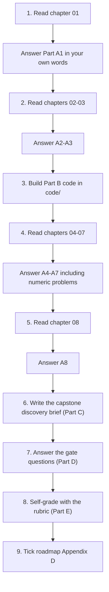
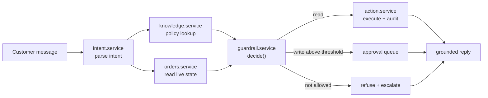
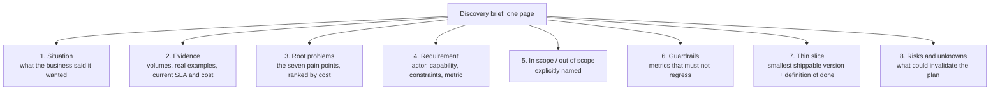

# 📝 Lecture 01 — Assignment

**Introduction to Forward Deployed Engineering & the History of AI**
Phase 0 · Orientation · 🟢 Beginner · **Estimated effort: 5–7 hours**

> **Read first:** the eight chapters in **[../notes](../notes)** (index: **[../index.md](../index.md)**).
> Every question below is answerable from those notes — the chapter number is given next to each part
> so you never have to guess where the material lives.
> The lecture's **goal**, **build task** and **completion gate** live in
> **[../README.md](../README.md)** and **[../../roadmap.md](../../roadmap.md)** → *Phase 0*.

---

## 🎯 What this assignment is for

Lecture 01 is not about a model. It is about **the work that happens before a model is chosen**:
finding the real requirement, proving why the first three attempts fail, and naming the architecture
that survives contact with production. So the assignment is deliberately weighted the same way:

| Weight | Part | What it tests | Output |
| :---: | :--- | :--- | :--- |
| **30%** | **A** — Chapter-wise practice | Can you *explain* and *compute*, not recite | Written answers, per chapter |
| **25%** | **B** — Code tasks | Can you turn the architecture into a typed, testable service | `../code/Basic Code`, `../code/Production Code` |
| **30%** | **C** — Capstone discovery brief | The roadmap's actual build task: one page, eight sections | `Assignment/discovery-brief.md` |
| **15%** | **D** — The gate | Can you defend the requirement in your own words | 5 short written answers |

---

## 🧭 How to work through it



**Three rules, taken from the repository's own writing contract:**

1. **Answer from memory first, then check the notes.** Copying a paragraph out of a chapter is worth
   zero — the gate at the end of the lecture is a *spoken* explanation.
2. **Diagrams in [mermaid](https://mermaid.js.org/) only.** No screenshots, no Excalidraw exports.
   Every diagram you submit must be a ```mermaid fenced block that renders.
3. **Code is TypeScript.** Pseudo-code is acceptable *inside written answers* (and must be labelled
   `// PSEUDO-CODE`), but everything under `../code` must actually compile and run.

---

## 📋 Contents

| Part | Topic | Chapters | Type |
| :---: | :--- | :--- | :--- |
| **A1** | The FDE role & requirement discovery | [01](../notes/01_The_FDE_Role_and_Requirement_Discovery.md) | Written + apply |
| **A2** | From vague request to grounded production system | [02](../notes/02_From_Vague_Request_to_Grounded_Production_System.md) | Written + design |
| **A3** | AI foundations & rule-based systems | [03](../notes/03_AI_Foundations_and_Rule_Based_Systems.md) | Written + numeric |
| **A4** | Machine learning & deep learning foundations | [04](../notes/04_Machine_Learning_and_Deep_Learning_Foundations.md) | Written + diagnostic |
| **A5** | Language challenges & statistical language models | [05](../notes/05_Natural_Language_Challenges_and_Statistical_Language_Models.md) | Written + numeric |
| **A6** | Neural language models & the RNN bottleneck | [06](../notes/06_Neural_Language_Models_and_the_RNN_Bottleneck.md) | Written |
| **A7** | Attention, transformers & modern LLMs | [07](../notes/07_Attention_Transformers_and_Modern_LLMs.md) | Written + numeric |
| **A8** | The production AI stack & evolutionary matrix | [08](../notes/08_Production_AI_Stack_and_Evolutionary_Matrix.md) | Written + audit |
| **B** | Code tasks (basic + production) | 01–08 | TypeScript / Express |
| **C** | Capstone: the one-page discovery brief | 01, 02, 08 | Document |
| **D** | The completion gate | all | Short answers |
| **E** | Rubric & definition of done | — | Checklist |

---

## Part A — Chapter-wise practice

> Write your answers in a scratch file (or in a personal `answers.md`). Aim for **6–10 lines per
> question** — long enough to be precise, short enough to prove you understood it.
> Numeric questions have an answer sketch inside a collapsed block; **try it before you open it.**

### A1 — The FDE role & requirement discovery
📖 [Chapter 01](../notes/01_The_FDE_Role_and_Requirement_Discovery.md) · sections 01.1–01.7

1. In one sentence each, distinguish the client's **request**, the client's **problem** and the
   client's **requirement**. Then explain why the request is the *least* useful of the three as an
   engineering input.
2. The case study gives you exactly one number: **50,000 support queries per day**. Name **four**
   engineering decisions that this single number forces, and for each say what the decision would be
   at 50 queries/day instead.
3. Classify all six query families (order status, wrong/damaged item, policy question, payment
   anomaly, cancellation/refund, delivery dispute) as **read**, **write** or **investigation**.
   Then choose the **thin slice** and justify it by walking the thin-slice decision tree in §01.6.
4. The chapter gives seven root pain points. Pick the **three** that a business would actually pay to
   fix, rank them by business cost, and say for each what evidence you would need to *prove* the
   ranking rather than assert it.
5. Write a requirement statement for a case of **your own** (your job, a family business, a side
   project) in the exact template
   `<ACTOR> needs to <CAPABILITY>, under <CONSTRAINTS>, measured by <METRIC>.`
   Then list **one primary metric**, **three guardrail metrics** and **one out-of-scope family with
   its reason**.
6. A teammate proposes **deflection rate** as the primary success metric. In two or three sentences
   explain the trap, and name the metric pair you would use instead to keep it honest.
7. Take **three** of the seven anti-patterns in §01.7. For each: describe what it looks like in a real
   kickoff meeting, and write the single question you would ask to break it.
8. §01.4 names two failure modes of the FDE role. Name both, and describe the concrete habit that
   prevents each one.
9. **Apply (do this, don't imagine it):** run a **20-minute discovery conversation** with a real
   person who has a real problem (a colleague, a shop owner, a friend running something). Ask the
   discovery questions checklist from §01.5, record at least **three verbatim quotes**, and produce
   the eight-section skeleton of their brief. *Evidence must be real examples, not happy-path
   guesses.*
10. **Mermaid task:** draw the "proposed solution vs root problems vs true requirement" diagram from
    §01.2 **from memory**, with the dotted arrow. If you cannot place the dotted arrow, you have not
    yet understood the chapter.

### A2 — From vague request to grounded production system
📖 [Chapter 02](../notes/02_From_Vague_Request_to_Grounded_Production_System.md) · sections 02.1–02.8

1. Build the comparison table for the **three attempts** (rules → ML classifier → naïve LLM). Columns:
   *what it does well*, *the specific thing it failed on*, *the general class of failure*. Then state
   in one sentence what the next attempt must therefore add.
2. Explain **"text generation is not an action"** using the message *"please cancel my order and
   initiate a refund"*. Name every state change that must happen in real systems, and say which of
   them the LLM is allowed to decide.
3. **From memory**, redraw the grounded production system architecture (§02.5) as mermaid, labelling
   all six capabilities around the application boundary. Then complete the "if you remove it" column
   for all six from memory.
4. Run the **six production engineering considerations** (§02.7) against a real AI feature you have
   built or used. Which two are almost always skipped, and what did skipping them cost?
5. Write the tool contract (pseudo-code, `// PSEUDO-CODE` label) for a **second** tool in the case
   study: `getOrderStatus`. Then answer: which fields must the *application* fill in rather than the
   model, and why is `orderId` a security field and not just a parameter?
6. **Mermaid task:** draw the write-request lifecycle (§02.6) as a `stateDiagram-v2` — every state,
   every transition, and the guard that authorises each transition.
7. Design the human threshold: refunds up to **$X** auto-approve, above that a human approves. What
   factors set `X`? What exactly do you log for an approved-vs-rejected decision, and what must be
   replayable after an incident?
8. Why is an ML **intent classifier** not a solution even at 95% accuracy? Answer in terms of *state*,
   *policy* and *execution*.

### A3 — AI foundations & rule-based systems
📖 [Chapter 03](../notes/03_AI_Foundations_and_Rule_Based_Systems.md) · sections 03.1–03.8

1. **1950:** what question did Turing *replace*, and with what observable test? Then state the two
   strongest criticisms of the test, and why "it passed the test" is a statement about the observer,
   not about the machine.
2. **1956:** what did the Dartmouth workshop promise, and what was actually delivered? Name the two AI
   winters and give one concrete cause for each.
3. **Deterministic vs cognitive computing.** Give three examples of each drawn from an e-commerce
   support system, and state what happens when you try to solve a cognitive task deterministically.
4. **Expert system anatomy:** fact base, rule base, inference engine. Write three concrete rules for
   order cancellation, then trace **one** customer query through **forward chaining** and the same
   query through **backward chaining**. Which one would a diagnosis system prefer, and why?
5. Why did **DENDRAL / MYCIN / XCON** genuinely work inside their narrow domains, and why did the same
   approach collapse when the domain widened? Describe the maintenance-cost curve.
6. **ELIZA (1966):** which modern failure mode is it the direct ancestor of? Use the chapter's
   comparison table to name three things ELIZA and a modern LLM *share* and two where they differ in
   kind, not degree.
7. **Numeric — the combinatorial explosion.** Suppose a support bot must branch on
   *5 intents × 4 order states × 3 payment states × 2 regions*.
   - (a) How many rules does the rule base need? Compute it.
   - (b) Recompute for *6 × 5 × 4 × 3*.
   - (c) If **one** dimension changes (a new region), how many rules must be reviewed or retested?
   - (d) In three sentences: why is this arithmetic a *stronger* argument against handwritten rules
     than "rules are ugly"?

<details>
<summary>Answer sketch (open only after attempting)</summary>

(a) $5 \times 4 \times 3 \times 2 = 120$ rules.
(b) $6 \times 5 \times 4 \times 3 = 360$ rules — a 3× growth from a 20% growth in each dimension.
(c) Every rule that mentions the region dimension: $5 \times 4 \times 3 = 60$ rules for the new
region alone, plus review of the existing 120 for interactions.
(d) The cost is **multiplicative, not additive**, and it is paid *again* on every dimension change —
so the rule base has a cost curve that grows faster than the business it models. That is a
sustainability argument, not an aesthetic one.

</details>

8. The chapter ends this era with the **ML paradigm shift**. In one sentence: what did the field trade
   away, and what did it get in return?

### A4 — Machine learning & deep learning foundations
📖 [Chapter 04](../notes/04_Machine_Learning_and_Deep_Learning_Foundations.md) · sections 04.1–04.8

1. Write $Y = f(X; \Theta)$ and label every symbol for a **support-intent classifier**. Which part is
   *learned* and which part is *designed by the engineer*? What does that split tell you about where
   the engineering effort moves?
2. **Training vs inference:** for each, say what is computed, what it costs, how often it happens, and
   what can go wrong that the other cannot.
3. **Prompting vs training vs fine-tuning.** For the case study's *policy-accuracy* problem, which do
   you reach for first and why? Then name the situation where fine-tuning is genuinely the right
   answer and prompting is not.
4. Map **supervised**, **unsupervised** and **self-supervised** learning onto three concrete support
   tasks. Which of the three produced the modern LLM, and what is the label in that setting?
5. **Feature-engineering bottleneck:** invent three features you would need for the refund-intent
   classifier, then explain why each one is brittle across typos, locales, emoji and code-switching.
6. **Representation learning:** explain what work disappeared when the model started learning its own
   features — and what new work appeared in its place (name at least three new costs).
7. **Diagnostic:** your classifier reports **99% train accuracy / 71% validation accuracy**. Diagnose
   it, name the fix, and then name **two** leakage risks specific to a support dataset (think: who
   appears in both splits, and *when* the data was collected).
8. One line each: what structure does a **CNN** assume, what does an **RNN** assume, and what does a
   **transformer** assume? Which assumption won for language, and name the two properties that made it
   win.
9. **Added depth:** why is a held-out test set *not sufficient* for evaluating an LLM-backed feature?
   Name two reasons and say which later lecture in the roadmap fixes this.

### A5 — Natural language challenges & statistical language models
📖 [Chapter 05](../notes/05_Natural_Language_Challenges_and_Statistical_Language_Models.md) · sections 05.1–05.8

1. Name the **six linguistic challenges** the chapter lists, and for each give one real support message
   where it bites. Then rank them by how much damage they do to the case study, with a reason.
2. Why is a language model defined as **"predict the next token"** and not "understand the sentence"?
   Answer in terms of what the objective function can and cannot see.
3. **Chain rule:** write $P(w_1, \dots, w_n)$ exactly. Then write the trigram (Markov) approximation and
   state precisely what you gave up to get it.
4. **Counting:** using the corpus
   *"I like machine learning. I like machine translation."*
   compute $P(\text{machine} \mid \text{like})$ by hand. Show the numerator, the denominator, and
   explain why the denominator is the count of *"like"*, not the count of all words.
5. **Numeric — sparsity.** The chapter gives the size of the $N$-gram space as $V^N$:
   - (a) For $V = 50{,}000$, compute the number of possible **bigrams** and **trigrams**.
   - (b) A 1-billion-word corpus observes at most $10^9$ bigram *tokens*. Roughly what fraction of the
     bigram *types* is that, and what does the rest of the table mean for any sentence you have never
     seen before?
   - (c) In two sentences: why can you not fix this by "getting a bigger corpus"?

<details>
<summary>Answer sketch (open only after attempting)</summary>

(a) Bigrams $= 50{,}000^2 = 2.5 \times 10^9$; trigrams $= 50{,}000^3 = 1.25 \times 10^{14}$.
(b) $10^9$ tokens of bigram evidence spread over $2.5 \times 10^9$ possible types — and tokens repeat,
so the number of *distinct* types actually seen is far smaller than either number. The overwhelming
majority of the table stays at **count 0**, so unseen sequences get probability zero.
(c) The space grows as $V^N$ (and $V^4 \approx 6.25 \times 10^{18}$), so it outruns any corpus you can
collect; the problem is combinatorial, not one of scale.

</details>

6. **Smoothing, backoff, interpolation, Kneser-Ney:** what does each fix, and what does each cost?
   Then explain in one sentence why Kneser-Ney uses *continuation counts* instead of raw counts.
7. **Perplexity:** write the formula, explain why lower is better, and then answer the important part —
   why can a model with excellent perplexity still be a **bad support agent**? Which later lecture
   formalises that gap?
8. **Zipf's law and OOV:** what does Zipf's law say about the long tail, why is a word-level vocabulary
   guaranteed to hit out-of-vocabulary tokens, and what replaced it? Name the lecture in this
   repository where that fix is taught.
9. **Apply:** take **100 real support messages** (reuse the transcripts you collected in A1.9). Build a
   **bigram count table** for the 10 most frequent words by hand (a spreadsheet is fine). Then take 20
   held-out messages and report **what fraction of their bigrams are unseen**. Write two sentences on
   what that number would mean if you shipped a bigram model tomorrow.

### A6 — Neural language models & the RNN bottleneck
📖 [Chapter 06](../notes/06_Neural_Language_Models_and_the_RNN_Bottleneck.md) · sections 06.1–06.7

1. Why can a **bag-of-words** model not distinguish *"the order was not delivered"* from *"the order was
   delivered"*? Name the two linguistic challenges responsible, and say what a model would need in
   order to tell them apart.
2. Write the **RNN recurrence** $h_t = f(h_{t-1}, x_t)$ in full (weights and bias included) and state
   what the hidden state $h_t$ is supposed to carry after reading $t$ tokens.
3. **Information bottleneck:** if the hidden state is 256-dimensional and the ticket is 500 tokens long,
   what information is necessarily lost? Give an example where the lost information is *harmful* and one
   where it is *harmless*, then explain why the failure appears at the **start** of long inputs.
4. **Long-range decay and vanishing gradients:** explain the mechanism (repeated multiplication by
   $W$ / products of derivatives smaller than 1) and the observable symptom in a trained model. Why is
   *"train on more data"* not the fix?
5. **Gating (LSTM / GRU):** name the gates, say what each one decides, and explain what the **cell
   state** adds that the hidden state alone did not provide. Then state clearly what gating does
   **not** fix.
6. **Encoder–decoder:** why is the fixed-size context vector described as "the same bottleneck, now made
   visible"? Sketch the encoder–decoder topology and mark the exact tensor where information is
   compressed.
7. **Teacher forcing and exposure bias:** define both, and describe the failure you would actually
   observe in a ticket-summarisation model that was trained with pure teacher forcing.
8. Why did neither more data nor more compute remove the RNN's limitation? Answer in one paragraph that
   an engineering manager would accept.
9. **Mermaid task:** draw the RNN **unrolled over time** (3–4 steps), showing the hidden state passing
   forward, and mark with a dashed arrow **where attention will later intervene**. Your diagram should
   make the bottleneck visible without any words.

### A7 — Attention, transformers & modern LLMs
📖 [Chapter 07](../notes/07_Attention_Transformers_and_Modern_LLMs.md) · sections 07.1–07.11

1. Explain **Q, K, V** as a *soft dictionary lookup*. Then apply it to the word *"bank"* in
   *"I deposited money at the bank"* and say which other tokens contribute most to its new
   representation and why.
2. **Why scale by $\sqrt{d_k}$?** Give the variance argument in three sentences, then describe what
   actually goes wrong numerically if you omit it (name the operation that saturates and the gradient
   consequence).
3. **Multi-head attention.** With $d_{\text{model}} = 512$ and $h = 8$, compute $d_k$ and $d_v$. Then
   answer: why not use a single head with $d_k = 512$? Quote the ablation result, and explain why *too
   many* heads is also bad.
4. **Encoder–decoder:** what does the encoder hand to the decoder, and which attention block consumes
   it? Then explain why the decoder needs **masking**, and what would break if you removed it.
5. **Positional encodings:** why does self-attention need them at all? State the **linear-offset
   property**, explain what it lets the model learn, and report the learned-vs-sinusoidal ablation
   result — including the one advantage that made the paper choose sinusoidal.
6. **Fill in the complexity table from memory** (4 rows × 3 columns: complexity per layer, sequential
   operations, maximum path length) for self-attention, recurrent, convolutional and restricted
   self-attention. Then answer two follow-ups:
   - (a) At $n = 512$, $d = 512$, which layer type is cheaper, and what is the rule of thumb?
   - (b) Why does **maximum path length** matter more than FLOPs for *learning* long-range dependencies?

<details>
<summary>Answer sketch (open only after attempting)</summary>

| Layer type | Complexity per layer | Sequential operations | Maximum path length |
| :--- | :--- | :--- | :--- |
| Self-attention | $O(n^2 \cdot d)$ | $O(1)$ | $O(1)$ |
| Recurrent (RNN/LSTM) | $O(n \cdot d^2)$ | $O(n)$ | $O(n)$ |
| Convolutional | $O(k \cdot n \cdot d^2)$ | $O(1)$ | $O(\log_k n)$ |
| Restricted self-attention | $O(r \cdot n \cdot d)$ | $O(1)$ | $O(n/r)$ |

(a) Self-attention wins whenever $n < d$ — $O(n^2 d)$ beats $O(n d^2)$ — which is the usual case for
sentence-level tasks.
(b) Path length is the number of operations a signal must traverse to connect two positions: $O(1)$ in
self-attention versus $O(n)$ in a recurrent layer. Shorter paths mean fewer multiplications for the
gradient to survive, so long-range dependencies are learnable *at all*, not merely cheaper.

</details>

7. **Training methodology:** why Adam with linear warmup and inverse-square-root decay? Describe what
   the learning rate is doing at step 0, at step 4000, and at step 100,000. Then explain why dropout is
   $0.1$ for the base model but $0.3$ for the big model.
8. **Label smoothing:** what does $\epsilon_{ls} = 0.1$ do to the target distribution, why does it
   *hurt* perplexity while *improving* BLEU, and what does that teach you about choosing a metric?
9. **Numbers:** complete the base-vs-big configuration table ($N$, $d_{\text{model}}$, $d_{ff}$, $h$,
   training steps, wall-clock time, parameters). Then state the headline results: BLEU on EN–DE and
   EN–FR, the margin over the previous best, and the training-cost claim.
10. **Ablations (Table 3):** which single change hurt translation quality the most? Given a fixed
    compute budget, what would you spend it on first — more heads, bigger $d_k$, a bigger model, or
    more dropout tuning? Justify with the table.
11. **Worked examples:** reproduce the chapter's attention-based explanation for pronoun coreference
    (*"the animal didn't cross the street because it was too tired"*) and for context-dependent polysemy.
    Then answer the deeper question: what do these two examples give you that an n-gram model
    fundamentally cannot?
12. **"Attention is not intelligence by itself."** What does the chapter mean by this, and what must an
    FDE bolt on top of attention for the case study to work? Point at the chapters that cover it.
13. **Modern efficiency variants:** one line each on **KV caching**, **MQA/GQA**, **FlashAttention** and
    **RoPE** — for each, name the *specific* problem it solves (memory, bandwidth, recomputation,
    position generalisation) and its complexity benefit where the chapter gives one.

### A8 — The production AI stack & evolutionary matrix
📖 [Chapter 08](../notes/08_Production_AI_Stack_and_Evolutionary_Matrix.md) · sections 08.1–08.6

1. **From memory**, reproduce the six-row evolutionary matrix: approach → key breakthrough → primary
   limitation. Then say which row we are standing in today, and why the last row's limitation is
   different in kind from the others.
2. **The bottleneck chain:** rules → ML → deep learning → n-grams → RNNs → transformers. For every
   arrow, name the *specific* limitation that forced the next generation. Six short sentences, no
   hand-waving.
3. "The transformer's limitation is **not** a modelling limitation." Explain in three sentences what it
   is instead, and whose job that makes it.
4. **Grounded · observable · secure · actionable:** for each adjective, name the box that delivers it and
   describe a failure you have *personally* seen (or can find) in a real AI product.
5. **Audit a real product.** Pick an AI product you actually use. Score it 1–5 against the six mandatory
   criteria (useful, secure, grounded, testable/observable, reliable, connected/actionable). Write the
   two weakest scores and the concrete fix for each.
6. **NFR checklist:** from §08.3 choose five non-functional requirements and set an actual number for the
   case study (for example p95 latency, cost per resolved contact, availability, provider failover time,
   PII retention, audit completeness). Justify each number in one line — "as low as possible" is not a
   number.
7. **The FDE mindset** — *"the model proposes; the architecture disposes."* Describe one case where a team
   let the **model** dispose, and what went wrong. If you have no first-hand case, use one from the notes
   and say what you would have changed.
8. **The 20 takeaways:** choose the five that changed your thinking the most and write one line each on
   *why*. Then, for each of the six production considerations from chapter 02, name the later lecture in
   `../../roadmap.md` that teaches it properly.

---

## Part B — Code tasks

**Stack:** TypeScript + Express (the repository's stated preference). **Location:**
`../code/Basic Code` and `../code/Production Code`. **Rule:** this lecture's code must show the
*architecture from the notes* — it must **not** jump ahead into RAG, agents, streaming or evals
frameworks that later lectures own.



### B1 — Basic Code (chapters 01–02): the minimum honest implementation

Build the smallest service that proves the chapter-02 argument: *a naive LLM is not the system; the
application layer is.* Suggested layout (adapt names only if you keep the same separation of concerns):

```text
code/Basic Code/
├── .env.example
├── package.json
├── tsconfig.json
└── src/
    ├── index.ts                      # express app, one router mounted
    ├── config/index.ts               # env + policy constants (maxAutoRefund, approval queue flag)
    ├── routes/support.route.ts       # POST /api/support/message
    ├── controllers/support.controller.ts
    └── services/
        ├── intent.service.ts         # attempt 1 (keywords) then attempt 2/3 behind one interface
        ├── knowledge.service.ts      # policy lookup -> grounded text, no invented policy
        ├── orders.service.ts         # READ: order status from an in-memory store
        ├── action.service.ts         # WRITE: cancelOrder / refundOrder behind the tool contract
        └── guardrail.service.ts      # decide(proposal, ctx) -> execute | escalate | refuse
```

**Requirements (each maps to a note section — say which in a code comment):**

| # | Requirement | From |
| :---: | :--- | :--- |
| B1.1 | `POST /api/support/message` accepts `{ customerId, message }` and returns `{ traceId, decision, reply, toolCall? }` | [02.5](../notes/02_From_Vague_Request_to_Grounded_Production_System.md) |
| B1.2 | **Three intent strategies behind one interface** (`keyword` → `classifier` → `llm`), switchable by env var, so you can *reproduce* the three failures | [02.1–02.4](../notes/02_From_Vague_Request_to_Grounded_Production_System.md) |
| B1.3 | `getOrderStatus(orderId, customerId)` is a **read** and executes automatically; it must verify ownership | [02.7](../notes/02_From_Vague_Request_to_Grounded_Production_System.md) |
| B1.4 | `cancelOrder` / `refundOrder` are **writes** and are only ever executed after contract validation | [02.7](../notes/02_From_Vague_Request_to_Grounded_Production_System.md) |
| B1.5 | `decide()` implements the threshold flow: read → auto, write within authority → auto, above threshold → approval queue, not authorised → refuse | [02.7](../notes/02_From_Vague_Request_to_Grounded_Production_System.md) |
| B1.6 | Every request gets a `traceId` and writes one structured log line: intent, tool call, decision, latency, tokens, cost | [02.7](../notes/02_From_Vague_Request_to_Grounded_Production_System.md) |
| B1.7 | `getPolicy(question)` returns text **only** from a local policy store — never generated | [02.5](../notes/02_From_Vague_Request_to_Grounded_Production_System.md) |

**Acceptance:** `npm run dev`, then these three calls behave differently — and you can explain why:

```bash
# 1) read -> executes automatically
curl -s localhost:3000/api/support/message -H 'content-type: application/json' \
  -d '{"customerId":"C-1","message":"where is my order ORD-1001?"}'

# 2) write below threshold -> executes, audited
curl -s localhost:3000/api/support/message -H 'content-type: application/json' \
  -d '{"customerId":"C-1","message":"cancel ORD-1001 and refund it"}'

# 3) write above threshold -> queued for a human
curl -s localhost:3000/api/support/message -H 'content-type: application/json' \
  -d '{"customerId":"C-1","message":"refund the full amount of ORD-1002"}'
```

> **Note:** if you do not want to call a real LLM provider yet, stub it. What matters is that the
> *application boundary* is real — the model is swappable and powerless on its own.

### B2 — Production Code: the same system, defended

`code/Production Code/` implements the same behaviour with the production topology from
[chapter 08](../notes/08_Production_AI_Stack_and_Evolutionary_Matrix.md). Required capabilities:

| # | Capability | Where it lives | Why |
| :---: | :--- | :--- | :--- |
| B2.1 | Request/response schema validation | `validators/` | The boundary is the only trusted input |
| B2.2 | AuthN + RBAC (a customer may touch only their own orders; an `agent` role for approvals) | `middleware/auth`, `services/policy` | Consideration 1 |
| B2.3 | **Tool contract** validation (schema + authority + threshold) | `services/tools/contract.ts` | Consideration 3 |
| B2.4 | Idempotency keys on every write | `middleware/idempotency` | Retries must not double-refund |
| B2.5 | Approval queue + reviewer endpoints | `services/approvals`, `routes/approvals.route.ts` | Consideration 4 |
| B2.6 | Structured audit log with trace IDs, replayable end-to-end | `observability/` | Consideration 5 |
| B2.7 | Token and cost accounting per request + p95 latency metric | `observability/metrics.ts` | Consideration 6 |
| B2.8 | Provider failover (two LLM providers behind one interface) + timeouts + retries | `services/llm/` | Criterion 5 — reliable |
| B2.9 | PII redaction before logging; injection-pattern screening on input | `security/` | Criterion 2 — secure |
| B2.10 | Golden-set **eval runner** (≥ 20 labelled messages) reporting policy accuracy, escalation precision and refund error rate | `evals/` | Criterion 4 — testable |

**Acceptance:** `npm test` is green, and `npm run evals` prints a table with the three guardrail metrics
from [chapter 01](../notes/01_The_FDE_Role_and_Requirement_Discovery.md) §01.3 — including at least one
case where your system **correctly refuses** to act.

### B3 — Implementation guides (required deliverable)

For **both** code trees, write the chapter-wise guides the repository's prompt specifies, at
`code/Basic Code/implementations guide/` and `code/Production Code/implementations guide/`:

- **Chapter 1 = the orientation chapter:** the full folder structure, every file's purpose, the commands
  to install / run / test, and a mermaid diagram of the request flow.
- **Every later chapter:** the **complete** code file first, then a block-by-block explanation of what
  that block does and *why it is written that way* — naming the consideration or criterion it satisfies.
- Order matters: a reader must be able to go top-to-bottom and finish with the working system.

### B4 — Stretch tasks (optional, but they are the best test of understanding)

1. **Reproduce the failures.** With `INTENT_STRATEGY=keyword`, collect **10 messages that break it**
   (typos, code-switching, emoji, indirect phrasing). Repeat for `classifier` and `llm`. Submit the
   three lists with one line per message explaining the failure. This is chapter 02 in your own data.
2. **Discovery brief as code.** Turn §01.6's `DiscoveryBrief` pseudo-code into a real typed schema plus a
   small CLI that validates a brief and **refuses to build** when `primaryMetric` is missing or
   `outOfScope` is empty. The `assertReadyToBuild` discipline is the whole point.
3. **Attention from scratch (~60 lines).** In TypeScript, implement single-head scaled dot-product
   attention over three 4-dimensional vectors: softmax rows must sum to 1, and you must reproduce the
   paper's $\sqrt{d_k}$ argument **numerically** — print the softmax row with and without scaling and
   show the saturation.
4. **N-gram model from scratch (~80 lines).** Bigram/trigram counting with add-one smoothing, plus
   perplexity on held-out text. Then print the fraction of unseen test bigrams — the sparsity number
   from chapter 05, measured instead of asserted.

---

## Part C — Capstone: the one-page discovery brief

This is the roadmap's **actual build task** for Lecture 01:
*a one-page written discovery brief for the e-commerce case (problem → constraints → measurable
success metric)*. Save it as **`Assignment/discovery-brief.md`** (next to this file).



**Skeleton — copy this into `discovery-brief.md` and fill every line:**

```markdown
# Discovery Brief — <client / system name>

## 1. Situation
What the business asked for, in their words (verbatim quote).

## 2. Evidence
- Daily contacts: 50,000 · families and their share:
- 3 real example messages (verbatim, redacted)
- Current MTTR: ... · current cost per contact: ... · current SLA: ...

## 3. Root problems (ranked by business cost)
1. ... (why it costs the most)
2. ...
3. ...

## 4. Requirement
<ACTOR> needs to <CAPABILITY>, under <CONSTRAINTS>, measured by <METRIC>.
- Primary metric: ...
- Baseline of that metric today: ...

## 5. In scope / out of scope
In: ... | Out: ... (with the reason for each exclusion)

## 6. Guardrails (must not regress)
CSAT · policy accuracy · escalation precision · refund error rate · compliance completeness

## 7. Thin slice
- Family: ... · Tools: ... · Automation level: read-only | read-and-draft | read-and-act
- Definition of done: ...

## 8. Risks and unknowns
| Risk | Impact | Mitigation / how we will find out |
```

**Rules for a passing brief**

| Rule | Why |
| :--- | :--- |
| **One page.** If it does not fit, you have not finished thinking. | A brief that cannot be read in five minutes will not be read |
| **Real quotes and real numbers.** Every claim is either a measurement or is labelled an assumption. | Prevents "demo-data discovery" (anti-pattern 3) |
| **Out of scope is non-empty, with reasons.** | "Everything in scope == nothing in scope" |
| **The primary metric has a baseline.** | Without a baseline the project is judged on vibes |
| **The thin slice is the highest-volume, lowest-risk family.** | It moves the metric fastest with the least exposure |

**Grading:** the brief is judged on whether an engineer who has never met the client could build the
thin slice from it **without asking a question**. Have someone else read it and note every question they
still had — each question is a defect.

---

## Part D — The completion gate

The roadmap's gate for Lecture 01 is: *you can explain, in your own words, why "the client asked for a
chatbot" is not the requirement.* Answer all five below in **≤ 150 words each**, from memory, then check
against the notes. Do not use bullet points copied from a chapter.

1. **The gate question.** Why is *"we want an AI chatbot that answers customer questions"* not a
   requirement? Name the four things it fails to specify, and say what each omission costs downstream.
2. **The three failures.** In one paragraph each: why handwritten rules failed, why the ML intent
   classifier failed, and why the naive LLM failed — and what single capability the *next* attempt had
   to add because of each failure.
3. **The central sentence.** *"Text generation is not an action."* Explain what this means for a system
   that must cancel an order and refund money, and why it forces an application layer around the model.
4. **Division of labour.** What does the **model** own, what does the **application** own, and what does
   the **human** own? Use the case study, and name the six capabilities around the application boundary.
5. **Your first number.** If you were the FDE on this account, name the single metric you would measure
   before writing any code, the number you would refuse to ship without, and the guardrail you would
   monitor for the first month.

> **Speaking check:** record yourself answering question 1 in **90 seconds** with no notes. If you
> stumble, re-read [chapter 01](../notes/01_The_FDE_Role_and_Requirement_Discovery.md) §01.2–01.3 and
> try again. This is the one thing the lecture is actually testing.

---

## Part E — Rubric & definition of done

### Self-grading rubric

| Criterion | Weight | Pass evidence |
| :--- | :---: | :--- |
| **Requirement discipline** | 20% | You can state a requirement in the `<ACTOR> … <METRIC>` form, with a primary metric, a baseline, guardrails and a non-empty out-of-scope list |
| **Diagnosis of the three attempts** | 15% | You can name the *specific* failure of rules, ML and naive LLM, and the general class each belongs to |
| **Architecture literacy** | 15% | You redrew the grounded system and the write-request lifecycle from memory, with correct guards |
| **Historical arc** | 10% | You can walk the bottleneck chain rules → ML → DL → n-grams → RNN → transformer and name each limitation |
| **Transformers, numerically** | 15% | $d_k = 64$ from $d_{\text{model}}=512, h=8$; the $\sqrt{d_k}$ variance argument; the complexity table; the BLEU and parameter numbers |
| **Code that compiles and decides** | 15% | `npm run dev` + `npm test` work; reads auto-execute, writes go through the contract, above-threshold writes queue for a human, and the audit log is replayable |
| **The brief** | 10% | One page, real quotes, ranked root problems, measurable primary metric with a baseline, non-empty out-of-scope, thin slice with a definition of done |

**Pass mark: 70%**, with *no* zero in **Requirement discipline** or **Code that compiles and decides** —
those two are the lecture.

### Definition of done

- [ ] All **eight** chapter parts (A1–A8) answered in my own words, including the numeric problems
- [ ] The **20-minute real discovery conversation** done, with at least three verbatim quotes captured
- [ ] **100 real support messages** collected and used for the A5 bigram/sparsity measurement
- [ ] Every submitted diagram is a **mermaid** block that renders
- [ ] `code/Basic Code` runs; the three curl calls produce three *different* decisions
- [ ] `code/Production Code` passes `npm test` and `npm run evals` prints the three guardrail metrics
- [ ] Implementation guides written chapter-wise for **both** code trees, each with the full file and a block-by-block explanation
- [ ] `Assignment/discovery-brief.md` fits **one page** and a second reader had **no questions**
- [ ] The five gate answers written, and the 90-second spoken answer recorded once
- [ ] I can explain, without notes, why *"the client asked for a chatbot"* is not the requirement

### Submission checklist

| Path | What must exist |
| :--- | :--- |
| `Assignment/answers.md` *(your own file)* | A1–A8 written answers + Part D gate answers |
| `Assignment/discovery-brief.md` | The one-page brief (Part C) |
| `code/Basic Code/` | Working minimal service (B1) |
| `code/Basic Code/implementations guide/` | Chapter-wise guide (B3) |
| `code/Production Code/` | Defended service with evals and approvals (B2) |
| `code/Production Code/implementations guide/` | Chapter-wise guide (B3) |

### Scope guard — what this assignment does **not** ask for

No vector database, no RAG pipeline, no agent framework, no streaming, no MCP, no fine-tuning, no
multimodal. Those are owned by later lectures, and pulling them in now hides the only thing Lecture 01
is testing: **can you find the real requirement and put the model in the right place.** If you feel the
urge to add them, write the reason in the brief's §8 risks instead.

### Tracking your progress

| Where | What to do |
| :--- | :--- |
| `../README.md` → **✅ Checklist** | Tick *"Read every source note"*, *"Write my own chapter notes"*, *"Build / rebuild the code"* and *"Pass the lecture's completion gate"* as you finish each |
| `../../roadmap.md` → **Appendix D — Progress Tracker** | Row **01**: `Notes written` ✅ once your notes are read, `Code built` ✅ once B1+B2 run, `Gate passed` ✅ only after the 90-second spoken answer succeeds |
| `../../roadmap.md` → **Appendix E** | Re-read the reading contract — progress is only verifiable when you can **show the artefact and the number** |

> **Revision before you close the lecture:** skim
> **[../notes/Lecture_01_Complete_Notes.md](../notes/Lecture_01_Complete_Notes.md)** — cheat sheet,
> decision tables, 20 misconceptions and 20 self-check questions. If a self-check question makes you
> hesitate, go back to that chapter rather than moving on. Lecture 02 assumes all of this.

---

*Assignment for **[Lecture 01 — Introduction to FDE and AI History](../README.md)** ·
Phase 0 · Orientation · notes: **[../notes](../notes)** · index: **[../index.md](../index.md)** ·
roadmap: **[../../roadmap.md](../../roadmap.md)***
