# Lecture 01 — Chapter Index

**Introduction to Forward Deployed Engineering & the History of AI**
Phase 0 · Orientation · 🟢 Beginner · **8 chapters**

> Source of truth for topics, goal, build task and gate: **[../roadmap.md](../roadmap.md)** → *"Lecture 01"*.
> Source notes: `../../Forward-Deployed-Engineer/Lecture 01/notes/` (`01_…` → `06_…`,
> `Lecture_01_Complete_Notes.md`, `Notes.pdf`, `Excalidraw-Notes.svg`, `Attebtion Is All You Need.pdf`).

---

## 📚 Chapters

| # | Chapter | One-line summary | File |
| :---: | :--- | :--- | :--- |
| 01 | **The FDE Role & Requirement Discovery** | Why "we want a chatbot" is a proposed solution, not a requirement; the 50k-query case study; discovery workflow; primary vs guardrail metrics; the one-page discovery brief | [01_The_FDE_Role_and_Requirement_Discovery.md](./notes/01_The_FDE_Role_and_Requirement_Discovery.md) |
| 02 | **From Vague Request to Grounded Production System** | The three failed attempts (rules → ML classifier → naïve LLM), the grounded architecture, the write-request state machine, the six production engineering considerations | [02_From_Vague_Request_to_Grounded_Production_System.md](./notes/02_From_Vague_Request_to_Grounded_Production_System.md) |
| 03 | **AI Foundations & Rule-Based Systems** | Turing (1950), McCarthy (1956), deterministic vs cognitive computing, the AI hierarchy, expert systems (fact base + rule base + inference engine), ELIZA, the combinatorial explosion | [03_AI_Foundations_and_Rule_Based_Systems.md](./notes/03_AI_Foundations_and_Rule_Based_Systems.md) |
| 04 | **Machine Learning & Deep Learning Foundations** | $Y = f(X; \Theta)$, training vs inference, prompting vs training, supervised vs unsupervised, the feature-engineering bottleneck, representation learning, CNN/RNN/Transformer | [04_Machine_Learning_and_Deep_Learning_Foundations.md](./notes/04_Machine_Learning_and_Deep_Learning_Foundations.md) |
| 05 | **Natural Language Challenges & Statistical Language Models** | Polysemy, word order, negation, coreference, sarcasm, productivity; the language-model chain rule; frequency counting; n-grams and the Markov assumption; sparsity, smoothing, perplexity | [05_Natural_Language_Challenges_and_Statistical_Language_Models.md](./notes/05_Natural_Language_Challenges_and_Statistical_Language_Models.md) |
| 06 | **Neural Language Models & the RNN Bottleneck** | Embeddings, the RNN recurrence, the information bottleneck, long-range decay, vanishing gradients, LSTM/GRU gating, encoder–decoder and teacher forcing | [06_Neural_Language_Models_and_the_RNN_Bottleneck.md](./notes/06_Neural_Language_Models_and_the_RNN_Bottleneck.md) |
| 07 | **Attention, Transformers & Modern LLMs** | *Attention Is All You Need*: Q/K/V, scaled dot-product attention, multi-head attention, encoder–decoder, positional encodings, the complexity table, training methodology and benchmarks, GPT decoder-only, KV cache/GQA/FlashAttention/RoPE | [07_Attention_Transformers_and_Modern_LLMs.md](./notes/07_Attention_Transformers_and_Modern_LLMs.md) |
| 08 | **The Production AI Stack & the Evolutionary Matrix** | The six-row evolutionary matrix, the grounded · observable · secure · actionable stack, the six mandatory production criteria, non-functional requirements, the FDE mindset, the 20 takeaways | [08_Production_AI_Stack_and_Evolutionary_Matrix.md](./notes/08_Production_AI_Stack_and_Evolutionary_Matrix.md) |

---

## 📄 Complete notes

A single consolidated document with the executive summary, cheat sheet, decision tables,
misconceptions, glossary and 20 self-check questions — shorter than the chapters, with links back
into them for detail:

👉 **[Lecture_01_Complete_Notes.md](./notes/Lecture_01_Complete_Notes.md)**

---

## 🔗 Related

- **[../code](./code)** — the rebuilt codebase (Basic Code · Production Code + implementation guides)
- **[../Assignment/task.md](./Assignment/task.md)** — the lecture assignment
- **[../README.md](../README.md)** — lecture objectives, phase, level, source mapping and checklist
- **[../roadmap.md](../roadmap.md)** — complete topic list, goal, build task and completion gate

---

## 🧭 Reading order

```mermaid
flowchart LR
    C1["01 FDE role and discovery"] --> C2["02 Grounded production system"]
    C2 --> C3["03 AI foundations and rules"]
    C3 --> C4["04 ML and deep learning"]
    C4 --> C5["05 Language and n-grams"]
    C5 --> C6["06 RNN bottleneck"]
    C6 --> C7["07 Attention and transformers"]
    C7 --> C8["08 Production stack and matrix"]
    C8 --> N["Complete notes"]
```

