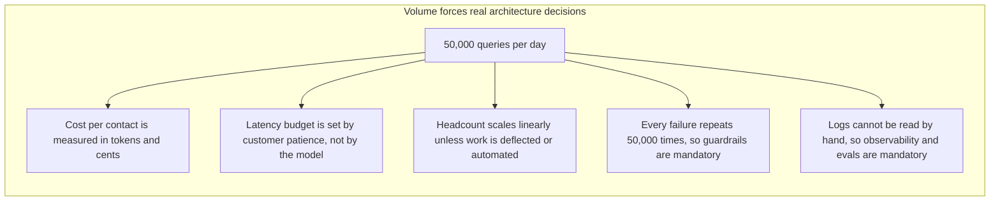
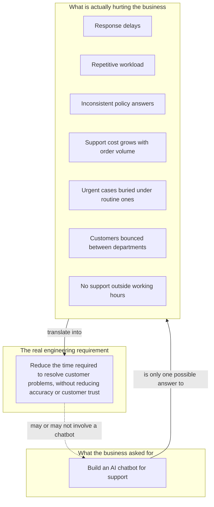
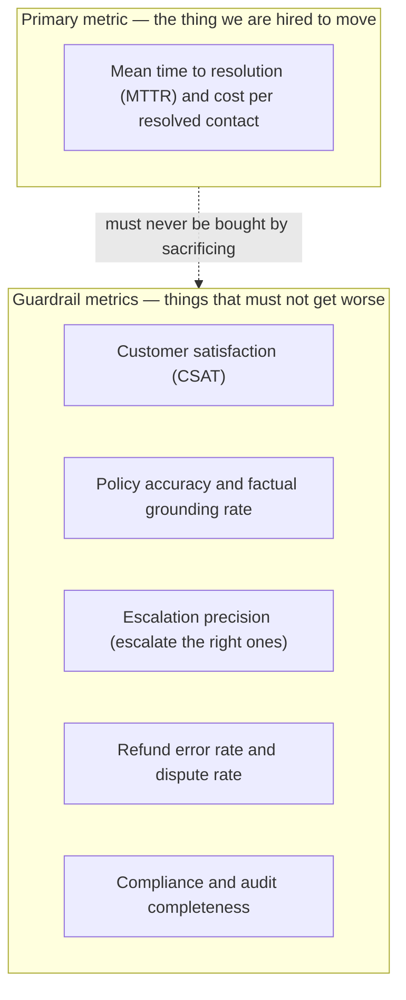
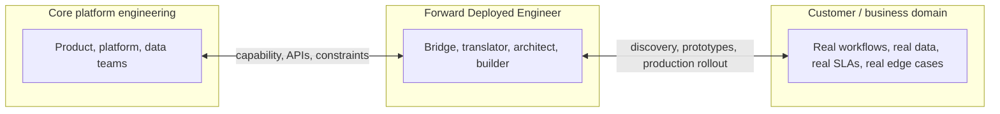
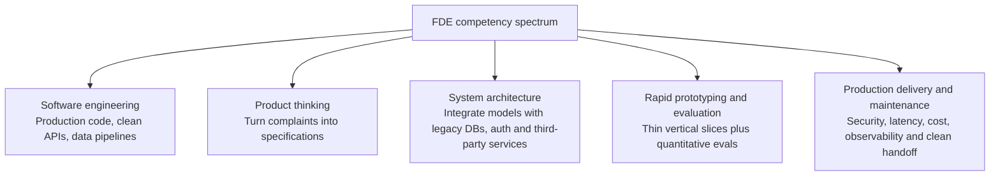
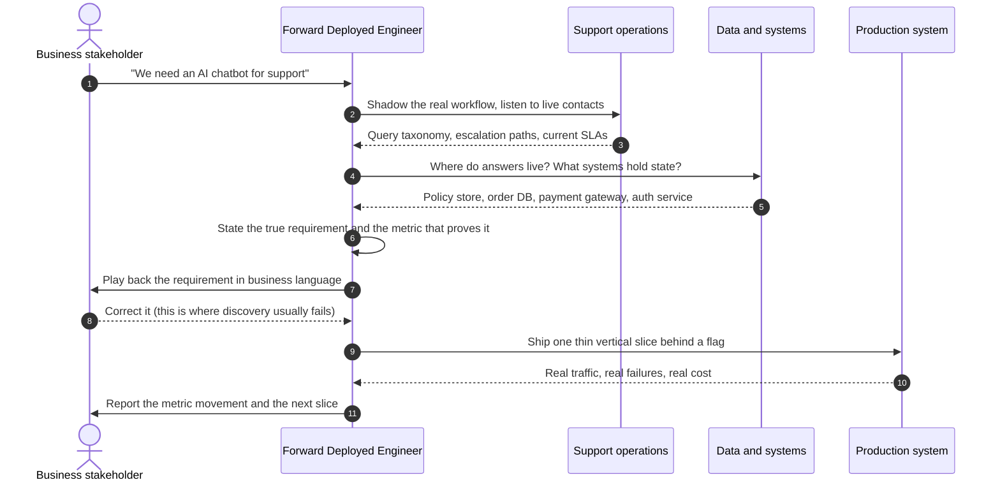
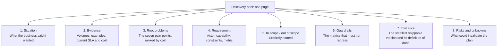
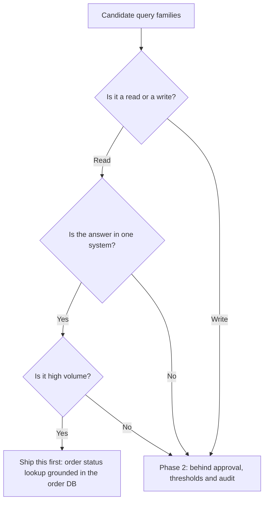

# Chapter 01 — The Forward Deployed Engineer & Requirement Discovery

> **Lecture 01 · Chapter 01 of 08** · Level: 🟢 Beginner · Phase 0 — Orientation
> **Source:** `Forward-Deployed-Engineer/Lecture 01/notes/01_Introduction_to_Forward_Deployed_Engineering.md`
> **Roadmap topics:** the FDE role (customer solution vs **true requirement**), discovery workflow,
> e-commerce case study (50k daily support queries), the one-page discovery brief.

---

## 01.0 What this chapter is for

Everything else in this curriculum is *tooling*. This chapter is about the thing that decides whether
the tooling matters: **finding the real problem before you build anything.**

By the end you should be able to:

1. Explain why *"the client asked for a chatbot"* is a **proposed solution**, not a requirement.
2. Turn a vague stakeholder request into a **requirement statement with a measurable success metric**.
3. Describe the **discovery workflow** an FDE runs before writing code.
4. Produce the lecture's build artefact: a **one-page discovery brief**.

> **The thesis of this repository, in one line:**
> *the model proposes; your architecture disposes.*
> Chapter 02 builds the "architecture" part. This chapter makes sure you point it at the right problem.

---

## 01.1 The case study: 50,000 support queries a day

A large e-commerce enterprise receives **50,000 customer-support requests every day**. That is the
only number the business gives you, and it is the most important number in the whole lecture —
everything else is downstream of it.

### What those 50,000 queries actually look like

| Query family | Representative messages | What the customer really wants |
| :--- | :--- | :--- |
| Order status | *"Where is my order?"*, *"Track my package."*, *"It has been 7 days and nothing arrived."* | A **fact** from an internal system (order state, ETA) |
| Wrong / damaged item | *"I received the wrong product."*, *"The product arrived broken."* | A **workflow** (replacement or return authorisation) |
| Policy question | *"Can I return an item after 15 days?"* | A **policy lookup** with a date computation |
| Payment anomaly | *"My payment was deducted but the order was not created."* | **Reconciliation** between two systems |
| Cancellation / refund | *"Please cancel my order and initiate a refund."* | A **write action** with money attached |
| Delivery dispute | *"The agent marked it delivered but I never received it."* | An **investigation + escalation** |

Two things are already visible from the table, before any AI is discussed:

- **Most of these are not "questions".** They are *facts* (read from a database) or *actions*
  (written to a business API). Text generation is at most the last mile.
- **The families have wildly different risk.** "Where is my order?" is a read. "Refund my money" is
  a write with legal and financial consequences. Any architecture that treats them identically is
  already broken.

### Why volume matters more than cleverness

At 50,000 queries/day you are not optimising a demo, you are optimising a **cost curve**:



> **FDE intuition:** a request that arrives *once* can be solved with a human and a script. A request
> that arrives *50,000 times* is an engineering problem. Volume is what turns "a chat feature" into
> "a system".

---

## 01.2 The trap: a solution wearing the costume of a requirement

Stakeholders do not phrase requirements. They phrase **solutions they have already imagined**:

> **"We want an AI chatbot that can answer customer questions."**

From a systems-engineering standpoint this sentence is almost empty. It says nothing about:

| Missing information | Why it blocks engineering |
| :--- | :--- |
| Which queries are in scope | Determines retrieval, tools, and escalation paths |
| Where the answers come from | Determines whether you need RAG, an API call, or both |
| What accuracy means | Determines your evals, and therefore your definition of "done" |
| What may be automated vs approved | Determines human-in-the-loop thresholds and audit requirements |
| What happens when it is wrong | Determines fallback, disclaimers, and legal exposure |
| Cost and latency budget | Determines model tier, caching, and batching strategy |

The stakeholder is not being difficult — they are describing **the thing they can picture**. Your job
is to find the thing they *need*.



Notice the dotted arrow at the bottom: once the requirement is stated properly, **the chatbot becomes
one candidate solution among several** — a self-serve tracking page, a proactive notification, a
better refund workflow, or a hybrid might win. That is the entire point of the chapter.

### The seven root pain points, translated into engineering terms

| Root pain point (business language) | Engineering translation | Candidate measurable metric |
| :--- | :--- | :--- |
| Response delays | Queueing + first-response latency | p50 / p95 first-response time |
| Repetitive workload | High share of low-variance contacts | Share of contacts that are "templatable" |
| Inconsistency | Policy answers not derived from one source of truth | Policy-answer agreement rate vs the canonical policy |
| Linear cost growth | Cost per contact does not fall as volume rises | Cost per resolved contact |
| High-priority neglect | No urgency classification / routing | Share of urgent contacts resolved inside SLA |
| Cross-department friction | No single owner for one order's journey | Handoff count per resolved contact |
| No 24/7 availability | Human-only coverage window | Share of contacts answered outside business hours |

> **Rule of thumb:** if you cannot name the metric that moves, you have not finished discovery — you
> have only finished listening.

---

## 01.3 Writing the requirement statement

A requirement is only usable if it has four parts. This is the sentence template the whole lecture
revolves around:

```text
<ACTOR> needs to <CAPABILITY>, under <CONSTRAINTS>, measured by <METRIC>.
```

For our case study:

```text
Customers need to get their order/payment problems RESOLVED (not merely explained),
under constraints of policy accuracy, authorization and auditability,
measured by mean time to resolution (MTTR) and cost per resolved contact.
```

### A "requirement contract" you can hand to an engineer

Because this repository is TypeScript-first, the cleanest way to *think* about a requirement is as a
typed object. This is pseudo-code — a mental model, not a runnable file:

```ts
// PSEUDO-CODE — mental model of a requirement, not an implementation
type RequirementContract = {
  actor: "customer" | "support-agent" | "operations-manager";
  problem: string;              // in the business's words, verbatim
  capability: string;           // what must become possible
  inScope: string[];            // query families we WILL handle
  outOfScope: string[];         // query families we will NOT handle (and why)
  constraints: {
    accuracy: string;           // "grounded in the policy store, never invented"
    authority: string;          // "reads automatic; writes above threshold need approval"
    latency: { p95Seconds: number };
    compliance: string[];       // PII, retention, region, audit
    budgetPerContact: number;   // in currency units, not "as cheap as possible"
  };
  primaryMetric: string;        // the number that must move
  guardrailMetrics: string[];   // the numbers that must NOT get worse
  definitionOfDone: string;     // how the first release is judged
};

// PSEUDO-CODE — the discipline: refuse to start work without one of these
function assertReadyToBuild(r: RequirementContract): void {
  if (!r.primaryMetric) throw new Error("No metric -> no requirement -> no build");
  if (r.outOfScope.length === 0) throw new Error("Everything in scope == nothing in scope");
}
```

### Primary metric vs guardrail metrics

This distinction is the single most useful habit you can take from this chapter.



**Why guardrails matter:** any system can reduce MTTR by answering everything instantly and wrongly.
Guardrails are what make the primary metric *honest*.

> **Gaming alert — deflection vs resolution.** "Deflection rate" (contacts that never reach a human)
> is seductive and dangerous. If a bot deflects a customer who then gives up, the metric improved and
> the business got worse. Always pair deflection with a resolution or re-contact metric
> (for example: *same customer, same order, contacted again within 7 days*).

---

## 01.4 The FDE role, deconstructed

### Deconstruct the words: *Forward* + *Deployed*

| Word | Meaning | Contrast |
| :--- | :--- | :--- |
| **Deployed** | Operationally embedded next to the workflow — with customers, ops teams, domain experts | Not isolated in a platform team writing generic features |
| **Forward** | Working at the boundary where raw business problems meet technical architecture | Not downstream of a fully written specification |



### Definition

> **A Forward Deployed Engineer is a software engineer who works closely with customers or
> operational teams to understand high-impact domain problems, architect technical solutions around
> real enterprise systems, and drive those solutions into production.**

Three verbs carry the whole definition: **understand** (discovery), **architect** (design against
real systems), **drive into production** (own the last mile).

### The competency spectrum



### How the FDE differs from neighbouring roles

| Role | Primary output | Typical failure mode |
| :--- | :--- | :--- |
| **Product Manager** | Prioritised problem statement and roadmap | Requirements stay abstract, never proven in code |
| **Core / platform engineer** | Reusable capability (SDK, service, infrastructure) | Builds generic power that no workflow can absorb |
| **Solutions architect** | Design document | A beautiful diagram that never reaches production |
| **Sales engineer** | Proof of concept that closes the deal | The demo works on curated data, then dies in production |
| **FDE** | A **working system in production with a measured business outcome** | Over-engineering; solving interesting problems instead of valuable ones |

The FDE is the only one of these whose deliverable is *production behaviour*.

### Two failure modes to name explicitly

1. **Order-taking.** The customer says "build a chatbot", you build a chatbot, it is delivered on
   time, and nothing improves. You optimised the *solution* instead of the *problem*.
2. **Architecture astronautics.** You discover the problem properly, then design a beautiful
   multi-agent, multi-database, event-driven platform for a support team of nine people. Nothing
   ships. Discovery must end in a **thin slice in production**, not a diagram.

---

## 01.5 The discovery workflow

Discovery is not a meeting; it is a **sequence of evidence-gathering steps** that ends when you can
state the requirement, the metric, and the thinnest possible first release.



### The five discovery moves

| Move | Question it answers | Artefact produced |
| :--- | :--- | :--- |
| **1. Observe** | What does the work actually look like? | A query taxonomy with real examples and volumes |
| **2. Quantify** | How bad is it, and how do we know? | Baseline numbers for the primary and guardrail metrics |
| **3. Locate** | Where does truth live? | System map: policies, order DB, payment, auth, logs |
| **4. Constrain** | What is off-limits? | Accuracy, authority, latency, compliance and budget limits |
| **5. Slice** | What is the smallest thing worth shipping? | One query family, one tool, one metric, one week |

> **The baseline rule:** you cannot claim improvement without a *before* number. Capture the current
> MTTR, cost per contact, and CSAT **before** you ship anything. Discovery without a baseline becomes
> an argument about opinions.

### The discovery questions checklist

Group your questions so you do not miss a dimension:

| Dimension | Ask | Why it changes the design |
| :--- | :--- | :--- |
| Volume and mix | How many contacts per day, per family? | Sets caching, batching and model-tier decisions |
| Latency | How long may a customer wait? | Sets streaming vs batch, model size, tool timeouts |
| Accuracy | What happens when the answer is wrong? | Sets grounding requirements and eval thresholds |
| Authority | What may be done without a human? | Sets read/write split and approval thresholds |
| Escalation | Who takes over, and how fast? | Sets the handoff contract and context payload |
| Data residency | Where may customer data live and travel? | Sets provider choice and PII redaction |
| Audit | Who needs to reconstruct this decision later? | Sets trace IDs, prompt logging and retention |
| Failure cost | What is the worst realistic outcome? | Sets guardrails, kill switches and rate limits |

---

## 01.6 The discovery brief (this lecture's build artefact)

The roadmap's build task for Lecture 01 is: **a one-page written discovery brief for the e-commerce
case (problem to constraints to measurable success metric).** Here is the shape it should take.



### The brief as a typed contract (pseudo-code)

```ts
// PSEUDO-CODE — the one-page brief, expressed as data so it can be reviewed and versioned
type DiscoveryBrief = {
  situation: string;                    // "Business asked for an AI chatbot"
  evidence: {
    dailyContacts: number;              // 50_000
    families: { name: string; share: number; example: string }[];
    currentMttrMinutes: number;
    currentCostPerContact: number;
  };
  rootProblems: string[];               // ranked by business cost
  requirement: string;                  // actor + capability + constraints + metric
  inScope: string[];
  outOfScope: { family: string; reason: string }[];
  guardrails: string[];
  thinSlice: {
    family: string;                     // start with the lowest-risk, highest-volume family
    tools: string[];                    // e.g. ["getOrderStatus", "getPolicy"]
    automationLevel: "read-only" | "read-and-draft" | "read-and-act";
    definitionOfDone: string;
  };
  risks: { risk: string; mitigation: string }[];
};
```

### Choosing the thin slice

The first slice should be the **highest-volume, lowest-risk** family, because that is where the
metric moves fastest with the least exposure:



---

## 01.7 Anti-patterns of requirement discovery

| Anti-pattern | What it looks like | Consequence | Fix |
| :--- | :--- | :--- | :--- |
| **Solution-first** | "We need a chatbot / an agent / RAG" | You build the wrong thing well | Ask what is slow, costly or wrong today |
| **Metric-free** | "Make support better" | No definition of done; endless scope creep | Name the primary metric and the baseline |
| **Demo-data discovery** | All examples are the happy path | Production collapses on the long tail | Sample real transcripts, including abusive and garbled ones |
| **Single-stakeholder discovery** | Only the CTO is interviewed | The people doing the work reject the system | Talk to agents, ops leads and customers |
| **Ignoring the tail** | 80 percent of examples are simple | The hard 20 percent generates all the incidents | Model the tail explicitly as escalation paths |
| **Requirements by inference** | "Obviously they want refunds automated" | Financial and legal exposure | Write authority limits down and get sign-off |
| **No baseline** | You cannot prove improvement | The project is judged on vibes | Measure before you ship |

---

## Common mistakes

- **Treating the stakeholder's sentence as the spec.** "We want an AI chatbot" is a *solution
  proposal*. The requirement is the pain behind it.
- **Skipping the baseline.** Without before-numbers, "improvement" is an opinion.
- **Using accuracy as a metric without defining it.** Grounding rate, escalation precision and
  policy agreement are three different numbers; "accuracy" is none of them.
- **Optimising deflection alone.** Deflection without a resolution check rewards the system for
  making customers give up.
- **Forgetting that most support requests are reads or writes, not questions.** Text generation is
  the last mile, not the system.
- **Letting discovery end in a diagram.** It must end in a thin slice behind a flag, with one metric.
- **Never playing the requirement back to the stakeholder.** Misalignment found in week one is cheap;
  found in month three it is a rebuild.
- **Confusing the FDE with a sales engineer.** A demo that works on curated data is not delivery.

## Key takeaways

1. A customer's **proposed solution** ("build a chatbot") is not the **requirement**.
2. The true requirement for the case study is: *reduce the time required to resolve customer problems
   without reducing accuracy or trust* — and a chatbot is only one candidate answer.
3. **Volume changes everything**: 50,000 contacts a day turns a feature into a cost, latency,
   guardrail and observability problem.
4. A usable requirement has four parts: **actor, capability, constraints, metric**.
5. **Primary metric vs guardrail metrics** is the discipline that keeps optimisation honest.
6. The **FDE** is defined by three verbs: understand, architect, drive into production — and the only
   role in the comparison table whose deliverable is production behaviour.
7. Discovery is five moves: **observe, quantify, locate, constrain, slice**.
8. The deliverable of Lecture 01 is a **one-page discovery brief**, and the first slice should be the
   highest-volume, lowest-risk query family.

## Self-check questions

1. Rewrite *"we want an AI chatbot"* as a requirement statement with a metric.
2. Which of the seven root pain points is *not* solved by better text generation at all?
3. Why is "deflection rate" a dangerous primary metric, and what would you pair it with?
4. Name the four parts of a requirement and give one example of each for the refund family.
5. Why must the baseline be captured before shipping the thin slice?
6. Give one query family that should be explicitly **out of scope** for the first release, and say why.

---

### Navigation

- **Next:** [Chapter 02 — From Vague Request to Grounded Production System](./02_From_Vague_Request_to_Grounded_Production_System.md)
- **Source:** `Forward-Deployed-Engineer/Lecture 01/notes/01_Introduction_to_Forward_Deployed_Engineering.md`
- **Back to index:** [../index.md](../index.md)


