# Chapter 02 — From Vague Request to Grounded Production System

> **Lecture 01 · Chapter 02 of 08** · Level: 🟢 Beginner · Phase 0 — Orientation
> **Source:** `Forward-Deployed-Engineer/Lecture 01/notes/01_Introduction_to_Forward_Deployed_Engineering.md` (§1.2, §1.3)
> **Roadmap topics:** three iterative attempts (**rules → ML classifier → naïve LLM**, and why each
> failed); the grounded enterprise AI system architecture (the target topology).

---

## 02.0 What this chapter is for

Chapter 01 gave you the *problem*. This chapter shows why the **first three obvious solutions all
fail**, and derives the architecture that survives. This is the most important structural lesson in
Lecture 01: every layer of a modern AI application exists because a simpler approach broke.

By the end you should be able to:

1. Explain the failure mode of rule-based, ML-classifier, and naïve-LLM support systems.
2. Draw the **grounded production architecture** from memory.
3. Explain why *text generation is not an action*.
4. Name the six production engineering considerations that a support system must answer.

---

## 02.1 The three attempts at a glance

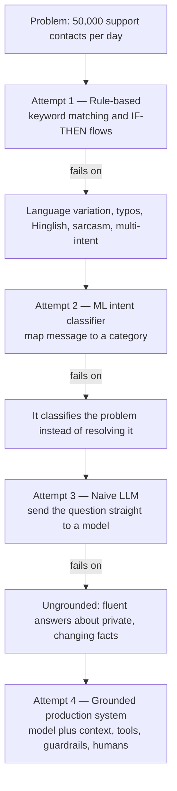

Each attempt is a *strictly better* answer to the previous attempt's bottleneck. That is how AI
engineering actually progresses — not by fashion, but by fixing the previous layer's failure.

---

## 02.2 Attempt 1 — Rule-based customer support

The pre-ML approach encodes support as explicit conditional logic:

```text
IF message contains "order status" THEN show order tracking page
IF message contains "refund"       THEN show refund policy
IF message contains "cancel"       THEN show cancellation instructions
```

The same idea, as TypeScript pseudo-code (this is the shape of the real thing, not runnable logic):

```ts
// PSEUDO-CODE — keyword routing, the 1990s design
function route(message: string): string {
  const m = message.toLowerCase();
  if (m.includes("order status")) return "showTrackingPage";
  if (m.includes("refund")) return "showRefundPolicy";
  if (m.includes("cancel")) return "showCancellationInstructions";
  return "showContactForm";
}
```

### Why handwritten rules fail

| Failure mode | Example | Why it breaks |
| :--- | :--- | :--- |
| **Language diversity** | *"Where is my order?"* vs *"It has been seven days and my package has not arrived"* vs *"Mera order kha ha"* | One intent, three surface forms, only one of which matches the rule |
| **Typos and abbreviations** | *"recieved"*, *"pkg"*, *"delvr"* | Rigid string matching is defeated by one wrong character |
| **Context carry-over** | User says "cancel it" after two earlier messages | Rules have no memory of the conversation |
| **Multi-intent messages** | *"Cancel my order and refund to my original card because it arrived damaged"* | One message needs three different rules and a priority order |
| **Sarcasm and tone** | *"Great service, three weeks late!"* | Keyword filters read sentiment backwards |
| **Rule conflicts** | A new rule overlaps an old one | Behaviour changes silently; nobody can predict the system |

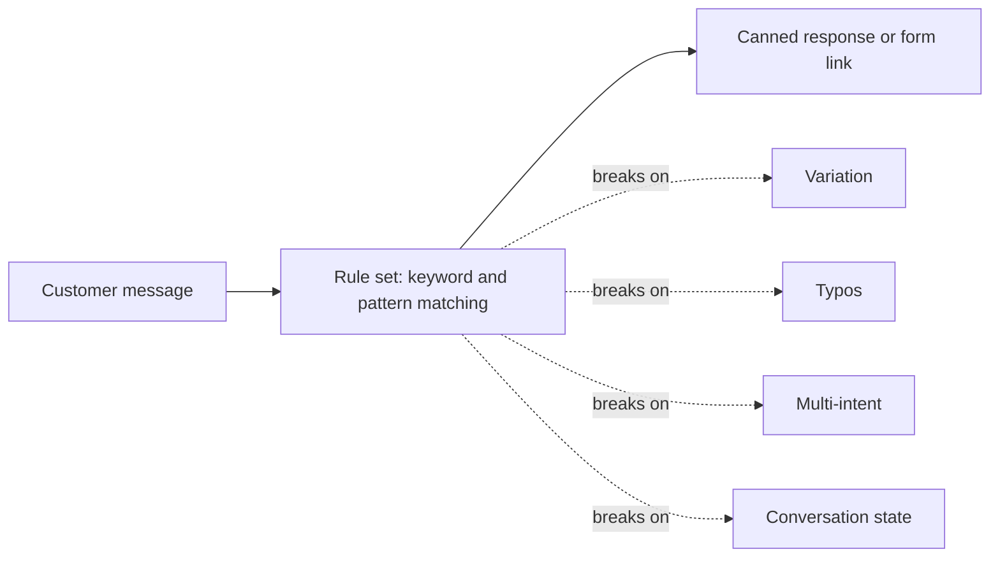

> **Key insight:** rules encode *the exact words* a user might type. Real users do not use exact
> words. The gap between "what the rule matches" and "what people write" is the whole problem — and
> it grows combinatorially as you add categories (Chapter 03 explains the explosion).

---

## 02.3 Attempt 2 — Machine Learning intent classification

The fix was to stop matching strings and start **learning patterns from labelled data**. An ML
classifier (Naïve Bayes, SVM, or later a BERT-style encoder) maps a message to a category:

| Customer input | Predicted intent |
| :--- | :--- |
| *"Where is my package?"* | `Order_Status` |
| *"Cancel my purchase"* | `Cancellation` |
| *"When will I get my money back?"* | `Refund` |
| *"The product arrived broken"* | `Damaged_Product` |

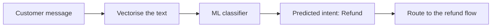

This solves the *language variation* problem: typos, Hinglish and paraphrase no longer break the
system, because the model learned a distribution rather than a string.

### The limitation: classification is not resolution

Identifying that a message is about a refund does **not**:

- read and evaluate the refund policy against the delivery timestamp,
- fetch the order and payment records,
- verify the customer's identity and permissions,
- compute eligibility,
- execute the refund API call,
- or handle the edge case where the order was already shipped.

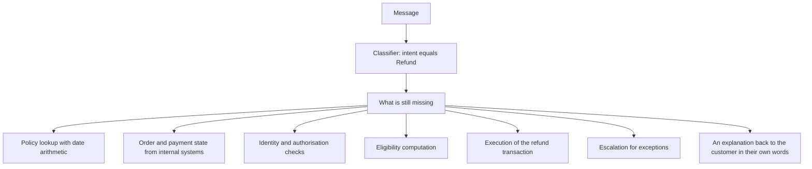

> **The pattern:** the classifier moved the frontier from *understanding the words* to
> *understanding the category* — but the customer's actual problem lives **past** the category, in
> the workflow. A category label is not an answer.

---

## 02.4 Attempt 3 — Naïve general-purpose LLM

With LLMs, the obvious move is to skip the classifier and hand the message to the model:

```text
System: You are a customer-support assistant. Answer the customer's question.
User:   Can I return a laptop after 20 days?
Model:  Yes, laptops can be returned within 30 days of delivery.
```

The answer is fluent, confident, well-formatted — and, if the real policy allows only **7 days**,
**factually wrong** in a way a customer will treat as binding.

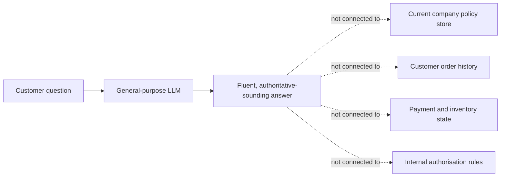

### What the model does not have

| Missing context | Consequence |
| :--- | :--- |
| Current policies and recent terms updates | Outdated or invented policy answers |
| Real-time order history and shipping state | Wrong status, wrong ETA, wrong eligibility |
| Inventory and payment gateway logs | Cannot reconcile "money deducted, no order" |
| Internal authorisation rules | Cannot decide who may act on which order |
| The customer's identity and entitlements | Privacy and authorisation violations |

> **Crucial engineering principle (verbatim from the source):**
> **Generating a fluent answer and generating a correct business answer are two completely different
> problems.**

This is the single sentence that Lecture 01 exists to teach. Fluency is a property of the *model*;
correctness is a property of the *system around the model*. Chapter 07 explains why this is
structural, not a bug: a transformer produces the most probable continuation, not a verified fact.

### The three failure modes side by side

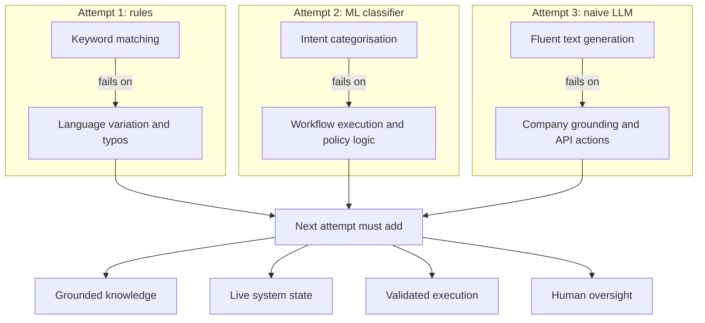

---

## 02.5 The target architecture: a grounded production system

> **Text generation is not an action.**
> When a customer says *"cancel my order and refund my payment"*, an LLM writing
> *"your order has been cancelled"* has changed nothing. No database row moved. No money moved.

So the LLM must be surrounded by an **application layer** that owns state, context and execution:

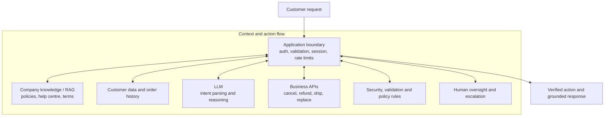

Read the diagram as **six capabilities bolted onto a model**:

| Component | Responsibility | If you remove it |
| :--- | :--- | :--- |
| Application boundary | Identity, session, validation, rate limiting | Anyone can act as anyone |
| Knowledge / RAG | Retrieval of policy text so answers are grounded | The model invents policy |
| Customer data and order history | Facts about this customer's order | The model cannot answer status questions |
| LLM | Language understanding, planning, response drafting | The system cannot handle free text |
| Business APIs | Real reads and writes in the systems of record | The system can only talk, never act |
| Guardrails + human oversight | Authorisation, thresholds, approvals, audit | The system can move money without permission |

> **Note on naming:** in later lectures these components get proper names — **RAG** (Lecture 16–17),
> **tool calling** (Lecture 08), **structured outputs** (Lecture 10), **agents and HITL**
> (Lecture 09), **evals** (Lecture 30), **guardrails** (Lecture 31). This chapter is where you first
> see *why* each of them has to exist.

---

## 02.6 The lifecycle of a write request (worked example)

Take the hardest message in the case study:

> *"Please cancel my order and initiate a refund."*

A production system treats it as a **state machine**, not a chat turn:

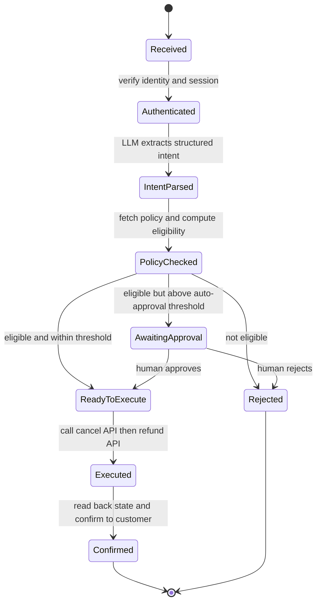

Three properties fall out of this diagram, and all three are missing from "just call the LLM":

1. **Idempotency.** The customer may send the same message twice. `Executed` must be reachable only
   once per order; the refund API call needs an idempotency key.
2. **Ordering.** Cancel-then-refund is not the same as refund-then-cancel. The state machine makes
   the order explicit and testable.
3. **Auditability.** Every transition can be logged with a trace ID: who asked, what the model
   proposed, what policy said, who approved, what the API returned.

```ts
// PSEUDO-CODE — the shape of a guarded write action
type ActionRequest = {
  traceId: string;              // one id per customer turn, propagated everywhere
  customerId: string;
  orderId: string;
  action: "cancel" | "refund" | "replace";
  amount?: number;
  idempotencyKey: string;       // prevents double refunds on retries
};

async function executeAction(req: ActionRequest): Promise<ActionResult> {
  // 1. Authorisation: may THIS customer act on THIS order?
  assertAuthorised(req.customerId, req.orderId, req.action);

  // 2. State validation: is the action still possible?
  const order = await getOrder(req.orderId);
  assertOrderIsCancellable(order);

  // 3. Policy: compute eligibility and the amount
  const decision = evaluatePolicy(order, req.action);

  // 4. Authority: does this need a human?
  if (decision.amount > AUTO_APPROVAL_LIMIT) {
    return requestHumanApproval({ ...req, decision });
  }

  // 5. Execution: idempotent, audited, reversible where possible
  const result = await businessApi.execute(req, { idempotencyKey: req.idempotencyKey });

  // 6. Confirmation: read back real state, then let the model phrase the answer
  const fresh = await getOrder(req.orderId);
  await auditLog.write({ req, decision, result });
  return { status: "done", state: fresh, message: await phrase(fresh, result) };
}
```

Notice where the LLM sits: at step *"extract structured intent"* and at the very end, *"phrase the
answer"*. **Every decision that moves money is deterministic code.**

---

## 02.7 The six production engineering considerations

The source lists six questions that separate a prototype from a production system. They are the
checklist you run against *any* AI feature.

| # | Consideration | Question to answer | Failure if ignored |
| :--- | :--- | :--- | :--- |
| 1 | **Authorization** | Is this authenticated user allowed to modify or cancel *this* order ID? | One customer cancels another's order |
| 2 | **State validation** | Has the order already shipped or been processed by the warehouse? | Impossible actions, corrupted state |
| 3 | **Execution safety** | Should the LLM invoke write APIs directly, or emit a structured tool-call request validated by application code? | Arbitrary API calls chosen by a probabilistic model |
| 4 | **Human-in-the-loop** | Does the refund exceed an automatic approval threshold requiring a manager? | Unbounded financial loss |
| 5 | **Observability and auditability** | Are prompts, retrieved contexts and API actions logged with deterministic trace IDs? | You cannot explain or reproduce any decision |
| 6 | **Latency and cost** | What is the per-token cost and end-to-end latency across providers? | A system that is technically correct and economically dead |

### Consideration 3 in detail: the tool contract

The safe pattern is that **the model never calls anything directly**. It emits a *proposal*, and the
application validates that proposal against a typed contract before executing.

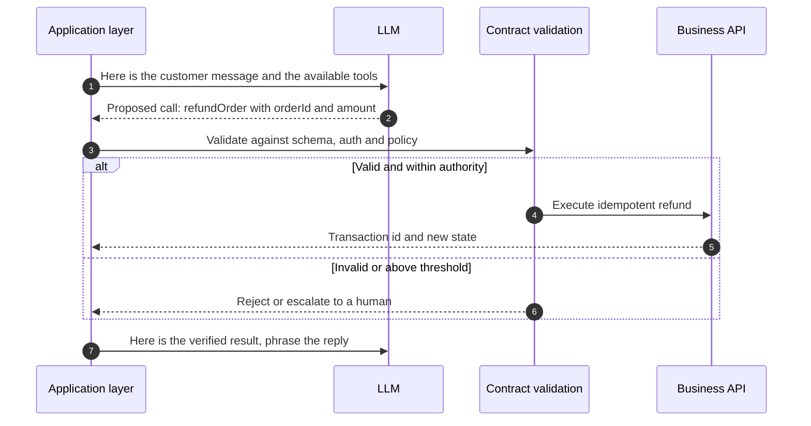

```ts
// PSEUDO-CODE — a tool contract: what the model may propose, and what the app enforces
type ToolContract = {
  name: "refundOrder";
  inputSchema: {
    orderId: string;            // must exist and belong to the caller
    amount: number;             // must not exceed the policy maximum
    reason: "damaged" | "not_received" | "wrong_item";
  };
  requiresAuth: true;
  maxAutoAmount: number;        // above this, a human must approve
  idempotent: true;             // safe to retry
  audit: true;                  // always logged with a trace id
};
```

### Consideration 4 in detail: where the human threshold sits

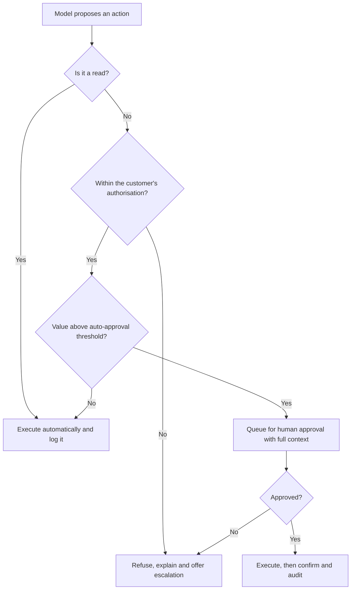

---

## 02.8 Where this chapter's architecture shows up later

This is worth internalising early: **nothing in this diagram is hand-waving.** Each box is a lecture
in this curriculum.

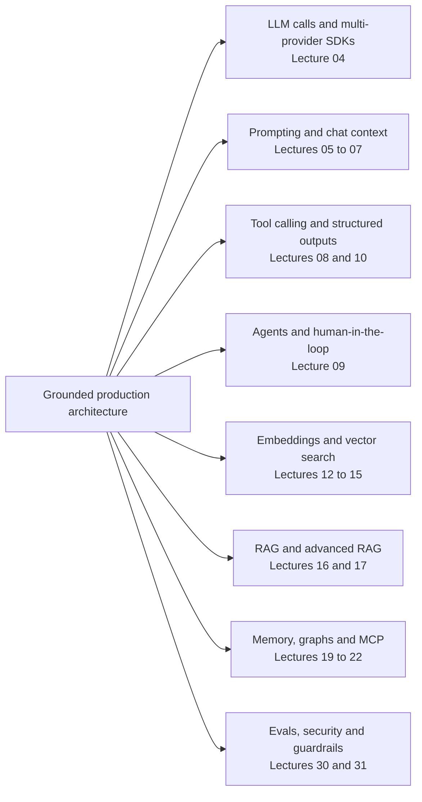

---

## Common mistakes

- **Believing the model is the system.** The model is one component; the application owns truth,
  permission and execution.
- **Letting the LLM call write APIs directly.** Always route through a validated, authorised,
  idempotent contract.
- **Forgetting idempotency.** Retries and duplicate messages cause double refunds.
- **Treating "cancel + refund" as one action.** It is a state machine with ordering and thresholds.
- **Skipping the read-back.** Never confirm to a customer based on what the model *believed*; confirm
  from the system of record after the write.
- **No trace ID.** Without one, an audit question cannot be answered.
- **Assuming ML classification is the answer.** It solves language variation and nothing else.
- **Assuming the LLM's confident tone implies correctness.** Fluency and factual grounding are
  different problems, and only one of them is solved by a bigger model.

## Key takeaways

1. **Attempt 1 (rules)** fails on language variation, typos, context and multi-intent messages.
2. **Attempt 2 (ML classifier)** fixes language variation but *classifies* instead of *resolves*.
3. **Attempt 3 (naïve LLM)** fixes fluency but is **ungrounded** in private, changing facts.
4. **Generating a fluent answer and generating a correct business answer are two different problems.**
5. **Text generation is not an action.** The application layer owns state and execution.
6. The grounded architecture bolts six capabilities onto the model: **boundary, knowledge, data,
   model, business APIs, guardrails and humans**.
7. A write request is a **state machine** with authentication, policy, approval, execution, read-back
   and audit — and the LLM sits only at intent extraction and final phrasing.
8. The six production considerations are: **authorization, state validation, execution safety, HITL,
   observability, latency and cost**.

## Self-check questions

1. Give two messages that break a keyword rule but are handled correctly by an ML classifier.
2. What exactly does an intent classifier *not* do that the customer needs?
3. Why is "the LLM said the order was cancelled" not evidence that the order was cancelled?
4. Which of the six production considerations protects against double refunds?
5. Where in the write lifecycle should the LLM be allowed to act, and where must it not?
6. Draw the grounded architecture and label which box is missing if the system hallucinates policy.

---

### Navigation

- **Previous:** [Chapter 01 — The FDE Role & Requirement Discovery](./01_The_FDE_Role_and_Requirement_Discovery.md)
- **Next:** [Chapter 03 — AI Foundations & Rule-Based Systems](./03_AI_Foundations_and_Rule_Based_Systems.md)
- **Source:** `Forward-Deployed-Engineer/Lecture 01/notes/01_Introduction_to_Forward_Deployed_Engineering.md`
- **Back to index:** [../index.md](../index.md)


