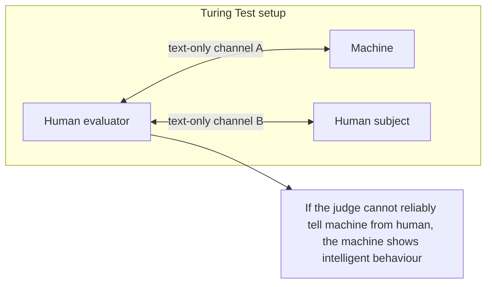
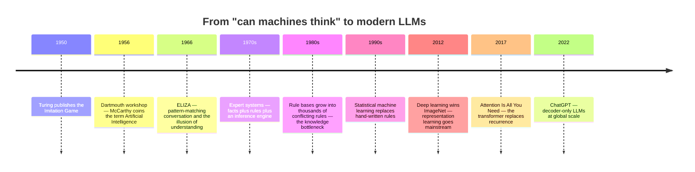
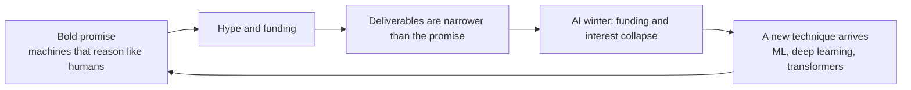
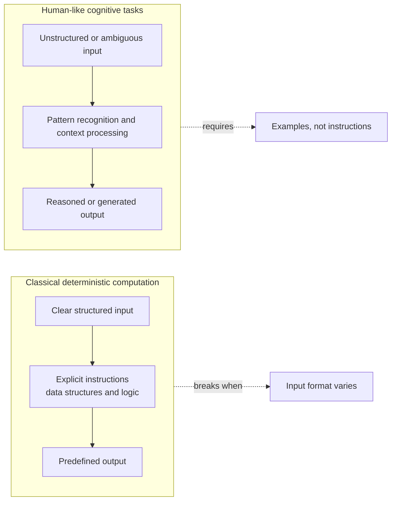
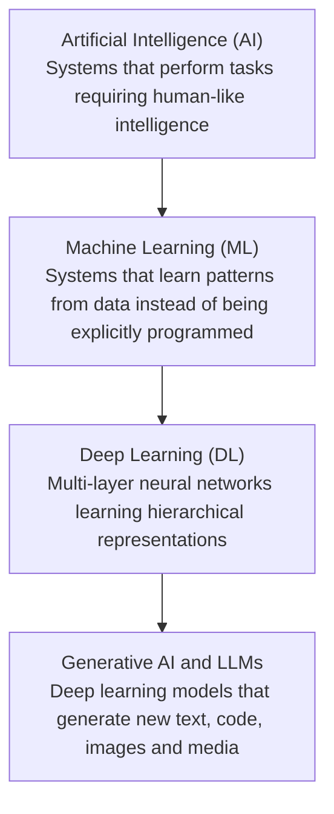
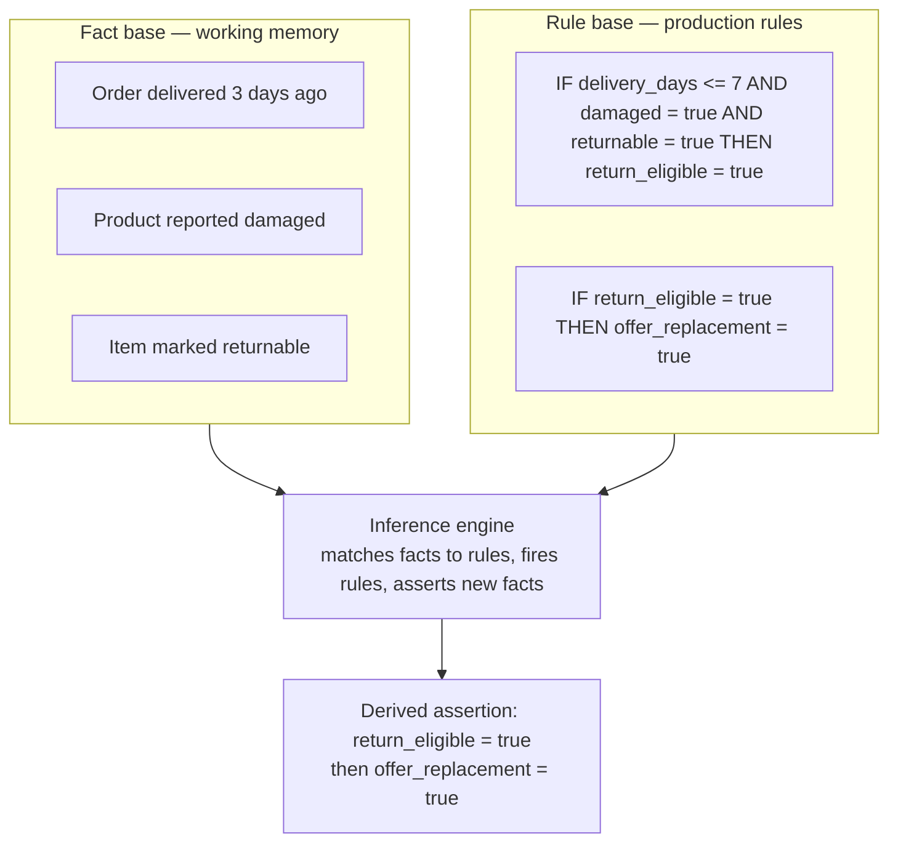
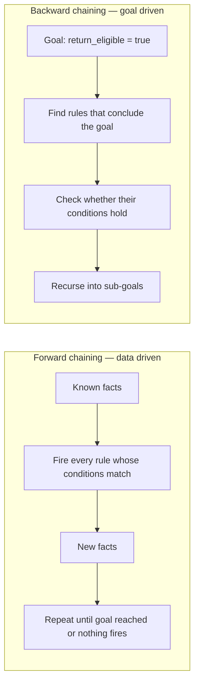
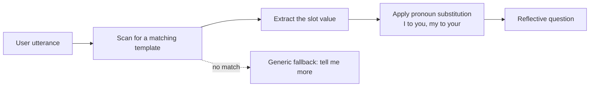
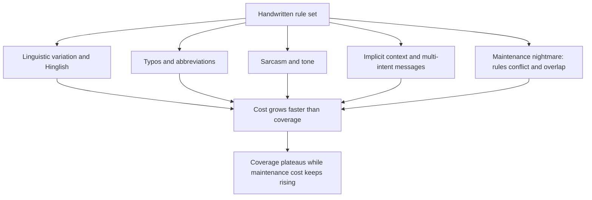
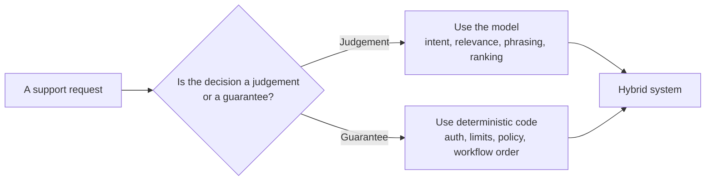

# Chapter 03 — AI Foundations & Rule-Based Systems

> **Lecture 01 · Chapter 03 of 08** · Level: 🟢 Beginner · Phase 0 — Orientation
> **Source:** `Forward-Deployed-Engineer/Lecture 01/notes/02_Foundations_of_Artificial_Intelligence_and_Rule_Based_Systems.md`
> **Roadmap topics:** Turing Test (1950), coining of "AI" (McCarthy, 1956), deterministic computing vs
> cognitive tasks, the AI hierarchy, symbolic AI and expert systems (**fact base + rule base +
> inference engine**), ELIZA (1966) and the illusion of understanding, the combinatorial explosion of
> handwritten rules.

---

## 03.0 What this chapter is for

Chapter 02 showed that rules fail on natural language. This chapter explains *where rules came from*,
*why the field believed in them for twenty years*, and *what that era still teaches us*. The
historical detour is not decoration: expert systems are the direct ancestor of today's guardrails,
policy engines and deterministic tool validation — and the ELIZA illusion is the ancestor of today's
hallucination problem.

By the end you should be able to:

1. State Turing's operational definition of intelligence and one serious objection to it.
2. Draw the **AI hierarchy** and place LLMs inside it.
3. Draw a **rule-based expert system** and explain forward vs backward chaining.
4. Explain the **ELIZA effect** and why conversational fluency is not understanding.
5. Explain the **combinatorial explosion** that killed hand-written rules.

---

## 03.1 1950 — Turing's question

Alan Turing's 1950 paper *Computing Machinery and Intelligence* opens with a question that the field
has still not escaped:

> **"Can machines think?"**

Turing immediately noticed the trap: "thinking" is not operationally definable, so any answer becomes
philosophy. His move was to replace the unanswerable question with a **testable one** — the
**Imitation Game**, now called the **Turing Test**.



### The insight that mattered

Turing shifted the definition of intelligence from **internal consciousness** to **observable
behaviour**, and named the capabilities that behaviour requires:

| Observable capability | Modern equivalent |
| :--- | :--- |
| Understand written natural language | Language understanding, intent detection |
| Maintain contextual consistency | Multi-turn chat context, memory |
| Formulate coherent responses using reasoning | Generation, chain-of-thought, planning |

This is exactly the same shift an FDE makes every day: **do not argue about whether the model
"understands" — measure whether the system's behaviour meets the requirement.**

### Three well-known objections (added depth)

| Objection | Argument | Why it matters to practitioners |
| :--- | :--- | :--- |
| **Searle's Chinese Room (1980)** | Symbol manipulation can produce correct output with zero comprehension | Correct output is still useful — but do not confuse it with knowledge or responsibility |
| **The ELIZA effect (see §03.6)** | Humans project understanding onto pattern matchers | Users will trust your system more than they should; design for that |
| **Behaviour is not truth** | Passing a conversation test says nothing about factual grounding | A fluent support bot can still give legally wrong policy answers |

Turing also predicted that by around the year 2000 a machine would fool a human interrogator about
30 percent of the time. The prediction's *date* was optimistic; the *direction* was right.

### Timeline: from the question to the transformer



---

## 03.2 1956 — the field gets a name

At the **Dartmouth Conference (1956)**, **John McCarthy** coined the term **"Artificial
Intelligence"**, defining the field as the science and engineering of making intelligent machines.

Why the naming moment matters: a name creates a research community, a funding story, and a promise.
That promise is also why the field experienced **AI winters** — periods when the gap between the
promise and the deliverable collapsed funding. The pattern is instructive:



> **FDE takeaway:** the same cycle exists *inside* a company. The stakeholder says "chatbot", the
> promise becomes "AI transforms support", the first release handles order status, and the sponsor
> feels disappointed. Chapter 01's discipline — explicit scope, explicit metric, thin slice — is how
> you avoid a miniature AI winter in your own project.

---

## 03.3 Classical deterministic computing vs cognitive tasks

Traditional programming is **deterministic execution of explicit instructions**:

```text
Input (20, 30) + operation (ADD)  -->  Output (50)
```

```ts
// PSEUDO-CODE — the essence of deterministic computing
function add(a: number, b: number): number {
  return a + b;              // same input, always the same output
}
```

Variables, conditions, loops, recursion and data structures excel when all three of these hold:

1. **Inputs are well-defined and structured.**
2. **The exact procedural steps can be mapped out in advance.**
3. **The output is deterministic.**

Cognitive tasks violate all three. Recognising handwriting, understanding sarcasm, navigating an
unfamiliar building, or extracting intent from *"my parcel still has not shown up and I am furious"*
cannot be reduced to a static algorithm because the space of inputs is open-ended.



### The engineering split that follows

| | Deterministic code | Learned model |
| :--- | :--- | :--- |
| **Specification** | Written by a human, step by step | Implied by training examples |
| **Behaviour on new input** | Predictable, testable | Probabilistic, needs evals |
| **Best used for** | Rules that must never be violated (authorisation, money, policy limits) | Judgements that cannot be enumerated (intent, relevance, phrasing) |
| **Worst used for** | Open-ended language understanding | Guarantees of any kind |

> **This table is the whole architecture of a production AI system in miniature.** The model handles
> the fuzzy part; deterministic code keeps the promises. Chapter 02's grounded architecture is this
> table turned into a diagram.

---

## 03.4 The hierarchy of Artificial Intelligence

AI is an umbrella discipline; Generative AI and LLMs are a small, recent subset.



Read the nesting carefully, because the confusion is extremely common:

| Term | Relationship | Example |
| :--- | :--- | :--- |
| **AI** | The whole field | A* pathfinding, expert systems, ML, planning |
| **ML** | Subset of AI | Logistic regression, decision trees, SVMs |
| **DL** | Subset of ML | CNNs, RNNs, transformers |
| **Generative AI / LLM** | Subset of DL | GPT, Gemini, Claude, Llama |

> **Two consequences for engineers:**
> 1. "We do AI" does not imply "we use LLMs". A deterministic search algorithm is still AI.
> 2. Most production AI features are **hybrids**: learned components for judgement plus symbolic
>    components for guarantees. The classic hybrid is a router model plus a rule-based policy engine.

### Symbolic vs non-symbolic AI (added depth)

| | Symbolic AI | Non-symbolic (learned) AI |
| :--- | :--- | :--- |
| Knowledge lives in | Explicit rules, facts, ontologies | Numerical weights |
| Human effort goes into | Writing and maintaining rules | Curating data and evaluating outputs |
| Strengths | Explainable, auditable, deterministic | Handles ambiguity, generalises, scales to open text |
| Weaknesses | Brittle, expensive, combinatorial | Opaque, probabilistic, ungrounded by default |
| Modern descendants | Guardrails, policy engines, tool validation, workflow state machines | Embeddings, classifiers, LLMs |

---

## 03.5 Symbolic AI and expert systems (1960s–1980s)

Early AI research assumed a simple premise: **if human experts decide using domain rules, then a
machine can replicate expertise if humans write those rules down.** This is **Symbolic AI**, and its
most successful product was the **expert system**.

### The three-part architecture

| Component | Role | Example |
| :--- | :--- | :--- |
| **Fact base** (working memory) | What is currently true about this case | Order delivered 3 days ago; product reported damaged; item marked returnable |
| **Rule base** (knowledge base) | `IF (conditions) THEN (assertions or actions)` | `IF delivery_days <= 7 AND damaged = true AND returnable = true THEN return_eligible = true` |
| **Inference engine** | Matches facts against rules and derives new facts | Fires the rule above and asserts `return_eligible = true` |



The same logic as TypeScript pseudo-code — note that this is *exactly* the shape of a modern
guardrail or policy check:

```ts
// PSEUDO-CODE — a rule-based eligibility check
function evaluateReturnEligibility(order: Order): ReturnDecision {
  if (order.daysSinceDelivery <= 7 && order.isDamaged && order.isReturnable) {
    return { returnEligible: true, reason: "within-window-and-damaged" };
  }
  return { returnEligible: false, reason: "outside-policy" };
}
```

### Forward vs backward chaining (added depth)

The inference engine needs a strategy. There are two classic ones:



| | Forward chaining | Backward chaining |
| :--- | :--- | :--- |
| Direction | Facts to conclusions | Goal to supporting facts |
| Good when | Many facts, few conclusions; monitoring and alerting | Few hypotheses, many rules; diagnosis |
| Classic example | Real-time policy enforcement | Medical diagnosis (MYCIN-style) |
| Modern analogue | Event-driven guardrail pipelines | Tool-selection planning, query planning |

### Real expert systems and why the era ended

| System | Domain | Lesson |
| :--- | :--- | :--- |
| **DENDRAL** | Chemical structure identification | Encoding expert heuristics works in narrow domains |
| **MYCIN** | Blood-infection diagnosis | Rules can outperform non-specialists *inside* a domain, and still need explanation facilities |
| **XCON** | Computer configuration | Maintenance cost grows faster than value as the rule base grows |

Three structural problems killed the approach:

1. **The knowledge-acquisition bottleneck.** Extracting tacit expertise from humans is slow, and
   experts disagree with each other.
2. **The brittleness problem.** Rules that were never written are silently unsupported; the system
   cannot generalise to a new phrasing or an unseen combination.
3. **The maintenance problem.** Rule bases grow into thousands of interacting rules; conflicts appear
   and nobody can predict the system's behaviour. This is the **combinatorial explosion** of §03.7.

> **Where rule-based thinking survives today (and should):** authorisation, refund limits, tax and
> compliance logic, routing policy, rate limits, and *guardrails around model output*. These are
> exactly the places where you must be able to explain and test the decision. Chapter 02's tool
> contract is an expert system in miniature.

---

## 03.6 ELIZA (1966) — the illusion of understanding

**ELIZA**, written by **Joseph Weizenbaum at MIT in 1966**, was one of the first conversational
programs. Its most famous script, `DOCTOR`, imitated a Rogerian psychotherapist using **pattern
matching plus pronoun substitution**.

```text
User input:   "I am feeling unhappy."
Rule matched: "I am <X>"                    --> rewrite as "Why are you <X>?"
ELIZA output: "Why are you feeling unhappy?"

User input:   "My friends do not understand me."
Rule matched: "My <Y> do not <Z>"           --> rewrite as "Why do you think your <Y> do not <Z>?"
ELIZA output: "Why do you think your friends do not understand you?"
```



The mechanism is embarrassingly simple — and yet users attributed empathy, memory and understanding
to it. This is the **ELIZA effect**: humans project intelligence onto anything that produces fluent,
contextually plausible language.

Weizenbaum's own reaction is the most important part of the story: he was disturbed that people
confided in the program, and he spent the rest of his career warning against treating such systems as
understanding.

> **Key takeaway for modern AI engineers (verbatim from the source):**
> **Conversational fluency does not imply factual reliability.** A system can produce syntactically
> flawless text while remaining completely ignorant of facts, truth and underlying context.

### ELIZA then vs LLMs now

| Dimension | ELIZA (1966) | Modern LLM |
| :--- | :--- | :--- |
| Mechanism | Hand-written templates and pronoun swaps | Learned statistical parameters over tokens |
| Knowledge | None | Broad but non-authoritative, frozen at training time |
| Memory | Essentially none | Context window plus any external memory you build |
| Can it be grounded? | No | Yes — via retrieval and tools (Chapter 02) |
| Same failure | Users over-trust fluent output | Users over-trust fluent output |

The technology changed by six orders of magnitude; the **human failure mode is unchanged**. That is
why grounding, citations, confidence signalling and escalation are product requirements, not
nice-to-haves.

---

## 03.7 Why handwritten rules do not scale: the combinatorial explosion

Consider encoding just one intent — `Order_Tracking` — as rules. A human customer can express this
single intent in thousands of ways:

- *"Where is my order?"*
- *"Track my package."*
- *"My parcel has not arrived."*
- *"Delivery kab hogi?"* (Hinglish)
- *"Order abhi tak nahi mila."*
- *"The expected delivery date passed yesterday."*
- *"Your app says dispatched, but nothing arrived."*

Each of those needs a pattern, and each pattern needs maintenance. Multiply by categories,
languages, tones and typos and the rule base explodes.



### The arithmetic of the explosion (added depth)

Rule-based systems scale *combinatorially* because conditions interact. A simple illustration:

| Number of independent conditions | Number of combinations to consider | Practical outcome |
| :--- | :--- | :--- |
| 3 | 8 | Handled by a few rules |
| 10 | 1,024 | Rule base becomes hard to review |
| 20 | 1,048,576 | Nobody can reason about the system |
| 30 | over 1 billion | Impossible to specify by hand |

And this counts *conditions*, not *phrasings*. Once you also multiply by surface forms per intent, you
get the same explosion on the language side:

```text
rules_needed ≈ intents × phrasings_per_intent × languages × tones
```

With 50 intents, 200 phrasings each, 3 languages and 2 tones you are already at **60,000 patterns** —
for a support bot. This is why the field had to stop writing rules and start **learning** them.

### The three bottlenecks of symbolic systems

1. **Rule friction and conflicts** — as rules grow into the thousands, new rules contradict old ones.
2. **Brittle edge cases** — any novel phrasing, typo or slang invalidates the string match.
3. **High maintenance cost** — engineers spend their time patching edge cases instead of building
   capability.

> **This limitation forced the shift from writing rules by hand to learning them from data — which is
> Machine Learning, the subject of Chapter 04.**

---

## 03.8 What an FDE takes from the symbolic era

Do not read this chapter as "rules are dead". Read it as **rules have a domain, and language is not
it**:

| Use rules when | Use a learned model when |
| :--- | :--- |
| The decision must be explainable and auditable | The input is free-form natural language |
| The decision must never be violated | The judgement is fuzzy and contextual |
| The logic is stable and small | The space of inputs is open-ended |
| A wrong answer is unacceptable (money, safety, compliance) | A wrong answer is recoverable (drafting, ranking, summarising) |
| You need unit tests with exact expectations | You need evals with statistical thresholds |



This hybrid split is the reason Lecture 09 (agents and HITL), Lecture 10 (structured outputs) and
Lecture 31 (security and guardrails) exist as separate topics.

---

## Common mistakes

- **Thinking "AI" means "LLM".** AI is the field; ML, deep learning and LLMs are nested subsets.
- **Believing rule-based systems were stupid.** They solved real problems in narrow domains and their
  descendants (policy engines, guardrails) are still in production today.
- **Assuming the Turing Test measures understanding.** It measures behaviour under text interrogation.
- **Reading ELIZA as a historical curiosity.** The human over-trust failure mode it revealed is alive
  in every chat product you will ship.
- **Trying to enumerate language with rules.** The pattern count explodes combinatorially; coverage
  plateaus while maintenance cost rises.
- **Throwing away deterministic logic when adding a model.** Authorisation, thresholds and workflow
  ordering should stay in code.
- **Confusing fluency with factual reliability.** ELIZA had none of the facts and all of the charm.

## Key takeaways

1. **Turing (1950)** replaced "can machines think?" with an observable behavioural test.
2. **McCarthy (1956, Dartmouth)** coined "Artificial Intelligence"; the field's hype cycles produced
   AI winters — the same pattern can happen inside a single project.
3. **Deterministic computing** excels on structured input, known steps and deterministic output;
   **cognitive tasks** need pattern recognition over open-ended input.
4. The **AI hierarchy** is AI ⊃ ML ⊃ DL ⊃ Generative AI / LLMs.
5. An **expert system** is a fact base plus a rule base plus an inference engine, driven by forward or
   backward chaining.
6. **ELIZA (1966)** created the illusion of understanding with pattern matching — **conversational
   fluency does not imply factual reliability**.
7. Handwritten rules suffer a **combinatorial explosion** of conditions and phrasings, plus rule
   conflicts and maintenance cost.
8. In production, keep **rules for guarantees** and **models for judgements** — that split is the
   hybrid architecture every later lecture assumes.

## Self-check questions

1. State the Turing Test in one sentence and give one serious objection to it.
2. What are the three components of an expert system, and which one derives new facts?
3. Give one modern production system component that is a direct descendant of rule-based AI.
4. Why did ELIZA convince users it understood them, and what is the modern equivalent risk?
5. Compute the number of combinations for 20 independent boolean conditions and explain the implication.
6. Name two decisions in the e-commerce case that must stay deterministic code.

---

### Navigation

- **Previous:** [Chapter 02 — From Vague Request to Grounded Production System](./02_From_Vague_Request_to_Grounded_Production_System.md)
- **Next:** [Chapter 04 — Machine Learning & Deep Learning Foundations](./04_Machine_Learning_and_Deep_Learning_Foundations.md)
- **Source:** `Forward-Deployed-Engineer/Lecture 01/notes/02_Foundations_of_Artificial_Intelligence_and_Rule_Based_Systems.md`
- **Back to index:** [../index.md](../index.md)


