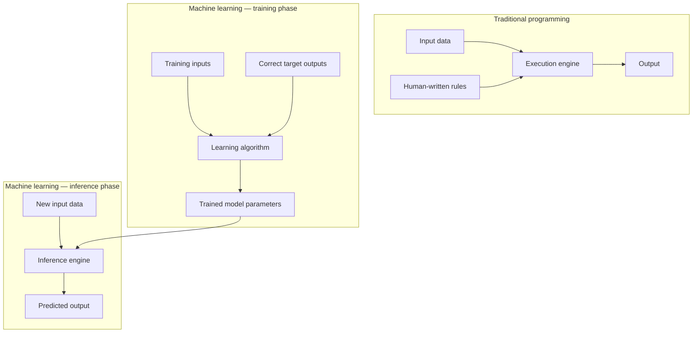
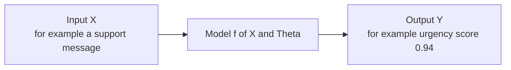
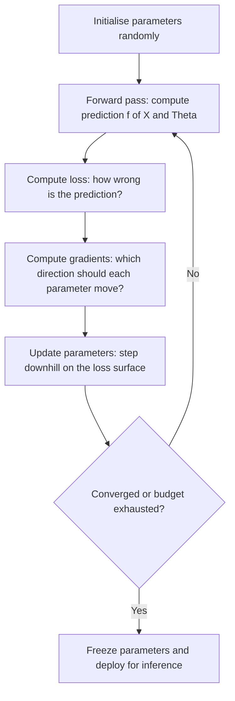
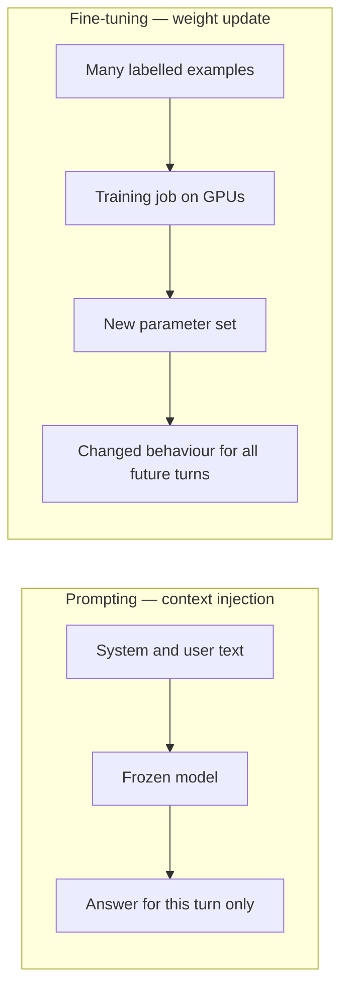
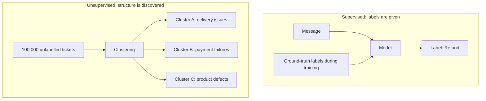
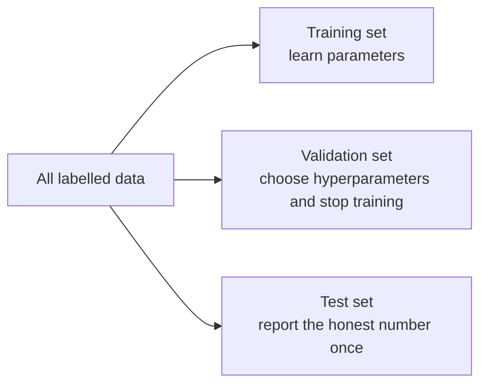
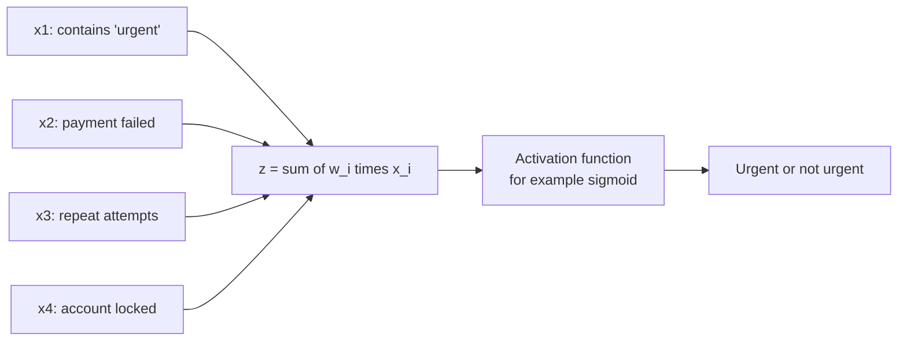
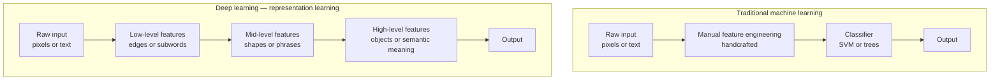
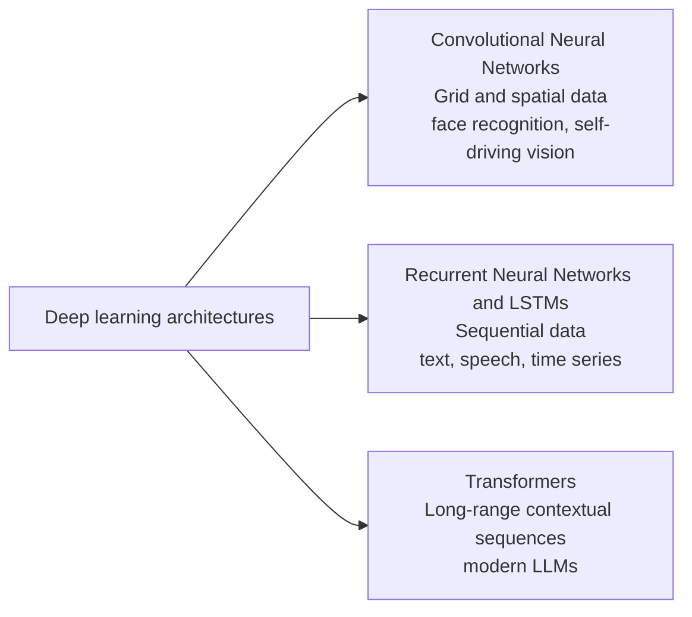
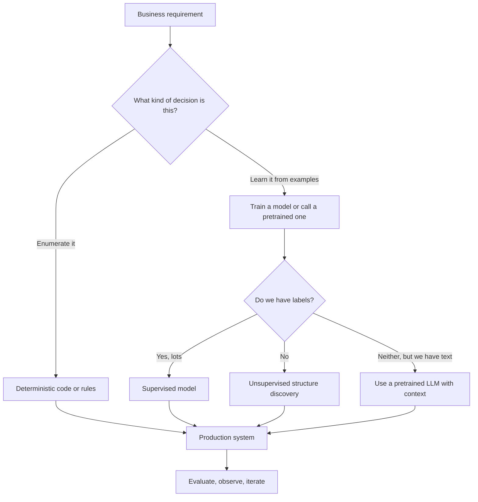

# Chapter 04 — Machine Learning & Deep Learning Foundations

> **Lecture 01 · Chapter 04 of 08** · Level: 🟢 Beginner · Phase 0 — Orientation
> **Source:** `Forward-Deployed-Engineer/Lecture 01/notes/03_Machine_Learning_and_Deep_Learning_Foundations.md`
> **Roadmap topics:** ML paradigm shift ($Y = f(X; \Theta)$); supervised vs unsupervised; training vs
> inference; the feature-engineering bottleneck; deep learning and representation learning;
> CNNs vs RNNs vs Transformers at a high level.

---

## 04.0 What this chapter is for

Chapter 03 ended with the combinatorial explosion of handwritten rules. This chapter is the answer
the field found: **stop specifying behaviour, start learning it from examples.** This is the single
biggest conceptual shift in the lecture, and every later topic — embeddings, attention, fine-tuning,
prompting — inherits its vocabulary: *parameters, training, inference, loss, features,
representations*.

By the end you should be able to:

1. Contrast traditional programming with the training and inference phases of ML.
2. Write and explain $Y = f(X; \Theta)$.
3. Distinguish supervised from unsupervised learning, and training from inference.
4. Explain why feature engineering was a bottleneck and how deep learning removed it.
5. Explain what representation learning is, and why CNNs, RNNs and transformers specialise by data type.

---

## 04.1 The paradigm shift: learning patterns instead of writing rules

When we teach a child to recognise a dog, we do not hand over a rule sheet (*"4 legs, fur, tail,
2 ears"* — which also describes a cat, a wolf and most foxes). We show examples: *"this is a dog, this
is also a dog, that is a cat."* The child builds an internal pattern.

Machine learning works the same way: **give labelled examples and let an algorithm adjust internal
numerical parameters until the mapping from input to output is accurate.**



Notice the elegant inversion:

| Paradigm | Inputs to the machine | Output of the machine |
| :--- | :--- | :--- |
| Traditional programming | Data + **rules** | Answers |
| Machine learning | Data + **answers** | **Rules** (encoded as parameters) |

---

## 04.2 The model as a function

> **A model is a computational function $f(X; \Theta)$ that maps an input vector $X$ to an output
> vector $Y$ using learned parameter weights $\Theta$.**

$$Y = f(X; \Theta)$$



### The two phases

| Phase | What happens | What changes | Cost profile |
| :--- | :--- | :--- | :--- |
| **Training** | Feed training data through the model, measure error with a **loss function**, update $\Theta$ with **gradient descent** | Parameters $\Theta$ are modified | High: GPU clusters, hours to months |
| **Inference** | Pass new unseen input $X$ through the frozen model | Nothing changes; $\Theta$ is read-only | Low per call, predictable latency |

### What training actually looks like as a loop



As TypeScript pseudo-code — the shape of every training loop in every framework:

```ts
// PSEUDO-CODE — the universal training loop
function train(model: Model, data: Example[], steps: number): Model {
  for (let step = 0; step < steps; step++) {
    const batch = sample(data);                 // a mini-batch of examples
    const prediction = model.forward(batch.X);  // f(X; Theta)
    const loss = crossEntropy(prediction, batch.Y);
    const gradients = backprop(loss);           // dLoss/dTheta
    model.parameters = stepDownhill(model.parameters, gradients, learningRate);
  }
  return model;                                 // parameters are now "learned"
}
```

---

## 04.3 Prompting vs training — the misconception that costs money

A very common developer assumption is that putting detailed context in a prompt "trains" the model.
It does not.

| Aspect | Inference (prompting) | Training (pretraining / fine-tuning) |
| :--- | :--- | :--- |
| **Parameter impact** | $\Theta$ stays **frozen and unchanged** | $\Theta$ is **permanently modified** |
| **Context scope** | Temporary input window for this call | Long-term knowledge encoded in weights |
| **Resource cost** | Low latency, per-call compute | High compute, GPU cluster operations |
| **Persistence** | Forgotten when the request ends (unless you store it) | Persists across all future requests |
| **Rollback** | Change the prompt | Retrain or swap the checkpoint |



> **Why this matters operationally:** if you want the model to *know* your refund policy, prompting
> (or retrieval) is the right tool because policy changes weekly. If you want the model to *speak in
> your brand's voice* or *emit a strict house format*, fine-tuning may be the right tool. Choosing
> wrongly gives you either stale knowledge or expensive retraining.

---

## 04.4 Supervised vs unsupervised learning

| | Supervised learning | Unsupervised learning |
| :--- | :--- | :--- |
| Training data | Inputs **with** ground-truth labels | Inputs **without** labels |
| Objective | Learn the input-to-label mapping | Discover structure: clusters, groups, density, low-dimensional shape |
| Example (support) | `Email -> Spam / Not Spam`; `Message -> intent` | Group 100,000 unlabelled tickets into operational clusters |
| Typical algorithms | Logistic regression, SVM, decision trees, neural nets | k-means, hierarchical clustering, PCA, autoencoders |
| Evaluation | Accuracy, precision, recall, F1, AUC | Cluster coherence, silhouette score, human interpretability |



### The other paradigms you will meet later (added depth)

| Paradigm | Signal used | Example in this curriculum |
| :--- | :--- | :--- |
| **Self-supervised** | The data labels itself (predict the next token) | How GPT-style models are pretrained (Lecture 02) |
| **Semi-supervised** | A few labels plus many unlabelled examples | Bootstrapping an intent classifier from a small labelled set |
| **Reinforcement learning** | Reward from actions in an environment | RLHF alignment of chat models |
| **In-context learning** | Examples inside the prompt, no weight change | Few-shot prompting (Lecture 05) |

> **The crucial bridge to LLMs:** a large language model is trained **self-supervised** — the "label"
> for each position is simply the next token. That single trick is what makes trillions of tokens of
> unlabelled text usable as training data, and it is why LLMs can be pretrained at all.

### Machine learning does not learn truth

> **Critical warning:** models learn statistical correlations present in their training data. If the
> training data is biased, outdated or incomplete, the output reflects exactly those flaws.

| Data problem | Model consequence | Mitigation |
| :--- | :--- | :--- |
| Historical bias (some regions got slower support) | Model reproduces the bias | Audit by segment; rebalance; measure fairness metrics |
| Distribution shift (policies changed after training) | Confident outdated answers | Retrieval instead of memorisation; scheduled re-evaluation |
| Label noise | Learns the noise | Label audits; multiple annotators; disagreement metrics |
| Spurious correlation (font correlates with spam) | Fails on new formatting | Held-out sets that break the correlation |

This is the statistical ancestor of the hallucination problem: **the model is optimised for
plausibility on its training distribution, not for truth about your business.**

---

## 04.5 The three splits and the overfitting trap (added depth)

Before any ML model reaches production, the data is divided:



| Split | Used for | Rule |
| :--- | :--- | :--- |
| **Train** | Updating $\Theta$ | Never report performance on this set as a result |
| **Validation** | Model selection, early stopping, prompt tuning | Touched many times, so it is mildly optimistic |
| **Test** | Final reported performance | Look at it once; if you tune on it, it is no longer a test set |

| Failure | Symptom | Fix |
| :--- | :--- | :--- |
| **Underfitting** | Poor on train and validation | Bigger model, better features, train longer |
| **Overfitting** | Excellent on train, poor on validation | More data, regularisation, dropout, early stopping |
| **Data leakage** | Suspiciously excellent everywhere | Remove future information from features; split by entity, not by row |
| **Contamination** | Excellent offline, poor in production | Check that eval examples were never in training data (Lecture 30) |

> **This vocabulary transfers directly to LLM work.** "Overfitting" becomes "the prompt was tuned on
> the eval set"; "contamination" becomes "the benchmark leaked into pretraining data". Lecture 30
> (Evals and Testing) is this section applied to generative systems.

---

## 04.6 The bottleneck of traditional ML: feature engineering

Before deep learning, models such as logistic regression, decision trees and SVMs required
**feature engineering**: a human domain expert manually converting raw input into a numerical feature
vector.

### Worked example: is this support ticket urgent?

A classic linear classifier — sometimes called a *synthetic neuron* — computes a weighted sum:

$$z = w_1 x_1 + w_2 x_2 + w_3 x_3 + w_4 x_4$$

where the **features are hand-crafted by humans**:

| Feature | Meaning | Type |
| :--- | :--- | :--- |
| $x_1$ | Message contains the keyword `"urgent"` | Binary flag |
| $x_2$ | Payment status is `Failed` | Binary flag |
| $x_3$ | Number of previous support attempts by this customer | Integer count |
| $x_4$ | Customer account is `Locked` | Binary flag |

and $w_1 \dots w_4$ are the weights the learning algorithm fits.



The same design as TypeScript pseudo-code:

```ts
// PSEUDO-CODE — a hand-engineered linear classifier
type Features = { hasUrgentWord: 0 | 1; paymentFailed: 0 | 1; priorAttempts: number; accountLocked: 0 | 1 };

function urgencyScore(f: Features, w: number[]): number {
  const z = w[0] * f.hasUrgentWord + w[1] * f.paymentFailed
          + w[2] * f.priorAttempts + w[3] * f.accountLocked;
  return sigmoid(z);            // squash into a 0..1 probability
}
```

### Why this became a severe bottleneck

1. **Enormous human effort.** Hundreds of domain-specific features had to be designed for every new
   problem.
2. **Human blind spots.** People miss complex non-linear interactions in high-dimensional data —
   exactly the interactions that matter.
3. **Zero transferability.** Features built for text intent classification are useless for image
   recognition or audio.

> **The deeper problem:** feature engineering puts a human back in the loop as the thing that decides
> *what is worth looking at*. The learning algorithm only ever optimises over the features it is
> given. That is a ceiling.

---

## 04.7 Deep learning and representation learning

**Deep learning** removed that ceiling by stacking layers so the model learns its own features —
**representation learning**.



### The hierarchy inside a vision model

| Layer | What it represents |
| :--- | :--- |
| Layer 1 (input) | Raw pixel brightness values |
| Layer 2 (low-level) | Lines, edges, contrast boundaries |
| Layer 3 (mid-level) | Shapes, eyes, noses |
| Layer 4 (high-level) | Full faces, dog breeds |
| Layer 5 (output) | Classification prediction |

The general lesson: **each layer composes the previous layer's features into a more abstract one.**
This is the same intuition that later explains why transformer layers build from token-level syntax up
to semantic and task-level structure (Chapter 07).

### Architectural specialisation by data type

As deep learning matured, architectures specialised by the *structure of the data*:



| Architecture | Inductive bias | Strength | Weakness |
| :--- | :--- | :--- | :--- |
| **CNN** | Locality and translation invariance | Excellent on grids: images, audio spectrograms | Not naturally sequential |
| **RNN / LSTM** | Order matters; state carries forward | Handles variable-length sequences | Sequential computation; long-range decay (Chapter 06) |
| **Transformer** | Any position can attend to any position | Parallel training, long-range links (Chapter 07) | Quadratic attention cost in sequence length |

> **This table is the roadmap for the rest of Lecture 01:** Chapter 05 covers statistical language
> models, Chapter 06 covers the RNN and its bottleneck, Chapter 07 covers the transformer that
> replaced it.

---

## 04.8 Where machine learning sits in the FDE's mental model



For an FDE the practical conclusion is short:

| Question | Answer |
| :--- | :--- |
| Do I need to train anything? | Usually **no** — use a pretrained model and add context |
| When is a trained classifier right? | High volume, narrow decision, cheap inference, stable labels (routing, urgency) |
| When is an LLM right? | Open-ended language, varied formats, fast iteration, no labelled data |
| When is fine-tuning right? | Style, format and behaviour consistency at scale |

---

## Common mistakes

- **Thinking a prompt "trains" the model.** Prompting injects temporary context; only training changes
  $\Theta$.
- **Confusing training with inference.** One modifies parameters; the other only reads them.
- **Reporting training-set accuracy as a result.** It measures memorisation, not generalisation.
- **Ignoring the validation/test split.** Without it you cannot detect overfitting or leakage.
- **Believing a model learns truth.** It learns correlations in the data it was given, flaws included.
- **Hand-engineering features for language.** That is the ceiling deep learning removed; for text,
  representations should be learned (embeddings) or supplied by a pretrained model.
- **Assuming a bigger model fixes a data problem.** Bias, shift and label noise are data problems.
- **Picking an architecture by fashion.** CNN for grids, RNN for short sequences, transformer for
  long-range contextual sequences.

## Key takeaways

1. Traditional programming takes **data plus rules** and outputs answers; machine learning takes
   **data plus answers** and outputs rules (parameters).
2. A model is $Y = f(X; \Theta)$; **training updates $\Theta$**, **inference only reads it**.
3. **Prompting is inference**, not training — the parameters stay frozen.
4. **Supervised** learning needs labels; **unsupervised** learning finds structure; LLMs are trained
   **self-supervised** by predicting the next token.
5. ML learns **statistical correlations**, not objective truth — the ancestor of hallucination.
6. **Feature engineering** was the bottleneck of traditional ML: manual, non-transferable and limited
   by human blind spots.
7. **Deep learning** replaced it with **representation learning**: hierarchical features learned from
   raw data.
8. Architectures specialise by data type: **CNN** for grids, **RNN/LSTM** for sequences,
   **Transformer** for long-range contextual sequences.

## Self-check questions

1. Write $Y = f(X; \Theta)$ and label each symbol. Which symbol changes during training?
2. Name four things that stay unchanged when you put detailed context in a prompt.
3. Give one supervised and one unsupervised task from the e-commerce case study.
4. Why is "the training accuracy is 99 percent" not evidence that the model is good?
5. List the three reasons feature engineering became a bottleneck.
6. Explain representation learning in one sentence, using the vision-layer example.
7. Which architecture would you pick for audio time series, and why?

---

### Navigation

- **Previous:** [Chapter 03 — AI Foundations & Rule-Based Systems](./03_AI_Foundations_and_Rule_Based_Systems.md)
- **Next:** [Chapter 05 — Natural Language Challenges & Statistical Language Models](./05_Natural_Language_Challenges_and_Statistical_Language_Models.md)
- **Source:** `Forward-Deployed-Engineer/Lecture 01/notes/03_Machine_Learning_and_Deep_Learning_Foundations.md`
- **Back to index:** [../index.md](../index.md)


