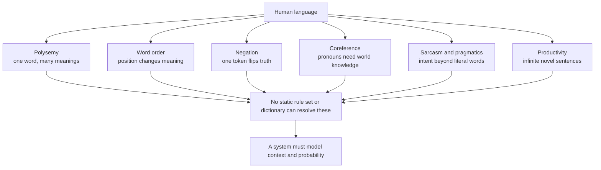
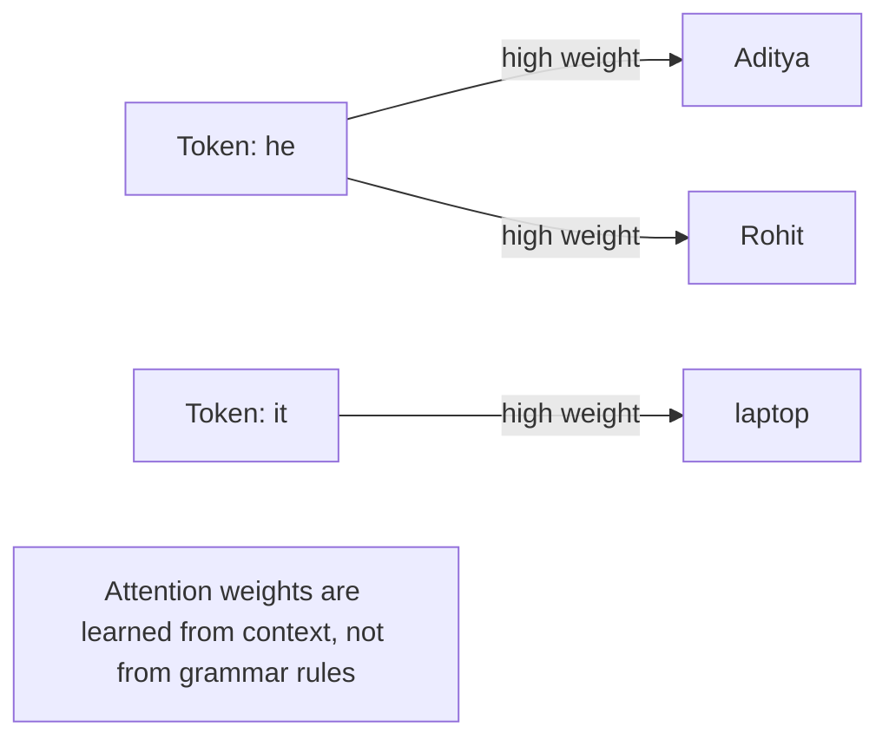
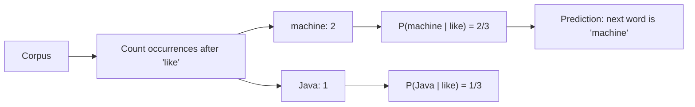
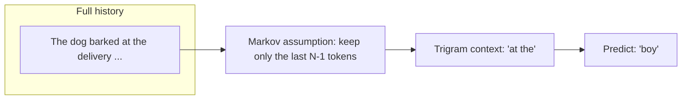
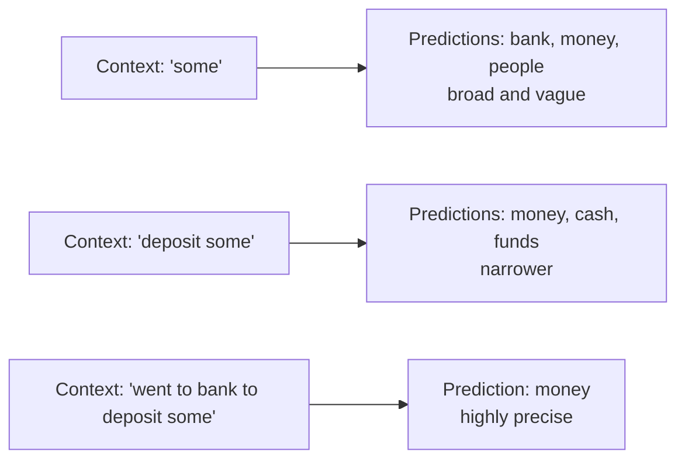
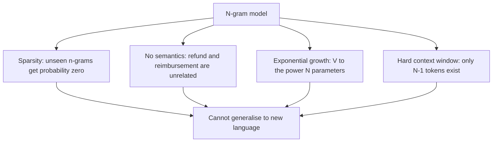
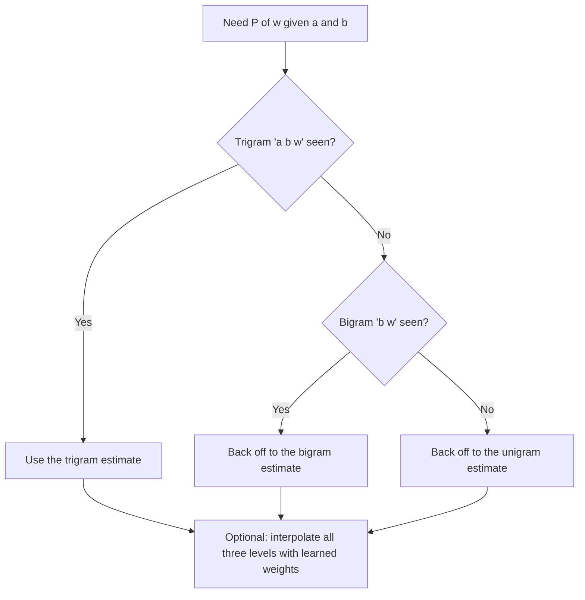
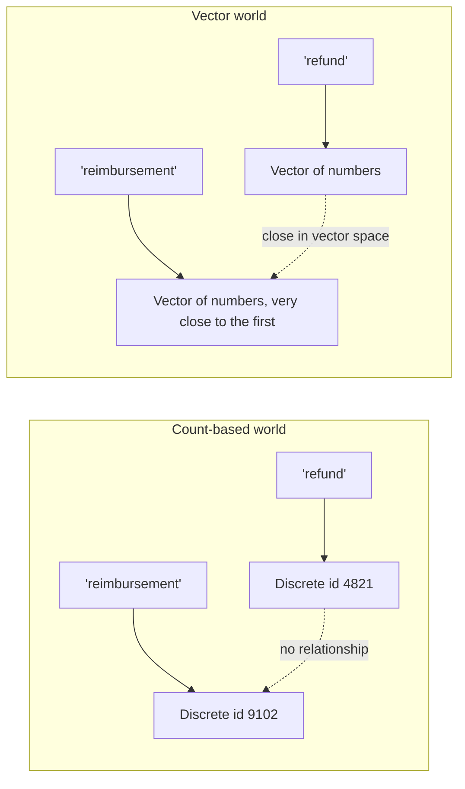

# Chapter 05 — Natural Language Challenges & Statistical Language Models

> **Lecture 01 · Chapter 05 of 08** · Level: 🟢 Beginner · Phase 0 — Orientation
> **Source:** `Forward-Deployed-Engineer/Lecture 01/notes/04_Language_Modeling_Statistical_N_Grams_and_RNNs.md` (§4.1, §4.2)
> **Roadmap topics:** the linguistic challenges of natural language (**polysemy, word order,
> negation, coreference, sarcasm**); language modelling with n-grams, frequency counting, the sparsity
> problem; pronoun coreference and disambiguation worked examples.

---

## 05.0 What this chapter is for

Chapter 04 gave you the machine-learning toolkit. This chapter applies it to the hardest data type of
all: **human language**. It answers two questions:

1. *Why* is language hard in a way that images and tables are not?
2. How did the first *statistical* language models work, and why did they fail?

The failures matter more than the successes here, because **every one of them is a motivation for the
transformer** in Chapter 07.

---

## 05.1 Why natural language is uniquely hard

Computers handle clear, structured numerical tables efficiently. Natural language presents six
structural hurdles that no deterministic algorithm handles gracefully.

### 1. Context sensitivity and polysemy

The same word means different things depending on its neighbours:

- *"I deposited money in the **bank**."* → financial institution
- *"We sat on the **bank** of the river."* → river edge

```ts
// PSEUDO-CODE — why a dictionary lookup cannot resolve a word
const dictionaryEntry = { bank: "a financial institution" };
// "bank" in "the bank of the river" is resolved by CONTEXT, not by the dictionary.
// The correct representation is a function of the surrounding tokens, not the token alone.
```

### 2. Word order significance

Changing word positions changes meaning entirely:

- *"The dog chased the man."* ≠ *"The man chased the dog."*

A bag-of-words representation loses this completely, which is why n-grams and later sequence models
exist at all.

### 3. Negation

A single token reverses the truth condition of a whole sentence:

- *"The customer **received** the refund."* vs *"The customer **did not receive** the refund."*

Sentiment and intent classifiers that ignore negation produce exactly the wrong answer with high
confidence.

### 4. Pronoun coreference

Resolving a pronoun requires world knowledge about what can be heavy or unstable:

- *"Aditya placed the laptop on the table because **it** was heavy."* → **it** = the laptop
- *"Aditya placed the laptop on the table because **it** was unstable."* → **it** = the table

Same syntax, opposite resolution, resolved by semantics. Chapter 07 shows how attention handles this
mechanically.

### 5. Sarcasm, pragmatics and tone

- *"Amazing service. My order is only three weeks late!"*

A keyword filter flags *"Amazing service"* as positive sentiment. A human recognises negative sarcasm
instantly. Pragmatics — meaning *beyond* the literal words, including speaker intent — is invisible to
surface matching.

### 6. The productive nature of language

Humans constantly synthesise sentences nobody has ever spoken. A system cannot memorise all sentences;
it must learn **generative rules that generalise**. This is why *language modelling* — estimating
probabilities over sequences — became the central task.



> **FDE relevance:** every one of these six is a real production failure mode. Polysemy breaks
> keyword search; negation breaks sentiment routing; coreference breaks retrieval chunks that were cut
> mid-conversation; sarcasm breaks escalation rules. Knowing the *names* helps you find the incident.

---

## 05.2 Worked example: the same sentence, two readings

The single best illustration of all six challenges at once:

> **"Aditya gave Rohit the laptop because he needed it for work."**

| Question | Answer | Which challenge it exercises |
| :--- | :--- | :--- |
| Who is "he"? | Aditya or Rohit — genuinely ambiguous | Coreference |
| What is "it"? | The laptop | Coreference plus world knowledge (you work *with* a laptop) |
| Did the giving happen before the needing? | Yes — tense and causality | Word order and temporal reasoning |
| Does "for work" attach to "needed" or to "gave"? | Attachment ambiguity | Syntax |

A statistical model with a 2-word context window cannot resolve any of these. A model that can look
at *every* position at once can — which is exactly the property Chapter 07 adds.



---

## 05.3 What a language model is

> **A language model estimates the probability distribution over sequences of words (tokens) and
> predicts likely upcoming tokens given preceding context.**

Formally, the probability of a whole sequence factorises into a product of next-token conditionals —
this is the **chain rule of probability**:

$$P(w_1, w_2, \dots, w_m) = \prod_{i=1}^{m} P(w_i \mid w_1, w_2, \dots, w_{i-1})$$

Read it as: *the probability of a sentence is the product of the probability of each word given
everything before it.* Every modern LLM is still trained to do exactly this — only the way
$P(w_i \mid \text{history})$ is computed has changed:

| Era | How $P(w_i \mid \text{history})$ is computed |
| :--- | :--- |
| N-grams | Count occurrences in a corpus, use the last $N-1$ words only |
| RNN / LSTM | Compress history into a hidden state vector |
| Transformer / LLM | Attend to all previous tokens directly (Chapter 07) |

---

## 05.4 Frequency-based statistical counting

Before neural networks, probabilities were estimated by **counting word occurrences in a large
corpus** (maximum-likelihood estimation).

### Worked example (from the source)

Suppose the training corpus is three sentences:

1. *"I **like machine** learning."*
2. *"I **like Java** programming."*
3. *"Students **like machine** learning."*

Observing what follows the word **"like"**:

| Next word | Count |
| :--- | :--- |
| machine | 2 |
| Java | 1 |
| **total** | 3 |

$$P(\text{machine} \mid \text{like}) = \frac{2}{3} \approx 66.7\% \qquad P(\text{Java} \mid \text{like}) = \frac{1}{3} \approx 33.3\%$$



The same idea as TypeScript pseudo-code:

```ts
// PSEUDO-CODE — bigram maximum likelihood estimation
function buildBigramTable(corpus: string[][]): Map<string, Map<string, number>> {
  const counts = new Map<string, Map<string, number>>();
  for (const sentence of corpus) {
    for (let i = 1; i < sentence.length; i++) {
      const prev = sentence[i - 1], next = sentence[i];
      const row = counts.get(prev) ?? new Map();
      row.set(next, (row.get(next) ?? 0) + 1);
      counts.set(prev, row);
    }
  }
  return counts;                       // counts["like"]["machine"] === 2
}

function probability(table: Map<string, Map<string, number>>, prev: string, next: string): number {
  const row = table.get(prev);
  if (!row) return 0;                  // unseen context -> zero probability (the sparsity problem)
  const total = [...row.values()].reduce((a, b) => a + b, 0);
  return (row.get(next) ?? 0) / total;
}
```

> **Notice the `return 0`.** That single line is the sparsity problem, and it is the reason n-grams
> could never be a general language model. Chapter 06 and Chapter 07 exist to remove it.

---

## 05.5 N-gram models

An **n-gram** is a continuous sequence of $N$ items (words or tokens).

| Model | $N$ | Probability estimated | Example |
| :--- | :--- | :--- | :--- |
| **Unigram** | 1 | $P(w_i)$ — each token independent | *"the", "dog", "barked"* treated as unrelated draws |
| **Bigram** | 2 | $P(w_i \mid w_{i-1})$ — one word of context | *"the dog", "dog barked"* |
| **Trigram** | 3 | $P(w_i \mid w_{i-2}, w_{i-1})$ — two words of context | *"the dog barked"* |
| **4-gram** | 4 | three words of context | rarely useful in practice |

### The Markov assumption

N-grams rest on the **Markov assumption**: the next word depends only on the previous $N-1$ words,
not on the whole history.

$$P(w_i \mid w_1 \dots w_{i-1}) \approx P(w_i \mid w_{i-N+1} \dots w_{i-1})$$



### Context length changes prediction sharpness

The more context you condition on, the sharper the prediction — up to a point:



The same intuition as the classic autocomplete example from the hand-drawn notes:

```text
"The dog barked at the ...."                   -> many plausible continuations
"The dog barked at the delivery boy."          -> one likely continuation given more context
```

```ts
// PSEUDO-CODE — context length is a parameter, and it changes the answer
function predictNext(context: string[], order: "unigram" | "bigram" | "trigram"): Ranked[] {
  const window = { unigram: 0, bigram: 1, trigram: 2 }[order];
  const conditioned = context.slice(context.length - window);   // throw away the rest
  return rankByCount(conditioned);   // fewer words of context -> flatter distribution
}
```

---

## 05.6 Why n-grams fail: four structural limitations

### 1. The sparsity problem (zero probability)

If a specific $N$-gram never appeared in the training corpus, the model assigns it probability **0**.
The model cannot generalise at all:

> *"The buyer asked for reimbursement."* — never seen → probability 0, even though
> *"the customer asked for a refund"* was seen a million times.

### 2. Zero semantic understanding

Count-based models treat related words as unrelated tokens. `"customer"` and `"buyer"` are as
different as `"customer"` and `"hippopotamus"`. `"refund"` and `"reimbursement"` share nothing.

### 3. Severe context truncation

To capture longer context you must increase $N$, and the parameter count grows **exponentially**:
the number of possible $N$-grams is $V^N$ for vocabulary size $V$.

| Vocabulary $V$ | $N$ | Possible n-grams $V^N$ |
| :--- | :--- | :--- |
| 50,000 | 2 | 2.5 × 10⁹ |
| 50,000 | 3 | 1.25 × 10¹⁴ |
| 50,000 | 4 | 6.25 × 10¹⁸ |

Almost all of those combinations are never observed, so almost all probabilities are zero. You cannot
fix sparsity by adding data — the space grows faster than any corpus.

### 4. No notion of position beyond the window

Anything outside the last $N-1$ tokens simply does not exist to the model. Long documents are
therefore structurally invisible.



---

## 05.7 The fixes engineers invented before neural networks (added depth)

The sparsity problem was attacked with **smoothing**: redistribute probability mass so that unseen
events get a small non-zero chance. Worth knowing these names, because the same ideas reappear as
*smoothing* in modern ranking and as *temperature* in decoding.

| Technique | Idea | Effect |
| :--- | :--- | :--- |
| **Add-one (Laplace) smoothing** | Add 1 to every count before dividing | Unseen n-grams get small non-zero probability; high-frequency estimates are distorted |
| **Add-k smoothing** | Add a small $k$ instead of 1 | Tunable compromise |
| **Backoff** | If the trigram is unseen, use the bigram, then the unigram | Never returns zero, but loses precision |
| **Interpolation** | Weighted mix of trigram, bigram and unigram estimates | Smoother than pure backoff; needs tuned weights |
| **Kneser-Ney** | Back off using *continuation* counts (how many distinct contexts a word appears in) | Best classical n-gram method; still a standard baseline |



```ts
// PSEUDO-CODE — interpolated n-gram probability
function interpolatedProbability(trigram: string[], weights: number[]): number {
  return weights[0] * pTrigram(trigram)
       + weights[1] * pBigram(trigram.slice(1))
       + weights[2] * pUnigram(trigram[2]);   // always non-zero if the unigram exists
}
```

### How n-gram models were evaluated

Language models are scored with **perplexity** — roughly "how surprised is the model by held-out
text?" Lower is better.

$$\text{Perplexity} = \exp\left(-\frac{1}{N}\sum_{i=1}^{N} \ln P(w_i \mid \text{context})\right)$$

| Metric | Meaning | Limitation |
| :--- | :--- | :--- |
| **Perplexity** | How well the model predicts held-out text | Not the same as usefulness; a model can score well and still answer nothing |
| **BLEU / ROUGE** | Overlap with reference text | Cheap but shallow; misses meaning |
| **Task metrics** | Did the system resolve the request? | The only metric the business cares about |

> **Why this matters later:** perplexity is still reported for LLMs, and the *distinction between
> perplexity and usefulness* is exactly the distinction Lecture 30 (Evals) formalises for generative
> systems.

### Why the vocabulary is a problem even today

Natural language follows **Zipf's law**: a few words are extremely frequent and a long tail appears
once. Two consequences survive into the transformer era:

- **Out-of-vocabulary (OOV) tokens.** A word-level vocabulary cannot represent unseen words, so early
  systems replaced them with a single `UNK` token and lost the meaning.
- **The fix is subword tokenisation** — splitting text into frequent character sequences (BPE,
  WordPiece) so that *"reimbursement"* becomes *"re" + "imburse" + "ment"* and no word is truly
  unknown. That is Lecture 02's topic, and the direct descendant of this problem.

---

## 05.8 From counts to vectors: the bridge to neural language models

The fatal weakness is now clear. Counting has no idea that:

```text
customer ≈ buyer ≈ client
refund   ≈ reimbursement ≈ money back
```

To fix that, words must be represented as **continuous vectors** whose *geometric distance* encodes
similarity, so a model can generalise from *"the customer asked for a refund"* to *"the buyer asked
for reimbursement"* without ever seeing that exact sentence.



That is the doorway to **embeddings** and **neural language models** — the subject of Chapter 06.

---

## Common mistakes

- **Treating words as independent.** Polysemy, negation and word order all depend on context.
- **Using keyword or bag-of-words matching for intent.** Negation alone flips the meaning, with high
  confidence.
- **Believing a big corpus eliminates sparsity.** The n-gram space grows as $V^N$; it cannot be
  enumerated.
- **Confusing "grammatical" with "meaningful".** N-grams can produce fluent-looking word salad.
- **Assuming smoothing solves n-grams.** It avoids zero probabilities but adds no semantics and does
  not extend the context window.
- **Optimising perplexity as if it were usefulness.** A model can predict text well and still resolve
  nothing.
- **Ignoring the OOV problem.** Word-level vocabularies lose meaning on unseen words; subword
  tokenisation is the fix.

## Key takeaways

1. Natural language is hard because of **polysemy, word order, negation, coreference, sarcasm and
   productivity** — none of which a static rule set or dictionary resolves.
2. A **language model** estimates $P(w_1 \dots w_m) = \prod_i P(w_i \mid w_1 \dots w_{i-1})$.
3. **Statistical language models** estimated those probabilities by **counting** in a corpus
   (for example $P(\text{machine} \mid \text{like}) = 2/3$).
4. **N-grams** add context: unigram (0 words), bigram (1), trigram (2), under the **Markov
   assumption** that only the last $N-1$ tokens matter.
5. N-grams fail on **sparsity** (zero probability for unseen sequences), **no semantics**
   (refund vs reimbursement), **exponential parameter growth** ($V^N$) and a **hard context window**.
6. Classical fixes were **smoothing and backoff** (Laplace, interpolation, Kneser-Ney), evaluated with
   **perplexity** — which is not the same as usefulness.
7. **Zipf's law** and **OOV tokens** pushed the field toward **subword tokenisation**.
8. The real breakthrough is representing words as **vectors**, so similarity becomes geometry —
   Chapter 06's starting point.

## Self-check questions

1. Name the six linguistic challenges and give a support-message example for two of them.
2. In *"Aditya placed the laptop on the table because it was unstable"*, what does "it" refer to, and
   which capability resolves it?
3. Compute $P(\text{Java} \mid \text{like})$ from the three-sentence corpus in §05.4.
4. State the Markov assumption and explain what it throws away.
5. Why does increasing $N$ not solve the context problem?
6. Explain the difference between backoff and interpolation in one sentence each.
7. Why is perplexity not the metric the business cares about?

---

### Navigation

- **Previous:** [Chapter 04 — Machine Learning & Deep Learning Foundations](./04_Machine_Learning_and_Deep_Learning_Foundations.md)
- **Next:** [Chapter 06 — Neural Language Models & the RNN Bottleneck](./06_Neural_Language_Models_and_the_RNN_Bottleneck.md)
- **Source:** `Forward-Deployed-Engineer/Lecture 01/notes/04_Language_Modeling_Statistical_N_Grams_and_RNNs.md`
- **Back to index:** [../index.md](../index.md)


