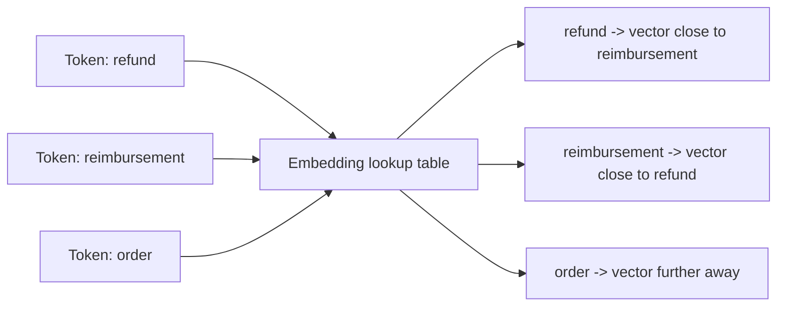
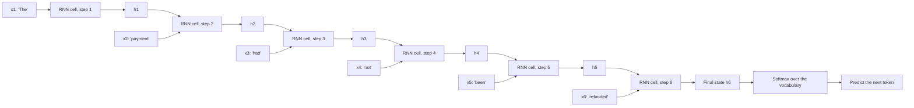
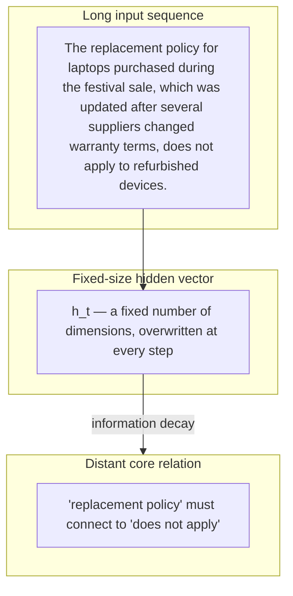
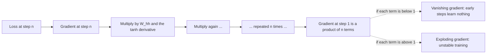
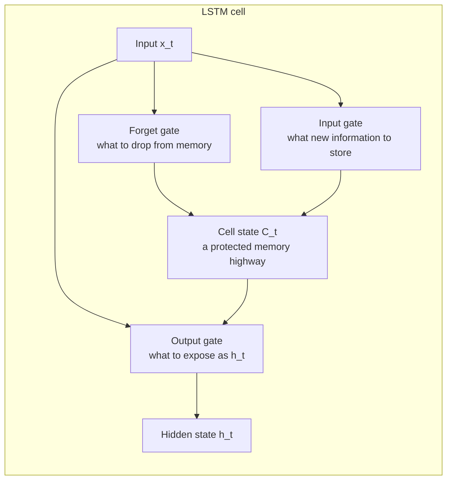
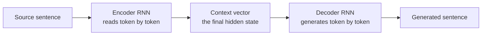
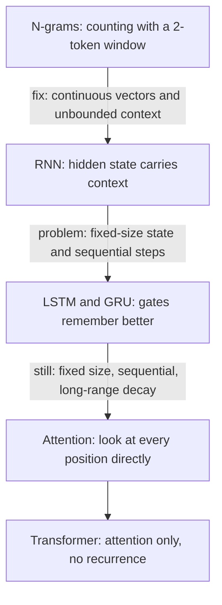

# Chapter 06 — Neural Language Models & the RNN Bottleneck

> **Lecture 01 · Chapter 06 of 08** · Level: 🟢 Beginner · Phase 0 — Orientation
> **Source:** `Forward-Deployed-Engineer/Lecture 01/notes/04_Language_Modeling_Statistical_N_Grams_and_RNNs.md` (§4.3, §4.4)
> **Roadmap topics:** neural language models, word embeddings, the RNN **hidden state**, the
> **information bottleneck**, **long-range dependency decay** and vanishing gradients.

---

## 06.0 What this chapter is for

Chapter 05 ended with the two fatal flaws of counting: no semantics and no long context. Neural
language models attacked both. The first attempt — the **recurrent neural network** — is the direct
ancestor of the transformer, and understanding *exactly* why it fails is the fastest way to understand
*why attention exists*.

By the end you should be able to:

1. Explain how embeddings fix the "refund vs reimbursement" problem.
2. Write the RNN recurrence and explain the hidden state.
3. Explain the **information bottleneck** and **long-range dependency decay**.
4. Explain vanishing gradients in an RNN and how LSTM/GRU gates partially mitigate it.
5. Explain why the fix had to be architectural, not just "more layers".

---

## 06.1 Step one: turn words into vectors (embeddings)

The fix for count-based semantics is to give every token a **dense vector of real numbers** learned
during training, so that *distance in vector space* means *similarity in meaning*.



| Property | Count-based (discrete ids) | Embeddings (continuous vectors) |
| :--- | :--- | :--- |
| Representation | `refund = id 4821`, `reimbursement = id 9102` | `refund = [0.21, -0.44, ...]`, `reimbursement = [0.19, -0.40, ...]` |
| Similarity | None; every pair is equally unrelated | Cosine or dot product gives a similarity score |
| Generalisation | Zero: unseen sequences have probability 0 | Shared geometry lets the model transfer patterns |
| Dimension | Vocabulary size $V$ | A fixed small dimension $d$ (for example 128, 512, 768) |
| Learned how? | Counted | Learned by gradient descent alongside the rest of the model |

```ts
// PSEUDO-CODE — an embedding layer is a lookup table with learnable rows
type EmbeddingTable = { rows: number[][]; dim: number };

function embed(tokenId: number, table: EmbeddingTable): number[] {
  return table.rows[tokenId];         // no arithmetic yet: just a lookup
}
// During training, the rows of `table` are updated by gradient descent,
// so tokens used in similar contexts drift toward similar vectors.
```

> **This is the same idea that Lecture 12 (Vector Embeddings) and Lecture 14 (Vector Search) build
> into a product.** Retrieval is "embedding similarity" turned into a database query.

---

## 06.2 The RNN: sequential processing with a hidden state

A **recurrent neural network** processes language token by token, carrying a **hidden state vector**
$h_t$ forward as a running summary of everything read so far:

$$h_t = \tanh(W_{hh} h_{t-1} + W_{xh} x_t + b_h)$$

- $x_t$ — the embedding of the token at step $t$
- $h_{t-1}$ — the previous hidden state (the "memory")
- $W_{xh}, W_{hh}$ — learned weight matrices (the same matrices at every step — that is what makes it
  *recurrent*)
- $\tanh$ — a squashing non-linearity that keeps values bounded



Read the diagram twice, because two properties matter:

1. **The same cell is reused at every step.** There is exactly one set of weights, applied $n$ times.
2. **Information flows only left to right through a single vector.** $h_t$ is the *only* channel from
   the past to the future.

```ts
// PSEUDO-CODE — the recurrence, written out
function runRNN(tokens: number[], W: Weights): number[][] {
  const states: number[][] = [];
  let h = zeros(W.hiddenSize);                    // initial hidden state
  for (const tokenId of tokens) {
    const x = embed(tokenId, W.embeddings);
    h = tanh(add(matmul(W.hh, h), matmul(W.xh, x), W.bias));
    states.push(h);                               // h_t is the running summary
  }
  return states;                                  // h_last is the summary of the whole sentence
}
```

### What RNNs solved

| N-gram problem | RNN solution |
| :--- | :--- |
| Hard context window of $N-1$ tokens | In principle, unlimited context via the hidden state |
| Unseen sequences have probability 0 | Continuous representations generalise to unseen input |
| No notion of word order | The recurrence is order-sensitive by construction |
| OOV vocabulary | Embeddings plus subword tokenisation |

---

## 06.3 The information bottleneck

Here is the structural flaw. An RNN compresses **all** preceding context into a **single fixed-size
hidden state vector $h_t$**.

> Imagine reading a 20-page legal policy line by line while allowed to keep only **one sticky note**.
> By page 20, the details from page 1 have been overwritten or diluted.



Two independent problems live inside that diagram:

| Problem | Description | Consequence |
| :--- | :--- | :--- |
| **Capacity** | The hidden state has a fixed dimension regardless of input length | A 500-token document is summarised into the same 512 numbers as a 5-token one |
| **Decay** | Each step overwrites rather than appends | Early information is drowned out by later filler tokens |

### Long-range dependency

A **long-range dependency** occurs when interpreting a word near the end of a document requires exact
information located far back at the beginning.

Concrete support example:

> *"The replacement policy for laptops purchased during the festival sale, which was updated after
> several suppliers changed warranty terms, **does not apply** to refurbished devices."*

To interpret *"does not apply"* the model must have retained *"replacement policy"* — 24 tokens back,
separated by a relative clause. In an RNN that information has been through 24 multiplications and
24 squashings.

---

## 06.4 Why the information decays: vanishing (and exploding) gradients

Training an RNN means **backpropagating through time (BPTT)**: the error signal from step $n$ must
travel backwards through every intermediate step to reach step 1.



The intuition, without heavy calculus:

- Each backward step multiplies the gradient by the same weight matrix and by the derivative of
  $\tanh$ (at most 1, and usually well below it).
- Multiply many numbers smaller than 1 together and the product collapses toward zero —
  **vanishing gradient**.
- If the weights happen to be larger than 1, the product blows up — **exploding gradient**.

```ts
// PSEUDO-CODE — why the product of many small factors disappears
let gradient = 1.0;
for (let step = 0; step < 25; step++) {
  gradient *= 0.7;             // a representative per-step factor
}
// gradient is now about 0.00013 — the earliest tokens receive almost no learning signal
```

| Symptom | Root cause | Effect on the model |
| :--- | :--- | :--- |
| Vanishing gradient | Product of many factors below 1 | The model cannot learn long-range dependencies |
| Exploding gradient | Product of factors above 1 | Unstable training; loss becomes NaN |
| Early-context decay | Fixed-size state overwritten at each step | Distant information is effectively deleted |

> **The crucial insight:** the problem is not that the data is hard. The problem is that the
> **architecture forces all information through a narrow sequential pipe**. No amount of training data
> removes a bottleneck that is structural.

---

## 06.5 The partial fix: gating (LSTM and GRU) — added depth

The first response to vanishing gradients was not to abandon recurrence but to add **gates** that learn
*what to remember and what to forget*.



| Mechanism | Idea | Why it helps |
| :--- | :--- | :--- |
| **Cell state** | A second state vector updated additively rather than multiplied | Gradients flow along it without repeated shrinking |
| **Forget gate** | Learns to discard irrelevant history | Reduces noise in long contexts |
| **Input gate** | Learns which new information to write | Prevents overwriting everything at every step |
| **GRU** | A simplified two-gate variant (update and reset) | Fewer parameters, similar quality, faster training |

Gating helps a lot — LSTM-based seq2seq models powered machine translation for several years — but it
does **not** remove the bottleneck:

- The hidden state is still **fixed size**.
- Computation is still **strictly sequential** ($O(n)$ steps), so it cannot be parallelised across
  tokens during training.
- Very long dependencies (hundreds of tokens) still degrade.

> **This is the setup for Chapter 07:** the transformer's answer was to stop passing information
> through a sequential chain at all, and let every position look at every other position **directly**.

---

## 06.6 How RNNs were actually used: encoder–decoder and teacher forcing (added depth)

To make an RNN generate a whole sequence (for example translate a sentence), it was split in two:



| Term | Meaning | Known weakness |
| :--- | :--- | :--- |
| **Encoder** | Reads the input sequence and produces a context vector | The context vector *is* the information bottleneck |
| **Decoder** | Produces output tokens conditioned on the context | Errors compound over long outputs |
| **Teacher forcing** | During training, feed the *correct* previous token instead of the model's own guess | Trains fast, but creates exposure bias at inference time |
| **Exposure bias** | The model never learned to recover from its own mistakes | Small early errors cascade |
| **Beam search** | Keep the best $k$ partial sequences instead of greedily taking one | Better output, more compute |

```ts
// PSEUDO-CODE — teacher forcing vs free-running decoding
function decode(context: number[], correct: number[], teacherForcing: boolean): number[] {
  const out: number[] = [];
  let prev = START_TOKEN;
  for (let step = 0; step < correct.length; step++) {
    const next = argmax(softmax(decoderStep(context, prev)));
    out.push(next);
    prev = teacherForcing ? correct[step] : next;   // the entire difference
  }
  return out;
}
```

The **fixed-size context vector** between encoder and decoder is the same bottleneck, now visible as a
single point of failure. Attention was introduced first as a patch to *this* specific problem — and
then, in 2017, as the whole architecture.

---

## 06.7 Why the next step had to be architectural



| Requirement | RNN / LSTM | Transformer (Chapter 07) |
| :--- | :--- | :--- |
| Direct access to any earlier token | No — only through $h_t$ | Yes — one attention step, path length $O(1)$ |
| Parallelisable across tokens | No — $O(n)$ sequential steps | Yes — a single matrix operation |
| Context capacity | Fixed by hidden size | Grows with sequence length (attention over all tokens) |
| Training scale | Limited by sequential dependency | Scales to massive GPU parallelism |

---

## Common mistakes

- **Thinking the hidden state is real memory.** It is a fixed-size vector overwritten every step — a
  summary, not storage.
- **Assuming more training data fixes long-range decay.** The bottleneck is architectural.
- **Believing LSTM/GRU solved the problem.** They reduced vanishing gradients; they did not remove the
  fixed-size state or the sequential dependency.
- **Confusing vanishing and exploding gradients.** One makes early steps unlearnable, the other makes
  training unstable.
- **Ignoring teacher forcing's consequence.** Models trained with perfect previous tokens can fail to
  recover from their own errors at inference.
- **Confusing encoder/decoder RNNs with the transformer's encoder/decoder.** The names are shared; the
  mechanics (recurrence vs attention) are not.
- **Assuming a chat model "remembers" earlier turns.** Only what you explicitly place back into the
  context exists (this curriculum's Lecture 06 covers chat context).

## Key takeaways

1. **Embeddings** turn discrete token ids into continuous vectors so similarity becomes geometry —
   the fix for "refund vs reimbursement".
2. An **RNN** processes tokens sequentially with a hidden state
   $h_t = \tanh(W_{hh}h_{t-1} + W_{xh}x_t + b_h)$.
3. The **information bottleneck** is that all history is compressed into one fixed-size vector.
4. **Long-range dependencies** decay because information is overwritten at each step and gradients
   vanish during **backpropagation through time**.
5. **LSTM/GRU gating** (cell state, forget/input/output gates) mitigates but does not remove the
   bottleneck.
6. **Encoder–decoder RNNs** enabled sequence-to-sequence tasks; the fixed context vector between them
   is the bottleneck made visible.
7. **Teacher forcing** speeds training but introduces **exposure bias** at inference.
8. The fix had to be **architectural** — attention over all positions instead of a sequential chain
   (Chapter 07).

## Self-check questions

1. Why can a count-based model not know that "refund" and "reimbursement" are related?
2. Write the RNN recurrence and identify which matrix is shared across steps.
3. Explain the sticky-note analogy and name the two distinct problems it represents.
4. Explain in two sentences why gradients vanish over long sequences.
5. Name the three gates of an LSTM and what each controls.
6. What is exposure bias, and how does teacher forcing cause it?
7. Name the two architectural properties the transformer changes.

---

### Navigation

- **Previous:** [Chapter 05 — Natural Language Challenges & Statistical Language Models](./05_Natural_Language_Challenges_and_Statistical_Language_Models.md)
- **Next:** [Chapter 07 — Attention, Transformers & Modern LLMs](./07_Attention_Transformers_and_Modern_LLMs.md)
- **Source:** `Forward-Deployed-Engineer/Lecture 01/notes/04_Language_Modeling_Statistical_N_Grams_and_RNNs.md`
- **Back to index:** [../index.md](../index.md)


