# Chapter 07 — Attention, Transformers & Modern LLMs

> **Lecture 01 · Chapter 07 of 08** · Level: 🟡 Intermediate · Phase 0 — Orientation
> **Source:** `Forward-Deployed-Engineer/Lecture 01/notes/05_Attention_Mechanism_Transformers_and_LLMs.md`
> **Roadmap topics:** Attention and *"Attention Is All You Need"* (Vaswani et al., 2017) — first
> contact; self-attention vs recurrent vs convolutional layers; "attention is not intelligence by
> itself"; the paper's training methodology, regularisation and empirical benchmarks; pronoun
> coreference and disambiguation worked examples.

---

## 07.0 What this chapter is for

This is the payoff chapter of Lecture 01. Chapter 06 ended with an architectural dead end: a fixed-size
hidden state and a sequential pipe. In June 2017, Google researchers published
[**"Attention Is All You Need"** (Vaswani et al., arXiv:1706.03762)](https://arxiv.org/pdf/1706.03762)
and **removed recurrence and convolution from sequence modelling entirely**, building the
**Transformer** out of attention alone.

By the end you should be able to:

1. Explain why recurrence and convolution were replaced.
2. Explain Query / Key / Value and compute scaled dot-product attention by hand for a tiny example.
3. Explain why the scaling factor $\frac{1}{\sqrt{d_k}}$ exists.
4. Draw the full encoder–decoder transformer and describe every sub-layer.
5. Explain positional encodings and the linear-offset property.
6. Compare self-attention, recurrence and convolution on complexity, sequential operations and path length.
7. Describe the paper's training setup, regularisation and results.
8. Explain the decoder-only GPT architecture and today's efficiency variants.

---

## 07.1 The paradigm shift

Before 2017, state-of-the-art sequence transduction used RNNs or CNNs inside an encoder–decoder.

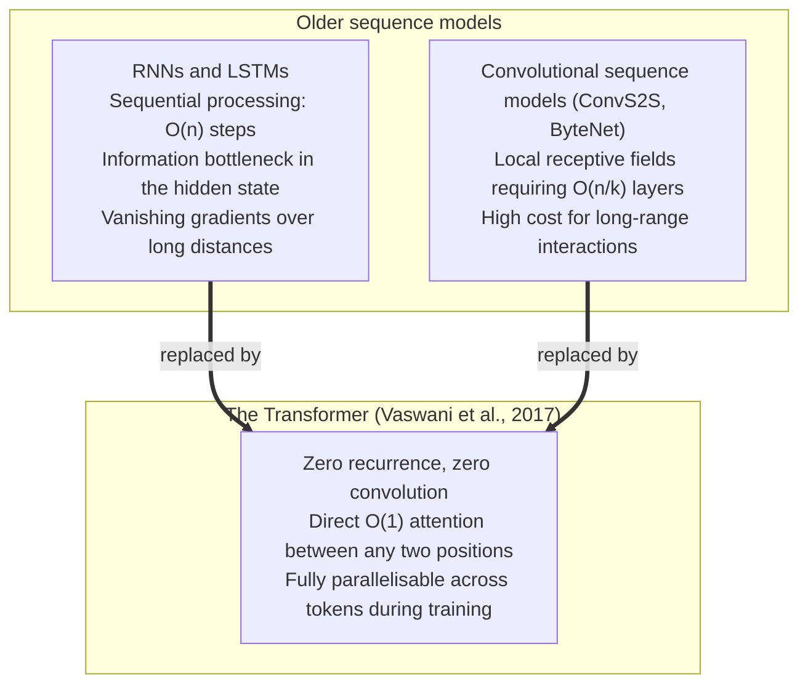

### The three constraints that had to be broken

| Model family | Constraint | Why it hurt |
| :--- | :--- | :--- |
| **Recurrent** | $O(n)$ sequential operations: $h_t = f(h_{t-1}, x_t)$ | Cannot parallelise *within* a training example; memory limits batch scaling on long sequences |
| **Convolutional** | Path length grows with distance: $O(n/k)$ for ConvS2S, $O(\log_k n)$ for dilated convolutions | Relating two distant positions requires many layers |
| **Transformer** | **$O(1)$ path length and $O(1)$ sequential operations** | Every position connects to every other in one step, and the whole sequence is processed as one matrix operation |

> **Why this is a *hardware* argument as much as a modelling argument:** training speed comes from GPU
> parallelism. A recurrence is a chain of dependent computations; a matrix multiplication is not. The
> transformer won partly because it fits the hardware.

---

## 07.2 Attention as a soft database lookup: Query, Key, Value

Attention is easiest to understand as a **differentiable retrieval mechanism**:

| Symbol | Question it answers | Analogy |
| :--- | :--- | :--- |
| **Query ($Q$)** | "What information am I looking for?" | Your search text |
| **Key ($K$)** | "What is this position indexed by?" | The index of each stored record |
| **Value ($V$)** | "What is the actual content here?" | The payload of each record |

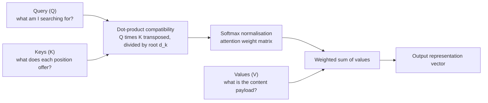

The word *soft* matters: a hard database lookup selects exactly one row. Attention **blends all rows**,
weighted by relevance. That is what makes it differentiable, and therefore trainable.

---

## 07.3 Scaled dot-product attention

Given $Q \in \mathbb{R}^{n \times d_k}$, $K \in \mathbb{R}^{m \times d_k}$ and
$V \in \mathbb{R}^{m \times d_v}$:

$$\text{Attention}(Q, K, V) = \text{softmax}\left(\frac{Q K^T}{\sqrt{d_k}}\right) V$$

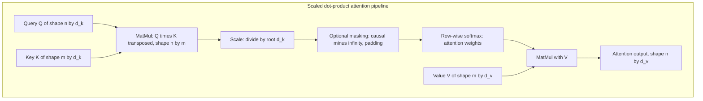

### Why divide by $\sqrt{d_k}$?

The paper compares **additive attention** (Bahdanau) with **dot-product attention**. The only
difference is the scaling factor, and the reason is a variance argument.

**Theoretical and practical performance.** Both have similar theoretical complexity, but dot-product
attention is far faster and more space-efficient in practice because it maps onto optimised matrix
multiplication (BLAS / GEMM) kernels on modern GPUs.

**The variance problem.** Assume the components of $q \in \mathbb{R}^{d_k}$ and $k \in \mathbb{R}^{d_k}$
are independent random variables with mean 0 and variance 1:

$$\mathbb{E}[q_i] = 0, \quad \text{Var}(q_i) = 1, \quad \mathbb{E}[k_i] = 0, \quad \text{Var}(k_i) = 1$$

The dot product is $q \cdot k = \sum_{i=1}^{d_k} q_i k_i$, so:

$$\mathbb{E}[q \cdot k] = \sum_{i=1}^{d_k} \mathbb{E}[q_i]\mathbb{E}[k_i] = 0$$

$$\text{Var}(q_i k_i) = \text{Var}(q_i)\text{Var}(k_i) = 1 \quad\Rightarrow\quad \text{Var}(q \cdot k) = \sum_{i=1}^{d_k} 1 = d_k$$

So the standard deviation of $q \cdot k$ grows as $\sqrt{d_k}$ — the dot products become **large in
magnitude as $d_k$ grows**.

**Consequence on softmax and gradients.** When the inputs to
$\text{softmax}(z_i) = \frac{e^{z_i}}{\sum_j e^{z_j}}$ become large, softmax **saturates**: it assigns
probability near $1.0$ to the largest element and near $0.0$ to all others. In that region the gradient
$\frac{\partial \text{softmax}}{\partial z}$ becomes **vanishingly small**, so learning stalls.

**The solution.** Dividing by $\sqrt{d_k}$ rescales the variance back to 1:

$$\text{Var}\left(\frac{q \cdot k}{\sqrt{d_k}}\right) = \frac{1}{d_k}\text{Var}(q \cdot k) = \frac{d_k}{d_k} = 1$$

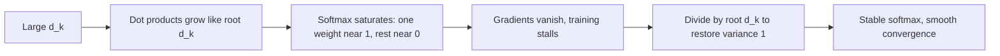

### A tiny worked example (3 tokens, by hand)

Take three tokens and pretend $d_k = 2$ so the arithmetic stays visible:

```text
Queries:  q1 = [1, 0]    q2 = [0, 1]    q3 = [1, 1]
Keys:     k1 = [1, 0]    k2 = [0, 1]    k3 = [1, 1]
Values:   v1 = [10]      v2 = [0]       v3 = [5]

For token 1, the raw scores are q1·k1 = 1, q1·k2 = 0, q1·k3 = 1
Scale by root d_k = root 2:  [0.707, 0.000, 0.707]
Softmax:                     [0.397, 0.206, 0.397]   (sums to 1)
Output for token 1:          0.397*10 + 0.206*0 + 0.397*5 = 5.96
```

The output is a **blend of all values**, weighted by relevance — not a lookup of one row.

```ts
// PSEUDO-CODE — scaled dot-product attention, exactly as in the paper
function attention(Q: Matrix, K: Matrix, V: Matrix, causal: boolean): Matrix {
  const dk = Q.cols;
  let scores = matmul(Q, transpose(K));            // Q K^T  -> n by m
  scores = scale(scores, 1 / Math.sqrt(dk));       // divide by root d_k
  if (causal) scores = maskFuture(scores);         // set future scores to -Infinity
  const weights = softmaxRows(scores);             // each row sums to 1
  return matmul(weights, V);                       // n by d_v
}
```

> **Masking:** causal masking sets pre-softmax scores of *future* positions to $-\infty$, so after
> softmax they become exactly 0. That is how a decoder is prevented from "looking into the future".

---

## 07.4 Multi-head attention

Instead of one attention function over $d_{\text{model}}$ dimensions, the paper projects $Q$, $K$, $V$
$h$ times with different learned projections into $d_k$, $d_k$ and $d_v$ dimensions:

$$\text{MultiHead}(Q, K, V) = \text{Concat}(\text{head}_1, \dots, \text{head}_h) W^O$$

$$\text{where } \text{head}_i = \text{Attention}(Q W_i^Q,\; K W_i^K,\; V W_i^V)$$

### Learned projection matrices

| Matrix | Shape |
| :--- | :--- |
| $W_i^Q$ | $\mathbb{R}^{d_{\text{model}} \times d_k}$ |
| $W_i^K$ | $\mathbb{R}^{d_{\text{model}} \times d_k}$ |
| $W_i^V$ | $\mathbb{R}^{d_{\text{model}} \times d_v}$ |
| $W^O$ | $\mathbb{R}^{h d_v \times d_{\text{model}}}$ |

Base model hyperparameters from the paper:

- $h = 8$ parallel attention heads
- $d_{\text{model}} = 512$
- $d_k = d_v = d_{\text{model}} / h = 512 / 8 = 64$

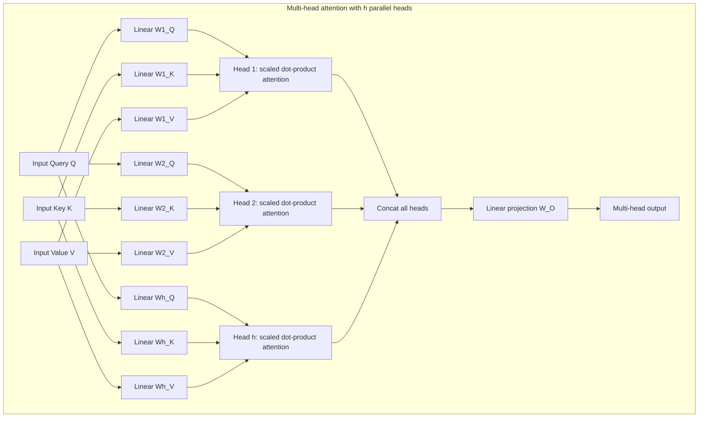

### Cost efficiency and subspace representation

| Question | Answer |
| :--- | :--- |
| Is multi-head attention more expensive than single-head? | **No.** Each head works in $d_k = d_{\text{model}}/h$ dimensions, so total cost matches single-head attention at full $d_{\text{model}}$ |
| Why use multiple heads at all? | With a single head, averaging attention weights over all positions prevents the model from attending to **different representation subspaces simultaneously** |
| What do heads specialise in? | Head 1 might track syntactic coreference ("he" to "Aditya"); head 2 might track semantic verb-object links ("needed" to "laptop"); head 3 might track positional or temporal markers |

> **Practical note for later lectures:** head specialisation is also why *attention visualisation* is a
> debugging tool, not an explanation. A head that lights up does not prove the model used that
> information to decide.

---

## 07.5 The full encoder–decoder transformer

The original transformer targets **sequence-to-sequence translation** (WMT English–German and
English–French).

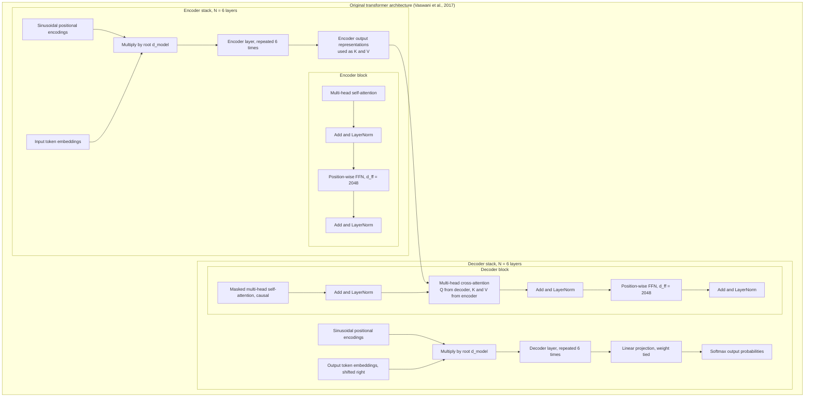

### Encoder stack ($N = 6$)

Each encoder layer has two sub-layers:

1. **Multi-head self-attention**, where $Q$, $K$, $V$ all come from the previous layer's output.
2. **Position-wise feed-forward network.**

Residual connections wrap each sub-layer, followed by layer normalisation:

$$\text{Output} = \text{LayerNorm}(x + \text{SubLayer}(x))$$

Every sub-layer and embedding layer outputs dimension $d_{\text{model}} = 512$ so the residual
additions line up.

### Decoder stack ($N = 6$)

Each decoder layer has **three** sub-layers:

1. **Masked multi-head self-attention** — prevents positions from attending to future positions.
2. **Multi-head cross-attention (encoder–decoder attention)** — $Q$ comes from the previous decoder
   layer, $K$ and $V$ come from the encoder stack.
3. **Position-wise feed-forward network.**

### The three distinct uses of multi-head attention

| # | Application | Where $Q$ comes from | Where $K, V$ come from | What it enables |
| :--- | :--- | :--- | :--- | :--- |
| 1 | **Encoder self-attention** | Previous encoder layer | Same as $Q$ | Every input position sees every other input position |
| 2 | **Decoder causal self-attention** | Previous decoder layer | Same as $Q$, future masked to $-\infty$ | Autoregressive generation without peeking ahead |
| 3 | **Encoder–decoder cross-attention** | Previous decoder layer | Encoder output | Every output token attends over the whole source sentence |

### Position-wise feed-forward network

$$\text{FFN}(x) = \max(0,\; x W_1 + b_1) W_2 + b_2$$

| Property | Value |
| :--- | :--- |
| Input and output dimension | $d_{\text{model}} = 512$ |
| Inner hidden dimension | $d_{ff} = 2048$ (**4x expansion**) |
| Applied how | Identically and independently to each position |
| Equivalent formulation | Two convolutions with kernel size 1 and stride 1 |
| Parameters | Identical across positions, different across layers |

### Embeddings, scaling and weight sharing

- Learned embeddings convert input and target tokens into vectors of dimension $d_{\text{model}} = 512$.
- Embedding weights are multiplied by $\sqrt{d_{\text{model}}} \approx 22.62$ before positional
  encodings are added — this keeps the embedding signal comparable in magnitude to the positional one.
- **Three-way weight sharing (tied weights):** the same weight matrix is shared between the source
  embedding, target embedding and the pre-softmax linear projection, significantly reducing trainable
  parameters.

```ts
// PSEUDO-CODE — one encoder layer, to see how the pieces compose
function encoderLayer(x: Matrix, W: EncoderWeights): Matrix {
  const attn = multiHeadAttention(x, x, x, W.selfAttn, false);   // not causal
  const a = layerNorm(add(x, attn));                             // residual + norm
  const ffn = feedForward(a, W.ffn);                             // 512 -> 2048 -> 512
  return layerNorm(add(a, ffn));                                 // residual + norm
}
```

---

## 07.6 Positional encodings and the linear-offset property

Because the transformer contains no recurrence and no convolution, it has **no built-in notion of
order**. Without help, *"the dog chased the man"* and *"the man chased the dog"* would look identical.
Vaswani et al. fix this by **adding** positional encodings to the input embeddings at the bottom of
both stacks.

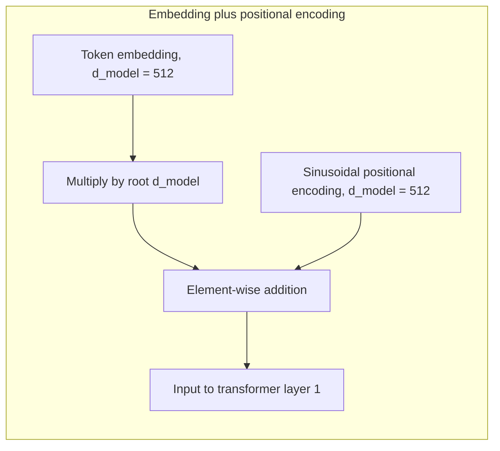

### Sinusoidal formulation

Using sine and cosine of different frequencies across dimensions $2i$ and $2i+1$:

$$PE_{(pos,\,2i)} = \sin\left(\frac{pos}{10000^{2i/d_{\text{model}}}}\right) \qquad PE_{(pos,\,2i+1)} = \cos\left(\frac{pos}{10000^{2i/d_{\text{model}}}}\right)$$

where $pos$ is the token position and $i$ is the dimension index with $0 \le i < d_{\text{model}}/2$.
Wavelengths form a geometric progression from $2\pi$ to $10000 \cdot 2\pi$: low dimensions oscillate
fast (fine position), high dimensions oscillate slowly (coarse position).

### The linear-offset property

Sinusoidal encodings were chosen because for any fixed offset $k$, $PE_{pos+k}$ is a **linear function
of $PE_{pos}$**. Using the trigonometric addition formulas:

$$\sin(\alpha+\beta) = \sin\alpha\cos\beta + \cos\alpha\sin\beta \qquad \cos(\alpha+\beta) = \cos\alpha\cos\beta - \sin\alpha\sin\beta$$

With $\omega_i = \frac{1}{10000^{2i/d_{\text{model}}}}$:

$$PE_{(pos+k,\,2i)} = \sin(\omega_i pos)\cos(\omega_i k) + \cos(\omega_i pos)\sin(\omega_i k)$$
$$PE_{(pos+k,\,2i+1)} = \cos(\omega_i pos)\cos(\omega_i k) - \sin(\omega_i pos)\sin(\omega_i k)$$

which is a 2D rotation matrix:

$$\begin{pmatrix} PE_{(pos+k, 2i)} \\ PE_{(pos+k, 2i+1)} \end{pmatrix} = \begin{pmatrix} \cos(\omega_i k) & \sin(\omega_i k) \\ -\sin(\omega_i k) & \cos(\omega_i k) \end{pmatrix} \begin{pmatrix} PE_{(pos, 2i)} \\ PE_{(pos, 2i+1)} \end{pmatrix}$$

**Why it matters:** the inner product between two positional encodings depends only on their relative
distance $k$. A linear attention mechanism can therefore learn to attend to **relative positions**
without ever being told absolute positions.

```ts
// PSEUDO-CODE — sinusoidal positional encoding for one position
function positionalEncoding(pos: number, dModel: number): number[] {
  const pe: number[] = [];
  for (let i = 0; i < dModel; i += 2) {
    const freq = Math.pow(10000, -i / dModel);
    pe[i]     = Math.sin(pos * freq);      // even dimension
    pe[i + 1] = Math.cos(pos * freq);      // odd dimension
  }
  return pe;
}
// Property: PE(pos + k) is a fixed rotation of PE(pos) -> relative positions are linear
```

### Sinusoidal vs learned positional embeddings

The paper compared learned positional embeddings (Gehring et al., 2017) with sinusoidal ones (Table 3,
row E):

| Approach | Result |
| :--- | :--- |
| Learned embeddings | Nearly identical BLEU ($25.8$ on EN–DE dev) |
| Sinusoidal | Same BLEU, **and** allows the model to extrapolate to sequence lengths longer than those seen in training |

Sinusoidal won because of **extrapolation**, not accuracy.

---

## 07.7 Self-attention vs recurrent vs convolutional layers

The paper explicitly compares the three layer types on three criteria:

1. Total computational complexity per layer.
2. Minimum number of sequential operations (parallelisability).
3. Maximum path length between long-range dependencies.

| Layer type | Complexity per layer | Sequential operations | Maximum path length |
| :--- | :--- | :--- | :--- |
| **Self-attention** | $O(n^2 \cdot d)$ | $O(1)$ | $O(1)$ |
| **Recurrent (RNN/LSTM)** | $O(n \cdot d^2)$ | $O(n)$ | $O(n)$ |
| **Convolutional** | $O(k \cdot n \cdot d^2)$ | $O(1)$ | $O(\log_k n)$ |
| **Restricted self-attention** | $O(r \cdot n \cdot d)$ | $O(1)$ | $O(n/r)$ |

- $n$ — sequence length
- $d$ — representation dimension ($d_{\text{model}}$)
- $k$ — convolutional kernel size
- $r$ — restricted neighbourhood window size

### What each column tells you

1. **$O(1)$ path length.** Shorter paths between distant tokens make long-range dependencies easier to
   learn. Self-attention gives every pair of tokens a direct one-step connection.
2. **$O(1)$ sequential operations.** Self-attention executes as a single matrix operation — maximum GPU
   parallelism — whereas a recurrent layer needs $O(n)$ sequential forward steps.
3. **When self-attention is cheaper ($n < d$).** $O(n^2 d)$ beats $O(n d^2)$ whenever sequence length
   $n$ is smaller than representation dimension $d$. With WordPiece/BPE tokens, typical settings are
   $n \approx 512$ and $d = 512$ or $1024$, so self-attention is faster.
4. **Restricted self-attention.** For very long sequences ($n > d$), attention can be restricted to a
   neighbourhood of size $r$, giving $O(r n d)$. This is the seed of modern **sparse and
   sliding-window attention**.

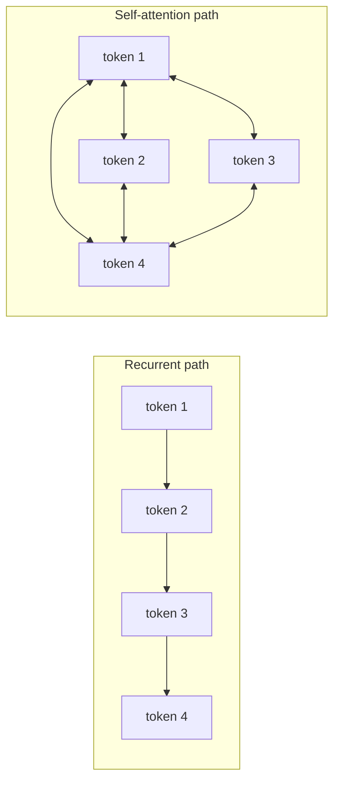

---

## 07.8 Training methodology, regularisation and empirical results

### Datasets and preprocessing

| Dataset | Size | Tokenisation |
| :--- | :--- | :--- |
| **WMT 2014 English–German** | ~4.5 million sentence pairs | Shared source–target vocabulary of ~37,000 **Byte-Pair Encoding (BPE)** tokens |
| **WMT 2014 English–French** | ~36 million sentence pairs | Split into a 32,000 **WordPiece** vocabulary |

Batching was done by approximate sequence length, with roughly **25,000 source tokens and 25,000 target
tokens per batch**.

### Hardware and schedule

| Model | Configuration | Training | Parameters |
| :--- | :--- | :--- | :--- |
| **Base** | $N=6$, $d_{\text{model}}=512$, $d_{ff}=2048$, $h=8$ | 100,000 steps, ~12 hours, 0.4 s per step | ~65 million |
| **Big** | $N=6$, $d_{\text{model}}=1024$, $d_{ff}=4096$, $h=16$ | 300,000 steps, ~3.5 days, 1.0 s per step | ~213 million |

Hardware: a single machine with **8 NVIDIA P100 GPUs**.

### Optimizer and learning-rate schedule

The **Adam optimizer** with $\beta_1 = 0.9$, $\beta_2 = 0.98$, $\epsilon = 10^{-9}$, and an
inverse-square-root decay schedule with linear warmup:

$$\text{lrate} = d_{\text{model}}^{-0.5} \cdot \min\left(\text{step\_num}^{-0.5},\; \text{step\_num} \cdot \text{warmup\_steps}^{-1.5}\right)$$

with $\text{warmup\_steps} = 4000$.

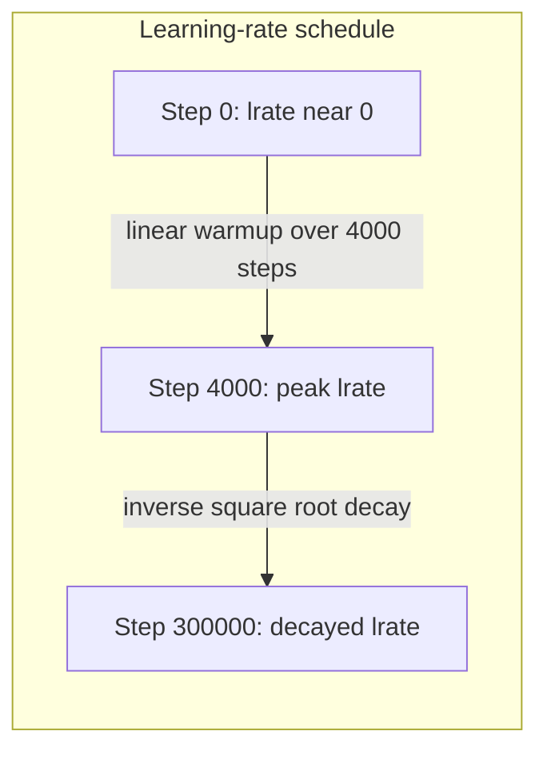

> **Why warmup matters for FDEs:** the schedule is a stabilisation trick, and the same idea appears in
> production as *ramping* a new model version — start with a small share of traffic, grow it, and keep
> a guardrail metric that can stop the ramp.

### Regularisation

| Technique | Setting | Effect |
| :--- | :--- | :--- |
| **Residual dropout** | $P_{drop} = 0.1$ on each sub-layer output before add-and-norm, and on embedding plus positional sums | Prevents overfitting (raised to $0.3$ for the Big EN–DE model) |
| **Label smoothing** | $\epsilon_{ls} = 0.1$ (Szegedy et al.) | *Hurts perplexity* because the model learns to be less certain, but **improves BLEU and translation accuracy** |

> **Label smoothing is the most counter-intuitive result in the paper, and the most useful lesson:**
> the metric that the model optimises internally is not the metric the product is judged on. Choosing
> the right objective can mean deliberately making a training metric worse.

### Translation state-of-the-art results (Table 2)

| Model | EN–DE BLEU | EN–FR BLEU | FLOPs (EN–DE) |
| :--- | :--- | :--- | :--- |
| ByteNet | 23.75 | 39.2 | — |
| GNMT + RL | 24.60 | 39.92 | 2.3 × 10¹⁹ |
| ConvS2S | 25.16 | 40.46 | 9.6 × 10¹⁸ |
| GNMT + RL Ensemble | 26.30 | 41.16 | 1.8 × 10²⁰ |
| ConvS2S Ensemble | 26.36 | 41.29 | 7.7 × 10¹⁹ |
| **Transformer (base)** | **27.3** | **38.1** | **3.3 × 10¹⁸** |
| **Transformer (big)** | **28.4** | **41.8** | **2.3 × 10¹⁹** |

**Key result:** the big transformer set a new state of the art of **28.4 BLEU** on EN–DE — beating all
previous models *and ensembles* by more than 2.0 BLEU — and **41.8** on EN–FR, at **less than a
quarter** of the training cost of previous models.

### Ablations and model variations (Table 3)

| Variation | Finding | Lesson |
| :--- | :--- | :--- |
| **Attention heads (row A)** | Single head ($h=1$, $d_k=512$) loses **0.9 BLEU** (24.9 vs 25.8); too many heads ($h=32$, $d_k=16$) also degrades | Multiple heads help, but each head needs enough capacity |
| **Key size $d_k$ (row B)** | Reducing $d_k$ hurts quality (25.1 BLEU) | Compatibility matching needs sufficient vector capacity |
| **Model size and dropout (rows C and D)** | Bigger models ($d_{\text{model}}=1024$) improve results substantially; dropout is essential | Scale plus regularisation, not scale alone |

### Generalisation: English constituency parsing (Table 4)

A 4-layer transformer was evaluated on English constituency parsing (Penn Treebank, WSJ):

| Setting | Result |
| :--- | :--- |
| WSJ-only training (40k sentences) | **91.3 F1**, beating previous seq2seq RNN models and BerkeleyParser |
| Semi-supervised (17M sentences) | **92.7 F1** |

This demonstrated strong structural generalisation **without task-specific tuning** — the first hint
that the architecture would become general-purpose rather than translation-specific.

---

## 07.9 Worked examples: coreference and polysemy

### Pronoun coreference resolution via attention

> **"Aditya gave Rohit the laptop because he needed it for work."**

Self-attention resolves the ambiguity dynamically by assigning different weights per token:

| Token being processed | Receives highest attention | Interpretation |
| :--- | :--- | :--- |
| **"he"** | "Aditya" and "Rohit" | Both plausible; the distribution stays split |
| **"it"** | "laptop" | Sharp, near-deterministic weight |

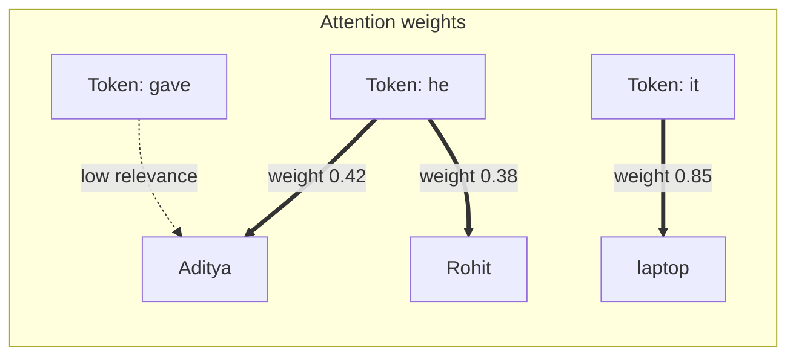

Notice the asymmetry: *"it"* resolves sharply, *"he"* stays genuinely ambiguous. A production system
must therefore not pretend the ambiguity is resolved — which is exactly why Chapter 02's architecture
includes clarification questions and human escalation.

### Context-dependent polysemy disambiguation

| Sentence | Attention partners of "bank" | Activated representation |
| :--- | :--- | :--- |
| *"I **deposited money** in the **bank**."* | "deposited", "money" | Financial institution |
| *"We **sat** on the **bank** of the **river**."* | "sat", "river" | Geographic shore |

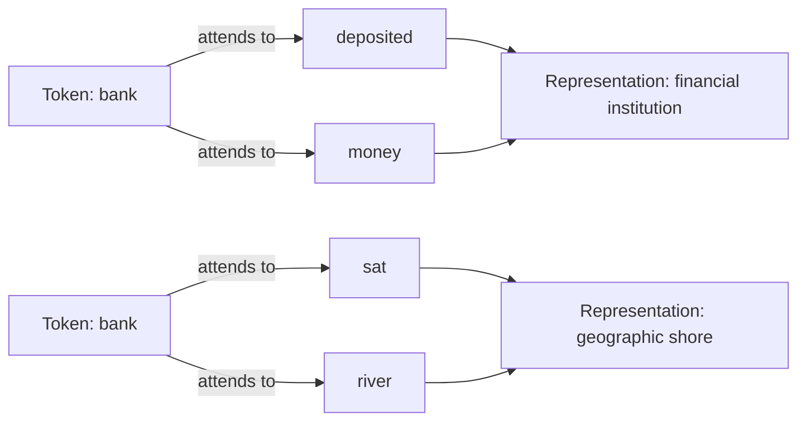

This is the mechanism Chapter 05 said was impossible for count-based models: the *same token* gets
*different representations* depending on its context.

---

## 07.10 Attention is not intelligence by itself

Attention is a mechanism for **weighting contextual relevance**. It is not:

1. a fact-checker that verifies whether a generated claim is true,
2. an internet or enterprise database connection,
3. permission to execute write or delete operations,
4. a guarantee against confident hallucination.

> **Critical distinction for FDEs:** attention explains how the model *mixes information*. It says
> nothing about whether the mixed information is *correct*, *current*, *authorised* or *actionable*.
> Those four properties come from the application layer built in Chapter 02.

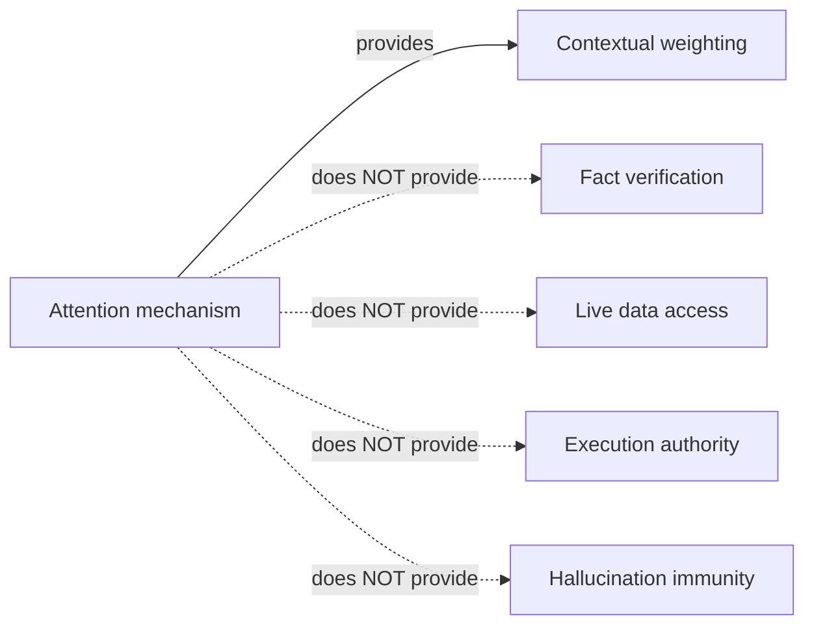

---

## 07.11 Modern LLMs: the decoder-only GPT architecture

Modern LLMs evolved from the encoder–decoder transformer into **decoder-only** architectures (OpenAI's
GPT series, Meta's Llama, Google's Gemini decoder variants). In **December 2022**, OpenAI released
**ChatGPT**, demonstrating decoder-only LLMs at global scale.

### Deconstructing GPT: G — P — T

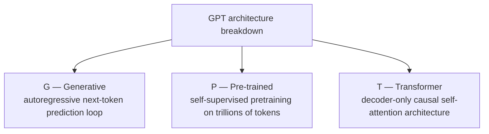

| Letter | Meaning | Mechanism |
| :--- | :--- | :--- |
| **G — Generative** | Produces text autoregressively | $x_{t+1} \sim P(x \mid x_1, x_2, \dots, x_t)$ |
| **P — Pre-trained** | Trained on massive text before any task-specific tuning | Yields a general-purpose foundation model adaptable to support, coding, search and document analysis |
| **T — Transformer** | Decoder-only stack | Causal masking ensures position $t$ attends only to tokens $< t$, so it cannot look into the future |

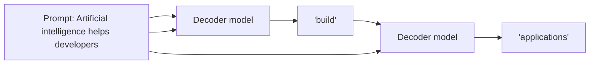

The loop is the whole idea: **each generated token is appended to the context and the model runs
again.** Everything an FDE builds around a chat API is scheduling, caching and constraining this loop.

### Modern attention variants in enterprise production systems

| Technique | What it does | Why it matters in production |
| :--- | :--- | :--- |
| **KV caching** | Stores computed $K$ and $V$ projections of past tokens in GPU VRAM during decoding | Turns generation from $O(n^2)$ recomputation into $O(1)$ per generated token |
| **Grouped-Query Attention (GQA)** | Fewer key/value heads than query heads (Llama 3 uses 8 KV heads for 32 Q heads) | Shrinks KV-cache memory **4x to 8x**, enabling larger context windows |
| **Multi-Query Attention (MQA)** | A single KV head shared by all query heads | Maximum memory saving, with some quality trade-off |
| **FlashAttention (Dao et al.)** | IO-aware exact attention using tiling and online softmax | Cuts GPU memory reads/writes from $O(n^2)$ to $O(n)$; **2x to 4x** faster training and inference |
| **Rotary Position Embeddings (RoPE)** | Applies a rotation to $Q$ and $K$ in complex space instead of adding absolute encodings | Enables seamless context-window extension (the practical descendant of the linear-offset property) |

> **Why an FDE should care:** these five items are the difference between a demo and a service.
> KV cache and GQA decide whether your context window fits in memory; FlashAttention decides latency
> and cost per token; RoPE decides whether you can raise the context limit for a customer's long
> documents. Lecture 25 (vLLM and PagedAttention) takes this further.

---

## Common mistakes

- **Thinking attention "looks things up" hard.** It blends all values by softmax weights.
- **Forgetting the $\sqrt{d_k}$ scaling.** Unscaled dot products saturate softmax and stall training.
- **Assuming multi-head attention costs $h$ times more.** Each head uses $d_{\text{model}}/h$
  dimensions, so total cost is unchanged.
- **Believing the transformer knows word order by default.** It does not; positional encodings add it.
- **Confusing the three attention usages.** Encoder self-attention, decoder causal self-attention and
  cross-attention have different $Q$/$K$/$V$ sources.
- **Thinking $O(n^2)$ attention is free.** Long context has a quadratic cost; that is why restricted,
  sparse, sliding-window and flash variants exist.
- **Reading attention visualisations as explanations.** A high weight is not a causal proof.
- **Believing attention provides truth, access or authority.** It provides contextual weighting only.
- **Assuming decoder-only models are "just smaller encoder–decoders".** GPT has no encoder and no
  cross-attention; the causal mask is doing the work.

## Key takeaways

1. *"Attention Is All You Need"* (Vaswani et al., 2017) removed recurrence and convolution, giving
   **$O(1)$ path length** and **$O(1)$ sequential operations**.
2. Attention is a **soft, differentiable retrieval**: queries match keys, softmax produces weights,
   values are blended.
3. $\text{Attention}(Q,K,V) = \text{softmax}(QK^T/\sqrt{d_k})V$; the $\sqrt{d_k}$ keeps dot-product
   variance at 1 so softmax does not saturate.
4. **Multi-head attention** projects into $h$ subspaces so the model can attend to several kinds of
   relationship at once, at no extra cost.
5. The original transformer is an **encoder–decoder** with $N=6$, $d_{\text{model}}=512$,
   $d_{ff}=2048$, $h=8$, residual connections, layer norm, tied weights and sinusoidal positional
   encodings.
6. **Positional encodings** exist because attention is order-blind; sinusoidal encodings have the
   **linear-offset property** and extrapolate to longer sequences.
7. Self-attention beats recurrence on **path length and parallelism**; it is cheaper when $n < d$.
8. Training details matter: **Adam with warmup and inverse-square-root decay**, dropout $0.1$, label
   smoothing $0.1$ (worse perplexity, better BLEU), **28.4 BLEU EN–DE** at a quarter of the cost.
9. **Attention resolves coreference and polysemy dynamically**, but **attention is not intelligence**:
   no truth, no access, no authority.
10. Modern LLMs are **decoder-only GPT** models (Generative, Pre-trained, Transformer with causal
    masking), optimised by **KV cache, GQA/MQA, FlashAttention and RoPE**.

## Self-check questions

1. Why did recurrence and convolution have to go? Answer with the three comparison criteria.
2. Write the scaled dot-product attention formula and explain each symbol.
3. Show that the variance of $q \cdot k$ is $d_k$, then explain the consequence for softmax gradients.
4. Why does multi-head attention not cost more than single-head attention?
5. Name the three places multi-head attention is used in the original transformer and give the
   $Q$/$K$/$V$ source for each.
6. Why do transformers need positional encodings, and what is the linear-offset property?
7. Give complexity, sequential operations and path length for self-attention, recurrence and convolution.
8. What did label smoothing do to perplexity and to BLEU, and what is the lesson?
9. Explain the causal mask and why it is essential for GPT.
10. Name three modern efficiency techniques and the resource each one saves.

---

### Navigation

- **Previous:** [Chapter 06 — Neural Language Models & the RNN Bottleneck](./06_Neural_Language_Models_and_the_RNN_Bottleneck.md)
- **Next:** [Chapter 08 — The Production AI Stack & the Evolutionary Matrix](./08_Production_AI_Stack_and_Evolutionary_Matrix.md)
- **Source:** `Forward-Deployed-Engineer/Lecture 01/notes/05_Attention_Mechanism_Transformers_and_LLMs.md`
- **Back to index:** [../index.md](../index.md)


