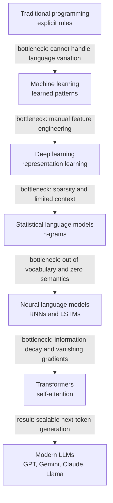
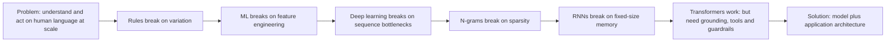
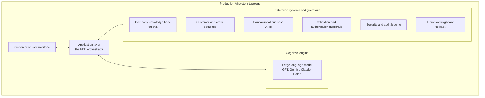
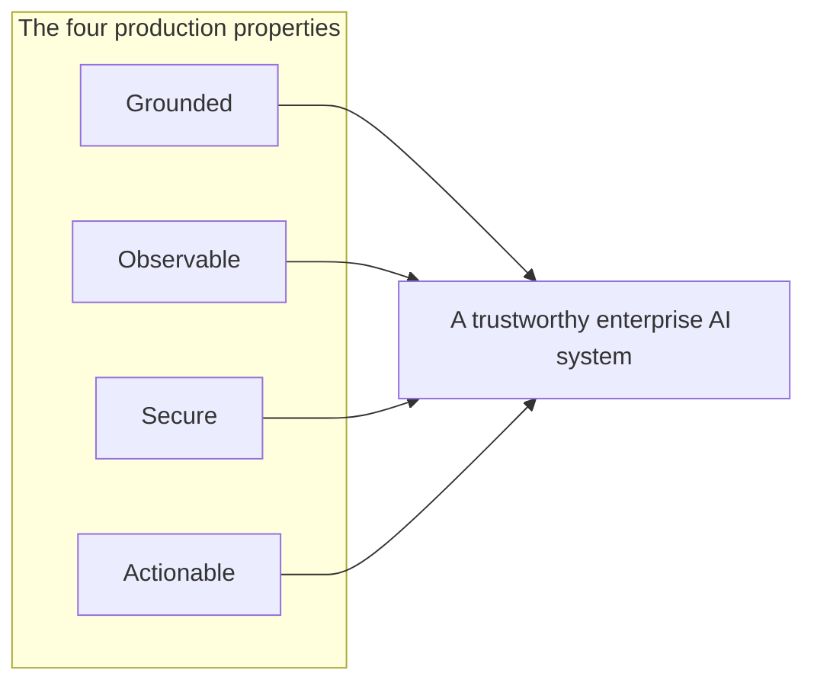
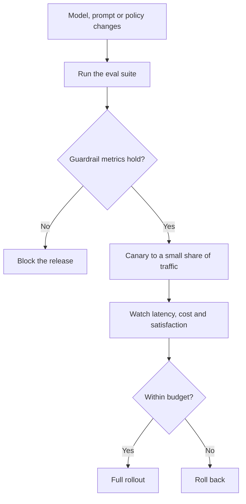
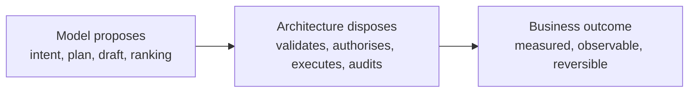
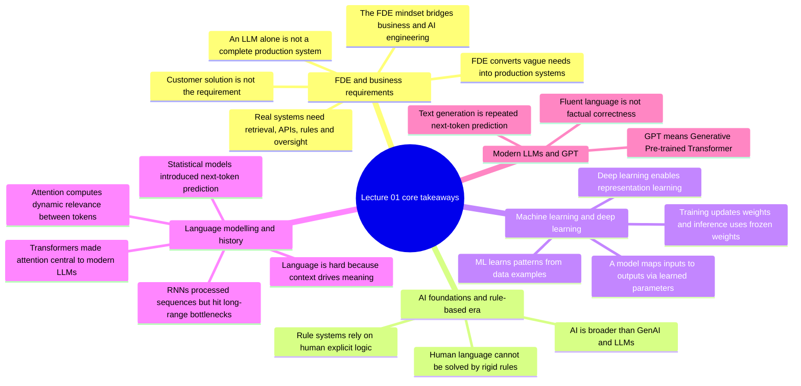
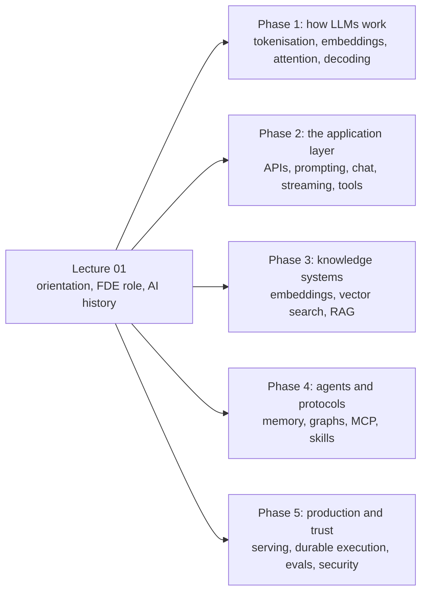

# Chapter 08 — The Production AI Stack & the Evolutionary Matrix

> **Lecture 01 · Chapter 08 of 08** · Level: 🟢 Beginner · Phase 0 — Orientation
> **Source:** `Forward-Deployed-Engineer/Lecture 01/notes/06_Production_Systems_and_Key_Takeaways.md`
> **Roadmap topics:** the enterprise production AI stack (**grounded · observable · secure ·
> actionable**); the evolutionary matrix (rules → ML → n-grams → RNN → Transformer); the FDE mindset.

---

## 08.0 What this chapter is for

Seven chapters built up a chain of ideas. This chapter closes the loop: it puts every generation of AI
side by side, states the criteria a production AI system must satisfy, and connects the whole lecture
back to the FDE role.

By the end you should be able to:

1. Recite the evolutionary matrix and name each generation's bottleneck.
2. Draw the enterprise production AI stack and justify each box.
3. List the six mandatory criteria for production AI systems.
4. State the FDE mindset in one sentence.
5. Recall all 20 key takeaways of Lecture 01.

---

## 08.1 The evolutionary journey of AI technology

Generative AI did not appear overnight. **Every technological shift emerged to resolve a specific
engineering bottleneck of the previous approach.**

### The evolutionary summary matrix

| Generation / era | Core approach | Key breakthrough | Primary limitation |
| :--- | :--- | :--- | :--- |
| **Rule-based systems** | Handwritten IF-THEN rules and facts | Clear, deterministic logic | Impossible to maintain for natural language; brittle rules |
| **Machine learning** | Statistical pattern learning from data | Eliminated manual rule creation | Required manual **feature engineering** per domain |
| **Deep learning** | Multi-layer neural networks | **Representation learning** (automatic feature extraction) | Sequential architectures (RNNs) hit context bottlenecks |
| **Statistical models (n-grams)** | Word co-occurrence counting | Probability estimates of text continuations | **Sparsity**; context restricted to $N \le 3$ |
| **RNNs / LSTMs** | Sequential hidden-state updating | Preserved word order across variable lengths | **Information bottleneck**; early-context decay |
| **Transformers / LLMs** | Self-attention mechanisms | **$O(1)$** direct context links; GPU parallel computation | Needs enterprise scaffolding for grounding and safety |

> **Read the last row twice.** The transformer's limitation is *not* a modelling limitation. It is the
> absence of an application layer — which is precisely the FDE's job, and the subject of the next 30
> lectures.

### The bottleneck chain in one picture

---

## 08.2 The enterprise production AI stack

An FDE does not treat an LLM as a mystical black box. It is a powerful **probabilistic reasoning
engine** inside a larger software stack.

### The four adjectives that define the stack

The roadmap states the stack as **grounded · observable · secure · actionable**. Each adjective maps
to specific boxes:

| Adjective | Meaning | Which boxes deliver it | Failure if missing |
| :--- | :--- | :--- | :--- |
| **Grounded** | Answers come from verified enterprise knowledge and live system state, not from model memory | Knowledge base / retrieval, customer and order database | Confident, fluent, wrong policy answers |
| **Observable** | Every prompt, retrieved chunk, tool call and decision can be traced and replayed | Audit logging, trace IDs, evals | Incidents cannot be explained or reproduced |
| **Secure** | Access control, PII handling and prompt-injection defence are enforced by the application | Guardrails, authorisation, security logging | Data leaks and unauthorised actions |
| **Actionable** | The system performs real work through audited APIs, not just conversation | Business APIs, human approval thresholds | A chatbot that talks but resolves nothing |

### The six mandatory criteria for production AI systems

| # | Criterion | What it means in practice |
| :--- | :--- | :--- |
| 1 | **Useful** | Resolves the true underlying business problem, not a user's curiosity |
| 2 | **Secure** | Strict role-based access control (RBAC), data privacy, prompt-injection defence |
| 3 | **Grounded** | Backed strictly by verified enterprise knowledge bases to prevent hallucinations |
| 4 | **Testable and observable** | Evaluated by continuous automated benchmark suites (evals) with end-to-end tracing |
| 5 | **Reliable** | Handles provider downtime, rate limits and API failures gracefully |
| 6 | **Connected and actionable** | Safely executes business transactions through audited microservice APIs |

---

## 08.3 Non-functional requirements checklist (added depth)

The six criteria above are qualitative. In a real engagement they become the non-functional
requirements you must write down, because they drive architecture:

| Dimension | Question | Typical target | Architectural consequence |
| :--- | :--- | :--- | :--- |
| **Latency** | What is the p95 budget? | First token under 1 s, complete under 5 s | Streaming, smaller model tier, caching, tool timeouts |
| **Cost** | What is the budget per resolved contact? | A fraction of a human contact | Model routing, prompt compression, caching, batching |
| **Reliability** | What happens when a provider is down? | Automatic failover, graceful degradation | Multi-provider abstraction, retries with backoff, circuit breakers |
| **Security** | Who may read or do what? | Least privilege, per-tenant isolation | RBAC, scoped tool permissions, PII redaction |
| **Compliance** | Where may data live, and for how long? | Region pinning, retention limits | Provider choice, storage policy, audit trail |
| **Observability** | Can any answer be reconstructed? | Full trace per request | Trace IDs, prompt and retrieval logging, cost per request |
| **Evaluability** | How do we know it still works after a change? | Regression suite run per release | Golden datasets, automated evals, canary rollout |
| **Escalation** | How does a human take over? | Context handed over in one step | Session state, summarised context, escalation API |

> **This diagram is the missing piece in most failed AI projects.** They ship a model update the way
> they would ship a CSS change. In an AI system the *behaviour* changed, so the *evidence* must be
> regenerated every time.

---

## 08.4 The FDE mindset: the model proposes, the architecture disposes

| If you think... | The FDE reality is... |
| :--- | :--- |
| "The model is the product" | The model is one dependency, replaceable behind an interface |
| "A better model will fix it" | Ungrounded is ungrounded at every model size |
| "It answered correctly in the demo" | Correctness must be measured on real traffic with guardrails |
| "We will add security later" | Authorisation and audit are architectural, not additive |
| "The customer asked for a chatbot" | The requirement is the pain behind the request (Chapter 01) |

Three habits that follow from the mindset:

1. **Treat the model as probabilistic infrastructure.** Version it, route between providers, cache it,
   rate-limit it, and fail over from it.
2. **Keep every guarantee in deterministic code.** Authorisation, thresholds, workflow order,
   idempotency and audit live outside the model (Chapter 02).
3. **Write the metric before the code.** If you cannot state the number that must move, you are not
   ready to build (Chapter 01).

---

## 08.5 The 20 fundamental key takeaways

| # | Takeaway |
| :--- | :--- |
| 1 | **Request vs requirement:** a proposed solution (for example "build a chatbot") is rarely the actual business requirement |
| 2 | **The FDE role:** work embedded near real customer problems, translating business needs into production-ready architectures |
| 3 | **AI taxonomy:** artificial intelligence is far broader than generative AI or LLMs |
| 4 | **Symbolic logic:** rule-based systems depend on humans explicitly defining domain knowledge and logic |
| 5 | **Linguistic complexity:** human language has too many contextual variations, idioms and nuances for handwritten rules |
| 6 | **Machine learning shift:** systems learn useful predictive patterns directly from data examples |
| 7 | **Model abstraction:** a model is a computational function mapping inputs to outputs using learned numerical parameters |
| 8 | **Training vs inference:** training updates weights; inference executes with frozen weights |
| 9 | **Representation learning:** deep learning discovers hierarchical internal features directly from raw data |
| 10 | **Context superiority:** natural language is uniquely difficult because token meaning depends on surrounding context |
| 11 | **Statistical foundations:** statistical language models introduced the core idea of predicting likely continuations |
| 12 | **The RNN bottleneck:** recurrent networks processed language sequentially but suffered severe context decay |
| 13 | **The role of attention:** attention lets positions dynamically examine and weight other positions |
| 14 | **The transformer impact:** self-attention enabled massive GPU parallelisation and became the basis of modern LLMs |
| 15 | **Decoding GPT:** GPT stands for **G**enerative **P**re-trained **T**ransformer |
| 16 | **Autoregressive generation:** GPT-style models generate text through repeated next-token prediction |
| 17 | **Fluency vs factuality:** syntactic fluency does not guarantee factual correctness |
| 18 | **Application scaffolding:** an LLM alone is not a complete, production-ready enterprise application |
| 19 | **Production requirements:** real systems need retrieval, APIs, business logic, security guardrails, evaluation suites and human oversight |
| 20 | **Engineering mindset:** bridging the gap between a probabilistic model and a secure, reliable platform is where the FDE mindset becomes essential |

---

## 08.6 Where Lecture 01 hands off to the rest of the curriculum

| What Lecture 01 established | Where it is developed |
| :--- | :--- |
| The requirement contract and discovery brief | Every lecture's Build and Gate |
| Grounded production architecture | Lectures 04, 08, 09, 10, 16, 17 |
| Tokens, embeddings, next-token prediction | Lecture 02 |
| Attention, transformers, decoding | Lecture 03 |
| Prompting, chat context, streaming | Lectures 05, 06, 07 |
| Retrieval, vector search, RAG | Lectures 12 to 18 |
| Memory, graphs, MCP, skills | Lectures 19 to 23 |
| Serving, latency and cost | Lectures 25, 27 |
| Evals, security and guardrails | Lectures 30, 31 |

---

## Common mistakes

- **Reading the evolutionary matrix as a story about smarter models.** It is a story about *removed
  bottlenecks*; each generation exists because the previous one broke.
- **Assuming the newest generation replaces the older ones everywhere.** Rules still own authorisation
  and policy; classifiers still own cheap routing; n-grams still power some ranking.
- **Treating "grounded" as "we use RAG".** Grounding means the answer is traceable to verified
  knowledge and live state — which also requires freshness, citations and refusal behaviour.
- **Treating "observable" as "we have logs".** Observability means a decision can be *reconstructed*:
  prompt, retrieved context, tool calls, model version, cost.
- **Adding guardrails after the first incident.** Security and authorisation are architectural.
- **Shipping prompt or model changes without re-running evals.** Behaviour changed; evidence must be
  regenerated.
- **Measuring only the primary metric.** Guardrails are what stop a system from "improving" by being
  confidently wrong.
- **Believing the FDE's job ends at deployment.** Production delivery includes maintenance, cost,
  latency, handoff and iteration.

## Key takeaways

1. Every AI generation exists to **remove the previous generation's bottleneck**; the matrix has six
   rows from rule-based systems to transformers.
2. The transformer's remaining limitation is **not modelling — it is scaffolding**: grounding,
   observability, security, action.
3. The production stack is an **application layer** around a probabilistic engine, wired to knowledge,
   data, APIs, guardrails and humans.
4. The four properties are **grounded, observable, secure, actionable**.
5. The six mandatory criteria are **useful, secure, grounded, testable and observable, reliable,
   connected and actionable**.
6. Those criteria become **non-functional requirements**: latency, cost, reliability, security,
   compliance, observability, evaluability, escalation.
7. **The model proposes; the architecture disposes.**
8. The lecture's 20 takeaways reduce to one sentence: *a fluent model is not a system — the FDE builds
   the system around it, against a measured business requirement.*

## Self-check questions

1. Name the six rows of the evolutionary matrix and the bottleneck that ended each generation.
2. Why is "the transformer needs enterprise scaffolding" a statement about the application layer
   rather than about model quality?
3. Map each of the four adjectives (grounded, observable, secure, actionable) to a box in the stack.
4. List the six mandatory production criteria and give one failure mode for each.
5. Which non-functional requirement forces streaming, and which forces a multi-provider abstraction?
6. Explain "the model proposes; the architecture disposes" using the refund example.
7. Recite five of the 20 key takeaways from memory.

---

### Navigation

- **Previous:** [Chapter 07 — Attention, Transformers & Modern LLMs](./07_Attention_Transformers_and_Modern_LLMs.md)
- **Complete notes:** [Lecture 01 — Complete Notes](./Lecture_01_Complete_Notes.md)
- **Source:** `Forward-Deployed-Engineer/Lecture 01/notes/06_Production_Systems_and_Key_Takeaways.md`
- **Back to index:** [../index.md](../index.md)

