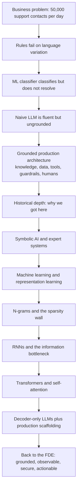
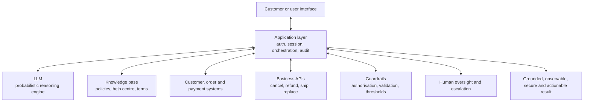

# Lecture 01 — Complete Notes
## Introduction to Forward Deployed Engineering & the History of AI

> **Phase:** 0 · Orientation · **Level:** 🟢 Beginner
> **Scope:** a single-pass consolidation of the eight chapter notes in this folder.
> **How to use this file:** read it to *revise and navigate*. It is deliberately shorter than the
> chapters and every section links to the chapter that explains it in full.
>
> | Chapter | File |
> | :--- | :--- |
> | 01 · The FDE role & requirement discovery | [01_The_FDE_Role_and_Requirement_Discovery.md](./01_The_FDE_Role_and_Requirement_Discovery.md) |
> | 02 · From vague request to grounded production system | [02_From_Vague_Request_to_Grounded_Production_System.md](./02_From_Vague_Request_to_Grounded_Production_System.md) |
> | 03 · AI foundations & rule-based systems | [03_AI_Foundations_and_Rule_Based_Systems.md](./03_AI_Foundations_and_Rule_Based_Systems.md) |
> | 04 · Machine learning & deep learning foundations | [04_Machine_Learning_and_Deep_Learning_Foundations.md](./04_Machine_Learning_and_Deep_Learning_Foundations.md) |
> | 05 · Natural language challenges & statistical language models | [05_Natural_Language_Challenges_and_Statistical_Language_Models.md](./05_Natural_Language_Challenges_and_Statistical_Language_Models.md) |
> | 06 · Neural language models & the RNN bottleneck | [06_Neural_Language_Models_and_the_RNN_Bottleneck.md](./06_Neural_Language_Models_and_the_RNN_Bottleneck.md) |
> | 07 · Attention, transformers & modern LLMs | [07_Attention_Transformers_and_Modern_LLMs.md](./07_Attention_Transformers_and_Modern_LLMs.md) |
> | 08 · Production AI stack & evolutionary matrix | [08_Production_AI_Stack_and_Evolutionary_Matrix.md](./08_Production_AI_Stack_and_Evolutionary_Matrix.md) |

---

## 1. Executive summary

**The lecture in five sentences.**

1. A customer's *proposed solution* ("build an AI chatbot") is almost never the *requirement*; an FDE
   discovers the real problem — for the e-commerce case, *reduce the time required to resolve customer
   problems without reducing accuracy or trust* — and writes it down with a measurable metric.
2. The three obvious solutions to that problem all fail in specific, instructive ways: **rules** break
   on language variation, **ML classifiers** classify instead of resolve, and **naïve LLMs** are
   fluent but ungrounded.
3. The fix is architectural: an **application layer** around the model that owns knowledge, data,
   authorisation, execution, audit and human escalation — because *text generation is not an action*.
4. Historically, AI moved from **handwritten rules** (Turing 1950, McCarthy 1956, ELIZA 1966, expert
   systems) to **learned patterns** (ML, then deep learning), then to **statistical language models**
   (n-grams), then to **recurrent networks** — each generation dying of a specific bottleneck:
   combinatorial explosion, feature engineering, sparsity, and finally a fixed-size hidden state.
5. In 2017 *"Attention Is All You Need"* removed recurrence and convolution entirely, giving
   **$O(1)$ path length and $O(1)$ sequential operations**; today's LLMs are **decoder-only GPT**
   models built on that idea — and they still need the scaffolding from sentence 3, which is the rest
   of this curriculum.

**The one-line thesis of the repository:** *the model proposes; your architecture disposes.*

---

## 2. The arc of the lecture in one diagram

---

## 3. Cheat sheet

### 3.1 Timeline

| Year | Event | Why it matters |
| :--- | :--- | :--- |
| 1950 | Turing, *Computing Machinery and Intelligence* | Replaces "can machines think?" with an observable test |
| 1956 | Dartmouth Conference — McCarthy coins "Artificial Intelligence" | The field gets a name, a promise and a hype cycle |
| 1966 | ELIZA (Weizenbaum, MIT) | Proves that fluency creates the illusion of understanding |
| 1970s–80s | Expert systems (DENDRAL, MYCIN, XCON) | Fact base + rule base + inference engine; dies of the knowledge-acquisition bottleneck |
| 1990s | Statistical ML replaces handwritten rules | Patterns learned from data instead of written by hand |
| 2012 | Deep learning breakthrough in vision | Representation learning removes the feature-engineering bottleneck |
| 2017 | *Attention Is All You Need* (Vaswani et al.) | Recurrence and convolution removed; transformer introduced |
| 2022 | ChatGPT (December) | Decoder-only LLMs at global scale |

### 3.2 Terminology

| Term | One-line definition | Chapter |
| :--- | :--- | :--- |
| **Request vs requirement** | The proposed solution vs the pain and the metric behind it | [01](./01_The_FDE_Role_and_Requirement_Discovery.md) |
| **Primary vs guardrail metric** | The number that must move vs the numbers that must not regress | [01](./01_The_FDE_Role_and_Requirement_Discovery.md) |
| **Grounded architecture** | Model plus knowledge, data, tools, guardrails and humans | [02](./02_From_Vague_Request_to_Grounded_Production_System.md) |
| **Tool contract** | A typed, authorised, idempotent, audited action the model may *propose* | [02](./02_From_Vague_Request_to_Grounded_Production_System.md) |
| **HITL threshold** | The value above which a human must approve an action | [02](./02_From_Vague_Request_to_Grounded_Production_System.md) |
| **Expert system** | Fact base + rule base + inference engine | [03](./03_AI_Foundations_and_Rule_Based_Systems.md) |
| **ELIZA effect** | Humans project understanding onto fluent pattern matchers | [03](./03_AI_Foundations_and_Rule_Based_Systems.md) |
| **Combinatorial explosion** | Rule count and condition combinations grow faster than value | [03](./03_AI_Foundations_and_Rule_Based_Systems.md) |
| **Model** | $Y = f(X; \Theta)$ — a function with learned parameters | [04](./04_Machine_Learning_and_Deep_Learning_Foundations.md) |
| **Training vs inference** | Updating $\Theta$ vs reading a frozen $\Theta$ | [04](./04_Machine_Learning_and_Deep_Learning_Foundations.md) |
| **Representation learning** | The model learns its own hierarchical features | [04](./04_Machine_Learning_and_Deep_Learning_Foundations.md) |
| **N-gram / Markov assumption** | Next token depends only on the previous $N-1$ tokens | [05](./05_Natural_Language_Challenges_and_Statistical_Language_Models.md) |
| **Sparsity** | Unseen n-grams get probability zero | [05](./05_Natural_Language_Challenges_and_Statistical_Language_Models.md) |
| **Perplexity** | How surprised a model is by held-out text (not usefulness) | [05](./05_Natural_Language_Challenges_and_Statistical_Language_Models.md) |
| **Embedding** | A dense vector whose geometry encodes meaning | [06](./06_Neural_Language_Models_and_the_RNN_Bottleneck.md) |
| **Hidden state $h_t$** | The RNN's fixed-size running summary | [06](./06_Neural_Language_Models_and_the_RNN_Bottleneck.md) |
| **Information bottleneck** | All history compressed into one fixed-size vector | [06](./06_Neural_Language_Models_and_the_RNN_Bottleneck.md) |
| **Attention** | Soft, differentiable weighting of values by query-key similarity | [07](./07_Attention_Transformers_and_Modern_LLMs.md) |
| **Multi-head attention** | $h$ attention operations in parallel subspaces | [07](./07_Attention_Transformers_and_Modern_LLMs.md) |
| **Causal mask** | Future positions set to $-\infty$ so the decoder cannot peek | [07](./07_Attention_Transformers_and_Modern_LLMs.md) |
| **KV cache** | Stored key/value projections that make decoding $O(1)$ per token | [07](./07_Attention_Transformers_and_Modern_LLMs.md) |
| **Grounding** | Answers traceable to verified knowledge and live state | [08](./08_Production_AI_Stack_and_Evolutionary_Matrix.md) |

---

### 3.3 Formulas

| Formula | Meaning | Chapter |
| :--- | :--- | :--- |
| $Y = f(X; \Theta)$ | A model: input to output via learned parameters | [04](./04_Machine_Learning_and_Deep_Learning_Foundations.md) |
| $z = \sum_i w_i x_i$ | Hand-engineered linear classifier (synthetic neuron) | [04](./04_Machine_Learning_and_Deep_Learning_Foundations.md) |
| $P(w_1 \dots w_m) = \prod_i P(w_i \mid w_1 \dots w_{i-1})$ | Language model chain rule | [05](./05_Natural_Language_Challenges_and_Statistical_Language_Models.md) |
| $P(\text{machine} \mid \text{like}) = 2/3$ | Bigram maximum-likelihood estimate | [05](./05_Natural_Language_Challenges_and_Statistical_Language_Models.md) |
| $h_t = \tanh(W_{hh}h_{t-1} + W_{xh}x_t + b_h)$ | The RNN recurrence | [06](./06_Neural_Language_Models_and_the_RNN_Bottleneck.md) |
| $\text{Attention}(Q,K,V) = \text{softmax}(QK^T/\sqrt{d_k})V$ | Scaled dot-product attention | [07](./07_Attention_Transformers_and_Modern_LLMs.md) |
| $\text{Var}(q \cdot k) = d_k$ | Why the $\sqrt{d_k}$ scaling exists | [07](./07_Attention_Transformers_and_Modern_LLMs.md) |
| $\text{MultiHead} = \text{Concat}(\text{head}_1 \dots \text{head}_h)W^O$ | Multi-head attention | [07](./07_Attention_Transformers_and_Modern_LLMs.md) |
| $PE_{(pos,2i)} = \sin(pos / 10000^{2i/d_{\text{model}}})$ | Sinusoidal positional encoding | [07](./07_Attention_Transformers_and_Modern_LLMs.md) |
| $\text{FFN}(x) = \max(0, xW_1+b_1)W_2+b_2$ | Position-wise feed-forward network | [07](./07_Attention_Transformers_and_Modern_LLMs.md) |

### 3.4 Complexity and architecture numbers

| Item | Value |
| :--- | :--- |
| Self-attention | $O(n^2 d)$ compute, $O(1)$ sequential ops, $O(1)$ path length |
| Recurrent layer | $O(n d^2)$ compute, $O(n)$ sequential ops, $O(n)$ path length |
| Convolutional layer | $O(k n d^2)$ compute, $O(1)$ sequential ops, $O(\log_k n)$ path length |
| Restricted self-attention | $O(r n d)$ compute, path length $O(n/r)$ |
| Base transformer | $N=6$, $d_{\text{model}}=512$, $d_{ff}=2048$, $h=8$, $d_k=d_v=64$, ~65M params |
| Big transformer | $N=6$, $d_{\text{model}}=1024$, $d_{ff}=4096$, $h=16$, ~213M params |
| Hardware | 8 NVIDIA P100 GPUs; 12 hours (base) and 3.5 days (big) |
| Optimizer | Adam, $\beta_1=0.9$, $\beta_2=0.98$, $\epsilon=10^{-9}$, warmup 4000 steps |
| Regularisation | Residual dropout 0.1 (0.3 for big EN–DE), label smoothing 0.1 |
| Results | 28.4 BLEU EN–DE, 41.8 BLEU EN–FR, under a quarter of the previous training cost |

### 3.5 The e-commerce case at a glance

| Item | Value |
| :--- | :--- |
| Volume | 50,000 support contacts per day |
| Query families | Order status, wrong/damaged item, policy question, payment anomaly, cancel/refund, delivery dispute |
| True requirement | Reduce resolution time without reducing accuracy or trust |
| Primary metric | Mean time to resolution; cost per resolved contact |
| Guardrail metrics | CSAT, grounding rate, escalation precision, refund error rate, audit completeness |
| First thin slice | Highest-volume, lowest-risk family: order status, read-only, one data source |

### 3.6 The production stack in one diagram

---

## 4. Decision tables

### 4.1 Rules vs a learned model

| Situation | Use rules (deterministic code) | Use a learned model |
| :--- | :---: | :---: |
| Decision must be explainable and auditable | ✅ | |
| Decision must never be violated (money, safety, compliance) | ✅ | |
| Logic is small, stable and enumerable | ✅ | |
| Input is free-form natural language | | ✅ |
| Judgement is fuzzy and contextual | | ✅ |
| Wrong answers are recoverable (draft, rank, summarise) | | ✅ |

### 4.2 Which "AI" approach for a given task

| Task shape | Best first choice | Why |
| :--- | :--- | :--- |
| High-volume, narrow, stable decision (routing, urgency) | Trained classifier or rules | Cheap, fast, predictable |
| Open-ended language with no labels | LLM with retrieval and tools | No training data needed; iterate on prompts |
| Style, format and behaviour consistency at scale | Fine-tuning | Behaviour lives in the weights |
| Knowledge that changes weekly | Retrieval, not fine-tuning | Freshness without retraining |
| Exact arithmetic or eligibility logic | Deterministic code | Models are not calculators or policy engines |

### 4.3 Read vs write vs human approval

| Action type | Risk | Automation rule |
| :--- | :--- | :--- |
| Read (order status, policy lookup) | Low | Execute automatically, log everything |
| Draft (compose a reply, prepare a refund request) | Low to medium | Auto-generate, human sends |
| Write within threshold (small refund) | Medium | Execute with authorisation, idempotency and audit |
| Write above threshold | High | Queue for human approval with full context |
| Irreversible or money-moving at scale | Critical | Dual control, rate limits, kill switch |

### 4.4 Architecture choices that recur later in the curriculum

| Requirement | Choice | Where it is covered |
| :--- | :--- | :--- |
| Long context with bounded memory | KV cache plus GQA/MQA | [07](./07_Attention_Transformers_and_Modern_LLMs.md), Lecture 25 |
| Lower latency | Streaming, smaller model tier, caching | Lectures 07, 25 |
| Lower cost per contact | Model routing, prompt compression, caching | Lectures 04, 27 |
| Provider outage tolerance | Multi-provider abstraction, retries, circuit breakers | Lecture 04 |
| Knowledge freshness | Retrieval over generation | Lectures 12–18 |
| Deterministic guarantees | Rules and validation outside the model | [02](./02_From_Vague_Request_to_Grounded_Production_System.md), Lecture 31 |
| Trustworthy autonomy | Tool contracts, HITL thresholds, audit trails | [02](./02_From_Vague_Request_to_Grounded_Production_System.md), Lectures 09, 10, 31 |

### 4.5 "Why did this generation die?" quick reference

| Generation | Killed by | Fixed by |
| :--- | :--- | :--- |
| Rules / expert systems | Combinatorial explosion; knowledge-acquisition bottleneck | Learning patterns from data |
| Traditional ML | Feature engineering | Representation learning |
| Deep learning on sequences | Fixed-size hidden state; sequential computation | Attention over all positions |
| N-grams | Sparsity; $V^N$ parameter growth; no semantics | Continuous embeddings plus unbounded context |
| RNN / LSTM | Vanishing gradients; long-range decay | Transformer self-attention |
| Transformer (today) | No inherent grounding, no authority, no truth | The application layer — this curriculum |

---

## 5. Misconceptions

| # | Misconception | Reality | Chapter |
| :--- | :--- | :--- | :--- |
| 1 | "The client asked for a chatbot, so the requirement is a chatbot." | That is a proposed solution; the requirement is the pain plus a metric | [01](./01_The_FDE_Role_and_Requirement_Discovery.md) |
| 2 | "A fluent answer is a correct answer." | Fluency is a model property; correctness is a system property | [02](./02_From_Vague_Request_to_Grounded_Production_System.md) |
| 3 | "Text generation is an action." | Generating "your order is cancelled" changes nothing | [02](./02_From_Vague_Request_to_Grounded_Production_System.md) |
| 4 | "AI means LLMs." | AI ⊃ ML ⊃ DL ⊃ Generative AI / LLMs | [03](./03_AI_Foundations_and_Rule_Based_Systems.md) |
| 5 | "Rule-based systems were a dead end." | Their descendants — policy engines and guardrails — are still mandatory | [03](./03_AI_Foundations_and_Rule_Based_Systems.md) |
| 6 | "ELIZA was just a toy." | It demonstrated the human over-trust failure mode that is still present today | [03](./03_AI_Foundations_and_Rule_Based_Systems.md) |
| 7 | "Prompting trains the model." | Parameters stay frozen; only the context changes | [04](./04_Machine_Learning_and_Deep_Learning_Foundations.md) |
| 8 | "A model learns the truth." | It learns statistical correlations, including the flaws in its data | [04](./04_Machine_Learning_and_Deep_Learning_Foundations.md) |
| 9 | "Bigger corpora remove n-gram sparsity." | The space grows as $V^N$; it cannot be enumerated | [05](./05_Natural_Language_Challenges_and_Statistical_Language_Models.md) |
| 10 | "Good perplexity means a good assistant." | Perplexity measures prediction, not usefulness | [05](./05_Natural_Language_Challenges_and_Statistical_Language_Models.md) |
| 11 | "RNNs remember the whole document." | They compress it into one fixed-size vector | [06](./06_Neural_Language_Models_and_the_RNN_Bottleneck.md) |
| 12 | "LSTMs solved long-range dependencies." | They mitigated vanishing gradients; the bottleneck remained | [06](./06_Neural_Language_Models_and_the_RNN_Bottleneck.md) |
| 13 | "Attention is a hard lookup." | It is a soft, differentiable blend of all values | [07](./07_Attention_Transformers_and_Modern_LLMs.md) |
| 14 | "Multi-head attention is $h$ times slower." | Each head is $d_{\text{model}}/h$ wide; total cost is unchanged | [07](./07_Attention_Transformers_and_Modern_LLMs.md) |
| 15 | "Transformers inherently know word order." | They do not; positional encodings supply order | [07](./07_Attention_Transformers_and_Modern_LLMs.md) |
| 16 | "Attention equals intelligence." | It provides contextual weighting only — no truth, access or authority | [07](./07_Attention_Transformers_and_Modern_LLMs.md) |
| 17 | "A better model removes the need for scaffolding." | Ungrounded is ungrounded at every model size | [08](./08_Production_AI_Stack_and_Evolutionary_Matrix.md) |
| 18 | "Security and evals can be added later." | Authorisation, audit and evaluation are architectural | [08](./08_Production_AI_Stack_and_Evolutionary_Matrix.md) |
| 19 | "Deflection rate is the right success metric." | Deflection without resolution rewards making customers give up | [01](./01_The_FDE_Role_and_Requirement_Discovery.md) |
| 20 | "The demo worked, so the system works." | Demos use curated data; production is the long tail | [01](./01_The_FDE_Role_and_Requirement_Discovery.md) |

---

## 6. Top mistakes across all chapters

1. **Order-taking** — building the requested solution instead of solving the discovered problem.
2. **No baseline** — claiming improvement without a before-number.
3. **Metric-free requirements** — "make support better" has no definition of done.
4. **Letting the model call write APIs directly** — instead of proposing validated tool calls.
5. **Missing idempotency** — retries produce double refunds.
6. **No read-back after a write** — confirming based on what the model believed.
7. **Trying to enumerate language with rules** — combinatorial explosion.
8. **Believing a bigger model fixes a data or grounding problem.**
9. **Treating prompting as training** — and then wondering why knowledge is stale or expensive.
10. **Assuming fluency implies correctness** — the ELIZA failure mode, now at scale.

---

## 7. Glossary

| Term | Definition |
| :--- | :--- |
| **Actionable** | A property of a production AI system: it performs real, audited work through business APIs rather than only producing text. |
| **Attention** | A mechanism that computes a weighted combination of values, where weights come from query-key similarity; the core operation of the transformer. |
| **Autoregressive generation** | Producing output one token at a time, each conditioned on all previously produced tokens. |
| **Backoff / interpolation** | Classical smoothing techniques that avoid zero probabilities by falling back to shorter contexts or mixing estimates. |
| **Beam search** | A decoding strategy that keeps the best $k$ partial sequences instead of committing greedily to one. |
| **Information bottleneck** | The structural limit created by compressing all context into a single fixed-size vector. |
| **Causal mask** | A mask that sets attention scores of future positions to $-\infty$ so a decoder cannot see ahead. |
| **Combinatorial explosion** | The super-linear growth of required rules or n-grams as conditions, phrasings or $N$ increase. |
| **Context window** | The maximum number of tokens a model can condition on in one call. |
| **Coreference** | The task of resolving pronouns and referring expressions to the entities they denote. |
| **Cross-attention** | Attention where queries come from one sequence (decoder) and keys/values from another (encoder). |
| **Deflection rate** | The share of contacts that never reach a human; dangerous as a primary metric unless paired with resolution. |
| **Discovery brief** | The one-page artefact of requirement discovery: situation, evidence, root problems, requirement, scope, guardrails, thin slice, risks. |
| **Dropout** | A regularisation technique that randomly zeroes activations during training to prevent overfitting. |
| **ELIZA effect** | The human tendency to attribute understanding to systems that produce fluent, contextually plausible language. |
| **Embedding** | A dense vector representation of a token, learned so geometric closeness reflects semantic similarity. |
| **Encoder–decoder** | A two-stack architecture where one stack reads the input and the other generates the output. |
| **Eval** | A repeatable quantitative test suite for model or system behaviour, used as a release gate. |
| **Exposure bias** | The mismatch between training (perfect previous tokens) and inference (the model's own previous tokens). |
| **Feature engineering** | Manually constructing input features for a model; the bottleneck deep learning removed. |
| **Feed-forward network (FFN)** | The position-wise two-layer network in each transformer block, expanding to $4\times$ the model dimension. |
| **Grounded** | Backed by verified enterprise knowledge and live state, so answers can be traced rather than invented. |
| **Guardrail metric** | A metric that must not regress while the primary metric improves. |
| **Hallucination** | Confidently generated content not supported by fact or by the provided context. |
| **Hidden state ($h_t$)** | The RNN's running summary vector, updated each step and passed forward. |
| **Human-in-the-loop (HITL)** | A design in which a human approves actions above a risk threshold. |
| **Idempotency** | The property that repeating a request does not repeat its side effects. |
| **KV cache** | Cached key and value projections for processed tokens, avoiding recomputation during decoding. |
| **Label smoothing** | A regularisation technique that softens hard targets; it worsens perplexity but improved BLEU in the transformer paper. |
| **Layer normalisation** | Normalisation across features within a layer, used with residual connections in the transformer. |
| **Long-range dependency** | A relationship between two tokens that are far apart in the sequence. |

---

## 7. Glossary (continued)

| Term | Definition |
| :--- | :--- |
| **Markov assumption** | The assumption that the next token depends only on the previous $N-1$ tokens. |
| **Multi-head attention** | Running $h$ attention operations in parallel over projected subspaces, then concatenating. |
| **N-gram** | A contiguous sequence of $N$ tokens used as context for predicting the next token. |
| **Observable** | Every prompt, retrieval, tool call and decision can be traced and replayed. |
| **Perplexity** | Exponential of average negative log-likelihood; how well a language model predicts held-out text. |
| **Polysemy** | A word having multiple meanings that must be resolved by context. |
| **Positional encoding** | A signal added to token embeddings to give the order-blind transformer information about positions. |
| **Primary metric** | The single number a project exists to move. |
| **Prompt injection** | An attack in which untrusted content in the model's context manipulates it into unintended behaviour. |
| **RAG** | Retrieval-augmented generation: supplying retrieved verified context so the answer is grounded rather than recalled. |
| **Representation learning** | Learning hierarchical features directly from raw data instead of hand-crafting them. |
| **Residual connection** | An identity shortcut around a sub-layer so gradients and information can bypass it. |
| **Self-attention** | Attention in which queries, keys and values all come from the same sequence. |
| **Softmax** | A function turning a vector of scores into a probability distribution. |
| **Sparsity (n-gram)** | Most possible n-grams never appear in the corpus, so their estimated probability is zero. |
| **Structured output** | Model output constrained to a typed schema rather than free text. |
| **Teacher forcing** | Feeding ground-truth previous tokens during training of a sequence generator. |
| **Thin slice** | The smallest vertical slice of a system worth shipping: one query family, one tool, one metric. |
| **Tool calling** | Letting a model propose a structured call to an external function, validated and executed by the application. |
| **Trace ID** | A deterministic identifier propagated through a request so every prompt, retrieval and action can be reconstructed. |
| **Transformer** | The 2017 architecture built solely from attention, feed-forward layers, residual connections, layer norm and positional encodings. |
| **Vanishing gradient** | The decay of gradients through many multiplicative steps, preventing learning of long-range dependencies. |
| **Zipf's law** | Word frequency is inversely proportional to rank, producing a long tail and forcing subword tokenisation. |

---

## 8. Twenty self-check questions

Answer these **without notes**. If a question feels hard, the chapter link tells you where to look.

| # | Question | Chapter |
| :--- | :--- | :--- |
| 1 | Why is *"the client asked for a chatbot"* not a requirement, and what is the requirement for the e-commerce case? | [01](./01_The_FDE_Role_and_Requirement_Discovery.md) |
| 2 | Name the four parts of a requirement statement and give an example of each for the refund family. | [01](./01_The_FDE_Role_and_Requirement_Discovery.md) |
| 3 | What is the difference between a primary metric and a guardrail metric, and why is deflection rate dangerous alone? | [01](./01_The_FDE_Role_and_Requirement_Discovery.md) |
| 4 | Explain the failure mode of each of the three attempts: rules, ML classifier, naïve LLM. | [02](./02_From_Vague_Request_to_Grounded_Production_System.md) |
| 5 | Why is "text generation is not an action", and where should the LLM sit in a write workflow? | [02](./02_From_Vague_Request_to_Grounded_Production_System.md) |
| 6 | List the six production engineering considerations for the cancel-and-refund flow. | [02](./02_From_Vague_Request_to_Grounded_Production_System.md) |
| 7 | State the Turing Test and give one serious objection to it. | [03](./03_AI_Foundations_and_Rule_Based_Systems.md) |
| 8 | What are the three components of an expert system, and what is forward vs backward chaining? | [03](./03_AI_Foundations_and_Rule_Based_Systems.md) |
| 9 | Explain the ELIZA effect and why it is still a production risk. | [03](./03_AI_Foundations_and_Rule_Based_Systems.md) |
| 10 | Write $Y = f(X; \Theta)$ and say which symbol changes during training and which stays frozen during prompting. | [04](./04_Machine_Learning_and_Deep_Learning_Foundations.md) |
| 11 | Why did feature engineering become a bottleneck, and what replaced it? | [04](./04_Machine_Learning_and_Deep_Learning_Foundations.md) |
| 12 | Name the six linguistic challenges of natural language with one example each. | [05](./05_Natural_Language_Challenges_and_Statistical_Language_Models.md) |
| 13 | Compute $P(\text{machine} \mid \text{like})$ and $P(\text{Java} \mid \text{like})$ from the three-sentence corpus. | [05](./05_Natural_Language_Challenges_and_Statistical_Language_Models.md) |
| 14 | State the Markov assumption and give two reasons increasing $N$ does not solve the context problem. | [05](./05_Natural_Language_Challenges_and_Statistical_Language_Models.md) |
| 15 | Write the RNN recurrence and explain the information bottleneck using the sticky-note analogy. | [06](./06_Neural_Language_Models_and_the_RNN_Bottleneck.md) |
| 16 | Explain vanishing gradients as a product of factors, and name the LSTM gates. | [06](./06_Neural_Language_Models_and_the_RNN_Bottleneck.md) |
| 17 | Write the scaled dot-product attention formula and show that $\text{Var}(q \cdot k) = d_k$. | [07](./07_Attention_Transformers_and_Modern_LLMs.md) |
| 18 | Name the three uses of multi-head attention and the $Q$/$K$/$V$ source for each. | [07](./07_Attention_Transformers_and_Modern_LLMs.md) |
| 19 | Give complexity, sequential operations and path length for self-attention, recurrence and convolution. | [07](./07_Attention_Transformers_and_Modern_LLMs.md) |
| 20 | Recite the evolutionary matrix and explain what "the model proposes; the architecture disposes" means for the refund flow. | [08](./08_Production_AI_Stack_and_Evolutionary_Matrix.md) |

---

## 9. What to do next

| Next step | Where |
| :--- | :--- |
| Write the one-page discovery brief (this lecture's build task) | [Assignment/task.md](../Assignment/task.md) |
| Rebuild the lecture's code | [../code](../code) |
| Continue to tokenisation, embeddings and decoding | Lecture 02 — LLM Foundations |
| Continue to attention mechanics and decoding strategies | Lecture 03 — Attention and Decoding |

> **Gate for Lecture 01 (from the roadmap):** you can explain, in your own words, **why "the client
> asked for a chatbot" is not the requirement.**

---

### Sources

- `Forward-Deployed-Engineer/Lecture 01/notes/01_Introduction_to_Forward_Deployed_Engineering.md`
- `Forward-Deployed-Engineer/Lecture 01/notes/02_Foundations_of_Artificial_Intelligence_and_Rule_Based_Systems.md`
- `Forward-Deployed-Engineer/Lecture 01/notes/03_Machine_Learning_and_Deep_Learning_Foundations.md`
- `Forward-Deployed-Engineer/Lecture 01/notes/04_Language_Modeling_Statistical_N_Grams_and_RNNs.md`
- `Forward-Deployed-Engineer/Lecture 01/notes/05_Attention_Mechanism_Transformers_and_LLMs.md`
- `Forward-Deployed-Engineer/Lecture 01/notes/06_Production_Systems_and_Key_Takeaways.md`
- `Forward-Deployed-Engineer/Lecture 01/notes/Excalidraw-Notes.svg`
- *"Attention Is All You Need"* — Vaswani et al., 2017 ([arXiv:1706.03762](https://arxiv.org/pdf/1706.03762))

