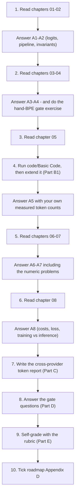
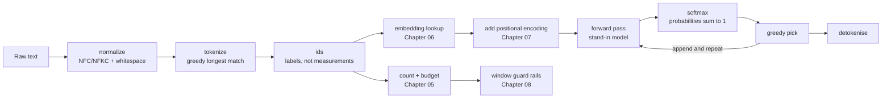

# 📝 Lecture 02 — Assignment

**LLM Foundations: Next-Token Prediction, Tokenization & Embeddings**
Phase 1 · Foundations · 🟢 Beginner · **Estimated effort: 6–8 hours**

> **Read first:** the eight chapters in **[../notes](../notes)** (index: **[../index.md](../index.md)**).
> Every question below is answerable from those notes — the chapter number sits next to each part, so you
> never have to guess where the material lives.
> The lecture's **goal**, **build task** and **completion gate** live in
> **[../README.md](../README.md)** and **[../../roadmap.md](../../roadmap.md)** → *Phase 1*.
> The code this assignment refers to is in **[../code/Basic Code](../code/Basic%20Code)**.

---

## 🎯 What this assignment is for

Lecture 02 has one idea: **an LLM is a next-token probability machine, and everything you send it is
tokens.** There is no model to train and nothing to fine-tune here — the whole lecture is about the layer
*before* the model, the layer that decides what the model ever sees. So the assignment is weighted the
same way: counting, tokenizing by hand, and explaining the consequences.

| Weight | Part | What it tests | Output |
| :---: | :--- | :--- | :--- |
| **30%** | **A** — Chapter-wise practice | Can you *count*, *tokenize by hand* and *explain* — not recite | Written answers, per chapter |
| **25%** | **B** — Code tasks | Can you make a tokenizer observable and a budget enforceable | `../code/Basic Code`, `../code/Production Code` |
| **30%** | **C** — Capstone: the cross-provider token report | The roadmap's actual build task: one sentence, several tokenizers, real numbers | `Assignment/tokenizer-report.md` |
| **15%** | **D** — The gate | Can you tokenize by hand and explain why "strawberry" is hard | 5 short answers + 1 spoken |

---

## 🧭 How to work through it



**Three rules, taken from the repository's own writing contract:**

1. **Answer from memory first, then check the notes.** Copying a paragraph out of a chapter is worth zero —
   the gate at the end of this lecture is a *spoken* explanation, and it is a hand-tokenization.
2. **Diagrams in [mermaid](https://mermaid.js.org/) only.** No screenshots, no Excalidraw exports. Every
   diagram you submit must be a `mermaid` fenced block that renders.
3. **Code is TypeScript.** Pseudo-code is acceptable *inside written answers* (and must be labelled
   `// PSEUDO-CODE`), but everything under `../code` must actually compile and run.

---

## 📋 Contents

| Part | Topic | Chapters | Type |
| :---: | :--- | :--- | :--- |
| **A1** | What an LLM is & next-token prediction | [01](../notes/01_What_an_LLM_Is_and_Next_Token_Prediction.md) | Written + numeric |
| **A2** | The text pipeline & why token IDs are labels | [02](../notes/02_The_Text_Pipeline_and_Why_Token_IDs_Are_Labels.md) | Written + numeric |
| **A3** | Tokenization strategies: word vs char vs subword | [03](../notes/03_Tokenization_Strategies_Word_Character_Subword.md) | Written + numeric |
| **A4** | BPE, WordPiece, SentencePiece & the vocabulary | [04](../notes/04_BPE_WordPiece_SentencePiece_and_Vocabulary.md) | Written + **hand exercise** |
| **A5** | Tokenizers in practice: `tiktoken` & model comparison | [05](../notes/05_Tokenizers_in_Practice_tiktoken_and_Model_Comparison.md) | Written + measured |
| **A6** | Embeddings: dense vectors & similarity | [06](../notes/06_Embeddings_Dense_Vectors_and_Similarity.md) | Written + numeric |
| **A7** | Positional encodings & word order | [07](../notes/07_Positional_Encodings_and_Word_Order.md) | Written + numeric |
| **A8** | Context windows, training vs inference, complete pipeline | [08](../notes/08_Context_Windows_Training_vs_Inference_and_the_Complete_Pipeline.md) | Written + numeric |
| **B** | Code tasks (basic + production + guides) | 01–08 | TypeScript / Express |
| **C** | Capstone: the cross-provider token report | 02–05 | Script + report |
| **D** | The completion gate | 04, 02, 06, 07, 08 | Short answers + spoken |
| **E** | Rubric & definition of done | — | Checklist |

---

## Part A — Chapter-wise practice

> Write your answers in your own scratch file (for example `Assignment/answers.md`). Aim for **6–10 lines
> per question** — long enough to be precise, short enough to prove you understood it.
> Numeric questions have an answer sketch inside a collapsed block; **attempt it before you open it.**

### A1 — What an LLM is & next-token prediction
📖 [Chapter 01](../notes/01_What_an_LLM_Is_and_Next_Token_Prediction.md) · sections 01.1–01.12

1. Write the one objective an LLM is trained on, as a formula, and label every symbol. Then say in one
   sentence what a **single** forward pass produces (and what it does *not* produce).
2. **GPT vs ChatGPT — the engine and the car.** Name what each of the two adds, and give one capability
   that belongs to ChatGPT and not to GPT, and one that belongs to the model and not the product.
3. The prompt-evolution experiment has three stages. For each stage, write the prompt and say what the
   next-token distribution does as context grows — and why "more context" is not the same as "more
   instructions".
4. Explain why *"it looked up that Delhi is the capital of India"* is the wrong description, and write the
   correct one. Then do the same for *"it is reasoning step by step"*.
5. **Numeric — the softmax is exponential.** §01.6 shows four logits next to illustrative probabilities:
   `Delhi 12.8 → 92%`, `Kolkata 7.1 → 4%`, `Mumbai 5.4 → 2%`, `Bangalore 4.2 → 1%`.
   (a) Compute $e^{12.8}$, $e^{7.1}$, $e^{5.4}$, $e^{4.2}$ and normalise the four.
   (b) How many times more likely is Delhi than Kolkata in the *logit* space, and in the *probability*
   space?
   (c) The lecture's table says 92%; your number will be different. In two sentences, explain what that
   discrepancy teaches you about reading tables of numbers you did not compute.
   (d) Now recompute only Delhi at 10.8 (a 2-point drop). What happens to the distribution, and what does
   that tell an FDE about when to add retrieval or a tool call?

<details>
<summary>Answer sketch (open only after attempting)</summary>

(a) $e^{12.8} \approx 362{,}218$, $e^{7.1} \approx 1{,}212$, $e^{5.4} \approx 221$, $e^{4.2} \approx 67$;
sum $\approx 363{,}718$ → Delhi ≈ **99.6%**, Kolkata ≈ 0.33%, Mumbai ≈ 0.06%, Bangalore ≈ 0.02%.
(b) In logit space the gap is $12.8-7.1 = 5.7$; in probability space the ratio is
$e^{5.7} \approx 299\times$.
(c) The gap is **exponentiated**, so a modest logit difference becomes an enormous probability
difference. The lecture's 92/4/2/1 is an illustration of *shape*, not a computation — and the habit to
keep is to compute rather than trust.
(d) At 10.8 the ratio to Kolkata falls to $e^{3.7} \approx 40\times$ and the top probability drops to
roughly 85–90% with a fatter tail. A **flatter** distribution is exactly where the model is unsure, which
is where retrieval, a tool call or a clarifying question belongs.

</details>

6. **Numeric — the cost model.** A user asks for a 400-token answer.
   (a) How many forward passes does that cost?
   (b) If one pass takes 12 ms, what is the minimum time before the *last* token arrives?
   (c) The prompt is processed once (**prefill**) and cached (**KV cache**). Using that, explain why
   "output tokens dominate cost and latency" is a statement about *arithmetic*, not about vendors.
7. **Mermaid task:** draw the autoregressive loop from memory — context → forward pass → distribution →
   decode strategy → append → repeat — and mark the exact place a stop token exits the loop. Then add the
   one arrow that makes the loop *autoregressive*.
8. Why does §01.10 say emergent capability is a *side effect* of prediction? Name the three mechanisms
   people confuse with "understanding" and say what each one actually is.
9. Name three things a next-token model **cannot** know from its weights alone, and for each one name the
   part of your system that supplies it.

### A2 — The text pipeline & why token IDs are labels
📖 [Chapter 02](../notes/02_The_Text_Pipeline_and_Why_Token_IDs_Are_Labels.md) · sections 02.1–02.9

1. Explain in one sentence why `"H" × 0.42` is meaningless, and what replaces the character in the
   pipeline. Then state the two-stage conversion that makes text computable.
2. **The roll-number analogy.** State it, then name the three properties an index does **not** have
   (order, meaning, distance) and give a one-line consequence of each for your code.
3. **Numeric — the embedding table.** For $|V| = 100{,}000$ and $d_{\text{model}} = 4096$:
   (a) how many parameters does $W_{\text{emb}}$ hold?
   (b) what fraction of a 7B-parameter model is that?
   (c) which grows faster if you double the vocabulary — the embedding table or the attention cost?
4. The forward pipeline has eight stages. For the input `"Capital of India is Delhi"`, write the output of
   every stage and the **shape** of the tensor at stages 4–7.
5. §02.7 names three details that bite in production. For each: the detail, the bug it causes, and the one
   line of code that prevents it. Include the `max_tokens` / wall-clock / stop-sequence rails.
6. **Invariants.** Pick invariants **1, 4 and 6** from §02.8. For each, describe a real production bug you
   would see if you violated it, and the symptom a support ticket would report.
7. **Numeric — round trip.** `decode(encode(x)) == x` fails for some inputs.
   (a) Give one whitespace input where it fails.
   (b) Give one Unicode input where it fails, and name the normalisation form you would apply at the API
   boundary to fix it.
   (c) Why does normalising *after* tokenising not help?
8. **Mermaid task:** draw the forward pipeline (raw text → tokens → ids → vectors → logits) with the
   chapter number on every box, then add the **reverse** pipeline (ids → text → render) as a second lane,
   and mark where the buffer must be decoded as a whole.
9. A teammate caches token IDs in Redis and replays them into a different model after a vendor switch.
   Name the invariant they broke, the two ways the failure shows up, and what they should store instead.

### A3 — Tokenization strategies: word vs character vs subword
📖 [Chapter 03](../notes/03_Tokenization_Strategies_Word_Character_Subword.md) · sections 03.1–03.10

1. **Word level.** Name its two fatal problems with one concrete example each, then name the one situation
   where word-level tokenization is still the right answer.
2. **Character level.** (a) Why is the vocabulary tiny? (b) Why does that *not* make it cheap?
   (c) State the $O(N^2)$ argument in one sentence an engineering manager would accept.
3. **Numeric — the attention multiplier.** The lecture's example gives word 6, character ~34 and subword 7
   tokens for `"Automatically, I love programming!"`.
   (a) Compute the attention work ratio character/subword using $N^2 \cdot d_{\text{model}}$.
   (b) Compute word/subword. Why is word-level *cheaper* here and still a bad idea?
4. **Byte level.** Why is it "the extreme that actually shipped"? What does it guarantee about `<UNK>`, and
   what does it cost you in sequence length?
5. **Subword.** State the four advantages. Then explain the equilibrium in one sentence: what are the two
   extremes it sits between?
6. **Numeric — vocabulary size.** §03.7 lists four competing costs of $|V|$. For $|V|$ going from 50k to
   200k at $d_{\text{model}} = 4096$: (a) how many extra embedding parameters? (b) what happens to the
   sequence length for the same text? (c) name the cost that gets *worse* as $|V|$ grows even though
   sequences get shorter.
7. **The token tax.** (a) Give two reasons non-English text costs more tokens on an English-heavy
   vocabulary. (b) Name one product consequence (hint: it is not only money). (c) Name one mitigation that
   is *not* "train a bigger vocabulary".
8. **Zipf's law.** In three sentences: what it says, why it makes a "one token per word" vocabulary
   impossible, and why it makes BPE's merge rule (merge the most frequent pair) the natural choice.
9. **Mermaid task:** draw the comparison as one diagram — two failing extremes, one equilibrium in the
   middle — with the specific failure labelled on each extreme and the four wins labelled on the middle.
10. **Choosing a granularity.** A teammate proposes character-level tokenization "because then we never
    have OOV". Write the three-sentence reply that names the cost they have not counted, and the one
    number you would ask them to compute before deciding.

### A4 — BPE, WordPiece, SentencePiece & the vocabulary
📖 [Chapter 04](../notes/04_BPE_WordPiece_SentencePiece_and_Vocabulary.md) · sections 04.1–04.10

> **Do question 1 by hand, on paper, before reading anything else in this part. It is the lecture's gate.**

1. **The gate exercise — tokenize by hand.** You are given the merge list, **in learned order**:
   `1: l+o → lo`, `2: lo+w → low`, `3: low+</w> → low</w>`, `4: e+r → er`, `5: e+s → es`,
   `6: es+t → est`.
   Tokenize `"lowest berry"` step by step: show the state of the pieces after **each** merge that applies,
   say which merges do **not** apply and why, and give the final token list and the token count.
2. **Why "strawberry" is hard.** Give the three structural reasons. Then answer: does a *larger*
   vocabulary make letter-counting better or worse? Justify with what happens to the token boundaries.
3. **Training vs encoding.** Explain the asymmetry (global vs local, once vs every request). Then answer:
   why must the merge list be shipped *exactly*, in order?
4. **WordPiece vs BPE.** What chooses the merge in each (frequency vs likelihood)? What does the `##`
   prefix mean, and what problem does it solve that a plain character split does not?
5. **Unigram and SentencePiece.** What is `▁` for? Why does SentencePiece not need pre-tokenization, and
   which language does that help most?
6. **Byte-level BPE.** Why can a byte-level vocabulary never emit `<UNK>`, and what does that cost in
   sequence length and in *weakly trained* tokens?
7. **Glitch tokens.** What are they, how do they arise from a corpus, and what is the practical rule?
8. **Numeric — the vocabulary trade-off.** (a) For $|V| = 50{,}000$ and $d_{\text{model}} = 4096$, how many
   parameters in $W_{\text{emb}}$? (b) Recompute for $|V| = 200{,}000$. (c) If the rest of a 7B model is
   fixed, how much bigger does the whole model get? (d) Name the two reasons everyone does not simply use
   200k.
9. **Tokenizer versioning.** Why must the tokenizer version be pinned *with* the model version? Name two
   tests you must re-run whenever it changes.
10. **Mermaid task:** draw BPE training (count → merge → repeat → stop) and BPE encoding (base pieces →
    replay merges in order) as two separate flows, and mark the one box that is different between them.

<details>
<summary>Answer sketch for question 1 (open only after attempting)</summary>

Start from base pieces with an end-of-word marker: `l o w e s t </w>` and `b e r r y </w>`.

| Merge | Applies to `lowest`? | State after it |
| :--- | :--- | :--- |
| `l+o → lo` | yes | `lo w e s t </w>` |
| `lo+w → low` | yes | `low e s t </w>` |
| `low+</w> → low</w>` | **no** — `low` is followed by `e`, not by the marker | `low e s t </w>` |
| `e+r → er` | **no** — no `e` is followed by `r` | `low e s t </w>` |
| `e+s → es` | yes | `low es t </w>` |
| `es+t → est` | yes | `low est </w>` |

`berry` merges only on `e+r → er` → `b er r y </w>`.

**Final pieces:** `["low", "est", "</w>", "b", "er", "r", "y", "</w>"]` → **8 pieces** in this classic
`</w>` scheme, or **3 tokens** if the marker is folded into the preceding piece and `berry` is already a
vocabulary entry (`["low", "est", " berry"]`), which is exactly the lecture's answer.

The lesson is the *method*, not the number: **apply the merges in learned order, greedily, and stop when
no merge applies.** Nothing is invented, and the result is deterministic.

</details>

### A5 — Tokenizers in practice: `tiktoken` & model comparison
📖 [Chapter 05](../notes/05_Tokenizers_in_Practice_tiktoken_and_Model_Comparison.md) · sections 05.1–05.9

> This part must be answered with **numbers you produced**, not numbers you read. Run
> `code/Basic Code` (see Part B) and paste the real output into your answers.

1. Why is `words × 1.3` not a token count? Name two inputs where the multiplier is badly wrong and say
   which direction each one errs.
2. Name the three tokenizer families you will meet in production, with a rough vocabulary size for each,
   and say which of them you can count locally.
3. When is a `tiktoken` count **exact**, and when is it only an **estimate**? What must your logs record
   when it is an estimate, and why does that matter to a finance conversation?
4. **The budget, in order.** Write the exact order of operations for building a prompt that fits a window:
   what you reserve first, what you count next, what you shrink and in what order, and what you do when it
   still does not fit. Then say which single step, if skipped, produces "the answer was cut off
   mid-sentence".
5. **Numeric — the monthly bill.** A prompt is **6,000 input tokens** and you expect **800 output tokens**.
   gpt-4o is priced at **\$2.50 / million input** and **\$10 / million output**.
   (a) Cost of one call, split into input and output.
   (b) Monthly cost at **20,000 calls/day for 30 days**.
   (c) Recompute (b) after you add **four retrieved chunks of 800 tokens each**.
   (d) Which change is cheaper: halving the retrieved context, or capping the output at 400 tokens? Show
   the arithmetic for both and state the general rule.
6. **The token tax, measured.** Take one short message in English and the same message in a second
   language you speak. Measure both with the same tokenizer, report the ratio, and answer: what would you
   change in the product because of that number?
7. **Numeric — token accounting.** A request logs `input: 6,412` from the provider but your pre-flight
   count said `5,180`. Give three explanations, order them by how likely they are, and say what you would
   log so that the *next* discrepancy is diagnosable in one minute.
8. **Mermaid task:** draw the context-window budget as one diagram — the window, the output reserve, each
   prompt part, and the shrink order when the total does not fit.
9. **The five habits** in §05.8. Pick the two you would enforce in code review, and for each write the
   rule you would put in the repository's contributing guide.
10. Where does tokenization belong inside a retrieval pipeline (§05.7)? Name the two places where the same
    text is counted twice for different reasons.

### A6 — Embeddings: dense vectors & similarity
📖 [Chapter 06](../notes/06_Embeddings_Dense_Vectors_and_Similarity.md) · sections 06.1–06.11

1. Write the embedding lookup as a formula, and give the shape of $W_{\text{emb}}$ for $|V| = 100{,}000$
   and $d_{\text{model}} = 4096$. Is the lookup a *computation* or a *read*? What does that mean for how
   fast it is?
2. Give the three reasons one-hot vectors fail, and what a dense vector buys you instead.
3. **Similarity.** Give the three measures with their formulas, ranges, and where each is used. Which one
   does attention use, and which one do vector stores prefer after normalisation?
4. Why is cosine similarity equal to the dot product for unit-length vectors? Why do vector stores
   normalise on write rather than at query time?
5. **Numeric — work it by hand.** For $a = [3, 4]$ and $b = [4, 3]$:
   (a) $\lVert a \rVert$ and $\lVert b \rVert$; (b) $a \cdot b$; (c) $\cos(a,b)$;
   (d) the Euclidean distance; (e) normalise both vectors, recompute the dot product, and show it equals
   (c). State the one-line rule this proves.

<details>
<summary>Answer sketch (open only after attempting)</summary>

(a) $\lVert a \rVert = \sqrt{9+16} = 5$; $\lVert b \rVert = 5$.
(b) $a \cdot b = 3 \times 4 + 4 \times 3 = 24$.
(c) $\cos = 24 / 25 = \mathbf{0.96}$.
(d) $\lVert a-b \rVert = \sqrt{1 + 1} = \sqrt{2} \approx 1.414$.
(e) $\hat{a} = [0.6, 0.8]$, $\hat{b} = [0.8, 0.6]$ → $\hat{a} \cdot \hat{b} = 0.48 + 0.48 = 0.96$ ✓.

**Rule:** if the vectors are unit length, dot product **is** cosine similarity — so you can store
normalised vectors and use the cheapest operation.

</details>

6. Why does the 2-dimensional worked example mislead, and what does high dimensionality fix? Use the
   phrase "almost exactly orthogonal" in your answer.
7. **Static vs contextual.** Take the word `bank`. Explain what a static embedding table can and cannot
   represent, and what the transformer's contextual hidden states give you instead. Then say which one you
   would use for a *retrieval index* and why.
8. **Retrieval embeddings vs token embeddings.** Name three differences, then list the metadata you must
   store next to every vector so that two embedding spaces can never be mixed by accident.
9. **Word arithmetic.** What does `king − man + woman ≈ queen` actually demonstrate? Name the common
   overclaim, and the two reasons the trick is weaker than it looks.
10. **Mermaid task:** draw the path from token id to the first transformer block — lookup → vector → add
    positional encoding → block — and label where $d_{\text{model}}$ is fixed.

### A7 — Positional encodings & word order
📖 [Chapter 07](../notes/07_Positional_Encodings_and_Word_Order.md) · sections 07.1–07.9

1. **Prove the problem.** Using a token-id list, show why `"Dog bites man"` and `"Man bites dog"` are the
   same input to a transformer without positional information. Name the property of self-attention that
   causes this.
2. Write the additive formula $X_{\text{in}} = E_{\text{token}} + P_{\text{pos}}$ and explain why the
   encoding is **added** and not **concatenated**. What has to stay fixed, and what would break if it did
   not?
3. Write both sinusoidal formulas. Then explain the frequency ladder in one sentence using the "clock
   hands" intuition: which hands separate neighbours, and which ones separate far-apart regions?
4. **Numeric — compute the encodings by hand.** For $d_{\text{model}} = 4$ the two frequencies are
   $\omega_0 = 1$ and $\omega_1 = 10000^{-2/4} = 0.01$.
   (a) Write $P_0$, $P_1$ and $P_2$ to 4 decimal places.
   (b) Compute $P_0 \cdot P_1$ and $P_1 \cdot P_2$.
   (c) What is $\sum_i \cos(\omega_i \cdot 1)$? Compare it with (b) and state the property this proves.

<details>
<summary>Answer sketch (open only after attempting)</summary>

(a) $P_0 = [\sin 0, \cos 0, \sin 0, \cos 0] = [0, 1, 0, 1]$
$P_1 = [\sin 1, \cos 1, \sin 0.01, \cos 0.01] \approx [0.8415, 0.5403, 0.0100, 0.9999]$
$P_2 = [\sin 2, \cos 2, \sin 0.02, \cos 0.02] \approx [0.9093, -0.4161, 0.0200, 0.9998]$

(b) $P_0 \cdot P_1 = 0 + 0.5403 + 0 + 0.9999 = \mathbf{1.5402}$
$P_1 \cdot P_2 = (0.8415)(0.9093) + (0.5403)(-0.4161) + (0.01)(0.02) + (0.9999)(0.9998)$
$\quad = 0.7652 - 0.2248 + 0.0002 + 0.9997 = \mathbf{1.5402}$

(c) $\sum_i \cos(\omega_i \cdot 1) = \cos 1 + \cos 0.01 = 0.5403 + 0.9999 = \mathbf{1.5402}$.

The two dot products are equal **and** equal to $\sum_i \cos(\omega_i k)$ — the linear-offset property:
$P_{pos} \cdot P_{pos+k}$ depends only on the **offset** $k$, not on the position. That is what lets the
model learn "attend three tokens back" as one reusable pattern.

</details>

5. Name the four positional-encoding families (sinusoidal, learned absolute, RoPE, ALiBi) and give one
   sentence each: what it does, and its main limitation.
6. Why can you not simply "turn on" a longer context at inference time? What is fixed at training time,
   and what is the *only* honest way to extend it?
7. **"Lost in the middle."** (a) Describe the effect. (b) Name three mitigations. (c) Explain why
   "retrieve fewer, better chunks" fixes a *quality* problem and a *cost* problem with one change.
8. §07.9 has a guard rail most teams forget. Write the check as pseudo-code (`// PSEUDO-CODE`), and explain
   what the failure looks like in production when the check is missing.
9. **Mermaid task:** trace `"the cat sat on the mat"` from text to the first transformer block, and mark
   the two rows that share a token id but differ in their input vector. Say in one line why they differ.

### A8 — Context windows, training vs inference & the complete pipeline
📖 [Chapter 08](../notes/08_Context_Windows_Training_vs_Inference_and_the_Complete_Pipeline.md) · sections 08.1–08.9

1. **Capacity vs quality.** Why is a 200k window not the same as 200k tokens of *usable* context? Name the
   two effects that make the far end of a window less reliable than the near end.
2. Name the three costs that scale with sequence length $N$, and give the scaling law of each. Then say
   which one limits **throughput** on a serving box and why.
3. **Numeric — the cost of a big prompt.** For $N = 32{,}000$ tokens and $d_{\text{model}} = 4096$:
   (a) attention work $\approx N^2 \cdot d_{\text{model}}$ — compute it;
   (b) KV-cache bytes for **32 layers**, **fp16** (2 bytes per value), remembering the $\times 2$ for the
   key cache *and* the value cache — give the answer in GB;
   (c) if the same model serves **8 concurrent requests** with that context, what is the total cache?
   (d) In two sentences: why is "just use a bigger window" not a free decision?

<details>
<summary>Answer sketch (open only after attempting)</summary>

(a) $32{,}000^2 = 1.024 \times 10^9$; $\times 4096 \approx \mathbf{4.19 \times 10^{12}}$ operations per
forward pass.
(b) $2 \times 32 \times 32{,}000 \times 4096 \times 2\ \text{bytes}
= 2 \times 32 \times 32{,}000 \times 8192 \approx \mathbf{1.68 \times 10^{10}}$ bytes $\approx$ **16.8 GB**.
(c) $8 \times 16.8 \approx$ **134 GB** — which is why concurrent long-context requests, not weights, decide
how many requests a GPU can hold at once.
(d) Both costs grow super-linearly (attention) or linearly-per-request (cache), so a longer window buys
capability at the price of throughput and money. The cheapest token is the one you never send.

</details>

4. **Four truncation strategies.** Name them in the order you should consider them, with the best use case
   and the specific risk of each. Then say which one you would pick for a support bot and why.
5. **Why is the label free?** For the 6-token sentence `the capital of india is delhi .`, write all five
   (input, label) pairs the training loop uses. Then explain in one sentence why this is the trick that
   makes pre-training on the whole internet possible.
6. **Numeric — cross-entropy.** (a) Why is $-\log p$ the right loss rather than $1-p$?
   (b) What does a loss of $0.693$ mean for a single position? (c) What is the loss of a uniform guess
   over a 100k vocabulary, and what does the *gap* between your model's loss and that number mean?
   (d) Why does the loss fall when you train on the same sentence twice?

<details>
<summary>Answer sketch (open only after attempting)</summary>

(a) $-\log p$ is 0 when the model is certain and correct, and grows without bound as $p \to 0$ — it
punishes confident mistakes, which is exactly what you want. $1-p$ is bounded at 1, so a confidently wrong
prediction is punished no more than a hesitant one.
(b) $-\log 0.5 = 0.693$ → the model gave the correct token a **50%** chance: a coin flip between two
candidates.
(c) $-\log(1/100{,}000) \approx 11.5$. The gap between your loss and 11.5 is what the model has actually
learned; a loss near 11.5 means it has learned nothing.
(d) Because the weights changed: the counts for the observed transitions went up, so the probability of
the correct next token rose, so $-\log p$ fell. (In a real model the same thing happens through a gradient
step — which is why "in-context learning" is not learning.)

</details>

7. **Training vs inference.** Give the four differences that matter most to an *application* engineer, and
   for each one name the product decision it changes.
8. **"In-context learning is not learning."** What are the three places knowledge can live so that it
   *persists*, and which one would you reach for: a policy document that changes weekly, a house style
   for tone, a task format the model keeps getting wrong?
9. **The complete pipeline.** Draw it from memory with the chapter number on every box, then draw the
   **training mirror image** next to it. Mark the three boxes the two flows *share* and the one box only
   training has.
10. **The FDE checklist** in §08.8 has eight items. Pick the three you would implement first on a real
    system, justify each in one line, and name the failure each one prevents.

---

## Part B — Code tasks

**Stack:** TypeScript + Express. **Location:** `../code/Basic Code` (already written) and
`../code/Production Code` (yours). **Rule:** this lecture's code must show the *pipeline from the notes* —
tokenize, count, embed, position, budget. It must **not** jump ahead into attention internals, sampling
strategies, RAG, agents or evals frameworks; those belong to later lectures.



### B1 — Basic Code: run it, then extend it

`../code/Basic Code` is a complete, runnable service that implements every chapter of this lecture. Your
first job is to **run it and prove you understand what each endpoint returns**, then to extend it.

```text
code/Basic Code/
├── .env                                  # PORT, D_MODEL, DEFAULT_MODEL (no secrets)
├── package.json  ·  package-lock.json  ·  tsconfig.json
├── src/
│   ├── server.ts                         # starts the HTTP server
│   ├── app.ts                            # builds the Express app (json, router, 404, error handler)
│   ├── config/config.ts                  # env + the model table (windows, max output, prices)
│   ├── types/index.ts                    # RawText, TokenStr, TokenId, Vector, Logits, Encoded, ModelSpec
│   ├── middleware/errorHandler.ts        # HttpError, asyncHandler, notFound, errorHandler
│   ├── middleware/validate.ts            # requireText, optionalNumber, optionalStringArray, requireParts
│   ├── routes/index.ts                   # every route, grouped by chapter
│   ├── controllers/                      # one thin controller per chapter (body in, JSON out)
│   │   ├── tokenizerController.ts  ·  strategyController.ts  ·  bpeController.ts
│   │   ├── countController.ts      ·  embeddingController.ts ·  positionalController.ts
│   │   └── contextController.ts    ·  pipelineController.ts
│   └── services/                         # all the logic lives here
│       ├── tokenizerService.ts           # normalise, tokenize, toIds, encode, decode, vocabulary
│       ├── strategyService.ts            # word vs char vs subword + O(N^2) comparison
│       ├── bpeService.ts                 # trainBPE, encodeWithMerges, decodePieces, countLetters
│       ├── countService.ts               # count, promptBudget, estimateCost, countParts
│       ├── embeddingService.ts           # the W_emb table, dot/cosine/euclidean, meanPool
│       ├── positionalService.ts          # sinusoidal encoding, addPositions, offset property
│       ├── contextService.ts             # fitToWindow, attentionOps, kvCache
│       └── pipelineService.ts            # forward, softmax, generate, trainingStep, runPipeline
└── implementations guide/                # chapter-wise walkthrough of every file (see B3)
```

**Commands:**

```bash
cd "code/Basic Code"
npm install          # once
npm run dev          # tsx watch src/server.ts  -> http://localhost:3000/api
npm run typecheck    # tsc --noEmit  (must be clean)
npm run build && npm start   # compiled JS in dist/
```

**Requirements — each endpoint maps to a note section, and this table is the checklist:**

| # | Requirement | Endpoint | From |
| :---: | :--- | :--- | :--- |
| B1.1 | Normalise → tokenize → ids, with **offsets** and a special-token mask; `decode` reverses it | `POST /api/tokenizer/encode` · `/decode` | [02.5–02.9](../notes/02_The_Text_Pipeline_and_Why_Token_IDs_Are_Labels.md) |
| B1.2 | The same sentence through **three granularities**, with the $N^2$ attention multiplier | `POST /api/strategies/compare` | [03.6, 03.9](../notes/03_Tokenization_Strategies_Word_Character_Subword.md) |
| B1.3 | **Train** BPE from a corpus (count → merge → repeat) and show the merge list in order | `POST /api/bpe/train` | [04.2, 04.10](../notes/04_BPE_WordPiece_SentencePiece_and_Vocabulary.md) |
| B1.4 | **Encode** with a merge list, replaying it in learned order, with the end-of-word marker | `POST /api/bpe/encode` | [04.8, 04.10](../notes/04_BPE_WordPiece_SentencePiece_and_Vocabulary.md) |
| B1.5 | The "strawberry" fix: count characters **in code**, next to how the model sees the word | `POST /api/bpe/count-letters` | [04.8 part 2](../notes/04_BPE_WordPiece_SentencePiece_and_Vocabulary.md) |
| B1.6 | Count a prompt part by part, **reserve the output first**, and price it per model | `POST /api/tokens/count` | [05.4–05.6](../notes/05_Tokenizers_in_Practice_tiktoken_and_Model_Comparison.md) |
| B1.7 | Embedding **table read** per id, plus cosine / dot / Euclidean and the normalised-dot check | `POST /api/embeddings/lookup` · `/similarity` | [06.1, 06.4](../notes/06_Embeddings_Dense_Vectors_and_Similarity.md) |
| B1.8 | Sinusoidal encoding, `E + P`, the **repeated-token** proof and the linear-offset property | `POST /api/positional` | [07.2–07.3, 07.7](../notes/07_Positional_Encodings_and_Word_Order.md) |
| B1.9 | Window **cost** (attention ops, KV-cache bytes) and priority **truncation** that logs drops | `POST /api/context/cost` · `/fit` | [08.2–08.3](../notes/08_Context_Windows_Training_vs_Inference_and_the_Complete_Pipeline.md) |
| B1.10 | The **autoregressive loop** with an eight-stage trace, and a **training step** with shifted labels and cross-entropy | `POST /api/pipeline/generate` · `/training-step` | [01.7, 01.12](../notes/01_What_an_LLM_Is_and_Next_Token_Prediction.md) · [08.4, 08.9](../notes/08_Context_Windows_Training_vs_Inference_and_the_Complete_Pipeline.md) |

**Acceptance — run these and explain every number you get:**

```bash
# 1) The §02.6 example: 5 tokens, ids as LABELS, offsets over the original text
curl -s localhost:3000/api/tokenizer/encode -H 'content-type: application/json' \
  -d '{"text":"Capital of India is Delhi"}'

# 2) The chat template adds BOS/EOS and marks them as NOT user text
curl -s localhost:3000/api/tokenizer/encode -H 'content-type: application/json' \
  -d '{"text":"strawberry","chat":true}'

# 3) The §03.9 comparison: word 6 / char 34 / subword 7 on the same sentence
curl -s localhost:3000/api/strategies/compare -H 'content-type: application/json' \
  -d '{"text":"Automatically, I love programming!"}'

# 4) BPE: the hand-written merge list of §04.8 vs the list your trainer learned
curl -s localhost:3000/api/bpe/encode -H 'content-type: application/json' \
  -d '{"text":"lowest berry","model":"note"}'
curl -s localhost:3000/api/bpe/train -H 'content-type: application/json' \
  -d '{"corpus":["low","low","low","low","low","lower","lower","lowest"]}'

# 5) The strawberry fix: the model sees 2 tokens, code counts 3 r's
curl -s localhost:3000/api/bpe/count-letters -H 'content-type: application/json' \
  -d '{"text":"strawberry","letter":"r"}'

# 6) Budget: output reserved first, cost split into input and output
curl -s localhost:3000/api/tokens/count -H 'content-type: application/json' \
  -d '{"model":"gpt-4o","desiredOutputTokens":512,"text":"Can I get a refund after 10 days?"}'

# 7) Embeddings: the lookup is a table read; normalisedDot must equal cosine
curl -s localhost:3000/api/embeddings/similarity -H 'content-type: application/json' \
  -d '{"textA":"the cat","textB":"the mat","metric":"cosine"}'

# 8) Positions: the same token at two positions -> two different input vectors
curl -s localhost:3000/api/positional -H 'content-type: application/json' \
  -d '{"text":"the cat sat on the mat"}'

# 9) The window: system is truncated, history is dropped, and both are reported
curl -s localhost:3000/api/context/fit -H 'content-type: application/json' \
  -d '{"window":14,"outputReserve":4,"text":"Can I get a refund?"}'

# 10) The loop: a trace of all stages, then the autoregressive steps, one forward pass each
curl -s localhost:3000/api/pipeline/generate -H 'content-type: application/json' \
  -d '{"prompt":"the capital of india is","maxTokens":4}'

# 11) Training vs inference: call the training step twice and watch the loss fall
curl -s localhost:3000/api/pipeline/training-step -H 'content-type: application/json' \
  -d '{"text":"the capital of france is paris ."}'
```

**Then extend it (six tasks — each is small, and each one tests something the lecture claims):**

| # | Task | What it proves |
| :---: | :--- | :--- |
| **B1.E1** | Add `POST /api/tokenizer/round-trip` returning `{ input, normalised, decoded, identical }`, and find **three inputs where `identical` is false** | Invariant 1 of §02.8, measured instead of asserted |
| **B1.E2** | Add a `limit` parameter to `/embeddings/lookup` (default 20) and return `truncated: true` when rows were dropped | A response is a budget too — the same discipline as the context window |
| **B1.E3** | Make `decode` reject ids outside the vocabulary with a **400** instead of silently returning `<UNK>` | IDs are only meaningful inside one vocabulary (§02.3) |
| **B1.E4** | Add `POST /api/bpe/train-file` that reads a `.txt` corpus from `data/` and reports the merge list plus the **10 longest tokens** learned | Vocabulary quality depends on the corpus (§03.7, §04.7) |
| **B1.E5** | Add `POST /api/tokens/compare` that counts the same text with **two vocabularies** and reports the ratio | The same user text has different prices (§03.9, §05.5) |
| **B1.E6** | Add `GET /api/context/strategies` returning the four truncation strategies of §08.3 as data, each with its `risk` | A decision table becomes code you can test |

### B2 — Production Code: the same pipeline, defended

`../code/Production Code` is the version you would put in front of real traffic. Same pipeline, senior
engineering: provider adapters, exact counting where it exists, caching, validation, metrics, tests.

| # | Capability | Where it lives | Why |
| :---: | :--- | :--- | :--- |
| B2.1 | **Provider adapters** behind one `TokenizerPort` interface: OpenAI (`tiktoken` / `js-tiktoken`), a local BPE file, and an "ask the provider" fallback | `services/tokenizers/` | Closed tokenizers exist; you must be able to swap them |
| B2.2 | Every count carries `{ model, tokenizerVersion, exact }` and is **labelled an estimate** when it is not exact | `services/accounting/` | §05.4 warning, §05.8 habit 1 |
| B2.3 | A **pre-flight guard**: reject or downgrade a request before it spends money, with a clear error | `middleware/budget.ts` | §05.6, §08.3 |
| B2.4 | **Prompt assembly** with output reserve, per-part counting, priority truncation and a log of everything dropped | `services/prompt/` | §05.6, §08.3 |
| B2.5 | **Embedding registry**: model id + version + dimensions stored with every vector, and a hard error if two spaces are mixed | `services/embeddings/` | §06.10, §06.11 |
| B2.6 | **KV-cache and attention cost calculator** exposed as a metric, not a spreadsheet | `services/capacity/` | §08.2 |
| B2.7 | Structured logs with `traceId`, token counts (estimated vs actual) and the provider's `usage` **reconciled** against the estimate | `observability/` | §05.8 habits 3–4 |
| B2.8 | **Schema validation** on every request body and a typed error contract | `validators/`, `middleware/error.ts` | The boundary is the only trusted input |
| B2.9 | **Tests**: unit tests for tokenize / BPE / softmax / positional / budget, plus a golden set of ≥ 20 strings with expected token counts | `tests/` | Counting is arithmetic: it must be tested, not eyeballed |
| B2.10 | A **CLI** (`npm run tokens -- "text"`) that prints tokens, ids, offsets, count, cost and the budget verdict | `cli/` | The roadmap's build task needs a script, not a slide |

**Acceptance:** `npm test` is green; `npm run tokens -- "some text"` prints a table; a request that exceeds
the window is **rejected with a reason**, never silently truncated; and the log line for one request
contains the estimate, the actual usage and the delta.

### B3 — Implementation guides (required deliverable)

For **both** code trees, write the chapter-wise guides at
`code/Basic Code/implementations guide/` and `code/Production Code/implementations guide/`:

- **Chapter 1 = the orientation chapter:** the full folder structure, every file's purpose, the commands to
  install / run / typecheck / test, and a mermaid diagram of the request flow.
- **Every later chapter:** the **complete** code file first, then a block-by-block explanation of what each
  block does and *why it is written that way* — naming the note section it satisfies.
- Order matters: a reader must be able to go top-to-bottom and finish with the working system.

### B4 — Stretch tasks (optional, but they are the best test of understanding)

1. **A real tokenizer, two providers (~60 lines).** Count the same five sentences with `js-tiktoken`
   (`cl100k_base` and `o200k_base`) and one non-OpenAI tokenizer (a SentencePiece model file, or a
   provider endpoint). Print tokens per sentence per tokenizer plus the ratio, and mark every number as
   `exact` or `estimate`.
2. **Train BPE on a real corpus (~80 lines).** Take ≥ 100 KB of plain text (a book from Project Gutenberg,
   or your own notes). Train to 2,000 merges, then report: characters per token, the 20 longest tokens,
   the token count for an English sentence and for the same sentence in a second language, and one word
   your vocabulary splits badly. This is §03.7 and §04.7 measured on your own data.
3. **The positional-encoding plot as CSV.** Emit `position, dimension, value` for positions 0–64 and
   dimensions 0–31, plot it (a spreadsheet is fine), explain the "clock hands" pattern from the picture,
   then verify the linear-offset property numerically for $k = 1, 3, 7$.
4. **The "lost in the middle" experiment.** Build a prompt with 20 numbered facts, put the answer-bearing
   fact at position 1, 10 and 20, and ask the same question three times against a real model. Report which
   position is answered most reliably, and what that means for your retrieval ordering. (No API key? Write
   the experiment design and the metric instead.)
5. **A KV-cache calculator you would actually ship.** Given
   `{ model, tokens, layers, heads, dModel, bytesPerValue, concurrency }`, print the cache size, the
   maximum concurrency that fits in 40 GB, and the monthly prompt cost at a given request rate. Then
   answer: what would you change first?
6. **Break your own tokenizer.** Find five inputs where the Basic Code tokenizer behaves badly (a long URL,
   a base64 blob, an emoji, an unnormalised accent, a 500-character word) and for each one say what a
   production tokenizer does differently and why.

---

## Part C — Capstone: the cross-provider token report

The roadmap's build task for this lecture is:

> **Build:** a script that calls a tokenizer and prints token ids, token boundaries and token counts for
> the same sentence across **2 providers**.

That is the deliverable. It is small on purpose — the value is in the **numbers**, and in the three
findings that only come out when you compare providers on the same text.

**Deliverables**

| Path | What it must contain |
| :--- | :--- |
| `code/Production Code/cli/token-report.ts` (or a small script in `code/Basic Code/`) | A runnable script: `npm run token-report` prints the table |
| `Assignment/tokenizer-report.md` | The report: method, table, findings, cost projection, hand verification, limitations |

**The corpus — use these five strings, exactly (they are chosen to break different tokenizers):**

```text
1. English   : "Refunds are allowed within 30 days of delivery for damaged items."
2. Code      : "const total = items.reduce((sum, i) => sum + i.price, 0);"
3. JSON      : {"orderId":"A-10293","status":"late","daysLate":4}
4. Emoji     : "My order arrived 😡 and the box was crushed 📦"
5. Non-English: the same sentence as (1) in a language you speak (Bangla, Hindi, Spanish, ...)
6. Rare word : "The antidisestablishmentarianism of tokenization is superserializability."
```

**The table your script must print** (one row per string per tokenizer):

| Column | Meaning |
| :--- | :--- |
| `text_id` | 1–6 |
| `tokenizer` | the provider/encoding name, e.g. `cl100k_base`, `o200k_base`, `llama-3`, `local-bpe` |
| `tokens` | token count |
| `chars` | character count of the same string |
| `chars_per_token` | `chars / tokens` — the compression ratio |
| `first_5_tokens` | the first five pieces, printed with `▁` / `Ġ` visible so boundaries are readable |
| `ids_first_5` | the first five ids |
| `exact` | `true` only when the tokenizer belongs to that model; otherwise `false` (an estimate) |

**Report sections (six, one page each at most):**

1. **Method.** Which tokenizers, which versions, which commands, and how you recorded them. State clearly
   which numbers are exact and which are estimates.
2. **The table.** From the script. Plus one extra column: `ratio_vs_best` — how many times more expensive
   the string is on the worst tokenizer than on the best one.
3. **Three findings.** Each finding must be a *sentence with a number in it*. For example: "the JSON string
   costs 1.9× more tokens on tokenizer A than on tokenizer B, so the same tool-calling loop is 1.9× more
   expensive." Findings must be things you did not know before you ran it.
4. **Cost projection.** Take string 1 and string 5, assume they are sent 50,000 times a day, and project the
   monthly input cost on each tokenizer at that provider's price. State the delta.
5. **Hand verification.** Pick **one** word from the corpus and tokenize it by hand with the method from
   A4 question 1 (or by replaying a merge list), then compare your hand result with the script's output.
   Explain any difference.
6. **Limitations.** What your script cannot tell you (for example: it does not count the chat template, it
   does not model prefix caching, closed tokenizers are approximated). Name at least three.

**Acceptance criteria**

- [ ] The script runs with one command and prints the table with no manual editing.
- [ ] Every number in the report can be traced to a line of script output (paste the output as an appendix).
- [ ] At least **two** different tokenizers appear, and at least one is **not** from the same family as the
      other.
- [ ] Every `exact` flag is correct, and the report says what happens to your cost estimate when it is
      `false`.
- [ ] The non-English string appears, with its ratio against English reported.
- [ ] The hand-tokenization in §5 matches the script, or the difference is explained.

---

## Part D — The completion gate

The roadmap's gate for Lecture 02 is: *you can tokenize a sentence by hand for a simple BPE case and
explain why "strawberry" is hard.* Answer all five below in **≤ 150 words each**, from memory, then check
against the notes. Do not copy bullet points out of a chapter.

1. **The gate question — tokenize by hand.** Merge list, in order:
   `l+o → lo`, `lo+w → low`, `w+</w> → w</w>`, `e+r → er`, `e+s → es`, `es+t → est`.
   Tokenize `"lowest"` and then `"lowest berry"`. Show the piece list after each applicable merge, state
   which merges do not apply, and give the final token count. Then answer: why does the *order* of the merge
   list matter?

   <details>
   <summary>Answer sketch (open only after writing your own)</summary>

   `lowest` → `l o w e s t </w>` → `lo w e s t </w>` → `low e s t </w>` → (`low+</w>` does not apply: `low`
   is followed by `e`) → (`e+r` does not apply) → `low es t </w>` → `low est </w>`.
   `berry` → `b er r y </w>` (only `e+r` applies).
   **Final:** `["low", "est", "</w>", "b", "er", "r", "y", "</w>"]` — 8 pieces in the strict `</w>` scheme,
   or **3 tokens** (`low`, `est`, ` berry`) once the marker is folded into the preceding piece, which is the
   lecture's answer.

   **Order matters** because encoding replays the list top to bottom: an earlier merge changes the pieces
   the later merges can see. A different order produces a different tokenization of the same text — which is
   exactly why the merge list is shipped with the weights and pinned by version.

   </details>

2. **Why "strawberry" is hard.** Give the three structural reasons (the character list is not in the input;
   character facts are only learnable statistically; the boundary hides the interesting part). Then answer
   the follow-up: **does a 200k vocabulary help or hurt?** Justify with what happens to token boundaries.
3. **"IDs are labels, not measurements."** Explain the roll-number analogy, then give the two engineering
   consequences: what you must never do with an id, and what you must store next to a count.
4. **Order must be injected.** Using `"Dog bites man"` vs `"Man bites dog"`, show why attention cannot tell
   them apart, and state what fixes it and why the fix is additive rather than concatenative.
5. **Training vs inference.** In one paragraph: what changes during training, what never changes during
   inference, and why "the model learned from my examples in the prompt" is not learning. Then name the one
   place an application engineer *can* change behaviour, and the three levers inside it.

> **Speaking check:** record yourself answering question 1 — tokenizing `"lowest berry"` out loud, by hand,
> in **90 seconds**, with no notes. If you stumble, re-read
> [chapter 04](../notes/04_BPE_WordPiece_SentencePiece_and_Vocabulary.md) §04.8–04.10 and try again. This is
> the one thing the lecture is actually testing.

---

## Part E — Rubric & definition of done

### Self-grading rubric

| Criterion | Weight | Pass evidence |
| :--- | :---: | :--- |
| **Tokenization by hand** | 20% | You can run a merge list over a word step by step, say which merges do not apply and why, and give the final pieces — without notes |
| **"Tokens are not words"** | 15% | You explain the "strawberry" failure structurally, name what a tool fixes that a prompt cannot, and know when a bigger vocabulary helps or hurts |
| **The pipeline, end to end** | 15% | You can draw text → tokens → ids → vectors → +positions → logits → probabilities → pick → detokenise from memory, with the shapes and the chapter numbers |
| **Numbers you computed** | 15% | The softmax, the $N^2$ attention ratio, the embedding-table parameters, the cosine/dot equality, the KV-cache GB, and one measured token-tax ratio — all with your own arithmetic |
| **Code that runs** | 20% | `npm run dev` works, `npm run typecheck` is clean, the eleven acceptance calls return the expected shapes, and at least three extension tasks are implemented |
| **The token report** | 15% | Two tokenizers, a real table, three findings each containing a number, a cost projection, and one hand-verified word |

**Pass mark: 70%**, with *no* zero in **Tokenization by hand** or **Code that runs** — those two are the
lecture. If you cannot tokenize `"lowest berry"` on paper, nothing else here counts yet.

### Definition of done

- [ ] All **eight** chapter parts (A1–A8) answered in my own words, including every numeric problem
- [ ] The **hand-tokenization** of `"lowest berry"` done on paper, from memory, and it matched the notes
- [ ] `code/Basic Code` runs: `npm install`, `npm run dev`, and the **eleven acceptance calls** all return the expected shapes
- [ ] At least **three** of the six B1 extension tasks implemented, with the endpoint documented in `../code/Basic Code`
- [ ] `npm run typecheck` is clean and the numbers in my A5 answers came from **my own** runs, not from the notes
- [ ] The token tax measured on a real second language, with the ratio reported
- [ ] `Assignment/tokenizer-report.md` written, with the script output pasted as an appendix
- [ ] Every submitted diagram is a **mermaid** block that renders
- [ ] The five gate answers written, and the **90-second spoken hand-tokenization** recorded once
- [ ] I can explain, without notes, why the token `straw` + `berry` makes *"how many r's in strawberry"* a hard question

### Submission checklist

| Path | What must exist |
| :--- | :--- |
| `Assignment/answers.md` *(your own file)* | A1–A8 written answers + Part D gate answers |
| `Assignment/tokenizer-report.md` | The cross-provider token report (Part C) + the script output appendix |
| `code/Basic Code/` | The working pipeline service (B1) — running, typechecked, with your extension tasks |
| `code/Basic Code/implementations guide/` | Chapter-wise guide for the basic tree (B3) |
| `code/Production Code/` | The defended service: adapters, budget guard, metrics, tests (B2) |
| `code/Production Code/implementations guide/` | Chapter-wise guide for the production tree (B3) |
| The script | `npm run token-report` (or the documented equivalent) producing the Part C table |

### Scope guard — what this assignment does **not** ask for

No attention maths beyond "it is $N^2$", no softmax internals beyond "logits → probabilities", no
temperature, no top-p, no beam search — **Lecture 03 owns decoding**. No vector database, no RAG pipeline,
no chunking strategy, no reranking, no agents, no MCP, no streaming UI, no fine-tuning, no multimodal.
Those belong to later lectures, and pulling them in now hides the only thing Lecture 02 is testing:
**can you see what the model actually receives, and can you price it.**

### Tracking your progress

| Where | What to do |
| :--- | :--- |
| `../README.md` → **✅ Checklist** | Tick *"Read every source note"*, *"Write my own chapter notes"*, *"Build / rebuild the code"* and *"Pass the lecture's completion gate"* as you finish each |
| `../../roadmap.md` → **Appendix D — Progress Tracker** | Row **02**: `Notes written` ✅ once your notes are read, `Code built` ✅ once B1 + B2 run, `Gate passed` ✅ only after the 90-second spoken hand-tokenization succeeds |
| `../../roadmap.md` → **Appendix E** | Re-read the reading contract — progress is only verifiable when you can **show the artefact and the number** |

> **Revision before you close the lecture:** skim
> **[../notes/Lecture_02_Complete_Notes.md](../notes/Lecture_02_Complete_Notes.md)** — cheat sheet, decision
> tables, 25 misconceptions and 20 self-check questions. If a self-check question makes you hesitate, go back
> to that chapter rather than moving on. Lecture 03 assumes all of this: attention, softmax and sampling are
> the *next* layer, and they sit on top of everything here.

---

*Assignment for **[Lecture 02 — LLM Foundations](../README.md)** ·*
*Phase 1 · Foundations · notes: **[../notes](../notes)** · index: **[../index.md](../index.md)** ·*
*code: **[../code/Basic Code](../code/Basic%20Code)** · roadmap: **[../../roadmap.md](../../roadmap.md)***
