# 🛠️ Lecture 02 — Basic Code · Implementation Guide

**Project:** `code/Basic Code` — an Express + TypeScript service that implements every chapter of
**Lecture 02 — LLM Foundations** as a real HTTP API.
**Level:** 🟢 Beginner · **Read time:** ~2 hours end to end · **Every file is shown in full.**

---

## What this guide is

The code in `../src` is deliberately small: **8 services, 8 thin controllers, 1 router, 2 middleware
files, 1 config, 1 types file.** Nothing is hidden behind a framework, and there is no database, no
external API and no LLM SDK — because this lecture is not about calling a model. It is about the layer
*before* the model: turning text into tokens, counting them, turning them into vectors, injecting order,
and staying inside a budget.

This guide walks that code **chapter by chapter**. For every file you get:

1. **What the file is for** and which note section it implements.
2. **The complete file** — never an excerpt.
3. **A block-by-block explanation** of what each part does and *why it is written that way*.

```mermaid
flowchart LR
    G1["01 Project structure<br/>and setup"] --> G2["02 Next-token prediction<br/>the generation loop"]
    G2 --> G3["03 Text pipeline<br/>tokens and ids"]
    G3 --> G4["04 Tokenization<br/>strategies"]
    G4 --> G5["05 BPE and<br/>the vocabulary"]
    G5 --> G6["06 Token counting<br/>and cost"]
    G6 --> G7["07 Embeddings<br/>and similarity"]
    G7 --> G8["08 Positional<br/>encodings"]
    G8 --> G9["09 Context window<br/>and the full pipeline"]
```



---

## How the guide maps onto the lecture notes

The guide's chapter 01 is **setup** (no lecture chapter). After that, guide chapter `N` covers lecture
chapter `N-1`, so the numbering of the notes and the numbering of the guide never collide:

| Guide chapter | Lecture chapter | Notes | Code files introduced |
| :---: | :---: | :--- | :--- |
| [01](./01_Project_Structure_and_Setup.md) | — | — | `.env`, `package.json`, `tsconfig.json`, `config/config.ts`, `types/index.ts`, `middleware/*`, `app.ts`, `server.ts`, `routes/index.ts` |
| [02](./02_Next_Token_Prediction_and_the_Generation_Loop.md) | 01 | [notes/01](../notes/01_What_an_LLM_Is_and_Next_Token_Prediction.md) | `services/pipelineService.ts`, `controllers/pipelineController.ts` |
| [03](./03_Text_Pipeline_and_Token_IDs.md) | 02 | [notes/02](../notes/02_The_Text_Pipeline_and_Why_Token_IDs_Are_Labels.md) | `services/tokenizerService.ts`, `controllers/tokenizerController.ts` |
| [04](./04_Tokenization_Strategies.md) | 03 | [notes/03](../notes/03_Tokenization_Strategies_Word_Character_Subword.md) | `services/strategyService.ts`, `controllers/strategyController.ts` |
| [05](./05_BPE_and_the_Vocabulary.md) | 04 | [notes/04](../notes/04_BPE_WordPiece_SentencePiece_and_Vocabulary.md) | `services/bpeService.ts`, `controllers/bpeController.ts` |
| [06](./06_Token_Counting_and_Cost.md) | 05 | [notes/05](../notes/05_Tokenizers_in_Practice_tiktoken_and_Model_Comparison.md) | `services/countService.ts`, `controllers/countController.ts` |
| [07](./07_Embeddings_and_Similarity.md) | 06 | [notes/06](../notes/06_Embeddings_Dense_Vectors_and_Similarity.md) | `services/embeddingService.ts`, `controllers/embeddingController.ts` |
| [08](./08_Positional_Encodings.md) | 07 | [notes/07](../notes/07_Positional_Encodings_and_Word_Order.md) | `services/positionalService.ts`, `controllers/positionalController.ts` |
| [09](./09_Context_Window_and_the_Complete_Pipeline.md) | 08 | [notes/08](../notes/08_Context_Windows_Training_vs_Inference_and_the_Complete_Pipeline.md) | `services/contextService.ts`, `controllers/contextController.ts` |

> **Why the guide starts with the loop (chapter 02) before the tokenizer (chapter 03).** The pipeline
> service is the *whole* system in one function, and it imports the tokenizer, the embeddings and the
> positional encoder. Reading it first gives you the map; chapters 03–09 then open each box. If you prefer
> bottom-up, start at chapter 03 and come back — nothing breaks, the code is already written.

---

## Run it first

```bash
cd "code/Basic Code"
npm install          # once — express, dotenv, typescript, tsx
npm run dev          # http://localhost:3000/api
npm run typecheck    # tsc --noEmit — must print nothing
npm run build        # compile to dist/
npm start            # run the compiled build
```

Smoke test the whole service with one call:

```bash
curl -s localhost:3000/api/health
# {"status":"ok","dModel":32,"defaultModel":"gpt-4o","models":["gpt-4o","gpt-4o-mini","claude-3-5-sonnet"]}
```

---

## The endpoint map (what to call to see each idea)

| Endpoint | Chapter | What you should see |
| :--- | :---: | :--- |
| `GET /api/health` | — | Vocabulary size, `d_model`, known models |
| `POST /api/pipeline/generate` | 01 · 08 | A trace of all eight pipeline stages, then the autoregressive steps — one forward pass per token |
| `POST /api/pipeline/training-step` | 08 | Per-position cross-entropy against the *next* token, and the loss falling when you call it twice |
| `POST /api/tokenizer/encode` | 02 | Tokens, ids, offsets, special-token mask, round trip |
| `POST /api/tokenizer/decode` | 02 | Ids back to text — decoding the whole buffer |
| `POST /api/strategies/compare` | 03 | Word vs character vs subword, with the $N^2$ attention multiplier |
| `POST /api/bpe/train` | 04 | The learned merge list, in order — that list *is* the tokenizer |
| `POST /api/bpe/encode` | 04 | Merge replay with `</w>`, on the hand-written list or the trained one |
| `POST /api/bpe/count-letters` | 04 | The "strawberry" fix: code counts, the model cannot |
| `POST /api/tokens/count` | 05 | Per-part counts, output reserve, cost, `fits` |
| `POST /api/embeddings/lookup` | 06 | The table read `W_emb[id]`, plus a mean-pooled text vector |
| `POST /api/embeddings/similarity` | 06 | Cosine, dot, Euclidean — and `normalisedDotEqualsCosine: true` |
| `POST /api/positional` | 07 | `E + P` per position, the repeated-token proof, the linear-offset property |
| `POST /api/context/cost` | 08 | Attention operations, KV-cache bytes, money |
| `POST /api/context/fit` | 08 | Priority truncation with everything dropped reported |

---

## Two rules this code follows

1. **Services own the logic; controllers only translate HTTP.** A controller reads the body, calls one
   service function, and shapes the JSON. That is why every service can be unit-tested without a server,
   and why the same logic can later sit behind a CLI or a queue.
2. **Every number in a response is labelled.** A token count carries `exact: false` and the tokenizer
   version; a vector carries `dModel`; a cost carries the model it was priced with. Numbers without
   provenance are how "the AI forgot what I said" bugs are born.

---

*Guide for **[Lecture 02 — LLM Foundations](../../README.md)** ·*
*notes: **[../../notes](../../notes)** · assignment: **[../../Assignment/task.md](../../Assignment/task.md)** ·*
*roadmap: **[../../../roadmap.md](../../../roadmap.md)***
