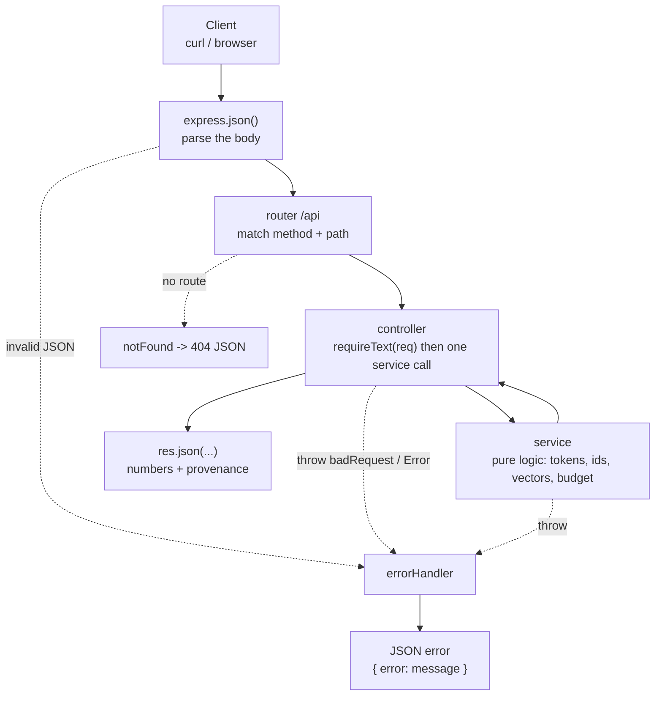

# 01 — Project Structure & Setup

> **Lecture chapter:** none — this is the orientation chapter.
> **What you get:** the full folder tree, every file's job, the request lifecycle, and the complete
> content of the ten scaffolding files (env, package, tsconfig, config, types, middleware, app, server,
> router) with a block-by-block explanation of each.
> **Commands used:** `npm install`, `npm run dev`, `npm run typecheck`.

---

## 01.1 The folder structure

```text
code/Basic Code/
├── .env                        # PORT, D_MODEL, DEFAULT_MODEL, DEFAULT_ENCODING — no secrets in this file
├── .gitignore                  # node_modules, dist, *.log
├── package.json                # scripts + the only two runtime dependencies
├── package-lock.json           # exact versions, so everyone installs the same tree
├── tsconfig.json               # strict TypeScript, src -> dist
├── src/
│   ├── server.ts               # opens the port (the only file that does)
│   ├── app.ts                  # builds the Express app: json, router, 404, error handler
│   ├── config/
│   │   └── config.ts           # env values + the model table (window, max output, prices)
│   ├── types/
│   │   └── index.ts            # RawText, TokenStr, TokenId, Vector, Logits, Encoded, TokenPiece, ModelSpec
│   ├── middleware/
│   │   ├── errorHandler.ts     # HttpError, asyncHandler, notFound, errorHandler
│   │   └── validate.ts         # requireText, optionalNumber, optionalStringArray, requireParts
│   ├── routes/
│   │   └── index.ts            # every route, grouped by the chapter it demonstrates
│   ├── controllers/            # one thin controller per chapter: body in, JSON out
│   │   ├── pipelineController.ts     # Chapter 01 + 08 (generate, training step)
│   │   ├── tokenizerController.ts    # Chapter 02 (encode, decode, compare)
│   │   ├── strategyController.ts     # Chapter 03 (compare)
│   │   ├── bpeController.ts          # Chapter 04 (train, encode, count-letters)
│   │   ├── countController.ts        # Chapter 05 (count)
│   │   ├── embeddingController.ts    # Chapter 06 (lookup, similarity)
│   │   ├── positionalController.ts   # Chapter 07 (encodePositions)
│   │   └── contextController.ts      # Chapter 08 (cost, fit)
│   └── services/               # ALL the logic lives here — pure functions, no HTTP
│       ├── tokenizerService.ts       # js-tiktoken: resolveEncoding, encode, decode, count, compare
│       ├── strategyService.ts        # word vs char vs subword + the N^2 comparison
│       ├── bpeService.ts             # trainBPE, encodeWithMerges, decodePieces, countLetters
│       ├── countService.ts           # count, tokenizerMeta, promptBudget, estimateCost, countParts
│       ├── embeddingService.ts       # vectorForId, dot/cosine/euclidean, meanPool, preview
│       ├── positionalService.ts      # sinusoidal encoding, addPositions, offset property, guard rail
│       ├── contextService.ts         # fitToWindow, attentionOps, kvCache
│       └── pipelineService.ts        # forward, softmax, generate, trainingStep, runPipeline
└── implementations guide/      # these chapter documents
```

**Why this shape?** It is the smallest structure that still separates four different concerns:

| Layer | Job | Never does |
| :--- | :--- | :--- |
| `routes/` | Map a URL + method to a controller | Contain logic |
| `controllers/` | Read the request, call **one** service function, shape the response | Do arithmetic on tokens |
| `services/` | The actual work: tokenize, count, embed, budget | Touch `req` or `res` |
| `middleware/` | Cross-cutting concerns: validation and errors | Know about a specific endpoint |

That separation is not decoration. It is what lets chapter 06 (counting) be tested with
`countTokens("hello")` instead of an HTTP call, and what lets the same services back a CLI later.

---

## 01.2 How a request flows



Read the two dotted paths carefully, because they are the difference between a service that fails well
and one that hangs: **an unknown route becomes a JSON 404** (never an HTML page), and **any thrown error
becomes a JSON error** with the right status — including a rejected promise inside an `async` handler.

---

## 01.3 The three root files

### `.env` — the only place a number is configured

**Purpose:** every tunable number lives here, so no constant is buried in the code. This file holds
**no secrets** — it is committed on purpose, because the lecture has nothing to hide.

```text
# Lecture 02 - LLM Foundations · Basic Code
# This file holds NO secrets: it only carries the defaults the endpoints read.
# Copy it to .env and change the numbers if you want a different shape.

# Port the Express server listens on
PORT=3000

# d_model - the width of every token vector (Lecture 02, Chapters 06-07).
# Kept small on purpose so the JSON responses stay readable.
D_MODEL=32

# The model spec the token-count and context endpoints use when the request
# does not name one. Must match an id in src/config/config.ts.
DEFAULT_MODEL=gpt-4o

# The BPE encoding the tokenizer falls back to when a request names neither a
# model nor an encoding. Both values below ship inside js-tiktoken, offline.
#   o200k_base - the gpt-4o family (|V| = 199,998)
#   cl100k_base - the gpt-4 / gpt-3.5 family (|V| = 100,256)
DEFAULT_ENCODING=o200k_base
```

**Block by block:**

1. `PORT=3000` — read by `config.port` and passed to `app.listen`. Change it here, not in `server.ts`.
2. `D_MODEL=32` — the width of every token vector, i.e. the number of columns in the embedding table
   (notes chapter 06 §06.1) and the length of every positional encoding (chapter 07). It is deliberately
   small: 32 numbers print readably in a terminal, and the mechanism is identical at 4096.
3. `DEFAULT_MODEL=gpt-4o` — the model spec used by `/api/tokens/count` and `/api/context/*` when a request
   does not name one. The id must exist in the table inside `config/config.ts`, or `config.model()` throws
   with the list of valid ids — a fail-loud lookup instead of a guessed context window.
4. `DEFAULT_ENCODING=o200k_base` — the BPE encoding used when a request names neither a model nor an
   encoding. `tokenizerService` validates it and falls back to `cl100k_base` (saying so in the response)
   instead of crashing on a typo. `o200k_base` is the gpt-4o family: |V| = 199,998.

### `package.json` — scripts and the smallest dependency set

**Purpose:** two runtime dependencies (`express`, `dotenv`) and four development ones. Nothing else is
needed to implement the lecture, and that is the point: tokens, ids, vectors and budgets are arithmetic,
not a framework feature.

```json
{
  "name": "lecture-02-llm-foundations-basic-code",
  "version": "1.0.0",
  "private": true,
  "description": "Basic Express + TypeScript code for Lecture 02 (LLM Foundations): text pipeline, tokenization, BPE, token counting, embeddings, positional encoding and the context window.",
  "main": "dist/server.js",
  "scripts": {
    "dev": "tsx watch src/server.ts",
    "build": "tsc -p tsconfig.json",
    "start": "node dist/server.js",
    "typecheck": "tsc --noEmit"
  },
  "dependencies": {
    "dotenv": "^16.4.5",
    "express": "^4.19.2",
    "js-tiktoken": "^1.0.21"
  },
  "devDependencies": {
    "@types/express": "^4.17.21",
    "@types/node": "^22.5.0",
    "tsx": "^4.19.2",
    "typescript": "^5.6.2"
  }
}
```

**Block by block:**

1. `"type"` is absent on purpose, so Node treats the compiled output as CommonJS and `node dist/server.js`
   works without extra flags.
2. `"dev": "tsx watch src/server.ts"` — runs TypeScript directly and restarts on save. `tsx` uses esbuild,
   so there is no build step while you work.
3. `"build": "tsc -p tsconfig.json"` and `"start": "node dist/server.js"` — the production path: type-check
   and compile once, then run plain JavaScript.
4. `"typecheck": "tsc --noEmit"` — the command to run before every commit. If it prints nothing, the whole
   tree type-checks; the assignment's acceptance criteria depend on this being clean.
5. `dependencies` — `express` (HTTP) and `dotenv` (read `.env` into `process.env`). Note what is *not*
   here: no tokenizer package, no LLM SDK, no database driver. Chapter 05 explains where a real tokenizer
   would slot in (a provider adapter), and the production tree is where that belongs.
6. `devDependencies` — `typescript`, `tsx`, and the type packages for Node and Express. Types are a
   development concern, so they never ship.

### `tsconfig.json` — strict, boring, and that is deliberate

**Purpose:** make the compiler catch the class of bug this lecture is about — confusing a token *string*
with a token *id*, or a vector with a logits array. `strict` plus named types is what stops those two from
ever being swapped silently.

```json
{
  "compilerOptions": {
    "target": "ES2022",
    "module": "commonjs",
    "moduleResolution": "node",
    "lib": ["ES2022"],
    "rootDir": "src",
    "outDir": "dist",
    "strict": true,
    "esModuleInterop": true,
    "forceConsistentCasingInFileNames": true,
    "skipLibCheck": true,
    "sourceMap": true
  },
  "include": ["src/**/*.ts"]
}
```

**Block by block:**

1. `"target": "ES2022"` and `"lib": ["ES2022"]` — modern JavaScript, including `Array.prototype.at`,
   `String.prototype.replaceAll` and top-level `??`. Everything used here is standard.
2. `"module": "commonjs"` + `"moduleResolution": "node"` — the pair that makes `import x from "express"`
   compile to a `require()` that Node runs directly.
3. `"rootDir": "src"` and `"outDir": "dist"` — the source tree and the build tree stay separate, so
   `npm start` runs compiled files while `npm run dev` runs sources.
4. `"strict": true` — the single most valuable line in the file. It forces every `TokenId` and every
   `Vector` to be handled as what it is, and it is why the services can return `Encoded` objects with
   confidence.
5. `"esModuleInterop": true` — lets the CommonJS packages (`express`, `dotenv`) be imported with the modern
   `import` syntax.
6. `"skipLibCheck": true` — do not type-check `node_modules`; it speeds the build and hides nothing that
   matters here.
7. `"include": ["src/**/*.ts"]` — only the service tree is compiled. The guide you are reading is markdown
   and is deliberately excluded.

---

## 01.4 Configuration and types

### `src/config/config.ts` — the model table, in one place

**Purpose:** read the environment once, and hold the **model specs** every cost calculation is measured
against: context window, maximum output tokens, and price per million tokens. Implements the "model
table" idea of notes chapter 05 §05.4.

```ts
import "dotenv/config";
import type { ModelSpec } from "../types";

/**
 * Chapter 05 - the model table every token count and cost estimate is measured
 * against. The prices are illustrative examples, not a quote: always read the
 * provider's own page before you promise anyone a number.
 */
const MODELS: ModelSpec[] = [
  { id: "gpt-4o", contextWindow: 128_000, maxOutputTokens: 16_384, pricePerMillionInput: 2.5, pricePerMillionOutput: 10 },
  { id: "gpt-4o-mini", contextWindow: 128_000, maxOutputTokens: 16_384, pricePerMillionInput: 0.15, pricePerMillionOutput: 0.6 },
  { id: "claude-3-5-sonnet", contextWindow: 200_000, maxOutputTokens: 8_192, pricePerMillionInput: 3, pricePerMillionOutput: 15 },
];

/** Read a number from the environment, falling back when it is missing or silly. */
function num(value: string | undefined, fallback: number): number {
  const parsed = Number(value);
  return Number.isFinite(parsed) && parsed > 0 ? parsed : fallback;
}

export const config = {
  /** Port the HTTP server listens on. */
  port: num(process.env.PORT, 3000),

  /** d_model - the width of every token vector (Chapters 06-07). */
  dModel: num(process.env.D_MODEL, 32),

  /** The model spec used when a request does not name one. */
  defaultModel: process.env.DEFAULT_MODEL ?? "gpt-4o",

  /**
   * The BPE encoding used when a request names neither a model nor an encoding.
   * Validated by tokenizerService, which falls back to cl100k_base and says so in
   * the response rather than crashing on a typo.
   */
  defaultEncoding: process.env.DEFAULT_ENCODING ?? "o200k_base",

  /** Every model spec the endpoints know about. */
  models: MODELS,

  /** Look a spec up by id, or fail loudly - never guess a context window. */
  model(id: string): ModelSpec {
    const found = MODELS.find((model) => model.id === id);
    if (!found) throw new Error(`Unknown model "${id}". Known models: ${MODELS.map((m) => m.id).join(", ")}`);
    return found;
  },
};
```

**Block by block:**

1. `import "dotenv/config"` — a side-effect import: it runs dotenv before anything reads `process.env`.
   Import order matters here, which is why it is the first line of the first file loaded.
2. `const MODELS: ModelSpec[]` — the table. Each row is exactly what a token-count endpoint needs: an id,
   the window, the output ceiling, and the two prices. **These prices are illustrative examples** — the
   point is that the numbers live in *data*, so updating them is a one-line change and never a hunt
   through code.
3. `function num(value, fallback)` — reads a number from the environment and falls back when it is missing
   or nonsense (`Number.isFinite` also rejects `NaN` from `PORT=abc`). This is the difference between a
   service that starts on a bad config and one that quietly runs with `NaN` as its vector width.
4. `config.port`, `config.dModel`, `config.defaultModel`, `config.defaultEncoding` — the four settings,
   each read once at startup instead of on every request.
5. `config.model(id)` — a **fail-loud** lookup: an unknown id throws with the list of valid ids. Compare
   that with silently defaulting to some window size, which is how you end up truncating a customer's
   prompt because a typo made the service pick the smallest model.
6. `export const config = { ... }` — a single object. Nothing else in the codebase reads `process.env`, so
   there is exactly one place to look when a value is wrong.

### `src/types/index.ts` — the pipeline as types

**Purpose:** this file is the notes' §02.9 pseudo-code made real. Naming the five pipeline stages as
distinct types is what makes the rest of the code readable and stops the classic mistake of treating an id
as a value.

```ts
/**
 * Chapter 02 (§02.9) - the five stages of the pipeline, written as types.
 * Read them together: each one is the output of one stage and the input of the
 * next, which is why the names must never be mixed up.
 */
export type RawText = string; // exactly what the user sent - the bytes the tokenizer sees
export type TokenStr = string; // a piece of text, e.g. " del" - note the leading space
export type TokenId = number; // an index into ONE encoding's vocabulary: a LABEL, not a value
export type Vector = number[]; // length = d_model
export type Logits = number[]; // length = |V|, one score per vocabulary entry

/**
 * One token, with everything you need to render or highlight it (Chapter 02 §02.5).
 * `bytes` is the UTF-8 length of the token; `partial` is true when the token ends in
 * the middle of a character (byte-level BPE does that to emoji and rare scripts).
 */
export type TokenPiece = {
  index: number;
  id: TokenId;
  token: TokenStr;
  bytes: number;
  start: number;
  end: number;
  special: boolean;
  partial: boolean;
};

/**
 * What a real tokenizer returns (Chapter 02 §02.5-§02.9).
 *
 * `encoding` and `exact` are not decoration: an id means nothing without the
 * vocabulary it came from, and `exact: false` means "this tokenizer is not the
 * model's own, so treat the count as an estimate" (§05.4).
 */
export type Encoded = {
  text: RawText; // the exact text that was encoded
  encoding: string; // e.g. "o200k_base"
  exact: boolean; // true when that encoding really belongs to the model asked about
  tokens: TokenStr[]; // the pieces the model actually sees
  ids: TokenId[]; // indices into that encoding's vocabulary
  count: number; // ids.length - the number you pay for
  offsets: [number, number][]; // [start, end) character span in `text`
  specialTokensMask: boolean[]; // true where a token came from the chat template, not the user
  pieces: TokenPiece[]; // the same data, plus byte lengths and partial flags
  roundTrip: RawText; // decode(ids)
  roundTripMatches: boolean; // invariant 1 of §02.8, checked on every call
};


/** One model's limits and prices (Chapter 05). */
export type ModelSpec = {
  id: string;
  contextWindow: number;
  maxOutputTokens: number;
  pricePerMillionInput: number;
  pricePerMillionOutput: number;
};

/** One piece of a prompt, with the token count it costs (Chapters 05 and 08). */
export type PromptPart = {
  name: "system" | "tools" | "user" | "context" | "history";
  tokens: number;
};

/** The four granularities compared in Chapter 03. */
export type Granularity = "word" | "char" | "subword";

/** An ordered merge list is the tokenizer for BPE (Chapter 04 §04.10). */
export type Merge = [string, string];
```

**Block by block:**

1. `RawText`, `TokenStr`, `TokenId`, `Vector`, `Logits` — five aliases, each documenting what the stage
   produces. They are all `string` or `number[]` underneath, so they cost nothing at runtime; their value
   is that a reader (and the compiler) can see *which* kind of number is in play.
2. `Encoded` — the tokenizer's return shape. It carries `tokens`, `ids` and `count` (what the model sees and
   what you pay for), `offsets` (map a token back to a character range — needed for highlighting and
   citations), and `specialTokensMask` (which tokens came from the chat template rather than the user). It
   also carries the two provenance fields that make a count trustworthy — `encoding` and `exact` — and
   `roundTripMatches`, which is invariant 1 of §02.8 checked on every call instead of trusted.
3. `TokenPiece` — one token with its byte length, its character span, a `special` flag and a `partial` flag
   for tokens that end in the middle of a character. Byte-level BPE really does that, so the flag is not
   decoration: it is why offsets are computed from bytes and not from characters.
4. `ModelSpec` — the shape of one row of the config table. Used by `/api/tokens/count` and
   `/api/context/*`, and returned in the response so the caller can see which limits were applied.
5. `PromptPart` — one piece of a prompt with its `name` from a closed set (`system`, `tools`, `user`,
   `context`, `history`) and its token count. The closed set is what makes the truncation priority order
   in chapter 09 possible: you cannot prioritise parts that have no name.
6. `Granularity` — the three tokenization strategies compared in guide chapter 04.
7. `Merge` — `[string, string]`, the BPE merge pair. The *order* of a `Merge[]` is the tokenizer
   (notes §04.10), so the type is deliberately a tuple: it is always exactly two pieces.

---

## 01.5 Middleware

### `src/middleware/errorHandler.ts` — one place where errors become JSON

**Purpose:** three jobs — give errors a status, catch rejected promises from `async` handlers, and turn
anything thrown anywhere into one JSON shape. Without the second job, a thrown error inside an `async`
controller would leave the request hanging until it times out.

```ts
import type { NextFunction, Request, Response } from "express";

/** An error that carries an HTTP status, so the handler can send it as-is. */
export class HttpError extends Error {
  constructor(
    public status: number,
    message: string,
  ) {
    super(message);
  }
}

/** A 400 that the caller caused - a missing field, a wrong type. */
export const badRequest = (message: string): HttpError => new HttpError(400, message);

type Handler = (req: Request, res: Response, next: NextFunction) => Promise<unknown> | unknown;

/**
 * Express 4 does not catch rejected promises, so a thrown error inside an async
 * handler would hang the request. This wrapper sends it to the error handler.
 */
export const asyncHandler =
  (handler: Handler) =>
  (req: Request, res: Response, next: NextFunction): void => {
    Promise.resolve(handler(req, res, next)).catch(next);
  };

/** Unknown route -> a JSON 404, never an HTML page. */
export function notFound(req: Request, res: Response): void {
  res.status(404).json({ error: `No route for ${req.method} ${req.path}` });
}

/** The last middleware in the chain: one place that turns any error into JSON. */
export function errorHandler(err: unknown, _req: Request, res: Response, _next: NextFunction): void {
  const status = err instanceof HttpError ? err.status : 500;
  const message = err instanceof Error ? err.message : "Unexpected error";
  res.status(status).json({ error: message });
}
```

**Block by block:**

1. `class HttpError extends Error` with a `status` — an error that carries its own HTTP status, so the
   handler never has to guess. `public status: number` in the constructor is TypeScript's shorthand for
   "declare the field and assign it".
2. `badRequest(message)` — the helper every validator uses for a 400. One function means every bad body
   produces the same error shape, which is what makes an API predictable to call.
3. `type Handler` — the signature a wrapped handler must have. `Promise<unknown> | unknown` allows both
   synchronous and asynchronous handlers, so you never have to remember which style a controller used.
4. `asyncHandler(handler)` — the wrapper. `Promise.resolve(handler(...)).catch(next)` is the whole trick:
   Express 4 does not catch rejections from async functions, so this converts a rejection into a call to
   `next(err)`, which lands in the error handler below. **Every controller here is wrapped in it**, which
   is why no controller contains a `try/catch`.
5. `notFound(req, res)` — the last route-level middleware. It answers with the method and the path, so a
   typo in a URL is diagnosable from the response alone.
6. `errorHandler(err, _req, res, _next)` — the four-argument signature is what marks this as an *error*
   middleware in Express. It reads the status from an `HttpError` (500 otherwise) and the message from an
   `Error`. The leading underscores on the unused parameters keep the required arity while making it clear
   that they are intentionally unused.

### `src/middleware/validate.ts` — the only trusted input boundary

**Purpose:** every request body in this service is untrusted text. These helpers turn "the field is
missing" into a **400 with a useful message**, instead of a `TypeError` five layers deep inside a service.

```ts
import type { Request } from "express";
import type { PromptPart } from "../types";
import { badRequest } from "./errorHandler";

/**
 * Request-body helpers. They exist so every controller can answer the same way
 * when a field is missing: a clear 400 instead of a crash deep inside a service.
 */

const PART_NAMES: PromptPart["name"][] = ["system", "tools", "user", "context", "history"];

/** `{ "text": "..." }` - the shape almost every endpoint here needs. */
export function requireText(req: Request, field = "text"): string {
  const value = (req.body as Record<string, unknown> | undefined)?.[field];
  if (typeof value !== "string" || value.trim().length === 0) {
    throw badRequest(`Body must contain "${field}" as a non-empty string.`);
  }
  return value;
}

/** An optional number, with a default. `{ "maxTokens": 8 }` */
export function optionalNumber(req: Request, field: string, fallback: number, min = 1, max = 4096): number {
  const value = (req.body as Record<string, unknown> | undefined)?.[field];
  if (value === undefined || value === null) return fallback;
  const parsed = Number(value);
  if (!Number.isFinite(parsed) || parsed < min || parsed > max) {
    throw badRequest(`"${field}" must be a number between ${min} and ${max}.`);
  }
  return Math.floor(parsed);
}

/** An optional non-empty string array, with a default. `{ "corpus": ["low", "lower"] }` */
export function optionalStringArray(req: Request, field: string, fallback: string[]): string[] {
  const value = (req.body as Record<string, unknown> | undefined)?.[field];
  if (value === undefined || value === null) return fallback;
  if (!Array.isArray(value) || value.length === 0 || value.some((item) => typeof item !== "string")) {
    throw badRequest(`"${field}" must be a non-empty array of strings.`);
  }
  return value as string[];
}

/**
 * The tokenizer a request asked for: a model id or an encoding name, in one string.
 * Every counting endpoint takes it, because a count means nothing without the
 * vocabulary it was measured in (§02.3).
 */
export function optionalTokenizer(req: Request): string | undefined {
  const body = (req.body ?? {}) as { model?: unknown; encoding?: unknown };
  if (typeof body.model === "string" && body.model.trim().length > 0) return body.model;
  if (typeof body.encoding === "string" && body.encoding.trim().length > 0) return body.encoding;
  return undefined;
}

/**
 * A prompt, part by part: either the explicit form
 *   { "parts": [{ "name": "system", "text": "..." }, { "name": "user", "text": "..." }] }
 * or the short form `{ "text": "..." }`, which is treated as the user's message.
 */
export function requireParts(req: Request): { name: PromptPart["name"]; text: string }[] {
  const body = req.body as { parts?: unknown; text?: unknown } | undefined;

  if (Array.isArray(body?.parts) && body.parts.length > 0) {
    return body.parts.map((part) => {
      const candidate = part as { name?: unknown; text?: unknown };
      if (!PART_NAMES.includes(candidate.name as PromptPart["name"]) || typeof candidate.text !== "string") {
        throw badRequest(`Each part needs {"name": one of ${PART_NAMES.join(" | ")}, "text": "..."}.`);
      }
      return { name: candidate.name as PromptPart["name"], text: candidate.text };
    });
  }

  if (typeof body?.text === "string" && body.text.trim().length > 0) {
    return [{ name: "user", text: body.text }];
  }

  throw badRequest('Send either {"text": "..."} or {"parts": [{"name": "system", "text": "..."}]}.');
}
```

**Block by block:**

1. `PART_NAMES` — the one place the allowed prompt-part names are listed. It is used for the validation
   *and* to build the error message, so the message can never fall out of date with the check.
2. `requireText(req, field = "text")` — the workhorse: the body must carry that field as a non-empty string
   (after trimming). Every text endpoint calls it, which is why every text endpoint rejects an empty body
   the same way. It *returns* the string, so a controller reads `const text = requireText(req);` —
   validation and extraction in one line.
3. `optionalNumber(req, field, fallback, min, max)` — for numeric knobs such as `maxTokens` and `layers`.
   It returns the fallback when the field is absent, rejects `NaN` and out-of-range values with the range
   in the message, and floors the result so `maxTokens: 3.7` cannot produce a fractional loop bound.
4. `optionalStringArray(req, field, fallback)` — used by `/api/bpe/train` for the corpus. It rejects an
   empty array as well as a non-array, because "no corpus" is a client mistake, not a valid request.
5. `requireParts(req)` — accepts either the explicit form
   `{ "parts": [{ "name": "system", "text": "..." }] }` or the short form `{ "text": "..." }`, which it
   treats as the user's own message. Both shapes appear in the notes (chapter 05 §05.6 counts parts;
   chapter 08 §08.3 truncates them), and supporting both keeps the assignment's curl examples short.
6. Every throw in this file is a `badRequest`, so all four helpers produce **400**, never 500 — the client
   caused it, and the response says so.

---

## 01.6 The app, the server and the router

### `src/app.ts` — the app, built but not started

**Purpose:** assemble Express. It is separated from `server.ts` for one reason: a test can import
`createApp()` and exercise the whole API **without opening a port**, which is the standard way to keep a
service testable.

```ts
import express, { type Express } from "express";
import { errorHandler, notFound } from "./middleware/errorHandler";
import router from "./routes";

/**
 * Build the Express app. Kept separate from server.ts so a test can import the
 * app without opening a port.
 */
export function createApp(): Express {
  const app = express();

  app.use(express.json({ limit: "1mb" })); // prompts are text; the ceiling is a guard rail

  // One mounting point for every route, so versioning later is a one-line change.
  app.use("/api", router);

  app.use(notFound); // unknown route -> JSON 404
  app.use(errorHandler); // anything thrown -> JSON error

  return app;
}
```

**Block by block:**

1. `express.json({ limit: "1mb" })` — parses JSON bodies and caps their size. The cap is not paranoia: a
   service whose whole job is counting tokens should refuse a 200 MB body before it tries to tokenize it.
2. `app.use("/api", router)` — every route is mounted under one prefix. Versioning later (`/api/v2`) is a
   one-line change here, and no controller needs to know.
3. `app.use(notFound)` — placed **after** the router, so it only runs when nothing matched.
4. `app.use(errorHandler)` — placed **last**, which is the only position where an error middleware can see
   errors from everything above it.
5. `export function createApp(): Express` — the factory returns the app. `server.ts` calls it; a test would
   call it too.

### `src/server.ts` — the only file that opens a port

**Purpose:** start the app and print what it is configured with. Everything interesting is imported; this
file has no logic, which is exactly what you want in a process entry point.

```ts
import { createApp } from "./app";
import { config } from "./config/config";
import { ENCODING_NAMES, vocabularySize } from "./services/tokenizerService";

const app = createApp();

app.listen(config.port, () => {
  console.log(`Lecture 02 - LLM Foundations (basic code) listening on http://localhost:${config.port}/api`);
  console.log(`d_model: ${config.dModel} · default model: ${config.defaultModel} · default encoding: ${config.defaultEncoding}`);
  console.log(`tokenizers: ${ENCODING_NAMES.map((name) => `${name} |V| = ${vocabularySize(name)}`).join(" · ")}`);
});
```

**Block by block:**

1. `createApp()` then `app.listen(config.port, ...)` — the port comes from config, never a literal.
2. The two `console.log` lines print `d_model`, the default model, the default encoding, and the |V| of
   every encoding the service can load. Startup logs that state the *configuration* are how you avoid the
   classic "why is the response different from yesterday" — you can see the shape of the service in the
   terminal before you send a request.
3. `ENCODING_NAMES` and `vocabularySize()` come from `tokenizerService`, so the numbers in the log are read
   from the real rank tables (199,998 and 100,256) instead of being copied into a comment that can drift.

### `src/routes/index.ts` — the map of the API

**Purpose:** one file that lists every endpoint, grouped by the lecture chapter it demonstrates. A reader
who wants to know what this service does should be able to read this file and stop.

```ts
import { Router } from "express";
import { config } from "../config/config";
import * as bpe from "../controllers/bpeController";
import * as context from "../controllers/contextController";
import * as count from "../controllers/countController";
import * as embedding from "../controllers/embeddingController";
import * as pipeline from "../controllers/pipelineController";
import * as positional from "../controllers/positionalController";
import * as strategy from "../controllers/strategyController";
import * as tokenizer from "../controllers/tokenizerController";
import { ENCODING_NAMES, vocabularySize } from "../services/tokenizerService";

/**
 * Every route, grouped by the chapter of Lecture 02 it demonstrates.
 * Nothing else lives here: a route names a controller and nothing more.
 */
const router = Router();

/** Setup check: is the server up, and with what configuration? */
router.get("/health", (_req, res) => {
  res.json({
    status: "ok",
    dModel: config.dModel,
    defaultModel: config.defaultModel,
    defaultEncoding: config.defaultEncoding,
    encodings: ENCODING_NAMES.map((name) => ({ name, vocabularySize: vocabularySize(name) })),
    models: config.models.map((model) => model.id),
  });
});

// Chapter 01 - next-token prediction and the autoregressive loop
router.post("/pipeline/generate", pipeline.generate);
router.post("/pipeline/training-step", pipeline.trainingStep);

// Chapter 02 - the text pipeline: text -> tokens -> ids, and back (real tokenizer)
router.post("/tokenizer/encode", tokenizer.encode);
router.post("/tokenizer/decode", tokenizer.decode);
router.post("/tokenizer/compare", tokenizer.compare);

// Chapter 03 - word vs character vs subword
router.post("/strategies/compare", strategy.compare);

// Chapter 04 - BPE: train the merges, encode with them, and the "strawberry" problem
router.post("/bpe/train", bpe.train);
router.post("/bpe/encode", bpe.encode);
router.post("/bpe/count-letters", bpe.countLetters);

// Chapter 05 - token counting, budget and cost
router.post("/tokens/count", count.count);

// Chapter 06 - embedding lookup and similarity
router.post("/embeddings/lookup", embedding.lookup);
router.post("/embeddings/similarity", embedding.similarity);

// Chapter 07 - positional encoding
router.post("/positional", positional.encodePositions);

// Chapter 08 - context window cost and truncation policy
router.post("/context/cost", context.cost);
router.post("/context/fit", context.fit);

export default router;
```

**Block by block:**

1. `import * as pipeline from "../controllers/pipelineController"` — namespace imports, one per chapter.
   They keep the route list readable (`pipeline.generate`) and make a missing export a compile error.
2. `router.get("/health", ...)` — the setup check. It returns `dModel`, `defaultModel`, `defaultEncoding`,
   the |V| of each encoding and the known model ids, so the first curl of any session confirms the
   configuration you think you are running — including which tokenizer is loaded.
3. The eight comment blocks group routes by chapter. That is documentation that cannot rot: the route is
   directly under the chapter it belongs to.
4. `POST /pipeline/generate` and `/pipeline/training-step` — inference and training side by side, which is
   notes chapter 08 §08.9 in two lines of routing.
5. `/tokenizer/*` (encode · decode · **compare**), `/strategies/*`, `/bpe/*`, `/tokens/*`,
   `/embeddings/*`, `/positional`, `/context/*` — one path family per chapter. `/tokenizer/compare` is the
   roadmap's build task ("the same sentence across two providers") available as a single call.
6. `export default router` — a single default export, mounted once in `app.ts`.

---

## 01.7 Checkpoint

After chapter 01 you should be able to answer, without looking:

1. Which file opens the port, and which file could a test import safely?
2. Where does a new endpoint get added — and in what order (route → controller → service)?
3. Why does every controller get wrapped in `asyncHandler`, and what happens if it is not?
4. What turns a missing `text` field into a 400 instead of a 500?
5. Where would you change `d_model`, and what two other things would change with it?

Verify with:

```bash
cd "code/Basic Code"
npm run typecheck                     # must print nothing
npm run dev &                         # start the service
curl -s localhost:3000/api/health     # configuration, straight from config.ts
curl -s localhost:3000/api/tokenizer/encode -H 'content-type: application/json' -d '{}'   # 400
curl -s localhost:3000/api/nope                                                            # 404
```

> **Next:** [02 — Next-Token Prediction & the Generation Loop](./02_Next_Token_Prediction_and_the_Generation_Loop.md),
> where the whole pipeline is assembled in `pipelineService.ts`.
