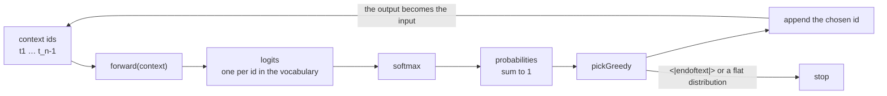

# 02 — Next-Token Prediction & the Generation Loop

> **Lecture chapter 01** — [notes/01](../../../notes/01_What_an_LLM_Is_and_Next_Token_Prediction.md)
> **Files:** `src/services/pipelineService.ts` · `src/controllers/pipelineController.ts`
> **Endpoints:** `POST /api/pipeline/generate` · `POST /api/pipeline/training-step`

This chapter is the whole lecture in one file. Everything else in `src/` is a box that this file opens:
the tokenizer (chapter 03), the embedding table (07), the positional encoder (08) and the context guard
(09). Read it as the map.

---

## 02.1 The objective, in code

An LLM is trained on exactly one task:

$$P(t_n \mid t_1, \dots, t_{n-1})$$

The model never predicts a *sentence*; it predicts a **distribution over the vocabulary** for the next
position, one position at a time. Everything else — chat, reasoning, code — is that loop running on a
carefully shaped context.



**The tokenizer is real; the model is a stand-in.** `js-tiktoken` supplies the same BPE tables the models
use, so the ids, the pieces and the counts are the real ones. The *model* is a bigram table counted from a
five-sentence corpus, because a transformer needs a GPU and this chapter needs to show you the mechanism.
The loop around the model — which is what you actually have to understand — is identical either way.

---

## 02.2 The file

### `src/services/pipelineService.ts`

**Purpose:** build a stand-in next-token model from a corpus, run the forward pass, turn logits into
probabilities, generate autoregressively, and run one training step beside it — all on **real** token ids.

```ts
import { config } from "../config/config";
import type { Logits, TokenId } from "../types";
import { count } from "./countService";
import { embedAll, preview } from "./embeddingService";
import { inputPipeline, trainedLengthWarning } from "./positionalService";
import { VOCAB_SIZE, decode, encode, isSpecial, normalize, pieceOf, tokenize } from "./tokenizerService";

/**
 * Chapter 01 - an LLM is a next-token probability machine:
 *
 *     P(t_n | t_1 ... t_{n-1})
 *
 * The TOKENIZER here is real (js-tiktoken, the same tables the models use). The MODEL is
 * a bigram table counted from a tiny corpus: it scores every id in the vocabulary,
 * softmax turns those scores into probabilities, and a decoding strategy picks exactly
 * one. A real LLM swaps the table for a transformer - everything around it, including
 * the loop below, is identical.
 */

/** The entire training corpus of our stand-in model. */
export const DEMO_CORPUS: string[] = [
  "the capital of india is delhi .",
  "the capital of india is delhi .", // twice, so the distribution comes out PEAKED (§01.6)
  "the capital of france is paris .",
  "the cat sat on the mat .",
  "hello i am aminul .",
];

/**
 * A floor logit: every id in the vocabulary gets a score, so the softmax is over the
 * whole vocabulary and not just over the ids the corpus happened to show (§01.6).
 * -30 is small enough that the floor mass never distorts the real candidates.
 */
const FLOOR_LOGIT = -30;

type Counts = Map<TokenId, Map<TokenId, number>>;

function addCount(counts: Counts, from: TokenId, to: TokenId): void {
  const row = counts.get(from) ?? new Map<TokenId, number>();
  row.set(to, (row.get(to) ?? 0) + 1);
  counts.set(from, row);
}

/**
 * "Training": count which id follows which. This is the same loop as §08.9 - forward
 * pass, compare with the next token, update the weights - only the update here is a
 * counter instead of a gradient step. Note that the corpus is tokenized by the REAL
 * tokenizer, so the counts are over real ids.
 */
export function buildModel(corpus: string[]): Counts {
  const counts: Counts = new Map();
  for (const sentence of corpus) {
    const ids = encode(sentence).ids;
    for (let i = 0; i < ids.length - 1; i++) addCount(counts, ids[i], ids[i + 1]);
  }
  return counts;
}

/** The weights. In memory only - and changed by POST /pipeline/training-step. */
export const MODEL: Counts = buildModel(DEMO_CORPUS);

/**
 * The forward pass: one logit per vocabulary entry - 199,998 numbers for o200k_base.
 * Only the LAST position's logits are used to pick the next token (§02.6, step 7).
 */
export function forward(context: TokenId[]): Logits {
  const logits: Logits = new Array(VOCAB_SIZE).fill(FLOOR_LOGIT);
  const last = context[context.length - 1];
  const row = MODEL.get(last);
  if (row) for (const [id, times] of row) logits[id] = Math.log(times) + 2;
  return logits;
}

/**
 * Softmax, written out so "logits -> probabilities" is not a black box (Lecture 03 has
 * the maths). The maximum is found with a loop, not with Math.max(...logits): spreading
 * 200k arguments would blow the call stack, which is a real bug in real code.
 */
export function softmax(logits: Logits): number[] {
  let max = -Infinity;
  for (const value of logits) if (value > max) max = value;

  let total = 0;
  const exps = logits.map((value) => {
    const exp = Math.exp(value - max); // subtract the max so exp() cannot overflow
    total += exp;
    return exp;
  });
  return exps.map((value) => value / total);
}

/** The decoding strategy: greedy, the simplest one. Temperature and top-p are Lecture 03. */
function pickGreedy(probabilities: number[]): TokenId {
  let best = 0;
  for (let id = 1; id < probabilities.length; id++) {
    if (probabilities[id] > probabilities[best]) best = id;
  }
  return best;
}

/**
 * The head of a distribution - this is the §01.6 table, computed instead of typed.
 * One pass keeps the best `size` ids, so a 200k-entry array is never sorted.
 */
function topScores(probabilities: number[], size = 5): { token: string; id: number; probability: number }[] {
  const best: number[] = [];
  for (let id = 0; id < probabilities.length; id++) {
    if (best.length < size) {
      best.push(id);
      continue;
    }
    let lowest = 0;
    for (let i = 1; i < best.length; i++) if (probabilities[best[i]] < probabilities[best[lowest]]) lowest = i;
    if (probabilities[id] > probabilities[best[lowest]]) best[lowest] = id;
  }

  return best
    .map((id) => ({ token: pieceOf(id), id, probability: Number(probabilities[id].toFixed(6)) }))
    .filter((entry) => entry.probability > 1e-9) // drop the floor: it is not a real candidate
    .sort((a, b) => b.probability - a.probability);
}

export type Stage = { stage: string; detail: unknown };

/** The stages of §02.6 and §08.7, run once on a prompt so you can watch each one. */
export function runPipeline(text: string) {
  const encoded = encode(text);
  const tokens = tokenize(text); // stage 1-2: the real tokenizer
  const ids = encoded.ids; // stage 3: ids are labels, not measurements
  const vectors = embedAll(ids); // stage 4: embedding lookup W_emb[id]
  const inputMatrix = inputPipeline(ids, vectors, config.dModel); // stage 5: E + P
  const logits = forward(ids); // stage 6: forward pass
  const probabilities = softmax(logits); // stage 7
  const chosen = pickGreedy(probabilities); // stage 8

  const stages: Stage[] = [
    { stage: "1-2 tokenize (real BPE)", detail: { encoding: encoded.encoding, tokens } },
    { stage: "3 vocabulary lookup", detail: { ids, note: "ids mean nothing without this encoding" } },
    { stage: "4 count tokens", detail: count(text) },
    { stage: "5 embedding lookup", detail: { shape: [ids.length, config.dModel], firstRow: preview(vectors[0] ?? []) } },
    { stage: "6 add positional encoding", detail: { shape: [inputMatrix.length, config.dModel], firstRow: preview(inputMatrix[0] ?? []) } },
    { stage: "7 forward pass -> logits", detail: { vocabularySize: logits.length, top5: topScores(logits) } },
    {
      stage: "8 softmax -> probabilities",
      detail: { sumsTo: Number(probabilities.reduce((sum, value) => sum + value, 0).toFixed(6)), top5: topScores(probabilities) },
    },
    { stage: "9 greedy pick", detail: { token: pieceOf(chosen), id: chosen } },
  ];

  return {
    text,
    encoding: encoded.encoding,
    exact: encoded.exact,
    roundTripMatches: encoded.roundTripMatches,
    inputShape: [ids.length, config.dModel] as [number, number],
    nextToken: { token: pieceOf(chosen), id: chosen },
    stages,
    note: "The stand-in model reads only the last token id, so stages 5-6 exist to show the shape a real transformer consumes. Every stage still runs, so the trace is complete.",
  };
}

export type GenerationStep = {
  step: number;
  positionsProcessed: number;
  context: string;
  chosen: string;
  chosenId: number;
  probability: number;
  top5: { token: string; id: number; probability: number }[];
};

/**
 * Below this, the pick is not a decision: it is the floor logit, i.e. the context was
 * never seen in the corpus and the distribution is (almost) uniform - 1/199,998 for
 * o200k_base. Generation stops instead of inventing a token.
 */
const MIN_PROBABILITY = 1e-3;

/** The autoregressive loop of §01.7: one full forward pass per generated token. */
export function generate(prompt: string, maxTokens: number) {
  const promptIds = encode(prompt).ids;
  const context: TokenId[] = [...promptIds];
  const output: TokenId[] = [];
  const steps: GenerationStep[] = [];
  let stoppedBecause: string | null = null;

  for (let step = 0; step < maxTokens; step++) {
    // Chapters 06-07 run every step: this is the matrix the transformer blocks consume.
    const inputMatrix = inputPipeline(context, embedAll(context), config.dModel);

    const probabilities = softmax(forward(context)); // ONE full forward pass per generated token
    const chosen = pickGreedy(probabilities); // greedy; temperature and top-p are Lecture 03

    if (isSpecial(chosen)) {
      stoppedBecause = "the model emitted a special token (<|endoftext|>)";
      break;
    }
    if (probabilities[chosen] < MIN_PROBABILITY) {
      stoppedBecause = `no observed continuation after ${JSON.stringify(decode(context))}: the distribution is flat, so every token in the vocabulary is equally likely.`;
      break;
    }

    steps.push({
      step: step + 1,
      positionsProcessed: inputMatrix.length,
      context: decode(context),
      chosen: pieceOf(chosen),
      chosenId: chosen,
      probability: Number(probabilities[chosen].toFixed(6)),
      top5: topScores(probabilities),
    });

    output.push(chosen);
    context.push(chosen); // autoregressive: the output becomes the input
  }

  return {
    prompt,
    mode: "inference",
    weightsFrozen: true,
    promptTokens: promptIds.length,
    output: decode(output),
    outputTokens: output.length,
    steps,
    stoppedBecause,
    guardRail: trainedLengthWarning(promptIds.length, config.model(config.defaultModel).contextWindow),
    cost: {
      forwardPasses: output.length,
      note: "One full forward pass per generated token, and the sequence grows by one each step - that is why output tokens dominate latency and cost (§01.7).",
    },
  };
}

export type TrainingPosition = {
  position: number;
  context: string;
  label: string;
  probability: number;
  loss: number;
};

/**
 * §08.4 and §08.9 - one training step. The label is free: it is the next token of the
 * same sentence, which is the whole trick behind pre-training.
 */
export function trainingStep(text: string) {
  const ids = encode(text).ids;
  const positions: TrainingPosition[] = [];
  let totalLoss = 0;

  for (let i = 0; i < ids.length - 1; i++) {
    const probabilities = softmax(forward(ids.slice(0, i + 1))); // a real model does all positions at once
    const label = ids[i + 1]; // the label, free of charge
    const probability = Math.max(probabilities[label], 1e-12); // an unseen transition is not free
    const loss = -Math.log(probability); // cross-entropy for this position
    totalLoss += loss;

    positions.push({
      position: i + 1,
      context: decode(ids.slice(0, i + 1)),
      label: pieceOf(label),
      probability: Number(probability.toFixed(6)),
      loss: Number(loss.toFixed(4)),
    });
  }

  // The update step: remember the pairs we just saw. A real model runs backward() and moves every weight.
  for (let i = 0; i < ids.length - 1; i++) addCount(MODEL, ids[i], ids[i + 1]);

  return {
    text,
    encoding: encode(text).encoding,
    mode: "training",
    weightsUpdated: true,
    positions,
    averageLoss: Number((totalLoss / Math.max(positions.length, 1)).toFixed(4)),
    update: "Observed pairs added to the bigram counts. A real LLM runs backward() and moves every weight (§08.9).",
    note: "Send the same text twice: the loss falls the second time, because the weights moved. Prompting never does that.",
  };
}
```

**Block by block:**

1. `DEMO_CORPUS` — the entire training data: five sentences, one of them twice. Duplicating
   `"the capital of india is delhi ."` is not laziness: it is what makes the distribution **peaked**
   (§01.6) instead of a coin flip, so the greedy pick has something to prefer. The corpus is tokenized by
   the real tokenizer when the model is built, so the counts are over real ids.
2. `FLOOR_LOGIT = -30` — every id in the vocabulary gets a score, even the ones the corpus never showed.
   That is what makes the softmax a distribution over the **whole** vocabulary rather than only over the
   ids you happened to see. The value is chosen so the floor mass is negligible: $e^{-30}$ × 199,998 is
   about $10^{-7}$, which cannot distort the real candidates.
3. `Counts = Map<TokenId, Map<TokenId, number>>` — the weights of this stand-in model: for each id, how
   often each other id followed it. A real model stores matrices here; the shape of the *interface*
   (context id → scores) is the same, which is why the rest of the file would not change.
4. `buildModel(corpus)` — "training": count, for every adjacent pair, which id follows which. It runs once
   at import, exactly like real pre-training runs once by the model authors. Note that it tokenizes with
   `encode(sentence).ids` — real ids — so the same code would work on a real corpus.
5. `forward(context)` — the forward pass. It allocates one logit per vocabulary entry, fills them with the
   floor, then overwrites the ids the corpus observed after the **last** context id with
   `Math.log(count) + 2`. Only the last position matters here because this model is a bigram; a transformer
   would use every position, which is why `generate` still builds the full input matrix each step.
6. `softmax(logits)` — logits to probabilities, written out so it is not a black box. The maximum is found
   with a **loop, not `Math.max(...logits)`**: spreading 200k arguments overflows the call stack, which is
   a real bug that bites people the first time they run softmax on a real vocabulary. Subtracting the max
   keeps `exp()` from overflowing — the standard trick, and now you have seen why it is needed.
7. `pickGreedy(probabilities)` — the decoding strategy: take the largest probability. Temperature, top-p
   and top-k are **Lecture 03**; this lecture only needs *a* strategy, and greedy is the simplest one that
   makes the loop observable.
8. `topScores(probabilities, 5)` — the head of the distribution, which is the §01.6 table computed instead
   of typed. It keeps the best five ids in a single pass (never sorting 200k entries), then drops anything
   below `1e-9` so the floor ids do not pollute the output, then sorts those five.
9. `Stage` / `runPipeline(text)` — the trace: tokenize → ids → count → embedding lookup → `E + P` →
   forward → softmax → greedy pick. Each stage reports the **shape** of what it produced and a preview, so
   you can see the pipeline without a debugger. `sumsTo` proves the softmax normalised; `roundTripMatches`
   proves the tokenizer round-tripped.
10. `GenerationStep` — what one turn of the loop recorded: the step number, how many positions were
    processed, the decoded context, the chosen piece and id, its probability, and the top five. This is the
    object that makes "one forward pass per token" visible instead of asserted.
11. `MIN_PROBABILITY = 1e-3` — the honesty guard. If the best token is below this, the context was never
    seen in the corpus, every id sits at the floor logit, and the distribution is **uniform**
    ($1/199{,}998 \approx 5\times10^{-6}$). The loop stops and says so, instead of emitting a random token
    and calling it generation.
12. `generate(prompt, maxTokens)` — the autoregressive loop of §01.7. Each turn: build the input matrix,
    one forward pass, softmax, pick, stop if the model chose a special token or if the distribution is flat,
    otherwise push the id onto `output` **and onto `context`** — the line that makes it autoregressive.
    `cost.forwardPasses` reports the arithmetic: the number of passes equals the number of output tokens.
13. `trainingStep(text)` — §08.4 and §08.9. For every position it computes the distribution, reads the
    probability of the *next* token of the same sentence (the label is free — that is the whole trick behind
    pre-training), and takes $-\log p$ as the cross-entropy. An unseen transition is clamped to `1e-12` so
    the loss is large but finite ($\approx 27.6$) instead of `Infinity`.
14. The update loop at the end of `trainingStep` — the "weights move" step. Here the update is *increment
    the bigram count*, which is why calling the endpoint twice on the same text makes the loss fall. A real
    LLM runs `backward()` and moves every weight instead; the observable behaviour — the loss falls, and
    prompting never does that — is identical.

**Measured behaviour** (`POST /api/pipeline/generate` with
`{"prompt":"the capital of india is","maxTokens":4}`, o200k_base):

| Step | Context | Chosen | Probability | Why |
| :---: | :--- | :--- | :---: | :--- |
| 1 | `the capital of india is` | `" del"` | 0.6667 | after `" is"` the corpus has `" del"` twice and `" paris"` once |
| 2 | `… del` | `"hi"` | 1.0 | only one continuation was ever observed |
| 3 | `… delhi` | `" ."` | 1.0 | ditto |
| 4 | `… delhi .` | — | — | **stopped**: nothing follows `" ."`, so the distribution is flat |

Two things to notice, because they are the lecture: the model generated `" del"` **then** `"hi"` — the token
boundary cuts *through* the word "delhi", which is why a model cannot count letters (guide chapter 05). And
`stoppedBecause` names the reason instead of pretending.

### `src/controllers/pipelineController.ts`

**Purpose:** two endpoints, two service calls, nothing else.

```ts
import type { Request, Response } from "express";
import { asyncHandler } from "../middleware/errorHandler";
import { optionalNumber, requireText } from "../middleware/validate";
import * as pipeline from "../services/pipelineService";

/** Chapter 01 - the generation loop, and Chapter 08 - the training step next to it. */

/** POST /api/pipeline/generate   { "prompt": "the capital of india is", "maxTokens": 6 } */
export const generate = asyncHandler((req: Request, res: Response) => {
  const prompt = requireText(req, "prompt");
  const maxTokens = optionalNumber(req, "maxTokens", 6, 1, 64);

  res.json({
    pipelineTrace: pipeline.runPipeline(prompt),
    generation: pipeline.generate(prompt, maxTokens),
  });
});

/** POST /api/pipeline/training-step   { "text": "the capital of india is delhi ." } */
export const trainingStep = asyncHandler((req: Request, res: Response) => {
  const text = requireText(req);
  res.json(pipeline.trainingStep(text));
});
```

**Block by block:**

1. `requireText(req, "prompt")` — the prompt is mandatory and must be a non-empty string; a missing field
   becomes a 400 from the shared validator, not a `TypeError` from inside the loop.
2. `optionalNumber(req, "maxTokens", 6, 1, 64)` — the default is 6, the ceiling is 64. The ceiling is not
   arbitrary: each generated token costs a full forward pass over a 200k-entry vocabulary, so an unbounded
   `maxTokens` is a free denial-of-service on your own service.
3. `res.json({ pipelineTrace, generation })` — one response carries both views: the *static* trace of one
   prompt through the pipeline, and the *dynamic* loop. That pairing is the chapter: the trace shows what
   the model receives, the loop shows what it does with it.
4. `POST /pipeline/training-step` calls `pipeline.trainingStep(text)` and returns it unchanged — including
   `averageLoss`, the number that falls when you call it twice. Keeping the response raw means the
   controller never reinterprets the service's numbers.

---

## 02.3 Try it

```bash
curl -s localhost:3000/api/pipeline/generate -H 'content-type: application/json' \
  -d '{"prompt":"the capital of india is","maxTokens":4}'

# call it twice: the average loss falls the second time
curl -s localhost:3000/api/pipeline/training-step -H 'content-type: application/json' \
  -d '{"text":"the capital of france is paris ."}'
```

**Checkpoint.** Answer from memory, then verify in the code:

1. Why is the label free in `trainingStep`, and what would you have to build instead if it were not?
2. Which line makes the loop autoregressive, and what breaks if you delete it?
3. Why does `softmax` use a loop for the maximum, and what happens with `Math.max(...logits)` here?
4. The fourth generation step stops. What exactly does `MIN_PROBABILITY` protect you from reporting?
5. `cost.forwardPasses` equals `outputTokens`. Why is that the single most important sentence in the
   lecture's cost model?

> **Next:** [03 — The Text Pipeline & Token IDs](./03_Text_Pipeline_and_Token_IDs.md), where the tokenizer
> this file depends on is written out in full.
