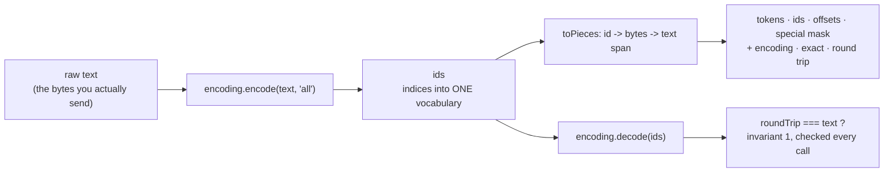

# 03 — The Text Pipeline & Token IDs

> **Lecture chapter 02** — [notes/02](../../../notes/02_The_Text_Pipeline_and_Why_Token_IDs_Are_Labels.md)
> **Files:** `src/services/tokenizerService.ts` · `src/controllers/tokenizerController.ts`
> **Endpoints:** `POST /api/tokenizer/encode` · `/decode` · `/compare`

This is the most important file in the project, because every other chapter depends on it: the counts in
chapter 06, the vectors in chapter 07, the budget in chapter 09 and the model in chapter 02 all start
here. It is also the one place where the code **is not a simulation** — it runs OpenAI's own BPE tables.

---

## 03.1 The five stages, and the four rules this file enforces



| Rule | Why it is in the code |
| :--- | :--- |
| **An id belongs to one encoding** | `o200k_base` id 1083 is `" del"`; the same number means something else in `cl100k_base`. So every response names its encoding (§02.3). |
| **`exact` must be earned** | `getEncodingNameForModel("gpt-4o")` returns a real table → `exact: true`. Claude's tokenizer is closed, so the count is an **estimate** and the response says so (§05.4). |
| **Offsets are computed in bytes** | Byte-level BPE splits characters — an emoji is often two tokens — so counting characters would produce wrong spans (§02.5). |
| **The round trip is checked, not assumed** | `roundTripMatches` is invariant 1 of §02.8, evaluated on every request. |

---

## 03.2 The file

### `src/services/tokenizerService.ts`

**Purpose:** wrap `js-tiktoken` in the four functions the rest of the service needs — `encode`, `decode`,
`countTokens`, `compare` — and attach the provenance (`encoding`, `exact`) that makes a count trustworthy.

```ts
import { getEncoding, getEncodingNameForModel, type Tiktoken, type TiktokenModel } from "js-tiktoken";
import { config } from "../config/config";
import type { Encoded, RawText, TokenId, TokenPiece, TokenStr } from "../types";

/**
 * Chapter 02 - the text pipeline, running a REAL tokenizer.
 *
 * `js-tiktoken` is the JavaScript port of OpenAI's `tiktoken`: the same BPE rank
 * tables the models are trained with, shipped offline. Nothing here is hand-rolled,
 * so the counts are the counts a provider bills for - the only number that matters
 * in Chapter 05.
 *
 * Three rules this file follows:
 *   1. An id is an index into ONE encoding's vocabulary. Ids are never portable
 *      between encodings (§02.3), so every response names its encoding.
 *   2. `exact` says whether that encoding is really the model's own. A closed
 *      tokenizer (Claude, Gemini) can only be approximated, and an estimate must be
 *      labelled as one (§05.4).
 *   3. Offsets are computed by walking BYTES, not characters. Byte-level BPE happily
 *      splits a character in two, so character counting would be wrong (§02.5).
 */

/** The encodings this service exposes by name. Both ship inside js-tiktoken. */
export const ENCODING_NAMES = ["o200k_base", "cl100k_base"] as const;
export type EncodingName = (typeof ENCODING_NAMES)[number];

/** tiktoken's own version, so a count can be traced back to a tokenizer build (§05.4). */
export const TIKTOKEN_VERSION = "1.0.21";

/**
 * js-tiktoken's published types only declare encode() and decode(), but the instance
 * really carries the byte tables this file needs. Rather than reach for `any`, the
 * runtime shape is written down once, here, and narrowed to at the boundary.
 */
type TiktokenInternals = {
  encode: (text: string, allowedSpecial?: "all" | string[]) => number[];
  decode: (ids: number[]) => string;
  textMap: Map<number, Uint8Array>; // id -> the raw bytes of that token
  specialTokens: Record<string, number>; // "<|endoftext|>" -> 199999
  inverseSpecialTokens: Record<string, string>; // 199999 -> "<|endoftext|>"
};

const internals = (encoding: Tiktoken): TiktokenInternals => encoding as unknown as TiktokenInternals;

const cache = new Map<string, Tiktoken>();

/** Loading a rank table costs ~100 ms, so each encoding is built once and reused. */
function load(name: EncodingName): Tiktoken {
  const found = cache.get(name);
  if (found) return found;
  const encoding = getEncoding(name);
  cache.set(name, encoding);
  return encoding;
}

export type ResolvedEncoding = { name: EncodingName; encoding: Tiktoken; exact: boolean; source: string };

/**
 * Turn whatever the caller sent - an encoding name or a model id - into a real
 * encoding, and say honestly whether it is the right one for that model.
 */
export function resolveEncoding(input?: string): ResolvedEncoding {
  const wanted = typeof input === "string" ? input.trim() : "";

  // 1. An explicit encoding name: exact by definition.
  if ((ENCODING_NAMES as readonly string[]).includes(wanted)) {
    const name = wanted as EncodingName;
    return { name, encoding: load(name), exact: true, source: `encoding ${name}` };
  }

  // 2. A model id tiktoken knows: its own table, so still exact.
  if (wanted.length > 0) {
    try {
      const name = getEncodingNameForModel(wanted as TiktokenModel);
      if ((ENCODING_NAMES as readonly string[]).includes(name)) {
        return { name: name as EncodingName, encoding: load(name as EncodingName), exact: true, source: `model ${wanted}` };
      }
    } catch {
      // The model's tokenizer is closed (Claude, Gemini, ...): fall through and label it.
    }
  }

  // 3. Unknown or absent: the configured default - and never claim it is exact for a model.
  const configured = config.defaultEncoding;
  const name = (ENCODING_NAMES as readonly string[]).includes(configured) ? (configured as EncodingName) : "cl100k_base";
  return {
    name,
    encoding: load(name),
    exact: wanted.length === 0,
    source: wanted.length === 0 ? `configured default: ${name}` : `no public tokenizer for "${wanted}" - approximated with ${name}`,
  };
}

/** |V| of an encoding - it shapes the logits vector and the embedding table (§05.5). */
export function vocabularySize(input?: string): number {
  return internals(resolveEncoding(input).encoding).textMap.size;
}

/** The default encoding's |V|, resolved once at startup. */
export const VOCAB_SIZE = vocabularySize(config.defaultEncoding);

const textDecoder = new TextDecoder();
const textEncoder = new TextEncoder();

/** UTF-8 byte length of one code point: byte-level BPE measures everything in bytes. */
const byteLength = (character: string): number => textEncoder.encode(character).length;

/**
 * Stage 2 and stage 3 of §02.6 in one pass: the ids, the piece each id stands for,
 * and the character span it covers in the text that was actually sent.
 *
 * tiktoken returns ids only, so the pieces are rebuilt from the encoding's own byte
 * table. A token can end in the MIDDLE of a character (an emoji is often two tokens),
 * so `partial` marks those pieces - and the offsets still add up to the whole text.
 */
function toPieces(text: RawText, ids: TokenId[], encoding: Tiktoken): TokenPiece[] {
  const bytesOf = internals(encoding).textMap;
  const specials = internals(encoding).inverseSpecialTokens;
  const codePoints = [...text].map((character) => ({ utf16: character.length, bytes: byteLength(character) }));
  let codePoint = 0;
  let position = 0; // a UTF-16 index, so text.slice(start, end) is exact

  return ids.map((id, index) => {
    const bytes = bytesOf.get(id)?.length ?? 0;
    const start = position;
    let consumed = 0;
    while (consumed < bytes && codePoint < codePoints.length) {
      consumed += codePoints[codePoint].bytes;
      position += codePoints[codePoint].utf16;
      codePoint += 1;
    }
    return {
      index,
      id,
      token: text.slice(start, position),
      bytes,
      start,
      end: position,
      special: Object.prototype.hasOwnProperty.call(specials, id),
      partial: consumed !== bytes,
    };
  });
}

/**
 * NFKC + whitespace collapse. Reported next to the raw text so you can SEE why you must
 * not normalise silently: `encode` never calls this, because the model counts the bytes
 * you actually send (§02.8).
 */
export function normalize(text: RawText): RawText {
  return text.normalize("NFKC").replace(/\s+/g, " ").trim();
}

/**
 * The forward pipeline of §02.6: text -> tokens -> ids, with offsets, the special-token
 * mask, and the round trip checked on every single call (invariant 1 of §02.8).
 */
export function encode(text: RawText, input?: string): Encoded {
  const { name, encoding, exact } = resolveEncoding(input);
  // "all" lets special tokens through as literal text instead of throwing, so the mask
  // below can say which tokens came from the template and which came from the user.
  const ids = internals(encoding).encode(text, "all");
  const pieces = toPieces(text, ids, encoding);
  const roundTrip = encoding.decode(ids);

  return {
    text,
    encoding: name,
    exact,
    tokens: pieces.map((piece) => piece.token),
    ids,
    count: ids.length,
    offsets: pieces.map((piece) => [piece.start, piece.end] as [number, number]),
    specialTokensMask: pieces.map((piece) => piece.special),
    pieces,
    roundTrip,
    roundTripMatches: roundTrip === text,
  };
}

/**
 * Chat mode: a real template adds real special tokens and marks them as NOT user text,
 * so token accounting matches the provider's (§02.8, invariant 6).
 */
export function encodeChat(text: RawText, input?: string): Encoded {
  const inner = encode(text, input);
  const { encoding } = resolveEncoding(input);
  const specials = internals(encoding).specialTokens;

  const wrap = (id: number | undefined, token: TokenStr, at: number): TokenPiece | null =>
    typeof id === "number" ? { index: -1, id, token, bytes: 0, start: at, end: at, special: true, partial: false } : null;

  const head = wrap(specials["<|endofprompt|>"], "<|endofprompt|>", 0);
  const tail = wrap(specials["<|endoftext|>"], "<|endoftext|>", text.length);
  const pieces = [...(head ? [head] : []), ...inner.pieces, ...(tail ? [tail] : [])].map((piece, index) => ({
    ...piece,
    index,
  }));

  return {
    ...inner,
    tokens: pieces.map((piece) => piece.token),
    ids: pieces.map((piece) => piece.id),
    count: pieces.length,
    offsets: pieces.map((piece) => [piece.start, piece.end] as [number, number]),
    specialTokensMask: pieces.map((piece) => piece.special),
    pieces,
  };
}

/** Stage 8, backwards - detokenise. Decode the WHOLE buffer, never one token (§02.7). */
export function decode(ids: TokenId[], input?: string): RawText {
  return resolveEncoding(input).encoding.decode(ids);
}

/** Id -> piece. A partial character decodes to U+FFFD, which is exactly what a model sees. */
export function pieceOf(id: TokenId, input?: string): TokenStr {
  const { encoding } = resolveEncoding(input);
  const bytes = internals(encoding).textMap.get(id);
  if (bytes) return textDecoder.decode(bytes);
  return internals(encoding).inverseSpecialTokens[String(id)] ?? `<unknown id ${id}>`;
}

/** True when the id is one of the encoding's control tokens - never user text. */
export function isSpecial(id: TokenId, input?: string): boolean {
  return Object.prototype.hasOwnProperty.call(internals(resolveEncoding(input).encoding).inverseSpecialTokens, id);
}

/** Stage 2 as a plain list of token strings (used by the Chapter 03 comparison). */
export function tokenize(text: RawText, input?: string): TokenStr[] {
  return encode(text, input).tokens;
}

/** Cost and context accounting use this, never word counts (§03.10). */
export function countTokens(text: RawText, input?: string): number {
  return encode(text, input).count;
}

export type EncodingComparison = {
  encoding: string;
  exact: boolean;
  source: string;
  tokens: number;
  chars: number;
  charsPerToken: number;
  vocabularySize: number;
  firstTokens: TokenStr[];
  firstIds: TokenId[];
};

/**
 * The roadmap's build task, in code: the same text through more than one tokenizer,
 * side by side. Pass model ids to compare providers; pass encoding names to compare
 * vocabularies. Anything with a closed tokenizer comes back with `exact: false`.
 */
export function compare(text: RawText, inputs: string[] = [...ENCODING_NAMES]) {
  const chars = [...text].length;

  const results: EncodingComparison[] = inputs.map((input) => {
    const { name, exact, source } = resolveEncoding(input);
    const encoded = encode(text, input);
    return {
      encoding: name,
      exact,
      source,
      tokens: encoded.count,
      chars,
      charsPerToken: Number((chars / Math.max(encoded.count, 1)).toFixed(3)),
      vocabularySize: vocabularySize(input),
      firstTokens: encoded.tokens.slice(0, 5),
      firstIds: encoded.ids.slice(0, 5),
    };
  });

  return {
    text,
    chars,
    results,
    note: "Same text, different vocabularies, different bills. `exact: false` means the model's own tokenizer is closed, so read that count as an estimate (§05.4).",
  };
}
```

**Block by block:**

1. `import { getEncoding, getEncodingNameForModel, type Tiktoken, type TiktokenModel } from "js-tiktoken"`
   — the two functions that matter. `getEncoding` builds a tokenizer from a bundled rank table; there is no
   network call and no API key, which is why local counting works at all (§05.3).
2. `ENCODING_NAMES = ["o200k_base", "cl100k_base"]` — the two families this service exposes: the gpt-4o
   family (|V| = 199,998) and the gpt-4/gpt-3.5 family (|V| = 100,256). Keeping the list explicit means an
   unknown name cannot silently load something else.
3. `TIKTOKEN_VERSION = "1.0.21"` — the tokenizer's own version, reported with every count. A tokenizer
   version is part of the model version: change it and every cached count, golden test and cost estimate is
   suspect (§04.10). Bump this line when you bump the dependency.
4. `type TiktokenInternals` + `internals()` — a documented narrowing, not a shortcut. `js-tiktoken`'s
   published types declare only `encode` and `decode`, but the instance really carries the byte tables this
   file needs (`textMap`, `specialTokens`, `inverseSpecialTokens`). Writing the runtime shape down once, in
   one place, is how you use an under-typed library without sprinkling `any` through the codebase.
5. `cache` + `load(name)` — loading a rank table costs about 100 ms and a few MB, so each encoding is built
   **once** and reused. This is the same discipline as a connection pool: pay once, share forever.
6. `resolveEncoding(input)` — the heart of the provenance story, in three cases:
   1. an **encoding name** (`"cl100k_base"`) → that table, `exact: true`;
   2. a **model id tiktoken knows** (`"gpt-4"`) → its own table, `exact: true`;
   3. anything else (a closed model, or nothing at all) → the configured default with a `source` string
      that says exactly what happened, and `exact: false` unless the caller asked for nothing.
   The `try/catch` is not defensive noise: `getEncodingNameForModel` **throws** for a model it does not
   know, and that throw is the signal that the tokenizer is closed.
7. `vocabularySize(input?)` — `textMap.size`, i.e. |V| read from the table rather than hard-coded. `VOCAB_SIZE`
   is that number for the default encoding, resolved once at import: it is the length of every logits array
   in chapter 02.
8. `toPieces(text, ids, encoding)` — the part worth reading twice. tiktoken returns **ids only**, so the
   pieces have to be rebuilt from the encoding's own byte table:
   - `codePoints` records, for every code point in the text, its UTF-16 length and its UTF-8 byte length;
   - for each id, the token's byte length comes from `textMap`, and the walk consumes code points until that
     many bytes are accounted for, advancing a UTF-16 position as it goes;
   - `partial` marks a piece whose byte budget ran out *inside* a character — which is exactly what happens
     to an emoji — and the offsets still tile the whole text with no gaps and no overlaps.
   This is why `text.slice(start, end)` is always a valid slice, and why offsets survive multi-byte scripts.
9. `special` detection via `inverseSpecialTokens` — a chat template's `<|endoftext|>` is a real id, and the
   response has to be able to tell it apart from the user's own text (§02.8, invariant 6).
10. `normalize(text)` — NFKC plus whitespace collapse, exported **but never called by `encode`**. It exists
    so a caller can *see* what silent normalisation would change. The model counts the bytes you send;
    normalising before counting is how your count and the provider's `usage` drift apart (§02.8).
11. `encode(text, input?)` — the forward pipeline of §02.6 in one function. The detail that matters:
    `encode(text, "all")` is called with `"all"` as the allowed-special argument. Without it, a text
    containing `<|endoftext|>` **throws**; with it, the token comes through as a normal id and the mask
    below tells you where it came from. Returning `roundTripMatches` means the invariant is a fact in the
    response, not a hope.
12. `encodeChat(text, input?)` — the chat template. It wraps the user's tokens in the encoding's real
    control tokens (`<|endofprompt|>` at the start, `<|endoftext|>` at the end), gives them zero-width
    offsets and `special: true`. That is why the count for chat mode is larger than the count for the same
    string: templates cost tokens, and they are not the user's.
13. `decode(ids, input?)` — decode the **whole** buffer through the encoding. Never decode token by token:
    a token boundary is not a character boundary, so per-token decoding produces replacement characters that
    were never in the text (§02.7).
14. `pieceOf(id, input?)` — one id to its piece, for display. A partial token decodes to U+FFFD, which is
    precisely what a model sees when it is handed half a character — a useful honesty, not a bug.
15. `isSpecial(id, input?)` — used by the generation loop to stop when the model emits a control token.
16. `tokenize` / `countTokens` — thin wrappers, so chapter 03's comparison and chapter 05's accounting both
    go through the same path. One implementation of "how many tokens" is one place to be wrong.
17. `compare(text, inputs?)` — the roadmap's build task as a function: the same text through several
    tokenizers, each row carrying `tokens`, `chars`, `charsPerToken`, `vocabularySize`, the first five
    pieces and the first five ids, plus `exact` and `source`. Passing model ids compares *providers*;
    passing encoding names compares *vocabularies*.

### `src/controllers/tokenizerController.ts`

**Purpose:** expose encode, decode and compare — and nothing else.

```ts
import type { Request, Response } from "express";
import { asyncHandler, badRequest } from "../middleware/errorHandler";
import { optionalStringArray, optionalTokenizer, requireText } from "../middleware/validate";
import * as tokenizer from "../services/tokenizerService";

/**
 * Chapter 02 - the text pipeline over HTTP, backed by a real tokenizer.
 * Controllers stay thin: read the body, call one service, shape the response.
 */

/** POST /api/tokenizer/encode   { "text": "...", "chat": false, "model" | "encoding"?: "gpt-4o" } */
export const encode = asyncHandler((req: Request, res: Response) => {
  const text = requireText(req);
  const chat = (req.body as { chat?: unknown }).chat === true;
  const input = optionalTokenizer(req);
  const encoded = chat ? tokenizer.encodeChat(text, input) : tokenizer.encode(text, input);

  res.json({
    ...encoded,
    chat,
    // Shown next to the raw text so you can see what silent normalisation would cost you.
    normalized: tokenizer.normalize(text),
    vocabularySize: tokenizer.vocabularySize(input),
    note: "IDs are labels, not measurements: id 3 is not 'bigger' than id 2, and they are not portable to another model (§02.3).",
  });
});

/** POST /api/tokenizer/decode   { "ids": [...], "model" | "encoding"?: "gpt-4o" } */
export const decode = asyncHandler((req: Request, res: Response) => {
  const ids = (req.body as { ids?: unknown }).ids;
  if (!Array.isArray(ids) || ids.some((id) => typeof id !== "number")) {
    throw badRequest('Body must contain "ids" as an array of numbers, e.g. {"ids": [1824, 3139, 315]}.');
  }

  const input = optionalTokenizer(req);
  const numericIds = ids as number[];

  res.json({
    ids: numericIds,
    encoding: tokenizer.resolveEncoding(input).name,
    tokens: numericIds.map((id) => tokenizer.pieceOf(id, input)),
    text: tokenizer.decode(numericIds, input),
    note: "Decode the WHOLE buffer, never one token at a time: a token boundary is not a word boundary (§02.7).",
  });
});

/**
 * POST /api/tokenizer/compare   { "text": "...", "models"?: ["gpt-4o", "claude-3-5-sonnet"] }
 * The roadmap's build task for this lecture, as an endpoint: the same text through more
 * than one tokenizer, with `exact` telling you which counts are the provider's own.
 */
export const compare = asyncHandler((req: Request, res: Response) => {
  const text = requireText(req);
  const models = optionalStringArray(req, "models", [...tokenizer.ENCODING_NAMES]);
  res.json(tokenizer.compare(text, models));
});
```

**Block by block:**

1. `optionalTokenizer(req)` — one helper reads `model` or `encoding` from the body, so every endpoint takes
   the same two ways of naming a tokenizer. Controllers never parse that decision themselves.
2. `encode` — spreads the service's `Encoded` object straight into the response, then adds two fields:
   `normalized` (so the raw and normalised strings sit side by side) and `vocabularySize`. The service's
   shape is the API's shape; the controller adds context, not transformations.
3. `chat` — read as `=== true`, so a missing or non-boolean field means "not chat" instead of a crash.
4. `decode` — validates that `ids` is an array of numbers and answers 400 otherwise. This is the boundary
   doing its job: an id that is not a number is a client mistake, and it must not reach the service.
5. `compare` — defaults to both encodings, and accepts `models: ["gpt-4o","claude-3-5-sonnet"]` to compare
   providers. The `exact` flags in the response are the point of the endpoint.

---

## 03.3 What it actually prints

Measured with `curl`, default encoding `o200k_base`:

| Input | Tokens | Pieces | Note |
| :--- | :---: | :--- | :--- |
| `Capital of India is Delhi` | **5** | `Capital` · ` of` · ` India` · ` is` · ` Delhi` | the notes' example, now real |
| `strawberry` | **3** | `st` · `raw` · `berry` (o200k) / `str` · `aw` · `berry` (cl100k) | two encodings, two different splits |
| `lowest berry` | **2** | `lowest` · ` berry` | the real vocabulary knows "lowest" — the hand-BPE example in the notes needs 3 pieces |
| `I am fine` | **3** | — | English baseline |
| `আমি ভালো আছি` | **14** | — | same meaning, ~4.7× the tokens: the multilingual token tax |
| `arrived 😡 crushed` | 5 | `arrived` · ` 😡`-half · `😡`-half · … | the emoji is split mid-character, so a piece is `partial: true` |

And the provenance flags, for the same sentence:

| `model` in the request | `encoding` | `exact` | `source` |
| :--- | :--- | :---: | :--- |
| `gpt-4o` | `o200k_base` | ✅ | `model gpt-4o` |
| `gpt-4` | `cl100k_base` | ✅ | `model gpt-4` |
| `claude-3-5-sonnet` | `o200k_base` | ❌ | `no public tokenizer for "claude-3-5-sonnet" - approximated with o200k_base` |
| *(absent)* | `o200k_base` | ✅ | `configured default: o200k_base` |

**Checkpoint.**

1. Why does the same word split differently in `o200k_base` and `cl100k_base`, and what does that imply for
   a cache that stores ids?
2. What exactly does `partial: true` mean on a piece, and which note section is it evidence for?
3. Why does `encode` pass `"all"` to tiktoken, and what would happen without it?
4. A response says `exact: false`. Which number in it would you put in a cost projection, and how would you
   label it?
5. Why is `normalize()` exported but not called by `encode`?

> **Next:** [04 — Tokenization Strategies](./04_Tokenization_Strategies.md), where this tokenizer becomes
> the subword row of a three-way comparison.
