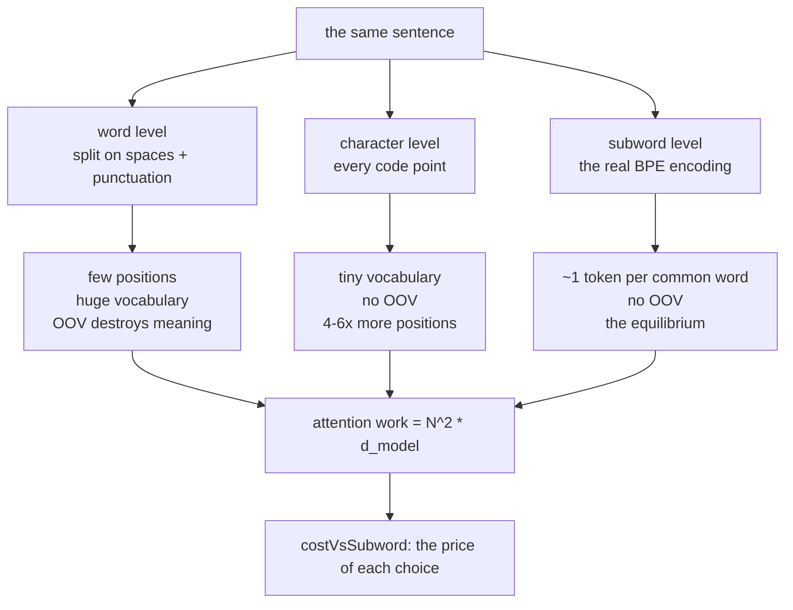

# 04 — Tokenization Strategies: Word vs Character vs Subword

> **Lecture chapter 03** — [notes/03](../../../notes/03_Tokenization_Strategies_Word_Character_Subword.md)
> **Files:** `src/services/strategyService.ts` · `src/controllers/strategyController.ts`
> **Endpoint:** `POST /api/strategies/compare`

Chapter 03 of the notes argues that subword tokenization is the equilibrium between two failing extremes.
This chapter of the guide makes that argument **measurable**: the same sentence is tokenized three ways and
the attention cost of each is computed.

One honesty note before you read the code: only the **subword** row is real. Word and character level are
simulated here — no shipped model uses them — because their purpose in this chapter is to be *counted*, so
the two extremes can be compared against the equilibrium.

---

## 04.1 The three granularities and what each one costs



The attention formula is the whole reason this matters: work grows with $N^2$, so *positions are the
currency*. A tokenizer that turns one sentence into 34 positions instead of 6 does not cost 5.7× more — it
costs $5.7^2 \approx 32\times$ more attention work.

---

## 04.2 The file

### `src/services/strategyService.ts`

**Purpose:** tokenize one string three ways, count the positions, compute the $N^2 \cdot d_{\text{model}}$
attention cost of each, and report the ratio against subword. Plus the OOV report that makes word level's
failure visible instead of theoretical.

```ts
import { config } from "../config/config";
import type { Granularity } from "../types";
import { tokenize } from "./tokenizerService";

/**
 * Chapter 03 - the three granularities, run on the same sentence.
 *
 *   word    : smallest sequence, enormous vocabulary, OOV destroys meaning (§03.2)
 *   char    : no OOV at all, but far more positions and O(N^2) attention (§03.3)
 *   subword : the equilibrium every modern LLM ships (§03.5) - and the only row here
 *             that is measured with a real tokenizer instead of simulated
 */

/** Words we pretend the word-level vocabulary contains. Anything else is OOV. */
const KNOWN_WORDS = new Set([
  "i", "love", "programming", "the", "cat", "sat", "on", "mat", "capital", "of",
  "india", "is", "delhi", "a", "bug", "because", "it", "works", "hello", "am",
  ",", ".", "!", "?", // punctuation is a token, not a word: it should not be reported as OOV
]);

const PUNCTUATION = /([.,!?;:'"()[\]])/g;

/** Word level: split on spaces, then give punctuation its own token. */
export function tokenizeWord(text: string): string[] {
  return text
    .trim()
    .split(" ")
    .flatMap((word) => word.replace(PUNCTUATION, " $1 ").split(" "))
    .filter((piece) => piece.length > 0);
}

/** Character level: every code point is a token, spaces included. */
export function tokenizeChar(text: string): string[] {
  return [...text];
}

/** Subword: the real BPE encoding, not an imitation (§03.5). */
export function tokenizeSubword(text: string, input?: string): string[] {
  return tokenize(text, input);
}

export type StrategyResult = {
  granularity: Granularity;
  tokens: string[];
  count: number;
  positions: number; // every token is one position in the sequence
  attentionOps: number; // N^2 * d_model - why long sequences are expensive (§03.3)
  costVsSubword: number; // how many times more attention work than subword
  oov?: string[]; // word level only: tokens the vocabulary does not contain
  tokensWithUnk?: string[]; // ...and what they become instead
};

/** Run all three granularities and compare their sequence length and attention cost. */
export function compare(text: string, input?: string) {
  const wordTokens = tokenizeWord(text);
  const oov = wordTokens.filter((token) => !KNOWN_WORDS.has(token.toLowerCase()));

  const build = (granularity: Granularity, tokens: string[], extra: Partial<StrategyResult> = {}): StrategyResult => ({
    granularity,
    tokens,
    count: tokens.length,
    positions: tokens.length,
    attentionOps: tokens.length * tokens.length * config.dModel,
    costVsSubword: 0, // filled in below
    ...extra,
  });

  const results = [
    build("word", wordTokens, {
      oov,
      tokensWithUnk: wordTokens.map((token) => (oov.includes(token) ? "<UNK>" : token)),
    }),
    build("char", tokenizeChar(text)),
    build("subword", tokenizeSubword(text, input)),
  ];

  const subwordOps = results[2].attentionOps;
  for (const result of results) {
    result.costVsSubword = Number((result.attentionOps / subwordOps).toFixed(2));
  }

  return {
    text,
    dModel: config.dModel,
    results,
    note: "Same text, three prices. The subword row is a real BPE encoding; word and char are simulated so the comparison is visible.",
  };
}
```

**Block by block:**

1. `KNOWN_WORDS` — a stand-in for "what a 1-million-word vocabulary would contain". Anything outside it is
   reported as OOV. The set includes punctuation on purpose: punctuation is a token, not a word, and
   counting `","` as an unknown word would inflate the failure you are trying to show.
2. `PUNCTUATION` + `tokenizeWord` — split on spaces, then peel punctuation off as its own token. This is the
   most flattering possible version of word-level tokenization: a real one also has to decide about
   contractions, hyphens and case. If it fails *anyway*, the argument is stronger.
3. `tokenizeChar` — `[...text]` iterates **code points**, not UTF-16 units. `"😡".split("")` gives two broken
   halves; `[...text]` gives one character. That one line is the difference between a correct character
   count and a wrong one, and it is why `Array.from`/spread is the idiom to remember.
4. `tokenizeSubword(text, input?)` — the real tokenizer, via the same `tokenize()` that chapter 03 wraps.
   This is the only row whose numbers a provider would agree with.
5. `StrategyResult` — one row of the comparison: the granularity, the tokens, `positions` (identical to the
   token count — every token is one position), `attentionOps`, `costVsSubword`, and the word-level-only
   `oov` / `tokensWithUnk` pair.
6. `build(granularity, tokens, extra)` — the shared row builder. `attentionOps` is computed from
   `tokens.length ** 2 * dModel` using the configured `d_model`, so the ratios stay consistent if you change
   `D_MODEL` in `.env`.
7. `oov` and `tokensWithUnk` — the two fields that make the word-level failure concrete: `oov` lists the
   words the vocabulary does not have, and `tokensWithUnk` shows what the model would actually receive
   (`<UNK>` in their place). Information is destroyed at the boundary, and you can see exactly which words.
8. `costVsSubword` — every row divided by the subword row's work, so subword is always `1.0` and the other
   rows answer "how many times more expensive than the equilibrium?". Normalising to the real tokenizer
   instead of to word level is deliberate: it answers *what did choosing subwords buy me?*
9. The returned `note` says out loud which rows are simulated, so a reader of the JSON is never misled into
   quoting a simulated character count as a provider's number.

**Measured** (`"Automatically, I love programming!"`, o200k_base):

| Granularity | Tokens | Positions | Attention ops (d_model = 32) | vs subword | Verdict |
| :--- | :---: | :---: | :---: | :---: | :--- |
| word | 6 | 6 | 1,152 | **1.00×** | cheapest — and it reports OOV for anything not in its list |
| character | 34 | 34 | 36,992 | **32.11×** | no OOV, 32× the attention work |
| subword | 6 | 6 | 1,152 | **1.00×** | real BPE: `Automatically` · `,` · ` I` · ` love` · ` programming` · `!` |

Read that table carefully, because it contains the lecture's punchline: on a sentence made of **common**
words, word level is not more expensive than subword — it is *the same size*. Word level does not fail on
cost; it fails on **coverage**. The moment the sentence contains a typo, a name, a plural or another
language, its token count stops being predictable and `<UNK>` eats the meaning. Subword's advantage is not
being smaller on easy input — it is staying bounded on hard input.

### `src/controllers/strategyController.ts`

**Purpose:** one endpoint, one call.

```ts
import type { Request, Response } from "express";
import { asyncHandler } from "../middleware/errorHandler";
import { optionalTokenizer, requireText } from "../middleware/validate";
import * as strategyService from "../services/strategyService";

/** Chapter 03 - one sentence, three tokenizers, three prices. */

/** POST /api/strategies/compare   { "text": "Automatically, I love programming!", "model"?: "gpt-4o" } */
export const compare = asyncHandler((req: Request, res: Response) => {
  const text = requireText(req);
  res.json(strategyService.compare(text, optionalTokenizer(req)));
});
```

**Block by block:**

1. `requireText(req)` — the text is mandatory; the 400 comes from the shared validator.
2. `optionalTokenizer(req)` — the caller may name the model or encoding whose *real* subword row is used, so
   the comparison can be run for `gpt-4o` and `gpt-4` and the two subword rows compared.
3. `res.json(strategyService.compare(...))` — the service's object *is* the response. When a controller adds
   nothing, that is a good sign: the service already returns the shape a caller wants.

---

## 04.3 Try it

```bash
# the notes' example, on two tokenizers
curl -s localhost:3000/api/strategies/compare -H 'content-type: application/json' \
  -d '{"text":"Automatically, I love programming!","model":"gpt-4o"}'

# make word level fail: a name and a typo
curl -s localhost:3000/api/strategies/compare -H 'content-type: application/json' \
  -d '{"text":"aminul ordered from amazonia yesterday"}'
```

**Checkpoint.**

1. Why is the subword row the only one a provider would agree with, and what does `costVsSubword` mean for
   the other two?
2. The word row is as cheap as subword here. State precisely what word level *does* fail at, and which field
   in the response shows it.
3. Character tokenization is 32× more attention work on this sentence. Where does that 32 come from?
4. Why does `tokenizeChar` use `[...text]` instead of `text.split("")`?
5. A teammate says "character level never has OOV, so it is safer". Write the one-sentence reply, using a
   number from this chapter.

> **Next:** [05 — BPE & the Vocabulary](./05_BPE_and_the_Vocabulary.md), where you train a merge list by
> hand and meet the reason "strawberry" is hard.
