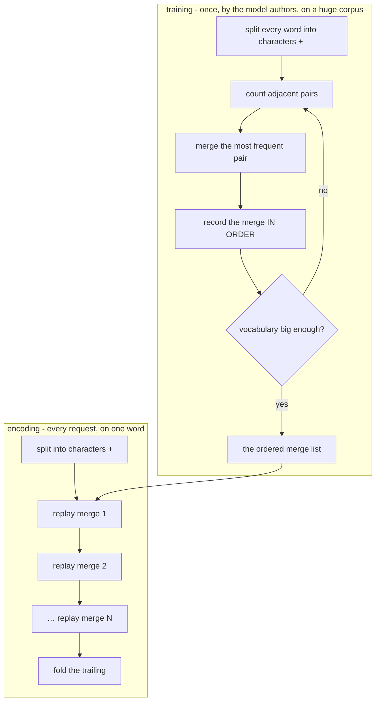

# 05 — BPE & the Vocabulary

> **Lecture chapter 04** — [notes/04](../../../notes/04_BPE_WordPiece_SentencePiece_and_Vocabulary.md)
> **Files:** `src/services/bpeService.ts` · `src/controllers/bpeController.ts`
> **Endpoints:** `POST /api/bpe/train` · `/bpe/encode` · `/bpe/count-letters`

Chapter 04 of the notes is the *mechanism* chapter: where the vocabulary comes from and why a model cannot
count letters. This file is the one part of the project that stays deliberately small and hand-rolled —
because BPE is a ~40-line algorithm and the point is to watch it run. The real tokenizer (chapter 03) is
compiled data you cannot learn from; this one you can step through.

---

## 05.1 Training is global, encoding is local



That asymmetry is why tokenization is fast enough to run on every request: training looks at the whole
corpus many times, encoding walks a fixed list once. It is also why the merge list **is** the tokenizer —
lose the order and the same text tokenizes differently.

---

## 05.2 The file

### `src/services/bpeService.ts`

**Purpose:** implement BPE exactly as §04.10 describes it — train a merge list from a corpus, encode with it,
decode from it, and answer the letter-counting question correctly.

```ts
import type { Merge } from "../types";

/**
 * Chapter 04 - BPE, the algorithm of §04.10.
 *
 * Note the asymmetry: TRAINING is global (it looks at the whole corpus and
 * chooses the merge ORDER), while ENCODING is local and greedy (it applies that
 * fixed order left to right). That is why encoding is fast enough to run on
 * every request, and why the merge list must be shipped exactly as it was learned.
 */

/** The end-of-word marker: it is what stops merges from running across words. */
export const END_OF_WORD = "</w>";

/** The hand-written merge list from the §04.8 gate exercise, in its learned order. */
export const NOTE_MERGES: Merge[] = [
  ["l", "o"],
  ["lo", "w"],
  ["w", END_OF_WORD],
  ["e", "r"],
  ["e", "s"],
  ["es", "t"],
];

/** The corpus the notes use: low x5, lower x2, lowest x1. */
export const NOTE_CORPUS: string[] = ["low", "low", "low", "low", "low", "lower", "lower", "lowest"];

export type BpeModel = {
  merges: Merge[]; // the ordered merge list - this IS the tokenizer
  vocab: string[]; // base characters plus every piece the merges created
  baseVocab: string[];
  targetVocabSize: number;
};

/** Base pieces of one word: single characters plus the end-of-word marker. */
function splitIntoPieces(word: string): string[] {
  return [...word, END_OF_WORD];
}

/** Replace every non-overlapping (a, b) occurrence with "ab", left to right. */
function applyMerge(pieces: string[], [a, b]: Merge): string[] {
  const merged: string[] = [];
  for (let i = 0; i < pieces.length; i++) {
    if (i < pieces.length - 1 && pieces[i] === a && pieces[i + 1] === b) {
      merged.push(a + b);
      i++; // consume b as well
    } else {
      merged.push(pieces[i]);
    }
  }
  return merged;
}

/** Count adjacent pairs, weighted by how often the word appears in the corpus. */
function countPairs(words: string[][]): Map<string, { pair: Merge; count: number }> {
  const counts = new Map<string, { pair: Merge; count: number }>();
  for (const pieces of words) {
    for (let i = 0; i < pieces.length - 1; i++) {
      const key = `${pieces[i]}\u0000${pieces[i + 1]}`;
      const found = counts.get(key);
      if (found) found.count += 1;
      else counts.set(key, { pair: [pieces[i], pieces[i + 1]], count: 1 });
    }
  }
  return counts;
}

/** The most frequent pair. Ties go to the pair seen first, so training is deterministic. */
function mostFrequentPair(counts: Map<string, { pair: Merge; count: number }>): { pair: Merge; count: number } | null {
  let best: { pair: Merge; count: number } | null = null;
  for (const entry of counts.values()) {
    if (!best || entry.count > best.count) best = entry;
  }
  return best;
}


/**
 * Training: count, merge, repeat - until the vocabulary is big enough or no
 * pair is worth merging. This runs ONCE, by the model authors, over a huge corpus.
 */
export function trainBPE(corpus: string[], targetVocabSize = 40): BpeModel {
  const words = corpus.map((word) => splitIntoPieces(word.toLowerCase()));
  const baseVocab = [...new Set(words.flat())].sort();
  const vocab = new Set(baseVocab);
  const merges: Merge[] = [];

  while (vocab.size < targetVocabSize) {
    const pairCounts = countPairs(words);
    const best = mostFrequentPair(pairCounts);
    if (!best || best.count < 2) break; // nothing useful left to merge

    merges.push(best.pair); // the ORDER is remembered: it defines encoding
    vocab.add(best.pair.join(""));
    for (let i = 0; i < words.length; i++) words[i] = applyMerge(words[i], best.pair);
  }

  return { merges, vocab: [...vocab], baseVocab, targetVocabSize };
}

/** The trained-once model this app ships, so /bpe/encode works without training first. */
export const DEMO_MODEL: BpeModel = trainBPE(NOTE_CORPUS, 40);

/** A trailing bare "</w>" is folded into the piece before it, like real vocabularies do. */
function foldEndOfWord(pieces: string[]): string[] {
  if (pieces.length >= 2 && pieces[pieces.length - 1] === END_OF_WORD) {
    return [...pieces.slice(0, -2), pieces[pieces.length - 2] + END_OF_WORD];
  }
  return pieces;
}

/** Encoding: split into base pieces, then apply the merges in learned order. */
export function encodeWithMerges(text: string, merges: Merge[]): { words: string[][]; pieces: string[] } {
  const words = text
    .toLowerCase()
    .split(/\s+/)
    .filter(Boolean)
    .map((word) => {
      let pieces = splitIntoPieces(word);
      for (const merge of merges) pieces = applyMerge(pieces, merge);
      return foldEndOfWord(pieces);
    });

  return { words, pieces: words.flat() };
}

/** Decoding: the marker means "a word ended here", so it becomes a space. */
export function decodePieces(pieces: string[]): string {
  return pieces
    .map((piece) => piece.replaceAll(END_OF_WORD, " "))
    .join("")
    .trim();
}

/**
 * §04.8 part 2 - the fix for "how many r's are in strawberry?".
 * Counting characters is exact in code and unreliable in the model: do it here.
 */
export function countLetters(text: string, letter: string): { text: string; letter: string; count: number } {
  const target = [...letter][0] ?? "";
  return { text, letter: target, count: [...text].filter((character) => character === target).length };
}
```

**Block by block:**

1. `END_OF_WORD = "</w>"` — the marker that makes "the end of a word" a piece BPE can merge with. Without
   it, `"est"` in `"lowest"` and `"est"` in `"estate"` are the same token, and a tokenizer could never learn
   word-final patterns.
2. `NOTE_MERGES` — the hand-written merge list from the §04.8 gate exercise, in its learned order:
   `l+o`, `lo+w`, `w+</w>`, `e+r`, `e+s`, `es+t`. It ships in the code so the gate exercise can be
   *executed* rather than read.
3. `NOTE_CORPUS` — `low ×5, lower ×2, lowest ×1`. The counts are chosen so the first merge is unambiguous,
   which makes the training loop's decisions reproducible by hand.
4. `BpeModel` — the four things a BPE tokenizer is: the ordered `merges`, the resulting `vocab`, the
   `baseVocab` (characters plus the marker) and the `targetVocabSize` it stopped at.
5. `splitIntoPieces(word)` — `[...word, END_OF_WORD]`. The spread gives code points, so an accented
   character is one base piece instead of two broken bytes.
6. `applyMerge(pieces, [a, b])` — one left-to-right pass replacing every non-overlapping `(a, b)` with `ab`.
   The `i++` inside the `if` is what makes it non-overlapping: `"aaa"` merged on `a+a` gives `"aa","a"`, not
   `"a","aa"` twice.
7. `countPairs(words)` — counts adjacent pairs **weighted by how often the word appears**, because `words`
   is a list with duplicates (`low` appears five times). Weighting by the corpus frequency is the entire
   reason `lo` wins over rarer pairs.
8. `mostFrequentPair(counts)` — the argmax. Ties go to the pair seen first, which makes training
   deterministic: run it twice, get the same merge list. A tokenizer that trained differently on each run
   would be a production incident.
9. `trainBPE(corpus, targetVocabSize)` — the training loop: count → merge → record → repeat, stopping when
   the vocabulary is big enough or when no pair occurs at least twice (`count < 2`). Stopping on a
   *usefulness* threshold rather than only on size is what real implementations do — merging a pair seen
   once buys nothing.
10. `DEMO_MODEL = trainBPE(NOTE_CORPUS, 40)` — trained once at import, so `/bpe/encode` works without a
    training call first. This mirrors reality: the merge list is produced once and then shipped with the
    weights.
11. `foldEndOfWord(pieces)` — a trailing bare `</w>` is folded into the piece before it, because real
    vocabularies store `"low</w>"` as one entry rather than `"low"` + `"</w>"`. It is a display-level
    convention, and it is why the gate answer can be quoted as 3 tokens instead of 8 pieces.
12. `encodeWithMerges(text, merges)` — encoding: lowercase, split on whitespace, base pieces, then **replay
    the merge list in order**. It returns both `words` (per-word pieces, which is what makes the algorithm
    readable) and `pieces` (flattened, which is what the model would see).
13. `decodePieces(pieces)` — decode: the marker means "a word ended here", so it becomes a space. Decoding
    the marker is how a piece-level vocabulary reconstructs the original spacing.
14. `countLetters(text, letter)` — the fix for "how many r's are in strawberry?". It counts in **code**, on
    the raw string, using `[...text]` so emoji and accents count as one character. This is the whole
    §04.8 part 2 lesson: exact character work belongs in the program, never in the model's head.

### `src/controllers/bpeController.ts`

**Purpose:** three endpoints — train, encode, count-letters — each one service call plus the provenance a
caller needs to trust the numbers.

```ts
import type { Request, Response } from "express";
import { asyncHandler, badRequest } from "../middleware/errorHandler";
import { optionalNumber, optionalStringArray, optionalTokenizer, requireText } from "../middleware/validate";
import * as bpe from "../services/bpeService";
import * as tokenizer from "../services/tokenizerService";

/** Chapter 04 - BPE: train the merge list once, then encode with it forever. */

/** POST /api/bpe/train   { "corpus": ["low","low","lower"], "targetVocabSize": 40 } */
export const train = asyncHandler((req: Request, res: Response) => {
  const corpus = optionalStringArray(req, "corpus", bpe.NOTE_CORPUS);
  const targetVocabSize = optionalNumber(req, "targetVocabSize", 40, 5, 500);
  const model = bpe.trainBPE(corpus, targetVocabSize);

  res.json({
    corpus,
    targetVocabSize,
    merges: model.merges.map(([a, b]) => `${a} + ${b} -> ${a}${b}`),
    mergeCount: model.merges.length,
    vocabulary: model.vocab,
    vocabularySize: model.vocab.length,
    note: "Training is global and runs once. The ORDER of the merge list is the tokenizer - ship it with the weights (§04.10).",
  });
});

/** POST /api/bpe/encode   { "text": "lowest berry", "model": "note" | "trained" } */
export const encode = asyncHandler((req: Request, res: Response) => {
  const text = requireText(req);
  const which = (req.body as { model?: unknown }).model === "trained" ? "trained" : "note";
  const merges = which === "trained" ? bpe.DEMO_MODEL.merges : bpe.NOTE_MERGES;
  const { words, pieces } = bpe.encodeWithMerges(text, merges);

  res.json({
    text,
    model: which,
    mergeList: merges.map(([a, b]) => `${a} + ${b}`),
    words,
    pieces,
    tokenCount: pieces.length,
    decoded: bpe.decodePieces(pieces),
    note: 'The "</w>" marker is the end of a word, so merges never run across words. Encoding is greedy and local - it just replays the merge list (§04.10).',
  });
});

/** POST /api/bpe/count-letters   { "text": "strawberry", "letter": "r", "model"?: "gpt-4o" } */
export const countLetters = asyncHandler((req: Request, res: Response) => {
  const text = requireText(req);
  const letter = requireText(req, "letter");
  const input = optionalTokenizer(req);
  const encoded = tokenizer.encode(text, input);
  const result = bpe.countLetters(text, letter);

  res.json({
    ...result,
    encoding: encoded.encoding,
    tokenizedAs: encoded.tokens,
    tokenCount: encoded.count,
    note: "The model never sees the letters - it sees these tokens. Anything that needs exact character work belongs in code, not in the model (§04.8).",
  });
});
```

**Block by block:**

1. `optionalStringArray(req, "corpus", bpe.NOTE_CORPUS)` — the corpus defaults to the notes' corpus, so
   `POST /bpe/train` with an empty body still demonstrates the algorithm. An empty array is rejected by the
   validator, because "no corpus" is a client mistake.
2. `optionalNumber(req, "targetVocabSize", 40, 5, 500)` — bounded on purpose. Training is $O(\text{merges}
   \times \text{corpus})$; an unbounded target on a large corpus is a way to hang your own server.
3. `merges.map(([a, b]) => \`${a} + ${b} -> ${a}${b}\`)` — the merge list is returned **as a readable list, in
   order**, because the order is the thing being taught. Returning only the vocabulary would hide it.
4. `encode` reads `model: "note" | "trained"` and picks the matching merge list. Two lists, one algorithm:
   running the same word through both is the fastest way to see that a different merge order is a different
   tokenizer.
5. `words` and `pieces` are both returned, so you can see the per-word walk *and* the flattened result — the
   same data at two zoom levels.
6. `countLetters` calls `tokenizer.encode(text, input)` to show **what the model sees** next to what code
   counted. The response deliberately contains both `count` (the letter count, from code) and `tokenizedAs`
   (the pieces, from the real tokenizer) so the contrast is in one JSON object: 3 letters, 3 tokens — and no
   relationship between them.
7. `tokenCount: encoded.count` and `encoding: encoded.encoding` — the count and the vocabulary it came from,
   because a count without its tokenizer is not a number, it is a rumour (§02.3).

**Measured** (default `o200k_base`):

| Call | Result |
| :--- | :--- |
| `POST /bpe/train {"corpus":["low"×5,"lower"×2,"lowest"]}` | the learned merge list, in order, with the vocabulary it produced |
| `POST /bpe/encode {"text":"lowest berry","model":"note"}` | 3 pieces: `low` · `est` · ` berry` — the §04.8 gate answer, executed |
| `POST /bpe/count-letters {"text":"strawberry","letter":"r"}` | `count: 3` (from code) and `tokenizedAs: ["st","raw","berry"]` (from the model) |

The third row is the one to sit with: the model has **three** tokens and there are **three** r's, which is a
coincidence. `st` · `raw` · `berry` — the letter `r` appears in two different pieces, and one piece contains
a letter that looks like two. Nothing in the model's input is a letter, so "count the r's" is a question the
tokenizer has already made unanswerable. Route it to code.

---

## 05.3 Try it

```bash
# train on the notes' corpus and read the merge order
curl -s localhost:3000/api/bpe/train -H 'content-type: application/json' \
  -d '{"corpus":["low","low","low","low","low","lower","lower","lowest"],"targetVocabSize":40}'

# the gate exercise, executed: the hand-written merge list vs the trained one
curl -s localhost:3000/api/bpe/encode -H 'content-type: application/json' \
  -d '{"text":"lowest berry","model":"note"}'
curl -s localhost:3000/api/bpe/encode -H 'content-type: application/json' \
  -d '{"text":"lowest berry","model":"trained"}'

# the letter-counting fix, with the real tokenizer beside it
curl -s localhost:3000/api/bpe/count-letters -H 'content-type: application/json' \
  -d '{"text":"strawberry","letter":"r"}'
```

**Checkpoint.**

1. Why does `applyMerge` skip the second element of a merged pair, and what would break without that `i++`?
2. Why is `countPairs` run on a list with duplicates instead of a set of words?
3. In the gate exercise, why does `low+</w>` not apply to `"lowest"`?
4. `countLetters` is 3 and `tokenizedAs` is 3 pieces. Explain why that agreement is a coincidence and not a
   rule.
5. A colleague suggests caching token ids from the `note` merge list and replaying them after switching to
   `trained`. What exactly breaks?

> **Next:** [06 — Token Counting & Cost](./06_Token_Counting_and_Cost.md), where these counts become money.
