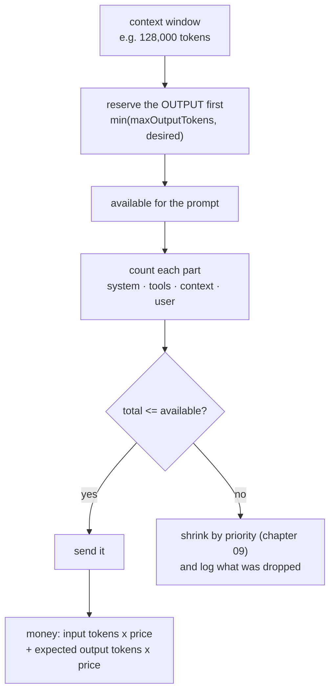

# 06 — Token Counting & Cost

> **Lecture chapter 05** — [notes/05](../../../notes/05_Tokenizers_in_Practice_tiktoken_and_Model_Comparison.md)
> **Files:** `src/services/countService.ts` · `src/controllers/countController.ts`
> **Endpoint:** `POST /api/tokens/count`

This chapter turns counts into decisions. The numbers a token counter must produce are boring — tokens,
budget, cost — and each one is asked for by somebody different: a product manager asks *will the answer
fit?*, a finance team asks *what does a month cost?*, and an on-call engineer asks *why is p95 latency up?*.
Putting them in the codebase, next to the tokenizer that produces them, is what stops each of those people
from maintaining their own spreadsheet.

---

## 06.1 Reserve first, spend second



The order matters more than any single number. If you assemble the prompt first and *then* ask whether it
fits, you have already lost: the answer gets cut off mid-sentence, and the only evidence is a user complaint.

---

## 06.2 The file

### `src/services/countService.ts`

**Purpose:** count with the model's own tokenizer, reserve the output, price the call, and label every
number with the tokenizer that produced it.

```ts
import { config } from "../config/config";
import type { ModelSpec, PromptPart } from "../types";
import { TIKTOKEN_VERSION, countTokens, resolveEncoding } from "./tokenizerService";

/**
 * Chapter 05 - token accounting: count, budget, cost.
 *
 * These three numbers are what a product manager, a finance team and an on-call engineer
 * will each ask you for - which is why they belong in the codebase and not in a
 * spreadsheet. The count comes from the real tokenizer, and it always travels with the
 * two facts that make it trustworthy: WHICH tokenizer, and whether it is exact (§05.4).
 */

export type TokenizerMeta = {
  name: string;
  version: string;
  encoding: string;
  exact: boolean;
  source: string;
};

/**
 * Which tokenizer produced a number, and how much to trust it.
 * `exact: false` is not a failure - it is the honest answer for a model whose tokenizer
 * is closed (Claude, Gemini), and the number must be labelled an estimate.
 */
export function tokenizerMeta(input?: string): TokenizerMeta {
  const { name, exact, source } = resolveEncoding(input);
  return { name: "js-tiktoken", version: TIKTOKEN_VERSION, encoding: name, exact, source };
}

export type CountResult = TokenizerMeta & { tokens: number };

/** Count one piece of text with the encoding that model really uses. */
export function count(text: string, input?: string): CountResult {
  return { tokens: countTokens(text, input), ...tokenizerMeta(input) };
}

/** Reserve the output FIRST, then see what is left for the prompt (§05.6). */
export function promptBudget(model: ModelSpec, desiredOutputTokens: number): {
  contextWindow: number;
  outputReserve: number;
  availableForPrompt: number;
} {
  const outputReserve = Math.min(model.maxOutputTokens, desiredOutputTokens);
  return {
    contextWindow: model.contextWindow,
    outputReserve,
    availableForPrompt: model.contextWindow - outputReserve,
  };
}

const round = (value: number): number => Number(value.toFixed(6));

/** Input and output tokens are priced separately (§05.4). */
export function estimateCost(
  inputTokens: number,
  outputTokens: number,
  model: ModelSpec,
): { inputUsd: number; outputUsd: number; totalUsd: number } {
  const inputUsd = (inputTokens / 1_000_000) * model.pricePerMillionInput;
  const outputUsd = (outputTokens / 1_000_000) * model.pricePerMillionOutput;
  return { inputUsd: round(inputUsd), outputUsd: round(outputUsd), totalUsd: round(inputUsd + outputUsd) };
}

/** Count a whole prompt part by part, so you can see where the window goes. */
export function countParts(
  parts: { name: PromptPart["name"]; text: string }[],
  input?: string,
): (PromptPart & { preview: string; tokens: number })[] {
  return parts.map((part) => ({
    name: part.name,
    tokens: countTokens(part.text, input),
    preview: part.text.slice(0, 60),
  }));
}

/** The model spec a request asked for, or the configured default. */
export function modelFrom(id: unknown): ModelSpec {
  return config.model(typeof id === "string" && id.length > 0 ? id : config.defaultModel);
}
```

**Block by block:**

1. `TokenizerMeta` — the fields that make a count defensible: `name` (`js-tiktoken`), `version` (the
   tokenizer build), `encoding` (which vocabulary), `exact` (whether that vocabulary is really the model's
   own) and `source` (a sentence saying how the choice was made).
2. `tokenizerMeta(input?)` — built from `resolveEncoding`, so the label and the count can never disagree:
   both come from the same resolution of the same request field.
3. `count(text, input?)` — one text, one count, plus the meta. `CountResult` is `TokenizerMeta & { tokens }`
   rather than a bag of loose fields, so a caller who receives it cannot keep the number and drop the
   provenance.
4. `promptBudget(model, desiredOutputTokens)` — **the** function of this chapter. `outputReserve` is
   `min(model.maxOutputTokens, desiredOutputTokens)` and `availableForPrompt` is what is left of the window.
   Clamping to the model's ceiling matters: asking for 20,000 output tokens from a model whose ceiling is
   16,384 must not silently give you 3,616 tokens of prompt.
5. `estimateCost(inputTokens, outputTokens, model)` — input and output priced separately, because they are
   priced separately in reality (roughly 4× apart for gpt-4o). It returns the two parts *and* the total, so a
   report can show where the money went instead of one opaque number.
6. `round(value)` — six decimal places, so a per-call cost of `$0.000125` does not become `0` or
   `0.00012499999999999998` in a response.
7. `countParts(parts, input?)` — counts each prompt part separately and keeps a 60-character preview. This is
   the function that answers "where did my window go?" with data instead of opinion.
8. `modelFrom(id)` — resolves the model spec, defaulting to `config.defaultModel`, and **throws** for an
   unknown id. A guessed context window is worse than a 500: it produces wrong answers that look right.

### `src/controllers/countController.ts`

**Purpose:** the pre-flight check as an endpoint.

```ts
import type { Request, Response } from "express";
import { asyncHandler } from "../middleware/errorHandler";
import { optionalNumber, optionalTokenizer, requireParts } from "../middleware/validate";
import * as countService from "../services/countService";

/** Chapter 05 - count before you send: the pre-flight check that turns a surprise bill into a decision. */

/** POST /api/tokens/count   { model?, encoding?, desiredOutputTokens?, parts | text } */
export const count = asyncHandler((req: Request, res: Response) => {
  const model = countService.modelFrom((req.body as { model?: unknown }).model);
  const input = optionalTokenizer(req);
  const desiredOutputTokens = optionalNumber(req, "desiredOutputTokens", 512, 1, 200_000);
  const expectedOutputTokens = optionalNumber(req, "expectedOutputTokens", desiredOutputTokens, 1, 200_000);

  const parts = countService.countParts(requireParts(req), input);
  const totalTokens = parts.reduce((sum, part) => sum + part.tokens, 0);
  const budget = countService.promptBudget(model, desiredOutputTokens);

  res.json({
    model,
    tokenizer: countService.tokenizerMeta(input),
    parts,
    totalTokens,
    budget,
    cost: countService.estimateCost(totalTokens, expectedOutputTokens, model),
    fits: totalTokens <= budget.availableForPrompt,
    note: "Reserve the output FIRST, then spend what is left on context. Reserve nothing and the answer gets cut off mid-sentence (§05.6).",
  });
});
```

**Block by block:**

1. `countService.modelFrom(...)` — the model is resolved once and reused for the budget, the prices and the
   response, so the three cannot disagree.
2. `optionalTokenizer(req)` — the *tokenizer* is separate from the *model spec*: `gpt-4o` has a window and a
   price, while `o200k_base` has a vocabulary. A request may name either, and the response reports both.
3. `desiredOutputTokens` (default 512) vs `expectedOutputTokens` (defaults to the desired value) — the first
   shapes the budget, the second shapes the cost estimate. They are separate because "how much room do I need
   to leave" and "how much will I actually generate" are different questions.
4. `requireParts(req)` — accepts the explicit `parts[]` form or a bare `text`, which the validator turns into
   a single `user` part.
5. `fits: totalTokens <= budget.availableForPrompt` — the boolean the whole endpoint exists for. It is
   computed from the *same* budget object that is returned, so the caller can check the arithmetic.
6. `cost: estimateCost(totalTokens, expectedOutputTokens, model)` — priced from the measured input count and
   the expected output, not from a guess about either.
7. The `note` restates the rule in one line, because this response is often pasted into a ticket: *reserve the
   output first, then spend what is left on context.*

---

## 06.3 Measured: what the numbers look like

**A realistic four-part prompt** (`gpt-4o`, `desiredOutputTokens: 512`):

| Part | Tokens | What it is |
| :--- | :---: | :--- |
| `system` | 13 | "You are a support agent. Answer only from the policy below." |
| `tools` | 8 | `getOrderStatus(orderId: string)` |
| `context` | 14 | the refund policy sentence |
| `user` | 15 | "My order arrived damaged 10 days ago. Can I get a refund?" |
| **total** | **50** | of a 128,000-token window, with 512 reserved for the answer |

Fifty tokens — of which 21 are system + tools. That is the quiet lesson of this chapter: **your instructions
and your tools are not free**, and on a short user message they are the majority of the bill.

**The multilingual token tax**, same tokenizer (`o200k_base`), same meaning:

| Text | Tokens | Note |
| :--- | :---: | :--- |
| `I am fine` | 3 | English baseline |
| `আমি ভালো আছি` | 14 | ~4.7× the tokens for the same sentence |

At 50,000 requests a day that ratio is not a curiosity, it is a budget line — and it is invisible in every
dashboard that reports "tokens" without a language breakdown.

**Checkpoint.**

1. Why is `outputReserve` clamped with `min(...)`, and what bug appears if you remove the clamp?
2. `desiredOutputTokens` and `expectedOutputTokens` both exist. State the question each one answers.
3. Why does the response carry `tokenizer.exact` next to `totalTokens` instead of only the count?
4. The four-part prompt costs 50 tokens of which 21 are system + tools. What would you change, and what would
   you measure to prove it worked?
5. A finance colleague asks for "the cost of one request". Which two numbers must you ask *them* for first?

> **Next:** [07 — Embeddings & Similarity](./07_Embeddings_and_Similarity.md), where ids become vectors.
