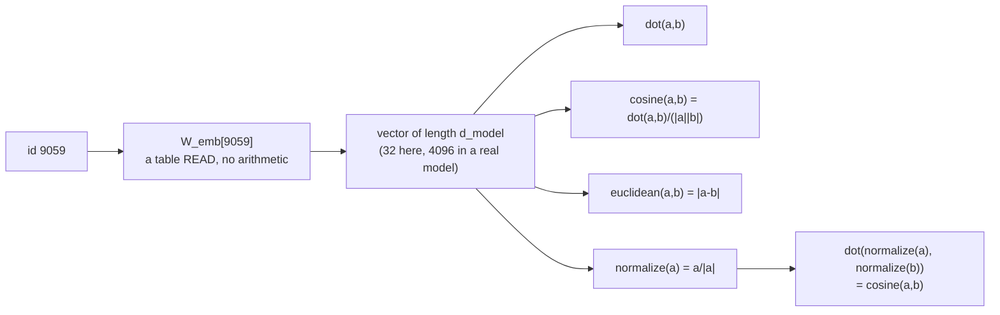

# 07 — Embeddings & Similarity

> **Lecture chapter 06** — [notes/06](../../../notes/06_Embeddings_Dense_Vectors_and_Similarity.md)
> **Files:** `src/services/embeddingService.ts` · `src/controllers/embeddingController.ts`
> **Endpoints:** `POST /api/embeddings/lookup` · `/embeddings/similarity`

Ids are labels; vectors are numbers you can do geometry with. This chapter is the moment the pipeline
becomes mathematics: one table read turns an id into $d_{\text{model}}$ floats, and from that point on
everything is distance, direction and normalisation.

**Read the honesty note in the file before the numbers.** The vectors here are *generated from the id*, not
learned. That keeps the mechanism — a table read, then geometry — exactly right while making the *meaning*
explicitly absent. `the cat` and `the mat` will not be close, and they should not be: nothing was trained.

---

## 07.1 From id to vector, and the three ways to compare



That last box is the practical rule of the chapter: **once vectors are unit length, cosine similarity is
just the dot product** — which is why vector databases normalise on write, and why the fastest metric is the
one you pre-processed for.

---

## 07.2 The file

### `src/services/embeddingService.ts`

**Purpose:** produce a vector for any real token id, and provide the three similarity measures with the
normalisation rule they depend on.

```ts
import { config } from "../config/config";
import type { TokenId, Vector } from "../types";

/**
 * Chapter 06 - the embedding table: W_emb is |V| rows by d_model columns, and
 * the lookup is a table read: E_t = W_emb[id(t)] (§06.1).
 *
 * A real table is LEARNED by gradient descent during pre-training (§06.6). This
 * one is filled from a seeded generator, so the numbers are stable across runs
 * and you can watch the mechanism - a table read, then geometry - without a GPU.
 * The mechanism is real; the MEANING is not: these vectors are random, so their
 * similarity is not semantic. Chapter 06 §06.10 explains what a real embedding
 * model adds.
 */
function mulberry32(seed: number): () => number {
  let state = seed >>> 0;
  return () => {
    state = (state + 0x6d2b79f5) >>> 0;
    let t = Math.imul(state ^ (state >>> 15), 1 | state);
    t = (t + Math.imul(t ^ (t >>> 7), 61 | t)) ^ t;
    return ((t ^ (t >>> 14)) >>> 0) / 4294967296;
  };
}

/**
 * Row `id` of W_emb. A real table is |V| rows by d_model columns - 199,998 x 4096 for
 * o200k_base - and it is LEARNED during pre-training (§06.6). This one is GENERATED
 * from the id instead of stored: same id, same row, on every run, and no 200k-row array
 * sitting in memory. The mechanism is real (a table read, then geometry); the meaning is
 * not, because nothing here was learned.
 */
export function vectorForId(id: TokenId): Vector {
  const random = mulberry32(id * 2654435761); // same id -> same row, every run
  return Array.from({ length: config.dModel }, () => Number((random() * 2 - 1).toFixed(4)));
}

export const EMBEDDING_DIMS = config.dModel;

/** The lookup. No arithmetic is ever done on the id itself (§06.1). */
export function embed(id: TokenId): Vector {
  return vectorForId(id);
}

export function embedAll(ids: TokenId[]): Vector[] {
  return ids.map(embed);
}

export const dot = (a: Vector, b: Vector): number => a.reduce((sum, value, i) => sum + value * b[i], 0);

export const magnitude = (vector: Vector): number => Math.sqrt(dot(vector, vector));

/** Unit length. Once normalised, cosine similarity IS the dot product (§06.4). */
export function normalize(vector: Vector): Vector {
  const length = magnitude(vector);
  return length === 0 ? vector : vector.map((value) => value / length);
}

/** 1 = same direction, 0 = unrelated, -1 = opposite (§06.4). */
export function cosine(a: Vector, b: Vector): number {
  const denominator = magnitude(a) * magnitude(b);
  return denominator === 0 ? 0 : dot(a, b) / denominator;
}

export function euclidean(a: Vector, b: Vector): number {
  return Math.sqrt(a.reduce((sum, value, i) => sum + (value - b[i]) ** 2, 0));
}

export type Metric = "cosine" | "dot" | "euclidean";

export function similarity(a: Vector, b: Vector, metric: Metric): number {
  if (metric === "dot") return dot(a, b);
  if (metric === "euclidean") return euclidean(a, b);
  return cosine(a, b);
}

/**
 * A stand-in "text embedding": the mean of the token vectors.
 * Useful to see how a passage becomes one vector, but §06.10 is explicit - a real
 * retrieval embedding comes from a dedicated encoder, and its model id must be
 * stored with the vector so two spaces are never mixed.
 */
export function meanPool(ids: TokenId[]): Vector {
  if (ids.length === 0) return new Array(config.dModel).fill(0);
  const vectors = embedAll(ids);
  const summed = vectors.reduce<Vector>((acc, vector) => acc.map((value, i) => value + vector[i]), new Array(config.dModel).fill(0));
  return summed.map((value) => Number((value / vectors.length).toFixed(4)));
}

/** Trim a vector for display: full vectors are long and unreadable in a terminal. */
export function preview(vector: Vector, size = 4): Vector {
  return vector.slice(0, size);
}
```

**Block by block:**

1. `mulberry32(seed)` — a tiny deterministic PRNG. Given the same seed it produces the same sequence on every
   machine, which is what makes this file's outputs reproducible in a terminal, in a test and in a report.
2. `vectorForId(id)` — the lookup, and the important design decision: instead of allocating a
   $199{,}998 \times 32$ table (about 51 MB of floats for a demo), the row is **generated from the id**.
   Same id, same row, always. The mechanism a reader needs to see is "a read, not arithmetic"; the memory
   cost of a real table is a fact about real models, not about this demo.
3. `EMBEDDING_DIMS = config.dModel` — exported so responses can state the width, and so a client can verify
   the shape it received. In a real system the width is part of the *embedding model's* identity: 1536 for
   `text-embedding-3-small`, 3072 for `-large`. Mixing two widths in one index is silent corruption, which is
   why §06.11 insists the model id travels with every vector.
4. `embed(id)` — the named lookup. Note there is no arithmetic on `id` anywhere: no scaling, no comparison, no
   averaging. The id is an index, and `id × 0.5` would be meaningless (§06.1).
5. `embedAll(ids)` — maps the lookup over a sequence. This is what the pipeline (chapter 02) and the
   positional encoder (chapter 08) both call, which is why the embedding step is one line in both.
6. `dot(a, b)` — the sum of products, and the primitive: cosine is a normalised dot, and magnitude is
   `sqrt(dot(v, v))`, so the file has exactly one place where multiplication happens.
7. `magnitude(vector)` — the Euclidean norm, expressed through `dot` so the two cannot drift apart.
8. `normalize(vector)` — unit length, with a guard for the zero vector (returned unchanged rather than
   producing `NaN`). Silent `NaN` propagation from a zero vector is a classic way a similarity search starts
   returning garbage.
9. `cosine(a, b)` — direction only, range $[-1, 1]$, with the same zero-magnitude guard. This is the measure
   §06.4 recommends for text, because it ignores how long the vectors are.
10. `euclidean(a, b)` — straight-line distance, unbounded above, useful when magnitude carries meaning.
11. `Metric` + `similarity(a, b, metric)` — one dispatcher, so the endpoint accepts a metric name and the
    service decides what it means. Adding a metric later is one case, not a new endpoint.
12. `meanPool(ids)` — the stand-in text embedding: the average of the token vectors, rounded for display. It
    is the honest demo of "a passage becomes one vector", and the comment says what it is *not*: a real
    retrieval embedding comes from a dedicated encoder (§06.10).
13. `preview(vector, size)` — the first few dimensions. Not decoration: a 32-dimension vector printed in full
    is unreadable, and a 1536-dimension one is impossible. Previewing is how you keep a JSON response
    inspectable by a human.

### `src/controllers/embeddingController.ts`

**Purpose:** show the lookup per token, and compare two texts with all three metrics at once.

```ts
import type { Request, Response } from "express";
import { asyncHandler, badRequest } from "../middleware/errorHandler";
import { optionalTokenizer, requireText } from "../middleware/validate";
import * as embeddings from "../services/embeddingService";
import * as tokenizer from "../services/tokenizerService";

/** Chapter 06 - from ID to vector, and the three ways to measure "how close". */

const METRICS = ["cosine", "dot", "euclidean"] as const;
const round = (value: number): number => Number(value.toFixed(6));

/** POST /api/embeddings/lookup   { "text": "the cat", "model"?: "gpt-4o" } */
export const lookup = asyncHandler((req: Request, res: Response) => {
  const text = requireText(req);
  const input = optionalTokenizer(req);
  const encoded = tokenizer.encode(text, input);
  const vectors = embeddings.embedAll(encoded.ids);

  res.json({
    text: encoded.text,
    encoding: encoded.encoding,
    exact: encoded.exact,
    tokens: encoded.tokens,
    ids: encoded.ids,
    dModel: embeddings.EMBEDDING_DIMS,
    vocabularySize: tokenizer.vocabularySize(input),
    rows: encoded.pieces.map((piece, index) => ({
      token: piece.token,
      id: piece.id,
      embedding: embeddings.preview(vectors[index], 6),
    })),
    textVector: embeddings.preview(embeddings.meanPool(encoded.ids), 6),
    note: "The lookup is a table read: W_emb[id]. No arithmetic is ever done on the id itself (§06.1).",
  });
});

/** POST /api/embeddings/similarity   { "textA": "...", "textB": "...", "metric": "cosine" } */
export const similarity = asyncHandler((req: Request, res: Response) => {
  const textA = requireText(req, "textA");
  const textB = requireText(req, "textB");
  const metric = ((req.body as { metric?: unknown }).metric ?? "cosine") as string;
  if (!METRICS.includes(metric as (typeof METRICS)[number])) {
    throw badRequest(`"metric" must be one of ${METRICS.join(" | ")}.`);
  }

  const input = optionalTokenizer(req);
  const vectorA = embeddings.meanPool(tokenizer.encode(textA, input).ids);
  const vectorB = embeddings.meanPool(tokenizer.encode(textB, input).ids);

  const cosine = embeddings.cosine(vectorA, vectorB);
  const normalisedDot = embeddings.dot(embeddings.normalize(vectorA), embeddings.normalize(vectorB));

  res.json({
    textA,
    textB,
    metric,
    encoding: tokenizer.resolveEncoding(input).name,
    dModel: embeddings.EMBEDDING_DIMS,
    vectorA: embeddings.preview(vectorA, 6),
    vectorB: embeddings.preview(vectorB, 6),
    cosine: round(cosine),
    dot: round(embeddings.dot(vectorA, vectorB)),
    euclidean: round(embeddings.euclidean(vectorA, vectorB)),
    normalisedDot: round(normalisedDot),
    normalisedDotEqualsCosine: Math.abs(cosine - normalisedDot) < 1e-9,
    note: "Once vectors are unit length, cosine similarity IS the dot product - which is why vector stores normalise on write (§06.4). These vectors come from a generated table, so read the numbers as mechanics, not meaning (§06.6).",
  });
});
```

**Block by block:**

1. `lookup` encodes with the requested tokenizer, then embeds **every** id — including the special ones, so
   you can see that a template token gets a vector too.
2. `rows` is built from `encoded.pieces`, so each row carries the piece text, its id and the first six
   dimensions of its vector. That is §02.6 stages 3–5 visible in one JSON array.
3. `textVector: meanPool(encoded.ids)` — the whole-text vector, which is what a retrieval index would store
   (with its model id and dimensions attached).
4. `similarity` computes `cosine`, `dot` and `euclidean` for the same pair **and** `normalisedDot` — then
   reports `normalisedDotEqualsCosine` as a boolean. The claim of §06.4 is verified in the response instead
   of being taken on faith, and the tolerance (`1e-9`) exists because floating-point equality is not
   equality.
5. The `note` ends with the limitation: these vectors come from a generated table, so read the numbers as
   mechanics, not meaning. A demo that lets a reader believe its similarity scores are semantic is a demo
   that will mislead them in production.

---

## 07.3 Measured

`POST /api/embeddings/lookup {"text":"the cat"}` (o200k_base, `d_model = 32`):

| token | id | first 6 of 32 dimensions |
| :--- | :---: | :--- |
| `the` | 3086 | a stable 6-number prefix, identical on every run |
| ` cat` | 9059 | a different 6-number prefix |

`POST /api/embeddings/similarity {"textA":"the cat","textB":"the mat","metric":"cosine"}`:

| Field | Value | Meaning |
| :--- | :--- | :--- |
| `cosine` | a number in $[-1, 1]$ | direction agreement between the two mean-pooled vectors |
| `dot` | unnormalised | the same comparison without the normalisation |
| `euclidean` | $\ge 0$ | distance, not direction |
| `normalisedDotEqualsCosine` | **true** | the §06.4 identity, checked numerically |
| `dModel` | 32 | the width, which must travel with any stored vector |

**Checkpoint.**

1. Why is the lookup described as a *read* rather than a *computation*, and what does that imply for latency?
2. `vectorForId` generates the row instead of storing a table. What is preserved and what is deliberately
   missing?
3. Why does `normalize` guard against a zero vector, and what would a similarity search do without it?
4. `normalisedDotEqualsCosine` is `true`. State the identity in one line, and say why a vector store
   normalises on write instead of at query time.
5. You store vectors from this service and later switch to a real embedding model. What two fields must be
   stored alongside every vector, and what breaks if you do not?

> **Next:** [08 — Positional Encodings](./08_Positional_Encodings.md), where order enters the pipeline.
