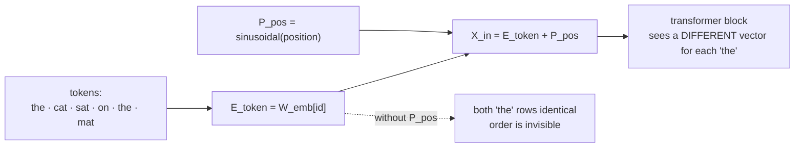

# 08 — Positional Encodings

> **Lecture chapter 07** — [notes/07](../../../notes/07_Positional_Encodings_and_Word_Order.md)
> **Files:** `src/services/positionalService.ts` · `src/controllers/positionalController.ts`
> **Endpoint:** `POST /api/positional`

Self-attention is permutation invariant: it sees a *set* of vectors, not a sequence. Everything the model
knows about order has to be injected, and this chapter is where. It is also the chapter where a small piece
of code makes an abstract claim checkable — "a token that appears twice gets one embedding but two input
vectors" is a boolean in the response.

---

## 08.1 Why order must be added, and why addition



Addition, not concatenation, because $d_{\text{model}}$ must stay fixed: every downstream matrix is sized by
it. The encoding is a vector *of the same width*, so the sum is still one row per token.

---

## 08.2 The file

### `src/services/positionalService.ts`

**Purpose:** implement the sinusoidal family from the original transformer — fixed mathematics, no learned
parameters — and expose the linear-offset property as a measurement.

```ts
import type { Vector } from "../types";
import { dot } from "./embeddingService";

/**
 * Chapter 07 - positional encoding.
 *
 * Self-attention is permutation invariant (§07.1): without a position signal,
 * "Dog bites man" and "Man bites dog" are the same input. Order is injected
 * additively, X_in = E_token + P_pos (§07.2), and this file implements the
 * SINUSOIDAL family from the original transformer (§07.3) - fixed maths, no
 * learned parameters, nothing to run out of.
 */

const round = (value: number): number => Number(value.toFixed(6));

/** The frequency ladder: early dimension pairs oscillate fast, later ones very slowly. */
function frequencies(dModel: number): number[] {
  return Array.from({ length: Math.floor(dModel / 2) }, (_, i) => 1 / Math.pow(10000, (2 * i) / dModel));
}

/** PE(pos, 2i) = sin(pos / 10000^(2i/d_model)), PE(pos, 2i+1) = cos(...) (§07.3). */
export function sinusoidalEncoding(positions: number[], dModel: number): Vector[] {
  const omega = frequencies(dModel);
  return positions.map((pos) => {
    const vector: Vector = new Array(dModel).fill(0);
    for (let i = 0; i < omega.length; i++) {
      vector[2 * i] = round(Math.sin(pos * omega[i])); // even dimensions: sin
      vector[2 * i + 1] = round(Math.cos(pos * omega[i])); // odd dimensions: cos
    }
    return vector;
  });
}

/** X_in = E_token + P_pos. Addition keeps d_model fixed (§07.2). */
export function addPositions(vectors: Vector[], positional: Vector[]): Vector[] {
  return vectors.map((vector, index) => vector.map((value, dimension) => round(value + positional[index][dimension])));
}

/**
 * The linear-offset property (§07.3), measured instead of asserted:
 * P_pos . P_(pos+k) = sum_i cos(omega_i * k), which depends only on k.
 * If every number in the array is the same, the property holds.
 */
export function offsetDotProducts(dModel: number, k: number, positions: number[]): number[] {
  const shifted = positions.map((pos) => pos + k);
  const encoded = sinusoidalEncoding([...positions, ...shifted], dModel);
  return positions.map((pos, index) => round(dot(encoded[index], encoded[positions.length + index])));
}

/** §07.9 guard rail: going past the trained length rarely errors - it quietly gets worse. */
export function trainedLengthWarning(tokenCount: number, maxTrainedPositions: number): string | null {
  if (tokenCount <= maxTrainedPositions) return null;
  return (
    `Exceeding the trained context length (${tokenCount} > ${maxTrainedPositions}). ` +
    "Nothing will throw: quality degrades first, and it shows up as \"the model stopped following instructions\"."
  );
}

/** The complete input pipeline of §07.7, as one line of code. */
export function inputPipeline(ids: number[], vectors: Vector[], dModel: number): Vector[] {
  return addPositions(vectors, sinusoidalEncoding(ids.map((_, index) => index), dModel));
}
```

**Block by block:**

1. `frequencies(dModel)` — the frequency ladder: $1 / 10000^{2i/d_{\text{model}}}$ for each dimension pair.
   Early pairs oscillate fast (they separate neighbours), late pairs oscillate very slowly (they separate
   distant regions). Think of clock hands: a second hand distinguishes two nearby moments, an hour hand
   distinguishes two distant ones, and you need both to know *when* you are.
2. `sinusoidalEncoding(positions, dModel)` — the §07.3 formulas, written out: even dimensions get
   $\sin(\text{pos} \cdot \omega_i)$, odd dimensions get $\cos(\text{pos} \cdot \omega_i)$. It rounds to six
   decimals so the JSON is readable, and it takes `positions` as an argument rather than assuming
   `0..N-1`, so the same function serves the offset test below.
3. `addPositions(vectors, positional)` — $X_{\text{in}} = E_{\text{token}} + P_{\text{pos}}$, element by
   element. This is the whole injection step, and it is one `map`. The fact that such a consequential idea is
   one line of code is worth noticing.
4. `offsetDotProducts(dModel, k, positions)` — the property, measured instead of asserted: it encodes
   `positions` and `positions + k` and returns $P_{\text{pos}} \cdot P_{\text{pos}+k}$ for each. If every
   number in the returned array is identical, then the dot product depends only on the offset $k$ — which is
   what lets a model learn "attend three tokens back" as a reusable pattern.
5. `trainedLengthWarning(tokenCount, maxTrainedPositions)` — the §07.9 guard rail. Going past the trained
   length rarely throws; it quietly gets worse. A warning string (or `null`) is the honest interface: the
   caller can log it, surface it, or ignore it deliberately.
6. `inputPipeline(ids, vectors, dModel)` — §07.7 as one line: `addPositions(vectors, sinusoidalEncoding(
   ids.map((_, i) => i)))`. Both the trace in chapter 02 and every step of the generation loop call this, so
   the "E + P" step is never skipped or reimplemented.

### `src/controllers/positionalController.ts`

**Purpose:** show every row as $E + P$, prove the repeated-token case, and report the offset property.

```ts
import type { Request, Response } from "express";
import { config } from "../config/config";
import { asyncHandler } from "../middleware/errorHandler";
import { optionalTokenizer, requireText } from "../middleware/validate";
import * as countService from "../services/countService";
import { cosine, embedAll, preview } from "../services/embeddingService";
import * as positional from "../services/positionalService";
import { encode, pieceOf } from "../services/tokenizerService";

/** Chapter 07 - where word order enters the model, and how to prove it did. */

const round = (value: number): number => Number(value.toFixed(6));

/** POST /api/positional   { "text": "the cat sat on the mat", "model": "gpt-4o" } */
export const encodePositions = asyncHandler((req: Request, res: Response) => {
  const text = requireText(req);
  const model = countService.modelFrom((req.body as { model?: unknown }).model);
  const input = optionalTokenizer(req);

  const encoded = encode(text, input);
  const ids = encoded.ids;
  const positions = ids.map((_, index) => index);

  const vectors = embedAll(ids);
  const positionalVectors = positional.sinusoidalEncoding(positions, config.dModel);
  const inputVectors = positional.addPositions(vectors, positionalVectors);

  // §07.7: a token that appears twice gets ONE embedding but TWO input vectors.
  const laterIndex = ids.findIndex((id, index) => ids.indexOf(id) !== index);
  const earlierIndex = laterIndex === -1 ? -1 : ids.indexOf(ids[laterIndex]);
  const repeatedToken =
    laterIndex > 0
      ? {
          token: pieceOf(ids[laterIndex], input),
          id: ids[laterIndex],
          positions: [earlierIndex, laterIndex],
          embeddingsIdentical: String(vectors[earlierIndex]) === String(vectors[laterIndex]),
          inputsIdentical: String(inputVectors[earlierIndex]) === String(inputVectors[laterIndex]),
          cosineBetweenInputs: round(cosine(inputVectors[earlierIndex], inputVectors[laterIndex])),
        }
      : null;

  res.json({
    text: encoded.text,
    encoding: encoded.encoding,
    tokens: encoded.tokens,
    ids,
    dModel: config.dModel,
    table: ids.map((id, index) => ({
      position: index,
      token: pieceOf(id, input),
      id,
      embedding: preview(vectors[index]),
      positional: preview(positionalVectors[index]),
      input: preview(inputVectors[index]),
    })),
    repeatedToken,
    offsetProperty: {
      claim: "P_pos . P_(pos+k) depends only on k, not on pos, so relative offsets are learnable (§07.3)",
      k1: positional.offsetDotProducts(config.dModel, 1, [0, 1, 2, 3]),
      k3: positional.offsetDotProducts(config.dModel, 3, [0, 1, 2, 3]),
    },
    guardRail: positional.trainedLengthWarning(ids.length, model.contextWindow),
    note: "Every row above is E_token + P_pos. Position is added, never concatenated, so d_model stays fixed (§07.2).",
  });
});
```

**Block by block:**

1. `encode(text, input)` then `positions = ids.map((_, index) => index)` — positions come from the *ids*
   array, so position 0 is the first token the model actually receives, template tokens included.
2. `table` — one row per token with `embedding`, `positional` and `input` previews side by side. This is the
   clearest possible answer to "where does order enter?": column 1 is the same for both `the`s, column 3 is
   not.
3. `repeatedToken` — finds the first token that appears twice and reports four facts about the pair:
   `embeddingsIdentical` (should be **true** — one row of $W_{\text{emb}}$, one id), `inputsIdentical`
   (should be **false** — the positions differ), and `cosineBetweenInputs` (close to 1 but not 1, because the
   two vectors share their embedding and differ only in $P$). Two booleans and a number, and the chapter's
   central claim is verified rather than believed.
4. `offsetProperty` — `k1` and `k3` arrays from `offsetDotProducts`. A reader can see that each array is
   constant, and that the constant differs between $k=1$ and $k=3$: the offset is what the encoding encodes.
5. `guardRail: trainedLengthWarning(ids.length, model.contextWindow)` — the model spec supplies the trained
   length, so the warning is about *this* model, not a hard-coded number.
6. The closing `note` restates the one-line rule: position is added, never concatenated, so $d_{\text{model}}$
   stays fixed.

---

## 08.3 Measured

`POST /api/positional {"text":"the cat sat on the mat"}` (o200k_base, `d_model = 32`):

| Field | Value | What it proves |
| :--- | :--- | :--- |
| `tokens` | `the` · ` cat` · ` sat` · ` on` · ` the` · ` mat` | 6 positions, two of them the same token |
| `repeatedToken.token` | `the` | the duplicate the controller found |
| `repeatedToken.positions` | `[0, 4]` | first and second occurrence |
| `repeatedToken.embeddingsIdentical` | **true** | one id → one row of $W_{\text{emb}}$ |
| `repeatedToken.inputsIdentical` | **false** | the rows the model sees differ |
| `repeatedToken.cosineBetweenInputs` | $\approx 1$ but $< 1$ | they share the embedding and differ only in $P$ |
| `offsetProperty.k1` | a constant array | $P_{\text{pos}} \cdot P_{\text{pos}+1}$ is the same for every pos |
| `offsetProperty.k3` | a different constant array | the constant is a function of $k$, and of nothing else |
| `guardRail` | `null` | 6 tokens is far inside a 128,000-token trained length |

**Checkpoint.**

1. Show, with token ids, why `"Dog bites man"` and `"Man bites dog"` are indistinguishable without $P$.
2. Why is the encoding **added** rather than concatenated? What would break if you concatenated it?
3. In the offset test, why is it enough that each array is constant? Say what the constant depends on.
4. `cosineBetweenInputs` is close to 1 but not exactly 1. Explain both halves of that sentence.
5. A user pastes a 200,000-token document into a 128,000-token model. What does this endpoint warn about,
   and what is the honest way to extend the limit?

> **Next:** [09 — The Context Window & the Complete Pipeline](./09_Context_Window_and_the_Complete_Pipeline.md),
> where every piece built so far is put behind one budget.
