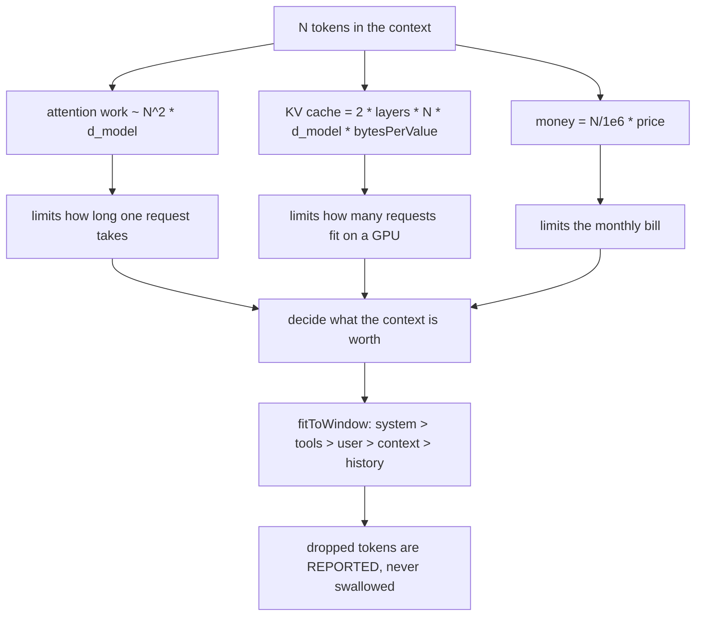
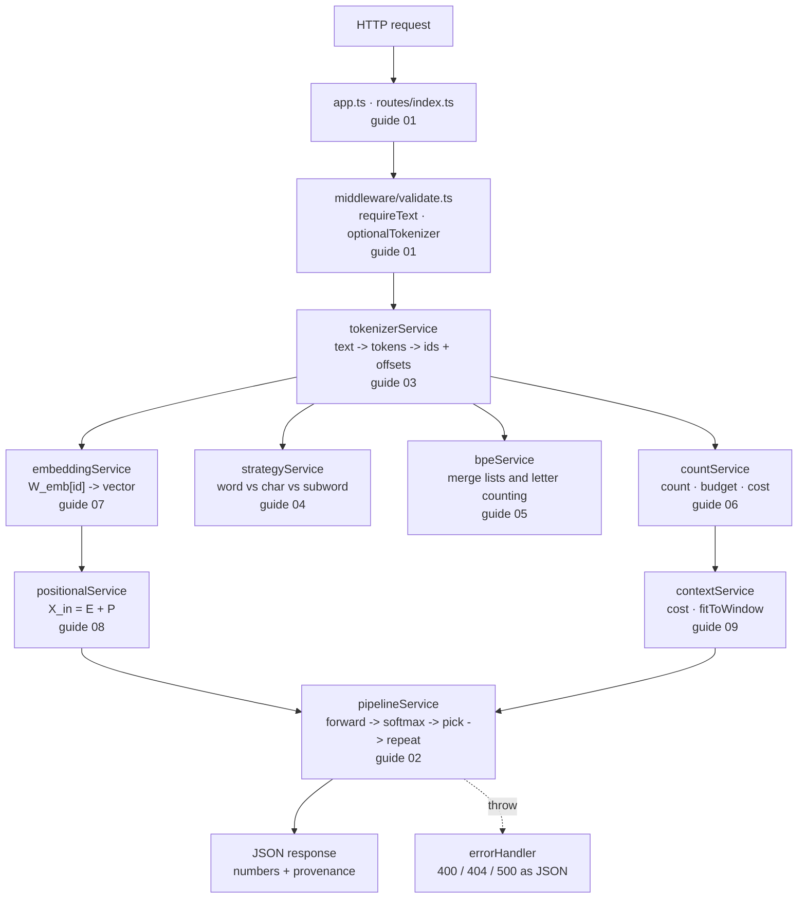

# 09 — The Context Window & the Complete Pipeline

> **Lecture chapter 08** — [notes/08](../../../notes/08_Context_Windows_Training_vs_Inference_and_the_Complete_Pipeline.md)
> **Files:** `src/services/contextService.ts` · `src/controllers/contextController.ts`
> **Endpoints:** `POST /api/context/cost` · `/context/fit`

This is the closing chapter, and it does two things: it puts a **price** on sequence length, and it decides
what to drop when the prompt does not fit. Everything built in chapters 03–08 feeds it — the counts from
chapter 06 are what make the budget real.

---

## 09.1 Three costs that grow with N, and a priority order for dropping



The priority order is the engineering judgement of the chapter: instructions and tool schemas are kept
before the conversation, history is dropped first, and the user's own question outranks retrieved context —
drop a document before you drop the question.

---

## 09.2 The file

### `src/services/contextService.ts`

**Purpose:** compute the cost of a sequence length, and fit a prompt into a window while recording exactly
what was lost.

```ts
import { config } from "../config/config";
import type { PromptPart } from "../types";

/**
 * Chapter 08 - the context window.
 *
 * Capacity is not attention quality (§08.1), and a big window is not free (§08.2):
 * attention is O(N^2 * d_model), the KV cache is O(N * layers * d_model), and the
 * money is linear in tokens. This file makes the cost visible and then decides
 * what to drop when the prompt does not fit.
 */

export type Budget = { window: number; outputReserve: number };

export type FittedPart = PromptPart & { truncated: boolean; dropped: boolean; reason: string | null };

/**
 * Priority order from §08.3, highest first: instructions and tool schemas are kept
 * before the conversation, and history is the first thing to go. The user's own
 * message still outranks retrieved context - drop a document before the question.
 */
const PRIORITY: PromptPart["name"][] = ["system", "tools", "user", "context", "history"];

export type FitResult = {
  available: number;
  usedTokens: number;
  kept: FittedPart[];
  dropped: FittedPart[];
  note: string;
};

/**
 * Fit the prompt into the window, in priority order, and RECORD what was lost.
 * Silent truncation is the worst outcome: it produces "the AI forgot what I said"
 * with no evidence (§08.3).
 */
export function fitToWindow(parts: PromptPart[], budget: Budget): FitResult {
  const available = budget.window - budget.outputReserve;
  const kept: FittedPart[] = [];
  const dropped: FittedPart[] = [];
  let used = 0;

  for (const name of PRIORITY) {
    const part = parts.find((candidate) => candidate.name === name);
    if (!part) continue;

    const remaining = available - used;
    if (remaining <= 0) {
      dropped.push({ ...part, truncated: false, dropped: true, reason: "no room left in the window" });
      continue;
    }
    if (part.tokens <= remaining) {
      kept.push({ ...part, truncated: false, dropped: false, reason: null });
      used += part.tokens;
      continue;
    }

    // The part fits only partly: keep the head, log the tail.
    kept.push({ ...part, tokens: remaining, truncated: true, dropped: false, reason: "truncated to fit" });
    dropped.push({ ...part, tokens: part.tokens - remaining, truncated: true, dropped: true, reason: "the tail that did not fit" });
    used += remaining;
  }

  return {
    available,
    usedTokens: used,
    kept,
    dropped,
    note: "Priority order: system > tools > user > context > history. Dropped tokens are reported, never swallowed.",
  };
}

/** Cost 1 of §08.2: attention work grows with the SQUARE of the sequence length. */
export function attentionOps(tokens: number, dModel = config.dModel): number {
  return tokens * tokens * dModel;
}

export type KvCache = {
  tokens: number;
  layers: number;
  dModel: number;
  bytesPerValue: number;
  bytes: number;
  megabytes: number;
};

/**
 * Cost 2 of §08.2: every concurrent request holds its own KV cache, which is
 * what limits batch size - and therefore throughput - on a serving box.
 * x2 because there is a key cache and a value cache.
 */
export function kvCache(
  tokens: number,
  options: { layers?: number; dModel?: number; bytesPerValue?: number } = {},
): KvCache {
  const layers = options.layers ?? 12;
  const dModel = options.dModel ?? config.dModel;
  const bytesPerValue = options.bytesPerValue ?? 2; // fp16
  const bytes = 2 * layers * tokens * dModel * bytesPerValue;

  return {
    tokens,
    layers,
    dModel,
    bytesPerValue,
    bytes,
    megabytes: Number((bytes / 1024 / 1024).toFixed(4)),
  };
}
```

**Block by block:**

1. `Budget = { window, outputReserve }` — the two numbers a fit needs, and nothing else. The reserve comes
   from chapter 06's `promptBudget`, so the window arithmetic exists in exactly one place.
2. `FittedPart` — a prompt part plus three fields: `truncated`, `dropped` and `reason`. That type is the
   chapter's thesis in one line: a part that did not survive must say so, and say why.
3. `PRIORITY = ["system", "tools", "user", "context", "history"]` — the drop order, highest priority first.
   It is a data constant, not a chain of `if`s, so the policy can be reviewed and changed in one place.
4. `fitToWindow(parts, budget)` — the algorithm: walk the priority list, keep a part whole if it fits, keep
   its **head** if it only partly fits, and record the tail in `dropped` with `reason: "the tail that did not
   fit"`. Once the budget is gone, every remaining part is dropped with `"no room left in the window"`.
5. The `truncated` vs `dropped` split — a part can appear in both lists (head kept, tail dropped) and both
   carry the same `name`, which is what lets a caller reconstruct "3 tokens of system were lost".
6. `usedTokens` and `available` in the result — the arithmetic is returned, not just the outcome, so a
   reviewer can verify the fit without re-running it.
7. `attentionOps(tokens, dModel)` — $N^2 \cdot d_{\text{model}}$, cost 1 of §08.2. It is deliberately a
   *relative* measure: the point is not the absolute count of operations, it is that doubling the sequence
   quadruples the work.
8. `kvCache(tokens, options)` — $2 \times \text{layers} \times N \times d_{\text{model}} \times
   \text{bytesPerValue}$, cost 2 of §08.2. The `2` is the key cache plus the value cache; the defaults
   (12 layers, fp16) are documented so a reader can substitute a real model's numbers. This is the number
   that explains why concurrency, not weights, decides how many requests a GPU holds.
9. The returned `megabytes` alongside `bytes` — the same value at a human scale, because "16777216" is not a
   number anyone reasons with.

### `src/controllers/contextController.ts`

**Purpose:** two endpoints — what a length costs, and what to do when it does not fit.

```ts
import type { Request, Response } from "express";
import { config } from "../config/config";
import { asyncHandler } from "../middleware/errorHandler";
import { optionalNumber, optionalTokenizer, requireParts } from "../middleware/validate";
import * as contextService from "../services/contextService";
import * as countService from "../services/countService";

/** Chapter 08 - the context window: what it costs, and what to drop when it overflows. */

/** POST /api/context/cost   { "tokens": 4000, "model": "gpt-4o", "layers": 12 } */
export const cost = asyncHandler((req: Request, res: Response) => {
  const model = countService.modelFrom((req.body as { model?: unknown }).model);
  const tokens = optionalNumber(req, "tokens", 4_000, 1, 2_000_000);
  const layers = optionalNumber(req, "layers", 12, 1, 200);
  const expectedOutputTokens = optionalNumber(req, "expectedOutputTokens", 512, 0, 200_000);

  res.json({
    model: model.id,
    dModel: config.dModel,
    tokens,
    attentionOps: contextService.attentionOps(tokens),
    kvCache: contextService.kvCache(tokens, { layers }),
    money: countService.estimateCost(tokens, expectedOutputTokens, model),
    note: "Three independent costs grow with N: attention is O(N^2 * d_model), the KV cache is O(N * layers * d_model), and the bill is linear in tokens (§08.2).",
  });
});

/** POST /api/context/fit   { window?, outputReserve?, parts | text } */
export const fit = asyncHandler((req: Request, res: Response) => {
  const model = countService.modelFrom((req.body as { model?: unknown }).model);
  const window = optionalNumber(req, "window", model.contextWindow, 1, 2_000_000);
  const outputReserve = optionalNumber(req, "outputReserve", 1_024, 0, 200_000);

  const parts = countService.countParts(requireParts(req), optionalTokenizer(req));
  const result = contextService.fitToWindow(parts, { window, outputReserve });

  res.json({
    model: model.id,
    window,
    outputReserve,
    inputParts: parts,
    ...result,
    droppedTokens: result.dropped.reduce((sum, part) => sum + part.tokens, 0),
    note: "Retrieve fewer and better tokens first, compact history second, slide the window third, map-reduce last (§08.3). Whatever you drop, log it.",
  });
});
```

**Block by block:**

1. `cost` resolves the model spec, takes `tokens`, `layers` and `expectedOutputTokens`, and returns the three
   costs of §08.2 side by side: attention ops, KV cache and money. Seeing all three together is the point —
   they are different curves, and optimising one alone is how you get a fast service that goes bankrupt.
2. `optionalNumber(req, "tokens", 4_000, 1, 2_000_000)` — a default of 4,000 (a realistic request) and a
   ceiling of 2 million, which is high enough for any real model and low enough to reject nonsense.
3. `fit` defaults `window` to the **model's** context window, so the endpoint is useful without arguments,
   and lets a caller pass a smaller number to force truncation and watch the policy work.
4. `countParts(requireParts(req), optionalTokenizer(req))` — the parts are counted with the real tokenizer
   before the fit runs. This is the join between chapter 06 and chapter 08: no counts, no budget.
5. `...result` plus `droppedTokens` — the service's fit result is spread in, and one derived number (the
   total tokens dropped) is added for logs and dashboards. One number to alert on, with the detail still
   present.
6. The closing `note` states the strategy order of §08.3 — retrieve fewer and better tokens first, compact
   history second, slide the window third, map-reduce last — and the rule that makes the whole thing
   debuggable: *whatever you drop, log it.*

---

## 09.3 Measured: a window that is deliberately too small

`POST /api/context/fit {"window":14,"outputReserve":4, parts: system(13) · history(…) · context(14) · user(15)}`
on `gpt-4o` — a 14-token window with 4 reserved leaves **10 tokens for everything else**:

| Part | Tokens | Outcome | Reason |
| :--- | :---: | :--- | :--- |
| `system` | 13 | **kept, truncated to 10** | the head fits; the tail is dropped |
| `system` (tail) | 3 | dropped | "the tail that did not fit" |
| `user` | 15 | dropped | "no room left in the window" |
| `context` | 14 | dropped | "no room left in the window" |
| `history` | ~22 | dropped | "no room left in the window" |

`droppedTokens` reports the total, so one metric moves when the window shrinks. The behaviour to note is that
this is the *worst* possible outcome — the system prompt survived and the user's actual question did not —
and the code still tells you so instead of silently sending a prompt whose question is missing. That
reporting is what turns "the AI ignored me" into a diagnosable incident.

`POST /api/context/cost {"tokens":4000,"model":"gpt-4o","layers":12}` returns the three curves at
$N = 4{,}000$: attention ops $= 4000^2 \times 32 = 5.12 \times 10^8$, KV cache $= 2 \times 12 \times 4000
\times 32 \times 2 = 6{,}144{,}000$ bytes ($\approx 5.86$ MB per concurrent request), and the money for 4,000
input + 512 output tokens.

---

## 09.4 The complete pipeline, across all nine chapters of this guide



Read that diagram top to bottom and you have the whole service. Every arrow is a function call, every box is
a file you have now seen in full, and every number in a response came from one of the boxes.

| Guide chapter | Lecture chapter | The one thing to remember |
| :---: | :---: | :--- |
| 01 | — | Services own the logic; controllers only translate HTTP |
| 02 | 01 | One forward pass per generated token — the loop is the cost model |
| 03 | 02 | Ids are labels; the encoding is part of the id's meaning |
| 04 | 03 | Positions are the currency: $N^2$ attention makes length expensive |
| 05 | 04 | The ordered merge list **is** the tokenizer; letters are not tokens |
| 06 | 05 | Reserve the output first; label every count with its tokenizer |
| 07 | 06 | The lookup is a read; normalised dot equals cosine |
| 08 | 07 | Order is injected additively, and the offset is what gets encoded |
| 09 | 08 | Every long prompt is a budget decision, and drops must be logged |

---

## 09.5 Where this leaves you

The Basic Code now implements every chapter of Lecture 02 as a running service, with the **real** tokenizer
from OpenAI (`js-tiktoken`) and honest labels on every number. The remaining work is deliberate and belongs
to the assignment:

| Next step | Where |
| :--- | :--- |
| The **Production Code** tree — provider adapters behind one `TokenizerPort`, exact-vs-estimate accounting, a pre-flight budget guard, an embedding registry, metrics and tests | `Assignment/task.md` → Part B2 |
| The **cross-provider token report** — two tokenizers, six strings, three findings with numbers in them | `Assignment/task.md` → Part C |
| The **gate** — tokenize `"lowest berry"` by hand, out loud, in 90 seconds | `Assignment/task.md` → Part D |
| The six **B1 extension tasks** (round-trip endpoint, lookup limits, id validation, corpus training, tokenizer comparison, truncation strategies as data) | `Assignment/task.md` → Part B1 |

**Checkpoint.**

1. Why does `fitToWindow` return both `truncated` and `dropped` for the same part, and what would you lose
   if it returned only the final prompt?
2. `kvCache` multiplies by 2. Say what each half is, and why the result decides concurrency.
3. In the measured fit, the system prompt survived and the user's question did not. Name the priority rule
   that produced that, and the one change that would fix it for this workload.
4. Why is `attentionOps` a *relative* measure rather than a claim about real hardware?
5. Of the three costs, which one would you put on a dashboard for an on-call engineer, and which for a
   finance review?

---

*Guide for **[Lecture 02 — LLM Foundations](../../../README.md)** ·*
*notes: **[../../notes](../../../notes)** · assignment: **[../../Assignment/task.md](../../../Assignment/task.md)** ·*
*roadmap: **[../../../roadmap.md](../../../../roadmap.md)***
