# Lecture 02 — Chapter Index

**LLM Foundations: Next-Token Prediction, Tokenization & Embeddings**
Phase 1 · Foundations · 🟢 Beginner · **8 chapters**

> Source of truth for topics, goal, build task and gate: **[../roadmap.md](../roadmap.md)** → *"Lecture 02"*.
> Source notes: `../../Forward-Deployed-Engineer/Lecture 02/notes/` (`01_…` → `03_…`,
> `Lecture_02_Complete_Notes.md`) and `../../gen-ai-cohort/week01/learning/day01/notes/notes.md`.

---

## 📚 Chapters

| # | Chapter | One-line summary | File |
| :---: | :--- | :--- | :--- |
| 01 | **What an LLM Is & Next-Token Prediction** | The one core task $P(t_n \mid t_1 \dots t_{n-1})$; GPT (engine) vs ChatGPT (car); the context-narrowing experiment; the autoregressive loop and its cost model; why emergent capability is a side effect of prediction | [01_What_an_LLM_Is_and_Next_Token_Prediction.md](./notes/01_What_an_LLM_Is_and_Next_Token_Prediction.md) |
| 02 | **The Text Pipeline & Why Token IDs Are Labels** | Why text must become numbers; text → tokens → IDs; the roll-number analogy (IDs are labels, not measurements); the forward pipeline and the streaming reverse pipeline; the seven invariants | [02_The_Text_Pipeline_and_Why_Token_IDs_Are_Labels.md](./notes/02_The_Text_Pipeline_and_Why_Token_IDs_Are_Labels.md) |
| 03 | **Tokenization Strategies: Word vs Character vs Subword** | Vocabulary explosion and `<UNK>` destruction at word level; $O(N^2)$ sequence-length explosion at character level; byte level as the shipped extreme; subword as the equilibrium; the multilingual token tax | [03_Tokenization_Strategies_Word_Character_Subword.md](./notes/03_Tokenization_Strategies_Word_Character_Subword.md) |
| 04 | **BPE, WordPiece, SentencePiece & the Vocabulary** | BPE trained by hand (count → merge → repeat); training vs encoding; WordPiece `##` and likelihood merges; Unigram and SentencePiece `▁`; byte-level BPE; vocabulary anatomy; **the "strawberry" problem** | [04_BPE_WordPiece_SentencePiece_and_Vocabulary.md](./notes/04_BPE_WordPiece_SentencePiece_and_Vocabulary.md) |
| 05 | **Tokenizers in Practice: `tiktoken` & Model Comparison** | `gpt2` / `cl100k_base` / `o200k_base` and the Llama/Gemini/Claude families; local counting with `tiktoken` (and when it is only an estimate); cost formulas; the context-window budget; token accounting inside retrieval | [05_Tokenizers_in_Practice_tiktoken_and_Model_Comparison.md](./notes/05_Tokenizers_in_Practice_tiktoken_and_Model_Comparison.md) |
| 06 | **Embeddings: Dense Vectors & Similarity** | The embedding lookup as a table read ($W_{\text{emb}} \in \mathbb{R}^{\lvert V\rvert \times d_{\text{model}}}$); why one-hot fails; cosine/dot/Euclidean; word arithmetic; static vs contextual embeddings and the `bank` problem; token vs retrieval embeddings | [06_Embeddings_Dense_Vectors_and_Similarity.md](./notes/06_Embeddings_Dense_Vectors_and_Similarity.md) |
| 07 | **Positional Encodings & Word Order** | Permutation invariance (`"Dog bites man"` vs `"Man bites dog"`); the additive formula; sinusoidal encodings and the linear-offset property; learned absolute, **RoPE**, **ALiBi**; the `"The cat sat on the mat"` trace; "lost in the middle" | [07_Positional_Encodings_and_Word_Order.md](./notes/07_Positional_Encodings_and_Word_Order.md) |
| 08 | **Context Windows, Training vs Inference & the Complete Pipeline** | Capacity vs attention quality; the three costs of long sequences; truncation strategies; the training phase (free labels, cross-entropy, pre-training → SFT → preference tuning); the inference phase (prefill, decode, KV cache); the master end-to-end pipeline | [08_Context_Windows_Training_vs_Inference_and_the_Complete_Pipeline.md](./notes/08_Context_Windows_Training_vs_Inference_and_the_Complete_Pipeline.md) |

---

## 📄 Complete notes

A single consolidated document with the executive summary, cheat sheet, formulas, decision tables,
25 misconceptions, glossary and 20 self-check questions — shorter than the chapters, with links back into
them for detail:

👉 **[Lecture_02_Complete_Notes.md](./notes/Lecture_02_Complete_Notes.md)**

---

## 🔗 Related

- **[../code](./code)** — the rebuilt codebase (Basic Code · Production Code + implementation guides)
- **[../Assignment/task.md](./Assignment/task.md)** — the lecture assignment
- **[../README.md](../README.md)** — lecture objectives, phase, level, source mapping and checklist
- **[../roadmap.md](../roadmap.md)** — complete topic list, goal, build task and completion gate

---

## 🧭 Reading order

```mermaid
flowchart LR
    C1["01 What an LLM is"] --> C2["02 Text pipeline and token ids"]
    C2 --> C3["03 Word vs character vs subword"]
    C3 --> C4["04 BPE, WordPiece, SentencePiece"]
    C4 --> C5["05 tiktoken and model comparison"]
    C5 --> C6["06 Embeddings and similarity"]
    C6 --> C7["07 Positional encodings"]
    C7 --> C8["08 Context windows and the full pipeline"]
    C8 --> N["Complete notes"]
    N --> L3["Lecture 03: attention and decoding"]
```

