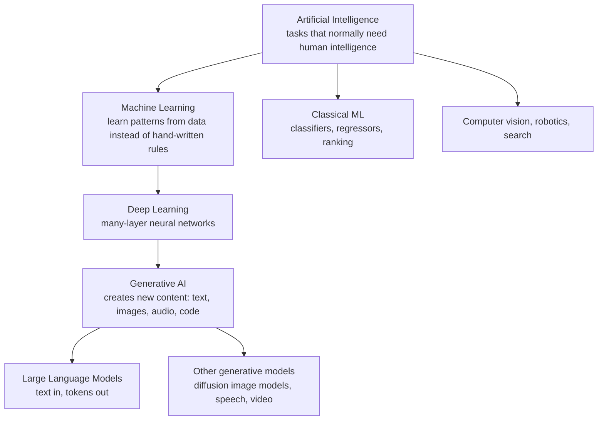
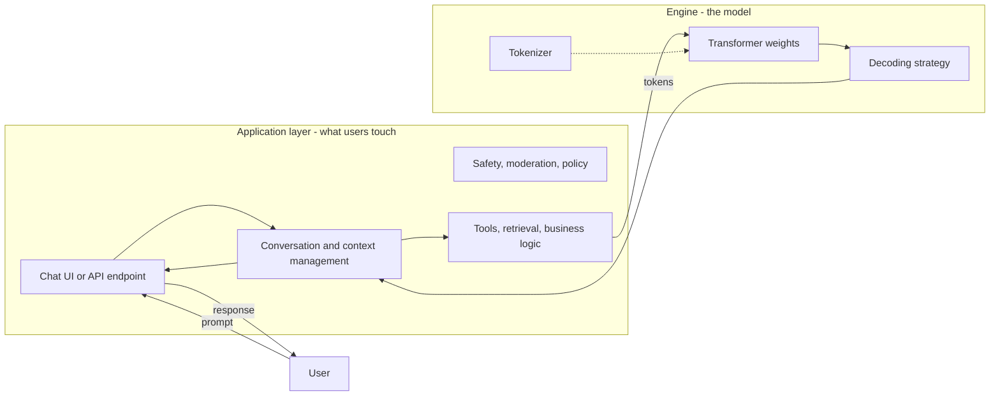
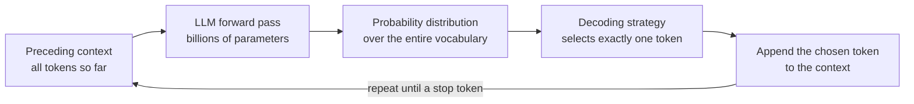
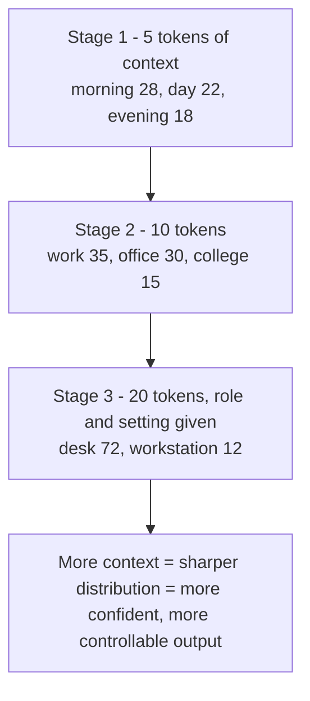
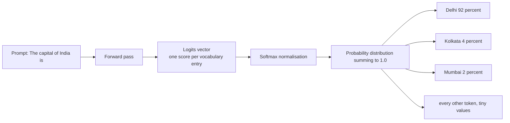
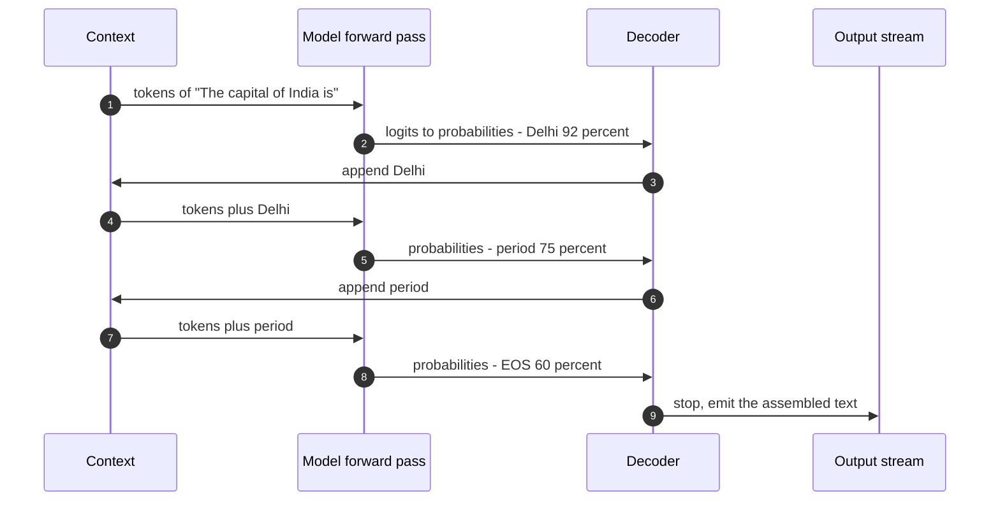
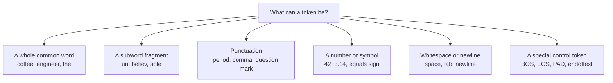
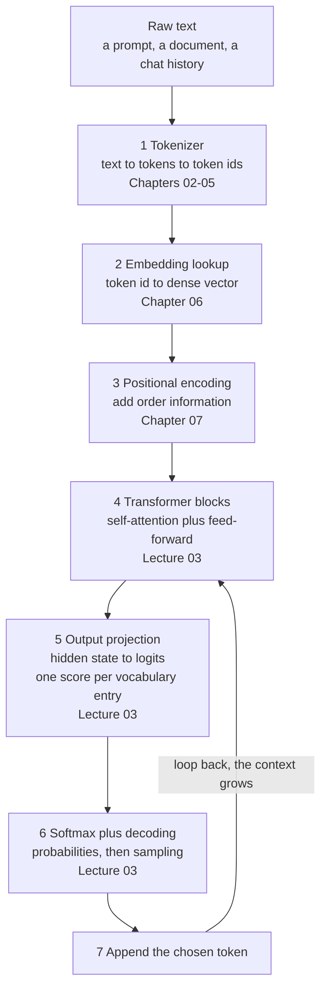
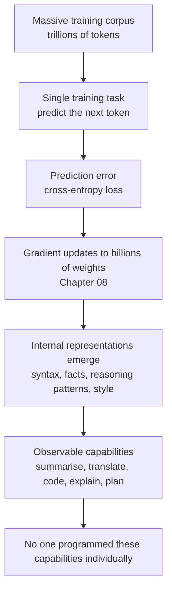

# Chapter 01 — What an LLM Is & Next-Token Prediction

> **Lecture 02 · Chapter 01 of 08** · Level: 🟢 Beginner · Phase 1 — Foundations: How LLMs Actually Work
> **Source:** `Forward-Deployed-Engineer/Lecture 02/notes/01_Foundations_of_LLMs_and_Next_Token_Prediction.md` ·
> `gen-ai-cohort/week01/learning/day01/notes/notes.md` (What is an LLM · GPT vs ChatGPT · the car analogy ·
> how a transformer generates text)
> **Roadmap topics:** what an LLM is; autoregressive next-token prediction; transformers and text processing
> at a glance; training phase vs inference phase (first pass); why emergent complexity arises from simple
> prediction.

---

## 01.0 What this chapter is for

Lecture 01 ended with an uncomfortable sentence: *the model proposes; your architecture disposes*. That
sentence only becomes engineering once you know **what the model actually is**. This chapter answers that
question with the smallest possible model of the model:

> **An LLM is a next-token probability machine.** Given the tokens so far, it returns a probability
> distribution over the next token. Everything else — chat, code, summarisation, tool use — is built on
> top of that one operation, repeated.

By the end of this chapter you should be able to:

1. Say what the words **Large**, **Language** and **Model** actually refer to, and why "LLM" is a narrower
   claim than "AI".
2. Explain the difference between **GPT** (the engine) and **ChatGPT** (the application) without hedging.
3. Describe **autoregressive next-token prediction** and trace it for a short prompt, token by token.
4. Explain why **more context narrows the probability distribution** — and therefore why prompt engineering
   works at all.
5. Explain why **emergent capability** (reasoning, translation, code) is a *side effect* of learning to
   predict well, not a separate feature that was designed.
6. Name the three engineering consequences that follow immediately: you pay **per token**, you wait
   **per token**, and you can only condition on what fits in the **context window**.

> **Where the detail lives:** tokenisation is Chapters 02–05, embeddings Chapter 06, positional encodings
> Chapter 07, context windows and the training/inference split Chapter 08. Attention, softmax and sampling
> belong to **Lecture 03** — here they are only named, never assumed.

---

## 01.1 Where an LLM sits in the landscape

Generative AI is a **subset** of AI, and LLMs are a subset of generative AI. This is not taxonomy for its
own sake: it tells you which problems are addressable with the tools in this curriculum and which are not.



| Layer | The one-sentence definition | Typical artefact |
| :--- | :--- | :--- |
| **AI** | Machines performing tasks that normally require human intelligence | A product feature |
| **Machine learning** | The system learns its behaviour from data rather than from written rules | A trained model file |
| **Deep learning** | Machine learning with multi-layer neural networks | A network with millions of weights |
| **Generative AI** | A model that *produces* new content rather than labelling existing content | Text, image, audio, code |
| **LLM** | A deep generative model over **text tokens** | GPT, Gemini, Claude, Llama, Mistral |

> [!NOTE]
> Lecture 01 explains *how we got here* — rules → ML → n-grams → RNN → Transformer. This chapter does not
> repeat that history; it takes the transformer as given and asks what it computes.

---

## 01.2 What an LLM actually is

The name is a precise three-part claim. Take it apart:

| Word | What it refers to | Why it matters to you |
| :--- | :--- | :--- |
| **Large** | Billions of learned parameters, trained on trillions of tokens | Capability comes from scale; so do cost, latency and non-determinism |
| **Language** | The input/output medium is **token sequences** (not bytes, not words, not characters) | Everything you measure — cost, limits, latency — is measured in tokens |
| **Model** | A *statistical* model: it assigns probabilities, it does not retrieve facts | It can be confidently wrong; grounding is an architecture problem |

The formal statement of the model's job:

$$P\left(t_n \mid t_1, t_2, \dots, t_{n-1}\right)$$

Read it as: *the probability of the next token, given every token that came before it.* Note what is
**absent** from this expression:

- No database, no knowledge graph, no rule tree, no `if/else`.
- No notion of "true" — only of "likely, given the training corpus".
- No memory of anything outside the sequence you gave it (statelessness — Lecture 06 goes deep on this).

Named models you will meet in this curriculum, all of them instances of the same idea:

| Model family | Vendor | Note |
| :--- | :--- | :--- |
| **GPT** | OpenAI | *Generative Pre-trained Transformer*; the reference decoder-only family |
| **Gemini** | Google | Very large context windows, natively multimodal |
| **Claude** | Anthropic | Strong long-context reasoning and tool use |
| **Llama** | Meta | Open-weights; runs locally (useful for cost and privacy experiments) |
| **Mistral** | Mistral AI | Open-weights European family |

> [!IMPORTANT]
> **The FDE consequence:** because the model only assigns probabilities, *"is the answer correct?"* is not a
> property of the model at all. It is a property of the **system** you build around it. That single
> sentence is the reason the RAG lectures and the evals lecture exist.

---

## 01.3 GPT vs ChatGPT: the engine and the car

The single most common beginner confusion is the difference between the **model** and the **product**.
The lecture's analogy is a car:

| Car | AI world | Who owns it |
| :--- | :--- | :--- |
| Car body, steering, dashboard, seats, doors | ChatGPT-style application: UI, conversation management, memory, safety systems, billing, tool integrations | **Application engineer** (you) |
| Engine: pistons, fuel injection, combustion chamber, gearbox, cooling | GPT / the LLM: attention, weights, tokenizer, inference kernels | **ML engineer / model lab** |
| Driver | The user | — |
| Fuel | The prompt | — |
| Movement | The generated response | — |



Two consequences follow from the split:

1. **You cannot fix a bad model with a good UI, and you cannot fix bad architecture with a better model.**
   A fluent model with no access to your order database will still invent order statuses.
2. **Your deliverables are system properties**: latency, cost per request, groundedness, escalation
   behaviour, auditability. None of these appear in the model's probability distribution.

The two roles are genuinely different jobs:

| | Machine Learning Engineer | Application Engineer (this curriculum) |
| :--- | :--- | :--- |
| Builds | Networks, training pipelines, datasets, optimisers | Services, chatbots, assistants, tools, integrations |
| Artefact | Model weights | A running system with SLAs |
| Failure mode | Underfit / overfit / unsafe model | Ungrounded, slow, expensive, unauditable system |
| Typical question | "How do I reduce loss?" | "How do I prove this answers correctly at 50k requests a day?" |

> **First-mover advantage, in one line:** OpenAI reached users first, which bought distribution, a
> developer ecosystem and — most importantly — a feedback flywheel. The lesson for an FDE is that
> *distribution and feedback compound faster than model quality does.*

---

## 01.4 The one core task: next-token prediction

Every LLM is trained to do **exactly one thing**:

> **Given all preceding tokens in the context, output a probability distribution over which single token
> comes next.**

This is called **next-token prediction**, and the generation process built on it is called
**autoregressive language modelling** (*auto* = self, *regressive* = each output depends on the preceding
values).



What the model is **not** doing, despite appearances:

| Looks like | Actually happening |
| :--- | :--- |
| "It looked up that Delhi is the capital of India" | It learned that the token sequence `[The, capital, of, India, is]` is followed by `Delhi` in most of its training text |
| "It is reasoning step by step" | It is emitting tokens that, in its training data, statistically follow from reasoning-like prefixes |
| "It knows my order is late" | It only knows what your prompt or your tools put into the context |

> [!NOTE]
> **Why the trick works at all.** To predict the next token in *"The bug occurs because Python's `//`
> truncates towards \_\_\_"*, a model must implicitly represent what Python is, what `//` does, and what
> "truncates towards" means. Prediction is not the goal — **prediction is the training signal**. The rich
> internal representations learned in order to minimise prediction error are where the capability lives.

---

## 01.5 Context is everything: the prompt-evolution experiment

A prediction is never made in isolation. Every distribution is conditioned on the **entire preceding
context**. The lecture demonstrates this by growing one prompt in three stages.

### Stage 1 — minimal context

```text
"I drink coffee every ___"
```

| Candidate | Probability |
| :--- | ---: |
| morning | 28% |
| day | 22% |
| evening | 18% |
| night | 15% |
| hour | 10% |
| everything else | 7% |

### Stage 2 — add a routine and a destination

```text
"I drink coffee every morning before going to ___"
```

| Candidate | Probability |
| :--- | ---: |
| work | 35% |
| office | 30% |
| college | 15% |
| gym | 10% |
| school | 6% |
| everything else | 4% |

### Stage 3 — add who the speaker is

```text
"I work remotely as a software engineer. Every morning I drink coffee before going to my ___"
```

| Candidate | Probability |
| :--- | ---: |
| **desk** | **72%** |
| workstation | 12% |
| computer | 8% |
| home office | 5% |
| everything else | 3% |



Three engineering lessons, all of which you will use from Lecture 05 (prompt engineering) onwards:

1. **Context is the only control surface** you have at inference time. Weights are frozen; the prompt is
   not.
2. **Specificity narrows distributions.** Telling the model the *role*, the *audience*, the *format* and the
   *constraints* is not politeness — it is conditioning.
3. **Irrelevant context also conditions.** A stale order status or a wrong policy document in the context
   makes the model confidently wrong. Context is capacity you are spending; spend it deliberately.

---

## 01.6 A worked probability distribution: "The capital of India is"

The lecture's second experiment shows the raw material of a prediction. For the prompt:

```text
"The capital of India is"
```

| Token candidate | Raw logit | Softmax probability | Interpretation |
| :--- | ---: | ---: | :--- |
| **Delhi** | +12.8 | **92%** | Strong pattern learned from the corpus |
| Kolkata | +7.1 | 4% | A major city, historically a capital |
| Mumbai | +5.4 | 2% | A major city, frequently co-mentioned |
| Bangalore | +4.2 | 1% | A major tech hub |
| every other token in the vocabulary | varies | ~1% | Spread across roughly 100k tokens |

Two facts in that table are easy to miss and important:

- **The model produces a score for *every* token in its vocabulary**, not just for plausible ones. The
  token `banana` also gets a number — an extremely small one.
- **Softmax normalises those scores so that the whole distribution sums to exactly 1.0.** The maths is in
  Lecture 03; for now, treat "logits → probabilities" as a normalisation step that preserves ordering.



> [!TIP]
> **Why the distribution shape matters to an FDE.** A *peaked* distribution (92% on one token) means the
> answer is effectively decided by the training data — you have little control and should verify it against
> your own source of truth. A *flat* distribution (many tokens near 20%) means the model is unsure — that is
> exactly where a retrieval step, a tool call or a clarifying question belongs.

---

## 01.7 The autoregressive loop, traced

Generation is a loop, not a single shot. Trace the prompt above:

**Iteration 1**

- Context: `"The capital of India is"`
- Distribution: `Delhi` 92%, `Kolkata` 4%, others 4%
- Selected: `Delhi`
- New context: `"The capital of India is Delhi"`

**Iteration 2**

- Context: `"The capital of India is Delhi"`
- Distribution: `.` 75%, `,` 8%, `and` 5%, `which` 4%, …
- Selected: `.`
- New context: `"The capital of India is Delhi."`

**Iteration 3**

- Context: `"The capital of India is Delhi."`
- Distribution: `<EOS>` 60%, `It` 15%, `The` 10%, …
- Selected: `<EOS>` → **stop**



The cost model falls straight out of the loop:

| Property | Consequence |
| :--- | :--- |
| One **full forward pass per generated token** | A 500-word answer can mean 700+ forward passes — output tokens dominate latency |
| The prompt is processed once at the start (**prefill**) and cached (**KV cache**) | Long prompts cost more up front, then amortise; see Lecture 03 and Lecture 25 |
| Output length is not known in advance | Streaming (Lecture 07) exists because waiting for the whole answer feels broken |
| The model conditions on its **own** previous output | One bad token can derail the rest of the answer |

> [!IMPORTANT]
> **Critical mental model:** an LLM never generates a whole response in one shot. It generates **one token
> at a time**, and each token costs a complete pass through the network. Everything you know about LLM
> latency, cost and streaming follows from this single sentence.

---

## 01.8 The first correction: words vs tokens

Beginners say "the model predicts the next **word**". It predicts the next **token**, and that distinction
has money attached to it.

A **token** is whatever unit of text the tokenizer treats as a single atomic unit. It can be:



Same sentence, different token counts, because tokenisation is **model-specific**:

```text
"unbelievable"        -> ["un", "believ", "able"]        3 tokens
"the"                 -> ["the"]                          1 token
"print(x)"            -> ["print", "(", "x", ")"]         4 tokens
"ChatGPT's tokenizer" -> often 4 or more tokens
```

> [!TIP]
> **Practical impact.** API providers bill by **token count**, not by word count. Technical jargon, code,
> identifiers, emoji and non-Latin scripts all inflate token counts relative to their word count. Estimate
> in tokens, always — Chapters 03–05 show you how to measure them exactly.

Consequences that appear later in this lecture:

| If you think in words | What actually happens |
| :--- | :--- |
| "The limit is 128k words" | The limit is 128k **tokens** — usually far fewer words, and fewer still for code or Bengali |
| "This prompt is short" | A 300-word prompt of rare identifiers can cost more than a 600-word prose prompt |
| "Truncation cut off a sentence" | Truncation happens at token boundaries, and can cut mid-word or mid-JSON |

---

## 01.9 Transformers and text processing at a glance

The architecture behind every model in this curriculum is the **Transformer**, introduced in
*"Attention Is All You Need"* (Vaswani et al., 2017). You do not need its internals yet — Lecture 03 and
Lecture 07 open it — but you do need to know the shape of the pipeline, because every chapter in this
lecture is one box of it.



Three properties of this pipeline deserve to be memorised now:

1. **It is autoregressive.** The loop arrow is the whole story: the model consumes its own output.
2. **It is decoder-only in GPT-style models.** There is no separate encoder; the prompt and the answer are
   one continuous token sequence (Lecture 03 explains why this design won).
3. **Attention is the reason it works.** The attention mechanism lets each token look at every other token
   in the context — the mechanism behind the "bank" disambiguation and behind in-context learning.

> **Deliberately out of scope here:** Q/K/V, scaled dot-product attention, multi-head attention, softmax
> mathematics, temperature, top-p and sampling. All of that is **Lecture 03**, and this chapter only names
> the boxes so that the next four chapters have somewhere to plug in.

---

## 01.10 Why emergent complexity comes out of simple prediction

If all the model does is predict the next token, why can it write essays, debug code and translate Bengali?

The answer is not magic; it is the **cost of predicting well**. Consider what must be represented internally
to assign a high probability to the right next token in these three prompts:

| Prompt prefix | What must be internally represented to predict well |
| :--- | :--- |
| *"The capital of France is \_\_\_"* | Geography and a large set of factual associations |
| *"def fib(n):\n    return \_\_\_"* | Python syntax, recursion, and the Fibonacci definition |
| *"She said the contract was void because the signature was forged; therefore the contract is \_\_\_"* | Legal reasoning chains, negation, and consequence |

To do that across trillions of tokens, the network must build internal representations of syntax, semantics,
facts, arithmetic patterns, discourse structure and world knowledge — because those representations are the
cheapest way to reduce prediction error. **Capability is a side effect of compression.**



### The three mechanisms people confuse with "understanding"

| Mechanism | What it actually is | Where it is explained |
| :--- | :--- | :--- |
| **Knowledge in the weights** | Statistical patterns from pre-training; may be stale or wrong | This chapter; Chapter 08 |
| **In-context learning** | The model conditions on the prompt: examples, instructions, retrieved documents | Chapters 01 and 08; prompt engineering later |
| **Tool use / retrieval** | The model emits a request; *your code* fetches facts and acts | Tool calling and RAG lectures |

> [!WARNING]
> **The same mechanism produces hallucination.** A model that is optimised to produce a *plausible*
> continuation will produce a plausible continuation when the facts are missing. Fluency and truth are
> different properties. Never treat "it said it confidently" as evidence.

---

## 01.11 What this mental model buys you as an FDE

Everything in the mental model converts into an engineering constraint. This table is the bridge from this
chapter to the rest of the curriculum.

| Property of the model | Engineering consequence | Where it is handled later |
| :--- | :--- | :--- |
| Billing is per input and output **token** | Budget per request; cache prompt prefixes; shorten retrieved context | Lecture 04 (token economics), Lecture 05 |
| One forward pass per **output token** | Output length is the latency lever; stream tokens to the user | Lecture 07 (streaming) |
| Only the **context window** is visible | Retrieval must be selective, not exhaustive; history must be summarised | Chapters 05 and 08; RAG lectures |
| Weights are **frozen** at inference | Behaviour is steered by prompt, tools and architecture — not by "teaching" it in a chat | Lecture 05, Lecture 10 |
| Output is **probabilistic** | Identical inputs can give different outputs; temperature and seeds matter | Lecture 03, Lecture 30 (evals) |
| The model is **stateless** | You must resend the conversation; "memory" is your feature, not the model's | Lecture 06, Lecture 19 |
| Facts are **learned, not looked up** | Any factual answer needs grounding from your systems | RAG and tool-calling lectures |

---

## 01.12 The generation loop as a contract (pseudo-code)

This is **pseudo-code**, not runnable code: it exists to make the loop explicit so that every later chapter
can point at one line of it.

```ts
// PSEUDO-CODE — the shape of generation. No library here is real; read it as a contract.
type TokenId = number;

function generate(promptText: string, options: { maxTokens: number }): string {
  const context: TokenId[] = tokenizer.encode(promptText);   // Chapters 02-05
  const output: TokenId[] = [];

  for (let step = 0; step < options.maxTokens; step++) {
    const vectors = embed(context);                          // Chapter 06
    const withOrder = addPositionalEncoding(vectors);        // Chapter 07

    const logits = transformerForward(withOrder);            // Lecture 03: attention, MLP
    const nextTokenLogits = logits.last();                   // one score per vocabulary entry
    const probs = softmax(nextTokenLogits);                  // Lecture 03: logits to probabilities

    const chosen: TokenId = decodeStrategy.pick(probs);      // greedy, temperature, top-p: Lecture 03
    if (chosen === SPECIAL.EOS) break;                       // stop token

    output.push(chosen);
    context.push(chosen);                                    // autoregressive: output becomes input
  }

  return tokenizer.decode(output);
}
```

Four lines of that pseudo-code are the whole lecture:

1. `tokenizer.encode` — text is not the model's language; **tokens are** (Chapters 02–05).
2. `embed` + `addPositionalEncoding` — tokens become vectors, and order must be injected (Chapters 06–07).
3. `softmax` + `decodeStrategy.pick` — the model gives a distribution; something else makes the choice
   (Lecture 03).
4. `context.push(chosen)` — the loop that makes the model *autoregressive*.

---

## Common mistakes

- **Calling it "AI" and stopping there.** *AI ⊃ ML ⊃ DL ⊃ GenAI ⊃ LLM.* Precision here decides which
  techniques you even consider.
- **Confusing GPT with ChatGPT.** One is a model; the other is an application that also needs context
  management, safety, tooling and a UI.
- **Thinking the model retrieves facts.** It assigns probabilities. Facts come from grounding.
- **Believing the whole answer is generated at once.** It is one forward pass **per token**; that is where
  latency and cost live.
- **Treating the model as stateful.** It forgets everything the moment the request ends; conversation
  memory is an application feature.
- **Optimising the prompt without measuring tokens.** "Shorter prompt" and "cheaper prompt" are different
  claims until you count tokens.
- **Reading a confident answer as a correct answer.** Confidence is a property of the distribution, not of
  the world.
- **Assuming a better model removes the need for architecture.** Ungrounded is ungrounded at every model
  size.

## Key takeaways

1. An LLM is a **next-token probability machine**: $P(t_n \mid t_1 \dots t_{n-1})$, nothing more.
2. **GPT is the engine; ChatGPT is the car.** Your job is the car — context, tools, safety, cost, proof.
3. **Generation is a loop**: forward pass → distribution → select one token → append → repeat until a stop
   token.
4. **More specific context narrows the distribution.** That is the mechanism behind prompt engineering, and
   the reason irrelevant context is dangerous.
5. **The model produces a score for every vocabulary entry**, then normalises to a distribution summing to
   1.0 (softmax — Lecture 03).
6. **Tokens, not words**, are the unit of everything: cost, limits, latency, truncation.
7. **Emergent capability is a side effect** of learning to predict well at scale — and the same mechanism
   produces hallucination.
8. Every property in this chapter becomes a constraint: per-token billing, per-token latency, a finite
   context window, frozen weights, probabilistic output, statelessness, ungrounded facts.

## Self-check questions

1. Write the next-token objective in your own words as a formula, and name the quantity being predicted.
2. Give the car analogy for GPT vs ChatGPT, then name two things the "car body" must do that the "engine"
   cannot.
3. In the coffee-prompt experiment, what exactly changes between Stage 1 and Stage 3 — the weights, the
   vocabulary, or the conditioning?
4. Why does the model output a score for *every* token in the vocabulary rather than only for the plausible
   ones?
5. Trace three iterations of the autoregressive loop for the prompt `"Rohit lives in"`, including the stop
   condition.
6. State two engineering decisions that follow directly from "one forward pass per generated token".

---

### Navigation

- **Next:** [Chapter 02 — The Text Pipeline & Why Token IDs Are Labels](./02_The_Text_Pipeline_and_Why_Token_IDs_Are_Labels.md)
- **Source:** `Forward-Deployed-Engineer/Lecture 02/notes/01_Foundations_of_LLMs_and_Next_Token_Prediction.md`;
  `gen-ai-cohort/week01/learning/day01/notes/notes.md`
- **Back to index:** [../index.md](../index.md)

