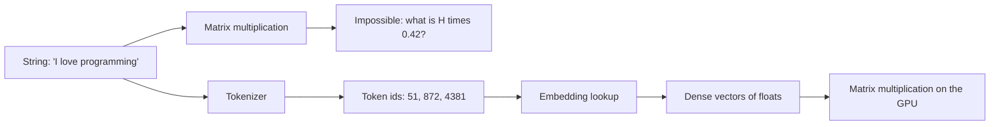
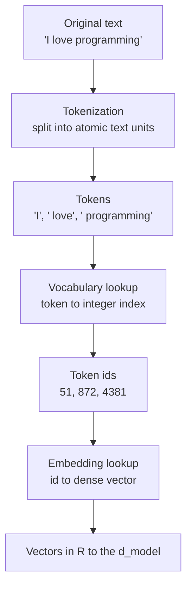
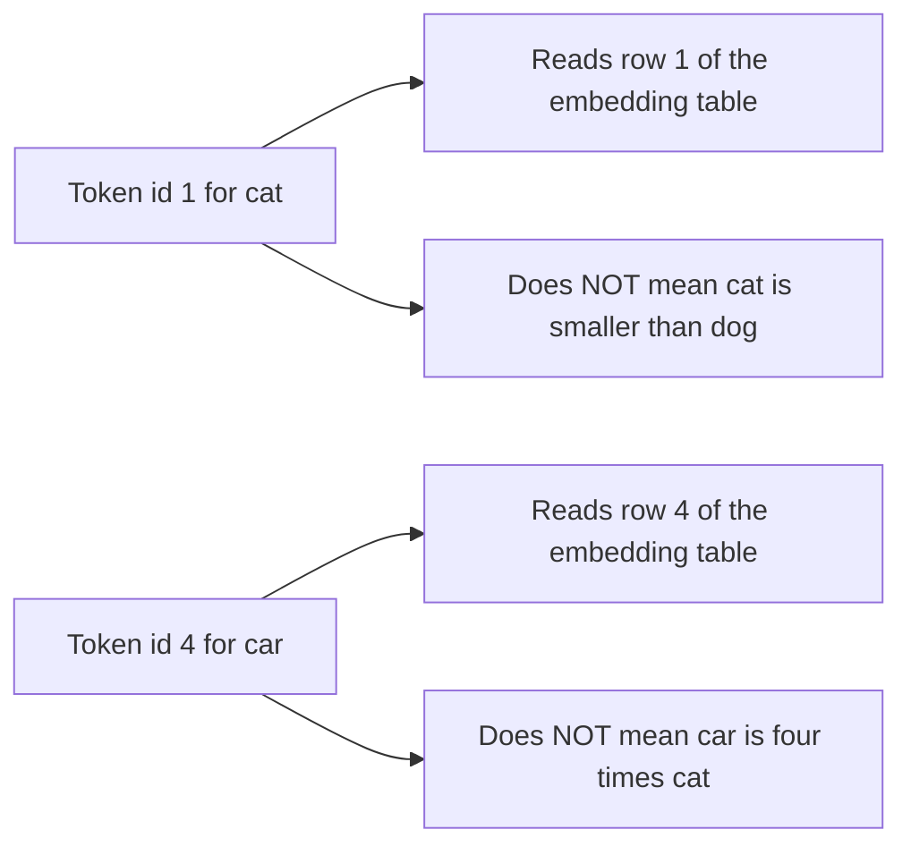
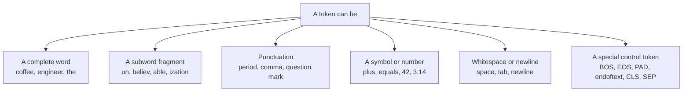
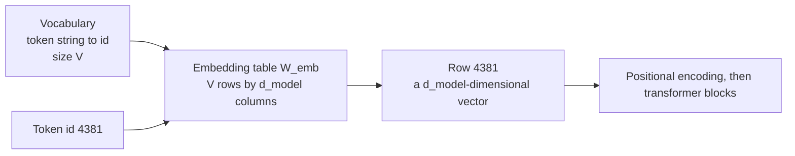
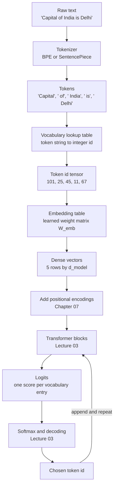
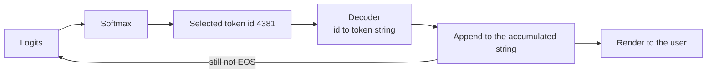

# Chapter 02 — The Text Pipeline & Why Token IDs Are Labels

> **Lecture 02 · Chapter 02 of 08** · Level: 🟢 Beginner · Phase 1 — Foundations: How LLMs Actually Work
> **Source:** `Forward-Deployed-Engineer/Lecture 02/notes/02_Tokenization_Subwords_and_Numerical_Representations.md`
> (§2.1–2.3, §2.8) · `gen-ai-cohort/week01/learning/day01/notes/notes.md` (how computers understand
> language · tokens · LLM vocabulary · Step 1 Tokenization)
> **Roadmap topics:** the text pipeline *raw text → tokens → ids → vectors → logits*; token IDs are
> **labels, not measurements**; numerical representation; why text must become numbers.

---

## 02.0 What this chapter is for

Chapter 01 established *what* the model predicts. This chapter answers the mechanical question that comes
immediately after: **how does a string of human text become something a matrix multiplication can consume?**

By the end of this chapter you should be able to:

1. Explain why a neural network cannot operate on text directly.
2. Distinguish the **three objects** that beginners blur together: original text, tokens, and token IDs.
3. Explain, with the roll-number analogy, why a larger token ID carries **no** meaning.
4. Name the five stages of the input pipeline and say what each stage outputs.
5. Describe the **reverse** pipeline (IDs → text) and why streaming breaks it into chunks.
6. State the pipeline invariants — round-trip, ID stability, model-specificity, whitespace ownership,
   Unicode normalisation — that you will rely on when counting tokens and estimating cost.

> **Not in this chapter:** the *algorithm* that decides where the token boundaries fall (Chapters 03–04) and
> the meaning stored in the vectors (Chapter 06). Here we only follow the data.

---

## 02.1 Why text must become numbers

A neural network is arithmetic: matrix multiplications, dot products, element-wise additions and non-linear
activations. Every one of those operations needs **numerical tensors**.

There is no meaningful definition of "multiply the letter `H` by a weight matrix". The string
`"I love programming"` is a sequence of code points; the network needs a sequence of numbers with a fixed
shape.



The conversion is a **two-stage** process, and it is worth naming the stages separately because they have
completely different properties:

| Stage | Input | Output | Learned? | Covered in |
| :--- | :--- | :--- | :--- | :--- |
| **Tokenisation** | A string | A list of integer IDs | No — a deterministic algorithm plus a fixed table | Chapters 03–05 |
| **Embedding** | A list of integer IDs | A matrix of dense vectors | **Yes** — trained with the rest of the network | Chapter 06 |

> [!IMPORTANT]
> **Tokenisation is not learned at inference time; embeddings are.** The tokenizer is a fixed artefact
> shipped with the model. If you change the tokenizer, you have changed the model's input language — that is
> why a model and its tokenizer are versioned together (Chapter 05).

---

## 02.2 The three things that are different

Before anything else, separate these three objects. Most beginner confusion in this lecture traces back to
collapsing them into one.

| Object | Example | What it is |
| :--- | :--- | :--- |
| **Original text** | `"I love programming"` | The raw string exactly as the user typed it |
| **Tokens** | `["I", " love", " programming"]` | Text *segments* the tokenizer treats as atomic units |
| **Token IDs** | `[51, 872, 4381]` | Integer indices into the model's **vocabulary** table |



Two details in that table are the ones people get wrong most often:

1. **The space is inside the token.** `" love"` and `"love"` are different tokens with different IDs. Leading
   whitespace is not decoration; it is part of the string being tokenised. (This is also why a stray space in
   a prompt can change a token count.)
2. **The ID is an index, not a value.** `51` is not "less than" `872` in any meaningful sense — see the next
   section.

> [!TIP]
> **Why the distinction is practical.** When you debug an LLM pipeline you will print token IDs and token
> strings side by side. If you only print one of them you will misdiagnose: the string tells you *what the
> model saw*, the IDs tell you *how much it costs* and *which table row was read*.

---

## 02.3 Token IDs are labels, not measurements

This is the single most important correction in the chapter:

> **A larger token ID does not mean a more important, more frequent, more common or "heavier" token.**

Token IDs are **arbitrary lookup indices** — exactly like university roll numbers or product SKUs.

### The roll-number analogy (from the lecture)

In a classroom:

- **Rohit** → roll number `104`
- **Aditya** → roll number `237`

The fact that $237 > 104$ tells you **nothing** about Aditya relative to Rohit: not intelligence, not age,
not height, not marks. Roll numbers are assigned at enrolment and mean only "this row of the register".

The same is true of tokens:

| Token | Assigned ID | What the number tells you |
| :--- | ---: | :--- |
| `cat` | 1 | Nothing beyond "row 1" |
| `dog` | 2 | Nothing beyond "row 2" |
| `apple` | 3 | Nothing beyond "row 3" |
| `car` | 4 | Nothing — `car ≠ 4 × cat` |
| `Rohit` | 104 | Nothing |
| `Aditya` | 237 | Nothing |



### The three properties an index does not have

| Property | Numeric value (a measurement) | Token ID (a label) |
| :--- | :--- | :--- |
| **Order** | 20°C < 30°C is meaningful | ID 200 is not "after" ID 100 |
| **Magnitude** | 30 is twice 15 | ID 30 is not twice ID 15 |
| **Distance** | \|30 − 20\| = 10 units | \|30 − 20\| = 10 rows — meaningless |

Why this matters in code, in **pseudo-code**:

```ts
// PSEUDO-CODE — the wrong intuition and the right one, side by side.

// ❌ WRONG: treat the id as a quantity
const importance = tokenId;                 // "bigger id = more important"? No.
const distance = Math.abs(idA - idB);       // "how similar are these tokens"? Meaningless.

// ✅ RIGHT: the id is only an address
const vector = embeddingTable.row(tokenId); // the id addresses a row; the row holds the meaning
const similarity = cosine(vectorA, vectorB);// similarity lives in the vectors, not the ids
```

> [!IMPORTANT]
> **Key principle:** $\text{Token ID} \neq \text{meaning}$. The ID is a **scalar lookup key**. All semantic
> meaning lives in the **embedding vectors** that the key points to — that is Chapter 06.

### A second consequence: IDs are not portable

The number `4381` means one thing in GPT-4's vocabulary and something completely different — or nothing at
all — in Llama's. Token IDs are **only** meaningful together with the exact tokenizer that produced them.

| Claim | True? |
| :--- | :--- |
| "Token `the` is ID 279 in every model" | ❌ False — vocabularies differ per model family |
| "Token IDs are ordered by frequency" | ❌ False in general — do not rely on it |
| "The same sentence yields the same IDs everywhere" | ❌ False — different tokenizers, different splits |
| "IDs are stable for a given tokenizer version" | ✅ True — that is the one guarantee you get |

---

## 02.4 What exactly is a token?

A **token** is whatever unit of text the tokenizer treats as the smallest atomic building block. Nothing in
the definition says "word", and that is the point.

### Two myths to retire now

**Myth 1 — "one word = one token".** Approximately true for short, common English words, and false almost
everywhere else:

```text
unbelievable      -> ["un", "believ", "able"]        3 tokens
Anthropic         -> ["Anthr", "opic"]               2 tokens
print(x)          -> ["print", "(", "x", ")"]        4 tokens
tokenization      -> ["token", "ization"]            2 tokens
Bengali / Hindi   -> often several tokens per character in older vocabularies
```

**Myth 2 — "1 token = 4 characters".** A useful *rule of thumb for English prose and cost estimation only*:

| Text | Characters | Tokens | Note |
| :--- | ---: | ---: | :--- |
| `the` | 3 | 1 | Common word → 1 token |
| `é` | 1 | up to 2 | Non-ASCII may cost more than one token |
| `glucocorticosteroid` | 19 | many | Rare technical term → decomposed |
| a typical English paragraph | 600 | ~150 | The ≈4 characters/token rule of thumb |

> [!WARNING]
> **Never plan a context budget with the 4-characters rule for code, JSON, non-Latin scripts or emoji.**
> Measure with the model's own tokenizer (Chapter 05). The rule is a *first estimate*, not a contract.

### What a token can be



---

## 02.5 The vocabulary: the table that gives IDs their meaning

Every tokenizer ships a **vocabulary**: a fixed, ordered mapping from token strings to integer IDs.

```text
Illustrative vocabulary (not a real model's):

  "A"      -> 1
  "B"      -> 9
  "The"    -> 209
  "Hello"  -> 15496
  "<EOS>"  -> 50256
```

Three structural facts about every vocabulary:

| Fact | Why it matters |
| :--- | :--- |
| **Size is fixed and known** (roughly 32k–200k entries) | It determines the shape of the embedding matrix and the size of the output logit vector |
| **It is model-specific** | The same string tokenises differently across model families (Chapter 05) |
| **It contains special tokens** | `BOS`/`EOS`/`PAD` and chat-format markers are part of the input contract, not user text |

The embedding table is the vocabulary's twin:

$$W_{\text{emb}} \in \mathbb{R}^{|V| \times d_{\text{model}}}$$

- $|V|$ = vocabulary size (number of rows — one row per token ID)
- $d_{\text{model}}$ = embedding width (number of columns — the vector length)

For a 100k vocabulary and $d_{\text{model}} = 4096$, that single table holds
$100{,}000 \times 4096 \approx 4.1 \times 10^8$ learned parameters — one of the largest single matrices in the
model. Vocabulary size is therefore a **real engineering trade-off**, which Chapter 05 quantifies.



---

## 02.6 The forward pipeline, end to end

Now trace one real prompt through every stage. Input:

```text
"Capital of India is Delhi"
```

| Step | Operation | Output |
| :---: | :--- | :--- |
| 1 | Raw string received | `"Capital of India is Delhi"` |
| 2 | Segmentation into tokens | `["Capital", " of", " India", " is", " Delhi"]` |
| 3 | Vocabulary lookup | `[101, 25, 45, 11, 67]` |
| 4 | Embedding row extraction | a $5 \times d_{\text{model}}$ matrix of floats |
| 5 | Positional encoding added | same shape, order now encoded |
| 6 | Transformer blocks | contextual hidden states |
| 7 | Output projection | logits: one score per vocabulary entry |
| 8 | Softmax + decoding | one chosen token ID → appended → loop |



The shape of the data at each stage is worth writing down, because shape bugs are the most common bugs in
LLM plumbing:

```text
step 2  tokens       : string[]                       length = N
step 3  ids          : number[]                       length = N
step 4  vectors      : number[][]                     shape  = N x d_model
step 6  hidden states: number[][]                     shape  = N x d_model
step 7  logits       : number[]                       length = |V|   (only the LAST position matters)
```

> [!NOTE]
> **Why only the last position matters.** The transformer produces a hidden state for *every* input
> position, but for generation you only need the prediction that follows the final token. Training uses all
> positions at once (Chapter 08) — that asymmetry is what makes training parallel and inference sequential.

---

## 02.7 The reverse pipeline: detokenisation and streaming

Generation runs the pipeline backwards: the model emits a token ID, and your code decodes it to text.



Three details that bite in production:

1. **Token boundaries are not word boundaries.** Appending tokens gives text like `"Cap" + "ital"` →
   `"Capital"`. Any per-token post-processing (profanity filters, redaction, JSON parsing) must run on the
   *accumulated* buffer, not per token.
2. **Partial multi-byte characters exist.** With byte-level tokenizers a single Unicode character can be
   split across tokens. Decoding one token in isolation can produce an invalid fragment — decode the whole
   buffer, or use a streaming-safe decoder.
3. **You must decide when to stop.** The natural stop is the `EOS` token, but you also need a
   `max_tokens` ceiling, a wall-clock budget and a stop-sequence check. Otherwise one runaway generation
   becomes one runaway bill.

```ts
// PSEUDO-CODE — the decode side of the loop, with the safety rails made explicit.
const buffer: TokenId[] = [];

for await (const tokenId of stream) {
  if (tokenId === SPECIAL.EOS) break;              // model decided to stop
  if (buffer.length >= budget.maxTokens) break;    // hard ceiling
  if (Date.now() - startedAt > budget.ms) break;   // latency ceiling
  buffer.push(tokenId);

  const textSoFar = tokenizer.decode(buffer);      // decode the WHOLE buffer, not one token
  ui.render(textSoFar);                            // replace, do not append raw fragments
}
```

---

## 02.8 Pipeline invariants you can rely on

These are the properties you should assume (and the ones you must not). They are the difference between code
that survives a model swap and code that silently corrupts input.

| # | Invariant | Consequence for your code |
| :---: | :--- | :--- |
| 1 | **Round trip within a tokenizer**: `decode(encode(x)) == x` for normal text | A failure here means lost information — usually a whitespace or Unicode issue |
| 2 | **IDs are stable for a fixed tokenizer version** | Cache token counts per tokenizer version, not globally |
| 3 | **IDs are *not* portable across models** | Never store token IDs in a database and replay them into a different model |
| 4 | **Whitespace belongs to tokens** | Do not trim or normalise text after tokenising; do it before |
| 5 | **Unicode normalisation happens before tokenising** | `"é"` as one code point and as `e + combining accent` are different strings → different tokens. Normalise (NFC/NFKC) at the boundary |
| 6 | **Special tokens come from the chat template, not from you** | The same message can tokenise differently in "raw" vs "chat" mode — which changes your cost estimate |
| 7 | **Token count grows, but not linearly** | Doubling the text usually increases tokens, rarely exactly 2× (boundaries re-merge) |

> [!TIP]
> **Normalise early, tokenise late.** The most common "why is my token count different from the dashboard?"
> bug is a Unicode form or a trailing whitespace introduced somewhere between the user, your database and the
> model call. Normalise at the API boundary, then count.

---

## 02.9 The pipeline as a typed contract (pseudo-code)

```ts
// PSEUDO-CODE — the five-stage pipeline as types, so the shapes cannot be confused.

type RawText  = string;   // exactly what the user sent, after Unicode normalisation
type TokenStr = string;   // a text fragment, e.g. " love" - note the leading space
type TokenId  = number;   // an index into the vocabulary: a LABEL, not a value
type Vector   = number[]; // length = d_model
type Logits   = number[]; // length = |V|, one score per vocabulary entry

type Tokenizer = {
  encode(text: RawText): TokenId[];   // deterministic, model-specific
  decode(ids: TokenId[]): RawText;    // inverse, within the same tokenizer version
  vocabularySize: number;             // |V| - shapes the logits and the embedding table
};

type Pipeline = {
  normalize(text: RawText): RawText;          // Unicode form, trim, strip control characters
  tokenize(text: RawText): TokenStr[];        // where the boundaries fall: Chapters 03-04
  toIds(tokens: TokenStr[]): TokenId[];       // vocabulary lookup
  embed(ids: TokenId[]): Vector[];            // W_emb row per id: Chapter 06
  addPositions(vectors: Vector[]): Vector[];  // Chapter 07
  forward(vectors: Vector[]): Logits;         // Lecture 03
};
```

Read it top to bottom: **normalise → tokenise → to IDs → embed → add positions → forward**. Every later
chapter in this lecture fills in exactly one of those functions, and every production bug you will hit lives
at a seam between two of them.

---

## Common mistakes

- **Treating a token ID as a number.** Arithmetic on IDs — ordering, averaging, distance — is meaningless.
  Meaning lives in the vectors.
- **Assuming token IDs transfer between models.** They do not; they are only valid with their own tokenizer.
- **Counting words instead of tokens.** Cost, limits and truncation are all token-based.
- **Assuming `" love"` and `"love"` are the same token.** Leading whitespace is part of the token.
- **Normalising text *after* tokenising.** Do it before, or your round trip and your counts drift.
- **Storing token IDs in your database.** Store text; tokenise at call time with the model you actually call.
- **Forgetting special tokens and chat templates.** The same message can cost different token counts in raw
  vs chat mode.
- **Decoding token-by-token and rendering raw fragments.** Decode the accumulated buffer; a single token can
  be a partial multi-byte character.
- **Believing every position's logits are used.** Only the final position's logits produce the next token.

## Key takeaways

1. Neural networks are arithmetic; **text must become numbers**, in two stages: tokenisation (a fixed
   algorithm) then embedding (learned).
2. **Three objects, never conflated:** raw text → tokens → token IDs.
3. **Token IDs are labels, not measurements** — the roll-number analogy. Order, magnitude and distance are
   all meaningless.
4. The **vocabulary** is a fixed, model-specific mapping; its size $|V|$ sets the shape of both the embedding
   table $W_{\text{emb}} \in \mathbb{R}^{|V| \times d_{\text{model}}}$ and the output logits.
5. The forward pipeline is **text → tokens → IDs → vectors → (+ positions) → transformer → logits**; the
   reverse pipeline is **IDs → text**, consumed incrementally by streaming.
6. Shapes are the contract: `N` tokens → `N × d_model` vectors → `|V|` logits at the final position only.
7. The invariants that save you in production: **round-trip, ID stability, no portability, whitespace
   ownership, normalise-before-tokenise**.

## Self-check questions

1. Explain in one sentence why `"H" × 0.42` is meaningless, and what replaces it in the pipeline.
2. Give the roll-number analogy and name the three numeric properties that a token ID lacks.
3. A colleague says "ID 5000 is a rarer token than ID 50". What is wrong with that statement?
4. Write out the five stages for the string `"Rohit is a CSE student"` and the shape of the data after each.
5. Why does only the last position's logits matter during generation, while every position matters during
   training?
6. Name two invariants you must respect when caching token counts for cost estimation.

---

### Navigation

- **Previous:** [Chapter 01 — What an LLM Is & Next-Token Prediction](./01_What_an_LLM_Is_and_Next_Token_Prediction.md)
- **Next:** [Chapter 03 — Tokenization Strategies: Word vs Character vs Subword](./03_Tokenization_Strategies_Word_Character_Subword.md)
- **Source:** `Forward-Deployed-Engineer/Lecture 02/notes/02_Tokenization_Subwords_and_Numerical_Representations.md`;
  `gen-ai-cohort/week01/learning/day01/notes/notes.md`
- **Back to index:** [../index.md](../index.md)
