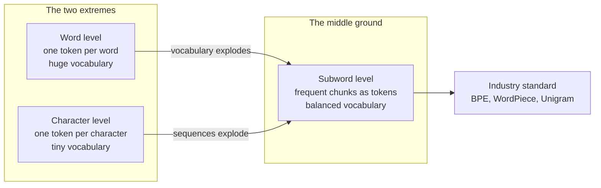
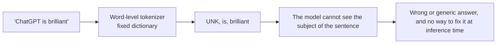
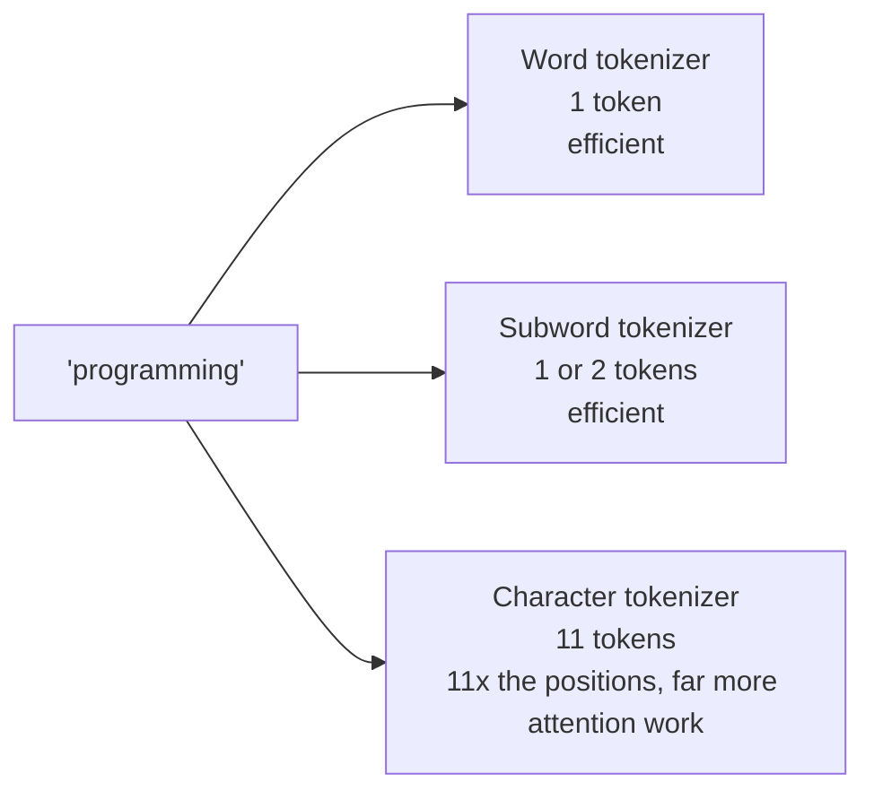
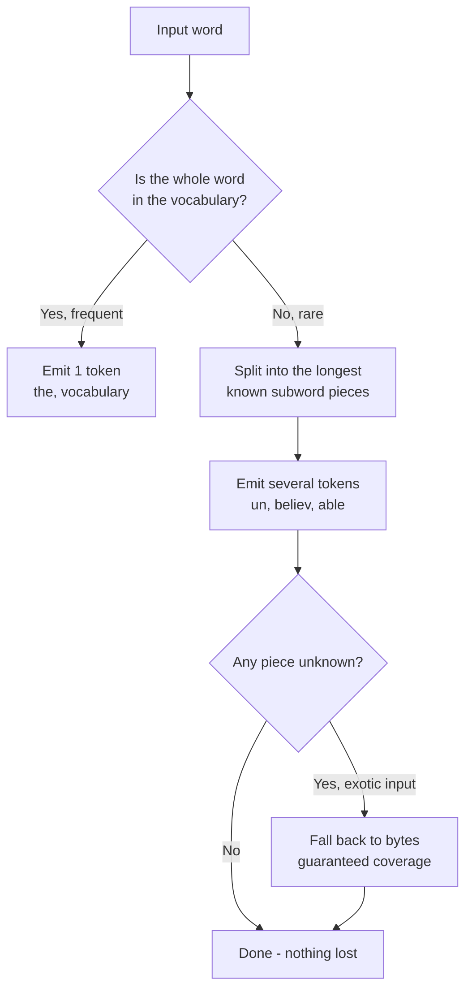
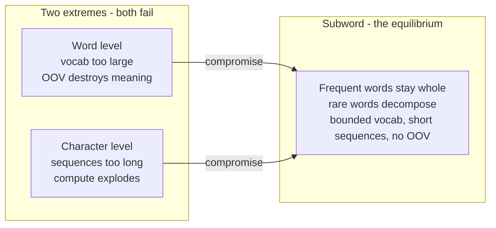
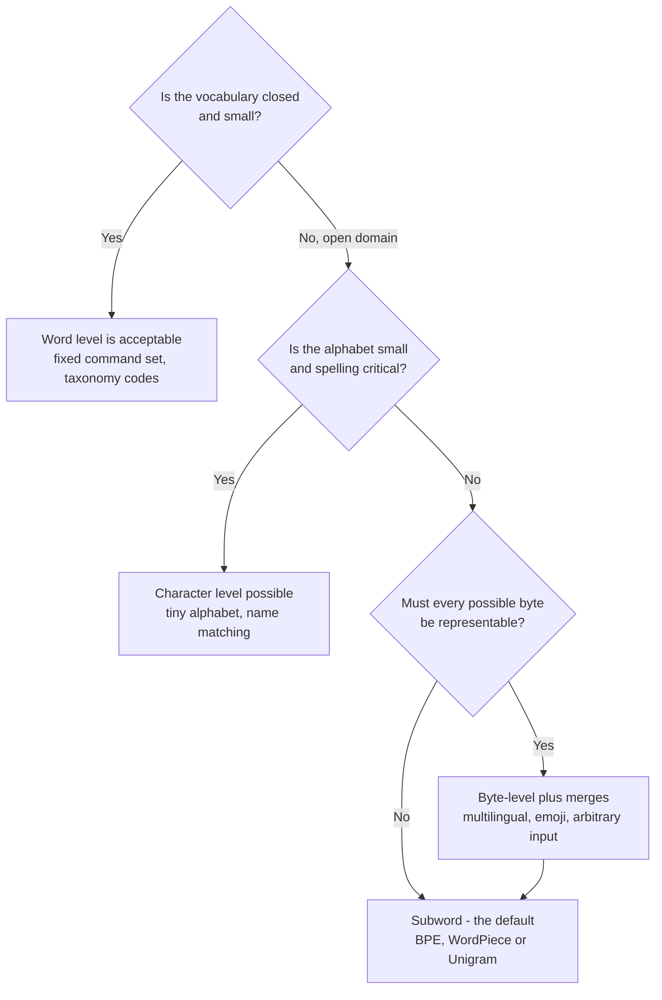
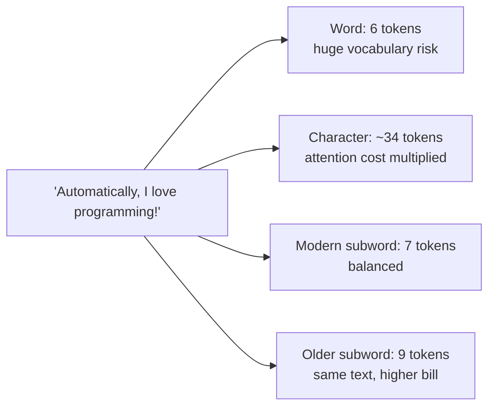

# Chapter 03 — Tokenization Strategies: Word vs Character vs Subword

> **Lecture 02 · Chapter 03 of 08** · Level: 🟢 Beginner · Phase 1 — Foundations: How LLMs Actually Work
> **Source:** `Forward-Deployed-Engineer/Lecture 02/notes/02_Tokenization_Subwords_and_Numerical_Representations.md`
> (§2.5–2.7, §2.9) · `gen-ai-cohort/week01/learning/day01/notes/notes.md` (tokens · LLM vocabulary ·
> tokenizer model comparisons)
> **Roadmap topics:** word-level vs character-level vs subword tokenization — and **why subwords win**;
> vocabulary; OOV; the sequence-length/attention-cost trade-off.

---

## 03.0 What this chapter is for

Chapter 02 established that text becomes tokens. This chapter answers the design question behind that step:
**where should the token boundaries fall?** There are three classic answers — word, character and subword —
and only one of them survived contact with real production systems.

By the end of this chapter you should be able to:

1. Describe word-level, character-level, byte-level and subword tokenization, with one concrete example each.
2. Explain the **two fatal failures** of word-level tokenization: vocabulary explosion and out-of-vocabulary
   (OOV) loss.
3. Explain the **fatal failure** of character-level tokenization: sequence-length explosion and its
   $O(N^2)$ attention cost.
4. State why **subword** tokenization is the industry standard, in terms of the two pressures it balances.
5. Compute the rough cost consequences of a tokenizer choice (sequence length → attention cost → bill).
6. Explain why tokenizer choice is effectively **not yours** — it is fixed by the pretrained model you call.

> **Not in this chapter:** the exact merge algorithm (Chapter 04) and the real-world tokenizer families and
> libraries (Chapter 05).

---

## 03.1 The design space: one decision, made once

Tokenization granularity is a decision made **once, at training time**, and then frozen into the model.
It cannot be changed at inference, because every learned weight was fitted to a specific vocabulary.



The whole argument is a **two-sided pressure**:

| Pressure | Pushes you towards | Why |
| :--- | :--- | :--- |
| Sequence length (compute, latency, context) | **Fewer, larger** tokens | Attention cost grows with $N^2$; context is measured in tokens |
| Vocabulary size (parameters, sparsity, OOV) | **More, smaller** tokens | A huge vocabulary costs parameters and still misses new words |

Subword tokenization is the equilibrium point of those two pressures.

---

## 03.2 Word-level tokenization and its two fatal problems

The naive design: one token per dictionary word.

```text
cat -> 1    dog -> 2    computer -> 3    programming -> 4    automatically -> 5   ...
```

It feels natural to humans, and it fails for two independent reasons.

### Problem 1 — vocabulary explosion (morphology)

Languages are morphologically productive. One root generates dozens of surface forms, and a word-level
vocabulary must list each one separately.

| Root | Surface forms that each need their own entry |
| :--- | :--- |
| `automate` | automate, automates, automated, automating, automation, automatic, automatically, automatons, automatism… |
| `program` | program, programs, programmed, programming, programmer, programmers, programmatic, reprogrammed… |
| `write` | write, writes, wrote, written, writing, writer, writers, rewrites… |

Add technical jargon, product names, code identifiers, typos, slang, emoji and every other language, and an
"English" word vocabulary passes a million entries easily. Consequences:

- The embedding matrix $W_{\text{emb}} \in \mathbb{R}^{|V| \times d_{\text{model}}}$ grows with $|V|$.
- The output projection must also produce a logit per vocabulary entry.
- Rare forms are seen so few times in training that their rows stay badly estimated.

### Problem 2 — out-of-vocabulary (OOV) failure

New words appear constantly. A fixed word vocabulary has no entry for them, so they collapse into a single
`<UNK>` token — and the information is *destroyed*, not compressed.

```text
Input : "ChatGPT is brilliant"
Word tokenizer output: ["<UNK>", "is", "brilliant"]
                         ^ the most informative token in the sentence is gone
```



> [!IMPORTANT]
> **Why this is fatal rather than annoying.** OOV loss is *unrecoverable at inference*: no prompt, no
> temperature and no fine-tuning can restore information that the tokenizer already discarded. Anything the
> tokenizer cannot spell, the model cannot read.

### Where word-level is still fine

Word-level tokenization is acceptable when the vocabulary is closed and small: a fixed command language, a
set of country codes, a controlled taxonomy. It is exactly wrong for open-domain text, and that is precisely
what an LLM faces.

---

## 03.3 Character-level tokenization and the sequence-length explosion

The opposite extreme: every character is a token. Vocabulary size becomes tiny (roughly 100–256 entries),
and OOV disappears forever.

```text
"programming" -> p r o g r a m m i n g       11 tokens
"the"         -> t h e                        3 tokens
```

### The fatal problem: $O(N^2)$ attention

Self-attention compares every position with every other position. Doubling the sequence length roughly
**quadruples** the attention work:

$$\text{attention cost} \propto N^2 \cdot d_{\text{model}}$$

Watch the arithmetic on a realistic prompt:

| Quantity | Subword (≈4 chars/token) | Character level |
| :--- | ---: | ---: |
| Prompt text | ~600 characters | ~600 characters |
| Sequence length $N$ | ~150 tokens | ~600 tokens |
| Relative $N$ | 1× | **4×** |
| Relative attention cost ($N^2$) | 1× | **16×** |
| Context consumed by the same document | 150 of 128k tokens | 600 of 128k tokens |



Three secondary costs:

1. **Long-range dependencies get harder.** The distance between related tokens grows, so the model must
   learn relationships over more steps.
2. **You run out of context sooner.** The same document consumes 4× the context window, which directly
   reduces how much knowledge you can put in front of the model.
3. **Output is slower.** More tokens must be generated for the same text, and output tokens are the latency
   bottleneck (Chapter 01).

> [!NOTE]
> **Character-level models are not useless** — they are attractive for tiny alphabets, byte-level
> robustness, or tasks where spelling matters (some speech and transliteration systems). They are simply the
> wrong choice for long-document LLM workloads, and no frontier chat model uses pure character tokenization.

---

## 03.4 Byte-level: the extreme that actually shipped

There is a third extreme that the lecture notes mention only in passing and that deserves its own section,
because it is what most frontier models actually use: **byte-level tokenization**.

Instead of characters, start from **UTF-8 bytes**. There are at most 256 distinct bytes, so:

- The base vocabulary is 256 entries — **OOV is impossible by construction**, for *any* language, emoji,
  symbol or binary-looking text.
- A rare character (say `क` or `🙂`) is represented as 2–4 byte tokens that merge into a single token once the
  merge algorithm has seen it often enough.

```text
"café"  -> UTF-8 bytes: 63 61 66 C3 A9
           byte tokens:  c  a  f  (byte C3)  (byte A9)
           after BPE merges: ["caf", "é"]  (2 tokens in a modern vocabulary)
```

| Property | Character level | **Byte level** |
| :--- | :--- | :--- |
| Base vocabulary | ~100–256 characters (language-specific) | **exactly 256 bytes (language-agnostic)** |
| OOV possible | For characters outside the alphabet | **Never** |
| Sequence length | Long | Even longer before merging |
| Used by | Legacy small models | **GPT-2, GPT-3.5/4, Llama, Mistral (byte-level BPE)** |

> [!IMPORTANT]
> **The trade-off byte-level buys:** absolute robustness at the cost of longer raw sequences — which is
> exactly why byte-level tokenization is always paired with a **merging algorithm** (BPE, Chapter 04). The
> bytes are the safety net; the merges are the efficiency.

---

## 03.5 Subword tokenization: the industry standard

Subword tokenization is the middle ground, and the rule is one sentence:

> **Frequent text stays whole; rare text is decomposed into frequent pieces that already exist in the
> vocabulary.**

### How the idea behaves on real words

| Word | Tokenization | Why |
| :--- | :--- | :--- |
| `the` | `["the"]` | Appears so often it survives as one token |
| `vocabulary` | `["vocabulary"]` | Common enough to be a single token |
| `unbelievable` | `["un", "believ", "able"]` | Each piece is frequent; the whole word is not |
| `tokenization` | `["token", "ization"]` | Productive suffix kept as its own token |
| `Anthropic` | `["Anthr", "opic"]` | A rare proper noun — split into the best available chunks |
| `ChatGPT` | `["Chat", "GPT"]` | Two frequent pieces; brand names never need a bespoke entry |

### The four advantages that make it win

1. **No OOV, ever.** Any string can be spelled out of existing pieces. Information is *compressed*, never
   destroyed.
2. **Morphology is shared.** `token`, `tokenize`, `tokenization`, `tokenizer` share subword pieces, so
   learning about one transfers to the others.
3. **Vocabulary stays bounded.** A fixed 32k–200k vocabulary covers every language, every domain and every
   future coinage.
4. **Sequences stay short.** Common text stays 1 token per word, so attention cost and context usage stay
   reasonable.



> [!TIP]
> **The mental model to keep:** a subword tokenizer is a **lossless compression scheme whose dictionary was
> learned from a corpus**. The corpus determines which strings became cheap (1 token) and which stayed
> expensive (many tokens) — which is exactly why the same text costs different amounts in different models
> (Chapter 05).

---

## 03.6 The comparison matrix

The lecture's trade-off table, plus the columns that matter for production:

| Dimension | Word level | Character level | **Subword (BPE / WordPiece / Unigram)** |
| :--- | :--- | :--- | :--- |
| **Vocabulary size** | Enormous (>1M) | Tiny (100–256) | Balanced (32k–200k) |
| **Sequence length for the same text** | Minimal | Massive (+4× or more) | Optimal |
| **Attention compute** | Light | Very heavy ($N^2$) | Moderate |
| **Embedding matrix size** | Enormous | Tiny | Manageable |
| **OOV handling** | Fails (`<UNK>`) | Perfect | Perfect (decomposition + byte fallback) |
| **Morphology** | Poor (every form separate) | N/A | Good (shares subwords) |
| **Multilingual** | Needs a separate vocabulary per language | Needs an alphabet per language | One vocabulary, byte fallback |
| **Handles code / JSON / emoji** | Badly | Verbosely | Well (with a large-enough vocabulary) |
| **Industry usage** | Legacy NLP only | Rare | **All modern LLMs** |



---

## 03.7 Why vocabulary size is a real engineering trade-off

Vocabulary size $|V|$ is not a free parameter. It sits at the centre of four competing costs:

| Cost | Direction | Explanation |
| :--- | :--- | :--- |
| **Embedding parameters** | grows with $|V|$ | $|V| \times d_{\text{model}}$ — for 100k × 4096 that is ~410M parameters |
| **Output logits** | grows with $|V|$ | Softmax over $|V|$ values at every generated token |
| **Sequence length** | shrinks as $|V|$ grows | Bigger vocabulary → more strings are a single token → fewer positions |
| **Data sparsity** | grows with $|V|$ | Rare tokens appear too few times to be well learned |

### The multilingual "token tax"

Because vocabularies are built from a training corpus that is usually English-heavy, text outside that
distribution costs more tokens:

| Text | Older tokenizer (small, English-heavy vocab) | Modern large-vocab tokenizer |
| :--- | ---: | ---: |
| One common English sentence | ~12 tokens | ~10 tokens |
| The same sentence in Bengali or Hindi | often 3–5× more tokens | close to the English count |
| Source code with rare identifiers | inflated | much closer to word count |

> [!WARNING]
> **The token tax is a *cost* and a *capacity* problem at the same time.** It multiplies your bill **and**
> consumes the context window faster for exactly the users whose language is least represented. If your
> product is multilingual, measure token counts per language — do not extrapolate from English.

### Zipf's law, in one paragraph

Token frequency follows a power law: a handful of tokens (spaces, `the`, `and`, `,`) account for a huge share
of all occurrences, and a long tail of tokens occurs a handful of times. BPE exploits this directly — the
most frequent pairs get merged first, so the vocabulary naturally concentrates on the head of the
distribution. It also explains why the **tail is where tokenization gets expensive**: rare words have to be
spelled out of pieces.

---

## 03.8 Choosing a granularity

In practice the choice is usually made **for** you: you call a pretrained model and inherit its tokenizer.
The decision tree below is still worth internalising, because it is the reasoning you will need when you
train a small domain model, build a retrieval index, or evaluate a new provider.



| Situation | Sensible choice | Reason |
| :--- | :--- | :--- |
| Calling a hosted LLM | Whatever the model ships | You cannot change it; measure it instead |
| Training a domain model on code | Byte-level BPE with a large vocabulary | Code tokens, indentation and identifiers are long-tail |
| Multilingual product | Large-vocabulary byte-level BPE | Minimises the token tax; guarantees coverage |
| Fixed command language (e.g. SQL keywords) | Word level | Vocabulary is genuinely closed |
| Retrieval index built with an embedding model | The embedding model's tokenizer | Truncation limits are in *its* tokens |

> [!IMPORTANT]
> **The practical rule:** the tokenizer is part of the model's **interface**, not an implementation detail.
> When you switch providers you are switching tokenizers, and therefore switching your cost curve, your
> truncation points and your context accounting.

---

## 03.9 One sentence, three tokenizers, worked

Take the sentence `"Automatically, I love programming!"` and look at what each granularity would produce
(illustrative counts):

| Granularity | Tokenisation | Token count | Note |
| :--- | :--- | ---: | :--- |
| **Word level** | `["Automatically", ",", "I", "love", "programming", "!"]` | 6 | Small count — but a vocabulary that must hold every form of every word |
| **Character level** | `a u t o m a t i c a l l y , ...` | ~34 | No OOV — but ~5.7× the positions, so ~32× the attention work |
| **Subword (modern)** | `["Automatic", "ally", ",", "I", " love", " programming", "!"]` | 7 | Nearly word-level efficiency with a bounded vocabulary |
| **Subword (older, smaller vocab)** | `["Auto", "mat", "ically", ",", "I", " love", " program", "ming", "!"]` | 9 | The same text costs ~29% more on the older tokenizer |



The lesson is not that 7 is a magic number — it is that **the same user text has different prices in
different tokenizers**, and only measurement tells you which. Chapter 05 makes this operational.

---

## 03.10 The tokenizer as an interface (pseudo-code)

```ts
// PSEUDO-CODE — what every tokenizer must expose, and why each field exists.

type Encoded = {
  tokens: string[];   // the text pieces the model actually sees
  ids: number[];      // indices into the vocabulary: labels, not values
  offsets: [number, number][]; // [start, end) character span in the ORIGINAL text
  specialTokensMask: boolean[];// true where a token was added by the chat template, not the user
};

interface Tokenizer {
  readonly vocabSize: number;         // |V| - sets the logits dimension and the embedding table shape
  readonly scheme: "word" | "char" | "byte-bpe" | "wordpiece" | "unigram";

  encode(text: string): Encoded;      // deterministic: the same text always yields the same ids
  decode(ids: number[]): string;      // inverse within the same tokenizer version
  countTokens(text: string): number;  // cost and context accounting use this, never word counts
}
```

Two of those fields are easy to skip and expensive to omit:

- **`offsets`** let you map a token back to a character range — essential for highlighting, redaction,
  citation spans in RAG, and "which part of the document caused this answer?".
- **`specialTokensMask`** separates *user content* from *template scaffolding*, so your token accounting
  matches the provider's, and so your prompt-injection defences do not treat template tokens as user input.

---

## Common mistakes

- **Believing word-level tokenization is "more accurate".** It is *less* accurate: unknown words become
  `<UNK>` and their information is destroyed before the model sees anything.
- **Thinking character-level tokenization is safe because it has no OOV.** It is safe on coverage and
  catastrophic on cost: $N$ grows ~4×, attention cost ~16×, and the context window empties faster.
- **Comparing token counts across models as if they were comparable.** They are not; the vocabulary differs.
- **Ignoring the multilingual token tax.** A product that is 20% Bengali can be paying 40% more tokens
  without anyone noticing.
- **Assuming one token is one word when budgeting context.** Rare identifiers, code and JSON break the
  assumption immediately.
- **Treating tokenizer choice as an implementation detail.** It is part of the model interface: it changes
  cost, truncation and context accounting.
- **Forgetting that tokenization is frozen at training time.** You cannot "fix tokenization" with a prompt.
- **Using word counts for truncation.** Truncate on token counts, and on the *same* tokenizer the model uses.

## Key takeaways

1. There are four granularities: **word, character, byte, subword** — and subword (usually byte-level
   subword) is what every modern LLM uses.
2. **Word level fails twice:** vocabulary explosion from morphology, and OOV destruction (`<UNK>`).
3. **Character level fails once, badly:** sequence-length explosion, and attention cost grows as $N^2$.
4. **Byte level** guarantees total coverage (256 base tokens, language-agnostic) at the price of longer
   sequences — which is why it is always paired with merges.
5. **Subword is the equilibrium:** frequent text stays whole, rare text decomposes, vocabulary stays bounded
   and OOV becomes impossible.
6. **Vocabulary size is a real trade-off** between embedding parameters, output logits, sequence length and
   data sparsity — and it drives the multilingual token tax.
7. Tokenization is part of the **model's interface**, not a detail: it sets your cost curve, your truncation
   points and your context accounting.

## Self-check questions

1. Give one word that word-level tokenization handles well and one that it destroys, with the reason.
2. A character-level tokenizer has no OOV. Why is that still a bad trade for a 50-page document?
3. Explain the byte-level trick: what is the base vocabulary, and why can it never produce `<UNK>`?
4. Why does subword tokenization let the model generalise from `tokenize` to `tokenization`?
5. Name the four costs that vocabulary size trades against, and say which way each moves.
6. A user says "the same text costs 30% more on model A than model B". Give two plausible explanations.
7. Why can't you change the tokenizer of a pretrained model?

---

### Navigation

- **Previous:** [Chapter 02 — The Text Pipeline & Why Token IDs Are Labels](./02_The_Text_Pipeline_and_Why_Token_IDs_Are_Labels.md)
- **Next:** [Chapter 04 — BPE, WordPiece, SentencePiece & the Vocabulary](./04_BPE_WordPiece_SentencePiece_and_Vocabulary.md)
- **Source:** `Forward-Deployed-Engineer/Lecture 02/notes/02_Tokenization_Subwords_and_Numerical_Representations.md`;
  `gen-ai-cohort/week01/learning/day01/notes/notes.md`
- **Back to index:** [../index.md](../index.md)
