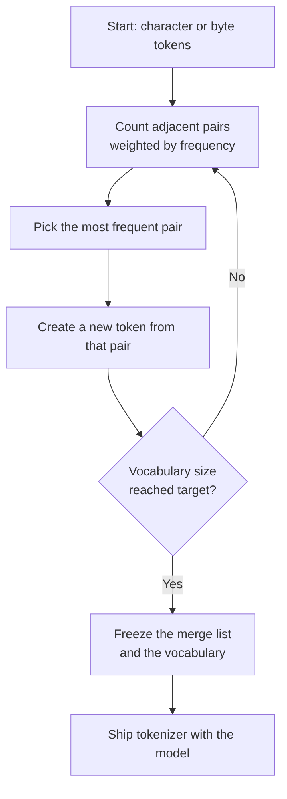
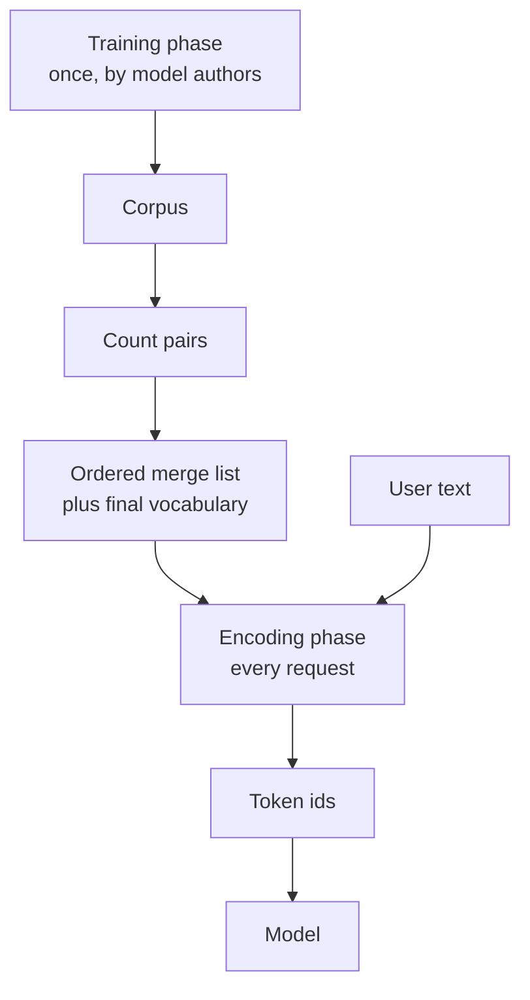
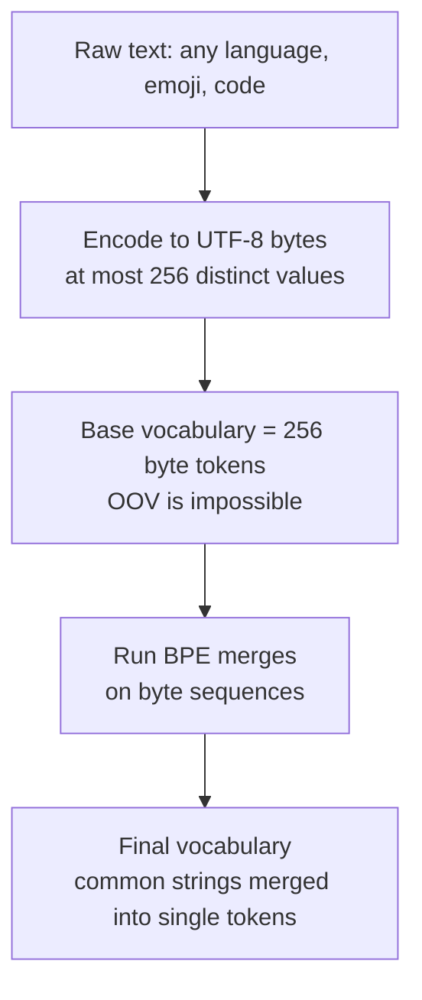
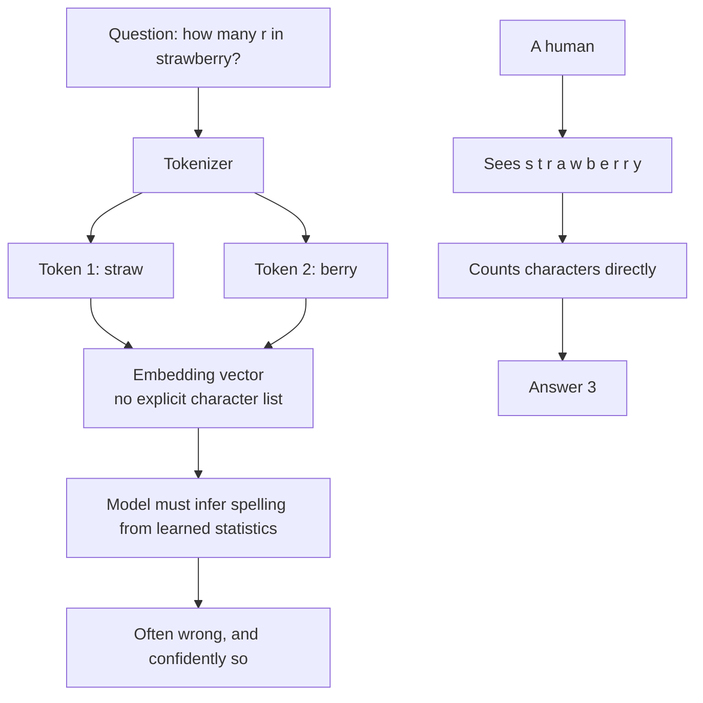

# Chapter 04 — BPE, WordPiece, SentencePiece & the Vocabulary

> **Lecture 02 · Chapter 04 of 08** · Level: 🟢 Beginner · Phase 1 — Foundations: How LLMs Actually Work
> **Source:** `Forward-Deployed-Engineer/Lecture 02/notes/02_Tokenization_Subwords_and_Numerical_Representations.md`
> (§2.7) · `gen-ai-cohort/week01/learning/day01/notes/notes.md` (Byte-Pair Encoding — the four algorithm
> steps · tokenizer model comparisons)
> **Roadmap topics:** **BPE / WordPiece / subwords**; vocabulary construction; tokenizer comparison across
> models. **Gate for this lecture:** *tokenize a sentence by hand for a simple BPE case and explain why
> "strawberry" is hard.*

---

## 04.0 What this chapter is for

Chapter 03 argued *why* subword tokenization wins. This chapter shows **how the vocabulary is actually
built**, and then does the thing the lecture's completion gate asks for: tokenize by hand, and explain why
counting letters in "strawberry" is hard for a model.

By the end of this chapter you should be able to:

1. Run the **BPE training loop** by hand on a tiny corpus: count pairs, merge the most frequent, repeat.
2. Explain the difference between **training** a tokenizer and **encoding** with it.
3. Describe **WordPiece** (likelihood-based merges, `##` continuation) and **Unigram / SentencePiece**
   (probabilistic, language-agnostic) and say where each is used.
4. Explain **byte-level BPE** and why GPT-2 introduced it.
5. Name the parts of a real vocabulary: base tokens, merged tokens, **special tokens** and reserved slots.
6. Tokenize a short sentence by hand, and explain the **"strawberry" problem** in terms of tokens versus
   characters.

---

## 04.1 The core idea: merge the most frequent pair

All subword algorithms share one intuition:

> Start from something tiny (characters or bytes), then **repeatedly merge the most useful adjacent pair**
> into a new token, until the vocabulary reaches the target size.

**Byte-Pair Encoding (BPE)** — borrowed from a 1994 data-compression algorithm — is the version the lecture
describes. Its four steps:

| Step | Operation |
| :---: | :--- |
| 1 | **Initialise**: every unique character (or byte) in the corpus becomes a base token |
| 2 | **Count**: count every adjacent pair of tokens in the corpus, weighted by word frequency |
| 3 | **Merge**: replace the most frequent pair with a single new token |
| 4 | **Repeat**: go back to step 2 until the vocabulary reaches the target size (e.g. 50k) |



The output of training is not a list of words — it is an **ordered list of merge rules**. That ordering is
what makes encoding deterministic.

---

## 04.2 BPE trained by hand on a tiny corpus

Use a miniature corpus (the frequencies are the whole point — BPE counts *weighted* occurrences):

| Word | Frequency |
| :--- | ---: |
| `low` | 5 |
| `lower` | 2 |
| `lowest` | 1 |

**Step 1 — initialise with characters** (append an end-of-word marker so suffixes are distinguishable):

```text
low     -> l o w _        x5
lower   -> l o w e r _    x2
lowest  -> l o w e s t _  x1
```

**Step 2 — count adjacent pairs**

| Pair | Weighted count |
| :--- | ---: |
| `l o` | 8 |
| `o w` | 8 |
| `w _` | 5 |
| `w e` | 3 |
| `e r` | 2 |
| `e s` | 1 |
| `s t` | 1 |
| `t _` | 1 |

**Step 3 — merge the most frequent pair.** `l o` and `o w` tie at 8; take `l o` (ties are broken by a fixed
rule, e.g. leftmost/lexicographic) and add the token `lo`.

```text
Merge 1: l + o -> lo
low    -> lo w _        x5
lower  -> lo w e r _    x2
lowest -> lo w e s t _  x1
```

**Step 4 — recount and repeat**

| Merge # | Most frequent pair | New token | Resulting corpus |
| :---: | :--- | :--- | :--- |
| 1 | `l` + `o` | `lo` | `lo w _`, `lo w e r _`, `lo w e s t _` |
| 2 | `lo` + `w` | `low` | `low _`, `low e r _`, `low e s t _` |
| 3 | `low` + `_` (word boundary) | `low_` | `low_`, `low e r _`, `low e s t _` |
| 4 | `e` + `r` | `er` | `low_`, `low er _`, `low e s t _` |
| 5 | `e` + `s` | `es` | `low_`, `low er _`, `low es t _` |
| 6 | `es` + `t` | `est` | `low_`, `low er _`, `low est _` |

Stop when the vocabulary target is reached (here we stop at 6 merges for illustration). The final vocabulary
contains the base characters **plus** `lo`, `low`, `low_`, `er`, `es`, `est`.

> [!NOTE]
> **What the merges reveal.** Because `low` occurred 8 times, it became a single token. Because `lower` and
> `lowest` each occurred far fewer times, their *suffixes* became tokens instead — `er` and `est`. This is
> exactly the behaviour Chapter 03 promised: **frequent text stays whole, rare text is decomposed** — and the
> suffix that many words share is what gets learned.

---

## 04.3 Training versus encoding: two different jobs

This distinction prevents a very common confusion. There are **two phases** and they use the same data
structure differently.

| Phase | When it happens | Input | Output | Deterministic? |
| :--- | :--- | :--- | :--- | :--- |
| **Tokenizer training** | Once, by the model authors, before training the network | A large corpus | The vocabulary + the ordered merge list | Yes, given the corpus and the settings |
| **Encoding** | Every time you send a request | Any text | Token strings + token IDs | Yes, always |

Encoding never invents new tokens. It applies the merge list **in the order it was learned**, greedily
pairing tokens that appear in the list:

```text
Encoding "lowest" with the learned merge list [lo, low, low_, er, es, est]:

  start        : l o w e s t _
  apply merge 1: lo w e s t _
  apply merge 2: low e s t _
  merge 3 not applicable: "low" is followed by "e", not by "_"
  merge 5 applicable: low es t _
  merge 6 applicable: low est _
  no further merges applicable -> stop

  result: ["low", "est", "_"]  (word-boundary marker shown only for illustration)
```



> [!IMPORTANT]
> **The merge list is the tokenizer.** If two services use "the same" BPE algorithm but different corpora or
> a different number of merges, they have **different tokenizers** and their token counts are not
> comparable. "BPE" is a family, not a fixed artefact.

---

## 04.4 WordPiece: merges chosen by likelihood, not raw frequency

**WordPiece** is the tokenizer used by BERT-family models. It shares BPE's merge-until-target-size structure,
but changes the merge criterion:

| | BPE | **WordPiece** |
| :--- | :--- | :--- |
| Merge criterion | Highest **frequency** of the pair | Highest **likelihood gain**: $\dfrac{\text{count}(ab)}{\text{count}(a)\,\text{count}(b)}$ |
| Effect | Merges whatever is common | Merges pairs that are *surprisingly* common together |
| Continuation marker | None (whitespace is part of the token) | **`##` prefix** marks a token that continues a word |
| Typical users | GPT-2/3/4, Llama, Mistral (byte-level BPE) | BERT, DistilBERT, many encoder models |

The likelihood criterion matters because it prevents very frequent individual characters from dominating the
merge order. A pair only merges when the two pieces co-occur far more often than chance would predict.

The `##` marker makes WordPiece splits explicit:

```text
"unbelievable" -> ["un", "##believ", "##able"]
                       ^^ no marker   ^^      ^^ continuation tokens carry ##
"playing"      -> ["play", "##ing"]
```

| Property | Consequence |
| :--- | :--- |
| `##` marks a continuation | You can reconstruct the original word, and you can tell "start of word" from "middle of word" |
| Word starts are distinct tokens | Sub-word statistics stay interpretable; useful for classification and NER heads |
| Encoder-oriented design | WordPiece is common in embedding and classification models, not in decoder-only chat models |

---

## 04.5 Unigram and SentencePiece: probabilistic and language-agnostic

Two more families complete the picture.

### Unigram

Instead of building up from characters, Unigram starts from a **large candidate vocabulary** and *prunes*
it — removing pieces whose removal least hurts the corpus likelihood — until the target size is reached.
Encoding then chooses the **most probable segmentation** of the text under the resulting unigram language
model.

| | BPE / WordPiece | **Unigram** |
| :--- | :--- | :--- |
| Direction | Bottom-up (merge) | Top-down (prune) |
| Objective | Frequency / likelihood gain | Corpus likelihood of a probabilistic token model |
| Encoding | Apply merges in order | Choose the highest-probability segmentation |
| Typical users | GPT, Llama, BERT | T5, mT5, some multilingual and Gemma-family models |

### SentencePiece

**SentencePiece** is a *toolkit* rather than an algorithm: it implements BPE **and** Unigram, and adds one
crucial design decision — **it operates directly on the raw text, treating the space as a normal symbol
(`▁`) rather than pre-splitting on whitespace.**

```text
"Hello world"  ->  ["▁Hello", "▁world"]
                    ^ the space is inside the token, not a delimiter that was thrown away
```

| Benefit | Why it matters |
| :--- | :--- |
| **Language-agnostic** | Works for Thai, Chinese and Japanese, which do not use spaces |
| **Lossless** | Detokenisation is exact: the original string is recoverable |
| **No pre-tokenisation assumptions** | Removes an English-centric bias from the pipeline |
| **Reversible whitespace** | You can reproduce the user's exact spacing |

> [!TIP]
> **The pattern to notice across all four families:** every design decision is a *trade* between coverage,
> sequence length, vocabulary size and losslessness. There is no "correct" tokenizer — only one that is
> better or worse for a given corpus and workload.

---

## 04.6 Byte-level BPE, in detail

GPT-2 introduced the variant that dominates today. The change is at the *base* of the algorithm:



Why the byte detour is worth it:

| Problem with character-level bases | Byte-level solution |
| :--- | :--- |
| A character vocabulary is language-specific — add Thai and you must grow the alphabet | 256 bytes cover **every** language, symbol and emoji |
| Unseen characters become unknown | Never unknown — any byte sequence is representable |
| Whitespace, control characters and combining marks are awkward | They are just byte values |

The GPT-2 trick has one wrinkle: raw bytes include control characters that are awkward in a text file or a
JSON vocabulary. The solution is a **reversible byte↔printable-character mapping** — every one of the 256
bytes is mapped to a visible Unicode character for storage, and mapped back during decoding. That is why you
sometimes see odd-looking tokens like `Ġ` (which stands in for a leading space) in tokenizer dumps.

```text
" tokenization" (leading space) -> ["Ġtoken", "ization"]
                                   ^^^ "Ġ" is the printable stand-in for byte 0x20 (space)
```

| Property | Consequence for you |
| :--- | :--- |
| Base is bytes, not characters | Perfect coverage; no `UNK` ever |
| Vocabulary is trained on a specific corpus | Which strings became single tokens depends on that corpus |
| Leading spaces are encoded inside tokens | `" love"` ≠ `"love"`; whitespace changes cost |
| Decoding must be done on the buffer | A single token may be a partial multi-byte character (Chapter 02) |

---

## 04.7 Anatomy of a real vocabulary

A shipped vocabulary is more than "a list of words". It has structure, and the structure is part of the
model's interface.

| Segment | Contents | Examples |
| :--- | :--- | :--- |
| **Base tokens** | All 256 bytes (byte-level BPE) or the alphabet (character-based) | single bytes, `a`, `1`, `!` |
| **Merged tokens** | Everything the merge process produced | `the`, `ization`, `Ġtoken` |
| **Special control tokens** | Begin/end of sequence, padding, mask | `<BOS>`, `<EOS>`, `<PAD>`, `[MASK]`, `<|endoftext|>` |
| **Chat-template tokens** | Role delimiters for message formats | `<|system|>`, `<|user|>`, `<|assistant|>`, `<|tool|>` |
| **Reserved slots** | Empty IDs held back for future features | `<|reserved_0|>` … `<|reserved_99|>` |

Two practical details:

- **Special tokens are invisible to the user but visible to the model.** They are how a chat format is
  communicated. This is also why the same message can cost different token counts in "raw completion" mode
  versus "chat" mode: the template adds tokens.
- **Vocabulary sizes are usually rounded up.** You will see numbers like 50,257 or 100,256 rather than
  50,000 — the extra entries come from special tokens plus alignment padding (sizes are often padded to a
  multiple of 64/128 so that GPU matrix multiplications stay efficient).

> [!WARNING]
> **Never let user input be interpreted as a special token.** If your code concatenates raw user text into a
> prompt that contains template tokens, a user can type `<|system|>` and attempt to forge structure. Always
> encode user content with special-token handling **disabled**, and let the template add structure. This is
> the first prompt-injection surface you meet, long before the security lecture.

---

## 04.8 The gate exercise: tokenize by hand, and the "strawberry" problem

### Part 1 — tokenize a sentence by hand

Using the tiny merge list from §04.2 (`lo`, `low`, `low_`, `er`, `es`, `est`) plus an assumed base of
characters and a few already-known pieces, encode:

```text
"lowest berry"
```

| Step | State | Reasoning |
| :---: | :--- | :--- |
| 0 | `l o w e s t _ b e r r y _` | Start from the base pieces |
| 1 | `lo w e s t _ b e r r y _` | Merge 1: `l` + `o` → `lo` |
| 2 | `low e s t _ b e r r y _` | Merge 2: `lo` + `w` → `low` |
| 3 | `low es t _ b e r r y _` | Merge 5: `e` + `s` → `es` |
| 4 | `low est _ b e r r y _` | Merge 6: `es` + `t` → `est` |
| 5 | `low est _ b er r y _` | `e` + `r` → `er` (learned from `lower`) |
| 6 | — | `rr` and `ry` are not in the merge list, so they stay separate pieces |

```text
final tokens: ["low", "est", " berry"]     -> 3 tokens
```

That is the whole exercise: **apply the merges in learned order, greedily, and stop when no merge applies.**
Nothing is invented; the result is fully deterministic.

### Part 2 — why "strawberry" is hard

Now tokenize `"strawberry"` in a real modern vocabulary. Typical result:

```text
"strawberry" -> ["straw", "berry"]     (2 tokens)
```

A human asked *"How many r's are in strawberry?"* answers **3** by looking at the letters. The model does not
receive letters — it receives **two opaque tokens**, and its knowledge of the letters inside a token is only
whatever it learned statistically from seeing that token's spelling during training.



Three reasons the failure is structural rather than a bug:

1. **The character list is not in the input.** The model gets a token ID, not a string of letters.
2. **Character-level facts are only learnable statistically.** If the corpus contains enough spelling
   discussions, the model can learn them — but nothing guarantees it.
3. **The token boundary hides the interesting part.** The two `r`s in `berry` are *inside* one token, so even
   the boundary information does not help.

Why newer tokenizers help — and do not fully fix it:

| Change | Effect |
| :--- | :--- |
| Larger vocabularies (e.g. 200k) | Common words become single tokens → **fewer** character-level handles; sometimes worse |
| Better digit and symbol splitting (GPT-4o era) | Arithmetic and letter counting improved markedly, because digits and characters get their own tokens |
| Tools and code execution | The reliable fix: let a program count characters, not the model |

> [!IMPORTANT]
> **The engineering conclusion of the whole lecture in one line:** *anything that requires exact character
> manipulation should be done in code, not in the model.* Tokenization is why "count the letters", "reverse
> this string" and "how many words in this sentence" are unreliable without a tool.

---

## 04.9 Two phenomena worth knowing about

### Glitch tokens

Because merges are learned from a corpus, some tokens exist in the vocabulary with almost **no useful
training signal** — they were created from rare byte sequences (often from corrupted web data, HTML fragments
or specific usernames) and then almost never appeared again. Asking a model about such a token can produce
bizarre, unstable behaviour. Practical implications:

- Treat strange strings (`SolidGoldMagikarp`-style artefacts) as **adversarial input**, not as a curiosity.
- A user can trigger undefined behaviour simply by typing a rare token — a robustness argument for input
  validation and for treating model output as untrusted.

### Tokenizer versioning and reproducibility

| Change | Consequence |
| :--- | :--- |
| Vocabulary size changes | Old token IDs become invalid → **never store IDs** |
| Merge list changes | The same text yields different token counts and different truncation points |
| New special tokens added | Prompt templates shift; cached prompts and cached embeddings become stale |
| Any of the above | Re-measure cost, re-run evals, re-validate truncation limits |

> [!NOTE]
> **A practical rule for the code you will write later:** treat the tokenizer as part of the **model version
> string**. Pin `model + tokenizer version` together, log both, and re-run your cost and truncation tests
> whenever either changes.

---

## 04.10 BPE as an algorithm (pseudo-code)

```ts
// PSEUDO-CODE — BPE training. This runs ONCE, by the model authors, over a large corpus.

function trainBPE(corpus: string[], targetVocabSize: number) {
  // Step 1 — initialise: base pieces are single characters (or bytes for byte-level BPE)
  let words = corpus.map(word => splitIntoCharacters(word).concat([END_OF_WORD]));
  const merges: [string, string][] = [];                       // ordered merge list = the tokenizer
  let vocab = new Set(allCharactersIn(corpus));

  // Step 2-4 — count, merge, repeat
  while (vocab.size < targetVocabSize) {
    const pairCounts = countAdjacentPairs(words);              // weighted by word frequency
    const [bestPair, count] = mostFrequentPair(pairCounts);

    if (count < 2) break;                                     // stop when nothing useful remains
    merges.push(bestPair);                                    // remember the ORDER: it defines encoding
    vocab.add(bestPair.join(""));
    words = words.map(w => applyMerge(w, bestPair));           // replace the pair everywhere
  }

  return { merges, vocab };                                   // shipped alongside the model weights
}

// PSEUDO-CODE — encoding. This runs on EVERY request.
function encode(text: string, tokenizer: { merges: [string, string][] }) {
  let pieces = splitIntoCharacters(text);                      // base pieces first

  for (const [a, b] of tokenizer.merges) {                     // apply merges in learned order
    pieces = applyMerge(pieces, [a, b]);
  }

  return pieces.map(piece => tokenizer.vocabId(piece));         // final token ids
}
```

Note the asymmetry: **training is global** (it looks at the whole corpus and chooses merge order), while
**encoding is local and greedy** (it applies a fixed list left to right). That asymmetry is why encoding is
fast enough to run on every request, and why the merge list must be shipped exactly.

---

## Common mistakes

- **Thinking encoding invents tokens.** It only applies the learned merge list; unknown text is spelled from
  smaller existing pieces.
- **Assuming "BPE" means one specific tokenizer.** The corpus, base alphabet and target vocabulary size all
  vary, so two "BPE" tokenizers can behave completely differently.
- **Confusing frequency (BPE) with likelihood gain (WordPiece).** They merge different pairs and produce
  different vocabularies.
- **Ignoring SentencePiece's whitespace handling.** `▁` is a real token symbol, not decoration — it is why
  the toolkit is language-agnostic.
- **Treating special tokens as ordinary text.** They are control structure; user input must not be allowed to
  forge them.
- **Expecting the model to count letters or reverse strings.** Tokens hide characters; use code.
- **Storing token IDs in a database.** Vocabulary changes invalidate them.
- **Assuming glitch tokens are harmless.** Rare, weakly-trained tokens are a real robustness hazard.

## Key takeaways

1. **BPE builds a vocabulary by repeatedly merging the most frequent adjacent pair**, starting from characters
   or bytes, until the target vocabulary size is reached.
2. Training produces an **ordered merge list** — and the merge list *is* the tokenizer.
3. **Training and encoding are different phases**: global and corpus-wide versus local, greedy and
   deterministic.
4. **WordPiece** merges by likelihood gain and marks continuations with `##`; **Unigram** prunes from a large
   candidate set; **SentencePiece** implements both and treats whitespace as a normal symbol (`▁`).
5. **Byte-level BPE** (GPT-2 onwards) starts from 256 bytes, so OOV is impossible for any language or symbol.
6. A real vocabulary contains base tokens, merged tokens, **special tokens**, chat-template tokens and
   reserved slots — and the chat template changes token counts.
7. **"strawberry" is hard because the model never sees the letters**, only opaque tokens. Exact character
   manipulation belongs in code, not in the model.
8. Tokenizers are **versioned artefacts**: changing the vocabulary changes cost, truncation and cached
   prompts.

## Self-check questions

1. Run BPE on the corpus `low ×5, lower ×2, lowest ×1` and list the first three merges with their counts.
2. Why does BPE merge a *suffix* like `est` rather than the whole rare word `lowest`?
3. State the difference between BPE's merge criterion and WordPiece's, and give one consequence.
4. What is the base vocabulary in byte-level BPE, and why does that make `<UNK>` unnecessary?
5. Tokenize `"unbelievable"` by hand using plausible subword pieces, and mark which pieces a WordPiece
   tokenizer would prefix with `##`.
6. Explain, in three sentences a non-engineer could follow, why a model struggles to count the letters in
   "strawberry".
7. Name two things that break when a provider changes its tokenizer version.

---

### Navigation

- **Previous:** [Chapter 03 — Tokenization Strategies: Word vs Character vs Subword](./03_Tokenization_Strategies_Word_Character_Subword.md)
- **Next:** [Chapter 05 — Tokenizers in Practice: `tiktoken` & Model Comparison](./05_Tokenizers_in_Practice_tiktoken_and_Model_Comparison.md)
- **Source:** `Forward-Deployed-Engineer/Lecture 02/notes/02_Tokenization_Subwords_and_Numerical_Representations.md`;
  `gen-ai-cohort/week01/learning/day01/notes/notes.md`
- **Back to index:** [../index.md](../index.md)
