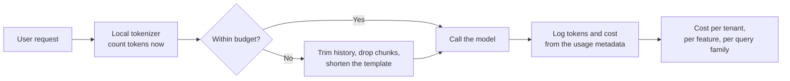
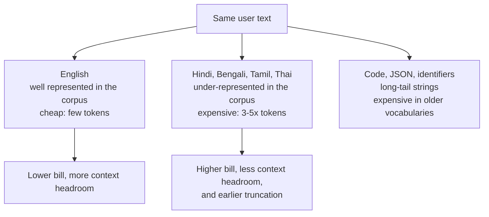
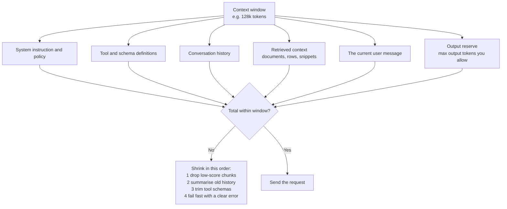
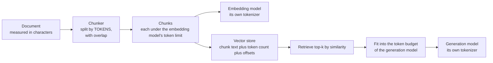

# Chapter 05 — Tokenizers in Practice: `tiktoken` & Model Comparison

> **Lecture 02 · Chapter 05 of 08** · Level: 🟢 Beginner · Phase 1 — Foundations: How LLMs Actually Work
> **Source:** `Forward-Deployed-Engineer/Lecture 02/notes/02_Tokenization_Subwords_and_Numerical_Representations.md`
> (§2.8 API engineering note) · `gen-ai-cohort/week01/learning/day01/notes/notes.md` (tiktoken example ·
> tokenizer model comparisons · the multilingual token tax · `.env` key hygiene)
> **Roadmap topics:** **tokenizer comparison across models**; `tiktoken` for local token counting;
> token-count-driven cost and context accounting.

---

## 05.0 What this chapter is for

Chapters 02–04 explained how tokens work. This chapter makes it **operational**: which tokenizer is which,
how to count tokens yourself, and how to turn token counts into the two numbers your product is judged on —
**cost** and **context headroom**.

By the end of this chapter you should be able to:

1. Name the main tokenizer families in production use and their approximate vocabulary sizes.
2. Explain why the same sentence has different token counts on different providers.
3. Count tokens locally with `tiktoken` (**pseudo-code** here) and explain when that count is approximate.
4. Compute a request's cost from input and output token counts, and say which side dominates.
5. Build a **token budget** for a request: system prompt + history + retrieved context + output reserve.
6. Explain why chunk sizes in a retrieval pipeline must be measured in **tokens**, not characters.
7. State the five habits that keep token accounting honest.

> **Not in this chapter:** provider SDK mechanics, retries and rate limits — that is **Lecture 04**
> (LLM APIs and Multi-SDK).

---

## 05.1 Why you must count tokens yourself

Providers report token usage in the response metadata — *after* you have already paid. Local counting lets
you act **before** the request:

| When you count | What you can do |
| :--- | :--- |
| Before the request | Reject or shorten an over-budget prompt; choose a cheaper model; drop low-value retrieved chunks |
| Before a batch job | Estimate the whole run's cost and get it approved |
| Before shipping | Prove the per-request cost against the business case |
| In your logs | Attribute cost per tenant, per feature and per query family |



> [!IMPORTANT]
> **The FDE framing.** Token counting is the LLM equivalent of a database query plan. Both let you estimate
> the price of an operation *before* you run it, and both are the difference between a demo and a service.

---

## 05.2 The tokenizer families in the wild

| Tokenizer | Used by | Vocabulary size | Characteristics |
| :--- | :--- | ---: | :--- |
| **`gpt2`** | GPT-2 | ~50,257 | Early byte-level BPE. Basic split rules; expensive for code and non-English text |
| **`cl100k_base`** | GPT-3.5-turbo, GPT-4 | ~100,000 | Larger vocabulary; much better for source code, whitespace and special characters |
| **`o200k_base`** | GPT-4o, GPT-4o-mini | ~200,000 | Very large vocabulary; significantly reduces the multilingual token tax and handles digits and dates better |
| **Llama tokenizers** | Llama 2 / 3 / 4 family | ~32k (Llama 2) → ~128k (Llama 3) | SentencePiece-based for Llama 2; byte-level BPE for Llama 3+ |
| **Gemini tokenizers** | Gemini models | not public | Optimised for very long context and multimodal input; count via the provider's API |
| **Claude tokenizers** | Claude models | not public | Count via the provider's token-counting endpoint or SDK helper |
| **Mistral / open-weights** | Mistral, Mixtral, many local models | 32k–130k | SentencePiece/byte-level BPE variants; local counting is possible from the model files |

Three consequences of this table:

1. **Token counts are not portable.** A prompt costing 1,000 tokens on one model can cost 1,300 on another.
2. **Local counting is only exact for models whose tokenizer you have.** For closed tokenizers you must use
   the provider's counting endpoint, or accept an approximation.
3. **Vocabulary size is a quality-of-life feature.** Bigger vocabularies make the same text cheaper and
   leave more of the context window for content.

> [!TIP]
> **How to choose a counting strategy**
> | Situation | Strategy |
> | :--- | :--- |
> | OpenAI models | Local `tiktoken` — exact for the matching encoding |
> | Anthropic / Google models | Provider counting endpoint, or a provider SDK helper |
> | Open-weights models | The model's own tokenizer files (e.g. Hugging Face `tokenizers`) |
> | Cross-provider comparison | Count each with its own tokenizer; never reuse one number for all |

---

## 05.3 The multilingual token tax, quantified

Tokenizers are trained on corpora that are English-heavy, so text outside that distribution fragments into
more pieces. The lecture's example of the same word across three generations of OpenAI tokenizers:

```text
"Automatically"
├── GPT-4      (cl100k)  -> ["Automatically"]         1 token
├── Llama-3              -> ["Auto", "matically"]     2 tokens
└── GPT-2      (gpt2)    -> ["Auto", "mat", "ically"] 3 tokens
```

| Text (same meaning) | `gpt2` (50k vocab) | `o200k_base` (200k vocab) | Ratio |
| :--- | ---: | ---: | ---: |
| A short English sentence | ~14 tokens | ~11 tokens | 1.27× |
| The same sentence in Hindi | ~40 tokens | ~14 tokens | 2.9× |
| The same sentence in Bengali | ~45 tokens | ~15 tokens | 3.0× |
| A line of TypeScript | ~18 tokens | ~13 tokens | 1.38× |



Two lessons:

- **The tax hits cost and capability at once.** More tokens means more money *and* less room for retrieved
  context, examples or history — for the users whose language is least represented.
- **It is measurable, so measure it.** A per-language token report over your real traffic takes an afternoon
  and typically finds a cost surprise nobody predicted.

---

## 05.4 Counting tokens locally with `tiktoken` (pseudo-code)

`tiktoken` is OpenAI's tokenizer library: it downloads/loads a BPE encoding and gives you fast
`encode`/`decode` for the matching model families. The lecture's example, restated as **pseudo-code**:

```ts
// PSEUDO-CODE — local token counting with a tiktoken-style library.
// Read this as the shape of the API, not as a runnable file.

import { getEncoding } from "tiktoken";   // package name and API are real; this file is illustrative

const encoding = getEncoding("cl100k_base");     // pick the encoding that matches your model

const text = "Hello, I am Aminul";
const ids  = encoding.encode(text);              // text -> token ids
const back = encoding.decode(ids);               // ids  -> text (round trip)

console.log(ids);                                 // e.g. [13225, 11, 314, 716, 19087]
console.log(ids.length);                          // token count = 5  -> use THIS for cost
console.log(back);                                // "Hello, I am Aminul"
```

What to do with it in a real service:

```ts
// PSEUDO-CODE — a counting helper that a request handler can call before it spends money.

type ModelSpec = {
  id: string;
  encoding: "gpt2" | "cl100k_base" | "o200k_base" | "provider-endpoint";
  contextWindow: number;
  maxOutputTokens: number;
  pricePerMillionInput: number;
  pricePerMillionOutput: number;
};

function countTokens(text: string, model: ModelSpec): number {
  if (model.encoding === "provider-endpoint") {
    return providerTokenCount(text, model.id);     // closed tokenizers: ask the provider
  }
  return getEncoding(model.encoding).encode(text).length;
}

function estimateCost(inputTokens: number, expectedOutputTokens: number, model: ModelSpec) {
  return (inputTokens  / 1_000_000) * model.pricePerMillionInput
       + (expectedOutputTokens / 1_000_000) * model.pricePerMillionOutput;
}
```

> [!WARNING]
> **`tiktoken` counts are only exact for OpenAI models with a matching encoding.** Using a `cl100k_base`
> count to estimate a Gemini or Claude bill is an approximation — sometimes off by 20–30% on non-English or
> code-heavy prompts. Label such numbers as estimates in your logs, or you will argue with finance later.

---

## 05.5 One prompt, several providers, worked

Take a realistic support-agent prompt (a system instruction plus a customer message plus three retrieved
policy paragraphs) and count it per family:

| Component | `gpt2` | `cl100k_base` | `o200k_base` |
| :--- | ---: | ---: | ---: |
| System instruction (120 words) | 168 | 141 | 133 |
| Customer message (40 words, mixed English/Hindi) | 96 | 62 | 44 |
| 3 retrieved policy paragraphs (~600 words) | 820 | 690 | 650 |
| Chat template and special tokens | 6 | 12 | 12 |
| **Input total** | **1,090** | **905** | **839** |
| Expected answer (150 words) | 205 | 173 | 163 |

The same conversation, the same user, three different bills. Add a per-million-token price and the
differences become money:

| Model | Input tokens | Input cost (per 1M) | Output tokens | Output cost (per 1M) | Cost per request |
| :--- | ---: | ---: | ---: | ---: | ---: |
| Model A (small vocab) | 1,090 | $0.50 | 205 | $1.50 | $0.00085 |
| Model B (mid vocab) | 905 | $0.15 | 173 | $0.60 | $0.00024 |
| Model C (large vocab, cheap) | 839 | $0.05 | 163 | $0.20 | $0.00007 |

> [!NOTE]
> **Read the table as a shape, not as real prices.** The point is that a ~25% token difference can combine
> with a 10× price difference to produce a ~12× cost difference — and that **output tokens cost more per
> token than input tokens on almost every provider**, which is why answer-length control is a cost lever,
> not just a UX preference.

---

## 05.6 The token budget: where the context window actually goes

A context window is not "the size of my prompt". It is the size of **everything the model sees at once**,
including the tokens it is about to generate.



A budget as data, in **pseudo-code**:

```ts
// PSEUDO-CODE — reserve the output first, then spend what is left on context.
function buildPrompt(request, model: ModelSpec) {
  const outputReserve = Math.min(model.maxOutputTokens, request.desiredAnswerTokens);
  let remaining = model.contextWindow - outputReserve;

  const parts = [
    { name: "system",  tokens: countTokens(SYSTEM_PROMPT, model) },
    { name: "tools",   tokens: countTokens(TOOL_SCHEMAS, model) },
    { name: "history", tokens: countTokens(compactHistory(request.history), model) },
    { name: "context", tokens: countTokens(request.retrievedChunks, model) },
    { name: "user",    tokens: countTokens(request.message, model) },
  ];

  // Drop the least valuable pieces first - never the user's own message.
  for (const part of parts.filter(p => p.name !== "user").sort(byValueAscending)) {
    if (total(parts) <= remaining) break;
    part.tokens = shrink(part, remaining);          // summarise, truncate or drop
  }

  if (total(parts) > remaining) throw new Error("prompt exceeds the model window");
  return assemble(parts);
}
```

> [!TIP]
> **Reserve the output first.** The single most common cause of "the answer was cut off mid-sentence" is a
> prompt that consumed the window with no room left for the response. Decide `max_output_tokens` before you
> decide how many documents to retrieve.

---

## 05.7 Tokenization inside a retrieval pipeline

This is the place where token thinking pays off most visibly, because it is where "characters" quietly
become "money".

| Place where tokens matter | What goes wrong if you count characters instead |
| :--- | :--- |
| **Chunk size** for embedding and indexing | A 1,000-character chunk is ~250 tokens in English but can be ~450 in Bengali or ~500 for code |
| **Embedding model input limit** | Embedding models truncate at *their* token limit — silently dropping the end of a chunk |
| **Retrieved context** | Ten "small" chunks can consume most of the window before the user's question is even considered |
| **Re-ranking / reranking budgets** | Cost and latency are per token pair, not per character |
| **Citation spans** | Offsets are character-based; token spans are needed for highlighting |



> [!WARNING]
> **Two tokenizers, one pipeline.** Your embedding model and your generation model almost certainly have
> *different* tokenizers. A chunk that fits comfortably in the embedding model's limit may be expensive or
> over-long for the generator. Measure both, and store the counts you measured.

---

## 05.8 Five habits that keep token accounting honest

1. **Count per model, never once globally.** Store `{model, tokenizerVersion, tokenCount}` together.
2. **Measure before you send.** A pre-flight count turns a surprise bill into a routing decision.
3. **Log the provider's `usage` numbers** and reconcile them against your estimates — the gap is your
   estimation error, and it is worth knowing.
4. **Test in the languages you actually serve.** English-only benchmarks hide the token tax completely.
5. **Treat the tokenizer as part of the model version.** Pin it, log it, and re-run cost and truncation
   tests whenever it changes.

---

## 05.9 A minimal token-accounting module (pseudo-code)

```ts
// PSEUDO-CODE — the shape of the module you will write in code/ later in this lecture.

type TokenReport = {
  model: string;
  tokenizerVersion: string;
  inputTokens: number;
  outputTokens: number;
  estimatedCostUsd: number;
  exact: boolean;          // false when a proxy tokenizer was used
};

interface TokenAccounting {
  count(text: string, model: ModelSpec): { tokens: number; exact: boolean };
  budget(model: ModelSpec, outputReserve: number): number;      // tokens available for the prompt
  fit(parts: PromptPart[], model: ModelSpec, reserve: number): PromptPart[];  // shrink to fit
  cost(report: { inputTokens: number; outputTokens: number }, model: ModelSpec): number;
  reconcile(report: TokenReport, providerUsage: { input: number; output: number }): void;
}
```

Every function there answers a question a product manager, a finance team or an on-call engineer will ask
you — which is the whole reason token counting belongs in the codebase, not in a spreadsheet.

---

## Common mistakes

- **Using one token count for every provider.** Token counts are not portable; count with the model's own
  tokenizer.
- **Trusting the "4 characters per token" rule for budgeting.** It is an English-prose estimate; code and
  non-Latin scripts blow past it.
- **Estimating cost from word counts.** Word counts correlate with tokens loosely and break exactly where
  budgets matter.
- **Forgetting output tokens in the budget.** They are part of the same context window and usually the more
  expensive half.
- **Counting characters when chunking a retrieval corpus.** Chunks must respect the *embedding model's* token
  limit.
- **Assuming `tiktoken` is exact for non-OpenAI models.** It is a proxy; label it as an estimate.
- **Ignoring special tokens and chat templates.** They are real tokens that appear on the bill.
- **Never reconciling your estimate with the provider's `usage`.** Your estimation error becomes invisible.

## Key takeaways

1. Tokenizer families differ in vocabulary size (`gpt2` ~50k, `cl100k_base` ~100k, `o200k_base` ~200k) and in
   how well they handle code and non-Latin scripts.
2. **The same text costs different numbers of tokens on different models** — sometimes 20–40% different.
3. `tiktoken` gives fast, local, exact counts for matching OpenAI encodings; other providers need their own
   counting endpoints or tokenizer files.
4. Cost is $\text{input tokens} \times \text{input price} + \text{output tokens} \times \text{output price}$ —
   and **output tokens dominate** on almost every provider.
5. A context window is a **budget**: system + tools + history + retrieved context + user message + **output
   reserve**.
6. In retrieval pipelines, measure in tokens for the **embedding model** and again for the **generation
   model**; they are different tokenizers.
7. Five habits: count per model, measure before sending, log provider usage, test your real languages, pin
   the tokenizer version with the model version.

## Self-check questions

1. Why can two models bill the same prompt differently even at identical per-token prices?
2. Give the three OpenAI encoding names and their approximate vocabulary sizes.
3. When is a local `tiktoken` count exact, and when is it only an estimate? What should you do in the
   estimate case?
4. Write the cost formula for one request and identify which term usually dominates.
5. Name the six things that share one context window, and give the order in which you would shrink them.
6. A 900-character chunk from a Bengali document — how many tokens roughly, and why is that number important
   twice over?

---

### Navigation

- **Previous:** [Chapter 04 — BPE, WordPiece, SentencePiece & the Vocabulary](./04_BPE_WordPiece_SentencePiece_and_Vocabulary.md)
- **Next:** [Chapter 06 — Embeddings: Dense Vectors & Similarity](./06_Embeddings_Dense_Vectors_and_Similarity.md)
- **Source:** `Forward-Deployed-Engineer/Lecture 02/notes/02_Tokenization_Subwords_and_Numerical_Representations.md`;
  `gen-ai-cohort/week01/learning/day01/notes/notes.md`
- **Back to index:** [../index.md](../index.md)
