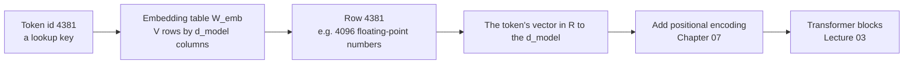
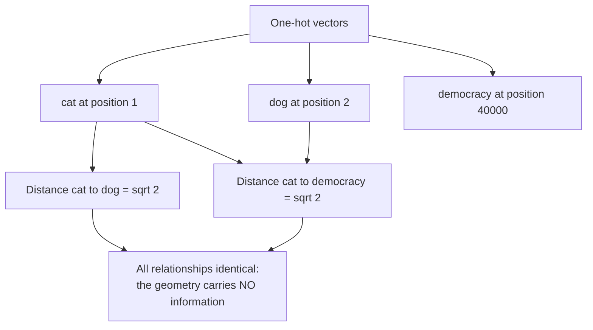
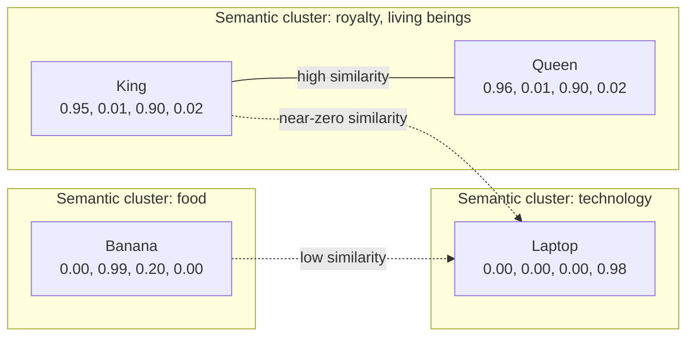
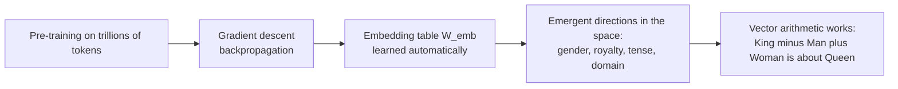
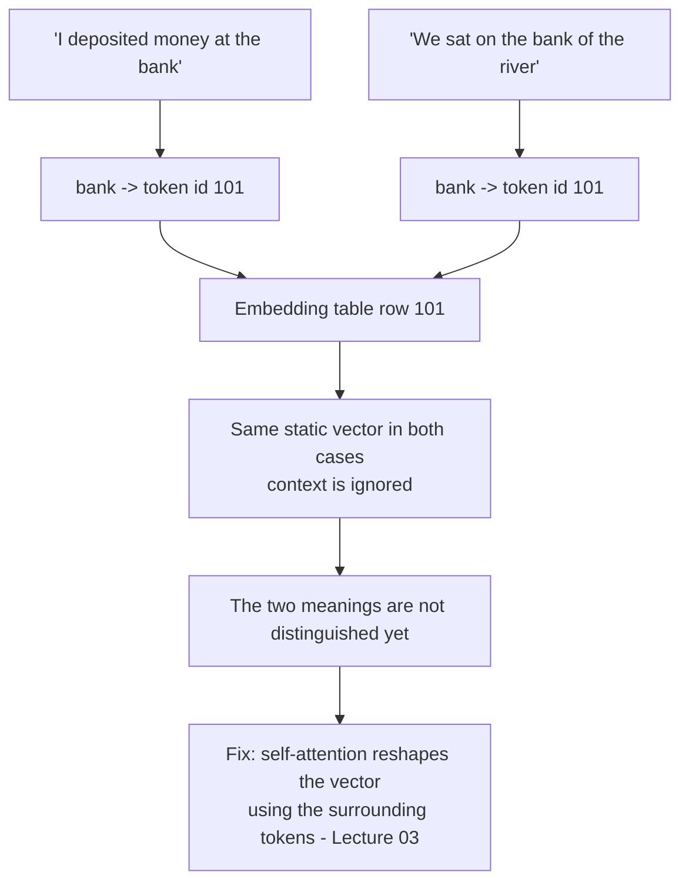
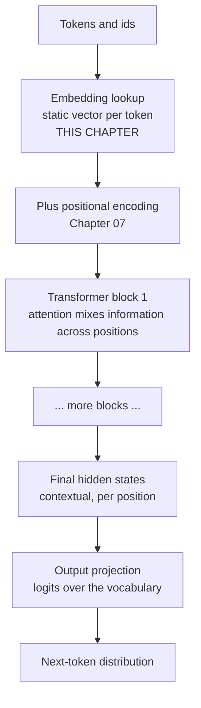
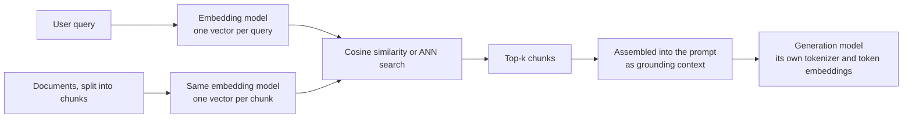

# Chapter 06 — Embeddings: Dense Vectors & Similarity

> **Lecture 02 · Chapter 06 of 08** · Level: 🟢 Beginner · Phase 1 — Foundations: How LLMs Actually Work
> **Source:** `Forward-Deployed-Engineer/Lecture 02/notes/03_Positional_Encodings_and_Vector_Embeddings.md`
> (§3.3–3.5) · `gen-ai-cohort/week01/learning/day01/notes/notes.md` (Step 2 — Embeddings · vector space
> intuition)
> **Roadmap topics:** numerical representation — token IDs → dense vectors $\mathbb{R}^{d_{\text{model}}}$;
> embedding vectors; **similarity between token vectors**; embeddings are learned, not hand-crafted.

---

## 06.0 What this chapter is for

Chapter 02 ended with a promise: *the ID is an address; the meaning is in the vector.* This chapter opens the
box. It is the chapter where tokens stop being symbols and become **geometry** — points in a
high-dimensional space where distance means relatedness.

By the end of this chapter you should be able to:

1. Explain the **embedding lookup** as a table read, and give the shape of $W_{\text{emb}}$.
2. Explain why **one-hot vectors** fail: dimensionality, no geometry, no generalisation.
3. Define **cosine similarity** and the dot product, and say what each measures.
4. Reproduce the conceptual feature-dimension illustration and explain why it is only an *illustration*.
5. Explain **word arithmetic** ($\text{King} - \text{Man} + \text{Woman} \approx \text{Queen}$) and its limits.
6. Distinguish **static token embeddings** from **contextual hidden states**, and say why the distinction
   matters for the polysemy problem.
7. Distinguish **token embeddings** (one per position, inside a model) from **retrieval embeddings** (one per
   document, used by search) — the distinction that the RAG lectures depend on.

---

## 06.1 From ID to vector: the embedding lookup

An embedding is a **dense, learned vector** — a fixed-length list of floating-point numbers — that represents
a token's meaning as a position in space.

The mechanism is embarrassingly simple: it is a **table read**.

$$W_{\text{emb}} \in \mathbb{R}^{|V| \times d_{\text{model}}}, \qquad \mathbf{E}_{t} = W_{\text{emb}}[\,\text{id}(t)\,]$$

| Symbol | Meaning | Typical value |
| :--- | :--- | :--- |
| $|V|$ | vocabulary size — number of rows | 32k – 200k |
| $d_{\text{model}}$ | embedding width — number of columns | 512 – 4096 (small models), 4096 – 8192+ (large) |
| $\mathbf{E}_t$ | the vector for one token | a row of the table |



In **pseudo-code**, the lookup is a single index operation:

```ts
// PSEUDO-CODE — embedding lookup is a table read, not a computation.
const d_model = 4096;
const embeddingTable: number[][] = /* learned: |V| rows x d_model columns */;

function embed(id: TokenId): Vector {
  return embeddingTable[id];        // row = id. No arithmetic on the id itself.
}
```

> [!IMPORTANT]
> **Where the "learning" happens.** This table is *not* written by anyone. It is initialised randomly and
> then updated by gradient descent during pre-training, exactly like every other weight in the network. The
> table is large — for a 100k vocabulary and $d_{\text{model}} = 4096$ it holds ~410M parameters — and it is
> one of the biggest single matrices in a model.

---

## 06.2 Why one-hot vectors fail

The naive encoding is a **one-hot vector** of length $|V|$: all zeros except a single 1 at the token's index.

```text
cat = [1, 0, 0, 0, 0, ...]     (50,000 dimensions)
dog = [0, 1, 0, 0, 0, ...]
```

Three fatal problems:

| Problem | Explanation | Consequence |
| :--- | :--- | :--- |
| **Enormous dimensionality** | 50,000+ numbers per token, all but one zero | Wasteful memory and compute; sparse gradients |
| **No geometry** | Every pair of distinct one-hot vectors is at the same distance: $\lVert u - v \rVert_2 = \sqrt{2}$ | `cat` is exactly as far from `dog` as from `democracy` |
| **No generalisation** | Nothing about row 1 informs row 2 | Learning that cats purr teaches the model nothing about dogs |



> [!NOTE]
> **The mathematical statement of the failure.** In one-hot space, cosine similarity between any two
> *different* tokens is exactly 0 and the Euclidean distance is always $\sqrt{2}$. A representation in which
> everything is equally unrelated to everything else cannot express relatedness — and relatedness is exactly
> what language modelling needs.

---

## 06.3 Dense embeddings: geometry carries meaning

Dense embeddings keep the dimensionality manageable (512–8192 instead of 50,000) and — crucially — make
**direction and distance meaningful**.

The lecture's conceptual illustration imagines a world where dimensions had human-readable labels:

| Word | Royalty | Food | Living being | Technology | Simplified vector |
| :--- | ---: | ---: | ---: | ---: | :--- |
| **King** | 0.95 | 0.01 | 0.90 | 0.02 | `[0.95, 0.01, 0.90, 0.02]` |
| **Queen** | 0.96 | 0.01 | 0.90 | 0.02 | `[0.96, 0.01, 0.90, 0.02]` |
| **Banana** | 0.00 | 0.99 | 0.20 | 0.00 | `[0.00, 0.99, 0.20, 0.00]` |
| **Laptop** | 0.00 | 0.00 | 0.00 | 0.98 | `[0.00, 0.00, 0.00, 0.98]` |

Read the geometry off that table:

- **King ↔ Queen**: nearly identical vectors → high similarity → semantically close.
- **King ↔ Laptop**: almost orthogonal → near-zero similarity → unrelated.
- **Banana ↔ King**: share the "living being" component (a fruit is alive-ish) → low but non-zero similarity.



> [!WARNING]
> **That table is a teaching device, not a description of a real model.** Real models do not have dimensions
> labelled "Royalty" or "Food". What is true — and remarkable — is that *some* structure of this kind emerges
> in the learned geometry, and that it is measurable through similarity, not readable through labels.

The lecture's other intuition pump is **clustering**:

```text
Cluster A: Paris, France, London, Berlin, Tokyo      (places and geography)
Cluster B: Apple, Banana, Orange, Mango              (fruit)
Cluster C: happy, joyful, delighted, pleased          (positive sentiment)
```

Nobody told the model that `Paris` and `Berlin` belong together. The clustering is a **by-product** of
learning to predict tokens: words that appear in similar contexts must end up with similar vectors, because
that is the cheapest way to predict them.

---

## 06.4 Similarity mathematics

Three measures, and you should know which one is used where.

| Measure | Formula | Range | Used for |
| :--- | :--- | :--- | :--- |
| **Dot product** | $\mathbf{a} \cdot \mathbf{b} = \sum_i a_i b_i$ | unbounded | Attention scores (Lecture 03); fast similarity when vectors are normalised |
| **Cosine similarity** | $\cos(\mathbf{a}, \mathbf{b}) = \dfrac{\mathbf{a} \cdot \mathbf{b}}{\lVert \mathbf{a} \rVert \lVert \mathbf{b} \rVert}$ | $[-1, 1]$ | Semantic similarity, retrieval, deduplication |
| **Euclidean distance** | $\lVert \mathbf{a} - \mathbf{b} \rVert_2 = \sqrt{\sum_i (a_i - b_i)^2}$ | $[0, \infty)$ | Clustering, nearest-neighbour in some indexes |

Two facts that save a lot of confusion later:

- **If vectors are normalised to unit length, cosine similarity *is* the dot product.** That is why vector
  databases store normalised vectors and use dot product for speed.
- **Cosine ignores magnitude and keeps direction.** Magnitude in an embedding usually encodes frequency or
  "intensity" rather than meaning, so ignoring it is usually what you want.

```ts
// PSEUDO-CODE — the three similarity measures, written out so the difference is visible.

function dot(a: Vector, b: Vector): number {
  return a.reduce((sum, ai, i) => sum + ai * b[i], 0);
}

function magnitude(v: Vector): number {
  return Math.sqrt(dot(v, v));
}

function cosine(a: Vector, b: Vector): number {
  return dot(a, b) / (magnitude(a) * magnitude(b));   // 1 = same direction, 0 = unrelated, -1 = opposite
}

function euclidean(a: Vector, b: Vector): number {
  return Math.sqrt(a.reduce((sum, ai, i) => sum + (ai - b[i]) ** 2, 0));
}
```

A tiny worked example on 2-dimensional stand-in vectors:

| Pair | Vectors | Dot | Cosine | Interpretation |
| :--- | :--- | ---: | ---: | :--- |
| King, Queen | `[0.95, 0.90]`, `[0.96, 0.90]` | 1.722 | 0.9999 | Almost the same direction → near-synonymous in this space |
| King, Laptop | `[0.95, 0.90]`, `[0.00, 0.98]` | 0.882 | 0.68 | Partially related — misleading in 2D; in high dimensions this collapses towards 0 |
| King, Banana | `[0.95, 0.90]`, `[0.00, 0.99]` | 0.891 | 0.69 | Same caveat |

> [!TIP]
> **Why the 2-D example misleads.** In 2 dimensions, unrelated vectors have a 50% chance of pointing in a
> roughly similar direction. In 4096 dimensions, two random vectors are almost exactly orthogonal (cosine
> $\approx 0$) with overwhelming probability. **High dimensionality is what makes "unrelated" mean
> "orthogonal"** — and it is why the geometry works at all.

---

## 06.5 Word arithmetic and analogies

The famous property of dense embeddings, from the Word2Vec era:

$$\text{vector}(\text{King}) - \text{vector}(\text{Man}) + \text{vector}(\text{Woman}) \approx \text{vector}(\text{Queen})$$

This is **geometry, not lookup**. The space has learned *directions* that correspond to concepts nobody
labelled:

| Analogy | Vector operation | The direction it exposes |
| :--- | :--- | :--- |
| King : Queen :: Man : Woman | $\mathbf{v}_{\text{King}} - \mathbf{v}_{\text{Man}} + \mathbf{v}_{\text{Woman}}$ | Gender |
| Paris : France :: Tokyo : Japan | $\mathbf{v}_{\text{Paris}} - \mathbf{v}_{\text{France}} + \mathbf{v}_{\text{Japan}}$ | Capital-of |
| Walking : Walked :: Swimming : Swam | $\mathbf{v}_{\text{walked}} - \mathbf{v}_{\text{walk}} + \mathbf{v}_{\text{swim}}$ | Past tense |



Four caveats that keep you honest:

1. **Analogy accuracy is far from 100%.** Published figures for word-analogy benchmarks are in the 60–80%
   range depending on the dataset and the space.
2. **It is not a reasoning engine.** Vector arithmetic finds the nearest neighbour to a computed point; it
   does not know *why* the relationship holds.
3. **The result is a token, not a fact.** The nearest neighbour of the arithmetic can be a rare or
   semantically wrong token — the geometry has no notion of correctness.
4. **In modern LLMs, the static table is only the *input*.** The vector the model actually reasons with has
   been reshaped by attention (see §06.7).

> [!NOTE]
> **Why it is still worth knowing.** Word arithmetic is the clearest demonstration that **meaning is
> geometric** in these models. Every later technique in this curriculum that relies on similarity — semantic
> search, RAG retrieval, deduplication, clustering, evaluation by embedding distance — is the same idea
> applied to different units of text.

---

## 06.6 Embeddings are learned, not hand-crafted

No human writes the numbers in $W_{\text{emb}}$. The table is initialised randomly and updated by
backpropagation. Consequences:

| Consequence | What it means for you |
| :--- | :--- |
| **The axes are not human-readable** | You cannot ask "what is dimension 3?" and get a meaningful answer |
| **The geometry reflects the corpus** | Biases and gaps in the training data appear as distortions in the space |
| **Similarity is model-specific** | A vector from model A cannot be compared with a vector from model B — ever |
| **The space is frozen per model version** | Re-embedding is required after any model change (a real cost in RAG systems) |
| **Domain shift matters** | Medical text embedded by a general model puts medical terms in odd places; a domain-tuned embedding model helps |

> [!IMPORTANT]
> **The single most expensive mistake in this area:** mixing embeddings from two different models in one
> vector index. The dimensions may match numerically, but the *spaces* are unrelated, so every similarity
> score becomes noise. Store the embedding model ID and version alongside every vector.

---

## 06.7 Static embeddings vs contextual hidden states

This is the bridge from this chapter to attention, and it resolves the **polysemy problem** the source notes
raise.

Consider the word `bank`:

- `"I deposited money at the bank."` → a financial institution
- `"We sat on the bank of the river."` → a riverside edge

The token ID is the same, so the **static embedding lookup returns the same vector** in both sentences.



| Stage | What it gives you | Context-aware? | Where |
| :--- | :--- | :--- | :--- |
| **Static token embedding** | One fixed vector per token ID | ❌ No | §06.1–06.6 |
| **Contextual hidden state** | A vector per *occurrence*, reshaped by attention over the whole context | ✅ Yes | Lecture 03 |
| **Pooled sentence/document embedding** | One vector for a whole passage | ✅ Yes (for the passage) | §06.10 |

Three layers of "meaning", each used for a different job:

1. **Static token embeddings** are the model's *input alphabet*.
2. **Contextual hidden states** are what the model actually *reasons with* — and they are why `bank` can be
   disambiguated at all.
3. **Pooled document embeddings** are what *you* use for search and retrieval.

> [!TIP]
> **Why the model does not need a separate `bank_finance` token.** Creating one entry per word sense would
> explode the vocabulary (hundreds of senses per ambiguous word) and would still fail for novel
> disambiguations. Attention solves the problem **dynamically**, at inference, for every occurrence.

---

## 06.8 What the embedding dimension buys and costs

| $d_{\text{model}}$ | Parameters in $W_{\text{emb}}$ (100k vocab) | Effect |
| ---: | ---: | :--- |
| 384 | ~38M | Small embedding models; fast, cheap, lower recall |
| 768 | ~77M | Classic BERT-base scale |
| 1536 | ~154M | Common API embedding dimension |
| 4096 | ~410M | Large generation models |
| 8192+ | ~820M+ | Frontier models; more capacity, more memory and compute |

The trade-off in one line: **more dimensions = more expressive geometry, but more parameters, more memory
per vector, slower similarity search and higher storage cost.**

Practical notes:

- **Retrieval indexes pay for dimensions twice:** once in storage (bytes per vector × number of vectors) and
  once in search time. A 1M-document index at 1536 dimensions in 4-byte floats is ~6 GB of raw vectors.
- **Dimensionality reduction is legitimate.** Techniques such as Matryoshka embeddings (train the vector so
  that its first $k$ dimensions are themselves a usable embedding) or post-hoc PCA/quantisation let you trade
  a little recall for a lot of speed and space.
- **Bigger is not automatically better for retrieval.** A well-trained 768-dimension embedding model can beat
  a poorly-trained 3072-dimension one on your data. Measure recall on *your* corpus.

---

## 06.9 Where token embeddings sit in the whole model

It is worth being precise about scope, because it prevents a very common over-claim.



| Claim | True? |
| :--- | :--- |
| "The embedding vector is the token's meaning" | ⚠️ Only the *initial* meaning — context has not been applied yet |
| "Similar tokens have similar embeddings" | ✅ Yes — that is the point of the geometry |
| "The model's final answer is a function of the embeddings alone" | ❌ No — attention and the MLP layers reshape everything |
| "Embeddings contain facts" | ⚠️ Weakly — associations, not retrievable records |

> [!IMPORTANT]
> **The residual-stream intuition.** You can think of the pipeline as a *stream* that starts as the embedding
> vector and is progressively edited by each block — each block adding contextual information to the same
> vector rather than replacing it. That is why the embedding table is best understood as the **starting point
> of the stream**, not the finished representation. Lecture 03 and Lecture 07 develop this.

---

## 06.10 Retrieval embeddings are a different object

This distinction is small in this lecture and enormous in the RAG lectures, so state it now:

| | **Token embeddings** (inside a model) | **Retrieval embeddings** (for search) |
| :--- | :--- | :--- |
| One vector per | token position | document, chunk, sentence or query |
| Produced by | the generation model's embedding table | a dedicated embedding model (encoder) |
| Dimension | $d_{\text{model}}$ (e.g. 4096) | typically 384–3072 |
| Pooling | none needed | mean/cls pooling over the passage's tokens |
| Used for | the model's internal computation | similarity search, clustering, dedup, ranking |
| Stored in | model weights | a vector database, with metadata |



Three rules that follow, and that the retrieval lectures will build on:

1. **Same model for queries and documents.** Never embed the query with model A and the corpus with model B.
2. **Normalise, then use cosine or dot product consistently.** Mixing metrics silently changes your ranking.
3. **Re-embed the whole corpus when the embedding model changes.** This is the biggest hidden cost in a RAG
   system, so pin the model version deliberately.

---

## 06.11 An embedding service as an interface (pseudo-code)

```ts
// PSEUDO-CODE — the shape of an embedding module, with the metadata that keeps you out of trouble.

type EmbeddingModelSpec = {
  id: string;                 // e.g. "text-embedding-3-small" - part of the vector's identity
  version: string;            // re-embedding trigger
  dimensions: number;         // storage and search cost
  maxInputTokens: number;     // truncation happens HERE, silently
  normalized: boolean;        // if true, cosine == dot product
};

type Embedded = {
  vector: number[];           // length = dimensions
  tokenCount: number;         // measured with THIS model's tokenizer (Chapter 05)
  modelId: string;            // never mix spaces
};

interface EmbeddingService {
  embedText(text: string, model: EmbeddingModelSpec): Promise<Embedded>;
  embedBatch(texts: string[], model: EmbeddingModelSpec): Promise<Embedded[]>;
  similarity(a: number[], b: number[], metric: "cosine" | "dot" | "euclidean"): number;
}
```

The three fields on `Embedded` — `tokenCount`, `modelId`, `dimensions` — are the difference between a vector
store you can reason about and one that silently rots when a provider ships an update.

---

## Common mistakes

- **Thinking the embedding is computed from the token.** It is a *table lookup*: the ID selects a row.
- **Assuming one-hot is "more precise".** One-hot has no geometry, so it cannot express relatedness at all.
- **Comparing vectors from different models.** Same dimension count does not mean same space. Never mix them.
- **Treating cosine similarity as a probability or a percentage.** It is a cosine; 0.7 is not "70% relevant".
- **Believing word arithmetic is a reasoning engine.** It finds a nearest neighbour; it does not verify facts.
- **Expecting dimensions to be human-readable.** The "Royalty / Food" table is a teaching device.
- **Confusing token embeddings with retrieval embeddings.** One vector per position inside a model versus one
  vector per document in your index.
- **Forgetting that the static vector is only the input.** Context arrives later, via attention.
- **Ignoring the embedding model's token limit.** It truncates silently, so long chunks lose their tail.

## Key takeaways

1. Embedding = **a dense learned vector**, fetched by a table read: $\mathbf{E}_t = W_{\text{emb}}[\text{id}(t)]$,
   with $W_{\text{emb}} \in \mathbb{R}^{|V| \times d_{\text{model}}}$.
2. **One-hot fails**: huge dimensionality, no geometry, no generalisation — every pair is equally unrelated.
3. In dense spaces, **direction and distance encode meaning**; related concepts cluster.
4. **Cosine similarity** measures direction (and equals the dot product for normalised vectors); Euclidean
   distance measures position; dot product is the fast path.
5. **Word arithmetic** ($\text{King} - \text{Man} + \text{Woman} \approx \text{Queen}$) shows meaning is
   geometric — with real accuracy limits and no notion of truth.
6. Embeddings are **learned by backpropagation**, so they are model-specific, corpus-biased and frozen per
   version.
7. **Static token embeddings are not contextual**: `bank` gets one vector regardless of sense. Attention
   (Lecture 03) is what disambiguates — at inference, per occurrence.
8. **Retrieval embeddings** are a different object from token embeddings, and must never be mixed across
   models.

## Self-check questions

1. Write the embedding lookup as a formula and give the shape of $W_{\text{emb}}$ for $|V| = 100{,}000$ and
   $d_{\text{model}} = 4096$.
2. Show that the Euclidean distance between any two distinct one-hot vectors is $\sqrt{2}$, and explain why
   that is a problem.
3. Compute cosine similarity for `[1, 1]` and `[1, -1]`, and interpret the result.
4. Why is the "Royalty / Food" dimension table a teaching device rather than a description of a real model?
5. Give the analogy arithmetic for *capital-of* and say what its limits are.
6. Explain, with the `bank` example, why static embeddings cannot disambiguate meaning and what fixes it.
7. Name three differences between a token embedding and a retrieval embedding.

---

### Navigation

- **Previous:** [Chapter 05 — Tokenizers in Practice: `tiktoken` & Model Comparison](./05_Tokenizers_in_Practice_tiktoken_and_Model_Comparison.md)
- **Next:** [Chapter 07 — Positional Encodings & Word Order](./07_Positional_Encodings_and_Word_Order.md)
- **Source:** `Forward-Deployed-Engineer/Lecture 02/notes/03_Positional_Encodings_and_Vector_Embeddings.md`;
  `gen-ai-cohort/week01/learning/day01/notes/notes.md`
- **Back to index:** [../index.md](../index.md)
