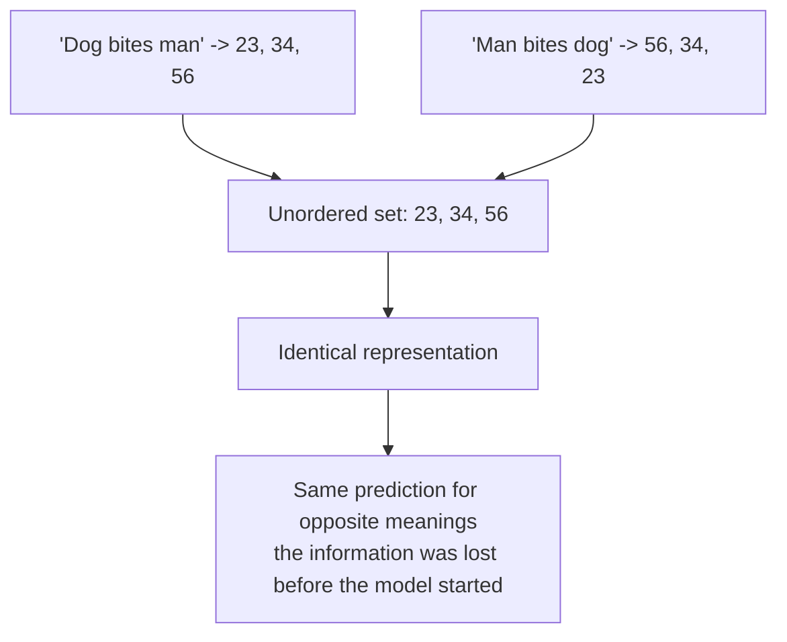
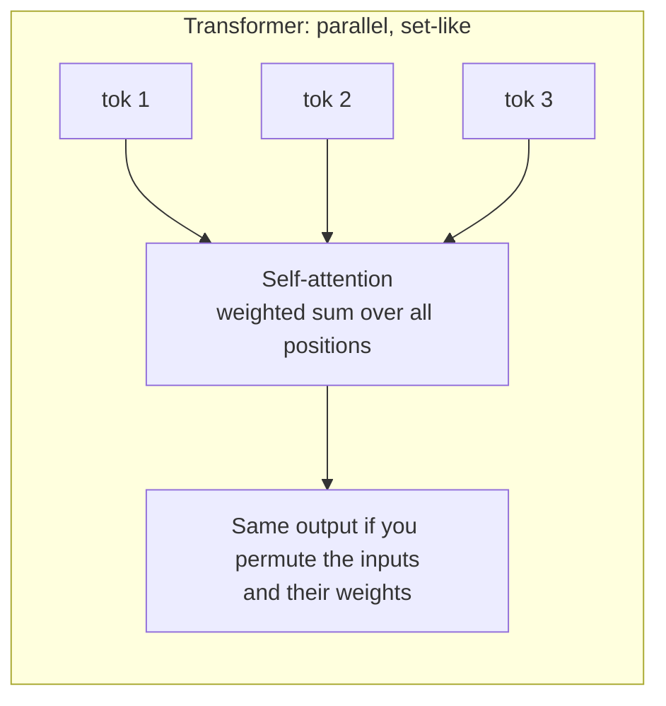
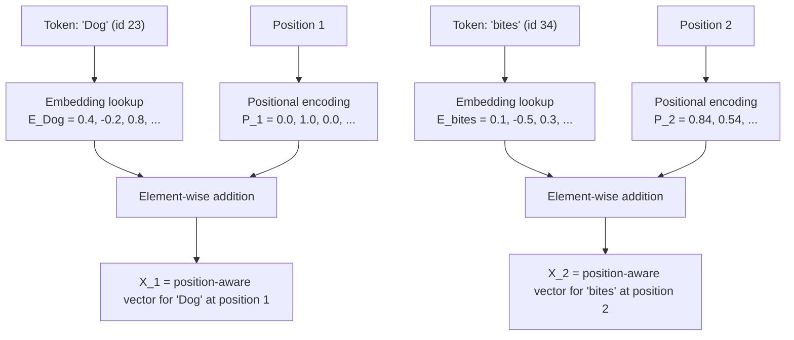
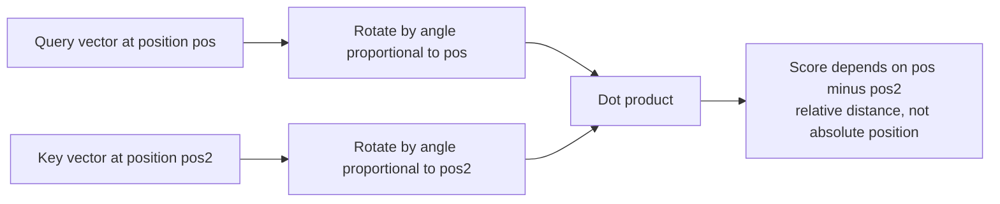
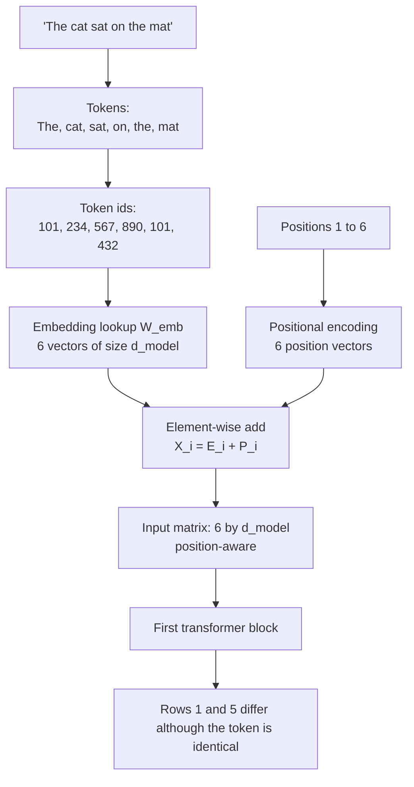
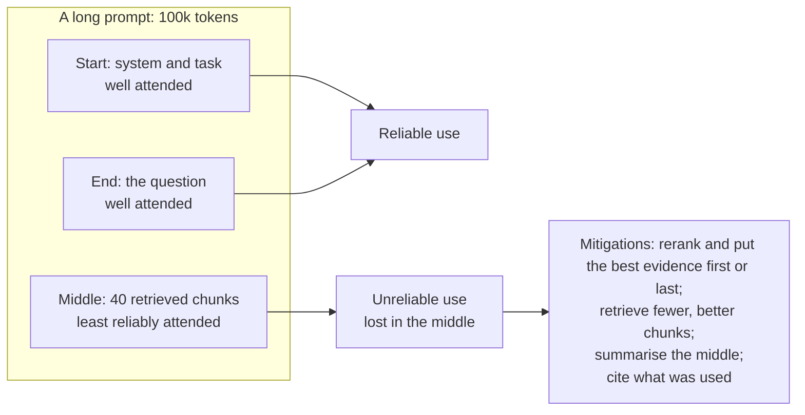

# Chapter 07 — Positional Encodings & Word Order

> **Lecture 02 · Chapter 07 of 08** · Level: 🟢 Beginner · Phase 1 — Foundations: How LLMs Actually Work
> **Source:** `Forward-Deployed-Engineer/Lecture 02/notes/03_Positional_Encodings_and_Vector_Embeddings.md`
> (§3.1–3.2, §3.6) · `gen-ai-cohort/week01/learning/day01/notes/notes.md` (Step 3 — Positional Encoding)
> **Roadmap topics:** positional encodings — **why order must be injected**; the complete
> tokenization → embedding → input pipeline. (The sinusoidal form and the linear-offset property are
> revisited in Lecture 03.)

---

## 07.0 What this chapter is for

Chapter 06 gave every token a vector that encodes *what* it is. Nothing in that vector says **where** it is.
This chapter explains why that is fatal, and how transformers fix it.

By the end of this chapter you should be able to:

1. State the **permutation-invariance problem** and demonstrate it with a sentence pair.
2. Explain why transformers are order-blind by construction (parallel processing, no recurrence).
3. Write and interpret the additive formula $\mathbf{X}_{\text{in}} = \mathbf{E}_{\text{token}} + \mathbf{P}_{\text{pos}}$.
4. Describe four families of positional encoding: **sinusoidal, learned, RoPE, ALiBi** — and say who uses each.
5. Explain the **linear-offset property** of sinusoidal encodings in plain language.
6. Trace `"The cat sat on the mat"` through the input pipeline and show why the two occurrences of `The` get
   different input vectors.
7. Explain why positional encoding is a **training-time decision** and what that implies for long-context
   extension.

---

## 07.1 The permutation problem: order carries meaning

Compare two sentences:

- **A:** `"Dog bites man."` → token IDs `[23, 34, 56]`
- **B:** `"Man bites dog."` → token IDs `[56, 34, 23]`

Same words. Opposite meanings — one is a news story, the other is not news at all. A model that sees only the
**set** `{23, 34, 56}` produces the **same representation** for both, and therefore the same prediction.



More pairs where the only difference is order:

| Sentence A | Sentence B | Same tokens? | Same meaning? |
| :--- | :--- | :---: | :---: |
| "Rohit teaches Aditya" | "Aditya teaches Rohit" | ✅ | ❌ |
| "The cat chased the dog" | "The dog chased the cat" | ✅ | ❌ |
| "I am fine, not sick" | "I am sick, not fine" | ✅ | ❌ |
| "Aminul loves ice cream" | "Ice cream loves Aminul" | ✅ | ❌ |
| "Only the admin can delete" | "The admin can only delete" | ✅ | ❌ |

### Why the transformer is order-blind

This is not an oversight; it is the direct consequence of the architecture's greatest strength.

| Architecture | How it processes text | Order information |
| :--- | :--- | :--- |
| **RNN** | Sequentially, left to right, carrying a hidden state | Implicit — the order *is* the computation |
| **CNN** | Sliding local windows | Local, approximate |
| **Transformer** | **All positions in parallel**, each attending to all others | **None** — attention is a weighted average over a set |

Self-attention computes, for each token, a weighted sum over all tokens. Weighted sums are **symmetric in
their inputs**: if you permute the inputs and the corresponding weights, you get the same output. Nothing in
the operation refers to "the previous token" or "position 3".



> [!IMPORTANT]
> **The one-sentence statement:** *self-attention is permutation-invariant, so order must be injected
> explicitly.* Positional encoding is not an optimisation — it is the mechanism that makes the architecture
> capable of language at all.

---

## 07.2 Injecting order: the additive encoding

The fix is disarmingly simple: **add a position vector to each token's embedding** before the first
transformer block.

$$\mathbf{X}_{\text{in}} = \mathbf{E}_{\text{token}} + \mathbf{P}_{\text{pos}}$$

| Symbol | Meaning | Shape |
| :--- | :--- | :--- |
| $\mathbf{E}_{\text{token}}$ | the token's static embedding (Chapter 06) | $\mathbb{R}^{d_{\text{model}}}$ |
| $\mathbf{P}_{\text{pos}}$ | the positional signal for position $i$ | $\mathbb{R}^{d_{\text{model}}}$ |
| $\mathbf{X}_{\text{in}}$ | the position-aware input to the first block | $\mathbb{R}^{d_{\text{model}}}$ |



The critical consequence: **the same token at different positions now receives different input vectors.**
`Dog` at position 1 and `Dog` at position 3 have the *same* embedding but *different* positional encodings,
so the model can tell them apart.

> [!NOTE]
> **Why addition and not concatenation?** Concatenation would grow the vector dimension with every extra
> position, and the model would have to learn to separate the two halves. Addition keeps a fixed
> $d_{\text{model}}$ and lets the network learn to disentangle the two signals — it works because the
> positional pattern is a consistent, structured offset in the same space.

---

## 07.3 Sinusoidal positional encodings

The original 2017 transformer used **fixed** mathematical functions — no learned parameters at all:

$$PE_{(pos,\,2i)} = \sin\!\left(\frac{pos}{10000^{\,2i/d_{\text{model}}}}\right), \qquad
PE_{(pos,\,2i+1)} = \cos\!\left(\frac{pos}{10000^{\,2i/d_{\text{model}}}}\right)$$

Read the formula in three pieces:

| Piece | What it does |
| :--- | :--- |
| $pos$ | the position index (0, 1, 2, …) |
| $2i$ / $2i+1$ | pairs of dimensions: even dimensions get `sin`, odd dimensions get `cos` |
| $10000^{\,2i/d_{\text{model}}}$ | the frequency ladder: early dimensions oscillate fast, later dimensions oscillate very slowly |

```text
Dimension pair  Frequency       Behaviour across positions
(0, 1)          very fast       changes dramatically between adjacent positions
(2, 3)          fast            distinguishes nearby positions
...             ...             ...
(last pair)     very slow       changes slowly - carries coarse, long-range position
```

### The linear-offset property, in plain language

Because the encoding is built from sines and cosines at fixed frequencies, the encoding of position
$pos + k$ is a **fixed linear transformation** of the encoding of position $pos$ — the same transformation
for every $pos$. In symbols:

$$\mathbf{P}_{pos+k} = \mathbf{R}_k \, \mathbf{P}_{pos}$$

where $\mathbf{R}_k$ is a rotation that depends only on the offset $k$, not on the absolute position.

Why that is the point:

| Property | Why it matters |
| :--- | :--- |
| **Relative offsets are representable** | The model can learn "attend to the token 3 positions back" as a *single* pattern, usable anywhere in the sequence |
| **No absolute-position table** | There is nothing to run out of — the function is defined for any $pos$ |
| **Smooth and bounded** | Values stay in $[-1, 1]$; no exploding magnitudes at large positions |
| **Deterministic** | No extra parameters, no extra training, fully reproducible |

> [!TIP]
> **The intuition to hold:** think of each dimension pair as a **clock hand** spinning at a different speed.
> Position is encoded as the *set of hand angles* — fast hands distinguish neighbours, slow hands distinguish
> far-apart regions. Two positions $k$ apart always differ by the same set of angle differences, which is
> exactly the "linear offset" property.

---

## 07.4 Learned positional embeddings

The simplest alternative: make the position vectors **trainable parameters**, one vector per position.

```text
P = learned table of shape (maxPositions x d_model)
```

| Model | Approach |
| :--- | :--- |
| GPT-2 | Learned absolute positional embeddings |
| BERT | Learned absolute positional embeddings |
| Original Transformer | Fixed sinusoidal |

| Advantage | Limitation |
| :--- | :--- |
| The model can shape positions to whatever the data needs | There is **no vector for position 5000** if training only saw 2048 — the model cannot address it |
| Dead simple to implement | Extending context requires **retraining** or interpolation |
| No hand-designed formula | Learned tables can be less smooth; long-range behaviour is whatever the data produced |

> [!WARNING]
> **This is the origin of many "context length" surprises.** A model trained with 2,048 learned positions
> genuinely has no representation for token 3,000. Newer architectures (RoPE, ALiBi) exist precisely to make
> length behaviour graceful instead of hard-capped.

---

## 07.5 RoPE — rotary position embeddings

**RoPE (Rotary Position Embedding)** is what almost every modern open-weights model uses (Llama, Mistral,
Gemma, Qwen). Instead of *adding* a position vector to the embedding, RoPE **rotates** the query and key
vectors by an angle proportional to their position.

$$\text{rotate}(\mathbf{q}, pos) \cdot \text{rotate}(\mathbf{k}, pos') \;=\; f(\mathbf{q}, \mathbf{k},\, pos - pos')$$

Read the right-hand side carefully: after rotation, the attention score between a query and a key depends on
their **relative distance** $pos - pos'$, not on their absolute positions.

| Property | Why it is a big deal |
| :--- | :--- |
| **Relative by construction** | The mechanism itself encodes distance, so the model does not have to learn it |
| **No positional parameters** | Nothing to train, nothing to run out of |
| **Graceful length extension** | Long-context variants scale or interpolate the rotation frequencies instead of retraining from scratch |
| **Composable with attention** | It modifies Q and K before the dot product — no change to the rest of the block |



Context-extension techniques you will meet in the wild are all manipulations of this rotation:

| Technique | Idea |
| :--- | :--- |
| **Position interpolation** | Squeeze new positions into the range the model was trained on |
| **NTK-aware scaling** | Change the frequency ladder non-uniformly so high frequencies stay accurate |
| **YaRN** | A tuned combination of interpolation and attention-temperature scaling for long context |
| **Sliding-window attention** | Cap how far back each token looks, so the absolute length matters less |

> [!IMPORTANT]
> **The engineering rule that follows:** the advertised context window of a model is a *trained and
> validated* limit, not a mathematical one. Pushing past it with a scaling trick usually degrades quality
> before it fails outright — and always validate with your own retrieval tasks, not with a synthetic
> "needle in a haystack" alone.

---

## 07.6 ALiBi — attention with a linear bias

**ALiBi (Attention with Linear Biases)** takes the opposite approach: **no positional vectors at all**.
Instead, it subtracts a penalty from each attention score that grows with the distance between the query and
the key:

$$\text{score}_{ij} = \mathbf{q}_i \cdot \mathbf{k}_j - m \cdot (i - j)$$

| Property | Consequence |
| :--- | :--- |
| No positional embeddings to add | Cheaper; nothing to train |
| Distance penalty built into attention | Nearby tokens are preferred by default; long-range links must earn their score |
| Per-head slopes $m$ | Different heads get different distance preferences — some local, some global |
| Strong length extrapolation | Performs well on sequences longer than those seen in training |

Used by models such as MPT and BLOOM. The trade-off: ALiBi hard-codes a *recency preference* into the
architecture, which is helpful for many tasks and restrictive for tasks that need genuinely long-range
reasoning.

### The four families, side by side

| Method | How position enters | Trained? | Length behaviour | Used by |
| :--- | :--- | :--- | :--- | :--- |
| **Sinusoidal** | Added to embeddings (fixed sin/cos) | ❌ | Defined for any position, but weak extrapolation in practice | Original Transformer |
| **Learned absolute** | Added to embeddings (trainable table) | ✅ | Hard-capped at the trained length | GPT-2, BERT |
| **RoPE** | Rotation of Q and K | ❌ | Relative by construction; extensible with scaling | Llama, Mistral, Gemma, Qwen |
| **ALiBi** | Bias on attention scores | ❌ | Strong extrapolation; built-in recency preference | MPT, BLOOM |

---

## 07.7 Worked trace: `"The cat sat on the mat"`

This is the lecture's own example, and it shows the mechanism doing its job.

```text
Raw text        : "The cat sat on the mat"
Tokens          : ["The", " cat", " sat", " on", " the", " mat"]
Token ids       : [101,   234,   567,   890,   101,   432]
                          ^ note: "The" appears twice -> the SAME id (101)
```

| Position | Token | Token id | Embedding | Positional encoding | Input vector |
| :---: | :--- | ---: | :--- | :--- | :--- |
| 1 | `The` | 101 | $\mathbf{E}_{101}$ | $\mathbf{P}_1$ | $\mathbf{E}_{101} + \mathbf{P}_1$ |
| 2 | `cat` | 234 | $\mathbf{E}_{234}$ | $\mathbf{P}_2$ | $\mathbf{E}_{234} + \mathbf{P}_2$ |
| 3 | `sat` | 567 | $\mathbf{E}_{567}$ | $\mathbf{P}_3$ | $\mathbf{E}_{567} + \mathbf{P}_3$ |
| 4 | `on` | 890 | $\mathbf{E}_{890}$ | $\mathbf{P}_4$ | $\mathbf{E}_{890} + \mathbf{P}_4$ |
| 5 | `the` | 101 | $\mathbf{E}_{101}$ | $\mathbf{P}_5$ | $\mathbf{E}_{101} + \mathbf{P}_5$ |
| 6 | `mat` | 432 | $\mathbf{E}_{432}$ | $\mathbf{P}_6$ | $\mathbf{E}_{432} + \mathbf{P}_6$ |

Look at rows 1 and 5: **the same token ID, the same base embedding — but different input vectors**, because
$\mathbf{P}_1 \neq \mathbf{P}_5$. That is exactly what was missing before this chapter.



### The complete input pipeline, in one line

```text
raw text -> tokens -> token ids -> embedding lookup -> add positional encoding -> N x d_model matrix -> first transformer block
```

That is the pipeline the roadmap asks you to be able to draw. Everything after it — attention, MLP, logits —
is Lecture 03.

---

## 07.8 What this means in production

| Fact about positional encoding | Engineering consequence |
| :--- | :--- |
| It is fixed at **training time** | You cannot "turn on" a longer context at inference; you can only *scale* what the model was trained with, and validate the quality |
| Different models use different schemes | A model swap changes long-context behaviour, even at the same nominal window size |
| RoPE makes position relative | Models attend well to *nearby* content; very distant content competes with a distance penalty |
| Long context is not the same as good long-context **retrieval** | Models show a **"lost in the middle"** effect: content at the start and end of a long prompt is used more reliably than content in the middle |
| Position bias is real | Ordering retrieved chunks matters: put the most relevant evidence where the model attends most reliably, and cite what you used |



> [!TIP]
> **The practical rule for prompt assembly (used later in the RAG lectures):** a smaller number of
> high-precision chunks beats a large number of mediocre ones — not only for cost, but because of how
> attention and position interact. Retrieval precision and prompt layout are *the same problem*.

---

## 07.9 Positional encoding as an interface (pseudo-code)

```ts
// PSEUDO-CODE — where position enters, and the two families of implementation.

type PositionScheme = "sinusoidal" | "learned" | "rope" | "alibi";

interface PositionEncoder {
  scheme: PositionScheme;
  maxTrainedPositions: number;            // the limit the model actually learned
  encode(positions: number[], dModel: number): Vector[];   // additive schemes
}

// Family 1: additive (sinusoidal or learned) - position is added to the embedding
function buildInput(ids: TokenId[], pos: PositionEncoder): Vector[] {
  const embeddings = ids.map(embed);                     // Chapter 06
  const positional = pos.encode(range(ids.length), dModel);
  return embeddings.map((e, i) => addVectors(e, positional[i]));   // X_i = E_i + P_i
}

// Family 2: rotary - position is applied inside attention, to Q and K only
function applyRotary(q: Vector[], k: Vector[], positions: number[]): { q: Vector[]; k: Vector[] } {
  return {
    q: q.map((v, i) => rotateByAngle(v, positions[i])),
    k: k.map((v, i) => rotateByAngle(v, positions[i])),
  };                                                     // the dot product then depends on distance
}

// Whichever family: the guard rail is the same.
function assertWithinTrainedLength(ids: TokenId[], pos: PositionEncoder) {
  if (ids.length > pos.maxTrainedPositions) {
    warn("Exceeding the trained context length - quality may degrade before it errors");
  }
}
```

The guard rail at the bottom is the piece most teams forget. Exceeding the trained length rarely throws an
exception — it quietly gets worse, and the regression shows up as "the model stopped following instructions"
in production.

---

## Common mistakes

- **Saying "attention knows word order".** It does not; attention is permutation-invariant and position is
  injected separately.
- **Thinking positional encoding is learned in every model.** Sinusoidal, RoPE and ALiBi are all fixed
  functions with no positional parameters.
- **Assuming you can concatenate embeddings and positions instead of adding.** Addition keeps the dimension
  fixed and is what the architecture expects.
- **Believing a bigger advertised context window means better long-context use.** "Lost in the middle" is
  about *where* evidence sits, not how much fits.
- **Pushing past the trained length with a scaling trick and assuming parity.** Quality degrades quietly.
- **Ignoring chunk order in a prompt.** With position bias and RoPE distance penalties, ordering changes
  answers.
- **Comparing two models by context length alone.** The positional scheme determines how well that length is
  actually used.
- **Forgetting that a positional-scheme change makes it a different model.** Caches, prompts and evals all
  need re-validation.

## Key takeaways

1. **Self-attention is permutation-invariant**: without position, `"Dog bites man"` and `"Man bites dog"` are
   the same input.
2. Position is injected with $\mathbf{X}_{\text{in}} = \mathbf{E}_{\text{token}} + \mathbf{P}_{\text{pos}}$ —
   a fixed-width, additive signal.
3. **Sinusoidal** encodings use sin/cos at a ladder of frequencies; the **linear-offset property** makes
   relative distances representable and gives them no fixed length limit.
4. **Learned absolute** embeddings (GPT-2, BERT) are simple but hard-capped at the trained length.
5. **RoPE** rotates Q and K so attention scores depend on *relative* distance — the modern default, and the
   reason long-context scaling techniques exist.
6. **ALiBi** removes positional vectors entirely and subtracts a distance-proportional bias from attention
   scores, giving strong extrapolation and a built-in recency preference.
7. The same token at two positions gets the **same embedding but different input vectors** — visible in the
   `"The cat sat on the mat"` trace.
8. Positional encoding is a **training-time decision**, so long context must be validated on your own tasks,
   and prompt layout (what goes first, last and in the middle) is a real lever.

## Self-check questions

1. Show, with a token-id list, why `"Dog bites man"` and `"Man bites dog"` are indistinguishable without
   positional encoding.
2. Write the additive positional formula and say what each term is.
3. Explain the linear-offset property using the "clock hands at different speeds" analogy.
4. Name the four positional schemes and the model families that use each.
5. Why does a model with learned absolute positional embeddings have a hard context cap?
6. In the `"The cat sat on the mat"` trace, why do the two occurrences of `the` produce different input
   vectors?
7. What is "lost in the middle", and name two mitigations.

---

### Navigation

- **Previous:** [Chapter 06 — Embeddings: Dense Vectors & Similarity](./06_Embeddings_Dense_Vectors_and_Similarity.md)
- **Next:** [Chapter 08 — Context Windows, Training vs Inference & the Complete Pipeline](./08_Context_Windows_Training_vs_Inference_and_the_Complete_Pipeline.md)
- **Source:** `Forward-Deployed-Engineer/Lecture 02/notes/03_Positional_Encodings_and_Vector_Embeddings.md`;
  `gen-ai-cohort/week01/learning/day01/notes/notes.md`
- **Back to index:** [../index.md](../index.md)
