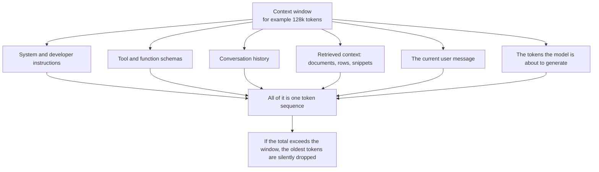
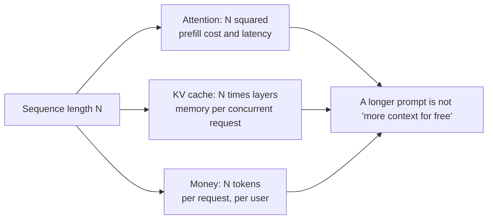
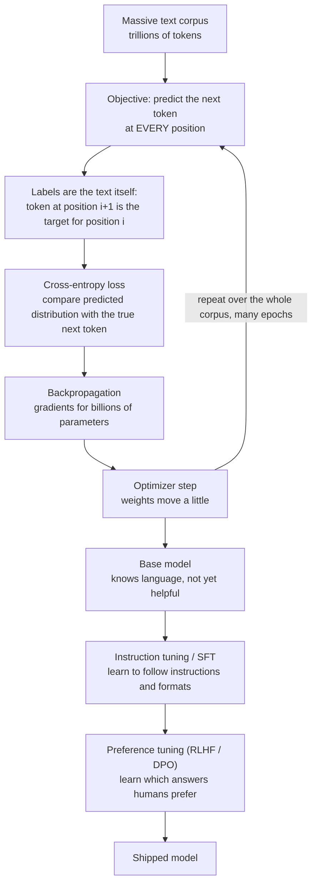
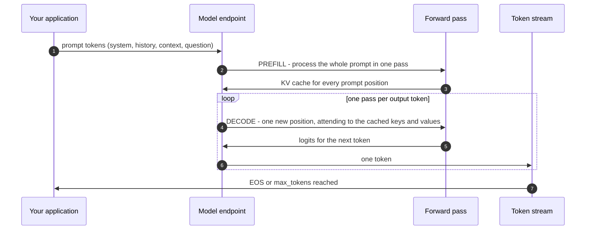
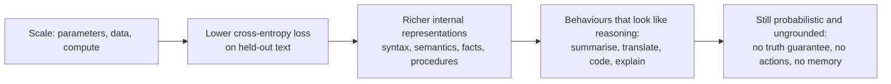
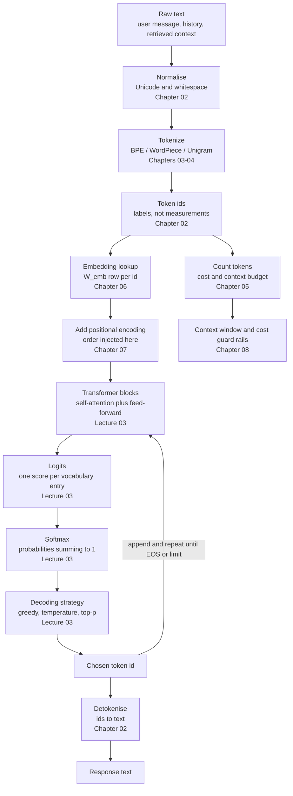
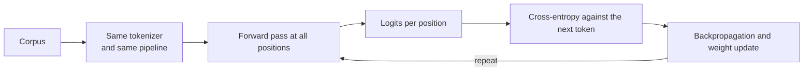

# Chapter 08 — Context Windows, Training vs Inference & the Complete Pipeline

> **Lecture 02 · Chapter 08 of 08** · Level: 🟢 Beginner · Phase 1 — Foundations: How LLMs Actually Work
> **Source:** `Forward-Deployed-Engineer/Lecture 02/notes/01_Foundations_of_LLMs_and_Next_Token_Prediction.md`
> (§1.4, §1.6) and `02_Tokenization_...md` (§2.9) · `gen-ai-cohort/week01/learning/day01/notes/notes.md`
> (training vs inference · labels · cross-entropy loss · context window · summary)
> **Roadmap topics:** **context windows** (capacity vs attention — first pass); **training phase vs
> inference phase**; why emergent complexity arises from simple prediction; the **complete
> tokenization → embedding → input pipeline**.

---

## 08.0 What this chapter is for

This chapter closes the loop. It puts the previous seven chapters into one end-to-end picture, and it adds
the two ideas that decide how you operate a model in production: the **context window** (your hard capacity
budget) and the **training/inference split** (why prompting is not learning).

By the end of this chapter you should be able to:

1. Define the context window and list **everything** that consumes it.
2. Distinguish **capacity** (the hard limit) from **attention quality** (how well that capacity is used).
3. Explain the costs of a large window: quadratic attention, KV-cache memory and money.
4. Name the four truncation strategies and when each is correct.
5. Describe the **training phase**: the next-token label, cross-entropy loss, parallel training, and
   pre-training followed by post-training.
6. Describe the **inference phase**: frozen weights, prefill and decode, and why in-context learning is not
   learning.
7. Draw the **complete pipeline** from raw text to a generated token, and say which chapter explains each box.

---

## 08.1 The context window: capacity versus attention

> **Definition:** the context window is the maximum number of tokens the model can consider at one time.

It is not "the length of your prompt". It is the length of **everything the model sees in a single forward
pass**:



| Term | Meaning |
| :--- | :--- |
| **Input / prompt tokens** | everything you send |
| **Output / completion tokens** | everything the model generates |
| **Prefill** | the first forward pass, which processes the whole prompt at once |
| **Decode** | the loop that generates one token per forward pass |
| **Truncation** | the provider (or your code) dropping tokens that do not fit |

### Capacity is not the same as attention quality

This is the distinction the roadmap calls "capacity vs attention", and it is the one that causes the most
production disappointment.

| | Capacity | Attention quality |
| :--- | :--- | :--- |
| What it is | the hard token limit | how reliably the model *uses* content at each position |
| How you measure it | token count against the model's documented window | task accuracy at various prompt lengths and orderings |
| Failure mode | hard truncation or an API error | "lost in the middle", ignored instructions, hallucinated answers |
| What fixes it | retrieval, summarisation, chunking | better retrieval precision, better prompt layout, fewer chunks, reranking |

> [!IMPORTANT]
> **The engineering rule:** *filling the window is not the goal; putting the right tokens in the window is.*
> A 128k-token window does not mean 128k tokens of useful context. Every token you add dilutes attention and
> costs money — which is why retrieval precision (later lectures) matters more than window size.

### Typical window sizes you will meet

| Class | Nominal window | Note |
| :--- | ---: | :--- |
| Older chat models | 4k – 16k | Truncation is a routine concern |
| Current mainstream | 128k – 200k | Comfortable for a long document plus history |
| Long-context frontier | 1M+ | Capacity is generous; attention quality is the limiting factor |
| Local small models | 2k – 32k | KV-cache memory is the binding constraint |

---

## 08.2 Why a big window is not free

Three independent costs scale with sequence length.

| Cost | Scaling | Where it bites |
| :--- | :--- | :--- |
| **Attention compute** | $O(N^2 \cdot d_{\text{model}})$ | Prefill time and GPU cost grow quadratically with prompt length |
| **KV-cache memory** | $O(N \cdot \text{layers} \cdot d_{\text{model}})$ | Every concurrent request holds its own cache; this limits batch size and therefore throughput |
| **Money** | linear in tokens | You pay for every input token, every request — including the ones the model ignored |



Two architectural answers to these costs, both of which appear in later lectures:

- **KV caching** stores the key/value projections of already-processed tokens, so decode is cheap per token
  instead of re-processing the whole prompt each step.
- **Efficient attention variants** (grouped-query attention, sliding-window attention, paged attention)
  reduce memory or compute — Lecture 25 covers the serving side.

> [!TIP]
> **The FDE translation of all three costs:** the cheapest token is the one you never send. Prompt-prefix
> caching, retrieval precision, history compaction and output-length limits are the four levers that turn a
> generous context window into a sustainable unit cost.

---

## 08.3 What to do when you run out of window

Four strategies, in the order you should consider them:

| Strategy | How it works | Best for | Risk |
| :--- | :--- | :--- | :--- |
| **Retrieve fewer, better tokens** | Use search/reranking so only the most relevant chunks enter the prompt | Knowledge-heavy Q&A | Retrieval misses → ungrounded answer |
| **Compact history** | Summarise older turns into a short recap | Long chat sessions | Summaries lose detail and can distort |
| **Sliding window** | Keep only the last $k$ turns verbatim | Customer support, code assistants | The user references something older and the model cannot see it |
| **Hierarchical / map-reduce** | Summarise chunks separately, then combine | Very large documents | Extra calls, extra latency, error compounding |

```ts
// PSEUDO-CODE — a truncation policy that is explicit about what it sacrifices.
type Budget = { window: number; outputReserve: number };

function fitToWindow(parts: PromptPart[], budget: Budget): PromptPart[] {
  const available = budget.window - budget.outputReserve;
  const order = ["system", "tools", "user", "context", "history"];   // priority, highest first
  const kept: PromptPart[] = [];

  for (const name of order) {
    const part = parts.find(p => p.name === name);
    if (!part) continue;
    const remaining = available - total(kept);
    if (remaining <= 0) break;

    kept.push(name === "history" ? compactHistory(part, remaining) : truncate(part, remaining));
  }

  // Never silently exceed the window: fail loudly, and log what was dropped.
  log({ dropped: parts.filter(p => !kept.includes(p)), reason: "context window" });
  return kept;
}
```

> [!WARNING]
> **Silent truncation is the worst outcome.** If the model loses the last four turns of a conversation and
> nobody logs it, you get a bug report that says "the AI forgot what I said" and no evidence. Always record
> what was dropped, and prefer failing fast over silently degrading.

---

## 08.4 The training phase

Training is where the weights come from. It happens **once**, by the model authors, at enormous cost.



### The label is free — that is the whole trick

Because the objective is *predict the next token*, the **label for every position is simply the next token in
the text**. No human annotation is required:

```text
Input  (context)         : The  capital  of  India  is
Label  (next token)      :      capital  of  India  is  Delhi
                            ^ every position provides its own training example
```

| Property | Consequence |
| :--- | :--- |
| Labels come from the data | You can train on trillions of tokens without annotators |
| **All positions train at once** | Training is massively parallel — unlike inference, which is sequential |
| Loss is cross-entropy | It measures how much probability mass the model put on the *correct* next token |
| Training is expensive | GPUs for weeks/months, and it happens once per model generation |

### Cross-entropy loss, worked

Suppose the correct next token is `Delhi` and the model outputs these probabilities:

| Candidate | Predicted probability | Target (one-hot label) | Contribution to loss |
| :--- | ---: | ---: | :--- |
| **Delhi** | 0.92 | 1 | $-1 \cdot \log 0.92 = 0.083$ |
| Kolkata | 0.04 | 0 | $0$ (label is 0) |
| Mumbai | 0.02 | 0 | $0$ |
| all others | 0.02 total | 0 | $0$ |
| **Total loss** | | | **≈ 0.083** |

$$L = -\sum_{v \in V} y_v \log \hat{p}_v \;=\; -\log \hat{p}_{\text{correct}}$$

Three things to notice:

- **Only the correct token's probability matters.** Because the label is one-hot, the loss reduces to
  $-\log \hat{p}_{\text{correct}}$.
- **Confident and right is cheap; confident and wrong is expensive.** If the model had said 0.01 for `Delhi`,
  the loss would be $-\log 0.01 \approx 4.6$ — 55× larger.
- **Perplexity is just $e^{L}$.** A loss of 0.083 gives perplexity $\approx 1.09$ (the model is barely
  surprised); a loss of 4.6 gives $\approx 100$ (the model is very surprised). Perplexity measures
  *prediction*, not usefulness — a model can be excellent at prediction and still useless as an assistant.

### Pre-training versus post-training

| Stage | Data | What it teaches | Result |
| :--- | :--- | :--- | :--- |
| **Pre-training** | Trillions of tokens of raw text | Language, facts, reasoning patterns, style | A base model that completes text |
| **Instruction tuning (SFT)** | Curated instruction → answer pairs | Follow instructions, respect formats, refuse unsafe requests | An assistant |
| **Preference tuning (RLHF / DPO)** | Human or model preferences between candidate answers | Which of two answers is better | A *helpful* assistant |

> [!IMPORTANT]
> **Why this matters to an FDE:** when you prompt a model you are talking to a **post-trained assistant**,
> not a raw text completer. Its instruction-following behaviour, its refusals and its chat template are all
> artefacts of post-training — and they change between model versions, which is why eval suites (Lecture 30)
> exist.

---

## 08.5 The inference phase

Inference is what happens when you call the model. **Nothing is learned.**



| Property of inference | Consequence |
| :--- | :--- |
| **Weights are frozen** | Prompting, few-shot examples and chat history change the *input*, never the model |
| **Prefill is parallel; decode is sequential** | Latency is dominated by output length, not by input length (though long inputs cost more) |
| **KV cache grows with context** | Memory per concurrent request limits throughput |
| **Output is probabilistic** | Same input can yield different outputs; temperature and seeds matter (Lecture 03) |
| **The model is stateless** | You resend the whole conversation every turn |

### Training versus inference, side by side

| | **Training** | **Inference** |
| :--- | :--- | :--- |
| When | Once, by the model authors | Every request |
| Weights | Updated by gradient descent | Frozen |
| Data flow | Forward pass **and** backward pass | Forward pass only |
| Parallelism | All positions in parallel | One token per step (sequential decode) |
| Objective | Minimise cross-entropy loss | Produce the most useful token sequence |
| Cost profile | Enormous, one-off | Small per call, multiplied by volume |
| Failure mode | Underfitting, overfitting, unsafe behaviour | Ungrounded answers, latency, cost, drift |
| Can you change it? | No | Yes — via prompt, tools, retrieval, decoding |

> [!IMPORTANT]
> **"In-context learning" is not learning.** When a model appears to learn from your examples in a prompt, it
> is conditioning on tokens — no weight has changed. The moment the request ends, the "learning" is gone.
> Anything you want to persist must live in your system: the prompt template, the retrieval index, a memory
> store, or a fine-tuned model.

---

## 08.6 Why emergent complexity arises from simple prediction

The question from Chapter 01 deserves a precise answer now that the training loop is visible.

**To predict the next token well, the model is forced to build internal representations of everything that
determines the next token.** There is no cheaper way to reduce cross-entropy loss.

| Prediction task | Representation the model must build to succeed |
| :--- | :--- |
| `"The capital of France is ___"` | Facts and geography |
| `"def fib(n):\n    return ___"` | Programming syntax and recursion patterns |
| `"She was furious, so she ___"` | Emotion and behavioural plausibility |
| `"The invoice total is 1,240 plus 18 percent GST = ___"` | Arithmetic procedure and formatting |
| `"Q: What is 3 + 4?\nA: ___"` | Instruction-following structure (from post-training) |



Three honest caveats:

1. **Emergence is not reliability.** A capability can appear at scale and still fail 20% of the time — which
   is why evaluations exist.
2. **Emergence is not understanding.** The model has representations that support prediction; it does not have
   beliefs, intentions or access to ground truth.
3. **Emergence does not remove architecture.** Grounding, tools, memory, guardrails and observability are
   still yours to build — the thesis of this whole repository.

---

## 08.7 The complete pipeline

This is the master diagram for Lecture 02. Every box names the chapter that explains it.



The mirror image, at training time:



> [!NOTE]
> **The symmetry is the point.** Training and inference share the *same* tokenizer, the *same* embedding table
> and the *same* transformer stack. The only differences are direction (backward pass), parallelism (all
> positions versus one token) and whether weights move. That is why a change to the tokenizer is a change to
> the model.

---

## 08.8 The engineering map for Lecture 02

| Pipeline stage | Concept | Chapter | Production consequence |
| :--- | :--- | :---: | :--- |
| Normalise + tokenise | tokens, subwords, BPE | 02–04 | Cost, truncation, language equity |
| Token counting | `tiktoken`, vocabularies | 05 | Budgets, routing, pre-flight rejection |
| Embedding lookup | $W_{\text{emb}}$, similarity | 06 | Retrieval quality, no cross-model mixing |
| Positional encoding | order, RoPE | 07 | Long-context behaviour, prompt layout |
| Transformer + logits | attention, softmax | 03 | Model capability (next lecture) |
| Decoding | temperature, top-p | 03 | Output character, determinism |
| Context management | window, truncation | 08 | Reliability, silent failure modes |
| Training vs inference | frozen weights | 08 | Prompting ≠ learning; evals needed |

### The FDE checklist that falls out of this lecture

1. **Count tokens with the right tokenizer** before you send, and log the provider's usage after.
2. **Reserve output tokens first**, then spend the rest on context.
3. **Never store token IDs**; store text, and tokenise at call time.
4. **Never mix embedding spaces**; store the embedding model ID with every vector.
5. **Respect the trained context length** — exceeding it degrades quality quietly.
6. **Put your best evidence where attention is strongest**, and cite what you used.
7. **Treat prompt content as data, not structure** — special tokens are not user input.
8. **Assume the output is probabilistic** and prove behaviour with evals, not with a demo.

---

## 08.9 Training step versus inference step (pseudo-code)

```ts
// PSEUDO-CODE — the two loops side by side. Same model, different direction.

// ---------- TRAINING (runs once, by the model authors) ----------
function trainingStep(batchOfTokenSequences: TokenId[][], model: Weights, optimizer: Optimizer) {
  const logitsAtEveryPosition = model.forward(batchOfTokenSequences);   // parallel over positions
  const labels = shiftLeft(batchOfTokenSequences);                      // the next token at each position
  const loss = crossEntropy(logitsAtEveryPosition, labels);             // one scalar
  const grads = backward(loss, model);                                  // d loss / d weight, everywhere
  optimizer.step(model, grads);                                         // weights move
  return loss;
}

// ---------- INFERENCE (runs on every request) ----------
function inferenceStep(prompt: string, model: FrozenWeights, params: DecodeParams) {
  let context = tokenizer.encode(normalize(prompt));                    // Chapters 02-05
  const kvCache = model.prefill(context);                               // one parallel pass over the prompt

  for (let step = 0; step < params.maxTokens; step++) {
    const logits = model.decodeOne(kvCache);                            // one new position
    const probs = softmax(scaleByTemperature(logits, params.temperature));
    const next = sample(probs, params.topP, params.topK);               // Lecture 03
    if (next === SPECIAL.EOS) break;
    context.push(next);
    kvCache.append(next);                                              // cache grows; no gradients
  }

  return tokenizer.decode(context.slice(promptTokenCount));             // detokenise the new part only
}
```

Read the two functions together: **the same forward computation appears in both**, but only training has a
`backward`, and only inference has a `kvCache`. Everything you do as an application engineer lives in the
second function's *inputs* — the prompt, the decoding parameters, the context — never in the weights.

---

## Common mistakes

- **Thinking the context window is "how much I can send".** It also contains the output, the tool schemas and
  the whole history.
- **Assuming a bigger window means better answers.** Attention quality and position bias decide usefulness.
- **Treating the window as free capacity.** Quadratic attention, KV-cache memory and per-token billing all
  grow with it.
- **Truncating silently.** Log what was dropped, or you will debug "the AI forgot" with no evidence.
- **Believing prompting trains the model.** Weights are frozen; only the context changes.
- **Confusing pre-training with post-training.** Instruction-following and refusals come from post-training,
  and they change between versions.
- **Reading perplexity as a quality score.** It measures prediction, not usefulness.
- **Assuming "emergent" means "reliable".** Prove behaviour with evals on your own tasks.

## Key takeaways

1. The **context window** is the total token budget for one forward pass: system + tools + history + retrieved
   context + user message + **the output**.
2. **Capacity ≠ attention quality.** Filling the window dilutes attention; "lost in the middle" is real.
3. Large windows cost three things: $O(N^2)$ attention, $O(N)$ KV-cache memory and linear money.
4. When you run out of window: **retrieve better, compact history, slide, or summarise hierarchically** — and
   always log what you dropped.
5. **Training** minimises cross-entropy against the *next token as its own label*, at all positions in
   parallel; pre-training → instruction tuning → preference tuning.
6. **Inference** runs forward only, on frozen weights, with prefill + sequential decode and a KV cache.
7. **In-context learning is not learning.** Anything that must persist belongs in your system, not in a chat.
8. **Emergent capability is a side effect of compressing the prediction task** — and it is neither reliable
   nor a substitute for architecture.

## Self-check questions

1. List six things that consume one context window.
2. Give an example where a 200k-token window performs *worse* than a 16k-token window on the same task.
3. Name the three costs that grow with sequence length, and their scaling.
4. Which truncation strategy would you choose for a 40-turn support conversation, and why?
5. Explain why the next-token label is "free", and compute the loss when the model gives the correct token
   0.05 probability.
6. Give the two structural differences between a training step and an inference step.
7. Why is "the model learned my style from the chat" a false statement?
8. Draw the complete pipeline from raw text to a chosen token, naming the chapter that explains each box.

---

### Navigation

- **Previous:** [Chapter 07 — Positional Encodings & Word Order](./07_Positional_Encodings_and_Word_Order.md)
- **Consolidated:** [Lecture_02_Complete_Notes.md](./Lecture_02_Complete_Notes.md)
- **Source:** `Forward-Deployed-Engineer/Lecture 02/notes/01_Foundations_of_LLMs_and_Next_Token_Prediction.md`,
  `02_Tokenization_Subwords_and_Numerical_Representations.md`;
  `gen-ai-cohort/week01/learning/day01/notes/notes.md`
- **Next lecture:** **Lecture 03 — Attention, Transformer Architecture & Decoding Strategies**
  (Q/K/V, scaled dot-product attention, multi-head attention, logits, softmax, temperature, top-p)
- **Back to index:** [../index.md](../index.md)
