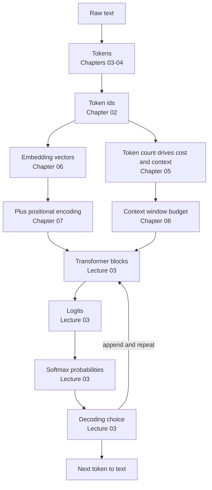

# Lecture 02 — Complete Notes
## LLM Foundations: Next-Token Prediction, Tokenization & Embeddings

> **Phase:** 1 · Foundations · **Level:** 🟢 Beginner · **Prerequisites:** Lecture 01
> **Scope:** a single-pass consolidation of the eight chapter notes in this folder.
> **How to use this file:** read it to *revise and navigate*. It is deliberately shorter than the chapters,
> and every section links to the chapter that explains it in full.
>
> | Chapter | File |
> | :--- | :--- |
> | 01 · What an LLM is & next-token prediction | [01_What_an_LLM_Is_and_Next_Token_Prediction.md](./01_What_an_LLM_Is_and_Next_Token_Prediction.md) |
> | 02 · The text pipeline & why token IDs are labels | [02_The_Text_Pipeline_and_Why_Token_IDs_Are_Labels.md](./02_The_Text_Pipeline_and_Why_Token_IDs_Are_Labels.md) |
> | 03 · Tokenization strategies: word vs character vs subword | [03_Tokenization_Strategies_Word_Character_Subword.md](./03_Tokenization_Strategies_Word_Character_Subword.md) |
> | 04 · BPE, WordPiece, SentencePiece & the vocabulary | [04_BPE_WordPiece_SentencePiece_and_Vocabulary.md](./04_BPE_WordPiece_SentencePiece_and_Vocabulary.md) |
> | 05 · Tokenizers in practice: `tiktoken` & model comparison | [05_Tokenizers_in_Practice_tiktoken_and_Model_Comparison.md](./05_Tokenizers_in_Practice_tiktoken_and_Model_Comparison.md) |
> | 06 · Embeddings: dense vectors & similarity | [06_Embeddings_Dense_Vectors_and_Similarity.md](./06_Embeddings_Dense_Vectors_and_Similarity.md) |
> | 07 · Positional encodings & word order | [07_Positional_Encodings_and_Word_Order.md](./07_Positional_Encodings_and_Word_Order.md) |
> | 08 · Context windows, training vs inference & the complete pipeline | [08_Context_Windows_Training_vs_Inference_and_the_Complete_Pipeline.md](./08_Context_Windows_Training_vs_Inference_and_the_Complete_Pipeline.md) |

---

## 1. Executive summary

**The lecture in six sentences.**

1. An LLM is a **next-token probability machine**: given the tokens so far it returns a distribution over the
   next token — $P(t_n \mid t_1 \dots t_{n-1})$ — and generation is that operation in a loop
   ([01](./01_What_an_LLM_Is_and_Next_Token_Prediction.md)).
2. Because a neural network is arithmetic, **text must become numbers**: a tokenizer splits the string into
   tokens and maps them to integer IDs, and an embedding table maps each ID to a dense vector
   ([02](./02_The_Text_Pipeline_and_Why_Token_IDs_Are_Labels.md), [06](./06_Embeddings_Dense_Vectors_and_Similarity.md)).
3. **Token IDs are labels, not measurements** — roll numbers, not quantities — so all meaning lives in the
   vectors, and IDs are never portable between models ([02](./02_The_Text_Pipeline_and_Why_Token_IDs_Are_Labels.md)).
4. Tokenization granularity is a two-sided pressure: word level explodes the vocabulary and loses unknown words
   (`<UNK>`), character level explodes sequence length and attention cost ($O(N^2)$) — **subword, and
   specifically byte-level BPE, is the equilibrium that won**
   ([03](./03_Tokenization_Strategies_Word_Character_Subword.md), [04](./04_BPE_WordPiece_SentencePiece_and_Vocabulary.md)).
5. Self-attention is **permutation-invariant**, so order must be injected — by adding a positional vector
   (sinusoidal or learned) or by rotating queries and keys (**RoPE**), which makes position *relative*
   ([07](./07_Positional_Encodings_and_Word_Order.md)).
6. The two operating constraints follow from the mechanism: a **finite context window** shared by prompt,
   history, retrieved context and output, and a **training/inference split** in which prompting conditions on
   tokens but never changes a weight ([08](./08_Context_Windows_Training_vs_Inference_and_the_Complete_Pipeline.md)).

**The one-line thesis of the repository, restated for this lecture:** *the model proposes a token
distribution; your architecture decides what goes into the context and what is done with the output.*

---

## 2. The lecture in one diagram



**The mental model to keep:** *tokens in, tokens out; one token per forward pass; everything you control
lives in the context you assemble and the parameters you choose.*

---

## 3. Cheat sheet

### 3.1 The pipeline, stage by stage

| # | Stage | Input → output | Key idea | Chapter |
| :---: | :--- | :--- | :--- | :---: |
| 1 | Normalise | string → string | Unicode form and whitespace decided **before** tokenising | [02](./02_The_Text_Pipeline_and_Why_Token_IDs_Are_Labels.md) |
| 2 | Tokenize | string → token strings | boundaries learned from a corpus; whitespace belongs to tokens | [03](./03_Tokenization_Strategies_Word_Character_Subword.md), [04](./04_BPE_WordPiece_SentencePiece_and_Vocabulary.md) |
| 3 | Look up IDs | tokens → integers | IDs are labels (roll numbers), not measurements | [02](./02_The_Text_Pipeline_and_Why_Token_IDs_Are_Labels.md) |
| 4 | Count | IDs → token count | cost, limits and truncation are token-based | [05](./05_Tokenizers_in_Practice_tiktoken_and_Model_Comparison.md) |
| 5 | Embed | IDs → dense vectors | table read from $W_{\text{emb}}$; geometry encodes meaning | [06](./06_Embeddings_Dense_Vectors_and_Similarity.md) |
| 6 | Add position | vectors → position-aware vectors | attention is order-blind; order is injected here | [07](./07_Positional_Encodings_and_Word_Order.md) |
| 7 | Transform | vectors → hidden states | attention + MLP; **Lecture 03** | — |
| 8 | Project | hidden states → logits | one score per vocabulary entry; **Lecture 03** | — |
| 9 | Softmax + decode | logits → one token | temperature, top-p, greedy; **Lecture 03** | — |
| 10 | Detokenise | IDs → text | decode the accumulated buffer, not single tokens | [02](./02_The_Text_Pipeline_and_Why_Token_IDs_Are_Labels.md) |

### 3.2 Terminology

| Term | Meaning | Chapter |
| :--- | :--- | :---: |
| **LLM** | A large model over token sequences that predicts the next token | [01](./01_What_an_LLM_Is_and_Next_Token_Prediction.md) |
| **Autoregressive** | Uses its own previous outputs as inputs for the next step | [01](./01_What_an_LLM_Is_and_Next_Token_Prediction.md) |
| **Token** | The atomic text unit the tokenizer produces (word, subword, byte, symbol, special) | [02](./02_The_Text_Pipeline_and_Why_Token_IDs_Are_Labels.md) |
| **Token ID** | Integer index into the vocabulary — a label, not a value | [02](./02_The_Text_Pipeline_and_Why_Token_IDs_Are_Labels.md) |
| **Vocabulary** | The fixed, model-specific token → ID table (32k–200k entries) | [02](./02_The_Text_Pipeline_and_Why_Token_IDs_Are_Labels.md), [04](./04_BPE_WordPiece_SentencePiece_and_Vocabulary.md) |
| **BPE** | Merge the most frequent adjacent pair, repeat until the target size | [04](./04_BPE_WordPiece_SentencePiece_and_Vocabulary.md) |
| **WordPiece** | Merges by likelihood gain; `##` marks continuation pieces | [04](./04_BPE_WordPiece_SentencePiece_and_Vocabulary.md) |
| **Unigram / SentencePiece** | Top-down pruning; SentencePiece treats space as `▁` and is language-agnostic | [04](./04_BPE_WordPiece_SentencePiece_and_Vocabulary.md) |
| **Byte-level BPE** | Base vocabulary is 256 bytes → OOV is impossible | [04](./04_BPE_WordPiece_SentencePiece_and_Vocabulary.md) |
| **OOV** | Out-of-vocabulary: an unknown word collapsed to `<UNK>` (word-level only) | [03](./03_Tokenization_Strategies_Word_Character_Subword.md) |
| **Embedding** | Dense learned vector; geometry encodes meaning | [06](./06_Embeddings_Dense_Vectors_and_Similarity.md) |
| **Cosine similarity** | $\mathbf{a}\cdot\mathbf{b}/(\lVert a\rVert\lVert b\rVert)$ — direction, not magnitude | [06](./06_Embeddings_Dense_Vectors_and_Similarity.md) |
| **Contextual hidden state** | A per-occurrence vector reshaped by attention (fixes polysemy) | [06](./06_Embeddings_Dense_Vectors_and_Similarity.md) |
| **Positional encoding** | The signal that injects order (sinusoidal, learned, RoPE, ALiBi) | [07](./07_Positional_Encodings_and_Word_Order.md) |
| **Permutation invariance** | Attention output is unchanged by permuting inputs and weights | [07](./07_Positional_Encodings_and_Word_Order.md) |
| **RoPE** | Rotates Q and K so scores depend on *relative* distance | [07](./07_Positional_Encodings_and_Word_Order.md) |
| **Context window** | Total token budget for one forward pass, including the output | [08](./08_Context_Windows_Training_vs_Inference_and_the_Complete_Pipeline.md) |
| **Prefill / decode** | One parallel pass over the prompt, then one pass per output token | [08](./08_Context_Windows_Training_vs_Inference_and_the_Complete_Pipeline.md) |
| **KV cache** | Stored key/value projections that make decoding cheap per token | [08](./08_Context_Windows_Training_vs_Inference_and_the_Complete_Pipeline.md) |
| **Cross-entropy loss** | $-\log \hat{p}_{\text{correct}}$ — the training objective | [08](./08_Context_Windows_Training_vs_Inference_and_the_Complete_Pipeline.md) |
| **Perplexity** | $e^{L}$; how surprised the model is by held-out text (not usefulness) | [08](./08_Context_Windows_Training_vs_Inference_and_the_Complete_Pipeline.md) |

### 3.3 Formulas

| Formula | Meaning | Chapter |
| :--- | :--- | :---: |
| $P(t_n \mid t_1, \dots, t_{n-1})$ | The model's whole job: next-token distribution | [01](./01_What_an_LLM_Is_and_Next_Token_Prediction.md) |
| $W_{\text{emb}} \in \mathbb{R}^{\lvert V\rvert \times d_{\text{model}}}$ | Embedding table shape: rows = vocabulary, columns = width | [02](./02_The_Text_Pipeline_and_Why_Token_IDs_Are_Labels.md), [06](./06_Embeddings_Dense_Vectors_and_Similarity.md) |
| $\mathbf{E}_t = W_{\text{emb}}[\text{id}(t)]$ | Embedding = a table read | [06](./06_Embeddings_Dense_Vectors_and_Similarity.md) |
| $\cos(\mathbf{a},\mathbf{b}) = \dfrac{\mathbf{a}\cdot\mathbf{b}}{\lVert\mathbf{a}\rVert\lVert\mathbf{b}\rVert}$ | Cosine similarity | [06](./06_Embeddings_Dense_Vectors_and_Similarity.md) |
| $\mathbf{v}_{\text{King}} - \mathbf{v}_{\text{Man}} + \mathbf{v}_{\text{Woman}} \approx \mathbf{v}_{\text{Queen}}$ | Meaning is geometric | [06](./06_Embeddings_Dense_Vectors_and_Similarity.md) |
| $\mathbf{X}_{\text{in}} = \mathbf{E}_{\text{token}} + \mathbf{P}_{\text{pos}}$ | Position injected by addition | [07](./07_Positional_Encodings_and_Word_Order.md) |
| $PE_{(pos,2i)} = \sin\!\left(\frac{pos}{10000^{2i/d_{\text{model}}}}\right)$ | Sinusoidal positional encoding | [07](./07_Positional_Encodings_and_Word_Order.md) |
| $\mathbf{P}_{pos+k} = \mathbf{R}_k \mathbf{P}_{pos}$ | Linear-offset property: offsets are representable | [07](./07_Positional_Encodings_and_Word_Order.md) |
| $\text{score}_{ij} = \mathbf{q}_i\cdot\mathbf{k}_j - m(i-j)$ | ALiBi: distance penalty instead of position vectors | [07](./07_Positional_Encodings_and_Word_Order.md) |
| $L = -\log \hat{p}_{\text{correct}}$ | Cross-entropy with a one-hot next-token label | [08](./08_Context_Windows_Training_vs_Inference_and_the_Complete_Pipeline.md) |
| $\text{cost} = \frac{\text{in}}{10^6}p_{\text{in}} + \frac{\text{out}}{10^6}p_{\text{out}}$ | Per-request cost from token counts | [05](./05_Tokenizers_in_Practice_tiktoken_and_Model_Comparison.md) |

### 3.4 Numbers worth remembering

| Item | Value |
| :--- | :--- |
| Typical vocabulary size | 32k – 200k tokens |
| Typical $d_{\text{model}}$ | 512 – 8192 |
| English rule of thumb | ~4 characters ≈ 1 token (**estimate only**) |
| Base vocabulary in byte-level BPE | 256 |
| `gpt2` / `cl100k_base` / `o200k_base` | ~50k / ~100k / ~200k |
| Non-Latin token inflation vs English | often 2–5× on older vocabularies |
| Attention cost scaling | $O(N^2 \cdot d_{\text{model}})$ |
| Multi-head attention total cost | unchanged — each head is $d_{\text{model}}/h$ wide |
| "strawberry" in a modern tokenizer | typically 2 tokens (`straw`, `berry`) |

### 3.5 Tokenizer comparison at a glance

| Tokenizer | Used by | Vocabulary | Watch out for |
| :--- | :--- | ---: | :--- |
| `gpt2` | GPT-2 | ~50k | Expensive for code and non-Latin scripts |
| `cl100k_base` | GPT-3.5-turbo, GPT-4 | ~100k | Good for code; still taxed on non-English |
| `o200k_base` | GPT-4o, GPT-4o-mini | ~200k | Much lower multilingual token tax |
| Llama 2 (SentencePiece) | Llama 2 | ~32k | Small vocabulary → more tokens for everything |
| Llama 3+ (byte-level BPE) | Llama 3 / 4 | ~128k | Better code and multilingual behaviour |
| Gemini / Claude | closed | not public | Count via the provider's endpoint; treat local counts as estimates |

### 3.6 The cost model in one place

```text
cost per request = (input tokens  / 1e6) * input price per 1e6
                 + (output tokens / 1e6) * output price per 1e6

where
  input tokens  = system + tools + history + retrieved context + user message
  output tokens = everything the model generates (usually the pricier side)
```

Four levers, in order of impact:

1. **Retrieval precision** — fewer, better chunks instead of more, mediocre ones.
2. **Output length limits** — a hard `max_tokens` plus instructions that respect it.
3. **Prompt-prefix caching** — reuse the unchanged part of the prompt where the provider supports it.
4. **Model routing** — cheap model for easy traffic, expensive model only where it earns its price.

---

## 4. Decision tables

### 4.1 Which tokenization granularity (and why subword won)

| Granularity | Strength | Fatal weakness | Verdict |
| :--- | :--- | :--- | :--- |
| **Word** | Minimal sequence length | Vocabulary explosion; `<UNK>` destroys unknown words | Closed vocabularies only |
| **Character** | Zero OOV | Sequence length ~4× → attention cost ~16× | Rarely appropriate |
| **Byte** | Total coverage (256 base tokens) | Longest raw sequences | Always paired with merges |
| **Subword (byte-level BPE)** | Bounded vocabulary, no OOV, short sequences | Corpus-dependent token costs | **The industry standard** |

### 4.2 Which algorithm family

| Need | Choose | Because |
| :--- | :--- | :--- |
| Decoder-only generation | Byte-level BPE | Coverage plus efficiency; what frontier models use |
| Encoder / classification heads | WordPiece | `##` markers and likelihood-based merges suit encoder tasks |
| Multilingual, no-space languages | SentencePiece (BPE or Unigram) | Operates on raw text with `▁`; lossless |
| Smallest vocabulary for a fixed domain | Unigram pruning | Top-down selection optimises corpus likelihood |

### 4.3 Which positional scheme

| Scheme | Order signal | Length behaviour | Typical user |
| :--- | :--- | :--- | :--- |
| Sinusoidal | Added sin/cos vectors | Defined everywhere; weak extrapolation in practice | Original Transformer |
| Learned absolute | Added trainable vectors | **Hard cap** at the trained length | GPT-2, BERT |
| RoPE | Rotate Q and K | Relative by construction; extensible with scaling | Llama, Mistral, Gemma, Qwen |
| ALiBi | Distance penalty on scores | Strong extrapolation; recency preference built in | MPT, BLOOM |

### 4.4 Static versus contextual versus retrieval embeddings

| Question | Static token embedding | Contextual hidden state | Retrieval embedding |
| :--- | :--- | :--- | :--- |
| One vector per | token ID | token occurrence | document or chunk |
| Context-aware? | No | Yes | Yes (for the passage) |
| Dimension | $d_{\text{model}}$ | $d_{\text{model}}$ | 384–3072 |
| Who produces it | the generation model's table | attention inside the model | a dedicated embedding model |
| Used for | model input | model reasoning | search, clustering, dedup |
| Failure if mixed | — | — | Silently meaningless similarity scores |

### 4.5 Out of context window: which strategy

| Situation | Strategy | Risk to accept |
| :--- | :--- | :--- |
| Knowledge-heavy Q&A | Retrieve fewer, better chunks (rerank) | Retrieval misses |
| Long chat | Compact older turns into a recap | Summary distortion |
| Support / coding assistant | Sliding window of the last $k$ turns | Older references become invisible |
| One enormous document | Hierarchical map-reduce summarisation | Extra calls and compounding error |

### 4.6 When the model must not do it alone

| Task | Use a tool instead | Why |
| :--- | :--- | :--- |
| Count characters or letters | Code | Tokens hide characters ("strawberry") |
| Reverse a string | Code | Character-level operation |
| Arithmetic on long numbers | Code / calculator | Digit grouping and carry are not token-safe |
| Exact JSON/CSV manipulation | Code | Token boundaries do not respect syntax |
| Anything requiring ground truth | Retrieval or an API | Weights hold associations, not records |

---

## 5. Misconceptions

| # | Misconception | Reality | Chapter |
| :---: | :--- | :--- | :--- |
| 1 | "GPT and ChatGPT are the same thing." | GPT is the engine (model); ChatGPT is the car (application: UI, memory, safety, tools) | [01](./01_What_an_LLM_Is_and_Next_Token_Prediction.md) |
| 2 | "The model looks facts up." | It assigns probabilities from learned patterns; facts need grounding | [01](./01_What_an_LLM_Is_and_Next_Token_Prediction.md) |
| 3 | "It writes the whole answer at once." | One forward pass per token; output length drives latency | [01](./01_What_an_LLM_Is_and_Next_Token_Prediction.md) |
| 4 | "The model predicts the next word." | It predicts the next **token** — often a subword, punctuation or special token | [01](./01_What_an_LLM_Is_and_Next_Token_Prediction.md), [02](./02_The_Text_Pipeline_and_Why_Token_IDs_Are_Labels.md) |
| 5 | "A bigger token ID means a more important token." | IDs are labels (roll numbers), not measurements | [02](./02_The_Text_Pipeline_and_Why_Token_IDs_Are_Labels.md) |
| 6 | "Tokens are portable across models." | IDs are valid only with their own tokenizer and version | [02](./02_The_Text_Pipeline_and_Why_Token_IDs_Are_Labels.md) |
| 7 | "`love` and ` love` are the same token." | Leading whitespace is part of the token | [02](./02_The_Text_Pipeline_and_Why_Token_IDs_Are_Labels.md) |
| 8 | "1 token ≈ 4 characters, always." | A rough English-prose estimate; code and non-Latin scripts break it | [02](./02_The_Text_Pipeline_and_Why_Token_IDs_Are_Labels.md), [05](./05_Tokenizers_in_Practice_tiktoken_and_Model_Comparison.md) |
| 9 | "Word-level tokenization is the most accurate." | It is the least: unknown words become `<UNK>` and their information is destroyed | [03](./03_Tokenization_Strategies_Word_Character_Subword.md) |
| 10 | "Character-level has no OOV, so it is safest." | Sequence length ~4× and attention cost ~16× — fatal for long documents | [03](./03_Tokenization_Strategies_Word_Character_Subword.md) |
| 11 | "Subwords are a compromise that loses accuracy." | Subwords *preserve* information losslessly and share morphology across forms | [03](./03_Tokenization_Strategies_Word_Character_Subword.md) |
| 12 | "BPE is a single fixed tokenizer." | It is a family: corpus, base alphabet and vocabulary size all vary | [04](./04_BPE_WordPiece_SentencePiece_and_Vocabulary.md) |
| 13 | "Encoding can invent new tokens." | Encoding only applies the learned merge list, greedily and deterministically | [04](./04_BPE_WordPiece_SentencePiece_and_Vocabulary.md) |
| 14 | "BPE and WordPiece merge the same pairs." | BPE uses frequency; WordPiece uses likelihood gain and adds `##` markers | [04](./04_BPE_WordPiece_SentencePiece_and_Vocabulary.md) |
| 15 | "The model sees letters." | It sees opaque tokens — which is why "strawberry" letter-counting fails | [04](./04_BPE_WordPiece_SentencePiece_and_Vocabulary.md) |
| 16 | "One token count works for every provider." | The same text costs different token counts per tokenizer | [05](./05_Tokenizers_in_Practice_tiktoken_and_Model_Comparison.md) |
| 17 | "Embeddings are computed from the token." | They are a table read: the ID selects a row of $W_{\text{emb}}$ | [06](./06_Embeddings_Dense_Vectors_and_Similarity.md) |
| 18 | "One-hot vectors are more precise." | They have no geometry: every pair is equally unrelated | [06](./06_Embeddings_Dense_Vectors_and_Similarity.md) |
| 19 | "Embeddings from different models can be compared if the dimensions match." | Same dimension count ≠ same space; mixing them makes similarity noise | [06](./06_Embeddings_Dense_Vectors_and_Similarity.md) |
| 20 | "Attention knows word order." | Attention is permutation-invariant; order comes from positional encodings | [07](./07_Positional_Encodings_and_Word_Order.md) |
| 21 | "Positional encodings are always learned." | Sinusoidal, RoPE and ALiBi are fixed functions with no positional parameters | [07](./07_Positional_Encodings_and_Word_Order.md) |
| 22 | "A 200k window means better long-context answers." | Capacity ≠ attention quality; "lost in the middle" is real | [08](./08_Context_Windows_Training_vs_Inference_and_the_Complete_Pipeline.md) |
| 23 | "The window is only my prompt." | It also contains tools, history, retrieved context **and** the output | [08](./08_Context_Windows_Training_vs_Inference_and_the_Complete_Pipeline.md) |
| 24 | "Prompting trains the model." | Weights are frozen; only the context changes | [08](./08_Context_Windows_Training_vs_Inference_and_the_Complete_Pipeline.md) |
| 25 | "Low perplexity means a good assistant." | Perplexity measures prediction, not usefulness | [08](./08_Context_Windows_Training_vs_Inference_and_the_Complete_Pipeline.md) |

---

## 6. Top mistakes across all chapters

1. **Reasoning in words instead of tokens.** Every cost, limit, truncation and latency number is in tokens.
2. **Counting tokens with the wrong tokenizer.** The count is only valid for the model you are about to call.
3. **Budgeting without reserving the output.** The answer gets cut off because the prompt ate the window.
4. **Storing token IDs.** A tokenizer update silently invalidates them.
5. **Mixing embedding spaces.** The most expensive silent failure in a retrieval system.
6. **Assuming a bigger context window is free or better.** Quadratic attention, KV memory, money — and
   attention dilution.
7. **Filling the middle of a long prompt with weak evidence.** "Lost in the middle" is a measurable effect.
8. **Asking the model for exact character operations.** Counting, reversing, digit arithmetic — use code.
9. **Treating user input as template structure.** Special tokens are not user text; that is an injection
   surface.
10. **Believing a demo proves the system.** Probabilistic outputs need evals on the long tail.

---

## 7. Glossary

| Term | Definition | Chapter |
| :--- | :--- | :---: |
| **Autoregressive generation** | Producing output by repeatedly feeding the model its own previous tokens | [01](./01_What_an_LLM_Is_and_Next_Token_Prediction.md) |
| **Logit** | An unnormalised score for a vocabulary entry before softmax | [01](./01_What_an_LLM_Is_and_Next_Token_Prediction.md) |
| **Softmax** | The normalisation that turns logits into probabilities summing to 1 | [01](./01_What_an_LLM_Is_and_Next_Token_Prediction.md) |
| **EOS token** | The special token that ends generation | [01](./01_What_an_LLM_Is_and_Next_Token_Prediction.md) |
| **Special token** | A non-text control token (`BOS`, `EOS`, `PAD`, role markers) | [04](./04_BPE_WordPiece_SentencePiece_and_Vocabulary.md) |
| **Chat template** | The scaffolding that formats messages into the model's expected structure | [04](./04_BPE_WordPiece_SentencePiece_and_Vocabulary.md) |
| **Vocabulary size $\lvert V\rvert$** | Number of distinct tokens the model can read and write | [02](./02_The_Text_Pipeline_and_Why_Token_IDs_Are_Labels.md) |
| **Subword** | A token that is a fragment of a word (prefix, stem or suffix) | [03](./03_Tokenization_Strategies_Word_Character_Subword.md) |
| **BPE** | Byte-Pair Encoding: merge the most frequent adjacent pair, repeat | [04](./04_BPE_WordPiece_SentencePiece_and_Vocabulary.md) |
| **Merge list** | The ordered rules learned during tokenizer training; the tokenizer's true identity | [04](./04_BPE_WordPiece_SentencePiece_and_Vocabulary.md) |
| **Byte-level BPE** | BPE starting from UTF-8 bytes, so no input is ever unknown | [04](./04_BPE_WordPiece_SentencePiece_and_Vocabulary.md) |
| **Glitch token** | A vocabulary entry with almost no useful training signal; unpredictable behaviour | [04](./04_BPE_WordPiece_SentencePiece_and_Vocabulary.md) |
| **`tiktoken`** | OpenAI's tokenizer library for local token counting | [05](./05_Tokenizers_in_Practice_tiktoken_and_Model_Comparison.md) |
| **Token tax** | The extra tokens non-English or code-heavy text costs under an English-centric vocabulary | [05](./05_Tokenizers_in_Practice_tiktoken_and_Model_Comparison.md) |
| **Embedding table $W_{\text{emb}}$** | The learned matrix mapping token IDs to vectors | [06](./06_Embeddings_Dense_Vectors_and_Similarity.md) |
| **Dense vector** | A fixed-length list of floats where every entry carries information | [06](./06_Embeddings_Dense_Vectors_and_Similarity.md) |
| **One-hot vector** | A sparse vector with a single 1; no geometry, no generalisation | [06](./06_Embeddings_Dense_Vectors_and_Similarity.md) |
| **Polysemy** | One word, many meanings; resolved by context, not by the static embedding | [06](./06_Embeddings_Dense_Vectors_and_Similarity.md) |
| **Pooling** | Reducing many token vectors to one passage vector (mean, CLS, …) | [06](./06_Embeddings_Dense_Vectors_and_Similarity.md) |

| **Positional encoding** | The signal that gives the model token order | [07](./07_Positional_Encodings_and_Word_Order.md) |
| **Linear-offset property** | Position $pos+k$ is a fixed linear transform of position $pos$ | [07](./07_Positional_Encodings_and_Word_Order.md) |
| **RoPE** | Rotary position embedding: rotate Q and K by position-dependent angles | [07](./07_Positional_Encodings_and_Word_Order.md) |
| **ALiBi** | Attention with linear biases: a distance penalty instead of positional vectors | [07](./07_Positional_Encodings_and_Word_Order.md) |
| **Context window** | The maximum tokens the model can attend to in one forward pass | [08](./08_Context_Windows_Training_vs_Inference_and_the_Complete_Pipeline.md) |
| **Prefill** | The first forward pass that processes the whole prompt | [08](./08_Context_Windows_Training_vs_Inference_and_the_Complete_Pipeline.md) |
| **KV cache** | Cached key/value projections that make each decode step cheap | [08](./08_Context_Windows_Training_vs_Inference_and_the_Complete_Pipeline.md) |
| **Lost in the middle** | The empirical effect that middle-of-prompt content is used less reliably | [08](./08_Context_Windows_Training_vs_Inference_and_the_Complete_Pipeline.md) |
| **Cross-entropy loss** | $-\log$ of the probability assigned to the correct next token | [08](./08_Context_Windows_Training_vs_Inference_and_the_Complete_Pipeline.md) |
| **Perplexity** | $e^{L}$; a prediction-quality metric, not a usefulness metric | [08](./08_Context_Windows_Training_vs_Inference_and_the_Complete_Pipeline.md) |
| **Instruction tuning (SFT)** | Post-training on instruction/answer pairs to create an assistant | [08](./08_Context_Windows_Training_vs_Inference_and_the_Complete_Pipeline.md) |
| **Preference tuning** | Post-training on which of two answers is better (RLHF/DPO) | [08](./08_Context_Windows_Training_vs_Inference_and_the_Complete_Pipeline.md) |
| **In-context learning** | Conditioning on prompt examples without any weight change | [08](./08_Context_Windows_Training_vs_Inference_and_the_Complete_Pipeline.md) |

---

## 8. Twenty self-check questions

| # | Question | Chapter |
| :---: | :--- | :--- |
| 1 | Write the next-token objective as a formula and say what the model returns at each step. | [01](./01_What_an_LLM_Is_and_Next_Token_Prediction.md) |
| 2 | Give the car analogy for GPT vs ChatGPT, and name two things the "car body" must do that the engine cannot. | [01](./01_What_an_LLM_Is_and_Next_Token_Prediction.md) |
| 3 | In the coffee-prompt experiment, what changes between Stage 1 and Stage 3 — the weights, the vocabulary or the conditioning? | [01](./01_What_an_LLM_Is_and_Next_Token_Prediction.md) |
| 4 | Trace three iterations of the autoregressive loop for `"Rohit lives in"`, including the stop condition. | [01](./01_What_an_LLM_Is_and_Next_Token_Prediction.md) |
| 5 | Name the three objects text → tokens → token IDs and give an example of each for one sentence. | [02](./02_The_Text_Pipeline_and_Why_Token_IDs_Are_Labels.md) |
| 6 | Give the roll-number analogy and name the three numeric properties a token ID lacks. | [02](./02_The_Text_Pipeline_and_Why_Token_IDs_Are_Labels.md) |
| 7 | Why does only the last position's logits matter during generation, while every position matters during training? | [02](./02_The_Text_Pipeline_and_Why_Token_IDs_Are_Labels.md) |
| 8 | Why does word-level tokenization destroy information, and give an example. | [03](./03_Tokenization_Strategies_Word_Character_Subword.md) |
| 9 | Character-level tokenization has no OOV. Why is it still the wrong choice for a 50-page document? | [03](./03_Tokenization_Strategies_Word_Character_Subword.md) |
| 10 | Run BPE on `low ×5, lower ×2, lowest ×1` and list the first three merges with their counts. | [04](./04_BPE_WordPiece_SentencePiece_and_Vocabulary.md) |
| 11 | What is the base vocabulary in byte-level BPE, and why can it never produce `<UNK>`? | [04](./04_BPE_WordPiece_SentencePiece_and_Vocabulary.md) |
| 12 | Explain in three sentences why a model struggles to count the letters in "strawberry". | [04](./04_BPE_WordPiece_SentencePiece_and_Vocabulary.md) |
| 13 | When is a local `tiktoken` count exact, and when is it an estimate? What do you do in the estimate case? | [05](./05_Tokenizers_in_Practice_tiktoken_and_Model_Comparison.md) |
| 14 | Write the per-request cost formula and say which term usually dominates. | [05](./05_Tokenizers_in_Practice_tiktoken_and_Model_Comparison.md) |
| 15 | Show that the Euclidean distance between two distinct one-hot vectors is $\sqrt{2}$, and explain why that is a problem. | [06](./06_Embeddings_Dense_Vectors_and_Similarity.md) |
| 16 | Compute cosine similarity for `[1, 1]` and `[1, -1]` and interpret the result. | [06](./06_Embeddings_Dense_Vectors_and_Similarity.md) |
| 17 | Using the `bank` example, explain why static embeddings cannot disambiguate meaning, and what fixes it. | [06](./06_Embeddings_Dense_Vectors_and_Similarity.md) |
| 18 | Show, with token IDs, why `"Dog bites man"` and `"Man bites dog"` are indistinguishable without positional encoding. | [07](./07_Positional_Encodings_and_Word_Order.md) |
| 19 | Name the four positional schemes and the model families that use each. | [07](./07_Positional_Encodings_and_Word_Order.md) |
| 20 | List six things that consume one context window, and give the order in which you would shrink them. | [08](./08_Context_Windows_Training_vs_Inference_and_the_Complete_Pipeline.md) |

---

## 9. What to do next

| Next step | Where |
| :--- | :--- |
| Build the tokenizer explorer (this lecture's build task: token ids, boundaries and counts for one sentence across two providers) | [Assignment/task.md](../Assignment/task.md) |
| Rebuild the lecture's code (token counting service, context-budget middleware) | [../code](../code) |
| Continue to attention mechanics and decoding strategies | **Lecture 03 — Attention, Transformer Architecture & Decoding Strategies** |
| Then start calling models from a service | **Lecture 04 — LLM APIs, Multi-SDK & Token Economics** |

> **Gate for Lecture 02 (from the roadmap):** you can **tokenize a sentence by hand for a simple BPE case**
> and **explain why "strawberry" is hard**.
>
> If you can do both — and say where the boundary between `straw` and `berry` sits and why that matters —
> you have passed the gate. The worked version is in
> [Chapter 04 §04.8](./04_BPE_WordPiece_SentencePiece_and_Vocabulary.md).

---

### Sources

- `Forward-Deployed-Engineer/Lecture 02/notes/01_Foundations_of_LLMs_and_Next_Token_Prediction.md`
- `Forward-Deployed-Engineer/Lecture 02/notes/02_Tokenization_Subwords_and_Numerical_Representations.md`
- `Forward-Deployed-Engineer/Lecture 02/notes/03_Positional_Encodings_and_Vector_Embeddings.md`
- `Forward-Deployed-Engineer/Lecture 02/notes/Lecture_02_Complete_Notes.md` (chapters 1–7, for cross-checking)
- `gen-ai-cohort/week01/learning/day01/notes/notes.md` — what an LLM is, GPT vs ChatGPT, tokenization, BPE,
  tokenizer comparison, embeddings, positional encoding, training vs inference, labels, cross-entropy,
  context window
- Vaswani et al., *"Attention Is All You Need"* (2017) — the architecture these notes describe
- Su et al., *"RoFormer: Enhanced Transformer with Rotary Position Embedding"* (RoPE)
- Press et al., *"Train Short, Test Long: Attention with Linear Biases Enables Input Length Extrapolation"* (ALiBi)

