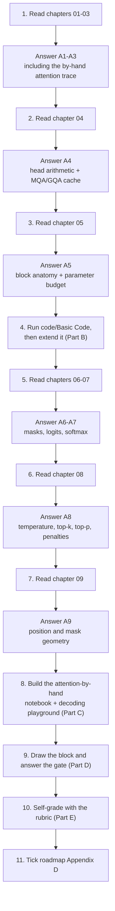
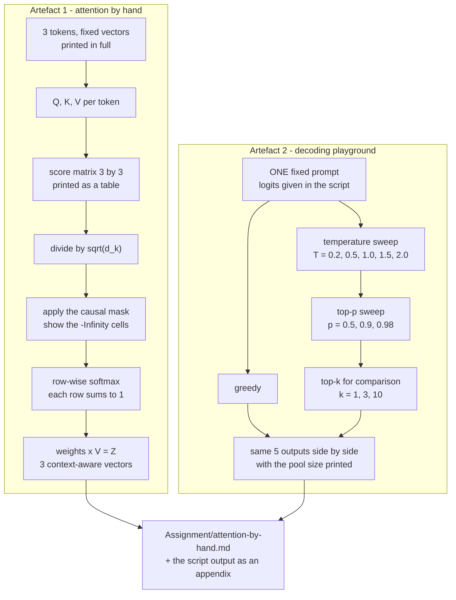

# 📝 Lecture 03 — Assignment

**Attention and Decoding: Self-Attention, Transformer Blocks, Logits & Sampling**
Phase 1 · Foundations · 🟢 Beginner · **Estimated effort: 8–10 hours**

> **Read first:** the nine chapters in **[../notes](../notes)** (index: **[../index.md](../index.md)**).
> Every question below is answerable from those notes — the chapter and section number sits next to each
> part, so you never have to guess where the material lives.
> The lecture's **goal**, **build task** and **completion gate** live in
> **[../README.md](../README.md)** and **[../../roadmap.md](../../roadmap.md)** → *Phase 1 · Lecture 03*.
> The code this assignment refers to is in **[../code/Basic Code](../code/Basic%20Code)** — 21 TypeScript
> files, 15 endpoints, and an **11-chapter implementation guide** that shows every file in full.

---

## 🎯 What this assignment is for

Lecture 02 was about what the model *receives*. Lecture 03 opens the box and asks what happens **inside**:
how a token decides what to read, how a block is assembled, how the last hidden state becomes a
distribution, and how a token is finally chosen. There is still nothing to train and nothing to
fine-tune — but there is real arithmetic, and every number in it can be checked by hand.

So the assignment is weighted the same way the lecture is: **compute the arithmetic, build the block,
and explain the two things the gate asks for.**

| Weight | Part | What it tests | Output |
| :---: | :--- | :--- | :--- |
| **30%** | **A** — Chapter-wise practice | Can you *compute* attention, *size* a block and *predict* a distribution — not recite | Written answers, per chapter (A1–A9) |
| **25%** | **B** — Code tasks | Can you make attention observable and decoding reproducible | `../code/Basic Code` + your extensions |
| **30%** | **C** — Capstone: attention by hand + the decoding playground | The roadmap's actual build task: attention for a 3-token sequence, then temperature/top-p on one prompt | `Assignment/attention-by-hand.md` + a script |
| **15%** | **D** — The gate | Can you draw the transformer block from memory and explain temperature without saying "creativity" | 6 short answers + 1 spoken + 1 drawn |

---

## 🧭 How to work through it



**Three rules, taken from the repository's own writing contract:**

1. **Answer from memory first, then check the notes.** Copying a paragraph out of a chapter is worth zero
   — the gate at the end of this lecture is a *spoken* explanation and a *drawn* diagram.
2. **Diagrams in [mermaid](https://mermaid.js.org/) only.** No screenshots, no Excalidraw exports. Every
   diagram you submit must be a `mermaid` fenced block that renders.
3. **Code is TypeScript.** Pseudo-code is acceptable *inside written answers* (and must be labelled
   `// PSEUDO-CODE`), but everything under `../code` must actually compile and run.

> [!IMPORTANT]
> **The one habit this lecture is really testing.** Every numeric answer below can be verified by running
> the matching endpoint in `code/Basic Code` and reading the number back. Do the arithmetic **first**, on
> paper, then run the endpoint. Where the two disagree, the code is right and your reasoning is the thing
> to fix — and finding that out is the point of the exercise.


---

## 📋 Contents

| Part | Topic | Chapter | Type |
| :---: | :--- | :--- | :--- |
| **A1** | Why attention: from static vectors to dynamic context | [01](../notes/01_Why_Attention_From_Static_Vectors_to_Dynamic_Context.md) | Written + numeric |
| **A2** | Queries, keys & values: the attention search engine | [02](../notes/02_Queries_Keys_Values_The_Attention_Search_Engine.md) | Written + numeric |
| **A3** | Scaled dot-product attention, by hand | [03](../notes/03_Scaled_Dot_Product_Attention_by_Hand.md) | Written + numeric |
| **A4** | Multi-head attention & head specialisation | [04](../notes/04_Multi_Head_Attention_and_Head_Specialisation.md) | Written + numeric |
| **A5** | The transformer block & the residual stream | [05](../notes/05_The_Transformer_Block_and_the_Residual_Stream.md) | Written + numeric |
| **A6** | Encoder-decoder vs decoder-only & why GPT | [06](../notes/06_Encoder_Decoder_vs_Decoder_Only_and_Why_GPT.md) | Written + numeric |
| **A7** | Logits, the LM head & softmax | [07](../notes/07_Logits_the_LM_Head_and_Softmax.md) | Written + numeric |
| **A8** | Decoding strategies & sampling controls | [08](../notes/08_Decoding_Strategies_and_Sampling_Controls.md) | Written + numeric |
| **A9** | Position, masking & attention geometry | [09](../notes/09_Position_Masking_and_Attention_Geometry.md) | Written + numeric |
| **B** | Code tasks — run, prove, extend | [../code/Basic Code](../code/Basic%20Code) | TypeScript + Express |
| **C** | Capstone — attention by hand + decoding playground | roadmap **Build** | Script + report |
| **D** | The completion gate | roadmap **Gate** | Spoken + drawn |
| **E** | Self-grade rubric | — | Self-assessment |
| **F** | Submission checklist · scope guard · progress | — | Admin |

> **How to read the question markers.**
> 🧮 = a numeric problem with a checkable answer · 🖊️ = draw it as mermaid · 💻 = run the endpoint and
> paste the real output · 🎯 = an FDE-consequence question (what you would *do* differently).

---

## Part A — Chapter-wise practice

Nine parts, one per chapter. Each part is answerable from its chapter alone plus the matching endpoints in
`code/Basic Code`. **Write your answers in your own file `Assignment/answers.md`**, keeping the numbering.

---

### A1 — Why attention: from static vectors to dynamic context
📖 [Chapter 01](../notes/01_Why_Attention_From_Static_Vectors_to_Dynamic_Context.md) · sections 01.1–01.9

1. State the problem in one sentence: what can a static embedding lookup **never** express? Then give the
   three things attention has to decide (§01.2) and say which vector answers each one.
2. **The two banks.** For `"I sat by the river bank"` and `"I went to the bank to withdraw cash"`, explain
   why the *same* embedding for `"bank"` is not a bug, and what changes between the two forward passes.
3. **Pronoun resolution.** For `"Rohit gave Aditya his laptop because his computer was broken."`, name the
   two candidate antecedents for the second `"his"`, and say what in the model's *architecture* (not its
   knowledge) is responsible for picking one. Then answer the honest follow-up: can you read the correct
   answer out of the attention weights alone? Why not?

---

### A2 — Queries, keys & values: the attention search engine
📖 [Chapter 02](../notes/02_Queries_Keys_Values_The_Attention_Search_Engine.md) · sections 02.1–02.9

1. Give the three projections as formulas, and for each one write the question it answers in the token's own
   voice (`"what am I looking for?"`). Then say which of the three is used **once** per token and which two
   are used **again by every later token**.
2. **The search-engine analogy.** Map the analogy onto the three vectors, then name the one part of a real
   search engine that has **no** counterpart in attention, and explain what that means for the accuracy of
   the analogy.
3. **The multi-faceted person analogy.** What is the *multi-head* version of this analogy, and why does it
   need more than one "facet" of the same person?
4. 🧮 **The parameter cost.** $W_Q$, $W_K$ and $W_V$ are each $d_{\text{model}} \times d_k$, and
   $d_k = d_{\text{model}}/h$ per head.
   (a) Show that the total projection parameters for $h$ heads equals $3\,d_{\text{model}}^2$ — i.e. that
      they do **not** depend on $h$ and do **not** depend on the sequence length.
   (b) Compute that number for GPT-2 small ($d_{\text{model}} = 768$), LLaMA-3 8B ($4096$) and GPT-3
      ($12{,}288$).
   (c) Express the LLaMA-3 8B figure as a percentage of a 7B-parameter model. State the general lesson in
      one sentence: *the weights are a fixed cost, the ... is a per-request cost.*
5. 🧮 **The shapes.** For a 6-token sequence with $d_{\text{model}} = 8$, $h = 2$:
   (a) write the shape of $X$, $W_Q$, $Q$, $V$, $QK^{T}$ and $Z$;
   (b) which of those shapes depends on the sequence length, and which depends only on the model?
   (c) If you doubled the sequence length to 12, which of the six shapes would change, and which would not?
6. 🧮 **The KV cache.** The cache holds $2 \times N \times \text{layers} \times d_{\text{model}} \times$
   bytes-per-value.
   (a) For GPT-2 small ($d_{\text{model}} = 768$, 12 layers, fp16) at $N = 4096$, compute the cache size in
      MB.
   (b) How many bytes per token is that?
   (c) What would the cache cost at a 128k-token context, in GiB?
   (d) **Why is `Q` not in the cache?** Answer in one sentence that mentions what each vector is *used for*.
7. **Why $W_Q$ and $W_K$ must differ.** If $W_Q = W_K$, what happens to the score of a token against
   itself, and what does that do to the whole attention pattern? Then state the general principle: what is
   the model *not* allowed to do with one matrix that it can do with two?
8. **The weighted-sum view.** Write $Z_i = \sum_j w_{ij}V_j$ and explain why this is a **convex
   combination**. Then state the one-sentence consequence: what kind of operation is attention *incapable*
   of, and which sub-layer of the block (Chapter 05) does it instead?
9. 💻 **Run it.** `POST /api/attention/qkv` with
   `{"tokens":["The","cat","sat","on","the","mat"]}`. Paste `shapes`, `projectionParameters` and
   `kvCacheBytes`. Then explain why `projectionParameters` is `192` while `kvCacheBytes` is `384` — both
   computed from the same `toy-tiny` shape.
10. 🖊️ **Mermaid task:** draw §02.3's dataflow — $X$ fanning out into three projections, $Q$ and $K$
    meeting at the score matrix, the row-wise softmax, and $V$ meeting the weights at the output. Put the
    **shape** on every box, and mark the single box whose size is $N \times N$.
11. 🎯 **Production detail.** §02.3 says real implementations store the three projections as **one fused
    matrix** of shape $d_{\text{model}} \times 3d_{\text{model}}$. Why is one big matrix multiply faster
    than three small ones? Name the one thing you give up by fusing, and the reason it does not matter.

<details>
<summary>Answer sketch for Q6 (open only after attempting)</summary>

(a) $2 \times 4096 \times 12 \times 768 \times 2 = 150{,}994{,}944$ bytes $= 144$ MB.

---

### A3 — Scaled dot-product attention, by hand
📖 [Chapter 03](../notes/03_Scaled_Dot_Product_Attention_by_Hand.md) · sections 03.1–03.8

> This is the centre of the lecture. Every part of this chapter can be done with a pencil and a calculator,
> and the matching endpoint is `POST /api/attention/trace`.

1. Write $\text{softmax}\!\left(\dfrac{QK^{T}}{\sqrt{d_k}}\right)V$ and label every symbol: what it is, its
   shape, and what it means. Then name the **five steps** in order, and say which step is the only one that
   involves $V$.
2. 🧮 **The full trace — do it by hand.** The lecture computes attention for the token `"on"` in
   `"The cat sat on the mat"`, with $d_k = 3$ and these raw scores:

   | Key token | `The` | `cat` | `sat` | `the` | `mat` |
   | :--- | ---: | ---: | ---: | ---: | ---: |
   | $Q_{\text{on}} \cdot K_j$ | 0.1 | 0.5 | 1.8 | 0.2 | 2.4 |

   (a) Compute $\sqrt{3}$ to four decimals — that is the divisor.
   (b) Divide all five raw scores by it. Show the scaled row.
   (c) Exponentiate with the **row maximum subtracted first** (so the largest exponent is exactly 1). Show
      the five exponents.
   (d) Divide by their sum. Report the five weights **as percentages**, to one decimal.
   (e) Verify the row sums to 100% (to within rounding).
   (f) The lecture's hand-drawn table prints `3% · 9% · 20% · 4% · 64%`. Compare it with your answer.
      Which token is first in both? Name the two reasons the *absolute* numbers differ, and state which
      column you should trust and why.
   (g) Write the final answer as a weighted sum: $Z_{\text{on}} = \sum_j w_j V_j$ with your own weights
      substituted. Then say in one sentence what downstream layers now see for the word `"on"`.
3. 🧮 **The scaling counterfactual.** Keep the **same five raw scores** but set $d_k = 64$, so the divisor
   becomes 8.
   (a) Recompute the scaled row and the five percentages.
   (b) Compare with your answer to 2(d). What happened to the distribution's **shape**?
   (c) Now the honest caveat: in a real model, a larger $d_k$ produces *larger* raw scores too. So what is
   the divisor actually compensating for? Answer with the word **variance** in the sentence.
4. 🧮 **The variance argument, quantified.** Two random vectors of length $d_k$ with unit-variance
   components have $\mathrm{Var}(Q \cdot K) \approx d_k$.
   (a) For $d_k = 128$, what is the standard deviation of a raw score?
   (b) A score one standard deviation above the mean gets what **multiplicative** advantage after the
      exponential? (Compute $e^{\sigma}$.)
   (c) State the two consequences in one sentence each: one about the **softmax**, one about the
      **gradient**.
   (d) After dividing by $\sqrt{d_k}$, what is the variance? What does that number buy you?
5. 🧮 **The causal mask.** For a 3-token sequence with a causal mask:
   (a) draw the $3 \times 3$ mask matrix as 1s and 0s;
   (b) for the row of token 0, what fraction of the row is masked, and what must the softmax therefore
      produce for that row?
   (c) The mask is applied by writing $-\infty$ into the scores, not $0$. Explain why $0$ would be wrong —
      and then explain why a *very negative number* like $-10^9$ is also not exactly equivalent to
      $-\infty$.
   (d) In which order do scale, mask and softmax happen? Give one concrete failure caused by doing them in
      a different order.
6. 🧮 **Numerical stability.** You are given the scores `[800, 810, 820]`.
   (a) Compute $e^{800}$, $e^{810}$, $e^{820}$ and explain what a float64 does with them.
   (b) Compute the naive softmax $\frac{e^{z_i}}{\sum_j e^{z_j}}$ and state the result.
   (c) Now subtract the row maximum first and recompute. Give the three probabilities.
   (d) Which property of softmax makes (c) *exactly* equivalent to (b) in exact arithmetic?
   (e) In the JSON response, what do the values from (b) appear as, and what does that tell you about
      debugging a `null` in a response body?
7. 🧮 **The cost model.** Attention work scales with $N^2$.
   (a) For $N = 4096$, how many entries does the score matrix have? For $N = 16{,}384$?
   (b) What is the ratio of the two, and what is the ratio of the context lengths?
   (c) Now compute the **KV-cache** growth over the same two context lengths for GPT-2 small (12 layers,
      $d_{\text{model}} = 768$, fp16). Which of the two grows quadratically and which grows linearly?
   (d) State the FDE consequence in one sentence: which of your product's knobs actually reduces the
      quadratic term?
8. **Why the divisor is not a normalisation trick.** §03.4 gives two arguments. Name both, and say which
   one is about *training* and which one is about *inference*.
9. 💻 **Run it.** `POST /api/attention/trace` with `{}`. Paste `steps`, `lectureTrace.dominance`,
   `lectureTrace.reconciles` and `scaling`. Then answer: `reconciles` is `false` — is that a bug in the
   code, a bug in the lecture, or neither? Justify in two sentences.
10. 💻 **Prove the variance claim yourself.** Call the same endpoint three times with `{"dK":3}`,
    `{"dK":64}` and `{"dK":128}`. Paste the three `measured` strings. What happens to `rawVariance`, and
    what happens to `scaledVariance`? Explain why the second one is the number that matters.
11. 🖊️ **Mermaid task:** draw the five steps as a single pipeline — scores → scale → mask → softmax → mix —
    putting the **shape** on every stage, marking where `-Infinity` enters, and marking which stage is
    applied **per row**. Then add a side lane showing the same pipeline **without** the mask, so the two can
    be compared at a glance.
12. 🎯 **The scaling decision.** A colleague proposes removing the $\sqrt{d_k}$ divisor "because it is just
    a constant and the model will learn to compensate". Write the three-sentence reply: what breaks first
    during training, what the symptom looks like on a loss curve, and the one experiment you would run to
    settle it.

(b) $144 \text{ MB} / 4096 = 36$ KB per token — that is $2 \times 12 \times 768 \times 2$ bytes.
(c) $36{,}864 \times 131{,}072 = 4{,}831{,}838{,}208$ bytes $\approx 4.5$ GiB **for one sequence**, which is
   why serving long context is a memory problem before it is a compute problem.
(d) Because $Q$ is the token's own question, used exactly once — at the moment that token is processed.
   $K$ and $V$ are the *answers* other tokens will look up later, so they must be kept.

</details>

4. **Why not an RNN?** (a) State the path-length argument in one sentence. (b) 🧮 An RNN processes
   $N = 4096$ tokens sequentially at $20\,\mu s$ per step. What is the minimum time before the *last*
   token's representation is available? (c) Attention has a path length of 1 *hop* between any two tokens
   — so is attention cheap? Name the cost the path-length argument does **not** capture.
5. **"Attention is a soft, differentiable database lookup."** Unpack all four words. Then state the one
   operation that is *hard* in a real database lookup but *soft* here, and why that difference is what
   makes the whole thing trainable.
6. 🧮 **A row is a distribution.** The lecture's Example B gives, for the token `"it"` in
   `"it was too tired"`: `it 0.432 · too 0.229 · tired 0.212 · was 0.127`.
   (a) Sum the row and state what the sum must be.
   (b) In the second sentence (`"it was too wide"`) the row is `0.418 · 0.237 · 0.222 · 0.123`.
      Which single weight moved the most, and by how much?
   (c) The word `"it"` has the *same* embedding in both sentences. So where does the difference in the row
      come from?
   (d) If you edited one weight from `0.229` to `0.329` by hand and left the rest alone, the row no longer
      sums to 1. Explain why that is a **consequence** of softmax rather than a rule you have to enforce.
7. 💻 **Run it.** `POST /api/attention/why` with `{}` returns `sameEmbedding` and `sameOutput`. Paste both
   booleans and both `reads` lists, then answer in two sentences: which of the two booleans is the *proof*
   of §01.2, and why is the other one the interesting one?
8. §01.8 lists what attention does **not** do. Name three of them, and for each name the part of a real
   system that does it instead.
9. 🖊️ **Mermaid task:** draw §01.3's "shape of the fix" — a static embedding on the left, the three
   projections in the middle, and the dynamic output vector on the right — and label the one arrow that
   turns a lookup into a computation. Then add a second lane showing the **same token** in a different
   sentence producing a different output, and mark where the two lanes first diverge.
10. 🎯 A colleague says: *"attention is the model deciding what to think about — so I can read the attention
    weights to explain why it answered that way."* Write the three-sentence reply. Name what the weights
    *do* tell you, what they cannot tell you, and the one measurement you would make instead.


<details>
<summary>Answer sketch for Q2 (open only after attempting)</summary>

(a) $\sqrt{3} = 1.7321$.
(b) Scaled: `0.0577 · 0.2887 · 1.0392 · 0.1155 · 1.3856`.
(c) Subtract the max (1.3856): `e^-1.3279 = 0.2650`, `e^-1.0969 = 0.3339`, `e^-0.3464 = 0.7072`,
   `e^-1.2701 = 0.2808`, `e^0 = 1.0000`.
(d) Sum $= 2.5869$ → **`10.2% · 12.9% · 27.3% · 10.9% · 38.7%`**.
(e) Sums to 100.0% (the last 0.1% is the six-decimal rounding in the intermediate steps).
(f) **`mat` is first in both.** The two reasons the absolute numbers differ: (i) the lecture's percentages
   are hand-rounded for teaching, and (ii) they were not computed from exactly this scaled row. Trust the
   **computed** column — and note that both columns agree on the *ranking*, which is what the example is
   teaching.
(g) $Z_{\text{on}} = 0.102\,V_{\text{The}} + 0.129\,V_{\text{cat}} + 0.273\,V_{\text{sat}} +
   0.109\,V_{\text{the}} + 0.387\,V_{\text{mat}}$. Downstream layers now see *"on … a mat"* rather than
   *"the word on"*.

</details>

<details>
<summary>Answer sketch for Q3 (open only after attempting)</summary>

(a) Scaled row `0.0125 · 0.0625 · 0.2250 · 0.0250 · 0.3000`; percentages
   **`17.8% · 18.7% · 22.0% · 18.0% · 23.7%`**.
(b) The distribution became **nearly uniform** — the spread collapsed from 10–39% to 18–24%. `mat` is still
   first, but it no longer dominates.
(c) The divisor compensates for the fact that the **variance** of a dot product grows with $d_k$. With
   $d_k$ terms, raw scores are spread over a range proportional to $\sqrt{d_k}$; dividing by $\sqrt{d_k}$
   holds that spread at roughly unit variance, which is the range where softmax still has a useful gradient.

</details>

<details>
<summary>Answer sketch for Q6 (open only after attempting)</summary>

(a) $e^{800} \approx 10^{347}$ — larger than float64's maximum of about $1.8 \times 10^{308}$, so it
   becomes **`Infinity`**. Same for $e^{810}$ and $e^{820}$.
(b) `Infinity / Infinity` is **`NaN`** — the naive softmax returns `[NaN, NaN, NaN]`.
(c) Subtract 820: `e^-20 = 2.0612e-9`, `e^-10 = 4.5400e-5`, `e^0 = 1`; sum $= 1.0000454$ →
   **`0.0000002% · 0.0045% · 99.9955%`**.
(d) **Shift invariance**: $\text{softmax}(z + c) = \text{softmax}(z)$ for any constant $c$. Choosing
   $c = -\max(z)$ is what makes the trick exact rather than approximate.
(e) They appear as **`null`** — JSON has no `Infinity` or `NaN`. So a `null` in a numeric field means "the
   arithmetic produced a non-finite value", which is a very different diagnosis from "the field was never
   set".

</details>

<details>
<summary>Answer sketch for Q7 (open only after attempting)</summary>

(a) $4096^2 = 16{,}777{,}216$ entries; $16{,}384^2 = 268{,}435{,}456$ entries.
(b) **16×** the entries for **4×** the context — quadratic means a 4× input gives a 16× cost.
(c) KV cache $= 2 \times N \times 12 \times 768 \times 2 = 36{,}864 \times N$ bytes, so
   $144$ MB at $N = 4096$ and $576$ MB at $N = 16{,}384$ — **4×, i.e. linear**. The score matrix is the
   quadratic term; the cache is not.
(d) The quadratic term is reduced by anything that reduces **$N$**: shorter prompts, tighter retrieval,
   prefix caching, and (for the work rather than the memory) the sliding-window masks of Chapter 09.

</details>


---

### A4 — Multi-head attention & head specialisation
📖 [Chapter 04](../notes/04_Multi_Head_Attention_and_Head_Specialisation.md) · sections 04.1–04.7

1. State the multi-head formula, including $W^{O}$. Then answer the key question: **which single operation
   in multi-head attention lets the heads exchange information?** What would happen if you removed it?
2. 🧮 **The arithmetic of $d_{\text{head}}$.** Complete the table from memory, then check it against §04.3:

   | Model | $d_{\text{model}}$ | $h$ | $d_{\text{head}}$ | layers |
   | :--- | ---: | ---: | ---: | ---: |
   | GPT-2 small | 768 | 12 | ? | 12 |
   | LLaMA-3 8B | 4096 | 32 | ? | 32 |
   | LLaMA-3 70B | 8192 | 64 | ? | 80 |
   | GPT-3 | 12,288 | 96 | ? | 96 |

   (a) Fill in every `?`. (b) What is the range of $d_{\text{head}}$ across those four models, spanning a
   ~1000× parameter range? (c) State the invariant that must always hold, as an equation.
3. 🧮 **Does multi-head cost more?** For $h$ heads at $d_{\text{head}} = d_{\text{model}}/h$:
   (a) Show that the projection parameters are **identical** to one full-width head ($3\,d_{\text{model}}^2$).
   (b) Show that the **mixing FLOPs** are identical: $N^2 d_{\text{model}}$ vs $h \cdot N^2 d_{\text{head}}$.
   (c) For $N = 4096$ and GPT-2 small ($h = 12$), compute the score-matrix entries for one head and for
      $h$ heads. By what factor do they differ?
   (d) Name the **two** genuinely new costs of multi-head attention, and classify each as *memory* or
      *compute*.
4. **Head specialisation.** Name the four roles the lecture lists, and for each one give the token pair it
   connects. Then answer the honest follow-up: are the attention weights of a single head an
   **explanation** of the model's answer? Justify in two sentences.
5. 🧮 **MQA and GQA.** The KV cache is sized by how many **KV heads** the model keeps.
   (a) For GPT-2 small at $N = 4096$, fp16, compute the cache for MHA ($h_{\text{kv}} = 12$), GQA
      ($h_{\text{kv}} = 3$) and MQA ($h_{\text{kv}} = 1$).
   (b) Express GQA and MQA as percentage savings against MHA.
   (c) Which matrix becomes *larger* in MQA relative to MHA, and why is that acceptable?
   (d) In one sentence: why did GQA become the default in open models rather than MQA?
6. **Head count as a hyperparameter.** §04.6 gives two facts about $d_{\text{head}}$. State both, and then
   answer: if you were pretraining a 1B-parameter model, what $d_{\text{head}}$ would you pick, and how
   would that choice set $h$ once $d_{\text{model}}$ is fixed?
7. **The split interpretation.** `headSlices` carves each token's $d_{\text{model}}$-wide vector into $h$
   contiguous slices. Name one consequence of slicing (rather than, say, random projection) that a reader
   should be aware of.
8. 💻 **Run it.** `POST /api/heads` with `{"tokens":["The","cat","mat"]}`. Paste the two `weights` matrices
   and answer: (a) in which rows do head 0 and head 1 disagree most? (b) why is row 0 `[1,0,0]` in *both*
   heads? (c) what does `concatenated` show, and what does `mixed` show that `concatenated` does not?
9. 💻 **Run it on a real shape.** `POST /api/heads` with `{"tokens":["The"],"shape":"gpt2-small"}`. Paste
   `cost.projectionParameters`, `cost.mixingFlops` and `cost.scoreMatrixEntries`. Which two have
   `identical: true`, and which one does not?
10. 🖊️ **Mermaid task:** draw the multi-head dataflow — $X$ → split into $h$ slices → $h$ independent
    Q/K/V projections → $h$ independent attention computations → concat → $W^{O}$ → mixed output — putting

---

### A5 — The transformer block & the residual stream
📖 [Chapter 05](../notes/05_The_Transformer_Block_and_the_Residual_Stream.md) · sections 05.1–05.6

1. **The misconception.** Complete the sentence and then justify it: *"A Transformer is not attention — it
   is ..."*. List the **six** operations of one block, in order, and say which single one of them is the
   attention sub-layer from Chapters 03–04.
2. **Pre-LN vs post-LN.** The 2017 paper used post-LN; essentially every modern decoder uses pre-LN. State
   the difference, and give the two training-stability reasons pre-LN won. Then name the normalisation that
   many current models use instead of LayerNorm, and say what it drops.
3. 🧮 **LayerNorm by hand.** For the token vector $\mathbf{x} = [2, 4, 4, 6]$ (assume $\gamma = 1$,
   $\beta = 0$, $\epsilon \approx 0$):
   (a) compute the mean;
   (b) compute the variance;
   (c) compute the standard deviation;
   (d) write the normalised vector;
   (e) state the property of the output in one line — what are its mean and variance?
   (f) **Which direction does LayerNorm normalise over** — across features within one token, or across
      tokens for one feature? Why does that matter for a sequence?
4. 🧮 **The residual arithmetic.** A block receives
   $H_{\text{in}} = [0.5,\; -1.0]$, the attention sub-layer outputs $[0.2,\; 0.3]$, and the FFN outputs
   $[-0.1,\; 0.4]$.
   (a) Compute $H_{\text{mid}} = H_{\text{in}} + Z_{\text{attention}}$.
   (b) Compute $H_{\text{out}} = H_{\text{mid}} + \text{FFN}(H_{\text{mid}})$.
   (c) Verify that $H_{\text{out}} = H_{\text{in}} + Z_{\text{attention}} + \text{FFN}$.
   (d) State the shape relationship between $H_{\text{in}}$ and $H_{\text{out}}$, and explain why that is
      the property that makes 96-layer models possible.
5. **The residual stream as a shared bus.** Unpack the metaphor: what is the bus, who reads it, who writes
   to it, and — critically — does anyone ever *overwrite*? Then name the four benefits §05.2 lists, and for
   each give one capability it enables (activation steering, pruning, probing, …).
6. **The FFN.** Write $\text{FFN}(\mathbf{x}) = \text{GELU}(\mathbf{x}W_1 + b_1)W_2 + b_2$.
   (a) What is the expansion ratio, typically?
   (b) Does the FFN mix positions? Say why or why not, referring to what attention already did.
   (c) State the **mathematical** reason the FFN is necessary: what can attention's output *not* be, and
      what does that mean for its expressive power?
   (d) Name the non-linearity used by GPT-2/3, by LLaMA, and by older models.
7. 🧮 **The parameter budget.** Per layer, attention is $4\,d_{\text{model}}^2$ and the FFN is
   $2\,d_{\text{model}}\,d_{\text{ff}}$.
   (a) Why is the attention term $4\,d^2$ and not $3\,d^2$? Name the matrix people forget.
   (b) For $d_{\text{model}} = 768$ and $d_{\text{ff}} = 3072$, compute both terms and the per-layer total.
   (c) Compute the FFN's share of the block, as a fraction and as a percentage.
   (d) Now do the same for $d_{\text{model}} = 8$, $d_{\text{ff}} = 32$. What do you notice about the two
      shares, and why does that make "about two-thirds" a general fact rather than a coincidence?
   (e) Multiply (b) by 12 layers. Then add a 50,257-token embedding table at $d_{\text{model}} = 768$ and a
      1,024-position learned positional table. What total do you get, and how does it compare with GPT-2

---

### A6 — Encoder-decoder vs decoder-only & why GPT is decoder-only
📖 [Chapter 06](../notes/06_Encoder_Decoder_vs_Decoder_Only_and_Why_GPT.md) · sections 06.1–06.9

1. **The one-sentence claim.** In exactly what respect do the three architecture families differ? Then
   complete the table from memory — family, what it is built for, its mask, and two real examples:

   | Family | Built for | Mask | Examples |
   | :--- | :--- | :--- | :--- |
   | encoder-decoder | ? | ? | ? |
   | encoder-only | ? | ? | ? |
   | decoder-only | ? | ? | ? |

2. **The three attention modes.** Draw each mask as a 1/0 matrix for a 3-token sequence. Then answer the
   question the masks alone cannot: **why is the cross-attention mask all ones** when the decoder's own
   self-attention is causal? Be precise about which positions are rows and which are columns.
3. **The 2017 architecture.** List the three places attention appears in the original encoder-decoder, and
   say which one the 2017 paper was *about*. Then explain what changed when the encoder was removed.
4. **Five reasons GPT is decoder-only.** State all five from §06.4. Then say which of the five is the one
   that actually decided the outcome for *serving* (as opposed to training or research), and why.
5. 🧮 **The training/inference asymmetry.** Training scores all $N$ positions in one forward pass with
   teacher forcing; inference needs one pass per token.
   (a) For $N = 4096$, how many forward passes does each mode need?
   (b) State the ratio, and explain why it equals $N$ rather than a constant.
   (c) Which of the two modes therefore needs a KV cache, and why is the cache *not* a property of the
      architecture?
   (d) 🎯 Write the two-sentence consequence for a product: what does this asymmetry make cheap, and what
      does it make expensive?
6. 🧮 **How much of the score matrix a causal mask keeps.**
   (a) Write the number of allowed pairs as a formula in $N$.
   (b) Evaluate it for $N = 3$, $N = 6$ and $N = 4096$.
   (c) Compute the ratio (bidirectional / causal) for each. What value does it approach as $N$ grows?
   (d) Why is "a causal mask hides about half the matrix" a *rounded* claim rather than an exact one? Give
      the value at $N = 3$ to show how wrong it is there.
7. **What decoder-only gave up.** §06.5 lists three losses. For each: the loss, and where it went instead.
   Then answer: for an embedding/retrieval workload, which family would you choose, and why?
8. **Prefix-LM.** State the idea, draw its mask as a 1/0 matrix for a 2-token prompt followed by a 3-token
   answer, and name the real use case. What does it cost you relative to a pure causal mask?
9. 💻 **Run it.** `POST /api/architecture/compare` with `{"n":3,"task":"summarise a contract"}`. Paste
   `attentionModes`, `contextReach` and `trainingVsInference`. Then answer: which two modes have
   **identical** matrices, and what field in the response explains why they are not the same thing?
10. 💻 **Check the ratio claim.** Call the same endpoint with `{"n":32}` and paste `contextReach`. What is
    `ratio`, and how close is it to 2?
11. 🖊️ **Mermaid task:** draw a single root node *"Transformer (2017)"* branching into the three families,
    with each branch carrying its mask and its two real examples, and a final converging arrow into the
    sentence *"same blocks, same heads, same formula, different mask."*
12. 🎯 **The migration question.** A team has a fine-tuned BERT-style encoder doing classification and a
    GPT-style model doing summarisation. They want to consolidate onto one family. Write the
    three-sentence recommendation: which family, what they gain, and the one capability they would have to
    rebuild by hand.

      small's commonly quoted ~124M?
8. 💻 **Run it.** `POST /api/block` with `{"tokens":["The","cat","mat"]}`. Paste `checks` and
   `parameterBudget`. Then explain which of the three checks would catch a block that returned its input
   unchanged — and why that specific bug is dangerous.
9. 💻 **Compare two scales.** Run the same endpoint with `{"tokens":["The"],"shape":"gpt2-small"}`. Paste
   `parameterBudget`. Why is `ffnShare` the same number at both scales?
10. 🖊️ **Mermaid task (this is half the lecture's gate — do it from memory).** Draw **one** transformer
    block as six numbered boxes with the two residual additions shown explicitly, then wrap it in a second
    diagram showing $L$ such blocks in a row with the **residual stream** as a single horizontal lane that
    every block reads from and writes back to. Label where $H_{\text{in}}$ and $H_{\text{out}}$ sit, and
    mark the box that holds two-thirds of the parameters.
11. 🎯 **The pruning decision.** A team wants to delete four of a 32-layer model's attention sub-layers to
    save latency. Using the residual-stream model, explain why the model degrades *gracefully* rather than
    catastrophically — and name the measurement you would run before and after.

    the shape on every box and marking the one box where the heads finally meet.
11. 🎯 **The serving decision.** A provider offers the same model at two configurations: 32 heads with full
   MHA, or 32 heads with GQA over 8 KV heads. Quality aside, write the two-sentence recommendation you
   would give for a service that keeps 8,000-token conversations, and name the one number that decides it.


---

### A7 — Logits, the LM head & softmax
📖 [Chapter 07](../notes/07_Logits_the_LM_Head_and_Softmax.md) · sections 07.1–07.9

> The matching endpoints are `POST /api/logits` and `POST /api/logits/bias`.

1. **The pipeline in one line.** Write it: $H_{\text{final}} \rightarrow \_\_\_ \rightarrow \_\_\_
   \rightarrow \_\_\_ \rightarrow$ one token. Give the **shape** of the LM head, and for
   $|V| = 50{,}257$ and $d_{\text{model}} = 768$ compute its parameter count. What is **weight tying**,
   and how many parameters does it save?
2. 🧮 **What a logit is not.** For the prompt `"The capital of India is"`, the logits are
   `Delhi 12.8 · Mumbai 8.1 · Kolkata 5.2 · Punjab 3.4 · banana −4.1 · <EOS> −8.3`.
   (a) Do these numbers sum to 1? Should they? Can they be negative?
   (b) Compute $e^{12.8}$ and $e^{8.1}$ **without** subtracting a maximum. What is the ratio between them?
   (c) Now redo it with the row maximum subtracted. What is the largest exponent, and why is that number
      convenient?
   (d) Divide by the sum of your exponents and report all six probabilities as percentages.
   (e) The lecture's table prints `92% · 5% · 2% · 1%`. Yours will be far more peaked. Name the reason —
      and note that this is a fact about **$|V|$**, not about arithmetic.
   (f) `banana` still has a non-zero probability. Compute it, and state in one sentence why that is the
      mechanical reason a language model is *usually* sensible but never *guaranteed* correct.
3. 🧮 **The three softmax properties, proved on the numbers above.**
   (a) **Shift invariance:** show that $\text{softmax}([12.8,\; 8.1]) = \text{softmax}([112.8,\; 108.1])$
      by computing both. Why does this make the row-max subtraction *free* rather than a compromise?
   (b) **Scale sensitivity:** for the logits `[5, 4, 3, 2, 1]`, compute the distribution at $T = 1$ and at
      $T = 2$. What changed?
   (c) **Ranking preservation:** for `[5, 4, 3, 2, 1]` at $T = 0.5$, $T = 1$ and $T = 2$, what is `argmax`
      each time? State the consequence for greedy decoding.
4. **Log probabilities.** Compute $\ln(0.99)$ and $\ln(0.01)$ approximately. Why is log-probability the
   form an API returns, and what arithmetic does it make easy that probabilities make hard? Name the two
   places in this lecture where log-space scoring is used.
5. 🧮 **Logit bias.** You add $+5$ to `Mumbai`'s logit and $-20$ to `banana`'s.
   (a) Write Mumbai's new logit, and recompute the distribution over `Delhi` and `Mumbai` only.
   (b) What happened to the **leader**? Explain the change in one sentence that mentions "log-space" and
      "multiplicative".
   (c) $e^{+5}$ is what factor? So a bias of $+5$ is really a bias of *what* in probability space?
   (d) What does `banana`'s $-20$ do, numerically? Why would a schema use a large negative number rather
      than a literal $-\infty$?
   (e) 🎯 Name the two-word phrase for the mechanism in (d), and the lecture where it becomes the whole
      subject.
6. **The LM head is not magic.** Explain in two sentences why the LM head is "the same matmul as every
   other projection in the model" — and which earlier operation it is most directly analogous to.
7. 💻 **Run it.** `POST /api/logits` with `{}`. Paste `table`, `properties.rankingPreserved` and
   `properties.sharpened` / `original` / `flattened`. Then answer: in `properties`, which single field is
   the *measured proof* that temperature cannot change which token wins?
8. 💻 **Run the bias.** `POST /api/logits/bias` with `{"bias":{"banana":-20,"Mumbai":5}}`. Paste `before`
   and `after`. Which token is now the leader, and by what percentage did its share change?
9. 🖊️ **Mermaid task:** draw the pipeline $H_{\text{final}} \rightarrow W_{\text{lm}} \rightarrow$ logits
   $\rightarrow$ bias $\rightarrow$ temperature $\rightarrow$ softmax $\rightarrow$ distribution, putting
   the shape on the first three boxes and marking the one step that is a **hard constraint** rather than a
   re-weighting.
10. 🎯 **The confidence question.** A product manager asks you to display "the model's confidence" in a
    generated answer. Write the three-sentence reply: why the probability of the *first* token is not the
    confidence in the *answer*, what you would display instead, and the one number you would compute over
    the whole sequence.

<details>
<summary>Answer sketch for Q2 (open only after attempting)</summary>

(a) No — logits sum to nothing in particular, and they are routinely negative.
(b) $e^{12.8} \approx 362{,}218$; $e^{8.1} \approx 3{,}294$; ratio $\approx 110\times$.
(c) Subtract 12.8: the largest exponent is $e^0 = 1$, and every other exponent is $\le 1$ — so the
   arithmetic can never overflow.
(d) Exponents `1 · 0.009095 · 0.0005 · 0.000083 · 0 · 0`; sum $= 1.009678$ →
   **`99.0414% · 0.9008% · 0.0496% · 0.0082% · ~0% · ~0%`**.
(e) Because these six tokens are a **slice** of a ~100,000-token vocabulary. The softmax denominator is
   the sum over the *whole* vocabulary, and the unlisted tokens absorb the remaining mass — which is why
   the same logits give ~92% over a full vocabulary and ~99% over six tokens.
(f) $P(\texttt{banana}) \approx 4 \times 10^{-8}$ — about 4 times in 100 million. Non-zero means
   *possible*, and "possible but astronomically unlikely" is not the same as "impossible".

</details>


---

### A8 — Decoding strategies & sampling controls
📖 [Chapter 08](../notes/08_Decoding_Strategies_and_Sampling_Controls.md) · sections 08.1–08.13

> The matching endpoints are `POST /api/decoding/controls` and `POST /api/decoding/sample`.

1. **Two separate systems.** §08.1 splits the loop into a neural-network stage and a decoding stage. State
   what each stage takes in and gives out, then answer the consequence question: why can you change
   temperature, top-p and penalties **without touching a single weight**?
2. 🧮 **Temperature.** Start from the logits `Python 5 · Java 4 · JavaScript 3 · C++ 2 · Rust 1`.
   (a) For $T = 0.5$, $T = 1.0$ and $T = 2.0$, write the three **scaled** rows.
   (b) State what happened to the **gaps** between adjacent tokens in each case.
   (c) Compute the three full distributions as percentages (this is the lecture's own table — reproduce it).
   (d) What is `argmax` at each of the three temperatures? What does that prove about what temperature can
      and cannot change?
   (e) State the two boundary cases precisely: what is $T = 0$ equivalent to, and what does
      $T \to \infty$ approach?
3. 🧮 **Top-k.** Take the full distribution from 2(c) at $T = 1$
   (`0.6364 · 0.2341 · 0.0861 · 0.0317 · 0.0117`) and apply $k = 3$.
   (a) Sum the three kept probabilities.
   (b) Renormalise them so the pool sums to 1. Give the three new values.
   (c) State top-k's **failure mode** for a *flat* distribution and for a *peaked* one — one sentence each.
   (d) Why is a fixed $k$ called "shape-blind"?
4. 🧮 **Top-p (nucleus).** The sorted distribution is
   `A 0.42 · B 0.26 · C 0.13 · D 0.08 · E 0.05 · F 0.03 · G 0.02 · H 0.01`.
   (a) Build the cumulative column.
   (b) For $p = 0.9$, which tokens form the nucleus? Show the cumulative value at which you stop.
   (c) Which single token is the "boundary" token, and what does it mean that the boundary falls *inside*
      it?
   (d) Redo (b) for $p = 0.5$. How many tokens now?
   (e) State top-p's weakness in one sentence — what does it still include that it should not?
5. 🧮 **Min-p.** With $p_{\min} = 0.1$ and the distribution from 3(a):
   (a) compute the threshold;
   (b) list the surviving tokens;
   (c) compare with your top-3 answer from Q3 — are they the same set?
   (d) Now use a **peaked** distribution `[0.90, 0.05, 0.03, 0.01, 0.01]`. Recompute the threshold and the
      survivors. How many tokens survive now, and why does min-p behave like greedy here?
6. 🧮 **Penalties.** Token `Python` (id 0) has logit `4.0`; token `Rust` (id 4) has logit `−4.0`.
   (a) Apply a **repetition penalty** of 1.5 to both. Show the arithmetic for each.
   (b) Why is the operation *division* for the positive logit and *multiplication* for the negative one?
      What would happen to the negative logit if you divided it too?
   (c) Apply a **frequency penalty** of 0.5 to a token that appeared **three** times. What is the
      adjustment?
   (d) Apply a **presence penalty** of 1.0 to the same token. What is the adjustment, and how does it
      differ from (c)?
   (e) 🎯 State why penalties are "blunt instruments", naming the two kinds of text they damage most.
7. **Greedy vs beam.** (a) What does greedy guarantee, and what does it fail at? (b) For beam search with
   width $w$ and vocabulary $|V|$, how many candidates are scored per step? (c) Why must the score be
   **length-normalised**, and what does an unnormalised beam search always prefer? (d) One sentence: what
   does beam search buy you, and what does it *not* buy you?
8. **Order of operations.** Write the nine steps in order. Then answer the two ordering questions: why
   must temperature come before the pool trimming, and why must penalties come before temperature?
9. 🧮 **Determinism.** (a) With a fixed seed, is sampling reproducible *in this project*? Why? (b) Is it
   reproducible across two hosted providers with the same seed and parameters? Name two reasons not.
   (c) 🎯 What do you log so that a non-reproducible output is at least *diagnosable*?
10. 💻 **Run it.** `POST /api/decoding/controls` with `{}`. Paste `lectureTemperature.table` and `pools`.
    Then answer: all three pools came out identical — is that a bug? Design **one** request that makes
    top-k and top-p disagree, and one that makes min-p behave like greedy.
11. 💻 **Run the decoder.** `POST /api/decoding/sample` with
    `{"strategy":"sample","temperature":0.7,"topP":0.9,"presencePenalty":1,"seed":42}`. Paste `trace`,
    `distribution`, `selected` and `greedy`. Then answer: (a) which step is **absent** from the trace and
    why? (b) what did the presence penalty do to the distribution? (c) why do `greedy` and `sample`
    disagree?
12. 🖊️ **Mermaid task:** draw the full decode loop — the two stages, the five control steps inside stage 2
    in order, the draw, and the stop check that either exits or appends and repeats. Mark on the diagram
    which steps are *per-step* and which are *per-sequence*.
13. 🎯 **The parameter set.** For each of these three products, state the temperature, top-p and penalties
    you would start with, and one sentence of justification: (i) a code-completion tool, (ii) a customer
    support summariser, (iii) a marketing brainstormer. Then say which single parameter you would change
    first if the support summariser started inventing details.


---

### A9 — Position, masking & attention geometry
📖 [Chapter 09](../notes/09_Position_Masking_and_Attention_Geometry.md) · sections 09.1–09.8

> The matching endpoints are `POST /api/position/encode` and `POST /api/position/mask`.

1. **Why position at all.** State the property self-attention has that makes position necessary, and give
   the two-sentence proof using `"Dog bites man"` and `"Man bites dog"`. Then say what fixes it and why the
   fix is **additive** rather than concatenative.
2. 🧮 **The frequency ladder.** For $d_{\text{model}} = 8$:
   (a) write the formula for $\omega_i$;
   (b) compute the four frequencies;
   (c) what is the ratio between consecutive frequencies, and what does that mean about "how fast each
      pair oscillates"?
   (d) 🖊️ Describe the clock-hands metaphor in one sentence, naming which hand gives the "second" and
      which gives the "hour".
3. 🧮 **The positional vector by hand.** Using the frequencies from Q2:
   (a) compute $PE_{(0,\,d)}$ for all eight dimensions. (Hint: $\sin 0 = 0$, $\cos 0 = 1$.)
   (b) compute $PE_{(1,\,d)}$ for all eight dimensions, to four decimals.
   (c) what is the range of every value, and why does that matter when you *add* the vector to an
      embedding?
   (d) for a token whose embedding is `[0.5, 0.5, 0.5, 0.5, 0.5, 0.5, 0.5, 0.5]` at position 1, write
      $X = E + P$.
4. 🧮 **The linear-offset property.** The claim is $\mathbf{P}_{pos} \cdot \mathbf{P}_{pos+k} =
   \sum_i \cos(\omega_i k)$ — depending only on $k$.
   (a) For $k = 1$ and the frequencies from Q2, compute the sum. (Four terms.)
   (b) For $k = 2$, compute it again.
   (c) Compare your two numbers with the endpoint's `values` field.
   (d) The endpoint's `spread` field is `0` for $k=1$ and `1e-06` for $k=2$. Explain what causes that
      1e-06, and why the code uses a **tolerance** rather than exact equality. Then state the general
      engineering lesson in one sentence.
   (e) Why does this property let the model read **relative** distance from an **absolute** encoding?
5. **How additive position enters the score.** Expand $Q_i \cdot K_j$ into its four terms and label each
   one. Which term carries the relative-position signal? Then state the *cost* of the additive approach —
   what can you no longer remove later?
6. 🧮 **RoPE.** (a) Describe the operation in one sentence, and say what it is applied to. (b) Why does the
   score depend only on $j - i$? Give the two-dimensional derivation in one line. (c) The endpoint scores
   positions `(0, 5)` and `(5, 10)` and gets `0.256209` both times — what does that demonstrate?
   (d) Name RoPE's three advantages over additive sinusoidal encoding. (e) How many parameters does RoPE
   add?
7. 🧮 **ALiBi.** (a) Write the score formula with the bias. (b) For $h = 2$ heads, compute the two slopes
   $m_h = 2^{-8(h+1)/h}$. (c) For a 3-token sequence, write the full bias matrix for head 0. (d) Why is
   ALiBi causal *without* a separate mask? (e) State ALiBi's headline property — what can it do at
   inference that additive sinusoidal cannot?
8. 🧮 **The four masks.** For $N = 4$:
   (a) draw each of the four masks (`none`, `causal`, `sliding` with window 3, `padding` with 1 pad token)
      as a 1/0 matrix;
   (b) compute `allowedPairs` and `density` for each;
   (c) which single cell distinguishes `causal` from `padding`, and why must a pad token be hidden **from
      itself**?
   (d) which cell does `sliding` remove that `causal` keeps, and what does that save?
9. **Two axes, one mechanism.** §09.6 frames masking as one mechanism on two axes. Name both axes, and say
   which lecture turns the second one into a product feature.
10. 💻 **Run it.** `POST /api/position/encode` with `{"tokens":["The","cat","mat"],"k":2}`. Paste
    `frequencies`, `linearOffset`, `rope.proof` and `alibi`. Then answer: which single row of
    `rope.proof` is the strongest evidence that RoPE is relative, and why?
11. 💻 **Run the masks.** `POST /api/position/mask` with `{"n":4}`. Paste the four `kind`/`allowedPairs`/
    `density`/`mask` rows. Then explain in one sentence what a sliding-window mask saves, and name the
    quality risk it introduces.
12. 🖊️ **Mermaid task:** draw the four positional schemes as a comparison — one column per scheme, one row
    per property (how relativity is obtained, parameter cost, extension ability, who uses it) — and add a
    fifth row showing *what each one costs you at runtime*.
13. 🎯 **"Lost in the middle."** A user complains that your RAG assistant ignores a document that *is*
    present in the context window. Write the three-sentence reply: what geometry causes it, what you would
    change about prompt layout, and what you would measure to confirm the fix worked. Then name the second
    runtime consequence from §09.8 that is about *chunk order*, and the third that is about *advertised vs
    usable* context.

---

## Part B — Code tasks

**Stack:** TypeScript + Express. **Location:** `../code/Basic Code` (already written, 21 files, 15
endpoints) plus your own extensions. **Rule:** this lecture's code must show the machinery **from the
notes** — attention, heads, the block, logits, sampling, position and masking. It must **not** jump ahead
into RAG, agents, tool calling, structured-output frameworks or evals; those belong to later lectures.

```mermaid
flowchart LR
    TOK["tokens"] --> EMB["embeddings<br/>one row per token"]
    EMB --> QKV["Q, K, V<br/>chapter 02"]
    QKV --> SCORE["Q x K^T<br/>N by N"]
    SCORE --> MASK["mask<br/>chapter 03, 09"]
    MASK --> SM["row-wise softmax<br/>weights sum to 1"]
    SM --> MIX["weights x V<br/>context-aware output"]
    MIX --> HEADS["concat h heads + W_O<br/>chapter 04"]
    HEADS --> BLOCK["LayerNorm, residual, FFN<br/>chapter 05"]
    BLOCK --> LM["LM head<br/>chapter 07"]
    LM --> DIST["logits to distribution"]
    DIST --> DEC["decode: temperature, top-k, top-p, penalties<br/>chapter 08"]
    DEC -->|"append and repeat"| BLOCK
```



### B1 — Basic Code: run it, then prove you understand it

`../code/Basic Code` is a complete, runnable service that implements every chapter of this lecture. There
is no model, no API key and no ML library — every vector is produced by a seeded pseudo-random function, so
**every number is reproducible and every number can be checked by hand.**

```text
code/Basic Code/
├── .env                                  # PORT, DEFAULT_SHAPE, D_MODEL, N_HEADS, D_FF, decoding defaults
├── package.json  ·  package-lock.json  ·  tsconfig.json
├── src/
│   ├── server.ts                         # opens the port (the only file that does)
│   ├── app.ts                            # builds the Express app (json, router, 404, error handler)
│   ├── config/config.ts                  # env + the model shape table (d_model, h, d_ff, layers, window)
│   ├── types/index.ts                    # Vector, Matrix, AttentionWeights, MaskKind, ModelShape, ...
│   ├── middleware/errorHandler.ts        # HttpError, badRequest, asyncHandler, notFound, errorHandler
│   ├── middleware/validate.ts            # requireTokens, optionalString, optionalNumber, requireMask, ...
│   ├── routes/index.ts                   # every route, grouped by chapter
│   ├── controllers/                      # one thin controller per chapter (body in, JSON out)
│   │   ├── attentionController.ts        # chapters 01-03: why, qkv, scores, trace, cost
│   │   ├── headController.ts             # chapter 04
│   │   ├── blockController.ts            # chapter 05
│   │   ├── architectureController.ts     # chapter 06
│   │   ├── logitsController.ts           # chapter 07
│   │   ├── decodingController.ts         # chapter 08
│   │   └── positionController.ts         # chapter 09
│   └── services/                         # ALL the logic lives here — pure functions, no HTTP
│       ├── attentionService.ts           # PRNG, matmul, softmax, project, mask, attention, cost
│       ├── headService.ts                # headSlices, multiHeadAttention, cost, MQA/GQA cache
│       ├── blockService.ts               # layerNorm, rmsNorm, gelu, ffn, transformerBlock, budget
│       ├── architectureService.ts        # families, attention modes, training vs inference
│       ├── logitsService.ts              # lmHead, softmaxTable, properties, logprobs, bias
│       ├── decodingService.ts            # temperature, top-k/p/min-p, penalties, decodeStep, beam
│       └── positionService.ts            # sinusoidal, linear offset, RoPE, ALiBi, mask geometry
└── implementations guide/                # 11 chapter documents, every file shown in full
```

**Setup:**

```bash
cd "code/Basic Code"
npm install          # once — express, dotenv, typescript, tsx
npm run typecheck    # tsc --noEmit — must print nothing
npm run dev          # http://localhost:3000/api
```

> If port 3000 is taken by another lecture's server, use `PORT=3103 npm run dev`.


#### B1.1 — The endpoint map, and what each one proves

| # | Task | Endpoint | Notes |
| :---: | :--- | :--- | :--- |
| B1.1 | Confirm the shape table, `d_head` and the decoding defaults | `GET /api/health` | — |
| B1.2 | The **same token, same embedding, different output** — Chapter 01's claim, measured | `POST /api/attention/why` | [01.2, 01.3](../notes/01_Why_Attention_From_Static_Vectors_to_Dynamic_Context.md) |
| B1.3 | One vector, three projections: `X`, `W_Q/W_K/W_V`, `Q/K/V`, every shape, the parameter count, the KV bytes | `POST /api/attention/qkv` | [02.3, 02.4, 02.8](../notes/02_Queries_Keys_Values_The_Attention_Search_Engine.md) |
| B1.4 | The $N \times N$ score matrix, the mask, the weights — **and the same rows without the mask** | `POST /api/attention/scores` | [02.6, 03.5](../notes/03_Scaled_Dot_Product_Attention_by_Hand.md) |
| B1.5 | The five steps, the lecture's own trace, the variance proof and the stability proof | `POST /api/attention/trace` | [03.3, 03.4, 03.6](../notes/03_Scaled_Dot_Product_Attention_by_Hand.md) |
| B1.6 | $N^2$ entries, per-layer ops, KV-cache MB, and the growth table at $N$, $2N$, $4N$ | `POST /api/attention/cost` | [03.7](../notes/03_Scaled_Dot_Product_Attention_by_Hand.md) |
| B1.7 | Per-head Q/K/V/weights, the concat, the $W^{O}$ mix, the cost table, and the MQA/GQA cache | `POST /api/heads` | [04.2, 04.3, 04.5](../notes/04_Multi_Head_Attention_and_Head_Specialisation.md) |
| B1.8 | The six block stages, the residual-stream check, and the parameter budget | `POST /api/block` | [05.2, 05.4](../notes/05_The_Transformer_Block_and_the_Residual_Stream.md) |
| B1.9 | Three families, three masks, training vs inference, and a decision for your task | `POST /api/architecture/compare` | [06.1, 06.3, 06.7, 06.8](../notes/06_Encoder_Decoder_vs_Decoder_Only_and_Why_GPT.md) |
| B1.10 | Logits → $e^z$ → probabilities, the three properties measured, logprobs, and the LM head | `POST /api/logits` | [07.1, 07.4, 07.5, 07.6](../notes/07_Logits_the_LM_Head_and_Softmax.md) |
| B1.11 | The distribution before and after a logit bias, including a hard ban | `POST /api/logits/bias` | [07.7](../notes/07_Logits_the_LM_Head_and_Softmax.md) |
| B1.12 | Temperature panels, top-k / top-p / min-p pools, the nucleus table, the recipes | `POST /api/decoding/controls` | [08.5, 08.6, 08.7, 08.8](../notes/08_Decoding_Strategies_and_Sampling_Controls.md) |
| B1.13 | The ordered decode step **with a trace**, plus greedy and beam on the same logits | `POST /api/decoding/sample` | [08.2, 08.3, 08.10](../notes/08_Decoding_Strategies_and_Sampling_Controls.md) |
| B1.14 | Sinusoidal vectors, the linear-offset proof, the RoPE relativity proof, ALiBi, the scheme table | `POST /api/position/encode` | [09.2, 09.3, 09.4, 09.5](../notes/09_Position_Masking_and_Attention_Geometry.md) |
| B1.15 | The four mask geometries with densities, as 1/0 matrices | `POST /api/position/mask` | [09.6](../notes/09_Position_Masking_and_Attention_Geometry.md) |

**Acceptance — run these and explain every number you get:**

```bash
# 1) Configuration: which shape, which d_head, which decoding defaults?
curl -s localhost:3000/api/health

# 2) Chapter 01's claim: same embedding, different output
curl -s -X POST localhost:3000/api/attention/why -H 'content-type: application/json' -d '{}'

# 3) Q, K, V: one vector, three projections, and the shapes
curl -s -X POST localhost:3000/api/attention/qkv -H 'content-type: application/json' \
  -d '{"tokens":["The","cat","sat","on","the","mat"]}'

# 4) The score matrix WITH the causal mask, and the same tokens WITHOUT it
curl -s -X POST localhost:3000/api/attention/scores -H 'content-type: application/json' \
  -d '{"tokens":["The","cat","mat"],"mask":"causal"}'

# 5) The lecture's trace + the variance proof + the stability proof
curl -s -X POST localhost:3000/api/attention/trace -H 'content-type: application/json' -d '{}'

# 6) The variance claim at three values of d_k
for dk in 3 64 128; do
  curl -s -X POST localhost:3000/api/attention/trace -H 'content-type: application/json' \
    -d "{\"dK\":$dk}" | python3 -c "import sys,json; print(json.load(sys.stdin)['scaling']['measured'])"
done

# 7) The cost model at a 4,096-token context on a real shape
curl -s -X POST localhost:3000/api/attention/cost -H 'content-type: application/json' \
  -d '{"n":4096,"shape":"gpt2-small"}'

# 8) Two heads disagreeing about the same token
curl -s -X POST localhost:3000/api/heads -H 'content-type: application/json' \
  -d '{"tokens":["The","cat","mat"],"mask":"causal"}'

# 9) The block: six stages, three checks, and the two-thirds budget
curl -s -X POST localhost:3000/api/block -H 'content-type: application/json' \
  -d '{"tokens":["The","cat","mat"]}'
```


```bash
# 10) The three families and the three masks
curl -s -X POST localhost:3000/api/architecture/compare -H 'content-type: application/json' \
  -d '{"n":3,"task":"summarise a contract"}'

# 11) Logits -> probabilities, and the three softmax properties measured
curl -s -X POST localhost:3000/api/logits -H 'content-type: application/json' -d '{}'

# 12) A logit bias that flips the leader
curl -s -X POST localhost:3000/api/logits/bias -H 'content-type: application/json' \
  -d '{"bias":{"banana":-20,"Mumbai":5}}'

# 13) Temperature panels and the three pool trimmers
curl -s -X POST localhost:3000/api/decoding/controls -H 'content-type: application/json' -d '{}'

# 14) The ordered decode step, with a trace
curl -s -X POST localhost:3000/api/decoding/sample -H 'content-type: application/json' \
  -d '{"strategy":"sample","temperature":0.7,"topP":0.9,"presencePenalty":1,"seed":42}'

# 15) Position: sinusoidal, the linear-offset proof, RoPE, ALiBi
curl -s -X POST localhost:3000/api/position/encode -H 'content-type: application/json' \
  -d '{"tokens":["The","cat","mat"],"k":2}'

# 16) The four mask geometries
curl -s -X POST localhost:3000/api/position/mask -H 'content-type: application/json' -d '{"n":4}'
```

**Error paths — prove the guard rails, not just the happy path:**

```bash
curl -s -X POST localhost:3000/api/attention/qkv -H 'content-type: application/json' -d '{}'            # 400
curl -s localhost:3000/api/nope                                                                        # 404
curl -s -X POST localhost:3000/api/position/mask -H 'content-type: application/json' -d '{"mask":"x"}'  # 400
curl -s -X POST localhost:3000/api/logits -H 'content-type: application/json' \
  -d '{"tokens":["a"],"logits":[1,2]}'                                                                 # 400
curl -s -X POST localhost:3000/api/decoding/sample -H 'content-type: application/json' \
  -d '{"temperature":99}'                                                                              # 400
curl -s -X POST localhost:3000/api/attention/qkv -H 'content-type: application/json' \
  -d '{"tokens":["a"],"shape":"nope"}'                                                                 # 200, falls back to toy-tiny
```

**What to hand in for B1:** a file `Assignment/b1-notes.md` with, for each of the 16 calls, the **one
number you found most surprising** and one sentence saying why. Findings must be things you did not know
before you ran it. For example: *"`/attention/scores` row 2 is identical with and without the mask, because
`mat` is the last token — the mask only ever removes positions **after** the current one."*


---

### B2 — Six extension tasks

Each task adds **one** endpoint. The rule is the same as everywhere in this repo: the **service** owns the
arithmetic, the **controller** only reads the body and shapes the JSON, and every number in the response is
labelled with the shape or parameter that produced it. Add the route to `routes/index.ts` under the correct
chapter comment.

| # | Task | What to build | Why it is in scope |
| :---: | :--- | :--- | :--- |
| **B2.1** | **Attention-row entropy** | `POST /api/attention/entropy` — for each row of an attention matrix, compute $H = -\sum_j w_j \log w_j$ and the normalised entropy $H / \log N$. Return the rows sorted by entropy, plus the mean. | §01.7 and §03.3: an attention row is a distribution, and entropy measures how **concentrated** it is. A high-entropy row is a token that could not decide; a low-entropy row is a token that read exactly one thing. |
| **B2.2** | **Run the whole stack** | `POST /api/block/stack` — wire up the **already-written** `runStack()` in `blockService.ts`, which no endpoint currently reaches. Return `residualStream.input/output`, `shapeStable` and `perLayerChecks`. | §05.2–05.3: one block is not a model. This proves the width survives every layer and that each layer's residual check holds. (A service function no endpoint reaches is a code smell — this task removes one.) |
| **B2.3** | **The second axis of masking** | `POST /api/logits/vocabulary-mask` — accept `allowedIds: number[]`, set every other logit to `-Infinity`, and return the distribution before and after, plus the renormalised probabilities over the allowed set only. | §09.6's "one mechanism, two axes" and §07.7: this is exactly how a JSON schema or a grammar is enforced, and it is the mechanism Lecture 10 is built on. |
| **B2.4** | **Context extension** | `POST /api/position/rope-scaling` — implement **linear position interpolation** (divide every position by a scale factor $s$) and return the RoPE score for a fixed offset at $s = 1, 2, 4$. Show how the score decays differently as $s$ grows. | §09.4's context-extension table: this is the cheapest of the four techniques and the one that lets an 8k-trained model accept 32k. Showing *why* quality drops is the lesson. |
| **B2.5** | **Sampling spread** | `POST /api/decoding/spread` — draw the **same** token $n = 200$ times at each of $T = 0.2, 1.0, 2.0$ with a fixed seed, and return the observed frequency of each token beside the theoretical probability. | §08.4 and §08.11: the only way to *see* that temperature changes the shape of the distribution rather than the ranking — and it proves a seeded sampler is reproducible. |
| **B2.6** | **Stream the decode loop** | `POST /api/decoding/stream` — use Server-Sent Events to emit one token per `data:` frame as the decode loop runs, with a `[DONE]` sentinel at the end. | §08.12: *why ChatGPT streams text.* The loop already emits one token at a time, so streaming is a transport change, not a model change. (This is the one task that touches Lecture 07's territory — keep it minimal and say so in a comment.) |

**Acceptance criteria for B2:**

- [ ] At least **four** of the six tasks implemented, and the ones you skip are named in your write-up.
- [ ] Each new endpoint is registered in `routes/index.ts` under the correct chapter comment.
- [ ] `npm run typecheck` prints nothing, and `npm run dev` starts cleanly.
- [ ] Every new endpoint validates its body through `middleware/validate.ts` and returns a **400** on a bad
      input — not a 500, and not a `NaN` in the response.
- [ ] Every new endpoint returns the **shape** or the **parameter** that produced its numbers, in the
      response body (the project's labelling rule).
- [ ] For B2.1 and B2.5 you paste the real output and state one thing it taught you.

---

### B3 — Read the implementation guide, then defend one chapter

`../code/Basic Code/implementations guide/` contains **11 chapter documents** — `00_README` plus one per
chapter of this lecture. Each shows the **complete** code file and then explains it block by block, with
numbered explanations.

1. Read `01_Project_Structure_and_Setup.md` **first** — it covers the folder tree, the request lifecycle
   and the ten scaffolding files, and it is where the *"services own the logic, controllers only translate
   HTTP"* rule is stated.
2. Then read the chapter matching the part of the lecture you found hardest.
3. **Then do this:** pick **one** guide chapter, close it, and explain its code aloud to somebody (or to a
   recording) in **three minutes** without looking. If you cannot, you have found the chapter to re-read —
   and that is the single most useful thing this assignment can tell you.

**What to hand in for B3:** in `Assignment/b1-notes.md`, add a section naming the chapter you presented, the
one thing you had to look up, and the one design decision in that file you would have made differently —
with a reason.


---

## Part C — Capstone: attention by hand, and a decoding playground

**This is the roadmap's build task for Lecture 03**, quoted verbatim:

> *"a tiny **attention by hand** notebook (numpy/JS) computing attention for a 3-token sequence, then a
> **decoding playground** showing temperature/top-p effects on the same prompt."*

You will produce **two artefacts** plus one report. Neither is a service — this part is deliberately
*not* an HTTP API, because the point is to compute something small enough to check line by line.



### C1 — The attention-by-hand script

Write **one** script (`attention-by-hand.ts` for Node, or `.py` for numpy — your choice, but say which in
the report). It must print every intermediate value, not just the final answer.

**The required input — a 3-token sequence, with the numbers chosen so they are checkable by hand:**

| | Token | $d_k$ |
| :--- | :--- | ---: |
| 0 | `The` | 2 |
| 1 | `cat` | 2 |
| 2 | `sat` | 2 |

Use these vectors, and **hard-code them** — do not generate them randomly. The whole point is that a
reader can reproduce every step on paper.

```text
X  = [[1.0, 0.0],      # "The"
      [0.0, 1.0],      # "cat"
      [1.0, 1.0]]      # "sat"

W_Q = [[1.0, 0.0],
       [0.0, 1.0]]     # identity, so Q == X

W_K = [[1.0, 0.0],
       [0.0, 1.0]]     # identity, so K == X

W_V = [[1.0, 0.0],
       [0.0, 1.0]]     # identity, so V == X
```

**What the script must print, in this order:**

1. **`X`**, then `Q = X W_Q`, `K = X W_K`, `V = X W_V` — all three, as tables, with a note saying which
   two are identical *and why that is deliberate*.
2. **The score matrix** $S = QK^{T}$ — all nine values, printed as a $3 \times 3$ table with row and
   column labels.
3. **The divisor** $\sqrt{d_k}$ and the **scaled** matrix $S/\sqrt{d_k}$.
4. **The masked** matrix — with the literal text `-Infinity` in the blocked cells, and a printed note
   saying how many of the nine cells were blocked.
5. **The attention weights** — the row-wise softmax, printed with **the sum of each row** next to it, so
   the reader can see it equals 1.
6. **The output** $Z = \text{weights} \cdot V$ — three vectors.
7. **A hand-check block:** print, for **row 0** only, the arithmetic spelled out — the three raw scores,
   the three scaled scores, the three exponents *after subtracting the row max*, and the three weights.
   This is the block a marker will read first.

**Acceptance for C1:**

- [ ] The script runs with one command and prints all seven sections with no manual editing.
- [ ] The script contains **no random number generation**. Every number is reproducible on paper.
- [ ] Row 0 of the weights is `[1, 0, 0]` and the script explains why in a printed comment.
- [ ] Every row's printed sum is `1` (to within the printed rounding), and the script asserts this.
- [ ] The masked cells print as `-Infinity`, not as `null` or `0`.
- [ ] The output $Z$ is **not** identical to $X$ overall — and the script says **which row is unchanged
      and why** (hint: with a causal mask, token 0 has nothing else it is allowed to read), and which row
      changed most.

> [!TIP]
> **Then do the manual check.** Take your printed row-0 arithmetic block and verify it with a calculator.
> Then verify the same row against `POST /api/attention/scores` in `code/Basic Code` with the *same*
> vectors substituted for the generated ones. If your script and the endpoint disagree, you have found a
> real bug in one of them — and that comparison is worth more than either artefact alone.


### C2 — The decoding playground

Same script or a second one — but **one fixed prompt**, and every strategy applied to *that same prompt*, so
the comparison is fair. Because there is no model in this project, the prompt's logits are given to you.
Use the lecture's own example:

```text
prompt: "The best programming language for this task is"
logits:  Python 5.0 · Java 4.0 · JavaScript 3.0 · C++ 2.0 · Rust 1.0
```

The script must produce **one row per run** with these columns, then a final side-by-side comparison:

| Column | What it must show |
| :--- | :--- |
| `strategy` | `greedy` · `sample` · `top-k` · `top-p` · `min-p` |
| `temperature` | the $T$ used |
| `pool size` | how many tokens survived the trimming (measured, not assumed) |
| `distribution` | the renormalised probabilities of the surviving pool |
| `selected` | the token that was drawn, and its probability |
| `cumulative draw` | the uniform value that was drawn, so the selection can be verified by hand |

**The required sweeps:**

1. **Temperature:** $T = 0.2,\; 0.5,\; 1.0,\; 1.5,\; 2.0$ — sampling with no other control. Print the full
   distribution at each, so the **shape** change is visible.
2. **Top-p:** $p = 0.5,\; 0.9,\; 0.98$ at $T = 1.0$. Print the pool size at each.
3. **Top-k:** $k = 1,\; 3,\; 10$ at $T = 1.0$. Print the pool size at each, and state where it disagrees
   with top-p.
4. **Min-p:** $p_{\min} = 0.05,\; 0.1,\; 0.3$ at $T = 1.0$.
5. **The same seed twice.** Run the identical configuration twice and assert the outputs are byte-identical.
   Then run it with a **different** seed and report what changed.

**The three questions the report must answer from the printed output:**

1. Which single parameter changed the **ranking** of the tokens, and which did not? Quote the numbers.
2. At which temperature did the distribution become "effectively one-hot", and how did you *measure* that
   rather than eyeball it? (Hint: entropy, or the ratio of the top probability to the second.)
3. On *this* five-token example, top-k and top-p often agree. Design **one** logit vector — and print it —
   where they **disagree**, and say which of the two you would ship as a default and why.

**Acceptance for C2:**

- [ ] One fixed prompt, and **the same logits** for every strategy in the comparison table.
- [ ] Every sweep is printed with the full distribution, not just the winner.
- [ ] The `cumulative draw` column is present, so any selection can be re-derived by hand.
- [ ] The pool size is **measured** after trimming and printed — and where it exceeds $k$, the script says
      why (ties).
- [ ] The reproducibility assertion passes, and the report says which seed was used.
- [ ] The three questions above are answered **from the printed numbers**, with the numbers quoted.
- [ ] At least one logit vector is printed where top-k and top-p disagree.


---

### C3 — The report

Write `Assignment/attention-by-hand.md`. It is a **short** document — the artefacts are the scripts — and it
must contain, in this order:

| Section | Content |
| :--- | :--- |
| **1 · What I built** | The two scripts, the language, the exact command to run each, and the seed |
| **2 · The attention trace** | The printed output of C1 pasted as an appendix, plus a **mermaid** diagram of the five steps with the shapes on every box |
| **3 · The hand check** | Row 0 verified on paper, and the comparison with `POST /api/attention/scores` |
| **4 · The decoding comparison** | The side-by-side table, the three answers, and a **mermaid** diagram of the ordered pipeline with the first step labelled |
| **5 · What surprised me** | Exactly three findings, each one a number you did not predict |
| **6 · Limitations** | At least three things the scripts **cannot** tell you (no real weights; one head only; no FFN; no position; the vocabulary is five tokens; the logits are hand-authored, not measured) |

**Acceptance criteria for the report**

- [ ] The report is under 1,500 words excluding the pasted appendices.
- [ ] Every number in it can be traced to a line of script output, and the full output is pasted as an
      appendix.
- [ ] Both diagrams are `mermaid` fenced blocks that render.
- [ ] Section 5 contains exactly three findings, and each names a number.
- [ ] Section 6 names at least three limitations — and at least one is a limitation of the *method*, not of
      the toy scale.

---

### C4 — Three stretch goals

Pick any subset. These are for after the two artefacts work.

| # | Stretch goal | What "done" looks like |
| :---: | :--- | :--- |
| **S1** | **Add a second head** to the attention-by-hand script, with a *different* $W_Q$ / $W_K$ / $W_V$ per head. Concatenate and mix with a $W^{O}$. | The script prints both heads' weight matrices, shows they **disagree** about at least one token, and the report states what changed in $Z$ once two heads were used instead of one — with numbers. |
| **S2** | **Add beam search** to the playground with width $w = 2$ and $w = 3$, scored both raw and length-normalised. | The report shows a case where the **raw** score prefers a shorter sequence and the **length-normalised** score prefers the longer one — with both scores printed. |
| **S3** | **Add positions.** Add a sinusoidal positional vector to $X$ before projecting, then recompute the whole trace and compare against the no-position version. | The report shows a **mermaid** diagram of $X = E + P$ and states which weights changed most, plus one sentence on what that tells you about why order matters. |

---

### Scope guard — what this assignment does **not** ask for

No training, no fine-tuning, no real model weights, no API keys. No RAG, no chunking, no vector database, no
agents, no tool calling, no MCP, no structured-output library, no eval framework, no streaming UI beyond
B2.6's minimal SSE endpoint. No multimodal. Those belong to later lectures, and pulling them in now hides
the only thing Lecture 03 is testing: **can you compute what happens inside the model, and can you explain
what the decoding parameters actually do to the distribution.**


---

## Part D — The completion gate

The roadmap's gate for Lecture 03 is:

> *"you can **draw the transformer block from memory** and **explain temperature without saying
> 'creativity'**."*

Answer all six below in **≤ 150 words each**, from memory, then check against the notes. Do not copy bullet
points out of a chapter.

### D1 — The gate question, drawn: the transformer block from memory

**Close every tab.** On paper, draw one transformer block with **six numbered operations** in the correct
order, showing the two residual additions explicitly, and label where $H_{\text{in}}$ and
$H_{\text{out}}$ sit. Then, beside it, draw $L$ such blocks in a row with the **residual stream** as a
single lane that every block reads from and writes back to.

Then answer, still from memory:

1. Which operation is the *only* one that mixes information between positions?
2. Which operation holds about **two-thirds** of the parameters, and why does that matter for
   interpretability?
3. Is the output shape the same as the input shape? Why is that the property that lets you stack 96 of them?
4. Name the two operations that are *not* part of the original 2017 ordering, and say what replaced what.

<details>
<summary>Answer sketch (open only after drawing your own)</summary>

**The six operations, in the lecture's order (pre-LN):**
`LayerNorm → multi-head attention → residual add → LayerNorm → FFN → residual add`.

**The residual stream:** a single $N \times d_{\text{model}}$ lane. Each sub-layer **reads** it, computes a
**delta**, and **adds** the delta back. Nothing is ever overwritten.

1. Only **attention** mixes positions. LayerNorm normalises within a token; the FFN is strictly per-token;
   the residual additions are per-position.
2. The **FFN**: $2\,d_{\text{model}}\,d_{\text{ff}}$ versus attention's $4\,d_{\text{model}}^2$, and with
   $d_{\text{ff}} = 4d_{\text{model}}$ that is exactly two-thirds. It matters because probing and
   interpretability work focuses on the FFN as a key–value memory, not on attention.
3. **Yes** — same shape, richer content. That is why $L$ blocks stack: every block is a shape-preserving
   transformation of the stream.
4. The 2017 paper used **post-LN** (normalise after the sub-layer); modern decoders use **pre-LN**
   (normalise before), which trains far more stably at depth. And many current models replace LayerNorm
   with **RMSNorm**, which drops the mean subtraction and the bias.

</details>

### D2 — The gate question, spoken: explain temperature without saying "creativity"

Record yourself for **90 seconds** explaining temperature to a colleague who has never trained a model. You
may not use the words *creativity*, *imagination*, *randomness* (as a synonym for temperature), or
*confidence*. Instead, you must use: **logits**, **divide**, **gaps**, **softmax**, **distribution**,
**ranking**.

Then answer these follow-ups in writing:

1. What exactly does temperature **change**, and what does it provably **not** change?
2. What is $T = 0$ equivalent to, and why does the code need a special branch for it rather than letting the
   division run?
3. What does $T \to \infty$ approach?
4. If a product manager says *"turn the creativity up"*, what two parameters do you actually change, and
   which do you change **first**?

<details>
<summary>Answer sketch (open only after recording your own)</summary>

Temperature **divides every logit** by $T$ before the softmax: $z_i' = z_i / T$. Because softmax
exponentiates, dividing in log-space **multiplies** the ratios in probability-space — so the **gaps**
between candidates widen as $T$ falls and narrow as $T$ rises. At $T < 1$ the leader's advantage grows and
the distribution sharpens toward one-hot; at $T > 1$ the tail gains mass and the distribution flattens
toward uniform.

What it **provably does not change** is the **ranking**: softmax is order-preserving, so `argmax` is
identical at every temperature. Temperature changes *how much more likely* the top token is, never *which*
token is most likely.

$T = 0$ is **equivalent to greedy decoding** — the softmax approaches a one-hot row. The code branches on
it because the formula would divide by zero. $T \to \infty$ approaches the **uniform distribution**: every
token equally likely, which is noise rather than any property of the model.

For "turn the creativity up": raise **temperature** first (it changes the shape everywhere), then widen
**top-p** to match (otherwise the trimming removes the tail that the higher temperature just created).
Changing top-p alone at a low temperature does nothing useful, because the tail is still too small to
matter.

</details>


### D3 — One attention row, by hand, out loud

Take the scaled scores `[0.058, 0.289, 1.040, 0.116, 1.386]`. In **90 seconds**, without notes, explain how
this becomes five weights that sum to 1 — naming the row maximum, the exponentiation, and the reason the
maximum is subtracted. Then state, in one sentence, what the resulting vector *means* for the token that
produced it.

<details>
<summary>Answer sketch</summary>

Subtract the row maximum (1.386) from every score, exponentiate, and divide by the sum:
`e^-1.328 = 0.265 · e^-1.097 = 0.334 · e^-0.346 = 0.707 · e^-1.270 = 0.281 · e^0 = 1.000`, sum `2.587` →
`10.2% · 12.9% · 27.3% · 10.9% · 38.7%`.

The maximum is subtracted because **softmax is shift invariant** — $\text{softmax}(z+c) = \text{softmax}(z)$
— so subtracting the max is *exactly* equivalent and stops `exp()` from overflowing. It is free, not a
compromise.

**Meaning:** the row is a probability distribution over *which tokens this token read*, and the resulting
vector is a **weighted average of their value vectors** — the token's context-aware representation. The
largest weight names the token whose payload dominates the output.

</details>

### D4 — Why GPT is decoder-only, in one paragraph

In **≤ 150 words**: state the one place the three families differ, give the causal mask as a 1/0 matrix for
three tokens, and give **three** of the five reasons decoder-only won. Then answer the honest follow-up:
name one thing decoder-only gave up and where it went instead.

<details>
<summary>Answer sketch</summary>

The families differ only in **which positions a token may read** — the mask. Causal, for three tokens:
`[[1,0,0],[1,1,0],[1,1,1]]`.

Three of the five reasons: **one objective** (predict the next token — no task-specific head);
**one mask** (the same block stacks to any depth); **one cache** (a single KV cache serves every request and
is trivially incremental, because each new token only needs to *append* its own K and V).

Gave up: **bidirectional context for understanding** — which is why encoder-only models still exist for
embeddings and retrieval. Also gave up the separate cross-attention path, which came back as the
**prefix** of a decoder-only prompt.

</details>

### D5 — The parameter budget, from memory

In **≤ 150 words**: give the two per-layer formulas, compute both for $d_{\text{model}} = 768$ and
$d_{\text{ff}} = 3072$, and state the FFN's share. Then answer: why is the attention term $4\,d^2$ and not
$3\,d^2$?

<details>
<summary>Answer sketch</summary>

Attention $= 4\,d_{\text{model}}^2 = 4 \times 589{,}824 = 2{,}359{,}296$. FFN $= 2\,d_{\text{model}}\,d_{\text{ff}}
= 2 \times 768 \times 3072 = 4{,}718{,}592$. Per-layer total $7{,}077{,}888$, so the **FFN is 66.7%** —
exactly two-thirds, and exactly two-thirds at *any* scale where $d_{\text{ff}} = 4d_{\text{model}}$, because
the ratio depends only on the ratio.

The attention term is $4\,d^2$ because there are **four** matrices: $W_Q$, $W_K$, $W_V$ **and** $W_O$ — the
output projection that mixes the heads back together. People routinely forget $W_O$, and it is a quarter of
the attention cost.

</details>

### D6 — What attention is not

In **≤ 150 words**, list three things attention does **not** do, and for each name the part of a real system
that does it instead. Then answer: why does this matter to how you talk to a non-technical stakeholder about
"the AI paying attention"?

<details>
<summary>Answer sketch</summary>

1. **It does not store facts.** Knowledge lives in the weights — overwhelmingly in the **FFN** — and in
   whatever you put in the context window.
2. **It does not retrieve documents.** Retrieval is a search system you build, and its output arrives as
   tokens.
3. **It does not decide truth or relevance in your sense.** It computes learned geometric similarity; a
   token's weight is a *geometric* fact, not a statement about importance.

It matters because "attention" invites the assumption that the model is *selecting what matters*. It is
not: it is computing a weighted average of value vectors, and the weights are not an explanation of the
answer. Saying that plainly prevents a stakeholder from treating an attention heat-map as evidence.

</details>


---

## Part E — Self-grade rubric

Score yourself honestly. A part scores **full** only if every box is ticked **and** the numbers came from
your own runs rather than from the notes.

| Criterion | 0 | 1 | 2 | Full |
| :--- | :--- | :--- | :--- | :--- |
| **A — Numeric work** | Answers copied from the notes | Some computed, some copied | All computed, a few unverified | Every number computed **and** cross-checked against the matching endpoint |
| **A — Written answers** | Paragraphs pasted from chapters | Paraphrased but thin | Own words, complete | Own words, complete, **and** each answer names the consequence for a real system |
| **B1 — Ran the service** | Did not run it | Ran it, did not explain | Ran and explained most calls | All 16 calls run, every number explained, **and** all six error paths verified |
| **B2 — Extensions** | None | One | Two or three | Four or more, each validated, labelled and typechecked |
| **B3 — Defended a chapter** | Did not present | Presented with the notes open | Presented from memory, with gaps | Presented in three minutes and named a design decision you would change |
| **C1 — Attention by hand** | Not built | Built, incomplete print | Built, all seven sections | All seven sections, **no randomness**, hand-check block present, compared with the endpoint |
| **C2 — Decoding playground** | Not built | Built, only the winner printed | Built with the sweeps | All sweeps, `cumulative draw` column, reproducibility assertion, and a top-k/top-p disagreement found |
| **C3 — Report** | Missing | Present but over-length | Complete and within length | Complete, under 1,500 words, two mermaid diagrams, three numeric surprises, three method limitations |
| **D — The gate** | Could not draw the block | Drew it with the notes open | Drew it from memory with one error | **Drew the block from memory with no errors** and explained temperature for 90 seconds without the banned words |
| **Repo discipline** | Files outside the lecture folder changed | Committed generated output | All files in place | All files in place, `npm run typecheck` clean, no `dist/` or `node_modules/` committed |

**Interpreting your score**

| Total | What it means | What to do next |
| :--- | :--- | :--- |
| **18–20** | You can move to Lecture 04. The gate is genuinely passed. | Skim `notes/Lecture_03_Complete_Notes.md`, then start Lecture 04 |
| **14–17** | The ideas are there; the arithmetic is shaky. | Re-do the numeric questions in A3, A7 and A8 with a calculator **before** running the endpoint |
| **9–13** | Re-read chapters 03 and 08 — they carry most of the lecture. | Redo C1 and C2 from scratch; they will surface exactly what is missing |
| **0–8** | Start again from chapter 01, and run `code/Basic Code` first. | The code is the shortest path through the lecture — read `implementations guide/01`, then `02` |


---

## Part F — Submission checklist

### Before you close the lecture

- [ ] All **nine** chapter parts (A1–A9) answered in my own words, including **every** numeric problem
- [ ] The **by-hand attention trace** (A3 Q2) done on paper, and it matched the endpoint's computed column
- [ ] The **variance claim** (A3 Q10) reproduced at $d_k = 3, 64, 128$, with the three `measured` strings pasted
- [ ] `code/Basic Code` runs: `npm install`, `npm run typecheck` clean, `npm run dev`, and the **16 acceptance calls** all return the expected shapes
- [ ] The **six error paths** all return a clean JSON error with the right status
- [ ] At least **four** of the six B2 extension tasks implemented, each with a labelled response and a 400 on bad input
- [ ] One `implementations guide` chapter defended aloud in three minutes, and the one thing I had to look up is written down
- [ ] The **attention-by-hand script** prints all seven sections, contains **no randomness**, and asserts that every weight row sums to 1
- [ ] The **decoding playground** runs all five sweeps on one fixed prompt, and the reproducibility assertion passes
- [ ] `Assignment/attention-by-hand.md` written, under 1,500 words, with both script outputs pasted as appendices
- [ ] Every submitted diagram is a **mermaid** block that renders
- [ ] The **block drawn from memory** with no errors, and the drawing kept
- [ ] The **90-second temperature explanation** recorded once, without the banned words
- [ ] I can state, without notes, **what temperature provably cannot change** and **why the block's output shape equals its input shape**

### Submission table

| Path | What must exist |
| :--- | :--- |
| `Assignment/answers.md` *(your own file)* | A1–A9 written answers + Part D gate answers |
| `Assignment/b1-notes.md` | The 16 findings (one per call) + the B2 write-up + the B3 chapter defence |
| `Assignment/attention-by-hand.md` | The Part C report + both script outputs as appendices |
| `code/Basic Code/` | The working service — running, typechecked, with your B2 extensions |
| `code/Basic Code/implementations guide/` | The 11 chapter documents (already present; add your own notes if you changed anything) |
| `attention-by-hand.ts` *(or `.py`)* | Artefact 1 — no randomness, seven printed sections |
| `decoding-playground.ts` *(or `.py`)* | Artefact 2 — one fixed prompt, five sweeps, reproducibility assertion |
| The block drawing | A photo, or a mermaid reproduction of the D1 diagram |

### Tracking your progress

| Where | What to do |
| :--- | :--- |
| `../README.md` → **✅ Checklist** | Tick *"Read every source note"*, *"Write my own chapter notes"*, *"Build / rebuild the code"* and *"Pass the lecture's completion gate"* as you finish each |
| `../../roadmap.md` → **Appendix D — Progress Tracker** | Row **03**: `Notes written` ✅ once your notes are read, `Code built` ✅ once B1 + B2 run, `Gate passed` ✅ only after the block is drawn from memory **and** the 90-second temperature explanation succeeds without the banned words |
| `../../roadmap.md` → **Appendix E** | Re-read the reading contract — progress is only verifiable when you can **show the artefact and the number** |

> **Revision before you close the lecture:** skim
> **[../notes/Lecture_03_Complete_Notes.md](../notes/Lecture_03_Complete_Notes.md)** — cheat sheet, four
> decision tables, 25 misconceptions and 20 self-check questions. If a self-check question makes you
> hesitate, go back to that chapter rather than moving on.
>
> **What Lecture 04 assumes from here:** that you know the model emits a **distribution**, that the
> distribution is shaped by **logits** and not by probabilities, and that the provider you are about to call
> is running exactly the decode loop you wrote in Part C — server-side, at a scale you cannot see. Every
> token you are billed for is one draw from that loop.

---

*Assignment for **[Lecture 03 — Attention and Decoding](../README.md)** ·*
*Phase 1 · Foundations · notes: **[../notes](../notes)** · index: **[../index.md](../index.md)** ·*
*code: **[../code/Basic Code](../code/Basic%20Code)** · roadmap: **[../../roadmap.md](../../roadmap.md)***

