# 🛠️ Lecture 03 — Basic Code · Implementation Guide

**Project:** `code/Basic Code` — an Express + TypeScript service that implements every chapter of
**Lecture 03 — Attention and Decoding** as a real HTTP API.
**Level:** 🟢 Beginner · **Read time:** ~2 hours end to end · **Every file is shown in full.**

---

## What this guide is

The code in `../src` is deliberately small: **7 services, 7 thin controllers, 1 router, 2 middleware
files, 1 config, 1 types file — 2,297 lines of TypeScript in total.** There is no database, no LLM
SDK and **no matrix library**. The only two runtime dependencies are `express` and `dotenv`.

That is the point. This lecture is about the machinery *inside* the model — attention, heads, blocks,
logits, softmax, sampling — and the honest way to learn machinery is to write it yourself. Every
vector in this project is generated by a small seeded pseudo-random function, so you can run any
endpoint twice and get byte-identical output, and every number in a response is one you can check by
hand on paper.

This guide walks that code **chapter by chapter**. For every file you get:

1. **What the file is for** and which note section it implements.
2. **The complete file** — never an excerpt.
3. **A block-by-block explanation** of what each part does and *why it is written that way*.

```mermaid
flowchart LR
    G1["01 Project structure<br/>and setup"] --> G2["02 Why attention<br/>the soft lookup"]
    G2 --> G3["03 Q, K, V and<br/>the score matrix"]
    G3 --> G4["04 Scaled dot-product<br/>attention by hand"]
    G4 --> G5["05 Multi-head<br/>attention"]
    G5 --> G6["06 The transformer block<br/>and the residual stream"]
    G6 --> G7["07 Encoder-decoder vs<br/>decoder-only"]
    G7 --> G8["08 Logits, the LM head<br/>and softmax"]
    G8 --> G9["09 Decoding strategies<br/>and sampling"]
    G9 --> G10["10 Position, masking<br/>and attention geometry"]
```



---

## How the guide maps onto the lecture notes

The guide's chapter 01 is **setup** (no lecture chapter). After that, guide chapter `N` covers lecture
chapter `N-1`, so the numbering of the notes and the numbering of the guide never collide:

| Guide chapter | Lecture chapter | Notes | Code files introduced |
| :---: | :---: | :--- | :--- |
| [01](./01_Project_Structure_and_Setup.md) | — | — | `.env`, `package.json`, `tsconfig.json`, `config/config.ts`, `types/index.ts`, `middleware/*`, `app.ts`, `server.ts`, `routes/index.ts` |
| [02](./02_Why_Attention_and_the_Soft_Lookup.md) | 01 | [notes/01](../../../notes/01_Why_Attention_From_Static_Vectors_to_Dynamic_Context.md) | `services/attentionService.ts` (the primitives), `controllers/attentionController.ts` (`why`) |
| [03](./03_Queries_Keys_Values_and_the_Score_Matrix.md) | 02 | [notes/02](../../../notes/02_Queries_Keys_Values_The_Attention_Search_Engine.md) | `project`, `applyMask`, `attention`, `weightRows`; controllers `qkv`, `scores` |
| [04](./04_Scaled_Dot_Product_Attention_by_Hand.md) | 03 | [notes/03](../../../notes/03_Scaled_Dot_Product_Attention_by_Hand.md) | `lectureTrace`, `scalingEffect`, `stabilityDemo`, `attentionCost`; controllers `trace`, `cost` |
| [05](./05_Multi_Head_Attention.md) | 04 | [notes/04](../../../notes/04_Multi_Head_Attention_and_Head_Specialisation.md) | `services/headService.ts`, `controllers/headController.ts` |
| [06](./06_The_Transformer_Block_and_the_Residual_Stream.md) | 05 | [notes/05](../../../notes/05_The_Transformer_Block_and_the_Residual_Stream.md) | `services/blockService.ts`, `controllers/blockController.ts` |
| [07](./07_Encoder_Decoder_vs_Decoder_Only.md) | 06 | [notes/06](../../../notes/06_Encoder_Decoder_vs_Decoder_Only_and_Why_GPT.md) | `services/architectureService.ts`, `controllers/architectureController.ts` |
| [08](./08_Logits_the_LM_Head_and_Softmax.md) | 07 | [notes/07](../../../notes/07_Logits_the_LM_Head_and_Softmax.md) | `services/logitsService.ts`, `controllers/logitsController.ts` |
| [09](./09_Decoding_Strategies_and_Sampling.md) | 08 | [notes/08](../../../notes/08_Decoding_Strategies_and_Sampling_Controls.md) | `services/decodingService.ts`, `controllers/decodingController.ts` |
| [10](./10_Position_Masking_and_Attention_Geometry.md) | 09 | [notes/09](../../../notes/09_Position_Masking_and_Attention_Geometry.md) | `services/positionService.ts`, `controllers/positionController.ts` |

> [!TIP]
> **Read chapter 01 first, then chapter 02, then run it.** Chapter 02 is the shortest complete path
> through the whole lecture: it builds the primitives that every later chapter imports. Chapters
> 03–10 then open each box in turn. If you prefer bottom-up, start at chapter 03 and come back —
> nothing breaks, the code is already written.

---

## Run it first

```bash
cd "code/Basic Code"
npm install          # once — express, dotenv, typescript, tsx
npm run dev          # http://localhost:3000/api
npm run typecheck    # tsc --noEmit — must print nothing
npm run build        # compile to dist/
npm start            # run the compiled build
```

Smoke test the whole service with one call:

```bash
curl -s localhost:3000/api/health
# {"status":"ok","defaultShape":"toy-tiny",
#  "shapes":[{"id":"toy-tiny","dModel":8,"nHeads":2,"dHead":4,"dFF":32,"layers":2,"contextWindow":512},
#            {"id":"gpt2-small","dModel":768,"nHeads":12,"dHead":64,"dFF":3072,"layers":12,"contextWindow":1024},
#            {"id":"llama3-8b","dModel":4096,"nHeads":32,"dHead":128,"dFF":14336,"layers":32,"contextWindow":8192}],
#  "decodingDefaults":{"temperature":1,"topP":0.9,"seed":42}}
```

> [!NOTE]
> If port 3000 is already taken by another lecture's server, run with `PORT=3103 npm run dev`.

---

## The endpoint map (what to call to see each idea)

| Endpoint | Chapter | What you should see |
| :--- | :---: | :--- |
| `GET /api/health` | — | The three shapes, `d_head = d_model / h`, layers, and the decoding defaults |
| `POST /api/attention/why` | 01 | **Same token, same embedding, different context vector** — `sameEmbedding: true`, `sameOutput: false` |
| `POST /api/attention/qkv` | 02 | `X`, the three projection matrices, `Q`/`K`/`V`, every shape, the parameter count and the KV-cache bytes |
| `POST /api/attention/scores` | 02 · 03 | The $N \times N$ score matrix, the mask, the weights — and the same rows *without* the mask, side by side |
| `POST /api/attention/trace` | 03 | The five steps, the lecture's own trace, the variance before/after scaling, and the softmax stability proof |
| `POST /api/attention/cost` | 03 | $N^2$ score entries, per-layer ops, KV-cache MB, and the quadratic growth table |
| `POST /api/heads` | 04 | Per-head Q/K/V/weights, the concatenation, the `W_O` mix, the cost table and the MQA/GQA cache comparison |
| `POST /api/block` | 05 | The six stages, the residual-stream check, and the parameter budget (FFN ≈ two-thirds) |
| `POST /api/architecture/compare` | 06 | The three families, three masks, training vs inference, and a decision for your task |
| `POST /api/logits` | 07 | Logits → $e^z$ → probabilities, the three softmax properties measured, logprobs, and the LM head |
| `POST /api/logits/bias` | 07 | The distribution before and after a logit bias — including `-Infinity` as a hard ban |
| `POST /api/decoding/controls` | 08 | The temperature panels, the top-k / top-p / min-p pools, the nucleus table, and the recipes |
| `POST /api/decoding/sample` | 08 | The ordered decode step with a trace, plus greedy and beam on the same logits |
| `POST /api/position/encode` | 09 | Sinusoidal vectors, the linear-offset proof, the RoPE relativity proof, ALiBi slopes, the scheme table |
| `POST /api/position/mask` | 09 | The four mask geometries, with densities, as 1/0 matrices |

---

## Three rules this code follows

1. **Services own the logic; controllers only translate HTTP.** A controller reads the body, calls
   one service function, and shapes the JSON. That is why every service can be unit-tested without a
   server, and why the same logic can later sit behind a CLI or a queue.
2. **The primitives live in exactly one place.** `attentionService.ts` exports `dot`, `matmul`,
   `transpose`, `softmax`, `add`, `scale` and the seeded PRNG, and every other service imports them.
   Chapter 02 is where softmax first appears (an attention row *is* a distribution, notes §01.7), so
   that is where it is defined — and `logitsService` imports the same function rather than writing a
   second one.
3. **Every number in a response is labelled.** A vector carries its `dModel`, a weight row carries its
   `sum`, a KV-cache figure carries the shape it was measured on, and a probability table carries the
   `|V|` slice it was computed over. Numbers without provenance are how "the AI forgot what I said"
   bugs are born.

---

## The one thing to notice while reading

Every chapter in this project is the *same* three lines of arithmetic, seen from a different
distance:

$$\text{softmax}\!\left(\frac{QK^{T}}{\sqrt{d_k}}\right)V$$

Chapter 02 builds $Q$, $K$ and $V$. Chapter 03 runs the formula. Chapter 04 runs it $h$ times.
Chapter 05 wraps it in LayerNorm, a residual connection and an FFN. Chapter 06 changes only the
**mask**. Chapter 07 projects the result onto the vocabulary. Chapter 08 decides what to do with that
distribution. Chapter 09 decides what the positions *mean*. If you can see all nine chapters as the
same formula, you have passed the lecture's gate.

---

*Guide for **[Lecture 03 — Attention and Decoding](../../../README.md)** ·*
*notes: **[../../notes](../../../notes)** · assignment: **[../../Assignment/task.md](../../../Assignment/task.md)** ·*
*roadmap: **[../../../roadmap.md](../../../../roadmap.md)***

