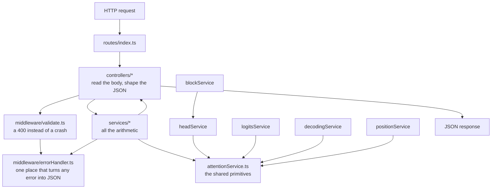
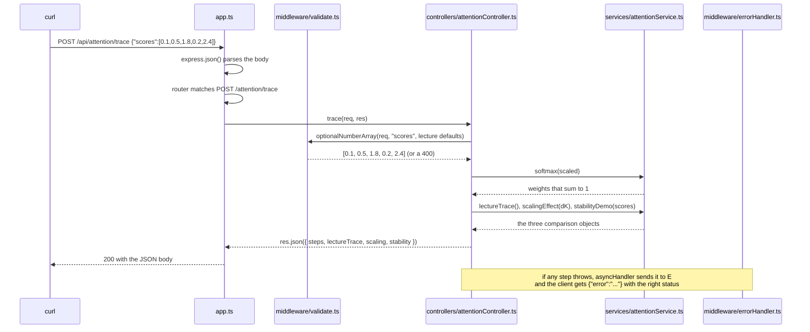

# 01 — Project Structure & Setup

> **Lecture chapter:** none — this is the orientation chapter.
> **What you get:** the full folder tree, every file's job, the request lifecycle, and the complete
> content of the ten scaffolding files (env, package, tsconfig, config, types, middleware, app, server,
> router) with a block-by-block explanation of each.
> **Commands used:** `npm install`, `npm run dev`, `npm run typecheck`.

---

## 01.1 The folder structure

```text
code/Basic Code/
├── .env                        # PORT, shape defaults, decoding defaults — no secrets in this file
├── .gitignore                  # node_modules, dist, *.log
├── package.json                # scripts + the only two runtime dependencies
├── package-lock.json           # exact versions, so everyone installs the same tree
├── tsconfig.json               # strict TypeScript, src -> dist
├── src/
│   ├── server.ts               # opens the port (the only file that does)
│   ├── app.ts                  # builds the Express app: json, router, 404, error handler
│   ├── config/
│   │   └── config.ts           # env values + the model shape table (d_model, h, d_ff, layers)
│   ├── types/
│   │   └── index.ts            # Vector, Matrix, AttentionWeights, MaskKind, ModelShape, ...
│   ├── middleware/
│   │   ├── errorHandler.ts     # HttpError, badRequest, asyncHandler, notFound, errorHandler
│   │   └── validate.ts         # requireTokens, optionalString, optionalNumber, requireMask, ...
│   ├── routes/
│   │   └── index.ts            # every route, grouped by the chapter it demonstrates
│   ├── controllers/            # one thin controller per chapter: body in, JSON out
│   │   ├── attentionController.ts      # Chapters 01-03 (why, qkv, scores, trace, cost)
│   │   ├── headController.ts           # Chapter 04 (heads)
│   │   ├── blockController.ts          # Chapter 05 (block)
│   │   ├── architectureController.ts   # Chapter 06 (compare)
│   │   ├── logitsController.ts         # Chapter 07 (softmax, bias)
│   │   ├── decodingController.ts       # Chapter 08 (controls, sample)
│   │   └── positionController.ts       # Chapter 09 (encode, mask)
│   └── services/               # ALL the logic lives here — pure functions, no HTTP
│       ├── attentionService.ts       # PRNG, matmul, softmax, project, mask, attention, cost
│       ├── headService.ts            # splitHeads, multiHeadAttention, cost, MQA/GQA cache
│       ├── blockService.ts           # layerNorm, rmsNorm, gelu, ffn, transformerBlock, budget
│       ├── architectureService.ts    # families, attention modes, training vs inference
│       ├── logitsService.ts          # lmHead, softmaxTable, properties, logprobs, bias
│       ├── decodingService.ts        # temperature, top-k/p/min-p, penalties, decodeStep, beam
│       └── positionService.ts        # sinusoidal, linear offset, RoPE, ALiBi, mask geometry
└── implementations guide/      # these chapter documents
```

**Why this shape?** It is the smallest structure that still separates four different concerns:

| Layer | Job | Never does |
| :--- | :--- | :--- |
| `routes/` | Map a URL + method to a controller | Contain logic |
| `controllers/` | Read the request, call **one** service function, shape the response | Do arithmetic on vectors |
| `services/` | The actual work: project, score, mask, softmax, sample | Touch `req` or `res` |
| `middleware/` | Cross-cutting concerns: validation and errors | Know about attention |

The dependency direction is strictly one-way, and it is worth memorising:



> [!IMPORTANT]
> **`attentionService.ts` is imported by every other service, and imports nothing from them.** That is
> deliberate: `dot`, `matmul`, `transpose`, `softmax`, `add`, `scale` and the seeded PRNG are the
> vocabulary of this whole lecture, and a second copy of `softmax` would be a second place for a bug
> to hide. `blockService` imports `multiHeadAttention` from `headService`, which is the one
> service-to-service dependency in the project — and it is a real one: a transformer block *contains*
> multi-head attention (notes §05.2).

---

## 01.2 `.env` — the configuration, with no secrets in it

**File:** `.env` · **Purpose:** every tunable number the endpoints read, in one place.

```bash
# Lecture 03 - Attention and Decoding · Basic Code
# This file holds NO secrets: it only carries the defaults the endpoints read.
# Copy it to .env and change the numbers if you want a different shape.

# Port the Express server listens on
PORT=3000

# The toy model shape every endpoint uses when a request does not name one.
# Must match an id in src/config/config.ts  (notes ch05 §05.4, ch04 §04.3).
#   toy-tiny    d_model=8    h=2   d_ff=32     2 layers
#   gpt2-small  d_model=768  h=12  d_ff=3072   12 layers
#   llama3-8b   d_model=4096 h=32  d_ff=14336  32 layers
DEFAULT_SHAPE=toy-tiny

# d_model - the width of every token vector (notes ch02 §02.3).
# Kept at 8 so the JSON responses stay readable.
D_MODEL=8

# h - how many attention heads the model runs in parallel (notes ch04 §04.3).
# d_head = d_model / h must be a whole number.
N_HEADS=2

# d_ff - the FFN's hidden width, normally 4 x d_model (notes ch05 §05.2).
D_FF=32

# Context length used by the cost endpoints (notes ch03 §03.7).
N_TOKENS=6

# Decoding defaults: the model's own distribution, nucleus 0.9, and a fixed
# seed so sampling is reproducible (notes ch08 §08.5, §08.7, §08.11).
TEMPERATURE=1.0
TOP_P=0.9
SEED=42
```

**Block by block:**

1. `PORT=3000` — the port `server.ts` listens on. Change it if another lecture's server is running.
2. `DEFAULT_SHAPE=toy-tiny` — which entry of the shape table in `config.ts` is used when a request
   does not name one. The three valid ids are listed in the comment above it.
3. `D_MODEL=8`, `N_HEADS=2`, `D_FF=32` — the toy shape's dimensions. `d_head = d_model / h = 4`, small
   enough that a whole attention matrix prints on one screen. `D_FF` is deliberately `4 × D_MODEL`,
   the standard expansion ratio from notes §05.2.
4. `N_TOKENS=6` — the default sequence length for `/api/attention/cost`, matching the lecture's
   `"The cat sat on the mat"`.
5. `TEMPERATURE=1.0`, `TOP_P=0.9`, `SEED=42` — the decoding defaults. `T = 1.0` means "the model's own
   distribution" (notes §08.5); `top-p = 0.9` is the chat default (notes §08.7); and the fixed seed is
   what makes sampling reproducible (notes §08.11).

> [!NOTE]
> **Why the comment says "no secrets".** This file carries *shape and defaults*, not credentials.
> Every lecture in this repo keeps its `.env` free of keys so it can be committed and shared, and so
> the file teaches configuration rather than hiding it.

---

## 01.3 `package.json` and `tsconfig.json` — the two dependencies, and strict TypeScript

**Files:** `package.json`, `tsconfig.json`.

```json
{
  "name": "lecture-03-attention-and-decoding-basic-code",
  "version": "1.0.0",
  "private": true,
  "description": "Basic Express + TypeScript code for Lecture 03 (Attention and Decoding): Q/K/V, scaled dot-product attention by hand, multi-head attention, the transformer block, logits, softmax and decoding strategies.",
  "main": "dist/server.js",
  "scripts": {
    "dev": "tsx watch src/server.ts",
    "build": "tsc -p tsconfig.json",
    "start": "node dist/server.js",
    "typecheck": "tsc --noEmit"
  },
  "dependencies": {
    "dotenv": "^16.4.5",
    "express": "^4.19.2"
  },
  "devDependencies": {
    "@types/express": "^4.17.21",
    "@types/node": "^22.5.0",
    "tsx": "^4.19.2",
    "typescript": "^5.6.2"
  }
}
```

**Block by block:**

1. `"dev": "tsx watch src/server.ts"` — `tsx` runs TypeScript directly and restarts on save. It is a
   devDependency only, so nothing in the shipped build depends on it.
2. `"build": "tsc -p tsconfig.json"` and `"start": "node dist/server.js"` — the compiled path. Same
   shape as every other lecture's Basic Code, so the commands are muscle memory.
3. `"typecheck": "tsc --noEmit"` — the command you should run before every commit. It must print
   nothing.
4. `dependencies` — **`express` and `dotenv`, and that is all.** There is deliberately no
   `mathjs`, no `ndarray`, no `@tensorflow/tfjs`: the arithmetic in this lecture is short enough to
   read, and hiding it behind a library would defeat the purpose. There is also no LLM SDK, because
   this lecture is about what happens *inside* the model, not about calling one.
5. `devDependencies` — `@types/express`, `@types/node`, `tsx`, `typescript`. Types for the runtime,
   tooling for the build.

```json
{
  "compilerOptions": {
    "target": "ES2022",
    "module": "commonjs",
    "moduleResolution": "node",
    "lib": ["ES2022"],
    "rootDir": "src",
    "outDir": "dist",
    "strict": true,
    "esModuleInterop": true,
    "forceConsistentCasingInFileNames": true,
    "skipLibCheck": true,
    "sourceMap": true
  },
  "include": ["src/**/*.ts"]
}
```

**Block by block:**

1. `"target": "ES2022"` — modern syntax, including `Array.prototype.flatMap` and `**`, both of which
   the services use.
2. `"module": "commonjs"` / `"moduleResolution": "node"` — what Node needs for `require`, and what
   `express`'s type definitions expect.
3. `"strict": true` — the important one. With `strict` on, `noImplicitAny` and `strictNullChecks` are
   on too, which is why `optionalInteger(req, "topK", null, ...)` returns `number | null` and the
   caller has to deal with the `null`. In a codebase full of index arithmetic, that check catches
   real bugs.
4. `"rootDir": "src"`, `"outDir": "dist"` — `src/server.ts` compiles to `dist/server.js`, which is
   exactly what `package.json`'s `main` field points at.
5. `"sourceMap": true` — so a stack trace from `dist/` points back at the TypeScript line.


---

## 01.4 `src/config/config.ts` — env values and the model shape table

**File:** `src/config/config.ts` · **Purpose:** turn the environment into one typed object, and hold
the shape table that Chapters 04–05 measure against (notes §04.3, §05.4).

```ts
import "dotenv/config";
import type { ModelShape } from "../types";

/**
 * Chapter 05 §05.4 - the shapes every endpoint measures against. Only three are
 * needed: one small enough to print, and two real models so the arithmetic can be
 * checked against something you have heard of (ch02 §02.3, ch04 §04.3).
 *
 * d_head = dModel / nHeads must be a whole number, and it is 64 or 128 in almost
 * every real model - one of the most stable hyperparameters in the field.
 */
const SHAPES: ModelShape[] = [
  { id: "toy-tiny", dModel: 8, nHeads: 2, dFF: 32, layers: 2, contextWindow: 512 },
  { id: "gpt2-small", dModel: 768, nHeads: 12, dFF: 3072, layers: 12, contextWindow: 1024 },
  { id: "llama3-8b", dModel: 4096, nHeads: 32, dFF: 14336, layers: 32, contextWindow: 8192 },
];

/** Read a number from the environment, falling back when it is missing or silly. */
function num(value: string | undefined, fallback: number): number {
  const parsed = Number(value);
  return Number.isFinite(parsed) && parsed > 0 ? parsed : fallback;
}

/** Read a number that is allowed to be 0 (temperature 0 means greedy). */
function numOrZero(value: string | undefined, fallback: number): number {
  const parsed = Number(value);
  return Number.isFinite(parsed) && parsed >= 0 ? parsed : fallback;
}

export const config = {
  /** Port the HTTP server listens on. */
  port: num(process.env.PORT, 3000),

  /** The shape used when a request does not name one. */
  defaultShape: process.env.DEFAULT_SHAPE ?? "toy-tiny",

  /** The toy width every endpoint falls back to (ch02 §02.3). */
  dModel: num(process.env.D_MODEL, 8),

  /** h - how many heads the toy model runs (ch04 §04.3). */
  nHeads: num(process.env.N_HEADS, 2),

  /** d_ff - the FFN's hidden width, normally 4 x d_model (ch05 §05.2). */
  dFF: num(process.env.D_FF, 32),

  /** Default sequence length for the cost endpoints (ch03 §03.7). */
  nTokens: num(process.env.N_TOKENS, 6),

  /** Decoding defaults (ch08 §08.5, §08.7, §08.11). */
  temperature: numOrZero(process.env.TEMPERATURE, 1),
  topP: num(process.env.TOP_P, 0.9),
  seed: num(process.env.SEED, 42),

  /** Every shape the endpoints know about. */
  shapes: SHAPES,

  /**
   * Look a shape up by id, or fall back to the configured toy shape. A typo must
   * never crash a request: the response says which shape was actually used.
   */
  shape(id?: string): ModelShape {
    const wanted = id ?? this.defaultShape;
    return (
      SHAPES.find((shape) => shape.id === wanted) ??
      SHAPES.find((shape) => shape.id === this.defaultShape) ??
      SHAPES[0]
    );
  },

  /** d_head = d_model / h - the width of one head (ch04 §04.3). */
  dHead(shape: ModelShape): number {
    return shape.dModel / shape.nHeads;
  },
};
```

**Block by block:**

1. `import "dotenv/config"` — a side-effect import. It reads `.env` and copies every key into
   `process.env` *before* the rest of this module runs. This is the only file in the project that
   touches the environment.
2. `const SHAPES: ModelShape[]` — the shape table. Only three entries, chosen on purpose:
   * `toy-tiny` — `d_model = 8`, `h = 2`, `d_head = 4`. Small enough that a full $N \times N$ weight
     matrix is readable in a terminal.
   * `gpt2-small` — `d_model = 768`, `h = 12`, `d_head = 64`. The lecture's own example
     (notes §04.3), so you can check the arithmetic in the notes against a live response.
   * `llama3-8b` — `d_model = 4096`, `h = 32`, `d_head = 128`. A modern open model, to show that
     `d_head` stays at 64 or 128 across wildly different sizes.
3. `function num(value, fallback)` — reads a number from the environment and falls back when it is
   missing *or silly*. `Number(undefined)` is `NaN`, and `NaN` in `d_model` would silently poison
   every vector in the service, so the guard is not decorative.
4. `function numOrZero(value, fallback)` — the same, but allows `0`, because `TEMPERATURE=0` is a
   meaningful value: it means greedy decoding (notes §08.5). Using `num()` here would turn a
   deliberate `0` into the default `1`, which is exactly the kind of quiet bug this project is
   trying to teach you to avoid.
5. `config.dModel`, `config.nHeads`, `config.dFF` — the toy shape's dimensions, read from the env.
6. `config.shape(id?)` — the lookup. Note the three-level fallback: the requested id, then the
   configured default, then `SHAPES[0]`. **A typo in `"shape"` must never crash a request** — it
   returns the toy shape and the response says which shape was actually used. That is a deliberate
   choice: a demo service should fail *visibly*, not loudly.
7. `config.dHead(shape)` — $d_{\text{head}} = d_{\text{model}} / h$, the one derived quantity the
   whole of Chapter 04 is built on. It is a function rather than a field because it depends on which
   shape you are asking about.


---

## 01.5 `src/types/index.ts` — the lecture's vocabulary, written as types

**File:** `src/types/index.ts` · **Purpose:** name every object the lecture talks about, so that
`Q` and `K` and `weights` can never be confused for one another.

```ts
/**
 * The lecture's vocabulary, written as types (notes ch02 §02.3, ch03 §03.1).
 * Read them together: each one is the output of one step and the input of the
 * next, which is why the names must never be mixed up.
 */

export type Vector = number[]; // one row of numbers - d_model or d_k of them
export type Matrix = number[][]; // rows x cols, e.g. N x d_model for a whole sequence
export type AttentionWeights = Matrix; // N x N, and every ROW sums to 1 (notes ch01 §01.7)
export type Token = string; // a token as text, e.g. "mat"

/**
 * Which positions a token is allowed to read (notes ch03 §03.5, ch09 §09.6).
 *   none    - everyone sees everyone (encoder)
 *   causal  - position i sees only j <= i (decoder: no peeking at the future)
 *   sliding - causal, plus a window of the last `window` positions
 *   padding - causal, plus a ban on the pad tokens at the end
 */
export type MaskKind = "none" | "causal" | "sliding" | "padding";

/** The three architecture families of notes ch06 §06.1. */
export type Architecture = "encoder-decoder" | "encoder-only" | "decoder-only";

/** The three attention modes of notes ch06 §06.3. */
export type AttentionMode = "bidirectional" | "causal" | "cross";

/** The four positional schemes of notes ch09 §09.3. */
export type PositionalScheme = "sinusoidal" | "rope" | "alibi" | "learned";

/** How one token gets picked out of the distribution (notes ch08 §08.1). */
export type DecodingStrategy = "greedy" | "beam" | "sample";

/** The shape of one model, and where its parameters live (notes ch05 §05.4). */
export type ModelShape = {
  id: string;
  dModel: number; // width of every token vector
  nHeads: number; // h - parallel attention heads
  dFF: number; // the FFN's hidden width
  layers: number; // how many transformer blocks
  contextWindow: number; // the longest sequence the model accepts
};

/** One vocabulary entry, with the score the model gave it (notes ch07 §07.3). */
export type Candidate = {
  id: number;
  token: Token;
  logit: number; // raw, unnormalised score - NOT a probability
  probability?: number; // filled in after the softmax
  percent?: number; // probability as a percentage, rounded for reading
};

/** Everything the decode step needs (notes ch08 §08.10). */
export type DecodingSettings = {
  strategy: DecodingStrategy;
  temperature: number; // divides the logits; T = 0 means greedy
  topK: number | null; // keep the k most likely tokens
  topP: number | null; // keep the smallest set that reaches this probability mass
  minP: number | null; // keep tokens at least this fraction of the leader
  repetitionPenalty: number; // 1 = off; > 1 discourages repeats
  frequencyPenalty: number; // subtract, proportional to how often a token appeared
  presencePenalty: number; // subtract a flat amount if a token appeared at all
  seed: number; // so the same request gives the same draw (notes ch08 §08.11)
};
```

**Block by block:**

1. `Vector` and `Matrix` — the two containers everything else is built from. `Vector` is `number[]`;
   `Matrix` is `number[][]`, meaning **rows first**. That convention matters: in this project a
   sequence is always "one row per token", so `X[3]` is token 3's vector, and an attention matrix's
   **rows** are queries while its **columns** are keys (notes §02.6).
2. `AttentionWeights = Matrix` — a separate alias, not a separate type, purely for readability. When
   you see `AttentionWeights` in a signature you know the invariant that comes with it: **every row
   sums to 1** (notes §01.7).
3. `MaskKind` — the four masks, and the comment records what each one blocks. `"none"` is the
   encoder's bidirectional mask, `"causal"` is the decoder's, `"sliding"` is a causal mask with a
   window (used by long-context models), and `"padding"` additionally hides the pad tokens at the
   end. **One mechanism, four policies** — that is the whole of notes §09.6.
4. `Architecture` and `AttentionMode` — Chapter 06's two vocabularies. The three families and the
   three modes are *not* the same list, and keeping them as separate types stops you writing
   `"causal"` where a family is expected.
5. `DecodingStrategy` — `"greedy" | "beam" | "sample"`. Chapter 08's fork in the road (notes §08.1).
6. `ModelShape` — the shape of a model, with a comment on each field. `contextWindow` is included
   even though this project never runs a real model, because the cost endpoints need it.
7. `Candidate` — one vocabulary entry with the score the model gave it. Note that `probability` and
   `percent` are **optional**: a candidate is born with a `logit` and only acquires a probability
   after the softmax. The type encodes the order of operations from notes §08.10.
8. `DecodingSettings` — everything the decode step needs, with the defaults' meaning in the comments.
   `temperature: number` rather than an optional field, because `0` is meaningful and must not be
   confused with "unset".


---

## 01.6 `src/middleware/` — a 400 instead of a crash, and one place for errors

Two files, two jobs. `errorHandler.ts` knows how to *report* a problem; `validate.ts` knows how to
*find* one.

**File:** `src/middleware/errorHandler.ts`.

```ts
import type { NextFunction, Request, Response } from "express";

/** An error that carries an HTTP status, so the handler can send it as-is. */
export class HttpError extends Error {
  constructor(
    public status: number,
    message: string,
  ) {
    super(message);
  }
}

/** A 400 that the caller caused - a missing field, a wrong type. */
export const badRequest = (message: string): HttpError => new HttpError(400, message);

type Handler = (req: Request, res: Response, next: NextFunction) => Promise<unknown> | unknown;

/**
 * Express 4 does not catch rejected promises, so a thrown error inside an async
 * handler would hang the request. This wrapper sends it to the error handler.
 */
export const asyncHandler =
  (handler: Handler) =>
  (req: Request, res: Response, next: NextFunction): void => {
    Promise.resolve(handler(req, res, next)).catch(next);
  };

/** Unknown route -> a JSON 404, never an HTML page. */
export function notFound(req: Request, res: Response): void {
  res.status(404).json({ error: `No route for ${req.method} ${req.path}` });
}

/** The last middleware in the chain: one place that turns any error into JSON. */
export function errorHandler(err: unknown, _req: Request, res: Response, _next: NextFunction): void {
  const status = err instanceof HttpError ? err.status : 500;
  const message = err instanceof Error ? err.message : "Unexpected error";
  res.status(status).json({ error: message });
}
```

**Block by block:**

1. `class HttpError extends Error` with a public `status` — an error that already knows which HTTP
   code it deserves. `badRequest()` is the shorthand for the only status this project needs, 400.
2. `asyncHandler(handler)` — **the most important eight lines in this file.** Express 4 does not
   catch rejected promises: if an `async` route handler throws, the request simply hangs until the
   client times out. `asyncHandler` wraps the handler, catches the rejection and forwards it to
   `next()`, which is what routes it to the error middleware. Every controller in this project is
   wrapped in it, which is why a bad request body produces a clean 400 instead of a stalled
   connection.
3. `notFound` — an unknown URL becomes `{"error": "No route for GET /api/nope"}` rather than
   Express's default HTML page. A JSON API should fail in JSON.
4. `errorHandler(err, _req, res, _next)` — the last middleware in the chain. It reads the status from
   an `HttpError` (or falls back to 500), reads the message, and sends `{ error }`. **This is the
   only place in the project that writes an error response**, so every failure looks the same from
   the outside.

**File:** `src/middleware/validate.ts`.

```ts
import type { Request } from "express";
import type { DecodingSettings, MaskKind } from "../types";
import { badRequest } from "./errorHandler";

/**
 * Request-body helpers. They exist so every controller can answer the same way
 * when a field is missing: a clear 400 instead of a crash deep inside a service.
 */

/** `{ "tokens": ["The", "cat", "sat"] }` - the shape most attention endpoints need. */
export function requireTokens(req: Request, field = "tokens", max = 12): string[] {
  const value = (req.body as Record<string, unknown> | undefined)?.[field];
  if (!Array.isArray(value) || value.length === 0 || value.some((item) => typeof item !== "string")) {
    throw badRequest(`Body must contain "${field}" as a non-empty array of strings, e.g. ["The","cat","sat"].`);
  }
  if (value.length > max) {
    throw badRequest(`"${field}" may hold at most ${max} tokens - this is a by-hand demo, not a production server.`);
  }
  return value as string[];
}

/** An optional token array, with a default. `{ "sentenceA": ["it","was","too","tired"] }` */
export function optionalTokens(req: Request, field: string, fallback: string[], max = 12): string[] {
  const value = (req.body as Record<string, unknown> | undefined)?.[field];
  if (value === undefined || value === null) return fallback;
  if (!Array.isArray(value) || value.length === 0 || value.some((item) => typeof item !== "string")) {
    throw badRequest(`"${field}" must be a non-empty array of strings.`);
  }
  if (value.length > max) throw badRequest(`"${field}" may hold at most ${max} tokens.`);
  return value as string[];
}

/** The model shape a request asked for, falling back to the configured one. */
export function shapeId(req: Request): string | undefined {
  const value = (req.body as Record<string, unknown> | undefined)?.shape;
  return typeof value === "string" && value.trim().length > 0 ? value : undefined;
}

/** A required string. `{ "word": "it" }` */
export function requireString(req: Request, field: string): string {
  const value = (req.body as Record<string, unknown> | undefined)?.[field];
  if (typeof value !== "string" || value.trim().length === 0) {
    throw badRequest(`Body must contain "${field}" as a non-empty string.`);
  }
  return value;
}

/** An optional string, with a default. `{ "word": "it" }` */
export function optionalString(req: Request, field: string, fallback: string): string {
  const value = (req.body as Record<string, unknown> | undefined)?.[field];
  if (value === undefined || value === null) return fallback;
  if (typeof value !== "string" || value.trim().length === 0) {
    throw badRequest(`"${field}" must be a non-empty string.`);
  }
  return value;
}

/** An optional non-empty array of numbers. `{ "logits": [5, 4, 3, 2, 1] }` */
export function optionalNumberArray(req: Request, field: string, fallback: number[]): number[] {
  const value = (req.body as Record<string, unknown> | undefined)?.[field];
  if (value === undefined || value === null) return fallback;
  if (!Array.isArray(value) || value.length === 0 || value.some((item) => !Number.isFinite(Number(item)))) {
    throw badRequest(`"${field}" must be a non-empty array of numbers, e.g. [5,4,3,2,1].`);
  }
  return (value as unknown[]).map(Number);
}

/** An optional number inside a range. `{ "temperature": 0.7 }` */
export function optionalNumber(req: Request, field: string, fallback: number, min = 0, max = 1000): number {
  const value = (req.body as Record<string, unknown> | undefined)?.[field];
  if (value === undefined || value === null) return fallback;
  const parsed = Number(value);
  if (!Number.isFinite(parsed) || parsed < min || parsed > max) {
    throw badRequest(`"${field}" must be a number between ${min} and ${max}.`);
  }
  return parsed;
}

/** An optional integer inside a range. `{ "topK": 3 }` */
export function optionalInteger(req: Request, field: string, fallback: number | null, min = 1, max = 1000): number | null {
  const value = (req.body as Record<string, unknown> | undefined)?.[field];
  if (value === undefined || value === null) return fallback;
  const parsed = Number(value);
  if (!Number.isInteger(parsed) || parsed < min || parsed > max) {
    throw badRequest(`"${field}" must be an integer between ${min} and ${max}.`);
  }
  return parsed;
}

/** An optional string from a fixed list. `{ "mask": "causal" }` */
export function optionalChoice<T extends string>(req: Request, field: string, allowed: readonly T[], fallback: T): T {
  const value = (req.body as Record<string, unknown> | undefined)?.[field];
  if (value === undefined || value === null) return fallback;
  if (typeof value !== "string" || !allowed.includes(value as T)) {
    throw badRequest(`"${field}" must be one of ${allowed.join(" | ")}.`);
  }
  return value as T;
}

/** The mask a request asked for (ch03 §03.5, ch09 §09.6). */
export const requireMask = (req: Request): MaskKind =>
  optionalChoice(req, "mask", ["none", "causal", "sliding", "padding"] as const, "causal");

/** The whole decoding configuration, with every default filled in (ch08 §08.10). */
export function requireSettings(req: Request, defaults: { temperature: number; topP: number; seed: number }): DecodingSettings {
  const topK = optionalInteger(req, "topK", null, 1, 1000);
  const minP = optionalNumber(req, "minP", 0, 0, 1);
  return {
    strategy: optionalChoice(req, "strategy", ["greedy", "beam", "sample"] as const, "sample"),
    temperature: optionalNumber(req, "temperature", defaults.temperature, 0, 10),
    topK,
    topP: optionalNumber(req, "topP", topK === null ? defaults.topP : 0, 0, 1) || null,
    minP: minP > 0 ? minP : null,
    repetitionPenalty: optionalNumber(req, "repetitionPenalty", 1, 0, 10),
    frequencyPenalty: optionalNumber(req, "frequencyPenalty", 0, 0, 10),
    presencePenalty: optionalNumber(req, "presencePenalty", 0, 0, 10),
    seed: optionalInteger(req, "seed", defaults.seed, 0, 2 ** 31) ?? defaults.seed,
  };
}
```

**Block by block:**

1. The file's header comment states the contract: *"so every controller can answer the same way when
   a field is missing: a clear 400 instead of a crash deep inside a service."* That is the whole
   reason these helpers exist rather than inline checks.
2. `requireTokens(req, field, max)` — the shape most endpoints need. It checks three things: the
   value is an array, it is non-empty, and every element is a string. The `max` default of 12 is a
   deliberate guard rail: this is a by-hand demo, and a 500-token sequence would produce an
   unreadable response and a slow request.
3. `optionalTokens(req, field, fallback, max)` — the same checks, but a missing field means "use the
   lecture's example" rather than "reject". This is what makes `POST /api/attention/why` with an
   empty body return the `"it was too tired / too wide"` demonstration.
4. `shapeId(req)` — pulls the optional `"shape"` string out of the body. It returns `undefined`
   rather than throwing, because `config.shape()` already has a safe fallback. Not every input
   deserves an error.
5. `requireString` / `optionalString` — the `word` parameter of `/api/attention/why`.
6. `optionalNumberArray(req, field, fallback)` — used by the logits and decoding endpoints. Note the
   validation: every element must survive `Number(...)`, so `[5, "four"]` is a 400 rather than a
   `NaN` that propagates through the softmax and turns the whole response into `null`s.
7. `optionalNumber(req, field, fallback, min, max)` and `optionalInteger(...)` — range-checked. The
   ranges are not arbitrary: `temperature` is clamped to `[0, 10]` because `0` means greedy and
   negative temperature is meaningless; `topK` is an integer because "keep the top 3.5 tokens" is
   not a thing.
8. `optionalChoice(req, field, allowed, fallback)` — a string from a fixed list, which is how
   `"mask"` and `"strategy"` are validated. The error message is generated from the list itself
   (`must be one of none | causal | sliding | padding`), so it can never drift out of date.
9. `requireMask(req)` — `optionalChoice` pre-bound to the four mask kinds, defaulting to `"causal"`.
   The default is causal because that is what a GPT-style decoder does, and this lecture is
   decoder-centric.
10. `requireSettings(req, defaults)` — builds the whole `DecodingSettings` object in one call. Two
    details worth reading twice:
    * `topP` defaults to `0` when the request named a `topK` — **top-k and top-p are alternatives,
      not a stack**, and defaulting both on would silently trim the pool twice (notes §08.6–§08.7).
    * `minP` defaults to `0` and is converted to `null` when it is `0`, so "off" and "0.0" are the
      same thing and the service never has to special-case it.


---

## 01.7 `app.ts`, `server.ts` and `routes/index.ts` — the three files that make it a server

**File:** `src/app.ts`.

```ts
import express, { type Express } from "express";
import { errorHandler, notFound } from "./middleware/errorHandler";
import router from "./routes";

/**
 * Build the Express app. Kept separate from server.ts so a test can import the
 * app without opening a port.
 */
export function createApp(): Express {
  const app = express();

  app.use(express.json({ limit: "1mb" })); // tokens and logits are small; the ceiling is a guard rail

  // One mounting point for every route, so versioning later is a one-line change.
  app.use("/api", router);

  app.use(notFound); // unknown route -> JSON 404
  app.use(errorHandler); // anything thrown -> JSON error

  return app;
}
```

**Block by block:**

1. `createApp(): Express` — a **factory**, not a module-level `const app`. The app is built by a
   function so that a test can call `createApp()` and get a fresh, unstarted app without opening a
   port. This is the single most useful structural decision in a small Express project.
2. `express.json({ limit: "1mb" })` — parses JSON bodies. The limit is a guard rail: attention
   matrices grow with $N^2$, and a body large enough to matter should be rejected before it is
   parsed.
3. `app.use("/api", router)` — **one mounting point for every route.** If this service ever needed a
   version, it would be a one-line change here (`app.use("/api/v2", router)`) rather than an edit to
   fifteen route definitions.
4. `notFound` then `errorHandler` — order matters. `notFound` is a normal middleware, so it only runs
   if no route matched; `errorHandler` has four parameters, which is how Express recognises it as an
   error handler rather than a normal middleware.

**File:** `src/server.ts`.

```ts
import { createApp } from "./app";
import { config } from "./config/config";

const app = createApp();

app.listen(config.port, () => {
  console.log(`Lecture 03 - Attention and Decoding (basic code) listening on http://localhost:${config.port}/api`);
  console.log(`default shape: ${config.defaultShape} · decoding: T=${config.temperature} top-p=${config.topP} seed=${config.seed}`);
  console.log(
    `shapes: ${config.shapes
      .map((shape) => `${shape.id} (d_model ${shape.dModel}, h ${shape.nHeads}, d_head ${config.dHead(shape)})`)
      .join(" · ")}`,
  );
});
```

**Block by block:**

1. `createApp()` — build the app.
2. `app.listen(config.port, callback)` — **the only line in the project that opens a socket.** Every
   other file is importable by a test without side effects.
3. The three `console.log` lines print the configuration on boot: the port, the default shape, the
   decoding defaults, and each shape with its derived `d_head`. That is not decoration — it is the
   fastest way to answer "which configuration am I actually running?" at the start of a session.

**File:** `src/routes/index.ts`.

```ts
import { Router } from "express";
import { config } from "../config/config";
import * as architecture from "../controllers/architectureController";
import * as attention from "../controllers/attentionController";
import * as block from "../controllers/blockController";
import * as decoding from "../controllers/decodingController";
import * as head from "../controllers/headController";
import * as logits from "../controllers/logitsController";
import * as position from "../controllers/positionController";

/**
 * Every route, grouped by the chapter of Lecture 03 it demonstrates.
 * Nothing else lives here: a route names a controller and nothing more.
 */
const router = Router();

/** Setup check: is the server up, and with what configuration? */
router.get("/health", (_req, res) => {
  res.json({
    status: "ok",
    defaultShape: config.defaultShape,
    shapes: config.shapes.map((shape) => ({
      id: shape.id,
      dModel: shape.dModel,
      nHeads: shape.nHeads,
      dHead: config.dHead(shape),
      dFF: shape.dFF,
      layers: shape.layers,
      contextWindow: shape.contextWindow,
    })),
    decodingDefaults: { temperature: config.temperature, topP: config.topP, seed: config.seed },
  });
});

// Chapter 01 - why attention: static vectors cannot be context-dependent
router.post("/attention/why", attention.why);

// Chapter 02 - Q, K, V: one vector, three projections
router.post("/attention/qkv", attention.qkv);

// Chapter 03 - the score matrix, the mask, the by-hand trace, the cost model
router.post("/attention/scores", attention.scores);
router.post("/attention/trace", attention.trace);
router.post("/attention/cost", attention.cost);

// Chapter 04 - multi-head attention: h views of the same tokens
router.post("/heads", head.heads);

// Chapter 05 - the transformer block and the residual stream
router.post("/block", block.block);

// Chapter 06 - encoder-decoder vs encoder-only vs decoder-only
router.post("/architecture/compare", architecture.compare);

// Chapter 07 - logits, softmax and logit bias
router.post("/logits", logits.softmax);
router.post("/logits/bias", logits.bias);

// Chapter 08 - temperature, top-k, top-p, min-p and the decode step
router.post("/decoding/controls", decoding.controls);
router.post("/decoding/sample", decoding.sample);

// Chapter 09 - position (sinusoidal, RoPE, ALiBi) and mask geometry
router.post("/position/encode", position.encode);
router.post("/position/mask", position.mask);

export default router;
```

**Block by block:**

1. `import * as attention from "../controllers/attentionController"` — namespace imports, one per
   chapter. They keep the route list readable (`attention.why`) and make a missing export a compile
   error rather than a runtime one.
2. `router.get("/health", ...)` — the setup check. It returns the shape table with `dHead` already
   computed, plus the decoding defaults, so the first curl of any session confirms the configuration
   you think you are running.
3. The eight comment blocks group routes by the chapter they demonstrate. That is documentation that
   cannot rot: the route sits directly under the chapter it belongs to.
4. `/attention/*` has **five** routes because Chapters 01, 02 and 03 are the dense part of the
   lecture, and each one asks a different question: *why* (01), *what are Q/K/V* (02), *what does the
   mask do* (02·03), *show me the arithmetic* (03), *what does it cost* (03).
5. `export default router` — a single default export, mounted once in `app.ts`.


---

## 01.8 The request lifecycle, end to end

One call to `POST /api/attention/trace`, followed from the socket to the JSON:



---

## 01.9 Checkpoint

After chapter 01 you should be able to answer, without looking:

1. Which file opens the port, and which file could a test import safely?
2. Where does a new endpoint get added — and in what order (route → controller → service)?
3. Why does every controller get wrapped in `asyncHandler`, and what happens if it is not?
4. What turns a missing `"tokens"` field into a 400 instead of a 500?
5. Why is `TEMPERATURE=0` read with `numOrZero` rather than `num`?
6. Which service imports nothing from the other services, and why does that matter?

Verify with:

```bash
cd "code/Basic Code"
npm run typecheck                     # must print nothing
npm run dev &                         # start the service
curl -s localhost:3000/api/health     # configuration, straight from config.ts
curl -s -X POST localhost:3000/api/attention/qkv -H 'content-type: application/json' -d '{}'   # 400
curl -s localhost:3000/api/nope                                                               # 404
```

> **Next:** [02 — Why Attention & the Soft Lookup](./02_Why_Attention_and_the_Soft_Lookup.md),
> where `attentionService.ts` is built from the ground up and Chapter 01's argument becomes a
> measurable result.

