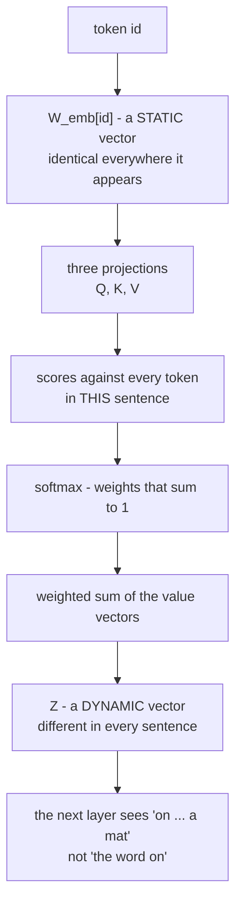
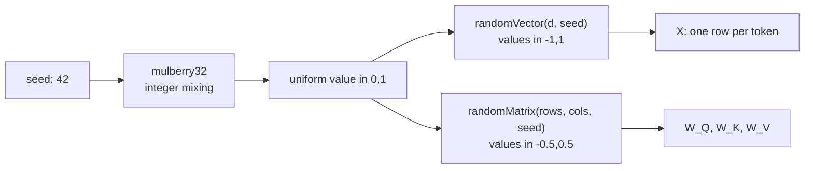
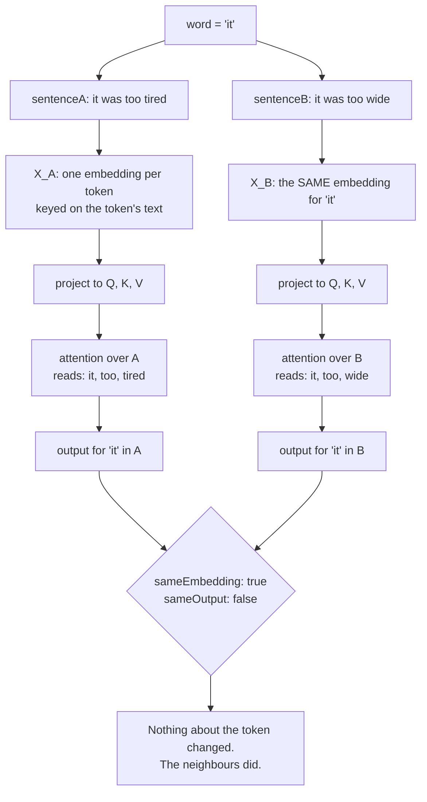

# 02 — Why Attention & the Soft Lookup

> **Lecture chapter:** 01 · **Notes:** [01_Why_Attention_From_Static_Vectors_to_Dynamic_Context.md](../../../notes/01_Why_Attention_From_Static_Vectors_to_Dynamic_Context.md)
> **What you get:** the whole of `attentionService.ts` part 1 — the seeded PRNG, the six linear-algebra
> primitives, `softmax` — and `explainStaticVsDynamic`, which turns Chapter 01's argument into a
> measurable result. Then the `why` handler that exposes it.
> **Command used:** `npm run dev`, then one `curl`.

---

## 02.1 The claim this chapter has to prove

Chapter 01's argument is short: a static embedding lookup cannot express context-dependent meaning,
because the vector for a token is a property of the token's *text* and nothing else
(notes §01.2). So a model that only ever does `W_emb[id]` can never tell the two meanings of
`"bank"` apart, and can never resolve `"it"`.

The fix is that every token is allowed to **read its neighbours** and rewrite itself as a weighted
average of what it read (notes §01.3). That is attention. But an argument is not a proof, so this
chapter ends with an endpoint that *measures* it: the same word, the same embedding, two different
sentences, and two different output vectors.



---

## 02.2 The two files this chapter introduces

| File | Lines | Job |
| :--- | :--- | :--- |
| `src/services/attentionService.ts` | 1–164 of 417 | **Part 1 of 3.** The shared toolbox: a seeded PRNG, six matrix primitives, `softmax`, and Chapter 01's `explainStaticVsDynamic` |
| `src/controllers/attentionController.ts` | 1–26 of 150 | The `why` handler — body in, one service call, JSON out |

> [!NOTE]
> `attentionService.ts` is the only file in the project split across three guide chapters. The split is
> by **lecture chapter**, not by convenience: this chapter gets the primitives plus Chapter 01's
> explainer, [chapter 03](./03_Queries_Keys_Values_and_the_Score_Matrix.md) gets Q/K/V and the mask,
> and [chapter 04](./04_Scaled_Dot_Product_Attention_by_Hand.md) gets the trace, the scaling argument
> and the cost model. Read the three together and you have the complete file.

---

## 02.3 The complete code — `attentionService.ts`, part 1 of 3

**File:** `src/services/attentionService.ts`, lines 1–164.

```ts
import type { AttentionWeights, MaskKind, Matrix, Vector } from "../types";

/**
 * Chapters 01-03 - the attention engine, and the arithmetic primitives that the
 * other services import. Everything here is plain TypeScript: no matrix library,
 * no model weights, nothing to install. That is the point of "attention by hand".
 *
 * The one thing to keep in mind while reading: every function below either
 * PRODUCES a vector/matrix or CONSUMES one. Nothing mutates its input.
 */

const round = (value: number, digits = 4): number => Number(value.toFixed(digits));
export { round };

// ---------------------------------------------------------------------------
// Deterministic numbers  (ch08 §08.11: the same request must give the same draw)
// ---------------------------------------------------------------------------

/** A tiny seeded PRNG (mulberry32). Same seed in, same sequence out - always. */
export function rng(seed: number): () => number {
  let state = seed >>> 0;
  return () => {
    state = (state + 0x6d2b79f5) >>> 0;
    let t = state;
    t = Math.imul(t ^ (t >>> 15), t | 1);
    t ^= t + Math.imul(t ^ (t >>> 7), t | 61);
    return ((t ^ (t >>> 14)) >>> 0) / 4294967296;
  };
}

/** Hash a word to a seed, so "mat" gets the SAME vector in every sentence (ch02 §02.4). */
export function seedOf(text: string): number {
  let hash = 2166136261;
  for (const char of text) hash = Math.imul(hash ^ char.charCodeAt(0), 16777619);
  return hash >>> 0;
}

/** A vector of `d` values in [-scale, scale]. Stands in for a learned embedding row. */
export function randomVector(d: number, seed: number, scale = 1): Vector {
  const next = rng(seed);
  return Array.from({ length: d }, () => round((next() * 2 - 1) * scale));
}

/** A rows x cols matrix. Stands in for a learned projection matrix W_Q / W_K / W_V. */
export function randomMatrix(rows: number, cols: number, seed: number, scale = 0.5): Matrix {
  const next = rng(seed);
  return Array.from({ length: rows }, () => Array.from({ length: cols }, () => round((next() * 2 - 1) * scale)));
}

/** One embedding per token, keyed by the token's own text (§02.4). */
export function tokenVectors(tokens: string[], dModel: number): Matrix {
  return tokens.map((token) => randomVector(dModel, seedOf(token)));
}

// ---------------------------------------------------------------------------
// Linear algebra - the six operations attention is built from (§02.3, §03.1)
// ---------------------------------------------------------------------------

/** Sum of element-wise products. The relevance score of one query against one key. */
export const dot = (a: Vector, b: Vector): number => a.reduce((total, value, i) => total + value * b[i], 0);

/** (rows x inner) x (inner x cols). Every projection in the model is one of these. */
export function matmul(a: Matrix, b: Matrix): Matrix {
  const bt = transpose(b);
  return a.map((row) => bt.map((column) => round(dot(row, column), 6)));
}

/** Swap rows and columns. Q x K^T is a matmul with K transposed (§02.6). */
export const transpose = (a: Matrix): Matrix => a[0].map((_, column) => a.map((row) => row[column]));

/** Element-wise addition - what a residual connection does (§05.2). */
export const add = (a: Vector, b: Vector): Vector => a.map((value, i) => round(value + b[i], 6));

/** Multiply every element by a constant - what temperature and 1/sqrt(d_k) do. */
export const scale = (a: Vector, factor: number): Vector => a.map((value) => round(value * factor, 6));

export const roundVector = (a: Vector, digits = 4): Vector => a.map((value) => round(value, digits));
export const roundMatrix = (a: Matrix, digits = 4): Matrix => a.map((row) => roundVector(row, digits));

/** The index of the largest value - how greedy decoding picks a token (§08.2). */
export const argmax = (a: Vector): number => a.reduce((best, value, i) => (value > a[best] ? i : best), 0);

// ---------------------------------------------------------------------------
// Softmax - an attention row IS a probability distribution (§01.7, §03.3, §07.4)
// ---------------------------------------------------------------------------

/** The naive form: e^z / sum(e^z). Shown so §03.6 can show why it overflows. */
export function softmaxNaive(scores: Vector): Vector {
  const exponents = scores.map((value) => Math.exp(value));
  const total = exponents.reduce((sum, value) => sum + value, 0);
  return exponents.map((value) => round(value / total, 6));
}

/**
 * The form every implementation actually uses. Subtracting the row maximum is
 * EXACTLY equivalent (softmax is shift invariant, §07.5) and stops exp() from
 * overflowing on a large logit.
 */
export function softmax(scores: Vector): Vector {
  const max = Math.max(...scores);
  const exponents = scores.map((value) => Math.exp(value - max));
  const total = exponents.reduce((sum, value) => sum + value, 0);
  return exponents.map((value) => round(value / total, 6));
}

/** Percentage form, rounded for reading - 0.3868 -> 38.7. */
export const percent = (probability: number, digits = 1): number => round(probability * 100, digits);

// ---------------------------------------------------------------------------
// Chapter 01 §01.2 - static vectors cannot be context-dependent
// ---------------------------------------------------------------------------

/** One sentence, run through Q/K/V projection and attention. */
type Run = { tokens: string[]; X: Matrix; Q: Matrix; K: Matrix; V: Matrix; result: AttentionResult; index: number };

function runSentence(tokens: string[], dModel: number, dHead: number, seed: number): Run {
  const X = tokenVectors(tokens, dModel);
  const { Q, K, V } = project(X, dHead, seed);
  return { tokens, X, Q, K, V, result: attention(Q, K, V, dHead, "none"), index: 0 };
}

/** One readable attention row: where this token's weight went, strongest first. */
function describeRow(run: Run, word: string) {
  const index = run.tokens.findIndex((token) => token === word);
  if (index < 0) return null;
  const row = run.result.weights[index];
  return {
    queryToken: word,
    reads: run.tokens
      .map((token, j) => ({ token, weight: row[j], percent: percent(row[j]) }))
      .sort((left, right) => right.weight - left.weight),
    output: roundVector(run.result.output[index]),
  };
}

/**
 * The whole argument of Chapter 01, measured. The focus word gets ONE embedding
 * (its vector is derived from its own text), yet its attention OUTPUT differs
 * between the two sentences - because the neighbours it reads are different.
 * That difference is the "dynamic context" the lecture is about.
 */
export function explainStaticVsDynamic(word: string, sentenceA: string[], sentenceB: string[], dModel: number, dHead: number, seed: number) {
  const a = runSentence(sentenceA, dModel, dHead, seed);
  const b = runSentence(sentenceB, dModel, dHead, seed);
  const indexA = a.tokens.indexOf(word);
  const indexB = b.tokens.indexOf(word);
  const found = indexA >= 0 && indexB >= 0;

  return {
    word,
    staticVector: found ? a.X[indexA] : null,
    staticVectorNote: "One embedding per token, keyed on the token's own text - identical in both sentences (§02.4).",
    sentenceA: describeRow(a, word),
    sentenceB: describeRow(b, word),
    sameEmbedding: found && String(a.X[indexA]) === String(b.X[indexB]),
    sameOutput: found && String(a.result.output[indexA]) === String(b.result.output[indexB]),
    conclusion:
      "Same token, same embedding, different context-aware vector. Nothing about the token changed - the " +
      "neighbours did. That is why attention turns a static lookup into a dynamic representation.",
    whatAttentionDoesNotDo:
      "It does not store facts, retrieve documents or decide truth - it moves existing information between positions (§01.8).",
  };
}

```

**Block by block:**

1. `import type { AttentionWeights, MaskKind, Matrix, Vector } from "../types"` — a **type-only**
   import. It disappears at compile time, so this service has *zero* runtime dependencies inside the
   project. That is what makes it the bottom of the dependency graph.
2. `const round = (value, digits = 4) => Number(value.toFixed(digits))` then `export { round }` — the
   project's single rounding helper. It is declared `const` and re-exported separately because every
   other service imports it, and a response full of `0.38655199999999997` teaches nothing. Four
   decimals is the default; the matrix operations pass `6` so that repeated rounding in a long chain
   of multiplies does not visibly drift.
3. The file header states the rule that matters when you read the rest: **"every function below
   either PRODUCES a vector/matrix or CONSUMES one. Nothing mutates its input."** That is why `scale`
   returns `a.map(...)` rather than assigning into `a`, and it is what makes the service safe to call
   twice with the same arguments.

### The deterministic PRNG — the reason two runs agree



4. `rng(seed)` — a **mulberry32** generator. Six lines of integer arithmetic that produce a sequence
   of numbers in $[0, 1)$ that is completely determined by the seed. `state >>> 0` and
   `Math.imul` keep every intermediate value inside 32-bit unsigned arithmetic, so JavaScript's
   floating-point numbers cannot creep in and make the sequence platform-dependent.
5. Why this matters more than it looks: notes §08.11 says you cannot rely on a hosted model to be
   reproducible. This project *can* be, and that is what makes it a teaching tool — `curl` the same
   endpoint twice and the numbers are identical, so a discrepancy you see is a bug in your reasoning,
   not sampling noise.
6. `seedOf(text)` — a **hash** (FNV-1a), turning a token's text into a seed. `Math.imul(hash ^
   char.charCodeAt(0), 16777619)` is the FNV prime multiply. The consequence is the property Chapter
   01 depends on: **`"mat"` gets the same embedding in every sentence**, which is exactly what a
   learned embedding table does. Without this, the "same embedding, different context" demonstration
   would be impossible to state precisely.
7. `randomVector(d, seed, scale = 1)` — `d` values in $[-1, 1]$. This stands in for one row of a
   learned embedding matrix.
8. `randomMatrix(rows, cols, seed, scale = 0.5)` — the stand-in for a learned projection matrix
   $W_Q$, $W_K$, $W_V$ or $W_O$. The default `scale` is smaller than a vector's on purpose: a
   projection of $d_{\text{model}}$ values should not blow up, and keeping the outputs near unit
   scale is what makes the printed attention weights readable rather than saturated.
9. `tokenVectors(tokens, dModel)` — one line that ties the two together: **one embedding per token,
   keyed on the token's own text**. This is the "static lookup" of Chapter 01, in code.

### The six primitives — everything attention is built from

10. `dot(a, b)` — a `reduce` over element-wise products. This is the only operation that decides
    *relevance* in the whole lecture: $Q_i \cdot K_j$ (notes §02.6).
11. `matmul(a, b)` — a triple loop written as two nested `map`s. Note the implementation detail:
    it transposes `b` once (`const bt = transpose(b)`) and then takes a `dot` per (row, column)
    pair. That is $O(N^2 \cdot d)$ work but reads exactly like the mathematical definition
    $(AB)_{ij} = \sum_k A_{ik}B_{kj}$, which is the point.
12. `transpose(a)` — `a[0].map((_, column) => a.map((row) => row[column]))`. Short, and it is what
    turns $K$ into $K^T$ for the score matrix (notes §02.6).
13. `add(a, b)` — element-wise addition. This one function is the **residual connection** of Chapter
    05 (notes §05.2). It appears here rather than in `blockService` because it is also how the
    positional vector is added to an embedding (notes §09.2).
14. `scale(a, factor)` — multiply every element. Two callers: the $1/\sqrt{d_k}$ divisor (notes
    §03.4) and temperature (notes §08.5). Same operation, two very different meanings — which is why
    the call sites carry comments.
15. `roundVector` / `roundMatrix` — display helpers. They exist so the *services* can return exact
    numbers and the *controllers* can decide how much precision to show.
16. `argmax(a)` — the index of the largest value, written as a `reduce` with a running best. This is
    greedy decoding (notes §08.2) and it is also how `logitsService` proves that softmax preserves
    the ranking (notes §07.5).


### `softmax` — where a row of scores becomes a distribution

17. `softmaxNaive(scores)` — the textbook definition, $e^{z_i} / \sum_j e^{z_j}$. **It is in the file
    only to be disproved.** Chapter 03 §03.6 shows that once the scores reach the hundreds this
    version overflows to `Infinity / Infinity = NaN`. Keeping the broken version next to the fixed
    one, with a comment saying so, is more useful than pretending it never existed.
18. `softmax(scores)` — the form every real implementation uses. Three lines:
    * `const max = Math.max(...scores)` — find the row maximum.
    * `scores.map((value) => Math.exp(value - max))` — exponentiate the **differences**.
    * divide by the total.
19. Why subtracting the maximum is *free*: softmax is **shift invariant**, so
    $\text{softmax}(z + c) = \text{softmax}(z)$ for any constant $c$ (notes §07.5). Subtracting the
    row max is just choosing $c = -\max(z)$, which makes the largest exponent exactly $e^0 = 1$ and
    every other exponent $\le 1$. The result is mathematically identical and numerically safe.
    `logitsService.properties()` measures this claim rather than asserting it.
20. `percent(probability, digits = 1)` — the last primitive, and the one you will read most in the
    responses. `0.386552 → 38.7`. Every weights table in this project prints percentages, because
    notes §01.7's point — *an attention row is a probability distribution* — is only visible when you
    can see the row sum to 100.

> [!IMPORTANT]
> **Why `softmax` lives in `attentionService` and not in `logitsService`.** Chapter 01 §01.7
> introduces softmax as the thing that makes an attention row a valid distribution, three chapters
> before Chapter 07 applies it to logits. Defining it once, where it first appears, is what stops a
> second copy appearing later. `logitsService` and `decodingService` both import this function.

---

## 02.4 Chapter 01's argument, measured — `explainStaticVsDynamic`



21. `type Run` — a small structural type holding one sentence's intermediate results (`X`, `Q`, `K`,
    `V`, the attention result, and the index of the word we care about). It exists so `describeRow`
    can be written once instead of twice.
22. `runSentence(tokens, dModel, dHead, seed)` — the whole forward path in four lines:
    `tokenVectors` → `project` → `attention`. **This is the entire model, minus the FFN.** Reading
    this function is the fastest way to see that Chapters 02–04 are not separate ideas: they are
    four lines that call each other.
23. `describeRow(run, word)` — turns one attention row into something readable: a list of
    `{ token, weight, percent }` **sorted strongest first**, plus the output vector. The sort is
    deliberate: the lecture's own trace for `"on"` reads as a ranking (`"mat"` 64%, `"sat"` 20%, …),
    and a sorted list is the form a human can check at a glance.
24. `explainStaticVsDynamic(...)` — the function Chapter 01 is built around. Note the four claims it
    returns as *booleans* rather than as prose:
    * `staticVector` — the embedding, taken from sentence A.
    * `sameEmbedding` — `String(a.X[indexA]) === String(b.X[indexB])`. It is `true`, because the
      embedding is keyed on the token's text.
    * `sameOutput` — `String(a.result.output[indexA]) === String(b.result.output[indexB])`. It is
      `false`, because the neighbours differ.
    * `conclusion` — the sentence the two booleans add up to.
25. `whatAttentionDoesNotDo` — returned alongside the result, not buried in the notes: *"It does not
    store facts, retrieve documents or decide truth — it moves existing information between
    positions (§01.8)."* A function that answers a question should also state its limits, especially
    in a field where "attention" invites over-interpretation.


---

## 02.5 The complete code — `attentionController.ts`, lines 1–26

**File:** `src/controllers/attentionController.ts`, lines 1–26 (the header and the `why` handler).

```ts
import type { Request, Response } from "express";
import { config } from "../config/config";
import { asyncHandler } from "../middleware/errorHandler";
import { optionalInteger, optionalNumberArray, optionalString, optionalTokens, requireMask, requireTokens, shapeId } from "../middleware/validate";
import * as attention from "../services/attentionService";

/** Chapters 01-03 - why attention exists, Q/K/V, and the formula by hand. */

/** Projection matrices are only echoed for the toy shape: 768 x 768 is not a response. */
const includeWeights = (dModel: number): boolean => dModel <= 32;

/** POST /api/attention/why  { "word": "it", "sentenceA": [...], "sentenceB": [...] } */
export const why = asyncHandler((req: Request, res: Response) => {
  const word = optionalString(req, "word", "it");
  const shape = config.shape(shapeId(req));
  const sentenceA = optionalTokens(req, "sentenceA", ["it", "was", "too", "tired"]);
  const sentenceB = optionalTokens(req, "sentenceB", ["it", "was", "too", "wide"]);

  res.json({
    chapter: "01 - why attention: from static vectors to dynamic context",
    shape: shape.id,
    dModel: shape.dModel,
    ...attention.explainStaticVsDynamic(word, sentenceA, sentenceB, shape.dModel, config.dHead(shape), config.seed),
  });
});

```

**Block by block:**

26. The four imports are the standard controller kit: Express types, `config` for the shape,
    `asyncHandler` so a throw becomes a 500 instead of a hang, the validators, and the service.
    `import * as attention from "../services/attentionService"` is a namespace import so that every
    call site reads `attention.softmax(...)`, `attention.project(...)` — the service's name is always
    in front of the function, which makes it obvious where the work is happening.
27. `const includeWeights = (dModel) => dModel <= 32` — a one-line guard that appears in three of the
    five handlers. A $768 \times 768$ projection matrix is 589,824 numbers; echoing it would produce
    a megabyte of JSON to prove a point that a $8 \times 4$ matrix proves better. **The response says
    it was omitted** rather than silently dropping it — that is the project's labelling rule again.
28. `why = asyncHandler((req, res) => { ... })` — the handler. It is `asyncHandler`-wrapped even
    though nothing here is async, because the moment you add an `await` the wrapper is what keeps the
    error path working, and remembering to add it later is a bug waiting to happen.
29. `optionalString(req, "word", "it")` — the focus word, defaulting to `"it"` so that
    `curl -d '{}'` runs the lecture's own Example B.
30. `config.shape(shapeId(req))` — the shape, with `config.shape()`'s safe fallback for a typo.
31. `optionalTokens(req, "sentenceA", ["it","was","too","tired"])` and the `"too wide"` counterpart —
    the two sentences of notes §01.2 Example B. Note they differ in **one token**, which is the
    smallest possible demonstration: change one word, and the reference of `"it"` changes.
32. `res.json({ chapter, shape, dModel, ...attention.explainStaticVsDynamic(...) })` — the spread is
    the whole controller pattern in one line: name the chapter for the reader, state the
    configuration, then hand over everything the service computed. **No arithmetic happens in this
    file at all.**

---

## 02.6 Run it

```bash
curl -s -X POST localhost:3000/api/attention/why \
  -H 'content-type: application/json' -d '{}'
```

Trimmed output:

```json
{
  "chapter": "01 - why attention: from static vectors to dynamic context",
  "shape": "toy-tiny",
  "dModel": 8,
  "word": "it",
  "staticVector": [-0.8362, 0.8704, 0.0429, -0.6598, 0.8741, -0.7797, 0.4954, -0.6254],
  "sentenceA": {
    "queryToken": "it",
    "reads": [
      { "token": "it",    "weight": 0.432083, "percent": 43.2 },
      { "token": "too",   "weight": 0.228908, "percent": 22.9 },
      { "token": "tired", "weight": 0.211911, "percent": 21.2 },
      { "token": "was",   "weight": 0.127098, "percent": 12.7 }
    ]
  },
  "sentenceB": {
    "queryToken": "it",
    "reads": [
      { "token": "it",   "weight": 0.418294, "percent": 41.8 },
      { "token": "wide", "weight": 0.237060, "percent": 23.7 },
      { "token": "too",  "weight": 0.221603, "percent": 22.2 },
      { "token": "was",  "weight": 0.123043, "percent": 12.3 }
    ]
  },
  "sameEmbedding": true,
  "sameOutput": false,
  "conclusion": "Same token, same embedding, different context-aware vector. Nothing about the token changed - the neighbours did. That is why attention turns a static lookup into a dynamic representation.",
  "whatAttentionDoesNotDo": "It does not store facts, retrieve documents or decide truth - it moves existing information between positions (§01.8)."
}
```

**Read the two `reads` lists side by side.** `"it"` has the same embedding in both sentences
(`sameEmbedding: true`), and its attention row is *not* the same: in sentence A it puts 21.2% of its
weight on `"tired"`, in sentence B it puts 23.7% on `"wide"`. That difference is why
`sameOutput: false` — the vector that leaves the attention sub-layer for the token `"it"` is a
different vector in the two sentences, even though the token is identical.

> [!TIP]
> **Try changing one word.** Send `{"sentenceB": ["it","was","too","loud"]}` and watch the weights
> move again. Then try `{"word": "too"}` and see that a different token has a different, equally
> context-sensitive row. There is no lookup table anywhere in this response — the numbers came out of
> a dot product and a softmax, which is the whole point of the chapter.

---

## 02.7 Common mistakes this chapter's code prevents

| Mistake | What the code does instead |
| :--- | :--- |
| Comparing two vectors with `===` | `String(a) === String(b)` — element-wise, because `[] === []` is `false` in JavaScript |
| Assuming the embedding changes per context | `seedOf(token)` — the embedding is keyed on the token's **text**, exactly like a learned table |
| Using `Math.random()` for the demo | `rng(seed)` — reproducible, so a surprising number is your bug, not noise (notes §08.11) |
| Letting a service import a controller | The dependency arrow points one way only: `controller → service → types` |
| Rounding inside a hot loop | Exact values in the service, rounding at the edge in the controller |

---

## 02.8 Checkpoint

1. Where does `"mat"` get its vector, and why is it the same in every sentence?
2. Which function is the residual connection of Chapter 05, and why does it live in this file?
3. Why does `softmax` subtract the row maximum, and which property of softmax makes that free?
4. What are the two booleans in the response, and which one proves Chapter 01's claim?
5. Which line of `attentionController.ts` does any arithmetic?

> **Next:** [03 — Q, K, V and the Score Matrix](./03_Queries_Keys_Values_and_the_Score_Matrix.md),
> where the static embedding becomes a query, a key and a value — and the $N \times N$ score matrix
> appears for the first time.

