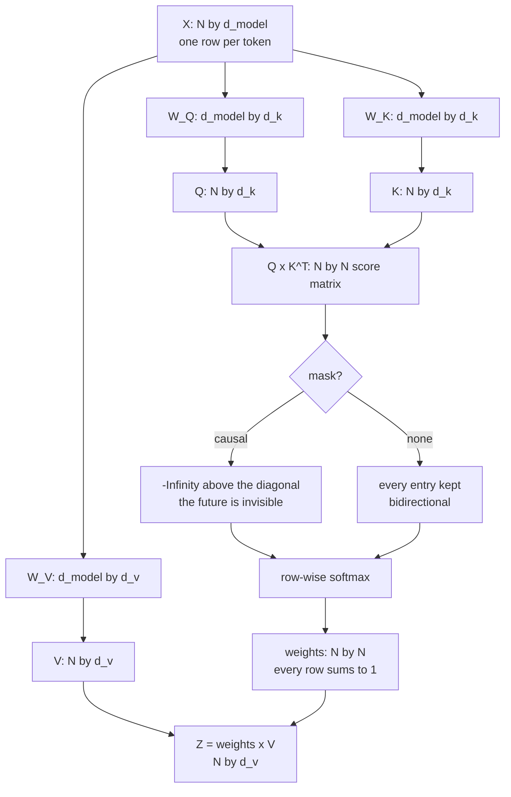

# 03 — Q, K, V and the Score Matrix

> **Lecture chapter:** 02 · **Notes:** [02_Queries_Keys_Values_The_Attention_Search_Engine.md](../../../notes/02_Queries_Keys_Values_The_Attention_Search_Engine.md)
> **What you get:** `attentionService.ts` part 2 — `project`, `projectionParameters`, the mask
> (`applyMask`, `maskMatrix`), the five-step `attention()` function and `weightRows` — plus the `qkv`
> and `scores` handlers.
> **Command used:** `npm run dev`, then two `curl` calls.

---

## 03.1 The idea this chapter has to implement

Chapter 01 showed *that* a token rewrites itself from its neighbours. Chapter 02 answers *how the
model decides which neighbours to read*. The answer is that every token produces three different
vectors from the same input vector, through three different learned matrices:

$$Q = XW_Q, \qquad K = XW_K, \qquad V = XW_V$$

| Vector | Question it answers | Used by |
| :--- | :--- | :--- |
| **Query** | "what am I looking for?" | this token, once |
| **Key** | "what can I be found by?" | every *other* token, as the thing being matched |
| **Value** | "what do I contribute if I am read?" | every *other* token, as the thing being mixed |

The score matrix is then $QK^{T}$: an $N \times N$ table where entry $(i, j)$ says how relevant token
$j$ is to token $i$ (notes §02.6). This is the chapter where the model stops looking at tokens one at
a time.



---

## 03.2 The two files this chapter touches

| File | Lines | Job |
| :--- | :--- | :--- |
| `src/services/attentionService.ts` | 165–271 of 417 | **Part 2 of 3.** `project`, `projectionParameters`, `applyMask`, `maskMatrix`, `attention`, `weightRows` |
| `src/controllers/attentionController.ts` | 27–103 of 150 | The `qkv` and `scores` handlers |

---

## 03.3 The complete code — `attentionService.ts`, part 2 of 3

**File:** `src/services/attentionService.ts`, lines 165–271.

```ts
// ---------------------------------------------------------------------------
// Chapter 02 - Q, K and V: one vector, three projections (§02.1-§02.5)
// ---------------------------------------------------------------------------

export type QKV = { W_Q: Matrix; W_K: Matrix; W_V: Matrix; Q: Matrix; K: Matrix; V: Matrix };

/**
 * The whole of Chapter 02 in one function:
 *   Q = X W_Q   (what this token is looking for)
 *   K = X W_K   (what this token can be found by)
 *   V = X W_V   (what this token contributes)
 * The SAME X is projected three times, and W_Q must differ from W_K (§02.7) -
 * otherwise every token would be its own best match.
 */
export function project(X: Matrix, dHead: number, seed: number): QKV {
  const dModel = X[0].length;
  const W_Q = randomMatrix(dModel, dHead, seed + 1);
  const W_K = randomMatrix(dModel, dHead, seed + 2);
  const W_V = randomMatrix(dModel, dHead, seed + 3);
  return { W_Q, W_K, W_V, Q: matmul(X, W_Q), K: matmul(X, W_K), V: matmul(X, W_V) };
}

/** Parameters in W_Q + W_K + W_V = 3 x d_model^2, independent of sequence length (§02.3). */
export function projectionParameters(dModel: number): number {
  return 3 * dModel * dModel;
}

// ---------------------------------------------------------------------------
// Chapter 03 §03.5 / ch09 §09.6 - the mask: one mechanism on two axes
// ---------------------------------------------------------------------------

export type MaskOptions = { window?: number; padCount?: number };

/**
 * The mask decides which positions a token is ALLOWED to read. It is applied to
 * the SCORES, before the softmax, by writing -Infinity - so that after exp() the
 * weight becomes exactly 0 and the token is never attended to.
 */
export function applyMask(scores: Matrix, kind: MaskKind, options: MaskOptions = {}): Matrix {
  const n = scores.length;
  const window = options.window ?? 3;
  const padFrom = options.padCount ? n - options.padCount : n;

  return scores.map((row, i) =>
    row.map((score, j) => {
      if (kind === "none") return score;
      if (j > i) return -Infinity; // causal: never read the future
      if (kind === "sliding" && i - j >= window) return -Infinity; // long-range positions dropped
      if (kind === "padding" && j >= padFrom) return -Infinity; // pad tokens are invisible
      return score;
    }),
  );
}

/** A readable picture of a mask: 1 = allowed, 0 = blocked. */
export function maskMatrix(n: number, kind: MaskKind, options: MaskOptions = {}): number[][] {
  const allowed = applyMask(
    Array.from({ length: n }, () => new Array(n).fill(0)),
    kind,
    options,
  );
  return allowed.map((row) => row.map((value) => (value === -Infinity ? 0 : 1)));
}

// ---------------------------------------------------------------------------
// Chapter 03 §03.1-§03.3 - the five steps, in order
// ---------------------------------------------------------------------------

export type AttentionResult = {
  scores: Matrix; // step 1: Q x K^T
  divisor: number; // step 2: sqrt(d_k)
  scaled: Matrix; // step 2: scores / sqrt(d_k)
  masked: Matrix; // step 3: -Infinity where the mask blocks
  weights: AttentionWeights; // step 4: row-wise softmax - every row sums to 1
  output: Matrix; // step 5: weights x V
};

/**
 * softmax( Q K^T / sqrt(d_k) ) V - the formula of §03.1, as five lines of code.
 * The order matters: scale, then mask, then softmax. Masking after the softmax
 * would leave the blocked tokens with non-zero weight that no longer sums to 1.
 */
export function attention(Q: Matrix, K: Matrix, V: Matrix, dK: number, mask: MaskKind = "none", options: MaskOptions = {}): AttentionResult {
  const scores = matmul(Q, transpose(K)); // step 1
  const divisor = Math.sqrt(dK); // step 2
  const scaled = scores.map((row) => scale(row, 1 / divisor));
  const masked = applyMask(scaled, mask, options); // step 3
  const weights = masked.map((row) => softmax(row)); // step 4
  const output = matmul(weights, V); // step 5
  return { scores, divisor: round(divisor), scaled, masked, weights, output };
}

/** One attention row, spelled out: token, score, weight, percent (§01.7). */
export function weightRows(tokens: string[], weights: AttentionWeights) {
  return weights.map((row, i) => ({
    queryToken: tokens[i],
    row: row.map((weight, j) => ({
      keyToken: tokens[j],
      weight,
      percent: percent(weight),
      blocked: weight === 0,
    })),
    sum: round(row.reduce((total, weight) => total + weight, 0), 6),
  }));
}

// ---------------------------------------------------------------------------
```

**Block by block:**

### The three projections

1. `export type QKV = { W_Q; W_K; W_V; Q; K; V }` — the return type names all six matrices, because
   the endpoint shows all six. Naming them in a type is what lets the controller destructure
   `const { W_Q, W_K, W_V, Q, K, V } = attention.project(...)` and get a compile error if the service
   ever renames one.
2. `project(X, dHead, seed)` — **the whole of Chapter 02 in six lines.** Read them in order:
   * `const dModel = X[0].length` — the input width, read from the data rather than passed in, so it
     can never disagree with `X`.
   * `randomMatrix(dModel, dHead, seed + 1)`, `seed + 2`, `seed + 3` — three *different* matrices from
     the same base seed. This is the one line that encodes notes §02.7: **$W_Q$ and $W_K$ must be
     different matrices**, or every token would be its own best match and attention would collapse.
     Using `seed`, `seed + 1`, `seed + 2` keeps the whole model reproducible while guaranteeing the
     three projections are distinct.
   * `matmul(X, W_Q)` and friends — one matrix multiply projects **every token at once**, which is why
     the projection is described as shared across positions (notes §02.3).
3. `projectionParameters(dModel)` — `3 * dModel * dModel`. It takes `dModel` and not the sequence
   length on purpose: this is the number that **does not depend on how long your prompt is**
   (notes §02.3). For `gpt2-small` that is $3 \times 768^2 = 1{,}769{,}472$; for `llama3-8b`,
   $3 \times 4096^2 = 50{,}331{,}648$. The contrast with the $N^2$ cost of the score matrix is the
   single most useful cost fact in the lecture.

### The mask — one mechanism, four policies

4. `type MaskOptions = { window?: number; padCount?: number }` — the two optional knobs. A sliding
   window needs a `window` size; a padding mask needs to know how many pad tokens sit at the end.
   Both are optional because a plain causal mask needs neither.
5. `applyMask(scores, kind, options)` — the function to read twice. It returns a **new** matrix with
   `-Infinity` written into the blocked cells:
   ```text
   if (kind === "none")    return score;                                  // bidirectional
   if (j > i)              return -Infinity;                              // causal: no future
   if (kind === "sliding" && i - j >= window) return -Infinity;           // window exceeded
   if (kind === "padding" && j >= padFrom)    return -Infinity;           // pad token
   ```
   Three details matter:
   * **`-Infinity`, not `0`.** A zero would be a *score* of zero, which after the softmax becomes a
     real, non-zero weight. `-Infinity` becomes $e^{-\infty} = 0$, which is a genuine prohibition.
   * **`j > i` is the causal rule**, stated as an index comparison rather than a matrix lookup. The
     loop variables are `i` for the query row and `j` for the key column, so `j > i` means "the key
     comes after the query" — the future. This is notes §03.5 in one line.
   * **It runs *before* the softmax**, which is the ordering claim of notes §08.10. Masking after the
     softmax would leave a row that no longer sums to 1.
6. `maskMatrix(n, kind, options)` — the same function, run on a matrix of zeros, converted to `1`/`0`
   for display. It exists so a response can show the *shape* of a mask without the reader having to
   parse `-Infinity`s. Notes §09.6's four geometries are these four calls.


### `attention()` — the five steps, and why they are in that order

7. `type AttentionResult` — the return type lists **every intermediate**: `scores`, `divisor`,
   `scaled`, `masked`, `weights`, `output`. That is unusual for production code (you would return
   only `output`) and deliberate here: the whole lecture is about the steps *between* the input and
   the answer, so the function hands them all back. Chapter 04's trace endpoint prints them.
8. `attention(Q, K, V, dK, mask, options)` — five lines, one per step:

   | Line | Step | Notes reference |
   | :--- | :--- | :--- |
   | `const scores = matmul(Q, transpose(K))` | 1 · score | §03.2 step 1, §02.6 |
   | `const divisor = Math.sqrt(dK)` | 2 · scale | §03.4 |
   | `const scaled = scores.map((row) => scale(row, 1 / divisor))` | 2 · scale | §03.4 |
   | `const masked = applyMask(scaled, mask, options)` | 3 · mask | §03.5 |
   | `const weights = masked.map((row) => softmax(row))` | 4 · softmax | §01.7, §03.3 |
   | `const output = matmul(weights, V)` | 5 · mix | §03.3 step 4 |

9. **The order is the lesson.** Scale, *then* mask, *then* softmax. Two ordering mistakes are possible
   and both are common:
   * Masking before scaling still works (multiplication commutes with adding $-\infty$), so this is
     the safe one.
   * Masking **after** the softmax does not work: the row would have non-zero weight on blocked
     positions and would no longer sum to 1, so `matmul(weights, V)` would mix in values it was told
     to ignore.
10. `masked.map((row) => softmax(row))` — note `softmax` is applied **per row**, not to the whole
    matrix. That is the single most important shape fact in the lecture: *an attention row is a
    probability distribution over the keys* (notes §01.7). Applying softmax to the flattened matrix
    would make all $N^2$ entries sum to 1, which is meaningless.
11. `matmul(weights, V)` — the mixing step. $Z_i = \sum_j w_{ij} V_j$: token $i$'s output is a
    weighted average of *every* token's value vector, with the weights it just computed. This is why
    notes §01.3 calls attention a **soft, differentiable database lookup** — and why the output is a
    convex combination, which is exactly why the FFN is needed (notes §05.2).
12. `weightRows(tokens, weights)` — the presentation helper. For each row it returns the query token,
    the per-key `{ keyToken, weight, percent, blocked }`, and the row's `sum`. Two things to notice:
    * `blocked: weight === 0` — after the softmax, a masked position is *exactly* `0`, so this flag is
      a reliable way to show which positions the mask removed.
    * `sum` is computed and returned, not assumed to be 1. Returning the measured sum means a
      rounding artifact (you will see `0.999999` sometimes, because each weight is rounded to 6
      decimals) is visible rather than hidden. **An invariant you can check is worth more than an
      invariant you assert.**


---

## 03.4 The complete code — the `qkv` handler

**File:** `src/controllers/attentionController.ts`, lines 27–69.

```ts
/** POST /api/attention/qkv  { "tokens": ["The","cat","sat","on","the","mat"] } */
export const qkv = asyncHandler((req: Request, res: Response) => {
  const tokens = requireTokens(req);
  const shape = config.shape(shapeId(req));
  const dHead = config.dHead(shape);

  const X = attention.tokenVectors(tokens, shape.dModel);
  const { W_Q, W_K, W_V, Q, K, V } = attention.project(X, dHead, config.seed);

  res.json({
    chapter: "02 - queries, keys and values: the attention search engine",
    shape: shape.id,
    dModel: shape.dModel,
    dHead,
    shapes: {
      X: `${tokens.length} x ${shape.dModel}`,
      "W_Q, W_K, W_V": `${shape.dModel} x ${dHead}`,
      "Q, K": `${tokens.length} x ${dHead}`,
      V: `${tokens.length} x ${dHead}`,
      "Q x K^T": `${tokens.length} x ${tokens.length}`,
    },
    tokens,
    X,
    weights: includeWeights(shape.dModel) ? { W_Q, W_K, W_V } : "omitted: too large for the JSON response",
    Q,
    K,
    V,
    projectionParameters: attention.projectionParameters(shape.dModel),
    perToken: tokens.map((token, i) => ({
      token,
      embedding: X[i],
      Q: Q[i],
      K: K[i],
      V: V[i],
      role: "Q = what I am looking for · K = what I can be found by · V = what I contribute",
    })),
    kvCacheBytes: attention.kvCacheBytes(tokens.length, shape.layers, shape.dModel),
    note:
      "One token vector, three learned projections. W_Q must differ from W_K, or every token would be its own " +
      "best match. The KV cache stores K and V only: Q is used once, K and V are used again by every later token.",
  });
});

```

**Block by block:**

13. `requireTokens(req)` — the sequence. It defaults to nothing: this endpoint is about *your* tokens,
    so a missing field is a 400. Compare this with `why`, where a missing field means "use the
    lecture's example".
14. `const X = attention.tokenVectors(tokens, shape.dModel)` then `project(X, dHead, config.seed)` —
    two lines, and the entire forward path up to the score matrix is done. The `dHead` comes from
    `config.dHead(shape)`, i.e. `dModel / nHeads`, which is what makes the projections the *right
    width* for Chapter 04 later.
15. `shapes` — an object of human-readable shape strings, computed with template literals:
    `X: "6 x 8"`, `W_Q, W_K, W_V: "8 x 4"`, `Q, K: "6 x 4"`, `Q x K^T: "6 x 6"`. This is not
    decoration. The single most common source of confusion in this material is mixing up which
    dimension is which, and printing the shapes next to the matrices removes the ambiguity.
16. `weights: includeWeights(shape.dModel) ? { W_Q, W_K, W_V } : "omitted: too large..."` — the guard
    rail from §02.5, applied here for the first time. On `toy-tiny` you get the three matrices; on
    `gpt2-small` you get a string explaining why not.
17. `perToken` — the same data reorganised **by token instead of by matrix**. This is the view that
    makes notes §02.4 click: each token has its own `Q`, `K` and `V`, all derived from one embedding,
    and the `role` string on each row restates what the three vectors mean.
18. `kvCacheBytes: attention.kvCacheBytes(tokens.length, shape.layers, shape.dModel)` — the first
    appearance of the KV cache, which notes §02.8 introduces here and Chapter 03 §03.7 prices. The
    point it makes: **the cache holds K and V, not Q**, because Q is used once per token while K and V
    are read again by every later token.
19. `note` — a prose sentence returned with the data, stating the two claims the endpoint just
    demonstrated: the projections must differ, and the cache is asymmetric. Notes §02.7 and §02.8,
    delivered in the response body rather than only in the docs.


---

## 03.5 The complete code — the `scores` handler

**File:** `src/controllers/attentionController.ts`, lines 70–103.

```ts
/** POST /api/attention/scores  { "tokens": [...], "mask": "causal" } */
export const scores = asyncHandler((req: Request, res: Response) => {
  const tokens = requireTokens(req);
  const shape = config.shape(shapeId(req));
  const mask = requireMask(req);
  const window = optionalInteger(req, "window", 3, 1, 12) ?? 3;
  const padCount = optionalInteger(req, "padCount", 0, 0, 12) ?? 0;
  const dHead = config.dHead(shape);

  const X = attention.tokenVectors(tokens, shape.dModel);
  const { Q, K, V } = attention.project(X, dHead, config.seed);
  const result = attention.attention(Q, K, V, dHead, mask, { window, padCount });
  const unmasked = attention.attention(Q, K, V, dHead, "none");

  res.json({
    chapter: "03 §03.5 - the score matrix, and the mask that hides the future",
    shape: shape.id,
    tokens,
    mask,
    maskMatrix: attention.maskMatrix(tokens.length, mask, { window, padCount }),
    divisor: result.divisor,
    scores: result.scores,
    scaled: result.scaled,
    masked: result.masked.map((row) => row.map((value) => (value === -Infinity ? "-Infinity" : value))),
    weights: result.weights,
    rows: attention.weightRows(tokens, result.weights),
    output: result.output,
    withoutMask: { weights: unmasked.weights, rows: attention.weightRows(tokens, unmasked.weights) },
    note:
      "The mask writes -Infinity into the scores BEFORE the softmax, so exp() turns it into exactly 0 and the " +
      "row is renormalised over the positions that remain. Every row still sums to 1.",
  });
});

```

**Block by block:**

20. `requireMask(req)` — the mask kind, defaulting to `"causal"`. This is the handler where notes
    §03.5 becomes visible, so the parameter is the centre of the endpoint.
21. `optionalInteger(req, "window", 3, 1, 12)` and `optionalInteger(req, "padCount", 0, 0, 12)` — the
    two knobs from `MaskOptions`. `padCount` defaults to `0`, meaning "no padding mask", which is the
    right default because padding only exists when you batch sequences of different lengths.
22. `const result = attention.attention(Q, K, V, dHead, mask, { window, padCount })` — **one call, all
    five steps.** The handler never sees the intermediate arithmetic; it only names the inputs.
23. `const unmasked = attention.attention(Q, K, V, dHead, "none")` — **the second call is the whole
    teaching trick of this endpoint.** The same `Q`, `K` and `V`, run again with the mask switched
    off. The response then contains both sets of weights, and you can see with your own eyes that the
    causal mask did not change *which tokens exist* — it changed which ones a token is allowed to
    read.
24. `maskMatrix: attention.maskMatrix(tokens.length, mask, { window, padCount })` — the 1/0 picture.
    For three tokens and `"causal"` it is `[[1,0,0],[1,1,0],[1,1,1]]`: row $i$ has $i+1$ ones. That
    lower-triangular shape is what "decoder-only" means, drawn.
25. `masked: result.masked.map((row) => row.map((value) => (value === -Infinity ? "-Infinity" : value)))`
    — a display conversion, and it is worth knowing why it is needed. `JSON.stringify(-Infinity)`
    produces **`null`**, which is technically valid but reads as "no data" rather than "deliberately
    forbidden". Converting to the string `"-Infinity"` before serialising keeps the meaning. (Note
    that `maskMatrix` already carries the same information in a cleaner form — this line exists so the
    raw masked scores are not misleading either.)
26. `rows: attention.weightRows(tokens, result.weights)` and
    `withoutMask: { weights: unmasked.weights, rows: attention.weightRows(tokens, unmasked.weights) }`
    — the same presentation applied to both runs, so they can be compared field by field.
27. `output: result.output` — the $N \times d_v$ matrix that leaves the attention sub-layer, i.e. the
    dynamic representations from Chapter 01.


---

## 03.6 Run it

**The projections** — one token vector, three matrices, three different vectors out:

```bash
curl -s -X POST localhost:3000/api/attention/qkv \
  -H 'content-type: application/json' \
  -d '{"tokens":["The","cat","sat","on","the","mat"]}'
```

The real response for the first token, `"The"`:

```json
{
  "shape": "toy-tiny", "dModel": 8, "dHead": 4,
  "shapes": { "X": "6 x 8", "W_Q, W_K, W_V": "8 x 4", "Q, K": "6 x 4", "V": "6 x 4", "Q x K^T": "6 x 6" },
  "projectionParameters": 192,
  "kvCacheBytes": 384,
  "perToken": [
    { "token": "The",
      "embedding": [-0.3472, 0.6768, -0.9645, -0.0611, 0.2109, 0.5280, 0.5490, 0.9799],
      "Q": [-0.83813, 0.817358, 0.118354, -0.253663],
      "K": [-0.31867, 0.151221, 0.317686, 0.063144],
      "V": [-0.038353, -0.564043, -0.587355, 0.191682],
      "role": "Q = what I am looking for · K = what I can be found by · V = what I contribute" }
  ]
}
```

Three things to check in those numbers:

* **`projectionParameters: 192`** is $3 \times 8^2$ — it does not mention the six tokens at all. Add
  a hundred tokens and this number does not move. That is notes §02.3's central cost fact.
* **`kvCacheBytes: 384`** is $2 \times 6 \times 2 \times 8 \times 2$: two matrices (K and V) × six
  tokens × two layers × `d_model` 8 × two bytes. **Notice `Q` is not in that product.**
* **The embedding is 8 numbers; `Q`, `K` and `V` are 4 numbers each.** All three came from the same
  8-number input and the same three $8 \times 4$ matrices. Same input, three views.

**The score matrix and the mask** — the same tokens, with and without the causal mask:

```bash
curl -s -X POST localhost:3000/api/attention/scores \
  -H 'content-type: application/json' \
  -d '{"tokens":["The","cat","mat"],"mask":"causal"}'
```

Trimmed to the parts worth reading:

```json
{
  "mask": "causal",
  "maskMatrix": [[1,0,0],[1,1,0],[1,1,1]],
  "divisor": 2,
  "masked": [[ 0.206135, "-Infinity", "-Infinity"],
             [-0.264031,  0.407017,  "-Infinity"],
             [ 0.287265, -0.500872,   0.223687]],
  "weights": [[1, 0, 0],
              [0.338262, 0.661738, 0],
              [0.417869, 0.190002, 0.392129]],
  "withoutMask": { "weights": [[0.436295, 0.251498, 0.312207],
                               [0.251989, 0.492963, 0.255047],
                               [0.417869, 0.190002, 0.392129]] }
}
```

**Read row 0 in both matrices.** Row 0 is the token `"The"`:

| | attends to `The` | `cat` | `mat` |
| :--- | ---: | ---: | ---: |
| **causal mask** | **100%** | 0% | 0% |
| **no mask** | 43.6% | 25.1% | 31.2% |

With the mask, `"The"` attends **100% to itself** — it is the first token, so there is nothing before
it to read, and the mask makes every other position exactly zero. Without the mask it spreads its
weight across all three tokens.

Now read **row 2** (`"mat"`) in both: `[0.417869, 0.190002, 0.392129]` in both cases. Row 2 is
unchanged, and that is not a coincidence: `"mat"` is the last token, so the causal mask has nothing to
hide from it. **The mask only ever removes positions after the current one**, which is exactly why
the matrix is lower-triangular.

> [!TIP]
> **Try the other masks.** `{"mask":"none"}` gives you the encoder view. `{"mask":"sliding","window":2}`
> on a six-token sequence gives you the banded structure of a sliding-window mask (notes §09.6).
> `{"mask":"padding","padCount":1}` hides the final token from everyone — which is how you stop a
> model from reading its own padding when you batch sequences of different lengths.


---

## 03.7 Common mistakes this chapter's code prevents

| Mistake | What the code does instead |
| :--- | :--- |
| Masking with `0` | `-Infinity`, so the post-softmax weight is exactly `0`, not a real score of zero |
| Masking *after* the softmax | `applyMask` runs on the scaled scores, before `softmax` |
| Applying softmax to the whole matrix | `masked.map((row) => softmax(row))` — one softmax per row |
| Using one matrix for `W_Q` and `W_K` | `seed + 1` / `seed + 2` guarantee three distinct projections |
| Reading `d_model` from the config instead of the data | `const dModel = X[0].length` inside `project` |
| Echoing a $768^2$ matrix into JSON | `includeWeights()` with an explicit "omitted" string |
| Serialising `-Infinity` and getting `null` | The explicit `"-Infinity"` conversion, plus the 1/0 `maskMatrix` |
| Assuming a row sums to 1 | `weightRows` returns the measured `sum` per row |

---

## 03.8 Checkpoint

1. Why must $W_Q$ and $W_K$ be different matrices?
2. Which dimension of the score matrix is the query, and which is the key?
3. Why is `-Infinity` used for masking instead of `0` or a very negative number?
4. Why does `attention()` return six values instead of just the output?
5. Why is `Q` absent from the KV cache?
6. In the run above, why is row 2 identical with and without the mask, while row 0 is not?

> **Next:** [04 — Scaled Dot-Product Attention by Hand](./04_Scaled_Dot_Product_Attention_by_Hand.md),
> where the lecture's own trace is reproduced step by step, and the $1/\sqrt{d_k}$ divisor is
> *measured* rather than asserted.

