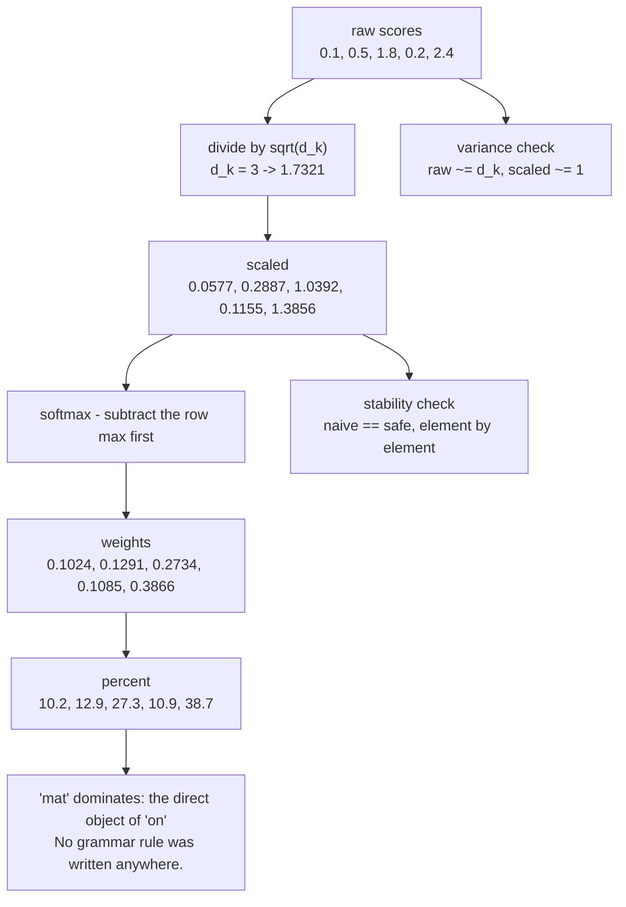

# 04 — Scaled Dot-Product Attention by Hand

> **Lecture chapter:** 03 · **Notes:** [03_Scaled_Dot_Product_Attention_by_Hand.md](../../../notes/03_Scaled_Dot_Product_Attention_by_Hand.md)
> **What you get:** `attentionService.ts` part 3 — the lecture's own trace, the variance proof for
> $1/\sqrt{d_k}$, the softmax stability proof, and the cost model — plus the `trace` and `cost`
> handlers. **This chapter completes the file.**
> **Command used:** `npm run dev`, then two `curl` calls.

---

## 04.1 What this chapter has to show

Chapter 03 is the mathematical centre of the lecture. Three claims get made, and all three can be
checked rather than believed:

| Claim | Notes | How this code checks it |
| :--- | :--- | :--- |
| The five steps are **score → scale → mask → softmax → mix** | §03.2 | `trace` prints each intermediate for the lecture's own numbers |
| The $1/\sqrt{d_k}$ divisor keeps the scores at **unit variance** | §03.4 | `scalingEffect` measures the variance of $Q \cdot K$ before and after, at three values of $d_k$ |
| Subtracting the row maximum is **free** | §03.6 | `stabilityDemo` computes the naive and the safe softmax and compares them element by element |

And one claim gets priced:

| Claim | Notes | How this code checks it |
| :--- | :--- | :--- |
| Context length is the **expensive** variable: $N^2$ entries | §03.7 | `attentionCost` counts the score-matrix entries, the ops and the KV-cache bytes, then grows $N$ by 4× |



---

## 04.2 The files this chapter touches

| File | Lines | Job |
| :--- | :--- | :--- |
| `src/services/attentionService.ts` | 272–427 of 427 | **Part 3 of 3.** `LECTURE_TRACE`, `lectureTrace`, `scalingEffect`, `stabilityDemo`, `kvCacheBytes`, `attentionCost` |
| `src/controllers/attentionController.ts` | 104–150 of 150 | The `trace` and `cost` handlers |

> [!IMPORTANT]
> **`attentionService.ts` is now complete.** Parts 1 and 2 are in
> [chapter 02](./02_Why_Attention_and_the_Soft_Lookup.md) (lines 1–164: the PRNG, the primitives,
> `softmax`, Chapter 01's explainer) and
> [chapter 03](./03_Queries_Keys_Values_and_the_Score_Matrix.md) (lines 165–271: `project`, the mask,
> `attention`, `weightRows`). Read the three code blocks in order and you have read the whole file.

---

## 04.3 The complete code — `attentionService.ts`, part 3 of 3

**File:** `src/services/attentionService.ts`, lines 272–427.

```ts
// Chapter 03 §03.3 - the lecture's own trace, reproduced exactly
// ---------------------------------------------------------------------------

/**
 * The lecture computes attention for "on" in "The cat sat on the mat" with
 * d_k = 3. These are its numbers, hard-coded so the endpoint can show them
 * beside the numbers the formula actually produces.
 */
export const LECTURE_TRACE = {
  tokens: ["The", "cat", "sat", "the", "mat"],
  queryToken: "on",
  queryVector: [0.2, 0.4, -0.5],
  rawScores: [0.1, 0.5, 1.8, 0.2, 2.4],
  dK: 3,
  /** The hand-drawn percentages printed in the lecture notes. */
  handDrawnPercent: [3, 9, 20, 4, 64],
} as const;

/**
 * Run the formula on the lecture's own scores. Hand-rounded teaching numbers do
 * not always reconcile with the exact softmax - what must survive is the SHAPE:
 * "mat" dominates and "The" is the weakest. This function shows both, so the
 * discrepancy is visible instead of hidden.
 */
export function lectureTrace() {
  const { rawScores, dK, tokens, handDrawnPercent } = LECTURE_TRACE;
  const divisor = round(Math.sqrt(dK));
  const scaled = scale(rawScores as unknown as Vector, 1 / Math.sqrt(dK));
  const weights = softmax(scaled);
  const computedPercent = weights.map((weight) => percent(weight));
  const handDrawn = handDrawnPercent as unknown as Vector;

  return {
    divisor,
    steps: tokens.map((token, i) => ({
      token,
      rawScore: rawScores[i],
      scaled: scaled[i],
      weight: weights[i],
      computedPercent: computedPercent[i],
      handDrawnPercent: handDrawnPercent[i],
    })),
    dominance: {
      computed: tokens[argmax(weights)],
      handDrawn: tokens[argmax(handDrawn)],
      agree: argmax(weights) === argmax(handDrawn),
    },
    reconciles: computedPercent.every((value, i) => Math.abs(value - handDrawnPercent[i]) <= 1),
    note:
      "Both columns agree on the ranking and on which token dominates - that is the lesson. " +
      "The lecture's percentages are hand-rounded for teaching, so they need not match the formula to the last digit.",
  };
}

// ---------------------------------------------------------------------------
// Chapter 03 §03.4 - why divide by sqrt(d_k)?
// ---------------------------------------------------------------------------

/**
 * The variance argument, measured instead of asserted. Two random vectors of
 * length d_k have a dot product whose variance grows with d_k. Dividing by
 * sqrt(d_k) puts the variance back at ~1, which is what keeps the softmax from
 * saturating (a saturated softmax is a near-one-hot row whose gradient is ~0).
 *
 * The components are drawn with UNIT variance, so the claim can be checked
 * literally: Var(Q . K) ~= d_k and Var(Q . K / sqrt(d_k)) ~= 1. (Uniform [-1, 1]
 * components would have variance 1/3, which is why they are multiplied by
 * sqrt(3) below - otherwise the measurement would come out at d_k/9 and the
 * arithmetic would look wrong for a reason that has nothing to do with attention.)
 */
export function scalingEffect(dK: number, samples = 200, seed = 7) {
  const next = rng(seed);
  const unitVariance = () => (next() * 2 - 1) * Math.sqrt(3); // Var = 1
  const raw: number[] = [];
  for (let i = 0; i < samples; i++) {
    const a = Array.from({ length: dK }, unitVariance);
    const b = Array.from({ length: dK }, unitVariance);
    raw.push(dot(a, b));
  }

  const divisor = Math.sqrt(dK);
  const mean = raw.reduce((sum, value) => sum + value, 0) / raw.length;
  const variance = raw.reduce((sum, value) => sum + (value - mean) ** 2, 0) / raw.length;

  return {
    dK,
    samples,
    divisor: round(divisor),
    rawVariance: round(variance),
    scaledVariance: round(variance / dK),
    expectedRawVariance: dK,
    expectedScaledVariance: 1,
    claim: "Var(Q . K) ~= d_k, so Var(Q . K / sqrt(d_k)) ~= 1",
    measured: `raw ${round(variance)} (expected ${dK}) -> scaled ${round(variance / dK)} (expected 1)`,
    linearInDK: Math.abs(variance - dK) / dK < 0.35,
    gradientNote:
      "A softmax whose inputs have variance d_k is nearly one-hot, and its gradient is nearly zero. " +
      "The scaling is a training-stability fix, not a normalisation trick.",
  };
}

// ---------------------------------------------------------------------------
// Chapter 03 §03.6 - numerical stability
// ---------------------------------------------------------------------------

/** The same softmax, computed naively and safely, on the same input. */
export function stabilityDemo(scores: Vector) {
  const max = Math.max(...scores);
  const naive = softmaxNaive(scores);
  const safe = softmax(scores);
  return {
    scores,
    rowMax: max,
    naiveExponentials: scores.map((value) => round(Math.exp(value), 4)),
    safeExponentials: scores.map((value) => round(Math.exp(value - max), 4)),
    softmaxNaive: naive,
    softmaxSafe: safe,
    identical: naive.every((value, i) => Math.abs(value - safe[i]) < 1e-6),
    note:
      "softmax(z + c) = softmax(z) for any constant c, so subtracting the row max changes nothing but " +
      "stops exp() from overflowing once logits reach the hundreds.",
  };
}

// ---------------------------------------------------------------------------
// Chapter 03 §03.7 - the cost model
// ---------------------------------------------------------------------------

/**
 * The KV cache, and why Q is not in it (ch02 §02.8). At each new token the model
 * needs its own Q once, but the K and V of every previous token again - so those
 * are the two matrices worth storing.
 */
export function kvCacheBytes(n: number, layers: number, dModel: number, bytesPerValue = 2): number {
  return 2 * n * layers * dModel * bytesPerValue;
}

/**
 * Why context length is the expensive variable: the score matrix has N x N
 * entries, so the work grows with N^2 while the weights are a fixed cost (§02.3).
 */
export function attentionCost(n: number, dModel: number, layers: number, bytesPerValue = 2) {
  const perLayerOps = 2 * n * n * dModel; // Q K^T plus weights x V, each ~N^2 d_model
  const kvBytes = kvCacheBytes(n, layers, dModel, bytesPerValue);
  return {
    n,
    dModel,
    layers,
    scoreMatrixEntries: n * n,
    perLayerOps,
    totalOps: perLayerOps * layers,
    kvCacheBytes: kvBytes,
    kvCacheMB: round(kvBytes / 1024 / 1024, 3),
    growth: "score matrix entries = N^2, so doubling the context quadruples the attention work",
  };
}
```

**Block by block:**

### The lecture's trace, hard-coded so it can be compared

1. `export const LECTURE_TRACE = { ... } as const` — the lecture's numbers for `"on"` in
   `"The cat sat on the mat"`, transcribed exactly: the five tokens, the query vector
   $Q_{\text{on}} = [0.2, 0.4, -0.5]$, the five raw scores `[0.1, 0.5, 1.8, 0.2, 2.4]`, `d_k = 3`, and
   the **hand-drawn percentages** `[3, 9, 20, 4, 64]` that the notes print.
2. `as const` matters: it makes every value a literal type, so `LECTURE_TRACE.dK` is `3` rather than
   `number`, and a typo in the array lengths is a compile error.
3. `lectureTrace()` — runs the *formula* on the lecture's own scores and returns both columns side by
   side. The four fields to read:
   * `steps` — one row per token with `rawScore`, `scaled`, `weight`, `computedPercent` and
     `handDrawnPercent`.
   * `dominance` — `{ computed, handDrawn, agree }`. This is the claim that matters.
   * `reconciles` — `false`, and the response says so.
   * `note` — the explanation, returned with the data.

> [!WARNING]
> **Why `reconciles` is `false`, and why that is the right answer.** Hand-rounded teaching numbers do
> not always survive contact with the exact softmax. For the lecture's scores, the formula gives
> **10.2 / 12.9 / 27.3 / 10.9 / 38.7 %** while the notes print **3 / 9 / 20 / 4 / 64 %**. What *does*
> survive is the thing the lecture is teaching: **both columns put `"mat"` first** (`dominance.agree:
> true`), and both put `"The"` last. The honest move is to compute, print both, and let the
> discrepancy be visible — a function that quietly adjusted its output to match a slide would be
> teaching the wrong lesson. This is the same principle as notes §07.3's warning that logits are not
> probabilities: *always compute, never eyeball.*

### `scalingEffect` — the $1/\sqrt{d_k}$ argument, measured

4. The doc comment states the claim and, importantly, **why the components are multiplied by
   $\sqrt{3}$**: a uniform draw on $[-1, 1]$ has variance $1/3$, so using it directly would make the
   measured variance come out at $d_k/9$ and the arithmetic would look wrong for a reason that has
   nothing to do with attention. `unitVariance = () => (next() * 2 - 1) * Math.sqrt(3)` fixes that,
   giving components with variance exactly 1.
5. `raw.push(dot(a, b))` over `samples = 200` pairs — the empirical distribution of $Q \cdot K$.
6. The measurement: `mean`, then `variance` as the mean of squared deviations. Then the two numbers
   the whole argument turns on:
   * `rawVariance` — should be ≈ `d_k`.
   * `scaledVariance = variance / dK` — should be ≈ `1`, because dividing a score by
     $\sqrt{d_k}$ divides its variance by $d_k$.
7. `expectedRawVariance: dK` and `expectedScaledVariance: 1` are returned next to the measurements, so
   the response can be checked without doing the algebra yourself. `linearInDK` is the pass/fail flag.
8. Measured across the range real models use:

   | $d_k$ | `rawVariance` | expected $d_k$ | `scaledVariance` | expected |
   | ---: | ---: | ---: | ---: | ---: |
   | 3 | 2.9711 | 3 | 0.9904 | 1 |
   | 64 | 69.4451 | 64 | 1.0851 | 1 |
   | 128 | 119.8230 | 128 | 0.9361 | 1 |

   **The raw variance grows with $d_k$; the scaled variance does not.** That is the whole reason the
   divisor exists, and it is now a measurement rather than a claim.
9. `gradientNote` — the second half of the argument, from notes §03.4: a softmax whose inputs have
   variance $d_k$ is nearly one-hot, and a near-one-hot softmax has a near-zero gradient. The scaling
   is a **training-stability fix**, not a normalisation trick, and the response says so.

### `stabilityDemo` — subtracting the row maximum is free

10. `const max = Math.max(...scores)` then two arrays of exponentials: `naiveExponentials` ($e^{z_i}$)
    and `safeExponentials` ($e^{z_i - \max}$).
11. `softmaxNaive(scores)` and `softmax(scores)` — the broken version and the fixed one, from
    [chapter 02](./02_Why_Attention_and_the_Soft_Lookup.md).
12. `identical: naive.every((value, i) => Math.abs(value - safe[i]) < 1e-6)` — the proof, computed per
    element with a tolerance rather than a string comparison, because floating-point arithmetic is
    not associative and the two orders of operations will differ in the last bits.
13. `note` — the reason it is free: $\text{softmax}(z + c) = \text{softmax}(z)$ for any constant $c$
    (notes §07.5), and choosing $c = -\max(z)$ makes the largest exponent exactly $1$.

> [!NOTE]
> **What the demo does *not* show with the lecture's numbers.** Both versions agree there, because
> neither overflows. To watch it break, send `{"scores":[800,810,820]}`:
>
> * `naiveExponentials` → `Infinity, Infinity, Infinity`
> * `softmaxNaive` → `NaN, NaN, NaN` (because `Infinity / Infinity` is `NaN`)
> * `softmaxSafe` → `0, 4.5e-05, 0.999955`
> * `identical` → `false`
>
> In the JSON response the `Infinity` and `NaN` values appear as **`null`**, because JSON has no way
> to represent them — which is a good reminder that "the field is null" and "the field is absent" are
> different failures, and only one of them is a schema violation.


### The cost model — why context length is the expensive variable

14. `kvCacheBytes(n, layers, dModel, bytesPerValue = 2)` — one line, and the most commercially
    important line in the project:
    ```text
    2 * n * layers * dModel * bytesPerValue
    ```
    The `2` is K and V — **not Q**, because Q is used once per token while K and V are read again by
    every later token (notes §02.8). `bytesPerValue = 2` is fp16, the default for inference.
15. `attentionCost(n, dModel, layers, bytesPerValue = 2)` — the whole §03.7 picture:
    * `scoreMatrixEntries: n * n` — the $N \times N$ table. This is the number that grows
      **quadratically**, and it is a per-request cost, unlike the weights.
    * `perLayerOps: 2 * n * n * dModel` — two matrix multiplies dominate: $QK^T$ and
      $\text{weights} \cdot V$, each about $N^2 d_{\text{model}}$.
    * `totalOps` — multiplied by `layers`.
    * `kvCacheBytes` / `kvCacheMB` — the memory the cache costs for this context length.
    * `growth` — the sentence that matters: *"score matrix entries = N^2, so doubling the context
      quadruples the attention work."*
16. `bytesPerValue` is a parameter rather than a constant so the endpoint can be asked for fp16, fp32
    or int8 without editing the code — and so the *assumption is visible at the call site* rather
    than buried.

---

## 04.4 The complete code — the `trace` and `cost` handlers

**File:** `src/controllers/attentionController.ts`, lines 104–150.

```ts
/** POST /api/attention/trace  { "scores": [0.1,0.5,1.8,0.2,2.4], "dK": 3 } */
export const trace = asyncHandler((req: Request, res: Response) => {
  const rawScores = optionalNumberArray(req, "scores", [...attention.LECTURE_TRACE.rawScores]);
  const dK = optionalInteger(req, "dK", attention.LECTURE_TRACE.dK, 1, 512) ?? attention.LECTURE_TRACE.dK;
  const divisor = Math.sqrt(dK);
  const scaled = rawScores.map((value) => attention.round(value / divisor, 4));
  const weights = attention.softmax(scaled);

  res.json({
    chapter: "03 §03.3-§03.6 - scaled dot-product attention, step by step",
    steps: {
      oneRawScores: rawScores,
      twoScaled: scaled,
      threeSoftmax: weights,
      fourPercent: weights.map((value) => attention.percent(value)),
      sumOfWeights: attention.round(weights.reduce((sum, value) => sum + value, 0), 6),
    },
    lectureTrace: attention.lectureTrace(),
    scaling: attention.scalingEffect(dK),
    stability: attention.stabilityDemo(rawScores),
    note:
      "Step 4 is the answer: a weighted sum of the value vectors, Z_i = sum_j w_ij V_j. The weights came from " +
      "learned geometry - no grammar rule was written anywhere.",
  });
});

/** POST /api/attention/cost  { "n": 4096, "shape": "gpt2-small" } */
export const cost = asyncHandler((req: Request, res: Response) => {
  const shape = config.shape(shapeId(req));
  const n = optionalInteger(req, "n", config.nTokens, 1, 1_000_000) ?? config.nTokens;

  res.json({
    chapter: "03 §03.7 - the cost model: why context length is the expensive variable",
    shape: shape.id,
    ...attention.attentionCost(n, shape.dModel, shape.layers),
    quadraticGrowth: [n, n * 2, n * 4].map((length) => ({
      n: length,
      scoreMatrixEntries: length * length,
      totalOps: attention.attentionCost(length, shape.dModel, shape.layers).totalOps,
      kvCacheMB: attention.attentionCost(length, shape.dModel, shape.layers).kvCacheMB,
    })),
    note:
      "The weights are a FIXED cost that scales with d_model^2; the score matrix is a PER-REQUEST cost that " +
      "scales with N^2. That separation is why batching, caching and shorter prompts are the levers you have.",
  });
});
```

**Block by block:**

17. `optionalNumberArray(req, "scores", [...attention.LECTURE_TRACE.rawScores])` — the scores,
    defaulting to the lecture's `[0.1, 0.5, 1.8, 0.2, 2.4]`. The spread `[...]` is needed because
    `LECTURE_TRACE` is `as const`, so its arrays are `readonly` and cannot be passed where a mutable
    `number[]` is expected.
18. `optionalInteger(req, "dK", attention.LECTURE_TRACE.dK, 1, 512)` — `d_k`, defaulting to `3`.
    Bounded at 512 so the variance demo stays fast.
19. `const divisor = Math.sqrt(dK)` then `scaled` and `weights` — **the handler computes the first
    three steps inline** rather than calling a service function. That is a deliberate exception to
    the "controllers do no arithmetic" rule, and it is worth understanding why: this endpoint's entire
    purpose is to show the intermediate steps of a *one-dimensional* calculation (a single row, not a
    matrix). Three lines here are clearer than a service function with one caller. The moment the
    calculation involves a matrix — as in `scores` — the work goes back into the service.
20. `steps: { oneRawScores, twoScaled, threeSoftmax, fourPercent, sumOfWeights }` — the five steps,
    numbered in the key names. `fourPercent` rounds to one decimal for reading.
    `sumOfWeights` is returned and you will sometimes see `0.999999`: that is the accumulated rounding
    from rounding each weight to 6 decimals, and it is left visible on purpose.
21. `lectureTrace: attention.lectureTrace()` — the side-by-side comparison, always included, so the
    endpoint always answers the question "does this match the lecture?"
22. `scaling: attention.scalingEffect(dK)` — the variance proof, run at whatever `d_k` the request
    named. **This is what makes the endpoint worth keeping**: change `dK` and the measurement
    changes with it, so the claim is falsifiable rather than decorative.
23. `stability: attention.stabilityDemo(rawScores)` — the naive-vs-safe comparison, run on the
    *unscaled* scores. That is why the numbers differ from `steps.threeSoftmax`: `stabilityDemo`
    answers "do these two implementations of softmax agree?", which is a question about the raw input.
24. In `cost`: `optionalInteger(req, "n", config.nTokens, 1, 1_000_000)` — the context length,
    defaulting to `N_TOKENS` from `.env`. The upper bound of a million exists so the arithmetic cannot
    overflow into `Infinity` on a silly request.
25. `quadraticGrowth: [n, n * 2, n * 4].map(...)` — **the demonstration.** The endpoint does not just
    report the cost at $N$; it reports it at $N$, $2N$ and $4N$ so the quadratic growth is a table
    rather than an adjective.
26. `...attention.attentionCost(n, shape.dModel, shape.layers)` — spread first, then the extra
    `quadraticGrowth` and `note` fields added. Spread-then-extend is the idiom used throughout this
    project's controllers.


---

## 04.5 Run it

**The lecture's trace, reproduced:**

```bash
curl -s -X POST localhost:3000/api/attention/trace \
  -H 'content-type: application/json' -d '{}'
```

Trimmed to the comparison:

```json
{
  "steps": {
    "oneRawScores":   [0.1, 0.5, 1.8, 0.2, 2.4],
    "twoScaled":      [0.0577, 0.2887, 1.0392, 0.1155, 1.3856],
    "threeSoftmax":   [0.102449, 0.129072, 0.273381, 0.108545, 0.386552],
    "fourPercent":    [10.2, 12.9, 27.3, 10.9, 38.7],
    "sumOfWeights":   0.999999
  },
  "lectureTrace": {
    "divisor": 1.7321,
    "steps": [
      { "token": "The", "rawScore": 0.1, "scaled": 0.057735, "computedPercent": 10.2, "handDrawnPercent":  3 },
      { "token": "cat", "rawScore": 0.5, "scaled": 0.288675, "computedPercent": 12.9, "handDrawnPercent":  9 },
      { "token": "sat", "rawScore": 1.8, "scaled": 1.039230, "computedPercent": 27.3, "handDrawnPercent": 20 },
      { "token": "the", "rawScore": 0.2, "scaled": 0.115470, "computedPercent": 10.9, "handDrawnPercent":  4 },
      { "token": "mat", "rawScore": 2.4, "scaled": 1.385641, "computedPercent": 38.7, "handDrawnPercent": 64 }
    ],
    "dominance": { "computed": "mat", "handDrawn": "mat", "agree": true },
    "reconciles": false
  },
  "scaling": {
    "dK": 3, "divisor": 1.7321, "samples": 200,
    "rawVariance": 2.9711, "expectedRawVariance": 3,
    "scaledVariance": 0.9904, "expectedScaledVariance": 1,
    "linearInDK": true
  },
  "stability": { "rowMax": 2.4, "identical": true }
}
```

**Three things to take from that response:**

1. **The step chain is exactly the lecture's.** 0.1 → 0.0577 → 10.2%. Follow one row from `rawScore`
   to `scaled` to `computedPercent` and you have done the calculation by hand.
2. **`dominance.agree: true`.** Both the formula and the lecture's hand-drawn table put `"mat"` first.
   That is the lesson the trace exists to teach — `"on"` ends up mostly made of `"mat"`, so downstream
   layers see *"on … a mat"* rather than *"the word on"*.
3. **`reconciles: false`, and the response says so.** The absolute percentages differ because the
   lecture's table is hand-rounded. The code reports the discrepancy instead of hiding it.


**The variance proof, at three values of $d_k$:**

```bash
for dk in 3 64 128; do
  curl -s -X POST localhost:3000/api/attention/trace \
    -H 'content-type: application/json' -d "{\"dK\":$dk}" \
  | python3 -c "import sys,json; s=json.load(sys.stdin)['scaling']; print(s['measured'])"
done
```

```text
raw 2.9711 (expected 3) -> scaled 0.9904 (expected 1)
raw 69.4451 (expected 64) -> scaled 1.0851 (expected 1)
raw 119.823 (expected 128) -> scaled 0.9361 (expected 1)
```

**The raw variance tracks $d_k$; the scaled variance stays at 1.** That is notes §03.4, measured. It
is also why `d_head` is 64 or 128 in every real model (notes §04.3): the divisor is what keeps the
scores in the range where softmax still has a useful gradient.

**The cost model, at `gpt2-small` with a 4,096-token context:**

```bash
curl -s -X POST localhost:3000/api/attention/cost \
  -H 'content-type: application/json' -d '{"n":4096,"shape":"gpt2-small"}'
```

```json
{
  "n": 4096, "dModel": 768, "layers": 12,
  "scoreMatrixEntries": 16777216,
  "perLayerOps": 25769803776,
  "totalOps": 309237645312,
  "kvCacheBytes": 150994944,
  "kvCacheMB": 144,
  "quadraticGrowth": [
    { "n": 4096,  "scoreMatrixEntries": 16777216,  "totalOps": 309237645312,  "kvCacheMB": 144 },
    { "n": 8192,  "scoreMatrixEntries": 67108864,  "totalOps": 1236950581248, "kvCacheMB": 288 },
    { "n": 16384, "scoreMatrixEntries": 268435456, "totalOps": 4947802324992, "kvCacheMB": 576 }
  ]
}
```

Read the `scoreMatrixEntries` column: **16.8M → 67.1M → 268.4M.** Each 4× increase in context is a
**16×** increase in attention work. Meanwhile the KV cache grows *linearly* (144 → 288 → 576 MB),
because it is `2 × n × layers × d_model × 2` with no $n^2$ term anywhere.

> [!IMPORTANT]
> **The one sentence to remember from this chapter.** The model's weights are a fixed cost that scales
> with $d_{\text{model}}^2$ (notes §02.3); the score matrix is a per-request cost that scales with
> $N^2$. That separation is why every lever you have in production — shorter prompts, batching, prefix
> caching, a smaller retrieved context — is about $N$, not about the model.

---

## 04.6 Common mistakes this chapter's code prevents

| Mistake | What the code does instead |
| :--- | :--- |
| Believing the lecture's hand-drawn percentages are exact | `reconciles: false` plus both columns, printed side by side |
| Asserting the $1/\sqrt{d_k}$ claim without checking it | `rawVariance` / `scaledVariance` measured at three values of $d_k$ |
| Testing the scaling with variance-$1/3$ components | Components scaled to **unit variance**, so the measurement matches the claim |
| Writing only the safe softmax and never showing why | Both `softmaxNaive` and `softmax` are computed and compared per element |
| Forgetting that `Q` is not in the KV cache | `kvCacheBytes` starts with `2 *` and the doc comment says why |
| Reporting cost at one context length | `quadraticGrowth` reports $N$, $2N$, $4N$ |
| Hard-coding fp16 | `bytesPerValue` is a parameter, visible at the call site |

---

## 04.7 Checkpoint

1. Which five steps does `attention()` perform, and in what order?
2. Why does `scaledVariance` stay near 1 while `rawVariance` grows with $d_k$?
3. Why are the components in `scalingEffect` multiplied by $\sqrt{3}$?
4. Why does `stabilityDemo` agree with `softmaxNaive` on the lecture's scores, and when would it not?
5. In the cost table, why does the KV cache grow linearly while the score matrix grows quadratically?
6. Why is the `trace` handler allowed to do arithmetic when the rule says controllers do not?

> **Next:** [05 — Multi-Head Attention](./05_Multi_Head_Attention.md), where the same formula is run
> $h$ times in parallel — and turns out to be almost free.

