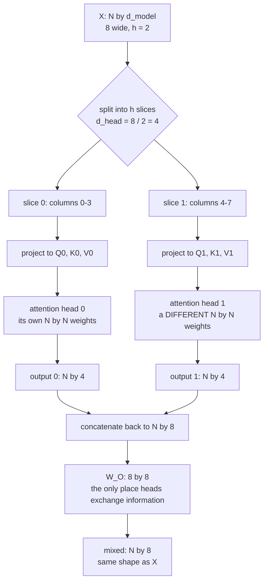

# 05 — Multi-Head Attention

> **Lecture chapter:** 04 · **Notes:** [04_Multi_Head_Attention_and_Head_Specialisation.md](../../../notes/04_Multi_Head_Attention_and_Head_Specialisation.md)
> **What you get:** the whole of `headService.ts` — `headSlices`, `multiHeadAttention`, the cost
> comparison, the MQA/GQA cache variants, and the head-role tables — plus `headController.ts`.
> **Command used:** `npm run dev`, then one `curl`.

---

## 05.1 The idea this chapter has to implement

One attention pattern is not enough. A single softmax row forces the model to make **one** decision
about how to distribute its attention, and language needs several at once: which token came before,
which noun a pronoun points at, which words agree grammatically. Multi-head attention runs $h$
independent attention computations in parallel and concatenates the results:

$$\text{MultiHead}(X) = \text{Concat}(\text{head}_1, \dots, \text{head}_h)\,W^{O}, \qquad \text{head}_i = \text{softmax}\!\left(\frac{Q_iK_i^{T}}{\sqrt{d_k}}\right)V_i$$

The arithmetic that makes this cheap is one line: $d_{\text{head}} = d_{\text{model}} / h$, so
$h \times d_{\text{head}} = d_{\text{model}}$. The output is **the same width** as the input — the
heads redistribute the width, they do not add to it.



---

## 05.2 The two files this chapter introduces

| File | Lines | Job |
| :--- | :--- | :--- |
| `src/services/headService.ts` | 1–142 | `headSlices`, `multiHeadAttention`, `costComparison`, `kvCacheVariants`, `headRoles`, `headCountGuide` |
| `src/controllers/headController.ts` | 1–46 | The `heads` handler |

---

## 05.3 The complete code — `headService.ts`

**File:** `src/services/headService.ts`.

```ts
import type { MaskKind, Matrix, ModelShape } from "../types";
import { attention, kvCacheBytes, matmul, project, randomMatrix, round, type AttentionResult } from "./attentionService";

/**
 * Chapter 04 - multi-head attention. One attention pattern is not enough
 * (§04.1), so the model runs h of them in parallel, each on its own slice of the
 * token vector, then concatenates the results and mixes them with W_O (§04.2).
 *
 * The arithmetic that makes this cheap: d_head = d_model / h, so
 * h x d_head = d_model. Splitting into heads does NOT make the output wider -
 * it redistributes the same width across h independent relationship patterns.
 */

/** One head: its own Q, K, V, its own weight matrix, its own output. */
export type Head = {
  head: number;
  dHead: number;
  Q: Matrix;
  K: Matrix;
  V: Matrix;
  weights: AttentionResult["weights"];
  output: Matrix;
};

/** Cut a d_model-wide sequence into h d_head-wide slices (§04.3). */
export function headSlices(X: Matrix, nHeads: number): Matrix[] {
  const dHead = X[0].length / nHeads;
  return Array.from({ length: nHeads }, (_, head) => X.map((row) => row.slice(head * dHead, (head + 1) * dHead)));
}

/**
 * The §04.2 formula: for each head run attention, concatenate the h outputs back
 * to d_model, then apply the learned output projection W_O. W_O is the only part
 * of multi-head attention that lets the heads exchange information.
 */
export function multiHeadAttention(X: Matrix, spec: ModelShape, seed: number, mask: MaskKind = "causal") {
  const dHead = spec.dModel / spec.nHeads;
  const heads: Head[] = headSlices(X, spec.nHeads).map((slice, head) => {
    const { Q, K, V } = project(slice, dHead, seed + head * 100);
    const result = attention(Q, K, V, dHead, mask);
    return { head, dHead, Q, K, V, weights: result.weights, output: result.output };
  });

  const concatenated = heads[0].output.map((_, position) => heads.flatMap((head) => head.output[position]));
  const W_O = randomMatrix(spec.dModel, spec.dModel, seed + 999);
  const mixed = matmul(concatenated, W_O);

  return {
    dModel: spec.dModel,
    nHeads: spec.nHeads,
    dHead,
    widthPreserved: spec.nHeads * dHead === spec.dModel,
    heads,
    concatenated,
    W_O,
    mixed,
    note:
      "Each head saw the same tokens but a different slice of each vector, so each learned its own " +
      "relationship pattern. W_O then mixes the h views back into one d_model vector per token.",
  };
}

/**
 * The §04.3 cost table, computed rather than quoted. Multi-head attention is
 * nearly free: the projections cost the same and the mixing FLOPs are identical.
 * Only the h separate score matrices (memory) and W_O are genuinely new.
 */
export function costComparison(n: number, spec: ModelShape) {
  const { dModel, nHeads: h } = spec;
  const dHead = dModel / h;
  return {
    n,
    dModel,
    nHeads: h,
    dHead,
    totalWidthPreserved: h * dHead === dModel,
    projectionParameters: {
      singleFullWidthHead: 3 * dModel * dModel,
      multiHead: 3 * dModel * dModel,
      identical: true,
    },
    scoreMatrixEntries: { singleFullWidthHead: n * n, multiHead: h * n * n },
    mixingFlops: {
      singleFullWidthHead: n * n * dModel,
      multiHead: h * n * n * dHead,
      identical: n * n * dModel === h * n * n * dHead,
    },
    outputProjectionParameters: dModel * dModel,
    whatDiffers: "one relationship pattern vs h independent relationship patterns",
    verdict: "h different views for roughly the price of one; the extra cost is memory, not compute",
  };
}

/**
 * §04.5 - the KV-cache reason MQA and GQA exist. Q is used once per token, but K
 * and V of every previous token are needed again, so the cache is sized by how
 * many KV heads the model keeps. MQA keeps one; GQA keeps a few.
 */
export function kvCacheVariants(n: number, spec: ModelShape, bytesPerValue = 2) {
  const dHead = spec.dModel / spec.nHeads;
  const variants: { variant: string; kvHeads: number; note: string }[] = [
    { variant: "MHA", kvHeads: spec.nHeads, note: "one K/V pair per head - best quality, largest cache" },
    { variant: "GQA", kvHeads: Math.max(1, Math.round(spec.nHeads / 4)), note: "a few heads share each K/V pair - the modern default" },
    { variant: "MQA", kvHeads: 1, note: "all heads share one K/V pair - smallest cache, some quality loss" },
  ];

  const mhaBytes = 2 * n * spec.layers * spec.nHeads * dHead * bytesPerValue;
  return variants.map(({ variant, kvHeads, note }) => {
    const bytes = 2 * n * spec.layers * kvHeads * dHead * bytesPerValue;
    return {
      variant,
      kvHeads,
      bytes,
      mb: round(bytes / 1024 / 1024, 3),
      savingVsMHA: round(1 - bytes / mhaBytes, 3),
      note,
    };
  });
}

/** §04.4 - what heads are observed to specialise in, from the lecture's list. */
export function headRoles() {
  return [
    { role: "Previous-token head", focus: "the token immediately before this one", why: "local order and syntax" },
    { role: "Syntactic head", focus: "subject-verb and modifier-noun pairs", why: "grammatical agreement" },
    { role: "Coreference head", focus: "pronouns and the nouns they point at", why: "'it' resolves to the right entity" },
    { role: "Positional head", focus: "fixed offsets, e.g. always two back", why: "structural patterns" },
  ];
}

/** §04.6 - head count is a hyperparameter: d_head stays 64-128 across model sizes. */
export function headCountGuide() {
  return [
    { model: "GPT-2 small", dModel: 768, nHeads: 12, dHead: 64 },
    { model: "LLaMA-3 8B", dModel: 4096, nHeads: 32, dHead: 128 },
    { model: "LLaMA-3 70B", dModel: 8192, nHeads: 64, dHead: 128 },
    { model: "GPT-3", dModel: 12288, nHeads: 96, dHead: 128 },
  ];
}

/** Reference, so the controller can report the cache a plain single-head model would need. */
export const singleHeadKvBytes = kvCacheBytes;
```

**Block by block:**

1. `import { attention, kvCacheBytes, matmul, project, randomMatrix, round, type AttentionResult } from "./attentionService"`
   — **this is the one service-to-service dependency in the project**, and it is a real one: a
   transformer block *contains* multi-head attention, and multi-head attention *contains* attention.
   `type AttentionResult` is imported with the `type` keyword so it is erased at compile time.
2. The file header states the two facts to take from the chapter: $h \times d_{\text{head}} = d_{\text{model}}$,
   and splitting into heads **redistributes** width rather than increasing it.
3. `export type Head` — one head's complete output: its index, its `dHead`, its own `Q`, `K`, `V`, its
   own `weights` matrix, and its own `output`. Returning this per head is what makes the response
   able to show that head 0 and head 1 computed *different* attention for the same tokens.
4. `headSlices(X, nHeads)` — **the split.** `const dHead = X[0].length / nHeads` reads the width from
   the data, then `row.slice(head * dHead, (head + 1) * dHead)` carves each token's vector into $h$
   contiguous slices. Notes §04.2 describes this as "each head gets its own slice of the
   representation", and this is that sentence in code.
5. `multiHeadAttention(X, spec, seed, mask = "causal")` — the whole of §04.2:
   * `headSlices(X, spec.nHeads).map((slice, head) => { ... })` — for each slice, `project` it with
     `seed + head * 100`, so **every head gets its own learned matrices**. The `* 100` stride keeps
     the per-head seeds far apart, which matters because `project` derives three matrices from
     `seed + 1`, `seed + 2`, `seed + 3`.
   * `attention(Q, K, V, dHead, mask)` — the same `attention()` function from
     [chapter 03](./03_Queries_Keys_Values_and_the_Score_Matrix.md), called $h$ times. **Nothing in
     the attention formula changes.** That is the point of the chapter: multi-head attention is not a
     new mechanism, it is the old one run in parallel.
   * `heads[0].output.map((_, position) => heads.flatMap((head) => head.output[position]))` — the
     concatenation. For each token, glue the $h$ output rows side by side, giving back a
     $d_{\text{model}}$-wide row. `flatMap` is doing the "concat" of the formula.
   * `matmul(concatenated, W_O)` — the output projection. **$W^{O}$ is the only operation in
     multi-head attention that lets the heads exchange information.** Without it, the heads' outputs
     would sit in disjoint slices of the vector and could never interact. That is a genuinely
     non-obvious point, and it is why $W^{O}$ is not optional.
   * `widthPreserved: spec.nHeads * dHead === spec.dModel` — the invariant, computed rather than
     asserted. It is `true` for every shape in the config table, and if someone added a shape where
     $d_{\text{model}}$ was not divisible by $h$, this would flip to `false` and the response would
     say so instead of silently producing a ragged matrix.

### The cost table — why multi-head attention is nearly free

6. `costComparison(n, spec)` — the §04.3 table, **computed** rather than quoted. The five fields are
   the five rows of the notes' comparison:

   | Field | Value | What it shows |
   | :--- | :--- | :--- |
   | `projectionParameters.singleFullWidthHead` | `3 * dModel * dModel` | one full-width head |
   | `projectionParameters.multiHead` | `3 * dModel * dModel` | $h$ heads — **identical** |
   | `mixingFlops.singleFullWidthHead` | `n * n * dModel` | |
   | `mixingFlops.multiHead` | `h * n * n * dHead` | **identical**, because $h \cdot d_{\text{head}} = d_{\text{model}}$ |
   | `scoreMatrixEntries.multiHead` | `h * n * n` | **the one real cost**: $h$ separate $N \times N$ matrices |
   | `outputProjectionParameters` | `dModel * dModel` | the new $W^{O}$ |

7. The two `identical` booleans are computed with `===` on the arithmetic, not hard-coded to `true`.
   That matters: if you changed `headSlices` to overlap or to pad, the equality would break and the
   response would tell you. **A claimed invariant that is not computed is just a comment.**
8. For `gpt2-small` with 3 tokens the response is:
   `projectionParameters: { single: 1769472, multi: 1769472, identical: true }`,
   `mixingFlops: { single: 6912, multi: 6912, identical: true }`, and
   `scoreMatrixEntries: { single: 9, multi: 108 }`. **The projections and the FLOPs are identical;
   the score matrices are 12× bigger.** That is the trade: memory for independence.

### MQA and GQA — the KV-cache reason these variants exist

9. `kvCacheVariants(n, spec, bytesPerValue = 2)` — builds the three variants and compares them:

   | Variant | `kvHeads` | Idea |
   | :--- | :--- | :--- |
   | `MHA` | `spec.nHeads` (12) | one K/V pair per head — best quality, largest cache |
   | `GQA` | `max(1, round(nHeads / 4))` (3) | a few heads share each K/V pair — the modern default |
   | `MQA` | `1` | all heads share one K/V pair — smallest cache, some quality loss |

10. `const mhaBytes = 2 * n * spec.layers * spec.nHeads * dHead * bytesPerValue` — the MHA baseline,
    computed with the same formula as `kvCacheBytes` from
    [chapter 04](./04_Scaled_Dot_Product_Attention_by_Hand.md), so the two numbers are comparable.
11. `savingVsMHA: round(1 - bytes / mhaBytes, 3)` — the saving **as a fraction**, computed per variant
    rather than asserted. For `gpt2-small`: GQA saves 75%, MQA saves 91.7%. That is notes §04.5's
    whole argument, and it is the reason every large open model since LLaMA-2 uses GQA.
12. Why the cache shrinks at all: notes §02.8 established that only K and V are cached, because Q is
    used once. So the cache size is proportional to **how many distinct K/V pairs the model keeps** —
    and MQA/GQA reduce exactly that number.

### The two reference tables

13. `headRoles()` — the lecture's four observed specialisations (previous-token, syntactic,
    coreference, positional) as data. It is returned with every response so the abstract claim
    "heads specialise" arrives next to the concrete list.
14. `headCountGuide()` — the §04.6 table for four real models, including `dHead`. It exists to make
    one fact checkable: **`d_head` is 64 or 128 in every one of them**, from a 124M-parameter GPT-2 up
    to a 175B-parameter GPT-3. It is one of the most stable hyperparameters in the field.
15. `export const singleHeadKvBytes = kvCacheBytes` — a re-export, so the controller can compute a
    single-head baseline without importing `attentionService` directly. It keeps the controller's
    import list honest about where the *work* comes from.


---

## 05.4 The complete code — `headController.ts`

**File:** `src/controllers/headController.ts`.

```ts
import type { Request, Response } from "express";
import { config } from "../config/config";
import { asyncHandler } from "../middleware/errorHandler";
import { requireMask, requireTokens, shapeId } from "../middleware/validate";
import { tokenVectors } from "../services/attentionService";
import * as head from "../services/headService";

/** Chapter 04 - multi-head attention: h views of the same tokens. */

/** POST /api/heads  { "tokens": [...], "shape": "toy-tiny", "mask": "causal" } */
export const heads = asyncHandler((req: Request, res: Response) => {
  const tokens = requireTokens(req);
  const shape = config.shape(shapeId(req));
  const mask = requireMask(req);

  const X = tokenVectors(tokens, shape.dModel);
  const result = head.multiHeadAttention(X, shape, config.seed, mask);

  res.json({
    chapter: "04 - multi-head attention and head specialisation",
    shape: shape.id,
    tokens,
    mask,
    dModel: result.dModel,
    nHeads: result.nHeads,
    dHead: result.dHead,
    widthPreserved: result.widthPreserved,
    heads: result.heads.map((one) => ({
      head: one.head,
      dHead: one.dHead,
      Q: one.Q,
      K: one.K,
      V: one.V,
      weights: one.weights,
      output: one.output,
    })),
    concatenated: result.concatenated,
    W_O: shape.dModel <= 32 ? result.W_O : "omitted: too large for the JSON response",
    mixed: result.mixed,
    cost: head.costComparison(tokens.length, shape),
    kvCache: head.kvCacheVariants(tokens.length, shape),
    headRoles: head.headRoles(),
    headCountGuide: head.headCountGuide(),
    note: result.note,
  });
});
```

**Block by block:**

16. `import { tokenVectors } from "../services/attentionService"` — the controller builds `X` itself,
    because `multiHeadAttention` takes a matrix rather than tokens. One import from the service that
    owns the primitives, one namespace import for the chapter's own service.
17. `const X = tokenVectors(tokens, shape.dModel)` then `head.multiHeadAttention(X, shape, config.seed, mask)`
    — two lines. All the arithmetic is in the service.
18. `heads: result.heads.map((one) => ({ head, dHead, Q, K, V, weights, output }))` — the per-head
    objects, mapped explicitly rather than spread. Naming each field is what guarantees the response
    shape stays stable if `Head` ever gains an internal field: a spread would leak it into the API.
    **An explicit mapping is an API contract; a spread is an accident waiting to happen.**
19. `W_O: shape.dModel <= 32 ? result.W_O : "omitted: too large..."` — the same guard as in
    `attentionController`. Note it is re-declared here rather than imported, because it is a *display*
    decision and each controller owns its own display decisions.
20. `cost: head.costComparison(tokens.length, shape)` and `kvCache: head.kvCacheVariants(tokens.length, shape)`
    — both tables, every call. They are cheap to compute and they are the two facts a reader most
    needs alongside the raw matrices.
21. `headRoles: head.headRoles()` and `headCountGuide: head.headCountGuide()` — the reference tables,
    so the abstract claims of §04.4 and §04.6 arrive with the data.
22. `note: result.note` — the service's own explanation, passed through unchanged. Controllers do not
    rewrite prose from the service; if the explanation is wrong, it is wrong in one place.


---

## 05.5 Run it

```bash
curl -s -X POST localhost:3000/api/heads \
  -H 'content-type: application/json' \
  -d '{"tokens":["The","cat","mat"],"mask":"causal"}'
```

The head weights — the numbers this chapter exists for:

```json
{
  "dModel": 8, "nHeads": 2, "dHead": 4, "widthPreserved": true,
  "heads": [
    { "head": 0, "dHead": 4,
      "weights": [[1, 0, 0],
                  [0.381896, 0.618104, 0],
                  [0.367191, 0.258434, 0.374375]] },
    { "head": 1, "dHead": 4,
      "weights": [[1, 0, 0],
                  [0.532897, 0.467103, 0],
                  [0.367511, 0.308250, 0.324239]] }
  ],
  "concatenated": [[0.078028, -0.377095, -0.568438, -0.241326,
                    0.349979,  0.283595, -0.305601,  0.442052]],
  "mixed": [[-0.146704, 0.016599, 0.308484, 0.275893,
             -0.419733, -0.202454, 0.040261, -0.318191]]
}
```

**Compare row 1 of the two weight matrices.** Row 1 is the token `"cat"`, and the two heads disagree
about it:

| Token `"cat"` attends to | head 0 | head 1 |
| :--- | ---: | ---: |
| `The` | 38.2% | **53.3%** |
| `cat` | **61.8%** | 46.7% |
| `mat` | 0% | 0% |

Both heads obey the causal mask (the `mat` column is 0 in both, because `"mat"` comes after `"cat"`).
But head 0 is mostly self-focused while head 1 looks more to the previous token. **Two different
relationships, from the same tokens, in the same layer.** That is notes §04.1 answered concretely —
and note that `"The"` (row 0) is `[1, 0, 0]` in *both* heads, because the first token has nothing else
it is allowed to read.

The `concatenated` row shows the two 4-wide outputs sitting side by side to make 8, and `mixed` shows
what `W_O` did with them.

**The cost table on a real model** — `gpt2-small`, 3 tokens:

```bash
curl -s -X POST localhost:3000/api/heads \
  -H 'content-type: application/json' \
  -d '{"tokens":["The","cat","mat"],"shape":"gpt2-small"}'
```

```json
{
  "cost": {
    "dModel": 768, "nHeads": 12, "dHead": 64, "totalWidthPreserved": true,
    "projectionParameters": { "singleFullWidthHead": 1769472, "multiHead": 1769472, "identical": true },
    "scoreMatrixEntries":   { "singleFullWidthHead": 9, "multiHead": 108 },
    "mixingFlops":          { "singleFullWidthHead": 6912, "multiHead": 6912, "identical": true },
    "outputProjectionParameters": 589824,
    "verdict": "h different views for roughly the price of one; the extra cost is memory, not compute"
  },
  "kvCache": [
    { "variant": "MHA", "kvHeads": 12, "bytes": 110592, "mb": 0.105, "savingVsMHA": 0 },
    { "variant": "GQA", "kvHeads":  3, "bytes":  27648, "mb": 0.026, "savingVsMHA": 0.75 },
    { "variant": "MQA", "kvHeads":  1, "bytes":   9216, "mb": 0.009, "savingVsMHA": 0.917 }
  ]
}
```

**Read the two `identical: true` flags.** The projections cost the same and the mixing FLOPs are the
same; the only genuinely new costs are the 12 separate $3 \times 3$ score matrices and the
$768 \times 768$ output projection. Multi-head attention buys 12 independent views for roughly the
price of one — and the `kvCache` table shows the price it *does* charge, in memory: **GQA saves 75% of
the cache, MQA saves 91.7%.**

> [!TIP]
> **Try `{"shape":"llama3-8b"}`.** `dHead` is 128 there and 64 on `gpt2-small`, while `d_model` differs
> by more than 5×. That is the stability of `d_head` from notes §04.6, visible in two calls.


---

## 05.6 Common mistakes this chapter's code prevents

| Mistake | What the code does instead |
| :--- | :--- |
| Thinking multi-head attention makes the output wider | `widthPreserved: h * dHead === dModel`, computed per call |
| Claiming the FLOPs are identical without checking | `mixingFlops.identical` computed with `===` on the arithmetic |
| Giving every head the same projection matrices | `seed + head * 100`, so each head has its own $W_Q$, $W_K$, $W_V$ |
| Forgetting that $W^{O}$ exists | `matmul(concatenated, W_O)` is a required step, with a comment saying why |
| Measuring the KV cache per *head* instead of per *KV head* | `kvCacheVariants` varies `kvHeads`, not `nHeads` |
| Hard-coding the MHA baseline | `mhaBytes` computed with the same formula as chapter 04's `kvCacheBytes` |
| Spreading a service object into a response | An explicit field-by-field `map`, so the API shape is a contract |

---

## 05.7 Checkpoint

1. Why is $d_{\text{head}} = d_{\text{model}} / h$, and what does that guarantee about the output?
2. Which single operation in multi-head attention lets the heads exchange information?
3. In the run above, why is row 0 `[1, 0, 0]` in *both* heads?
4. Which cost genuinely increases when you go from one full-width head to $h$ heads?
5. Why does MQA shrink the KV cache by ~92%, and which matrix is responsible for the reduction?
6. What does `headRoles()` list, and why is it returned with every response?

> **Next:** [06 — The Transformer Block and the Residual Stream](./06_The_Transformer_Block_and_the_Residual_Stream.md),
> where attention becomes one sub-layer of six — and the FFN turns out to hold two-thirds of the
> parameters.

