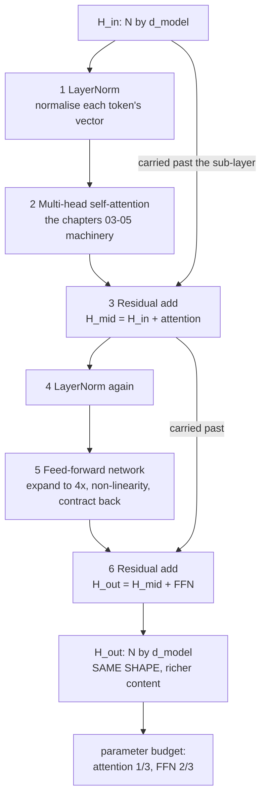

# 06 — The Transformer Block and the Residual Stream

> **Lecture chapter:** 05 · **Notes:** [05_The_Transformer_Block_and_the_Residual_Stream.md](../../../notes/05_The_Transformer_Block_and_the_Residual_Stream.md)
> **What you get:** the whole of `blockService.ts` — `layerNorm`, `rmsNorm`, `gelu`, `ffn`,
> `transformerBlock`, `parameterBudget`, `abstractionLayers`, `runStack` — plus `blockController.ts`.
> **Command used:** `npm run dev`, then one `curl`.

---

## 06.1 The misconception this chapter has to correct

**A Transformer is not attention.** That is the single most important sentence in Chapter 05. Attention
is one of **six** operations in a block, and it is not where most of the parameters live:



Two claims come out of that diagram, and both are checkable in this code:

| Claim | Notes | How this code checks it |
| :--- | :--- | :--- |
| `H_out` has the **same shape** as `H_in`, and equals `H_in + attention + FFN` | §05.2 | `checks.sameShape`, `checks.residualStreamHolds` |
| The **FFN holds about two-thirds** of the parameters | §05.4 | `parameterBudget().ffnShare` |

---

## 06.2 The two files this chapter introduces

| File | Lines | Job |
| :--- | :--- | :--- |
| `src/services/blockService.ts` | 1–137 | `layerNorm`, `rmsNorm`, `gelu`, `ffn`, `transformerBlock`, `parameterBudget`, `abstractionLayers`, `runStack` |
| `src/controllers/blockController.ts` | 1–42 | The `block` handler |

---

## 06.3 The complete code — `blockService.ts`

**File:** `src/services/blockService.ts`.

```ts
import type { MaskKind, Matrix, ModelShape, Vector } from "../types";
import { add, matmul, randomMatrix, round, roundVector, tokenVectors } from "./attentionService";
import { multiHeadAttention } from "./headService";

/**
 * Chapter 05 - the transformer block, and the misconception it corrects:
 * a Transformer is NOT attention (§05.1). Attention is one sub-layer of six
 * operations, and the FFN - not attention - is where most of the parameters and
 * all of the non-linear feature computation live.
 *
 * The order implemented here is the lecture's own: LayerNorm -> attention ->
 * residual -> LayerNorm -> FFN -> residual. That is pre-LN, and it is what
 * essentially every modern decoder uses (§05.2).
 */

/** Normalise one token's vector to zero mean and unit variance (§05.2 step 1). */
export function layerNorm(x: Vector, gamma?: Vector, beta?: Vector, eps = 1e-5): Vector {
  const mean = x.reduce((sum, value) => sum + value, 0) / x.length;
  const variance = x.reduce((sum, value) => sum + (value - mean) ** 2, 0) / x.length;
  const standardDeviation = Math.sqrt(variance + eps);
  return x.map((value, i) => round(((value - mean) / standardDeviation) * (gamma?.[i] ?? 1) + (beta?.[i] ?? 0)));
}

/** RMSNorm: skips the mean subtraction and the bias. Cheaper, and just as good (§05.2). */
export function rmsNorm(x: Vector, eps = 1e-6): Vector {
  const meanSquare = x.reduce((sum, value) => sum + value * value, 0) / x.length;
  const rootMeanSquare = Math.sqrt(meanSquare + eps);
  return x.map((value) => round(value / rootMeanSquare));
}

/** GELU - the non-linearity used by GPT-2 and GPT-3 (§05.2 step 5). */
export function gelu(value: number): number {
  return round(0.5 * value * (1 + Math.tanh(Math.sqrt(2 / Math.PI) * (value + 0.044715 * value ** 3))), 6);
}

/**
 * FFN(x) = GELU(x W_1 + b_1) W_2 + b_2 - expand, non-linearity, contract.
 * Strictly per token: the FFN never mixes positions, because attention already
 * did that. This is the only place new features are computed (§05.2 step 5).
 */
export function ffn(x: Vector, spec: ModelShape, seed: number) {
  const W1 = randomMatrix(spec.dModel, spec.dFF, seed + 11);
  const W2 = randomMatrix(spec.dFF, spec.dModel, seed + 12);
  const expanded = matmul([x], W1)[0];
  const activated = expanded.map(gelu);
  const output = matmul([activated], W2)[0];
  return { W1, W2, expanded: roundVector(expanded), activated: roundVector(activated), output: roundVector(output) };
}

/**
 * One complete transformer block. Every stage is returned, because the whole
 * point of the chapter is that H_out has the SAME shape as H_in - the block
 * adds a correction to the residual stream instead of replacing it.
 */
export function transformerBlock(H: Matrix, spec: ModelShape, seed: number, mask: MaskKind = "causal") {
  const H_in = H;

  const ln1 = H_in.map((row) => layerNorm(row)); // 1
  const attention = multiHeadAttention(ln1, spec, seed, mask); // 2
  const H_mid = H_in.map((row, i) => add(row, attention.mixed[i])); // 3 residual

  const ln2 = H_mid.map((row) => layerNorm(row)); // 4
  const ffnPerToken = ln2.map((row, i) => ffn(row, spec, seed + i).output); // 5
  const H_out = H_mid.map((row, i) => add(row, ffnPerToken[i])); // 6 residual

  // The residual-stream check: H_out really is H_in plus the two deltas.
  const rebuilt = H_in.map((row, i) => add(add(row, attention.mixed[i]), ffnPerToken[i]));

  return {
    H_in,
    ln1,
    attentionOutput: attention.mixed,
    H_mid,
    ln2,
    ffnOutput: ffnPerToken,
    H_out,
    checks: {
      sameShape: H_out.length === H_in.length && H_out[0].length === H_in[0].length,
      residualStreamHolds: String(rebuilt) === String(H_out),
      changed: String(H_out) !== String(H_in),
    },
    note:
      "H_out = H_in + attention(H_in) + FFN(...). Nothing is overwritten: the block writes a delta onto " +
      "the residual stream, which is why sub-layers can be removed or edited with graceful degradation.",
  };
}

/**
 * §05.4 - where the parameters actually live, per layer:
 *   attention: W_Q + W_K + W_V + W_O = 4 d_model^2
 *   FFN:       W_1 + W_2             = 2 d_model x d_ff
 * With the usual d_ff = 4 d_model the FFN is exactly two-thirds of the block.
 */
export function parameterBudget(spec: ModelShape) {
  const { dModel, dFF, layers } = spec;
  const attentionPerLayer = 4 * dModel * dModel;
  const ffnPerLayer = 2 * dModel * dFF;
  const perLayer = attentionPerLayer + ffnPerLayer;
  return {
    spec: spec.id,
    dModel,
    dFF,
    layers,
    perLayer: { attention: attentionPerLayer, ffn: ffnPerLayer, total: perLayer },
    total: perLayer * layers,
    ffnShare: round(ffnPerLayer / perLayer, 4),
    attentionShare: round(attentionPerLayer / perLayer, 4),
    verdict: "about two-thirds of the parameters sit in the FFN, not in attention (§05.4)",
  };
}

/**
 * §05.3 - why many layers. One block does one round of mixing plus one FFN pass;
 * understanding needs a hierarchy of abstractions, built layer by layer.
 */
export function abstractionLayers() {
  return [
    { stage: "Early layers (1-4)", learns: "'server' and 'memory' are co-occurring technical terms" },
    { stage: "Middle layers (5-15)", learns: "'server ran out of memory' is a resource-failure event" },
    { stage: "Deep layers (16-32)", learns: "the sentence describes a deployment failure CAUSED BY resource exhaustion" },
  ];
}

/** A whole stack of blocks: the residual stream carried from input to output. */
export function runStack(tokens: string[], spec: ModelShape, seed: number, mask: MaskKind = "causal") {
  const H0 = tokenVectors(tokens, spec.dModel);
  const stages = Array.from({ length: spec.layers }, (_, layer) => transformerBlock(H0, spec, seed + layer * 17, mask));
  const last = stages[stages.length - 1];
  return {
    layers: spec.layers,
    residualStream: { input: H0, output: last.H_out },
    shapeStable: last.H_out[0].length === H0[0].length,
    perLayerChecks: stages.map((stage, layer) => ({ layer, ...stage.checks })),
    note: "Every layer reads the stream, computes a delta and adds it back. The width never changes (§05.2).",
  };
}
```

**Block by block:**

1. `import { multiHeadAttention } from "./headService"` — **the second and last service-to-service
   dependency in the project.** It is a real containment relation: a transformer block *has* a
   multi-head attention sub-layer, so `blockService` composes `headService`. There is no cycle:
   `attentionService` → `headService` → `blockService`.
2. The file header states the misconception and the order: *"the lecture's own: LayerNorm → attention
   → residual → LayerNorm → FFN → residual. That is pre-LN, and it is what essentially every modern
   decoder uses."* Naming the variant matters, because the 2017 paper used **post**-LN and almost
   nothing does today (notes §05.2).

### Step ① and ④ — the two normalisations

3. `layerNorm(x, gamma?, beta?, eps = 1e-5)` — four lines, one per part of the formula:
   ```text
   mean      = sum(x) / x.length                      // zero-mean
   variance  = mean of (x - mean)^2                   // unit-variance
   std       = sqrt(variance + eps)                   // eps prevents division by zero
   return (x - mean) / std * gamma + beta             // then a learned scale and shift
   ```
4. **Three details that matter:**
   * It normalises **within one token's vector**, across features. It never touches other positions —
     so LayerNorm does *not* mix information between tokens, unlike attention (notes §05.2).
   * `gamma` and `beta` are **optional**. When omitted they are `1` and `0`, i.e. plain normalisation.
     They are parameters because the network must be able to *undo* the normalisation if that is what
     the task needs — the difference between a constraint and a useful prior.
   * `eps` is added **inside** the square root, before the division. Putting it outside would leave the
     variance able to go negative for numerical reasons.
5. `rmsNorm(x, eps = 1e-6)` — **RMSNorm**, the modern replacement: it skips the mean subtraction and
   the bias entirely, keeping only the root-mean-square scaling. Notes §05.2 notes it is cheaper and
   empirically just as good, and it is what LLaMA-family models use. It is in the file so the two can
   be compared, not because the block uses it.
6. `gelu(value)` — the non-linearity, in its standard numerically-stable tanh approximation:
   `0.5 * x * (1 + tanh(sqrt(2/π) * (x + 0.044715 x³)))`. GELU is what GPT-2 and GPT-3 use; LLaMA uses
   SwiGLU and older models used ReLU. The choice of non-linearity is where the "new features" of the
   next point come from.

### Step ⑤ — the FFN, and why attention alone is not enough

7. `ffn(x, spec, seed)` — `FFN(x) = GELU(x W₁) W₂`, the expand-then-contract shape:
   * `W1 = randomMatrix(spec.dModel, spec.dFF, seed + 11)` — the **expansion**, $d_{\text{model}} \to d_{\text{ff}}$.
     With the standard $d_{\text{ff}} = 4 d_{\text{model}}$ this multiplies the width by four.
   * `W2 = randomMatrix(spec.dFF, spec.dModel, seed + 12)` — the **contraction** back.
   * `matmul([x], W1)[0]` — note the `[x]` and the `[0]`: `matmul` takes a *matrix*, and here we have a
     single vector. Wrapping it in an array and unwrapping the result is the minimal way to reuse the
     one matrix primitive rather than writing a second one for vectors.
   * `expanded.map(gelu)` — the non-linearity, applied element-wise.
8. **The most important comment in the file is on this function**: *"Strictly per token: the FFN never
   mixes positions, because attention already did that. This is the only place new features are
   computed (§05.2 step 5)."*
9. Why that is true, mathematically: attention's output is a **convex combination** of value vectors
   (notes §01.3), so attention can only *move existing information around*. The FFN is a non-linear
   function of the token's current state, so it is the only place where genuinely **new** features can
   be computed. Remove the FFN and the model degenerates into weighted averaging.


### Steps ②③⑤⑥ — `transformerBlock`, and the residual-stream proof

10. `transformerBlock(H, spec, seed, mask = "causal")` — the six operations, one line each, with the
    step number in a trailing comment:
    ```text
    ln1          = H_in.map(layerNorm)                                    // 1
    attention    = multiHeadAttention(ln1, spec, seed, mask)              // 2
    H_mid        = H_in.map((row, i) => add(row, attention.mixed[i]))     // 3 residual
    ln2          = H_mid.map(layerNorm)                                   // 4
    ffnPerToken  = ln2.map((row, i) => ffn(row, spec, seed + i).output)   // 5
    H_out        = H_mid.map((row, i) => add(row, ffnPerToken[i]))        // 6 residual
    ```
11. **Note what is *not* done:** the residual adds `H_in` to the attention output, and `H_mid` to the
    FFN output. Each sub-layer's output is a **delta** that gets *added* to the stream. Nothing is ever
    overwritten. That is the whole of the "residual stream as a shared bus" model in notes §05.2, and
    it is why the width never changes.
12. `const rebuilt = H_in.map((row, i) => add(add(row, attention.mixed[i]), ffnPerToken[i]))` — the
    block **recomputes** `H_out` by a second route and compares. Then:
    * `checks.sameShape: H_out.length === H_in.length && H_out[0].length === H_in[0].length`
    * `checks.residualStreamHolds: String(rebuilt) === String(H_out)`
    * `checks.changed: String(H_out) !== String(H_in)`

    All three are `true` in the run below. **The third one is the one people forget**: a block that
    returns its input unchanged is a bug that looks like a working model, and the check catches it.
13. Why the residual connection matters so much (notes §05.2): it is a **gradient highway** (gradients
    flow through an addition, with no repeated multiplication to attenuate them), an **information
    bypass** (a sub-layer that outputs nothing useful cannot destroy what was already there), and it
    enables **depth** — which is why 96-layer GPT-3 and 200+ layer models train at all.

### §05.4 — the parameter budget

14. `parameterBudget(spec)` — the two formulas:
    * `attentionPerLayer = 4 * dModel * dModel` — $W_Q$, $W_K$, $W_V$ **and** $W_O$. Four matrices, not
      three: the output projection is easy to forget and it is a quarter of the attention cost.
    * `ffnPerLayer = 2 * dModel * dFF` — $W_1$ and $W_2$.
15. `ffnShare: round(ffnPerLayer / perLayer, 4)` — the number that settles the argument. With the
    standard $d_{\text{ff}} = 4 d_{\text{model}}$:

    | Shape | attention/layer | FFN/layer | `ffnShare` |
    | :--- | ---: | ---: | ---: |
    | `toy-tiny` ($d$ 8, $d_{\text{ff}}$ 32) | 256 | 512 | **0.6667** |
    | `gpt2-small` ($d$ 768, $d_{\text{ff}}$ 3072) | 2,359,296 | 4,718,592 | **0.6667** |

    **Exactly two-thirds, at both scales** — because the ratio depends only on
    $d_{\text{ff}}/d_{\text{model}} = 4$, not on the absolute size. That is notes §05.4's "about
    two-thirds", made exact.
16. `abstractionLayers()` — the §05.3 hierarchy as data: early layers learn co-occurrence, middle
    layers learn events, deep layers learn causation. Returned so the "why many layers" claim arrives
    with an example.
17. `runStack(tokens, spec, seed, mask)` — the whole stack: `H0` in, `spec.layers` blocks applied with
    `seed + layer * 17`, and `residualStream: { input: H0, output: last.H_out }` out. `shapeStable`
    confirms the width survived every layer, and `perLayerChecks` reports the three checks per layer.
    This is the function that turns "a block" into "a model".


---

## 06.4 The complete code — `blockController.ts`

**File:** `src/controllers/blockController.ts`.

```ts
import type { Request, Response } from "express";
import { config } from "../config/config";
import { asyncHandler } from "../middleware/errorHandler";
import { requireMask, requireTokens, shapeId } from "../middleware/validate";
import { tokenVectors } from "../services/attentionService";
import { abstractionLayers, parameterBudget, transformerBlock } from "../services/blockService";

/** Chapter 05 - one transformer block, stage by stage, and where its parameters live. */

/** POST /api/block  { "tokens": [...], "shape": "toy-tiny", "mask": "causal" } */
export const block = asyncHandler((req: Request, res: Response) => {
  const tokens = requireTokens(req);
  const shape = config.shape(shapeId(req));
  const mask = requireMask(req);

  const H_in = tokenVectors(tokens, shape.dModel);
  const result = transformerBlock(H_in, shape, config.seed, mask);

  res.json({
    chapter: "05 - the transformer block and the residual stream",
    shape: shape.id,
    tokens,
    mask,
    dModel: shape.dModel,
    dFF: shape.dFF,
    stages: {
      oneLayerNorm: result.ln1,
      twoMultiHeadAttention: result.attentionOutput,
      threeResidual: result.H_mid,
      fourLayerNorm: result.ln2,
      fiveFeedForward: result.ffnOutput,
      sixResidual: result.H_out,
    },
    checks: result.checks,
    parameterBudget: parameterBudget(shape),
    abstractionLayers: abstractionLayers(),
    note:
      result.note +
      " A Transformer is not attention (§05.1): the block is six operations, and the FFN - not attention - " +
      "is where most of the parameters sit and where the only non-linear feature computation happens.",
  });
});
```

**Block by block:**

18. `const H_in = tokenVectors(tokens, shape.dModel)` — the block's input, built here rather than in
    the service, because a block takes hidden states and not tokens.
19. `const result = transformerBlock(H_in, shape, config.seed, mask)` — one call for all six steps.
20. `stages: { oneLayerNorm, twoMultiHeadAttention, threeResidual, fourLayerNorm, fiveFeedForward, sixResidual }`
    — **the response renames the service's fields to the step numbers.** The service returns
    `H_mid` and `H_out` (good names for code); the API returns `threeResidual` and `sixResidual` (good
    names for a reader following the notes' numbered list). Renaming at the boundary is a legitimate
    and useful controller job — it is presentation, not logic.
21. `checks: result.checks` — passed through untouched, because these are assertions and the controller
    has no business reinterpreting them.
22. `parameterBudget: parameterBudget(shape)` — computed for the *requested* shape, so asking for
    `gpt2-small` gives you GPT-2's budget.
23. `note: result.note + " A Transformer is not attention (§05.1): ..."` — the controller appends the
    chapter's thesis to the service's explanation. Note that it *appends* rather than replaces: the
    service's note is about the residual stream, the controller's addition is about the misconception.

---

## 06.5 Run it

```bash
curl -s -X POST localhost:3000/api/block \
  -H 'content-type: application/json' \
  -d '{"tokens":["The","cat","mat"]}'
```

The parts that matter:

```json
{
  "shape": "toy-tiny", "dModel": 8, "dFF": 32,
  "checks": { "sameShape": true, "residualStreamHolds": true, "changed": true },
  "parameterBudget": {
    "spec": "toy-tiny", "dModel": 8, "dFF": 32, "layers": 2,
    "perLayer": { "attention": 256, "ffn": 512, "total": 768 },
    "total": 1536,
    "ffnShare": 0.6667,
    "attentionShare": 0.3333,
    "verdict": "about two-thirds of the parameters sit in the FFN, not in attention (§05.4)"
  }
}
```

**The three `checks` are the chapter's first claim, verified:**

* `sameShape: true` — `H_out` is still $3 \times 8$. The block changed the *content* and not the
  *shape*, which is why 96 of them can be stacked.
* `residualStreamHolds: true` — the block's output really is `H_in + attention + FFN`, recomputed by a
  second route and compared string-for-string.
* `changed: true` — and it is not the identity function. A block that returns its input unchanged is a
  bug that looks like a working model.

**The budget is the chapter's second claim, verified.** 256 attention parameters, 512 FFN parameters,
`ffnShare: 0.6667`. Now ask for a real model:

```bash
curl -s -X POST localhost:3000/api/block \
  -H 'content-type: application/json' \
  -d '{"tokens":["The"],"shape":"gpt2-small"}'
```

```json
{
  "parameterBudget": {
    "spec": "gpt2-small", "dModel": 768, "dFF": 3072, "layers": 12,
    "perLayer": { "attention": 2359296, "ffn": 4718592, "total": 7077888 },
    "total": 84934656,
    "ffnShare": 0.6667,
    "attentionShare": 0.3333
  }
}
```

**`ffnShare` is `0.6667` again** — the same two-thirds, at a 100× larger scale. The ratio depends only
on $d_{\text{ff}} / d_{\text{model}} = 4$, not on the model's size. That is why notes §05.4 can state
"about two-thirds" as a general fact rather than a coincidence.

> [!NOTE]
> **On the `total` figure.** 84,934,656 is the **block** parameters for a 12-layer GPT-2-shaped model —
> attention and FFN only. GPT-2 small is usually quoted at ~124M because that includes the token
> embedding matrix ($50257 \times 768 \approx 38.6$M) and the LM head, which this budget deliberately
> excludes: they are not part of any block. Knowing *which* parameters you are counting is the
> difference between a number and a claim.

---

## 06.6 Common mistakes this chapter's code prevents

| Mistake | What the code does instead |
| :--- | :--- |
| Calling a Transformer "attention" | The budget shows attention is one-third; the block is six operations |
| Overwriting the stream instead of adding to it | `add(row, subLayerOutput)` in both residual steps |
| Forgetting $W^{O}$ in the attention parameter count | `4 * dModel * dModel`, not `3 *` |
| Assuming a block changes the width | `checks.sameShape`, computed every call |
| Believing a block always does something | `checks.changed`, computed every call |
| Putting `eps` outside the square root | `Math.sqrt(variance + eps)` |
| Writing LayerNorm without learned `gamma`/`beta` | Both are optional parameters, defaulting to $1$ and $0$ |
| Quoting "two-thirds" as folklore | `ffnShare` computed, and constant across shapes because $d_{\text{ff}} = 4d_{\text{model}}$ |

---

## 06.7 Checkpoint

1. Which six operations make up a transformer block, in order?
2. Which of them mixes information *between* positions, and which does not?
3. Why can the FFN compute "new features" when attention cannot?
4. What are the three `checks`, and which one catches a block that does nothing?
5. Why is `attentionPerLayer` `4 * dModel * dModel` rather than `3 *`?
6. Why is `ffnShare` exactly `0.6667` for both `toy-tiny` and `gpt2-small`?
7. What does the parameter budget exclude, and why does that make GPT-2's quoted size larger?

> **Next:** [07 — Encoder-Decoder vs Decoder-Only](./07_Encoder_Decoder_vs_Decoder_Only.md), where the
> three architecture families turn out to differ in exactly one place: the mask.

