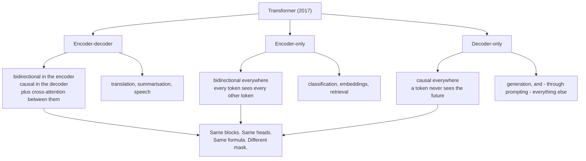

# 07 — Encoder-Decoder vs Decoder-Only

> **Lecture chapter:** 06 · **Notes:** [06_Encoder_Decoder_vs_Decoder_Only_and_Why_GPT.md](../../../notes/06_Encoder_Decoder_vs_Decoder_Only_and_Why_GPT.md)
> **What you get:** the whole of `architectureService.ts` — `families`, `attentionModes`,
> `trainingVsInference`, `whyDecoderOnly`, `whatWasGivenUp`, `prefixLm`, `chooseFamily`,
> `contextReach` — plus `architectureController.ts`.
> **Command used:** `npm run dev`, then one `curl`.

---

## 07.1 The claim this chapter has to make precise

The three architecture families sound like three different machines. They are not. **They differ in
exactly one place: which positions a token is allowed to read.** That is the mask, and everything else
— the blocks from [chapter 06](./06_The_Transformer_Block_and_the_Residual_Stream.md), the heads from
[chapter 05](./05_Multi_Head_Attention.md), the attention from
[chapters 03–04](./04_Scaled_Dot_Product_Attention_by_Hand.md) — is identical.



---

## 07.2 The two files this chapter introduces

| File | Lines | Job |
| :--- | :--- | :--- |
| `src/services/architectureService.ts` | 1–137 | `families`, `attentionModes`, `trainingVsInference`, `whyDecoderOnly`, `whatWasGivenUp`, `prefixLm`, `chooseFamily`, `contextReach` |
| `src/controllers/architectureController.ts` | 1–41 | The `compare` handler |

> [!NOTE]
> This service has **no arithmetic of its own** beyond counting mask entries. It is a *reference*
> service: it returns the lecture's comparison tables as data, plus two masks built by reusing
> `maskMatrix` from `attentionService`. That is a legitimate shape for a service — not every service
> needs a matrix multiply, and the alternative (hard-coding the tables in the controller) would put
> content in the wrong layer.

---

## 07.3 The complete code — `architectureService.ts`

**File:** `src/services/architectureService.ts`.

```ts
import type { Architecture, AttentionMode, ModelShape } from "../types";
import { kvCacheBytes, maskMatrix, round } from "./attentionService";

/**
 * Chapter 06 - encoder-decoder vs decoder-only, and why GPT is decoder-only.
 *
 * The three families differ in exactly one place: WHICH POSITIONS a token is
 * allowed to read. That is the mask. Everything else - blocks, heads, FFN,
 * logits - is the same machinery you have already built.
 */

/** §06.1 - the three families, what each is built for, and who uses it. */
export function families(): { family: Architecture; builtFor: string; mask: string; examples: string[] }[] {
  return [
    {
      family: "encoder-decoder",
      builtFor: "transforming one sequence into another (translation, summarisation, speech)",
      mask: "bidirectional in the encoder, causal in the decoder, plus cross-attention between them",
      examples: ["the original 2017 Transformer", "T5", "BART", "Whisper"],
    },
    {
      family: "encoder-only",
      builtFor: "understanding a whole sequence at once (classification, embeddings, retrieval)",
      mask: "bidirectional everywhere - every token sees every other token",
      examples: ["BERT", "RoBERTa", "embedding models"],
    },
    {
      family: "decoder-only",
      builtFor: "generating the next token, and - through prompting - everything else",
      mask: "causal everywhere - a token never sees the future",
      examples: ["GPT-2/3/4", "LLaMA", "Mistral", "Claude", "Gemini"],
    },
  ];
}

/** §06.3 - the three attention modes, as actual masks. 1 = allowed, 0 = blocked. */
export function attentionModes(n: number): { mode: AttentionMode; mask: number[][]; sees: string; usedBy: string }[] {
  return [
    {
      mode: "bidirectional",
      mask: maskMatrix(n, "none"),
      sees: "every position, including the ones after it",
      usedBy: "encoder self-attention",
    },
    {
      mode: "causal",
      mask: maskMatrix(n, "causal"),
      sees: "position j <= i only - never the future",
      usedBy: "decoder self-attention",
    },
    {
      mode: "cross",
      mask: maskMatrix(n, "none"),
      sees: "every ENCODER position; the decoder's own self-attention stays causal",
      usedBy: "the original 2017 encoder-decoder, T5, Whisper",
    },
  ];
}

/**
 * §06.7 - the asymmetry that shapes everything. Training scores every position
 * at once with teacher forcing, so one forward pass covers N predictions. At
 * inference the model must generate token by token, so N tokens cost N forward
 * passes - which is why the KV cache exists (ch02 §02.8).
 */
export function trainingVsInference(n: number, spec: ModelShape, bytesPerValue = 2) {
  return {
    n,
    training: {
      forwardPasses: 1,
      predictionsScored: n,
      why: "teacher forcing: the true next token is fed in for every position, in parallel",
    },
    inference: {
      forwardPasses: n,
      predictionsScored: n,
      why: "each token needs the previous one, so generation is inherently sequential",
      kvCacheBytes: kvCacheBytes(n, spec.layers, spec.dModel, bytesPerValue),
    },
    speedupOfTraining: n,
    note: "This is the whole reason serving is expensive and training is efficient - not the model, the loop (§06.7).",
  };
}

/** §06.4 - the five reasons GPT-style models won. */
export function whyDecoderOnly() {
  return [
    { reason: "One objective", detail: "predict the next token - no task-specific head, no second loss" },
    { reason: "One mask", detail: "causal everywhere; the same block stacks to any depth" },
    { reason: "One cache", detail: "a single KV cache serves every request, and it is trivially incremental" },
    { reason: "Prompting works out of the box", detail: "any task can be phrased as a continuation of text" },
    { reason: "Scales cleanly", detail: "in-context learning and instruction following emerge without architecture changes" },
  ];
}

/** §06.5 - what decoder-only gives up, and where it went instead. */
export function whatWasGivenUp() {
  return [
    { givenUp: "Bidirectional context for understanding", replacement: "encoder-only models, still used for embeddings and retrieval" },
    { givenUp: "A separate cross-attention path", replacement: "the encoder becomes a prefix, attended to by the same self-attention (§06.6)" },
    { givenUp: "Cheap whole-sequence scoring", replacement: "prefix-LM / fill-in-the-middle, used by code models" },
  ];
}

/** §06.6 - prefix-LM: "the encoder is just a prefix". */
export function prefixLm() {
  return {
    idea: "keep the decoder-only stack, but let the prompt be attended bidirectionally and the answer causally",
    mask: "two blocks: 1s for prompt x prompt, causal for the answer, all-ones from answer to prompt",
    usedBy: "code completion (fill-in-the-middle), some instruction-tuned variants",
    tradeOff: "the mask now depends on where the prompt ends, so it is less uniform than pure causal",
  };
}

/** §06.8 - the decision table, as data. */
export function chooseFamily(task: string) {
  const table = [
    { need: "generate text, chat, reason, use tools", family: "decoder-only" as Architecture, why: "one causal mask, one objective, prompting works" },
    { need: "classify, embed, retrieve, rerank", family: "encoder-only" as Architecture, why: "bidirectional context gives a better fixed representation" },
    { need: "translate, transcribe, summarise with a strict source", family: "encoder-decoder" as Architecture, why: "the source is read in full before the output starts" },
  ];
  return { asked: task, table, default: "decoder-only", note: "if in doubt, decoder-only is the safe default (§06.8)" };
}

/** §06.7 - how much of the score matrix a causal mask actually keeps. */
export function contextReach(n: number) {
  const causal = maskMatrix(n, "causal").flat().reduce((sum, value) => sum + value, 0);
  const bidirectional = maskMatrix(n, "none").flat().reduce((sum, value) => sum + value, 0);
  return {
    n,
    causalVisiblePairs: causal,
    bidirectionalVisiblePairs: bidirectional,
    ratio: round(bidirectional / causal, 4),
    note:
      "A causal mask keeps only the lower triangle: n(n+1)/2 of the n^2 pairs, which approaches half as n grows. " +
      "That hidden mass is the price of being able to generate.",
  };
}
```

**Block by block:**

1. `import { kvCacheBytes, maskMatrix, round } from "./attentionService"` — **three imports, and the
   second one is the important one.** `attentionModes` does not describe the three masks in prose; it
   *builds* them with `maskMatrix(n, "none")` and `maskMatrix(n, "causal")` — the same function from
   [chapter 03](./03_Queries_Keys_Values_and_the_Score_Matrix.md). So the claim "the families differ
   only in the mask" is demonstrated with the actual mask code, not asserted.
2. `families()` — the §06.1 table as data: family, what it is built for, its mask, and real examples.
   The `mask` field is the whole point; the `examples` field exists so the abstract names attach to
   models you have heard of.
3. `attentionModes(n)` — the §06.3 table, with the three modes explicit:
   * `bidirectional` → `maskMatrix(n, "none")` → all ones. Used by encoder self-attention.
   * `causal` → `maskMatrix(n, "causal")` → lower triangular. Used by decoder self-attention.
   * `cross` → `maskMatrix(n, "none")` → all ones, **for a different reason**. Cross-attention has no
     causal restriction on the *encoder* side: the decoder may read every encoder position, including
     ones "after" the token it is currently writing. The decoder's own self-attention stays causal.
     That asymmetry is easy to get wrong, and the `sees` and `usedBy` strings on each mode spell it out.
4. `trainingVsInference(n, spec, bytesPerValue = 2)` — §06.7, the asymmetry that shapes everything:
   * `training: { forwardPasses: 1, predictionsScored: n }` — teacher forcing feeds the *true* next
     token in for every position, so one pass scores all $N$ predictions in parallel.
   * `inference: { forwardPasses: n, predictionsScored: n }` — each token needs the previous one, so
     generation is inherently sequential.
   * `speedupOfTraining: n` — the ratio, computed.
   * `kvCacheBytes` inside `inference` — **the cache only exists because inference is sequential.** If
     generation were parallel there would be nothing to cache.
5. `whyDecoderOnly()` — the five reasons from §06.4 as data. The one to notice is *"One cache: a single
   KV cache serves every request, and it is trivially incremental."* That is the practical reason
   decoder-only won, and it follows directly from `trainingVsInference`.
6. `whatWasGivenUp()` — §06.5, the honest half. Every `givenUp` has a `replacement`, because "what did
   we lose" is a more useful question than "which is better".
7. `prefixLm()` — §06.6, "the encoder is just a prefix": keep the decoder-only stack but let the
   *prompt* be attended bidirectionally and the *answer* causally. Its `tradeOff` is stated: the mask
   now depends on where the prompt ends, so it is less uniform than pure causal.
8. `chooseFamily(task)` — §06.8 as a lookup with a stated default. `default: "decoder-only"` plus the
   note *"if in doubt, decoder-only is the safe default"* — a decision helper that refuses to hedge.
9. `contextReach(n)` — the one place this service counts something:
   * `causal = maskMatrix(n, "causal").flat().reduce((sum, value) => sum + value, 0)` — the number of
     allowed pairs in a causal mask, i.e. $\frac{n(n+1)}{2}$.
   * `bidirectional` — all $n^2$ pairs.
   * `ratio: bidirectional / causal` — for $n = 3$ that is $9/6 = 1.5$; as $n$ grows it approaches 2.
   * The note is deliberately precise rather than saying "about half": *"A causal mask keeps only the
     lower triangle: n(n+1)/2 of the n^2 pairs, which approaches half as n grows."* For small $n$ it is
     nowhere near half, and a rounded claim in a comment is how wrong intuitions get started.


---

## 07.4 The complete code — `architectureController.ts`

**File:** `src/controllers/architectureController.ts`.

```ts
import type { Request, Response } from "express";
import { config } from "../config/config";
import { asyncHandler } from "../middleware/errorHandler";
import { optionalInteger, shapeId } from "../middleware/validate";
import {
  attentionModes,
  chooseFamily,
  contextReach,
  families,
  prefixLm,
  trainingVsInference,
  whatWasGivenUp,
  whyDecoderOnly,
} from "../services/architectureService";

/** Chapter 06 - the three families, the three masks, and why GPT is decoder-only. */

/** POST /api/architecture/compare  { "n": 6, "shape": "toy-tiny", "task": "summarise a contract" } */
export const compare = asyncHandler((req: Request, res: Response) => {
  const shape = config.shape(shapeId(req));
  const n = optionalInteger(req, "n", config.nTokens, 1, 32) ?? config.nTokens;
  const asked = (req.body as { task?: unknown } | undefined)?.task;
  const task = typeof asked === "string" && asked.trim().length > 0 ? asked : "generate text, chat, use tools";

  res.json({
    chapter: "06 - encoder-decoder vs decoder-only, and why GPT is decoder-only",
    shape: shape.id,
    n,
    families: families(),
    attentionModes: attentionModes(n),
    contextReach: contextReach(n),
    trainingVsInference: trainingVsInference(n, shape),
    whyDecoderOnly: whyDecoderOnly(),
    whatWasGivenUp: whatWasGivenUp(),
    prefixLm: prefixLm(),
    decision: chooseFamily(task),
    note:
      "The three families differ in exactly one place: which positions a token may read. Everything else - blocks, " +
      "heads, FFN, logits - is the same machinery. Choose the family by the mask the task needs.",
  });
});
```

**Block by block:**

10. The import list is eight named imports from one service. There is no namespace import here, and the
    reason is the endpoint's shape: it is a *report*, so listing every table it returns makes the
    response's contents visible at the top of the file.
11. `optionalInteger(req, "n", config.nTokens, 1, 32)` — the sequence length, bounded at 32. That bound
    is not about performance: the response embeds **three $n \times n$ mask matrices**, so $n = 32$
    already means 3,072 numbers of mask. A reader looking at a $64 \times 64$ grid learns nothing that
    a $6 \times 6$ grid did not teach.
12. `const asked = (req.body as { task?: unknown } | undefined)?.task` then the fallback — reading an
    optional string *inline* rather than through a validator, because this field is prose that is only
    echoed back. Adding a validator would be ceremony without a benefit.
13. `res.json({ chapter, shape, n, families, attentionModes, contextReach, trainingVsInference, whyDecoderOnly, whatWasGivenUp, prefixLm, decision, note })`
    — nine sections in one response. This is the only endpoint in the project that is a **report**
    rather than a calculation, and it is deliberately the one you can read top to bottom to revise
    Chapter 06 without running anything else.
14. `note` — the closing sentence that ties the sections together: *"The three families differ in
    exactly one place: which positions a token may read. Everything else — blocks, heads, FFN, logits —
    is the same machinery. Choose the family by the mask the task needs."*

---

## 07.5 Run it

```bash
curl -s -X POST localhost:3000/api/architecture/compare \
  -H 'content-type: application/json' \
  -d '{"n":3,"task":"summarise a contract"}'
```

The three masks, side by side:

```json
{
  "attentionModes": [
    { "mode": "bidirectional", "mask": [[1,1,1],[1,1,1],[1,1,1]],
      "sees": "every position, including the ones after it",
      "usedBy": "encoder self-attention" },
    { "mode": "causal", "mask": [[1,0,0],[1,1,0],[1,1,1]],
      "sees": "position j <= i only - never the future",
      "usedBy": "decoder self-attention" },
    { "mode": "cross", "mask": [[1,1,1],[1,1,1],[1,1,1]],
      "sees": "every ENCODER position; the decoder's own self-attention stays causal",
      "usedBy": "the original 2017 encoder-decoder, T5, Whisper" }
  ],
  "contextReach": { "n": 3, "causalVisiblePairs": 6, "bidirectionalVisiblePairs": 9, "ratio": 1.5 },
  "trainingVsInference": {
    "n": 3,
    "training":  { "forwardPasses": 1, "predictionsScored": 3,
                   "why": "teacher forcing: the true next token is fed in for every position, in parallel" },
    "inference": { "forwardPasses": 3, "predictionsScored": 3,
                   "why": "each token needs the previous one, so generation is inherently sequential",
                   "kvCacheBytes": 192 },
    "speedupOfTraining": 3
  },
  "decision": { "asked": "summarise a contract", "default": "decoder-only" }
}
```

**Four things to read out of that:**

1. **`bidirectional` and `cross` have the same all-ones matrix but different meanings.** For
   bidirectional self-attention, all-ones means every token of the *same* sequence sees every other.
   For cross-attention, all-ones means every *decoder* position sees every *encoder* position. Same
   numbers, different rows and columns — which is exactly the confusion the `sees` field exists to
   prevent.
2. **`causalVisiblePairs: 6` out of 9.** The causal mask kept $\frac{3 \times 4}{2} = 6$ of the 9 pairs.
   At $n = 3$ that is a third hidden, not a half — the `ratio` approaches 2 only as $n$ grows, which is
   why the note refuses to say "about half".
3. **`trainingVsInference` is the chapter's real payload.** Training scored 3 predictions in **1**
   forward pass; inference needs **3**. The `speedupOfTraining: 3` is just $n$ — and at a 100,000-token
   context it is 100,000. That gap is why serving is expensive and training is efficient.
4. **`kvCacheBytes` sits inside `inference` and nowhere else.** The cache is a direct consequence of
   the sequential loop; it is not a property of the architecture.

> [!TIP]
> **Try `{"n":6}` and watch `ratio` rise.** At $n = 6$ it is $36/21 = 1.71$; at $n = 32$ it is
> $1024/528 = 1.94$. The causal mask's hidden fraction converges to one half from below — a small
> detail, but one that is easy to state wrongly.

---

## 07.6 Common mistakes this chapter's code prevents

| Mistake | What the code does instead |
| :--- | :--- |
| Believing the three families are different architectures | `attentionModes` builds them with the same `maskMatrix` call |
| Assuming cross-attention is causal | Its mask is all ones, with a `sees` string explaining why |
| Saying a causal mask hides "about half" | The exact count `n(n+1)/2`, with `ratio` computed per `n` |
| Treating the KV cache as an architecture feature | It is returned inside `inference`, not at the top level |
| Presenting decoder-only as strictly better | `whatWasGivenUp()` lists what it costs, with replacements |
| Hedging on the default | `default: "decoder-only"`, stated plainly |

---

## 07.7 Checkpoint

1. In what single respect do the three families differ?
2. Why is the cross-attention mask all ones while the decoder's self-attention is causal?
3. What is `speedupOfTraining`, and why does it equal $n$?
4. Why is `kvCacheBytes` nested inside `inference` rather than reported separately?
5. Why does `contextReach` refuse to say "about half" for $n = 3$?
6. What is prefix-LM, and what does it cost?

> **Next:** [08 — Logits, the LM Head and Softmax](./08_Logits_the_LM_Head_and_Softmax.md), where the
> last hidden state becomes a probability distribution over the whole vocabulary.

