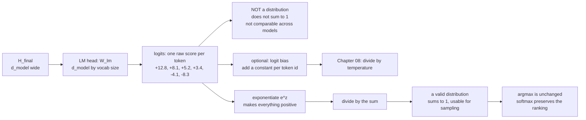

# 08 — Logits, the LM Head and Softmax

> **Lecture chapter:** 07 · **Notes:** [07_Logits_the_LM_Head_and_Softmax.md](../../../notes/07_Logits_the_LM_Head_and_Softmax.md)
> **What you get:** the whole of `logitsService.ts` — `LECTURE_LOGITS`, `lmHead`, `softmaxTable`,
> `properties`, `logprobs`, `applyBias`, `lectureTable` — plus `logitsController.ts` and its two
> handlers.
> **Command used:** `npm run dev`, then two `curl` calls.

---

## 08.1 The one mistake this chapter exists to prevent

**A logit is not a probability.** It is an unnormalised score in log-space: it can be any real number,
it does not sum to anything in particular, and it is not comparable across providers. Every bug in
this area starts with treating it as a probability.



---

## 08.2 The two files this chapter introduces

| File | Lines | Job |
| :--- | :--- | :--- |
| `src/services/logitsService.ts` | 1–135 | `LECTURE_LOGITS`, `lmHead`, `softmaxTable`, `properties`, `logprobs`, `applyBias`, `lectureTable` |
| `src/controllers/logitsController.ts` | 1–81 | The `softmax` (`POST /api/logits`) and `bias` handlers |

---

## 08.3 The complete code — `logitsService.ts`

**File:** `src/services/logitsService.ts`.

```ts
import type { Candidate, Vector } from "../types";
import { argmax, dot, percent, randomMatrix, round, softmax } from "./attentionService";

/**
 * Chapter 07 - from the last hidden state to a probability distribution.
 *
 * H_final (d_model) --W_lm--> logits (|V|) --softmax--> probabilities --decoder--> one token
 *
 * The warning that runs through this whole file: a logit is NOT a probability.
 * It is an unnormalised score in log-space. Dividing logits by their sum, or
 * comparing logits across two providers, are the two classic bugs here (§07.3).
 */

/** §07.3 - the lecture's own logits for "The capital of India is". */
export const LECTURE_LOGITS: { token: string; logit: number; sourcePercent: number }[] = [
  { token: "Delhi", logit: 12.8, sourcePercent: 92.0 },
  { token: "Mumbai", logit: 8.1, sourcePercent: 5.0 },
  { token: "Kolkata", logit: 5.2, sourcePercent: 2.0 },
  { token: "Punjab", logit: 3.4, sourcePercent: 1.0 },
  { token: "banana", logit: -4.1, sourcePercent: 0.000004 },
  { token: "<EOS>", logit: -8.3, sourcePercent: 0.0 },
];

/**
 * §07.1 - the LM head. One matrix of shape d_model x |V| projects the final
 * hidden state onto the whole vocabulary. It adds no magic: it is the same
 * matmul as every other projection in the model.
 */
export function lmHead(hidden: Vector, vocabulary: string[], seed: number): Candidate[] {
  const W_lm = randomMatrix(hidden.length, vocabulary.length, seed + 21);
  return vocabulary.map((token, id) => ({ id, token, logit: round(dot(hidden, W_lm.map((row) => row[id])), 4) }));
}

/** §07.4 - e^z and P(y_i), the two columns between logits and a distribution. */
export function softmaxTable(candidates: { token: string; logit: number }[], sourcePercent?: number[]) {
  const logits = candidates.map((candidate) => candidate.logit);
  const probabilities = softmax(logits);
  const max = Math.max(...logits);

  return candidates.map((candidate, i) => ({
    token: candidate.token,
    logit: candidate.logit,
    exponent: round(Math.exp(candidate.logit - max), 6), // e^(z - max), the stable form
    probability: probabilities[i],
    percent: percent(probabilities[i], 4),
    sourcePercent: sourcePercent?.[i],
  }));
}

/**
 * §07.5 - the three softmax properties, each one MEASURED on the request's own
 * logits rather than asserted. Shift invariance is what makes the row-max
 * subtraction free; scale sensitivity is what makes temperature work.
 */
export function properties(logits: Vector) {
  const base = softmax(logits);
  const shifted = softmax(logits.map((value) => value + 100));
  const halved = softmax(logits.map((value) => value / 0.5));
  const doubled = softmax(logits.map((value) => value / 2));

  return {
    shiftInvariance: {
      claim: "softmax(z + c) = softmax(z)",
      identical: base.every((value, i) => Math.abs(value - shifted[i]) < 1e-6),
      note: "this is why subtracting the row max is exactly equivalent, and free (§03.6)",
    },
    scaleSensitivity: {
      claim: "softmax(z / T) != softmax(z) in general",
      changed: base.some((value, i) => Math.abs(value - halved[i]) > 1e-6),
      note: "T < 1 sharpens, T > 1 flattens - this is Chapter 08's main knob",
    },
    rankingPreserved: {
      claim: "z_i > z_j  =>  P_i > P_j",
      argmaxBefore: argmax(logits),
      argmaxAfter: argmax(base),
      identical: argmax(logits) === argmax(base),
      note: "softmax never reorders the model's preferences - so greedy decoding is unaffected by temperature",
    },
    sharpened: halved.map((value) => percent(value)),
    flattened: doubled.map((value) => percent(value)),
    original: base.map((value) => percent(value)),
  };
}

/** §07.6 - log probabilities: the number an API actually returns. */
export function logprobs(candidates: { token: string; logit: number }[]) {
  const probabilities = softmax(candidates.map((candidate) => candidate.logit));
  return candidates.map((candidate, i) => ({
    token: candidate.token,
    logit: candidate.logit,
    probability: probabilities[i],
    logprob: round(Math.log(probabilities[i]), 4),
    note: "log P is negative for every token; it is the additive form used to score whole sequences",
  }));
}

/**
 * §07.7 - logit bias and vocabulary masking. Adding a constant to specific token
 * ids, before the softmax, is how a schema forbids a token (bias -Infinity) or
 * nudges the model towards one. Structural constraints go first in the pipeline
 * (§08.10), because they are the only step that can make a token impossible.
 */
export function applyBias(candidates: { token: string; logit: number }[], bias: Record<string, number>) {
  const biased = candidates.map((candidate) => ({
    token: candidate.token,
    logit: candidate.logit + (bias[candidate.token] ?? 0),
    bias: bias[candidate.token] ?? 0,
  }));
  return {
    bias,
    before: softmaxTable(candidates),
    after: softmaxTable(biased),
    changed: biased.some((candidate) => candidate.bias !== 0),
    note: "A bias of -Infinity makes a token impossible; a small positive bias only tilts the distribution.",
  };
}

/** The lecture's table, with the formula's answer beside the source's printed one. */
export function lectureTable() {
  const rows = softmaxTable(LECTURE_LOGITS, LECTURE_LOGITS.map((row) => row.sourcePercent));
  const dominant = rows[argmax(rows.map((row) => row.logit))].token;
  return {
    prompt: "The capital of India is",
    rows,
    dominant,
    reconciles: rows.every((row) => Math.abs(row.percent - (row.sourcePercent ?? 0)) <= 1),
    vocabularySliceSize: LECTURE_LOGITS.length,
    note:
      "These six tokens are a SLICE of a real vocabulary of about 100,000. The softmax denominator is the sum over " +
      "the WHOLE vocabulary (§07.4), and the tokens not listed here absorb the remaining mass - which is exactly " +
      "why the source's percentages (92 / 5 / 2 / 1) are lower than this six-token slice's (99 / 0.9 / 0.05 / 0.01) " +
      "for the same logits. Both are correct; the difference is |V|, not the arithmetic. Raise the temperature to " +
      "see the same smoothing effect without touching the vocabulary (ch08 §08.5).",
  };
}
```

**Block by block:**

1. `import { argmax, dot, percent, randomMatrix, round, softmax } from "./attentionService"` — **note
   that `softmax` comes from `attentionService`.** That is the payoff of the rule set in
   [chapter 02](./02_Why_Attention_and_the_Soft_Lookup.md): softmax was defined once, where it first
   appeared (an attention row *is* a distribution, notes §01.7), and Chapter 07 imports the same
   function rather than writing a second one. There is exactly one softmax in this project.
2. The file header states the pipeline in one line — *"H_final (d_model) → W_lm → logits (|V|) →
   softmax → probabilities → decoder → one token"* — and then the warning, so a reader cannot miss it:
   *"a logit is NOT a probability. It is an unnormalised score in log-space."*
3. `LECTURE_LOGITS` — the lecture's own logits for `"The capital of India is"`, transcribed:
   `Delhi +12.8`, `Mumbai +8.1`, `Kolkata +5.2`, `Punjab +3.4`, `banana −4.1`, `<EOS> −8.3`. The
   `sourcePercent` field carries the percentages the notes print next to them.
4. `lmHead(hidden, vocabulary, seed)` — §07.1 in three lines:
   * `randomMatrix(hidden.length, vocabulary.length, seed + 21)` — the LM head's shape is
     $d_{\text{model}} \times |V|$. For `gpt2-small` that is $768 \times 50257 \approx 38.6$M
     parameters, which is why notes §07.2 mentions **weight tying**: many models reuse the embedding
     matrix here instead of training a second one.
   * `vocabulary.map((token, id) => ({ id, token, logit: round(dot(hidden, W_lm.map((row) => row[id])), 4) }))`
     — one dot product per vocabulary entry. The `W_lm.map((row) => row[id])` extracts column `id`,
     i.e. the vector that token `id` is matched against. **This is the same `dot` as in attention**: an
     LM head is just attention's relevance score against the whole vocabulary instead of against $N$
     tokens.
5. `softmaxTable(candidates, sourcePercent?)` — the two columns between logits and a distribution:
   * `exponent: round(Math.exp(candidate.logit - max), 6)` — $e^{z_i - \max}$, the *stable* form, with
     the comment `// e^(z - max), the stable form`. Subtracting the max is what keeps the largest
     exponent at exactly 1 and prevents overflow (notes §03.6, §07.5).
   * `probability` — from the shared `softmax`.
   * `percent` — rounded to 4 decimals for the table.
   * `sourcePercent` — the notes' printed figure, optional, so the same function can build both the
     computed table and the comparison table.

6. `properties(logits)` — **the three §07.5 properties, each one measured on the request's own
   logits** rather than asserted. This is the most valuable function in the file:

   | Field | Claim | How it is checked |
   | :--- | :--- | :--- |
   | `shiftInvariance` | $\text{softmax}(z+c) = \text{softmax}(z)$ | `softmax(logits)` vs `softmax(logits.map(v => v + 100))`, compared element-wise with a tolerance |
   | `scaleSensitivity` | $\text{softmax}(z/T) \neq \text{softmax}(z)$ | compares against $T = 0.5$; `changed` is `true` |
   | `rankingPreserved` | $z_i > z_j \Rightarrow P_i > P_j$ | `argmaxBefore === argmaxAfter` |

7. **Why the shift test uses `+ 100` and not `+ 1`.** A shift of $+100$ makes the naive softmax
   overflow on any logit above ~700, so the test is deliberately extreme: it proves the *stability*
   claim and the *equivalence* claim at the same time.
8. `sharpened: halved.map((value) => percent(value))`, `flattened: doubled.map(...)`,
   `original: base.map(...)` — the same distribution at $T = 0.5$, $T = 2$ and $T = 1$, returned
   together. For the lecture's logits that is `[100, 0, 0, 0, 0, 0]` sharpened,
   `[99, 0.9, 0, 0, 0, 0]` at $T = 1$, and `[88.7, 8.5, 2, 0.8, 0, 0]` flattened. **Notice the ranking
   is `Delhi` first in all three** — which is the point of `rankingPreserved`.
9. `logprobs(candidates)` — §07.6, the number a real API returns: `Math.log(probabilities[i])`, which
   is negative for every token. The `note` explains why it exists: *"it is the additive form used to
   score whole sequences."* Adding log probabilities multiplies probabilities without underflowing —
   the same trick `decodingService.beamSearch` uses.
10. `applyBias(candidates, bias)` — §07.7. It returns `before`, `after`, and the `bias` map, so the
    change is visible as a diff rather than as a claim. Two things the code gets right:
    * The bias is added to the **logit**, before the softmax. Adding it to a probability would be
      meaningless (you can push a probability above 1).
    * `bias[candidate.token] ?? 0` — a token with no entry is unchanged, so the bias map can be sparse.
11. `note: "A bias of -Infinity makes a token impossible; a small positive bias only tilts the
    distribution."` — the distinction between a **hard constraint** and a **nudge**, which is the whole
    reason structured output works (notes §07.7 and Lecture 10).
12. `lectureTable()` — the side-by-side comparison, built by calling `softmaxTable` a second time with
    the notes' printed percentages. It returns:
    * `rows` — the computed table with `sourcePercent` beside it.
    * `dominant` — the token the formula puts first.
    * `reconciles` — whether the computed percentages match the source's within 1 point.
    * `vocabularySliceSize: LECTURE_LOGITS.length` — the crucial context, see the note below.
    * `note` — the explanation, which is the single best paragraph in the file.

> [!IMPORTANT]
> **Why the computed percentages (99.0 / 0.9 / 0.05 / 0.01) differ from the source's (92 / 5 / 2 / 1)
> — and why both are correct.** These six tokens are a **slice** of a real vocabulary of about
> 100,000. The softmax denominator is the sum over the *whole* vocabulary (notes §07.4), and the
> tokens not listed absorb the remaining probability mass. On a real model, `Delhi` really would be
> around 92% because tens of thousands of other tokens each take a small share.
>
> **The difference is $|V|$, not the arithmetic.** This is a genuinely instructive discrepancy, and it
> is the reason `vocabularySliceSize` is in the response: a probability table without its vocabulary
> size is not a probability table. It is also why the source's own warning — *never compare logits
> across providers* — extends to comparing distributions across *vocabularies*.


---

## 08.4 The complete code — `logitsController.ts`

**File:** `src/controllers/logitsController.ts`.

```ts
import type { Request, Response } from "express";
import { config } from "../config/config";
import { asyncHandler, badRequest } from "../middleware/errorHandler";
import { optionalNumberArray, optionalTokens } from "../middleware/validate";
import { round, tokenVectors } from "../services/attentionService";
import * as logits from "../services/logitsService";

/** Chapter 07 - from the last hidden state to a probability distribution. */

/**
 * POST /api/logits
 *   { "tokens": ["Delhi","Mumbai","Kolkata","Punjab","banana","<EOS>"],
 *     "logits": [12.8, 8.1, 5.2, 3.4, -4.1, -8.3] }
 * Omit both to use the lecture's own logits for "The capital of India is".
 */
export const softmax = asyncHandler((req: Request, res: Response) => {
  const defaults = logits.LECTURE_LOGITS;
  const tokens = optionalTokens(req, "tokens", defaults.map((row) => row.token));
  const values = optionalNumberArray(req, "logits", defaults.map((row) => row.logit));
  if (tokens.length !== values.length) {
    throw badRequest(`"tokens" (${tokens.length}) and "logits" (${values.length}) must be the same length.`);
  }

  const candidates = tokens.map((token, id) => ({ id, token, logit: values[id] }));

  // §07.1 - the LM head, on a toy vocabulary: H_final -> one logit per entry.
  const vectors = tokenVectors(tokens, config.dModel);
  const hidden = vectors[0].map((_, d) =>
    round(vectors.reduce((sum, row) => sum + row[d], 0) / vectors.length, 6),
  );

  res.json({
    chapter: "07 - logits, the LM head and softmax",
    prompt: "The capital of India is",
    candidates,
    table: logits.softmaxTable(candidates),
    properties: logits.properties(values),
    logprobs: logits.logprobs(candidates),
    lectureTable: logits.lectureTable(),
    lmHead: {
      hiddenState: hidden,
      vocabulary: tokens,
      logits: logits.lmHead(hidden, tokens, config.seed).map((candidate) => ({ token: candidate.token, logit: candidate.logit })),
      note: "one matrix of shape d_model x |V|; the same matmul as every other projection in the model",
    },
    note:
      "A logit is an unnormalised score in log-space, not a probability. Softmax turns the vector into a valid " +
      "distribution, and because it is order-preserving, argmax is identical before and after.",
  });
});

/**
 * POST /api/logits/bias
 *   { "tokens": ["Yes","No"], "logits": [4, 4], "bias": { "No": -Infinity } }
 */
export const bias = asyncHandler((req: Request, res: Response) => {
  const defaults = logits.LECTURE_LOGITS;
  const tokens = optionalTokens(req, "tokens", defaults.map((row) => row.token));
  const values = optionalNumberArray(req, "logits", defaults.map((row) => row.logit));
  const raw = (req.body as { bias?: unknown } | undefined)?.bias;

  if (raw === undefined || raw === null || typeof raw !== "object" || Array.isArray(raw)) {
    throw badRequest('Body must contain "bias" as an object of token -> number, e.g. { "banana": -Infinity }.');
  }
  const biasMap: Record<string, number> = {};
  for (const [token, delta] of Object.entries(raw as Record<string, unknown>)) {
    if (typeof delta !== "number") throw badRequest(`"bias.${token}" must be a number (use -Infinity to forbid it).`);
    biasMap[token] = delta;
  }

  const candidates = tokens.map((token, id) => ({ id, token, logit: values[id] }));

  res.json({
    chapter: "07 §07.7 - logit bias and constrained decoding",
    candidates,
    ...logits.applyBias(candidates, biasMap),
    note:
      "Bias is applied BEFORE the softmax, and before temperature and the pool trimming (§08.10). A bias of " +
      "-Infinity is how a JSON schema makes an invalid token impossible rather than merely unlikely.",
  });
});
```

**Block by block:**

13. `import { asyncHandler, badRequest } from "../middleware/errorHandler"` — **the only controller in
    the project that imports `badRequest` directly.** Every other handler's validation is covered by a
    helper in `validate.ts`; this one has a check that is specific to it (see step 16), so it throws
    its own 400. Importing the error class is the right move: the alternative is returning
    `res.status(400)` from a controller, which bypasses the single error path.
14. `const defaults = logits.LECTURE_LOGITS` then `optionalTokens(req, "tokens", defaults.map(...))` and
    `optionalNumberArray(req, "logits", defaults.map(...))` — **both fields default to the lecture's
    data**, so `curl -d '{}'` reproduces `"The capital of India is"` exactly.
15. `if (tokens.length !== values.length) throw badRequest(...)` — **a cross-field check**, and the
    reason `badRequest` had to be imported. No single-field validator can catch this: each field is
    individually valid, and only together are they inconsistent. The error message names both lengths,
    because `"tokens and logits must match"` would leave you counting by hand.
16. `const vectors = tokenVectors(tokens, config.dModel)` then
    `const hidden = vectors[0].map((_, d) => round(vectors.reduce((sum, row) => sum + row[d], 0) / vectors.length, 6))`
    — **a toy `H_final`,** built by averaging the token vectors. It is honest about being a toy: the
    `lmHead.note` says *"one matrix of shape d_model x |V|; the same matmul as every other projection
    in the model"*. The point is to show the **shape** of §07.1 — $d_{\text{model}} \to |V|$ — not to
    produce a real next-token prediction, which would require actual trained weights.
17. `lmHead: { hiddenState, vocabulary: tokens, logits: logits.lmHead(hidden, tokens, config.seed).map(...) }`
    — the vocabulary is the request's own tokens, so `|V| = 6` and the projection is $8 \times 6$. The
    `.map` renames `{ id, token, logit }` down to `{ token, logit }`, because the id is meaningless in
    a toy vocabulary.
18. `table: logits.softmaxTable(candidates)` — the main table. `properties: logits.properties(values)`
    — the three measured properties. `logprobs: logits.logprobs(candidates)` — the additive form.
    `lectureTable: logits.lectureTable()` — the comparison with the source. Four views of the same
    numbers, each answering a different question.
19. In `bias`: `const raw = (req.body as { bias?: unknown } | undefined)?.bias` then an explicit
    object check — `typeof raw !== "object" || Array.isArray(raw)`. **The `Array.isArray` check matters:**
    in JavaScript `typeof []` is `"object"`, so an array would otherwise pass as a bias map and produce
    keys `"0"`, `"1"`, … silently.
20. The loop `for (const [token, delta] of Object.entries(raw))` validates **every value is a number**
    and throws a 400 naming the offending key. It also allows `-Infinity`, which is the whole point:
    `{"banana": -Infinity}` is how a schema forbids a token rather than merely discouraging it.
21. `...logits.applyBias(candidates, biasMap)` — spread, then the `note` added after it. Same
    spread-then-extend idiom as everywhere else in the project.


---

## 08.5 Run it

**The logits → probability table:**

```bash
curl -s -X POST localhost:3000/api/logits \
  -H 'content-type: application/json' -d '{}'
```

```json
{
  "prompt": "The capital of India is",
  "table": [
    { "token": "Delhi",   "logit":  12.8, "exponent": 1,        "probability": 0.990414, "percent": 99.0414 },
    { "token": "Mumbai",  "logit":   8.1, "exponent": 0.009095, "probability": 0.009008, "percent":  0.9008 },
    { "token": "Kolkata", "logit":   5.2, "exponent": 0.0005,   "probability": 0.000496, "percent":  0.0496 },
    { "token": "Punjab",  "logit":   3.4, "exponent": 0.000083, "probability": 0.000082, "percent":  0.0082 },
    { "token": "banana",  "logit":  -4.1, "exponent": 0,        "probability": 0,        "percent":  0 },
    { "token": "<EOS>",   "logit":  -8.3, "exponent": 0,        "probability": 0,        "percent":  0 }
  ],
  "properties": {
    "shiftInvariance":  { "claim": "softmax(z + c) = softmax(z)", "identical": true },
    "scaleSensitivity": { "claim": "softmax(z / T) != softmax(z) in general", "changed": true },
    "rankingPreserved": { "claim": "z_i > z_j  =>  P_i > P_j",
                          "argmaxBefore": 0, "argmaxAfter": 0, "identical": true },
    "sharpened": [100, 0, 0, 0, 0, 0],
    "original":  [99, 0.9, 0, 0, 0, 0],
    "flattened": [88.7, 8.5, 2, 0.8, 0, 0]
  },
  "logprobs": [
    { "token": "Delhi",  "logit": 12.8, "probability": 0.990414, "logprob": -0.0096 },
    { "token": "Mumbai", "logit":  8.1, "probability": 0.009008, "logprob": -4.7096 }
  ],
  "lectureTable": { "vocabularySliceSize": 6, "reconciles": false, "dominant": "Delhi" }
}
```

**Four things to take from that response:**

1. **`exponent` is `1` for the leader, and that is the stability trick working.** The largest logit
   gets $e^{12.8 - 12.8} = e^0 = 1$; everything else is a fraction of it. That is why
   `logitsService` never computes `Math.exp(12.8)` directly.
2. **`rankingPreserved.identical: true`** — `argmax` is `0` (`Delhi`) both before and after the
   softmax. This is the property that makes greedy decoding independent of temperature, and it is
   notes §07.5's third row, measured.
3. **`sharpened` vs `flattened` is Chapter 08 previewed.** At $T = 0.5$ the distribution is
   `[100, 0, 0, 0, 0, 0]` — effectively one-hot. At $T = 2$ it is `[88.7, 8.5, 2, 0.8, 0, 0]`. **The
   order never changes; only the gaps do.**
4. **`reconciles: false` with `vocabularySliceSize: 6`.** Read the `lectureTable.note` in the full
   response: the source's 92 / 5 / 2 / 1 percentages are for the *same logits* over a ~100,000-token
   vocabulary, where the unlisted tokens absorb the missing mass. **The difference is $|V|$, not the
   arithmetic** — and `banana` is non-zero in both, which is notes §07.4's "usually sensible but never
   guaranteed correct" in a single cell.

**Logit bias — a hard ban and a nudge in one call:**

```bash
curl -s -X POST localhost:3000/api/logits/bias \
  -H 'content-type: application/json' \
  -d '{"bias":{"banana":-20,"Mumbai":5}}'
```

```json
{
  "bias": { "banana": -20, "Mumbai": 5 },
  "before": [
    { "token": "Delhi",   "logit": 12.8, "exponent": 1,        "percent": 99.0414 },
    { "token": "Mumbai",  "logit":  8.1, "exponent": 0.009095, "percent":  0.9008 },
    { "token": "Kolkata", "logit":  5.2, "exponent": 0.0005,   "percent":  0.0496 }
  ],
  "after": [
    { "token": "Delhi",   "logit": 12.8, "exponent": 0.740818, "percent": 42.5452 },
    { "token": "Mumbai",  "logit": 13.1, "exponent": 1,        "percent": 57.4300 },
    { "token": "Kolkata", "logit":  5.2, "exponent": 0.000371, "percent":  0.0213 }
  ],
  "changed": true
}
```

**A `+5` bias flipped the leader.** `Mumbai`'s logit went from `8.1` to `13.1` — the bias is added
*before* the softmax — and its share went from **0.9% to 57.4%**, overtaking `Delhi`. That is notes
§07.3's warning in reverse: because logits are unnormalised, a constant *added* in log-space is a
**multiplicative** change in probability space. A `+5` bias is a factor of $e^5 \approx 148$.

`banana`'s `-20` bias is a factor of $e^{-20} \approx 2 \times 10^{-9}$, which makes it effectively
impossible. In practice a schema uses a large negative number rather than a literal `-Infinity`,
because **JSON cannot represent `Infinity`** — which is exactly why `applyBias` accepts any finite
number and the note explains the limit case.

> [!IMPORTANT]
> **That difference is the whole idea behind structured outputs.** A *nudge* (a finite bias) makes a
> token more or less likely; a *ban* (a large negative bias, or `-Infinity` internally) makes it
> effectively impossible. Enforcing a JSON schema is nothing more than computing, at each step, which
> tokens are legal and suppressing every other logit. That is Lecture 10's subject, and this endpoint
> is the mechanism it is built on (notes §07.7).

---

## 08.6 Common mistakes this chapter's code prevents

| Mistake | What the code does instead |
| :--- | :--- |
| Dividing logits by their sum and calling it a probability | `softmax` exponentiates first, then normalises |
| Computing `Math.exp(12.8)` directly | `Math.exp(z - max)` — the leader is always exactly `1` |
| Comparing logits across providers | The `note` states the scale is arbitrary per model |
| Comparing distributions across vocabularies | `vocabularySliceSize` is in the response |
| Assuming temperature changes which token wins | `rankingPreserved` is measured with `argmax` |
| Adding a bias to a probability | The bias is added to the **logit**, before the softmax |
| Passing an array as a bias map | `Array.isArray(raw)` is checked explicitly |
| Enforcing a schema by discouraging tokens | `-Infinity` makes them impossible |

---

## 08.7 Checkpoint

1. What is the shape of the LM head, and why does weight tying exist?
2. Why is `exponent` exactly `1` for the top token?
3. Which of the three softmax properties makes temperature possible, and which makes it harmless to
   greedy decoding?
4. Why do the computed percentages differ from the source's, and what field explains it?
5. What is the difference between a logit bias of `-2` and one of `-Infinity`?
6. Why does `logprobs` return negative numbers, and what are they used for?

> **Next:** [09 — Decoding Strategies and Sampling](./09_Decoding_Strategies_and_Sampling.md), where a
> probability distribution finally becomes one token — and the model turns out not to be involved.

