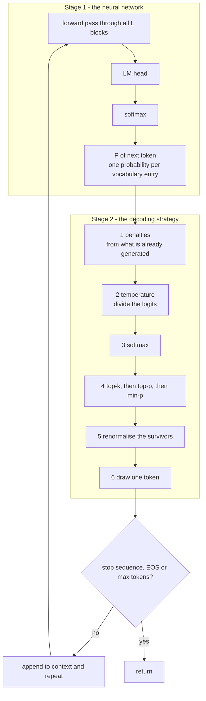

# 09 — Decoding Strategies and Sampling

> **Lecture chapter:** 08 · **Notes:** [08_Decoding_Strategies_and_Sampling_Controls.md](../../../notes/08_Decoding_Strategies_and_Sampling_Controls.md)
> **What you get:** the whole of `decodingService.ts` — `temperaturePanel`, `keepTopK`, `keepNucleus`,
> `keepAboveRelative`, `renormalise`, `weightedDraw`, `applyPenalties`, `countTokens`, `decodeStep`,
> `greedy`, `beamSearch`, `nucleusExample`, `recipes`, `streamingNote` — plus `decodingController.ts`.
> **Command used:** `npm run dev`, then two `curl` calls.

---

## 09.1 The claim this chapter rests on

**The model never selects a token.** It proposes a distribution; something outside the network picks
from it. That is why you can change temperature, top-p and penalties **without touching a single
weight**, and why the same checkpoint can power a deterministic code assistant and a creative writing
tool.



**The order is not negotiable**, because the operations do not commute (notes §08.10). The two
orderings that are most often got wrong:

* **Temperature before the pool trimming.** Top-k and top-p choose a pool by *probability*, and
  temperature is what shapes those probabilities. Trimming first would trim the wrong set.
* **Penalties before temperature.** Penalties are computed from the tokens already generated and are
  applied in log-space; applying them after temperature would change their effective strength.

---

## 09.2 The two files this chapter introduces

| File | Lines | Job |
| :--- | :--- | :--- |
| `src/services/decodingService.ts` | 1–251 | Every control in the chapter, plus the ordered `decodeStep` and `beamSearch` |
| `src/controllers/decodingController.ts` | 1–94 | The `controls` and `sample` handlers |

---

## 09.3 The complete code — `decodingService.ts`

**File:** `src/services/decodingService.ts`.

```ts
import type { DecodingSettings, Vector } from "../types";
import { argmax, percent, rng, round, softmax } from "./attentionService";

/**
 * Chapter 08 - decoding strategies and sampling controls.
 *
 * The chapter's central claim, and the reason this file exists separately from
 * logitsService: the MODEL never selects a token. It proposes a distribution.
 * Everything in here happens outside the network, which is why you can change
 * temperature, top-p and penalties without touching a single weight (§08.1).
 *
 * The order below is fixed, because the operations do not commute (§08.10):
 *   penalties -> temperature -> softmax -> top-k -> top-p -> min-p -> renormalise -> draw
 */

/** §08.5 - temperature divides the logits. It changes the GAPS, never the ranking. */
export function temperaturePanel(logits: Vector, temperature: number) {
  const scaled = logits.map((value) => round(value / temperature, 4));
  const probabilities = softmax(scaled);
  return {
    temperature,
    scaled,
    probabilities,
    percent: probabilities.map((value) => percent(value)),
    shape: temperature === 0 ? "greedy" : temperature < 1 ? "sharp" : temperature === 1 ? "the model's own distribution" : "flat",
  };
}

/** §08.5 - the lecture's three cases, side by side. */
export function lectureTemperature() {
  const tokens = ["Python", "Java", "JavaScript", "C++", "Rust"];
  const logits = [5, 4, 3, 2, 1];
  const panels = [0.5, 1.0, 2.0].map((temperature) => temperaturePanel(logits, temperature));

  return {
    tokens,
    rawLogits: logits,
    panels,
    table: tokens.map((token, i) => ({
      token,
      t0_5: percent(panels[0].probabilities[i]),
      t1_0: percent(panels[1].probabilities[i]),
      t2_0: percent(panels[2].probabilities[i]),
    })),
    boundaries: {
      tZero: "T = 0 is greedy decoding - the softmax approaches a one-hot row",
      tInfinity: "T -> infinity approaches a uniform distribution: random noise, whatever the model learned",
      ranking: "temperature never changes WHICH token is most likely, only how much more likely it is",
    },
  };
}

/** §08.6 - top-k: keep the k most likely tokens, zero the rest. */
export function keepTopK(probabilities: Vector, k: number): Vector {
  const cutoff = [...probabilities].sort((a, b) => b - a)[Math.min(k, probabilities.length) - 1];
  return probabilities.map((value) => (value >= cutoff ? value : 0));
}

/**
 * §08.7 - top-p (nucleus): keep the smallest set of tokens whose cumulative
 * probability reaches p. This is the one that adapts to the shape of the
 * distribution, which is why it beats a fixed k as a general default.
 */
export function keepNucleus(probabilities: Vector, p: number): Vector {
  const order = probabilities.map((value, id) => ({ value, id })).sort((a, b) => b.value - a.value);
  const kept = new Set<number>();
  let cumulative = 0;
  for (const { value, id } of order) {
    kept.add(id);
    cumulative += value;
    if (cumulative >= p) break;
  }
  return probabilities.map((value, id) => (kept.has(id) ? value : 0));
}

/** §08.8 - min-p: keep tokens at least minP x the leader. Relative, so it self-adjusts. */
export function keepAboveRelative(probabilities: Vector, minP: number): Vector {
  const threshold = minP * Math.max(...probabilities);
  return probabilities.map((value) => (value >= threshold ? value : 0));
}

/** Bring the surviving pool back to a valid distribution (it must sum to 1). */
export function renormalise(probabilities: Vector): Vector {
  const total = probabilities.reduce((sum, value) => sum + value, 0);
  return total === 0 ? probabilities.map(() => 0) : probabilities.map((value) => round(value / total, 6));
}

/** §08.4 - the weighted lottery. One uniform draw against the cumulative curve. */
export function weightedDraw(probabilities: Vector, draw: number): number {
  let cumulative = 0;
  for (let id = 0; id < probabilities.length; id++) {
    cumulative += probabilities[id];
    if (draw < cumulative) return id;
  }
  return probabilities.length - 1;
}

/** §08.9 - penalties modify logits from what has already been generated. */
export function applyPenalties(logits: Vector, counts: Map<number, number>, settings: DecodingSettings) {
  const adjusted = logits.slice();
  for (const [id, count] of counts) {
    if (settings.presencePenalty) adjusted[id] -= settings.presencePenalty;
    if (settings.frequencyPenalty) adjusted[id] -= settings.frequencyPenalty * count;
    if (settings.repetitionPenalty !== 1) {
      adjusted[id] =
        adjusted[id] > 0 ? adjusted[id] / settings.repetitionPenalty : adjusted[id] * settings.repetitionPenalty;
    }
  }
  return adjusted;
}

/** Count how many times each id already appears in the output (§08.9). */
export function countTokens(ids: number[]): Map<number, number> {
  const counts = new Map<number, number>();
  for (const id of ids) counts.set(id, (counts.get(id) ?? 0) + 1);
  return counts;
}

/**
 * §08.10 - the whole decode step, in the order that matters. Every provider runs
 * a variant of this function; the parameters differ, the shape does not.
 */
export function decodeStep(logits: Vector, generated: number[], settings: DecodingSettings) {
  const trace: { step: string; note: string }[] = [];
  let z = logits.slice();

  // 1. penalties - they depend on what has already been produced
  const counts = countTokens(generated);
  z = applyPenalties(z, counts, settings);
  trace.push({ step: "penalties", note: `${counts.size} distinct token(s) already generated` });

  // 2. temperature, and the T = 0 shortcut straight to argmax
  if (settings.temperature === 0) {
    const picked = argmax(z);
    return { selected: picked, mode: "greedy", trace, poolSize: 1, distribution: null };
  }
  z = z.map((value) => round(value / settings.temperature, 6));
  trace.push({ step: "temperature", note: `logits divided by ${settings.temperature}` });

  // 3. softmax - the trimming below works on PROBABILITIES, so temperature is baked in
  let probabilities = softmax(z);
  trace.push({ step: "softmax", note: "logits -> a valid distribution" });

  // 4. trim the pool
  if (settings.topK) {
    probabilities = keepTopK(probabilities, settings.topK);
    trace.push({ step: "top-k", note: `kept the ${settings.topK} most likely` });
  }
  if (settings.topP) {
    probabilities = keepNucleus(probabilities, settings.topP);
    trace.push({ step: "top-p", note: `kept the smallest set reaching ${settings.topP}` });
  }
  if (settings.minP) {
    probabilities = keepAboveRelative(probabilities, settings.minP);
    trace.push({ step: "min-p", note: `kept tokens at least ${settings.minP} x the leader` });
  }

  // 5. renormalise, then draw
  const pool = renormalise(probabilities);
  const poolSize = pool.filter((value) => value > 0).length;
  const draw = rng(settings.seed)();
  const selected = settings.strategy === "greedy" ? argmax(z) : weightedDraw(pool, draw);
  trace.push({ step: "draw", note: `one uniform value (${round(draw, 4)}) against the cumulative curve` });

  return { selected, mode: settings.strategy, trace, poolSize, distribution: pool };
}

/** §08.2 - greedy: always the highest. Deterministic, and prone to loops. */
export function greedy(logits: Vector) {
  const id = argmax(logits);
  return {
    strategy: "greedy",
    selected: id,
    probability: percent(softmax(logits)[id]),
    note: "identical input gives identical output every time; no temperature, no seed, no variance (§08.2)",
  };
}

/**
 * §08.3 - beam search: keep the `width` best partial sequences instead of one.
 * `steps` holds one logits vector per position. Scores are sums of log
 * probabilities, because adding logs multiplies probabilities without underflow.
 */
export function beamSearch(steps: Vector[], width: number) {
  type Beam = { ids: number[]; score: number };
  let beams: Beam[] = [{ ids: [], score: 0 }];

  for (const logits of steps) {
    // Adding logs multiplies probabilities without underflowing.
    const logs = softmax(logits).map((value) => Math.log(Math.max(value, 1e-12)));
    const candidates: Beam[] = [];

    for (const beam of beams) {
      for (let id = 0; id < logits.length; id++) {
        candidates.push({ ids: [...beam.ids, id], score: round(beam.score + logs[id], 6) });
      }
    }

    beams = candidates.sort((a, b) => b.score - a.score).slice(0, width);
  }

  return {
    width,
    beams: beams.map((beam) => ({
      ids: beam.ids,
      score: beam.score,
      lengthNormalised: round(beam.score / Math.max(beam.ids.length, 1), 6),
    })),
    note:
      "Beam search explores `width` continuations at once. The score must be normalised by length, or it always " +
      "prefers shorter sequences (§08.3). It buys fluency, not factuality.",
  };
}

/** §08.7 - the lecture's cumulative table, computed so the boundary is visible. */
export function nucleusExample() {
  const distribution = [0.42, 0.26, 0.13, 0.08, 0.05, 0.03, 0.02, 0.01];
  const labels = ["A", "B", "C", "D", "E", "F", "G", "H"];
  let cumulative = 0;
  const rows = distribution.map((value, i) => {
    cumulative = round(cumulative + value, 4);
    return { token: labels[i], probability: value, cumulative };
  });
  return {
    p: 0.9,
    rows,
    nucleus: rows.filter((row) => row.cumulative - row.probability < 0.9).map((row) => row.token),
    note: "the p = 0.9 boundary falls inside E, so the nucleus is {A,B,C,D,E}; the rest is zeroed and the pool renormalised",
  };
}

/** §08.13 - parameter sets that work, per task. */
export function recipes() {
  return [
    { task: "code / math / extraction", temperature: "0 - 0.3", topP: "1.0", note: "near-deterministic; verify with a schema, not with hope" },
    { task: "factual Q&A", temperature: "0.2", topP: "0.9", note: "small amount of variety, no wandering" },
    { task: "technical writing / summarising", temperature: "0.5 - 0.8", topP: "0.9", note: "the general-purpose sweet spot" },
    { task: "chat baseline", temperature: "1.0", topP: "0.95", note: "the model's own distribution" },
    { task: "creative writing / brainstorming", temperature: "1.2 - 1.5", topP: "0.95 - 0.98", note: "raise temperature, then raise top-p to match" },
  ];
}

/** §08.12 - why the UI types. */
export function streamingNote() {
  return {
    why: "the decode loop emits one token at a time, so the first token can be sent before the last one exists",
    effect: "time-to-first-token becomes the number the user feels, not total latency",
    caveat: "stop sequences and penalties still need the full buffer, so a streamed response can still be cut short",
  };
}
```

**Block by block:**

1. `import { argmax, percent, rng, round, softmax } from "./attentionService"` — five primitives, one
   of them the seeded `rng`. **Sampling is the only place in the project that needs randomness**, and
   it uses the deterministic generator from [chapter 02](./02_Why_Attention_and_the_Soft_Lookup.md)
   rather than `Math.random()`. That is a deliberate choice with a real benefit: the same request with
   the same seed returns the same token, so a surprising result is a bug you can reproduce.
2. The file header states the claim, the reason this file is separate from `logitsService`, and the
   fixed order — so a reader cannot implement the pipeline in the wrong sequence by accident.

### §08.5 — temperature

3. `temperaturePanel(logits, temperature)` — one panel:
   * `scaled = logits.map((value) => round(value / temperature, 4))` — **dividing the logits**. That
     single division is the entire mechanism.
   * `probabilities = softmax(scaled)` — the shared softmax, on the scaled logits.
   * `shape` — a **label computed from the value**, not passed in:
     `temperature === 0 ? "greedy" : temperature < 1 ? "sharp" : temperature === 1 ? "the model's own distribution" : "flat"`.
     Three boundary cases, all meaningful: `T = 0` is greedy (the softmax approaches a one-hot row),
     `T = 1` is the model's own distribution, and `T > 1` flattens it.
4. `lectureTemperature()` — the lecture's three cases on `Python 5, Java 4, JavaScript 3, C++ 2, Rust 1`:
   * `panels` — the three full panels at $T = 0.5$, $1.0$, $2.0$.
   * `table` — the notes' side-by-side layout, one row per token with `t0_5`, `t1_0`, `t2_0` columns.
   * `boundaries` — the two limit cases stated in prose, because they are the ones people get wrong:
     $T = 0$ is greedy, $T \to \infty$ approaches uniform ("random noise, whatever the model learned"),
     and **temperature never changes *which* token is most likely** — only how much more likely it is.
5. The real measured table, which reproduces the notes' own numbers closely:

   | Token | $T = 0.5$ | $T = 1.0$ | $T = 2.0$ |
   | :--- | ---: | ---: | ---: |
   | Python | 86.5% | 63.6% | 42.9% |
   | Java | 11.7% | 23.4% | 26.0% |
   | JavaScript | 1.6% | 8.6% | 15.8% |
   | C++ | 0.2% | 3.2% | 9.6% |
   | Rust | 0.0% | 1.2% | 5.8% |

   **The gaps shrink as $T$ rises and widen as it falls; the order never changes.** That is notes
   §08.5's table, computed.

### §08.6, §08.7, §08.8 — the three pool trimmers

6. `keepTopK(probabilities, k)` — **the one-liner with a subtlety**:
   `const cutoff = [...probabilities].sort((a, b) => b - a)[Math.min(k, probabilities.length) - 1]`.
   It sorts a *copy* (the spread is required — `sort` mutates), takes the $k$-th largest value as a
   cutoff, and then keeps everything `>= cutoff`. Two details matter:
   * The `Math.min(k, probabilities.length)` guard: asking for `topK = 50` on a 5-token vocabulary
     would otherwise read `sorted[49]` and get `undefined`, making every comparison `false` and
     zeroing the whole distribution.
   * Using `>=` rather than `>` means **ties are kept**. Two tokens with identical probability are
     both in or both out, so the pool size can exceed `k` — which is the honest behaviour, and the
     response reports the actual `poolSize` rather than assuming it.
7. `keepNucleus(probabilities, p)` — top-p, and the one that adapts:
   ```text
   order = indices sorted by probability, descending
   walk down the list, adding each token to `kept` and accumulating its probability
   stop as soon as cumulative >= p
   zero everything not in `kept`
   ```
   The loop `for (const { value, id } of order) { kept.add(id); cumulative += value; if (cumulative >= p) break; }`
   is the notes' pseudocode exactly, including the detail that **the token that crosses the boundary is
   kept** (the `kept.add(id)` happens before the break). That is why the nucleus for $p = 0.9$ on the
   notes' example is `{A, B, C, D, E}` and not `{A, B, C, D}` — the boundary falls *inside* `E`.
8. `keepAboveRelative(probabilities, minP)` — min-p, in two lines:
   `const threshold = minP * Math.max(...probabilities)` then keep everything `>= threshold`. **A
   relative threshold**, which is why min-p self-adjusts: when the leader is at 90% the threshold is
   `0.1 × 0.9 = 0.09` and almost nothing survives; when the leader is at 5% the threshold is `0.005`
   and a wide pool survives. Notes §08.8's whole argument in one multiplication.
9. `renormalise(probabilities)` — divide by the total, **with a guard**:
   `total === 0 ? probabilities.map(() => 0) : ...`. Without it, a pool that got trimmed to nothing
   would produce `0 / 0 = NaN` and poison the draw. The guard returns an all-zero distribution, which
   `weightedDraw` then handles by returning the last index — a degenerate answer, but a *defined* one.
10. `weightedDraw(probabilities, draw)` — the lottery. Walk the cumulative sum and return the first
    index where `draw < cumulative`. The `draw` value comes in as a parameter rather than being
    generated inside, which is what makes the function **pure and testable**: the randomness is
    injected, not buried.
11. `applyPenalties(logits, counts, settings)` — the three penalties, in the order notes §08.9 lists:
    * `presencePenalty` — a **flat** subtraction if the token appeared at all.
    * `frequencyPenalty` — proportional to how *often* it appeared.
    * `repetitionPenalty` — the asymmetric one:
      `adjusted[id] > 0 ? adjusted[id] / settings.repetitionPenalty : adjusted[id] * settings.repetitionPenalty`.
      **A positive logit is divided and a negative one is multiplied**, so the penalty always pushes
      the token *down* whichever side of zero it is on. Getting this wrong (dividing both) makes a
      negative logit *more* likely, which is a classic implementation bug.
12. `countTokens(ids)` — a `Map` of id → count, which is what the three penalties above consume.
13. **What is deliberately absent:** nothing in this file uses `Math.random()`, nothing uses a global
    clock, and nothing mutates its arguments. `applyPenalties` starts with `const adjusted = logits.slice()`.
    Every function here is pure except for the injected `draw`, and that is why the endpoint can be
    tested by asserting on exact numbers.


### §08.10 — `decodeStep`, the ordered pipeline

14. `decodeStep(logits, generated, settings)` — **the most important function in the chapter.** It
    returns the selected token *and* a `trace` array, so the response can show which steps ran. Read it
    in order:

    | # | Code | Notes |
    | :---: | :--- | :--- |
    | 1 | `z = applyPenalties(z, counts, settings)` | §08.9 — depends on what was already generated |
    | 2 | `if (settings.temperature === 0) { return { selected: argmax(z), mode: "greedy" } }` | §08.2/§08.5 — the `T = 0` shortcut |
    | 3 | `z = z.map((value) => round(value / settings.temperature, 6))` | §08.5 |
    | 4 | `let probabilities = softmax(z)` | §07.4 — **before** the trimming, so temperature is baked in |
    | 5 | `keepTopK` → `keepNucleus` → `keepAboveRelative` | §08.6–§08.8, applied in that order |
    | 6 | `const pool = renormalise(probabilities)` | so the survivors sum to 1 |
    | 7 | `weightedDraw(pool, rng(settings.seed)())` | §08.4 — one uniform draw |

15. **The `T = 0` shortcut is a real behaviour, not an optimisation.** At $T = 0$ the division is a
    division by zero, so the code cannot simply "let the formula handle it". Returning `argmax(z)`
    directly is what "temperature 0 means greedy" *means*, and it is why `validate.ts` uses `numOrZero`
    for `TEMPERATURE` in `.env` (see [chapter 01](./01_Project_Structure_and_Setup.md) §01.4).
16. `trace.push({ step, note })` after each stage — five entries in the run below. The trace exists so
    you can see **which controls actually fired**: if you send `topK` and `topP`, both appear; if you
    send neither, neither does. A decoder that silently ignores a parameter is a bug you cannot see
    without a trace.
17. `const poolSize = pool.filter((value) => value > 0).length` — the **actual** size of the pool after
    trimming, measured rather than assumed. It can differ from `topK` when ties are involved (step 6),
    and it is always smaller than the vocabulary after top-p.
18. `const selected = settings.strategy === "greedy" ? argmax(z) : weightedDraw(pool, draw)` — the
    strategy switch happens at the very end, after the pool is built. That is why `greedy` and
    `sample` can share the whole pipeline: they differ only in the last line.

### §08.2 and §08.3 — greedy and beam

19. `greedy(logits)` — `argmax`, plus the probability it carried and the note that it is deterministic:
    *"identical input gives identical output every time; no temperature, no seed, no variance."*
20. `beamSearch(steps, width)` — the one algorithm here with real state. `steps` is **one logits vector
    per position**:
    * `const logs = softmax(logits).map((value) => Math.log(Math.max(value, 1e-12)))` — **log
      probabilities, with a floor.** Adding logs multiplies probabilities without underflowing, which is
      the reason beam search scores in log-space. The `Math.max(value, 1e-12)` floor exists because
      `Math.log(0)` is `-Infinity`, and a single `-Infinity` score would make that whole beam
      unsalvageable.
    * `candidates.push({ ids: [...beam.ids, id], score: round(beam.score + logs[id], 6) })` — **every**
      beam is extended by **every** token, giving `width × |V|` candidates, then the top `width` are
      kept. That is the full beam-search expansion, in four lines.
    * `lengthNormalised: round(beam.score / Math.max(beam.ids.length, 1), 6)` — **the score normalised
      by length**, which notes §08.3 flags as mandatory. Raw log-probability sums are always negative
      and always *more* negative for longer sequences, so an unnormalised beam search will always
      prefer the shortest output. The note says exactly that.
21. The note's closing line is the honest assessment: *"Beam search explores `width` continuations at
    once. The score must be normalised by length, or it always prefers shorter sequences. It buys
    fluency, not factuality."*

### §08.7, §08.13, §08.12 — the reference tables

22. `nucleusExample()` — the notes' cumulative table, computed: probabilities
    `[0.42, 0.26, 0.13, 0.08, 0.05, 0.03, 0.02, 0.01]`, accumulated into a `cumulative` column. Then
    `nucleus: rows.filter((row) => row.cumulative - row.probability < 0.9).map((row) => row.token)` —
    **the filter is stated in terms of the probability *before* this token**, which is the precise way
    to say "the boundary falls inside this token". The result is `["A","B","C","D","E"]`, matching the
    notes exactly.
23. `recipes()` — the §08.13 parameter sets per task, as data: code/math at $T$ 0–0.3, factual Q&A at
    0.2, technical writing at 0.5–0.8, chat at 1.0, creative writing at 1.2–1.5. Each row carries a
    `note` with the reason, so the table is advice rather than a lookup.
24. `streamingNote()` — §08.12 as three fields: *why* streaming is possible (the loop emits one token at
    a time), *what it changes* (time-to-first-token becomes the number the user feels), and *the
    caveat* (stop sequences and penalties still need the full buffer).


---

## 09.4 The complete code — `decodingController.ts`

**File:** `src/controllers/decodingController.ts`.

```ts
import type { Request, Response } from "express";
import { config } from "../config/config";
import { asyncHandler, badRequest } from "../middleware/errorHandler";
import { optionalInteger, optionalNumber, optionalNumberArray, optionalTokens, requireSettings } from "../middleware/validate";
import { softmax } from "../services/attentionService";
import * as decoding from "../services/decodingService";

/** Chapter 08 - decoding strategies and sampling controls. */

const DEFAULT_TOKENS = ["Python", "Java", "JavaScript", "C++", "Rust"];
const DEFAULT_LOGITS = [5, 4, 3, 2, 1];

/** Both endpoints take the same pair of arrays, so validate them in one place. */
function candidatesFrom(req: Request) {
  const tokens = optionalTokens(req, "tokens", DEFAULT_TOKENS);
  const logits = optionalNumberArray(req, "logits", DEFAULT_LOGITS);
  if (tokens.length !== logits.length) {
    throw badRequest(`"tokens" (${tokens.length}) and "logits" (${logits.length}) must be the same length.`);
  }
  return { tokens, logits };
}

/** POST /api/decoding/controls  { "logits": [5,4,3,2,1], "topK": 3, "topP": 0.9, "minP": 0.1 } */
export const controls = asyncHandler((req: Request, res: Response) => {
  const { tokens, logits } = candidatesFrom(req);
  const topK = optionalInteger(req, "topK", 3, 1, 20) ?? 3;
  const topP = optionalNumber(req, "topP", config.topP, 0, 1);
  const minP = optionalNumber(req, "minP", 0.1, 0, 1);
  const full = softmax(logits);

  res.json({
    chapter: "08 §08.5-§08.8 - temperature, top-k, top-p and min-p",
    tokens,
    rawLogits: logits,
    fullDistribution: full,
    lectureTemperature: decoding.lectureTemperature(),
    panels: [0.5, 1, 2].map((temperature) => decoding.temperaturePanel(logits, temperature)),
    pools: {
      topK: { k: topK, probabilities: decoding.renormalise(decoding.keepTopK(full, topK)) },
      topP: { p: topP, probabilities: decoding.renormalise(decoding.keepNucleus(full, topP)) },
      minP: { minP, probabilities: decoding.renormalise(decoding.keepAboveRelative(full, minP)) },
    },
    nucleusExample: decoding.nucleusExample(),
    recipes: decoding.recipes(),
    streaming: decoding.streamingNote(),
    note:
      "Top-k is shape-blind and top-p is blind to how confident the leader is; min-p is a relative threshold " +
      "that behaves like greedy when the model is sure and like sampling when it is not.",
  });
});

/**
 * POST /api/decoding/sample
 *   { "logits": [5,4,3,2,1], "strategy": "sample", "temperature": 0.7,
 *     "topP": 0.9, "presencePenalty": 1, "seed": 42, "generated": [0] }
 */
export const sample = asyncHandler((req: Request, res: Response) => {
  const { tokens, logits } = candidatesFrom(req);
  const settings = requireSettings(req, { temperature: config.temperature, topP: config.topP, seed: config.seed });

  const rawGenerated = (req.body as { generated?: unknown } | undefined)?.generated;
  const generated = Array.isArray(rawGenerated) ? (rawGenerated as unknown[]).map(Number).filter(Number.isInteger) : [0];
  const rawSteps = (req.body as { steps?: unknown } | undefined)?.steps;
  const steps = Array.isArray(rawSteps) && rawSteps.length > 0 ? (rawSteps as number[][]) : [logits, logits];

  const result = decoding.decodeStep(logits, generated, settings);
  const chosen = result.selected >= 0 && result.selected < tokens.length ? tokens[result.selected] : String(result.selected);

  res.json({
    chapter: "08 §08.2-§08.10 - greedy, beam and sampling, in the order that matters",
    tokens,
    rawLogits: logits,
    generatedIds: generated,
    settings,
    selected: { id: result.selected, token: chosen, mode: result.mode },
    poolSize: result.poolSize,
    distribution: result.distribution,
    trace: result.trace,
    greedy: decoding.greedy(logits),
    beam: decoding.beamSearch(steps, 2),
    orderOfOperations: [
      "logit bias / vocabulary mask",
      "penalties (from what has already been generated)",
      "temperature",
      "top-k, then top-p, then min-p",
      "softmax and renormalise",
      "sample or argmax",
      "stop check, append, repeat",
    ],
    note:
      "The order is fixed because the operations do not commute: trimming the pool must happen AFTER temperature, " +
      "because the pool is chosen by probability and temperature is what shapes those probabilities.",
  });
});
```

**Block by block:**

25. `const DEFAULT_TOKENS` and `const DEFAULT_LOGITS` at the top of the file — the lecture's
    `Python 5, Java 4, JavaScript 3, C++ 2, Rust 1` example, named so both handlers share it.
26. `function candidatesFrom(req)` — **a local helper that both handlers call.** It reads `tokens` and
    `logits` with the lecture's defaults and then checks the cross-field invariant
    `tokens.length !== logits.length` → 400. Factoring it out means the two endpoints cannot drift
    apart in how they validate, and the error message names both lengths.
27. `import { softmax } from "../services/attentionService"` — the `controls` handler needs the plain
    distribution before any trimming, so it imports the primitive directly. Note it does **not**
    re-implement it: there is still exactly one `softmax` in the project.
28. In `controls`: `pools: { topK: { k, probabilities }, topP: { p, probabilities }, minP: { minP, probabilities } }`
    — each pool is returned **with the parameter that produced it**, so the response is self-describing.
    All three are wrapped in `decoding.renormalise(...)` so they are comparable: an unnormalised pool
    would not sum to 1 and could not be read as a distribution.
29. `optionalInteger(req, "topK", 3, 1, 20)` — the default of `3` is chosen for the demo, not for
    production (where 20–100 is typical, notes §08.6). With a 5-token vocabulary, `k = 3` produces a
    visible trim; `k = 40` would trim nothing and teach nothing.
30. In `sample`: `const generated = Array.isArray(rawGenerated) ? (rawGenerated as unknown[]).map(Number).filter(Number.isInteger) : [0]`
    — the ids already produced, defaulting to `[0]`. That default is deliberate: it gives the penalties
    something to act on, so `{"presencePenalty": 1}` visibly changes the result instead of doing
    nothing.
31. `const steps = Array.isArray(rawSteps) && rawSteps.length > 0 ? (rawSteps as number[][]) : [logits, logits]`
    — the beam-search input, defaulting to two copies of the same logits vector. A beam search needs
    one distribution per position, and repeating the same one is the simplest honest default.
32. `const chosen = result.selected >= 0 && result.selected < tokens.length ? tokens[result.selected] : String(result.selected)`
    — the **bounds check before indexing**. `tokens[result.selected]` would be `undefined` for an
    out-of-range id, and `undefined` in a JSON response is an absent field, which reads as a bug in
    the endpoint rather than a fact about the data.
33. `orderOfOperations` — the nine-step list from notes §08.10, returned as an array of strings. It is
    duplicated from the `trace` on purpose: the trace says *what ran*, this says *what the order is*,
    including the steps this demo does not implement (stop sequences, max tokens).
34. `note` — the closing claim: *"trimming the pool must happen AFTER temperature, because the pool is
    chosen by probability and temperature is what shapes those probabilities."* That is the single
    ordering fact that matters, stated where a reader of the response will see it.


---

## 09.5 Run it

**The temperature panels and the pools:**

```bash
curl -s -X POST localhost:3000/api/decoding/controls \
  -H 'content-type: application/json' -d '{}'
```

```json
{
  "tokens": ["Python", "Java", "JavaScript", "C++", "Rust"],
  "rawLogits": [5, 4, 3, 2, 1],
  "fullDistribution": [0.636409, 0.234122, 0.086129, 0.031685, 0.011656],
  "lectureTemperature": {
    "table": [
      { "token": "Python",     "t0_5": 86.5, "t1_0": 63.6, "t2_0": 42.9 },
      { "token": "Java",       "t0_5": 11.7, "t1_0": 23.4, "t2_0": 26.0 },
      { "token": "JavaScript", "t0_5":  1.6, "t1_0":  8.6, "t2_0": 15.8 },
      { "token": "C++",        "t0_5":  0.2, "t1_0":  3.2, "t2_0":  9.6 },
      { "token": "Rust",       "t0_5":  0.0, "t1_0":  1.2, "t2_0":  5.8 }
    ]
  },
  "pools": {
    "topK": { "k": 3,      "probabilities": [0.665241, 0.244729, 0.090031, 0, 0] },
    "topP": { "p": 0.9,    "probabilities": [0.665241, 0.244729, 0.090031, 0, 0] },
    "minP": { "minP": 0.1, "probabilities": [0.665241, 0.244729, 0.090031, 0, 0] }
  },
  "nucleusExample": {
    "rows": [
      { "token": "A", "probability": 0.42, "cumulative": 0.42 },
      { "token": "B", "probability": 0.26, "cumulative": 0.68 },
      { "token": "C", "probability": 0.13, "cumulative": 0.81 },
      { "token": "D", "probability": 0.08, "cumulative": 0.89 },
      { "token": "E", "probability": 0.05, "cumulative": 0.94 },
      { "token": "F", "probability": 0.03, "cumulative": 0.97 }
    ],
    "nucleus": ["A", "B", "C", "D", "E"]
  }
}
```

**Three things worth noticing:**

1. **The temperature table reproduces the notes' own numbers.** Notes §08.5 prints 88/10/1.5/0.4/0.1 at
   $T = 0.5$ and 65/24/8/3/0.5 at $T = 1$; this computes 86.5/11.7/1.6/0.2/0.0 and 63.6/23.4/8.6/3.2/1.2.
   Close enough to confirm the mechanism, and the small differences are the lecture's rounding.
2. **All three pools came out identical here — and that is a fact about this input, not a bug.** On
   `[5, 4, 3, 2, 1]` the top three tokens already hold 95.6% of the mass, so `topK = 3`, `topP = 0.9`
   and `minP = 0.1` all cut in the same place. **Change the input and they diverge**: send
   `{"logits":[3,3,3,3,3]}` (flat) and top-p widens while top-k stays at 3; send `{"logits":[20,1,1,1,1]}`
   (peaked) and min-p collapses the pool to one token while top-k still keeps three. That is the
   "top-k is shape-blind, top-p adapts" argument from notes §08.7, demonstrated by changing one array.
3. **`nucleus: ["A","B","C","D","E"]`** — five tokens, because the $p = 0.9$ boundary falls inside `E`
   (cumulative 0.89 → 0.94). The notes' example exactly, and the reason `keepNucleus` adds the token
   *before* checking the boundary.


**The ordered decode step, with a trace:**

```bash
curl -s -X POST localhost:3000/api/decoding/sample \
  -H 'content-type: application/json' \
  -d '{"strategy":"sample","temperature":0.7,"topP":0.9,"presencePenalty":1,"seed":42}'
```

```json
{
  "generatedIds": [0],
  "settings": { "strategy": "sample", "temperature": 0.7, "topK": null, "topP": 0.9,
                "minP": null, "repetitionPenalty": 1, "frequencyPenalty": 0,
                "presencePenalty": 1, "seed": 42 },
  "selected": { "id": 1, "token": "Java", "mode": "sample" },
  "poolSize": 3,
  "distribution": [0.446498, 0.446498, 0.107004, 0, 0],
  "trace": [
    { "step": "penalties",   "note": "1 distinct token(s) already generated" },
    { "step": "temperature", "note": "logits divided by 0.7" },
    { "step": "softmax",     "note": "logits -> a valid distribution" },
    { "step": "top-p",       "note": "kept the smallest set reaching 0.9" },
    { "step": "draw",        "note": "one uniform value (0.6011) against the cumulative curve" }
  ],
  "greedy": { "strategy": "greedy", "selected": 0, "probability": 63.6 },
  "beam": {
    "width": 2,
    "beams": [
      { "ids": [0, 0], "score": -0.903828, "lengthNormalised": -0.451914 },
      { "ids": [0, 1], "score": -1.903827, "lengthNormalised": -0.951913 }
    ]
  }
}
```

**Four things to read out of that:**

1. **`trace` lists exactly the five steps that ran** — and note that **top-k does not appear**, because
   the request sent `topP` and `validate.ts` set `topK` to `null`. That is the "top-k and top-p are
   alternatives" default from [chapter 01](./01_Project_Structure_and_Setup.md) §01.6, visible in the
   trace.
2. **`presencePenalty: 1` did something.** Token `0` (`Python`) was in `generatedIds`, so its logit was
   reduced by 1: from 5 to 4. After dividing by $T = 0.7$ both `Python` and `Java` land on the same
   value, giving the tied distribution `[0.446498, 0.446498, 0.107004, 0, 0]`. **The penalty erased the
   leader's advantage** — which is exactly what a repetition penalty is for, and exactly why notes
   §08.9 warns that it is a blunt instrument.
3. **`greedy` disagrees with `sample`** — greedy picks id `0`, the sample picked id `1`. Two functions,
   two answers, from the same logits: the chapter's opening claim, demonstrated.
4. **`beam` scores are negative and the length-normalised column differs.** Raw log-probability sums
   are always negative and always worse for longer sequences, which is precisely why
   `lengthNormalised` exists (notes §08.3).

> [!WARNING]
> **On point 3 — read the code, not just the demo.** `greedy(logits)` is called with the *raw* logits in
> the handler, while `decodeStep` applies the penalties first. That is intentional here: it puts an
> unpenalised greedy baseline beside a penalised sample so the effect of *both* controls is visible. In
> a real decoder you would route greedy through `decodeStep` with `temperature: 0`, which applies the
> penalties and then takes `argmax` — and the `T = 0` branch inside `decodeStep` is exactly that path.

---

## 09.6 Common mistakes this chapter's code prevents

| Mistake | What the code does instead |
| :--- | :--- |
| Trimming the pool *before* temperature | `softmax` runs after the division; the pool is built from those probabilities |
| Applying penalties after temperature | `applyPenalties` is step 1, before the division |
| Using `Math.random()` | `rng(seed)`, so the same request reproduces exactly (notes §08.11) |
| Dividing a negative logit by the repetition penalty | `> 0 ? divide : multiply` — the penalty always pushes down |
| `Math.log(0)` in beam search | `Math.max(value, 1e-12)` floor |
| Scoring beams without length normalisation | `lengthNormalised` is returned beside the raw score |
| Reading `sorted[k-1]` when `k` exceeds the vocabulary | `Math.min(k, probabilities.length)` |
| `0 / 0 = NaN` when a pool empties | `renormalise` guards on `total === 0` |
| Assuming the pool size equals `topK` | `poolSize` is measured after the trim, and ties can exceed `k` |
| Indexing `tokens[selected]` without bounds | An explicit range check, so the field is never `undefined` |

---

## 09.7 Checkpoint

1. Why must temperature come *before* top-k and top-p, and not after?
2. Why does `applyPenalties` divide a positive logit but multiply a negative one?
3. Why does `keepNucleus` add the token *before* checking the cumulative sum?
4. In the run above, why do `greedy` and `sample` disagree about the winning token?
5. Why does `beamSearch` score in log-space, and why does it floor the probability at `1e-12`?
6. Why is `lengthNormalised` necessary, and what happens without it?
7. Why is `Math.random()` not used anywhere in this project?

> **Next:** [10 — Position, Masking and Attention Geometry](./10_Position_Masking_and_Attention_Geometry.md),
> the last chapter, where the model finally learns that word order exists.

