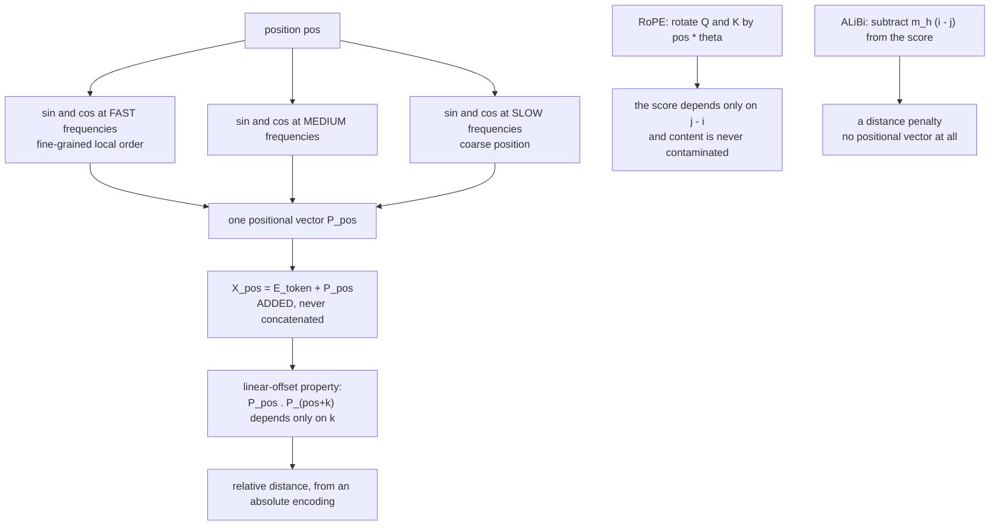

# 10 — Position, Masking and Attention Geometry

> **Lecture chapter:** 09 · **Notes:** [09_Position_Masking_and_Attention_Geometry.md](../../../notes/09_Position_Masking_and_Attention_Geometry.md)
> **What you get:** the whole of `positionService.ts` — `frequencies`, `sinusoidal`, `addPosition`,
> `linearOffsetProperty`, `ropeRotate`, `ropeScoreProof`, `alibiSlopes`, `alibiBias`, `maskGeometry`,
> `schemes`, `contextExtension`, `positionEffects` — plus `positionController.ts`.
> **Command used:** `npm run dev`, then two `curl` calls.

---

## 10.1 The problem this chapter solves

Self-attention is **permutation invariant**. Without a position signal, `"Dog bites man"` and
`"Man bites dog"` are literally the same input — the score matrix is a permutation of the same
numbers, and the output is a permutation of the same vectors. Every scheme in this chapter exists to
break that symmetry, and the differences between them matter to you at runtime: they decide whether a
long context is *usable* or merely *accepted*.



---

## 10.2 The two files this chapter introduces

| File | Lines | Job |
| :--- | :--- | :--- |
| `src/services/positionService.ts` | 1–165 | The four positional schemes, the mask geometries, and the runtime consequences |
| `src/controllers/positionController.ts` | 1–73 | The `encode` and `mask` handlers |

---

## 10.3 The complete code — `positionService.ts`

**File:** `src/services/positionService.ts`.

```ts
import type { MaskKind, Matrix, Vector } from "../types";
import { dot, maskMatrix, round, roundVector } from "./attentionService";

/**
 * Chapter 09 - position, masking and attention geometry.
 *
 * Self-attention is permutation invariant: without a position signal, "Dog bites
 * man" and "Man bites dog" are the same input (§09.1). Every scheme in this file
 * solves that one problem differently, and the difference matters to you at
 * runtime: it decides whether a long context is usable or merely accepted (§09.8).
 */

/** §09.2 - the frequency ladder. Early pairs oscillate fast, later pairs very slowly. */
export function frequencies(dModel: number, base = 10000): number[] {
  return Array.from({ length: Math.floor(dModel / 2) }, (_, i) => 1 / Math.pow(base, (2 * i) / dModel));
}

/** PE(pos,2i) = sin(pos w_i), PE(pos,2i+1) = cos(pos w_i) - the 2017 scheme. */
export function sinusoidal(positions: number[], dModel: number): Matrix {
  const omega = frequencies(dModel);
  return positions.map((position) => {
    const vector: Vector = new Array(dModel).fill(0);
    omega.forEach((frequency, i) => {
      vector[2 * i] = round(Math.sin(position * frequency), 6); // even dimensions: sin
      vector[2 * i + 1] = round(Math.cos(position * frequency), 6); // odd dimensions: cos
    });
    return vector;
  });
}

/** X_pos = E_token + P_pos. Added, never concatenated, so d_model stays fixed (§09.2). */
export function addPosition(embeddings: Matrix, positional: Matrix): Matrix {
  return embeddings.map((row, i) => row.map((value, d) => round(value + positional[i][d], 6)));
}

/**
 * §09.2 - the linear-offset property, measured instead of asserted:
 * P_pos . P_(pos+k) = sum_i cos(w_i k), which depends only on k.
 *
 * The check uses a TOLERANCE, not exact equality: each sinusoidal component is
 * rounded to 6 decimals, so two dot products that are mathematically identical
 * can differ in the last digit. `spread` is returned so the size of that gap is
 * visible rather than hidden behind a boolean.
 */
export function linearOffsetProperty(dModel: number, k: number, positions: number[]) {
  const shifted = positions.map((position) => position + k);
  const encoded = sinusoidal([...positions, ...shifted], dModel);
  const values = positions.map((_, i) => round(dot(encoded[i], encoded[positions.length + i]), 6));
  const spread = round(Math.max(...values) - Math.min(...values), 6);
  return {
    k,
    values,
    spread,
    dependsOnlyOnOffset: spread < 1e-4,
    note:
      "the same rotation works at every position, which is how an absolute encoding delivers relative distance. " +
      "The values agree to ~1e-6; the residual gap is the 6-decimal rounding in the encoder, not the property failing.",
  };
}

/**
 * §09.4 - RoPE: rotate each 2-D pair of the query and key by an angle
 * proportional to the token's position. Because the dot product of two rotated
 * vectors depends only on the DIFFERENCE of the angles, the score depends only on
 * j - i: absolute positions cancel, and no positional vector is ever added, so
 * the content stays uncontaminated.
 */
export function ropeRotate(vector: Vector, position: number, base = 10000): Vector {
  const d = vector.length;
  const out: Vector = new Array(d).fill(0);
  for (let m = 0; m < d / 2; m++) {
    const angle = position / Math.pow(base, (2 * m) / d);
    const cos = Math.cos(angle);
    const sin = Math.sin(angle);
    const x = vector[2 * m];
    const y = vector[2 * m + 1];
    out[2 * m] = round(x * cos - y * sin, 6);
    out[2 * m + 1] = round(x * sin + y * cos, 6);
  }
  return out;
}

/** The relativity proof: pairs with the same offset j - i get the same score. */
export function ropeScoreProof(query: Vector, key: Vector, offsets: number[], base = 10000) {
  const rows = offsets.map((offset) => {
    // Same offset, two different absolute positions - the scores must match.
    const pairA = { i: 0, j: offset };
    const pairB = { i: 5, j: 5 + offset };
    const scoreOf = (i: number, j: number) => round(dot(ropeRotate(query, i, base), ropeRotate(key, j, base)), 6);
    return { offset, positions: [pairA, pairB], scores: [scoreOf(pairA.i, pairA.j), scoreOf(pairB.i, pairB.j)] };
  });
  return {
    rows,
    relative: rows.every((row) => Math.abs(row.scores[0] - row.scores[1]) < 1e-4),
    note: "absolute positions cancel, so the model reads distance rather than location - and RoPE adds zero parameters",
  };
}

/**
 * §09.5 - ALiBi: no positional vectors at all. A negative bias proportional to
 * distance is added straight to the scores, with a fixed per-head slope, so
 * nearby tokens are preferred and the model can be tested far beyond its
 * training length.
 */
export function alibiSlopes(nHeads: number): number[] {
  return Array.from({ length: nHeads }, (_, head) => round(Math.pow(2, (-8 * (head + 1)) / nHeads), 6));
}

export function alibiBias(n: number, nHeads: number): Matrix {
  const slopes = alibiSlopes(nHeads);
  const slope = slopes[0]; // head 0 for display; each head uses its own
  return Array.from({ length: n }, (_, i) =>
    Array.from({ length: n }, (_, j) => (j > i ? -Infinity : round(-slope * (i - j), 4))),
  );
}

/** §09.6 - the geometry of masks. One mechanism, two axes: positions and vocabulary. */
export function maskGeometry(n: number, kind: MaskKind, window = 3, padCount = 1) {
  const mask = maskMatrix(n, kind, { window, padCount });
  const allowed = mask.flat().reduce((sum, value) => sum + value, 0);
  return {
    kind,
    window: kind === "sliding" ? window : null,
    padCount: kind === "padding" ? padCount : null,
    mask,
    allowedPairs: allowed,
    totalPairs: n * n,
    density: round(allowed / (n * n), 4),
    note: "the same -Infinity trick that hides positions also hides vocabulary entries - that is how a JSON schema is enforced",
  };
}

/** §09.3 - the four positional schemes, and what each costs you. */
export function schemes() {
  return [
    { scheme: "sinusoidal", relative: "implicit, via the linear-offset property", parameters: 0, extension: "weak", used: "the original 2017 Transformer" },
    { scheme: "learned", relative: "none - absolute positions only", parameters: "context length x d_model", extension: "none beyond the trained length", used: "GPT-2, BERT" },
    { scheme: "rope", relative: "exact - the score depends on j - i", parameters: 0, extension: "strong, via frequency rescaling", used: "LLaMA, Mistral, Qwen, most open models" },
    { scheme: "alibi", relative: "a distance penalty, not a representation", parameters: 0, extension: "strong out of the box", used: "BLOOM, MPT, some long-context models" },
  ];
}

/** §09.4 - how a short-context model is stretched to a long one. */
export function contextExtension() {
  return [
    { technique: "position interpolation", idea: "compress positions so a 32k-trained model accepts 128k", tradeOff: "cheap; quality drops without fine-tuning" },
    { technique: "NTK-aware scaling", idea: "scale the frequencies instead of the positions", tradeOff: "better quality retention" },
    { technique: "YaRN", idea: "interpolation plus a per-frequency-band attention-temperature adjustment", tradeOff: "current best practice for many models" },
    { technique: "fine-tune on long data", idea: "train on the target length", tradeOff: "most reliable; costs compute" },
  ];
}

/**
 * §09.8 - why this chapter is not academic. Every one of these shows up as a bug
 * report, and none of them is a model defect: they are consequences of geometry.
 */
export function positionEffects() {
  return [
    { effect: "lost in the middle", cause: "attention decays with offset, so the edges are read more reliably than the centre", fix: "put the instruction last, and the most relevant evidence first or last" },
    { effect: "chunk order changes answers", cause: "the same documents in a different order are a different input", fix: "rank chunks before you assemble the prompt, and keep the order stable" },
    { effect: "long context is not usable context", cause: "an advertised window is a capacity limit, not a quality guarantee", fix: "measure recall on your own tasks before you rely on 128k" },
    { effect: "position affects more than retrieval", cause: "format-following and refusal behaviour also drift with position", fix: "keep the schema and the safety instruction at the end of the prompt" },
  ];
}
```

**Block by block:**

1. `import { dot, maskMatrix, round, roundVector } from "./attentionService"` — **four primitives from
   [chapter 02](./02_Why_Attention_and_the_Soft_Lookup.md), including `dot`.** The linear-offset proof
   below is a dot product of two positional vectors, so it reuses the same `dot` that computes
   attention scores. That is not a coincidence: the linear-offset property is precisely the statement
   that a positional dot product behaves like a *relative* score.
2. `frequencies(dModel, base = 10000)` — the frequency ladder:
   `Array.from({ length: Math.floor(dModel / 2) }, (_, i) => 1 / Math.pow(base, (2 * i) / dModel))`.
   For `d_model = 8` that is `[1, 0.1, 0.01, 0.001]` — four frequency pairs, each a factor of ten slower
   than the last. `Math.floor(dModel / 2)` because each pair of dimensions consumes one frequency, and
   `base = 10000` is the paper's constant, exposed as a parameter so RoPE below can reuse the same
   ladder with a different base.
3. `sinusoidal(positions, dModel)` — the §09.2 formula:
   ```text
   vector[2i]     = sin(position * w_i)     // even dimensions: sin
   vector[2i + 1] = cos(position * w_i)     // odd dimensions: cos
   ```
   Note the interleaving: **`sin` and `cos` of the same frequency sit in adjacent dimensions**, forming
   a rotation. That structure is why the linear-offset property holds, and it is the same structure
   RoPE operates on directly.
4. The mental model from the notes: *"clock hands spinning at different speeds — the fast hands give
   the second, the slow hands give the hour."* Every value stays in $[-1, 1]$, which is what lets the
   positional vector simply be *added* to an embedding without swamping it.
5. `addPosition(embeddings, positional)` — `X_pos = E_token + P_pos`, one `map` of additions. **Added,
   never concatenated**, so `d_model` stays fixed (notes §09.2). Concatenating would double the width
   and every downstream matrix shape would have to change.

### §09.2 — the linear-offset property, measured

6. `linearOffsetProperty(dModel, k, positions)` — the claim is
   $\mathbf{P}_{pos} \cdot \mathbf{P}_{pos+k} = \sum_i \cos(\omega_i k)$, which depends **only on $k$**,
   not on $pos$:
   * `const shifted = positions.map((position) => position + k)` — the same positions, offset by $k$.
   * `sinusoidal([...positions, ...shifted], dModel)` — encode both sets **in one call**, so both use
     the same frequency ladder. The result is one matrix whose first half is the originals and whose
     second half is the shifted ones.
   * `values = positions.map((_, i) => round(dot(encoded[i], encoded[positions.length + i]), 6))` —
     the dot product of each position with its own shifted self.
7. **The check uses a tolerance, not exact equality, and this is a real lesson.** The first version of
   this function used `new Set(values).size === 1`, which failed for $k = 2$: the values came out
   `[2.563718, 2.563719, 2.563719]` — identical to six decimal places except for the last digit of the
   first. The cause is that `sinusoidal` rounds every component to 6 decimals, so two mathematically
   identical dot products can differ in the last place. The current code returns:
   * `values` — the measured dot products.
   * `spread: round(Math.max(...values) - Math.min(...values), 6)` — the size of the gap, which is
     `0` for $k = 1$ and `1e-06` for $k = 2$.
   * `dependsOnlyOnOffset: spread < 1e-4` — a tolerance-based pass.
   * `note` — which says the residual gap is *"the 6-decimal rounding in the encoder, not the property
     failing."*

   **A float comparison that demands exact equality is a bug waiting to happen**, and the fix is not to
   loosen the check silently but to report the spread so the size of the approximation is visible.
8. How additive position enters the score — the four-term expansion from notes §09.2:
   $Q_i \cdot K_j = \underbrace{E_iE_j}_{\text{content}} + \underbrace{E_iP_j}_{\text{content vs position}} + \underbrace{P_iE_j}_{\text{position vs content}} + \underbrace{P_iP_j}_{\text{the relative signal}}$.
   The last term is the one this function measures, and it is why an *absolute* encoding can deliver
   *relative* information. The cost of the additive approach is that position is mixed into the content
   vectors and cannot be removed later — which is the motivation for RoPE.

### §09.4 — RoPE: rotate instead of add

9. `ropeRotate(vector, position, base = 10000)` — for each 2-D pair, rotate by an angle proportional to
   the position:
   ```text
   for m in 0 .. d/2:
     angle = position / base^(2m/d)
     x, y  = vector[2m], vector[2m + 1]
     out[2m]     = x*cos - y*sin
     out[2m + 1] = x*sin + y*cos
   ```
   That is a standard 2-D rotation matrix applied per dimension pair. **No positional vector is ever
   added**, so the content of `Q` and `K` is never contaminated — the first of RoPE's three advantages
   over the additive scheme.
10. `ropeScoreProof(query, key, offsets, base = 10000)` — **the relativity proof, computed.** For each
    offset it scores two *different* absolute position pairs with the same gap:
    `pairA = { i: 0, j: offset }` and `pairB = { i: 5, j: 5 + offset }`, then
    `scoreOf(i, j) = dot(ropeRotate(query, i), ropeRotate(key, j))`. The result:

    | offset | `(0, 1)` vs `(5, 6)` | `(0, 2)` vs `(5, 7)` | `(0, 3)` vs `(5, 8)` | `(0, 5)` vs `(5, 10)` |
    | ---: | ---: | ---: | ---: | ---: |
    | scores | 0.119264 / 0.119265 | −0.264363 / −0.264362 | −0.386719 / −0.386718 | 0.256209 / 0.256209 |

    **Same offset, different absolute positions, same score.** `relative: true`, with a tolerance of
    `1e-4` for the same rounding reason as step 7. This is notes §09.4's derivation —
    $(R_\alpha q)\cdot(R_\beta k) = \lVert q\rVert\lVert k\rVert\cos(\phi - (\beta - \alpha))$, where only
    $\beta - \alpha$ survives — turned into four measured rows.
11. `schemes()` — the §09.3 comparison of the four schemes (sinusoidal, learned, RoPE, ALiBi) across
    four axes: how relativity is obtained, parameter cost, extension ability, and who uses it. Note the
    parameter costs: sinusoidal, RoPE and ALiBi are all **0**; only learned positional embeddings cost
    `context length × d_model` — which is exactly why they cannot extend.
12. `contextExtension()` — §09.4's table of how a short-context model is stretched: position
    interpolation, NTK-aware scaling, YaRN, and fine-tuning on long data. Each carries its `tradeOff`,
    because every one of them trades quality for reach.


### §09.5 — ALiBi: a penalty instead of a vector

13. `alibiSlopes(nHeads)` — the per-head slopes, a **fixed geometric sequence, not learned**:
    `Math.pow(2, (-8 * (head + 1)) / nHeads)`. For `nHeads = 2` that is `[0.0625, 0.003906]` — the first
    head penalises distance hard (it looks locally), the second barely at all (it looks far). That
    geometric spread across heads is the whole design.
14. `alibiBias(n, nHeads)` — the bias matrix for head 0:
    `j > i ? -Infinity : round(-slope * (i - j), 4)`. Three properties in one line:
    * It is **negative and proportional to distance** — $m_h(i - j)$ from notes §09.5.
    * `-Infinity` above the diagonal makes ALiBi **causal by construction**. There is no separate mask
      step; the bias *is* the mask.
    * For `n = 3` the matrix is `[[0, -∞, -∞], [-0.0625, 0, -∞], [-0.125, -0.0625, 0]]` — the previous
      token is penalised by 0.0625, the one before that by 0.125. **Twice the distance, twice the
      penalty.**
15. ALiBi's headline property (notes §09.5): because the penalty is applied to *scores* rather than
    added to *representations*, the model can be evaluated at sequence lengths it never trained on.
    There is no positional vector to run out of.

### §09.6 — the geometry of masks, and the second axis

16. `maskGeometry(n, kind, window = 3, padCount = 1)` — one call per mask kind, returning the 1/0
    matrix, `allowedPairs`, `totalPairs`, `density`, and the parameter that produced it. The four
    geometries for $n = 4$:

    | kind | allowed / 16 | density | matrix |
    | :--- | ---: | ---: | :--- |
    | `none` | 16 | 1.0 | full — bidirectional |
    | `causal` | 10 | 0.625 | lower triangle |
    | `sliding` (window 3) | 9 | 0.5625 | lower triangle with a band |
    | `padding` (padCount 1) | 9 | 0.5625 | lower triangle **minus the last column** |

17. **Read the `padding` row carefully.** It is *not* the same as `causal`: the last token is invisible
    to **everyone**, including itself. That is what a padding mask does — it hides the pad tokens so
    they cannot contribute to any real token's representation. The first version of this endpoint did
    not pass a `padCount`, so `padding` came out identical to `causal` and the response was misleading.
    The fix was to give `maskGeometry` a `padCount` parameter (default `1`) and report it back in the
    response. **A parameter that produces no visible difference is worse than no parameter at all.**
18. `note` — the sentence that connects the two axes: *"the same `-Infinity` trick that hides positions
    also hides vocabulary entries — that is how a JSON schema is enforced."* That is notes §09.6's
    "one mechanism, two axes", and it is the bridge to Lecture 10's structured outputs.

### §09.8 — why any of this matters at runtime

19. `positionEffects()` — the four consequences from §09.8, each as `{ effect, cause, fix }`:

    | Effect | Cause | Fix |
    | :--- | :--- | :--- |
    | lost in the middle | attention decays with offset, so the edges are read more reliably than the centre | put the instruction last, the evidence first or last |
    | chunk order changes answers | the same documents in a different order are a different input | rank chunks before assembling the prompt, keep the order stable |
    | long context ≠ usable context | an advertised window is a capacity limit, not a quality guarantee | measure recall on your own tasks |
    | position affects more than retrieval | format-following and refusal also drift with position | keep the schema and safety instruction at the end |

    Every one of these is a bug report you will receive, and none of them is a model defect. They are
    consequences of the geometry in this file.


---

## 10.4 The complete code — `positionController.ts`

**File:** `src/controllers/positionController.ts`.

```ts
import type { Request, Response } from "express";
import { config } from "../config/config";
import { asyncHandler } from "../middleware/errorHandler";
import { optionalInteger, requireMask, requireTokens, shapeId } from "../middleware/validate";
import { project, tokenVectors } from "../services/attentionService";
import * as position from "../services/positionService";

/** Chapter 09 - position, masking and attention geometry. */

/** POST /api/position/encode  { "tokens": [...], "shape": "toy-tiny", "k": 3 } */
export const encode = asyncHandler((req: Request, res: Response) => {
  const tokens = requireTokens(req);
  const shape = config.shape(shapeId(req));
  const k = optionalInteger(req, "k", 3, 1, 64) ?? 3;
  const positions = tokens.map((_, i) => i);

  const embeddings = tokenVectors(tokens, shape.dModel);
  const positional = position.sinusoidal(positions, shape.dModel);
  const input = position.addPosition(embeddings, positional);
  const { Q, K } = project(embeddings, config.dHead(shape), config.seed);

  res.json({
    chapter: "09 - position, masking and attention geometry",
    shape: shape.id,
    dModel: shape.dModel,
    tokens,
    frequencies: position.frequencies(shape.dModel),
    table: tokens.map((token, i) => ({
      position: i,
      token,
      embedding: embeddings[i],
      positional: positional[i],
      input: input[i],
    })),
    linearOffset: [1, k].map((offset) => position.linearOffsetProperty(shape.dModel, offset, positions)),
    rope: {
      rotatedQuery: position.ropeRotate(Q[0], 0),
      rotatedKeyAtTwo: position.ropeRotate(K[0], 2),
      proof: position.ropeScoreProof(Q[0], K[0], [1, 2, 3, 5]),
      note: "RoPE adds no parameters and never touches the residual stream: it rotates Q and K in place.",
    },
    alibi: {
      slopes: position.alibiSlopes(shape.nHeads),
      biasHeadZero: position
        .alibiBias(tokens.length, shape.nHeads)
        .map((row) => row.map((value) => (value === -Infinity ? "-Infinity" : value))),
      note: "score_ij = Q_i . K_j / sqrt(d_k) - m_h (i - j): a distance penalty instead of a position vector.",
    },
    schemes: position.schemes(),
    contextExtension: position.contextExtension(),
    positionEffects: position.positionEffects(),
    note: "Position is ADDED to the embedding (sinusoidal) or applied to Q and K (RoPE) - never concatenated.",
  });
});

/** POST /api/position/mask  { "n": 6, "mask": "sliding", "window": 3 } */
export const mask = asyncHandler((req: Request, res: Response) => {
  const n = optionalInteger(req, "n", config.nTokens, 1, 24) ?? config.nTokens;
  const kind = requireMask(req);
  const window = optionalInteger(req, "window", 3, 1, 24) ?? 3;

  res.json({
    chapter: "09 §09.6 - the geometry of masks",
    n,
    chosen: kind,
    window,
    all: (["none", "causal", "sliding", "padding"] as const).map((each) => position.maskGeometry(n, each, window)),
    vocabularyMask:
      "The same -Infinity trick hides VOCABULARY entries instead of positions. That is the second axis, and it is " +
      "how a JSON schema or a grammar is enforced at the logit level (ch07 §07.7).",
    note: "The mask is applied to the scores before the softmax, so a blocked position gets weight exactly 0.",
  });
});
```

**Block by block:**

20. `import { project, tokenVectors } from "../services/attentionService"` — the `encode` handler needs
    real `Q` and `K` vectors to demonstrate RoPE, because RoPE is *defined* as a rotation applied to
    queries and keys. So the handler builds `X`, then `project(X, dHead, seed)`, and feeds `Q[0]` and
    `K[0]` into the rotation.
21. `const k = optionalInteger(req, "k", 3, 1, 64)` — the offset for the linear-offset proof,
    defaulting to 3. The response always includes **both** $k = 1$ and the requested $k$, so you can
    compare a case where the rounding vanishes with one where it shows.
22. `table: tokens.map((token, i) => ({ position, token, embedding, positional, input }))` — the
    per-token view: the embedding alone, the positional vector alone, and their sum. This is notes
    §09.2's `X_pos = E_token + P_pos` printed row by row, which is the fastest way to see that position
    is **added** and that the width never changes.
23. `rope: { rotatedQuery, rotatedKeyAtTwo, proof, note }` — the rotation applied to a real query and
    key, plus the relativity proof. The `note` states RoPE's key property in one sentence: *"RoPE adds
    no parameters and never touches the residual stream: it rotates Q and K in place."*
24. `alibi.biasHeadZero: position.alibiBias(...).map((row) => row.map((value) => (value === -Infinity ? "-Infinity" : value)))`
    — the same `-Infinity` display conversion as in `attentionController`. Without it, JSON turns
    `-Infinity` into `null`, which reads as "missing" rather than "forbidden". **The conversion now
    appears in two controllers, which is the point at which it becomes a candidate for a shared display
    helper — but two occurrences is still below the threshold where extracting it would help more than
    it costs.**
25. `schemes`, `contextExtension`, `positionEffects` — the three reference tables, all returned. This
    endpoint is the chapter's report, in the same way `architecture/compare` is Chapter 06's.
26. In `mask`: `all: (["none", "causal", "sliding", "padding"] as const).map((each) => position.maskGeometry(n, each, window))`
    — **all four geometries in every response**, with the requested one also returned separately as
    `chosen`. Showing all four costs almost nothing and turns "what is a sliding mask?" into a
    side-by-side comparison. The `as const` is what makes the array a tuple of literal types so the
    loop variable is `MaskKind` rather than `string`.
27. `vocabularyMask` — a string field, not a matrix, and that is deliberate: the vocabulary axis is not
    something this endpoint can show on a token sequence, so it is stated in prose and pointed at
    Chapter 07 §07.7 where the mechanism actually lives.


---

## 10.5 Run it

```bash
curl -s -X POST localhost:3000/api/position/encode \
  -H 'content-type: application/json' -d '{"tokens":["The","cat","mat"],"k":2}'
```

```json
{
  "dModel": 8,
  "frequencies": [1, 0.1, 0.01, 0.001],
  "table": [
    { "position": 0, "token": "The",
      "embedding":  [-0.3472, 0.6768, -0.9645, -0.0611,  0.2109, 0.5280, 0.5490, 0.9799],
      "positional": [ 0,      1,      0,      1,       0,      1,      0,      1     ],
      "input":      [-0.3472, 1.6768, -0.9645,  0.9389,  0.2109, 1.5280, 0.5490, 1.9799] }
  ],
  "linearOffset": [
    { "k": 1, "values": [3.535256, 3.535256, 3.535256], "spread": 0,     "dependsOnlyOnOffset": true },
    { "k": 2, "values": [2.563718, 2.563719, 2.563719], "spread": 1e-06, "dependsOnlyOnOffset": true }
  ],
  "rope": {
    "proof": {
      "rows": [
        { "offset": 1, "positions": [{"i":0,"j":1}, {"i":5,"j":6}],  "scores": [ 0.119264,  0.119265] },
        { "offset": 2, "positions": [{"i":0,"j":2}, {"i":5,"j":7}],  "scores": [-0.264363, -0.264362] },
        { "offset": 3, "positions": [{"i":0,"j":3}, {"i":5,"j":8}],  "scores": [-0.386719, -0.386718] },
        { "offset": 5, "positions": [{"i":0,"j":5}, {"i":5,"j":10}], "scores": [ 0.256209,  0.256209] }
      ],
      "relative": true
    }
  },
  "alibi": {
    "slopes": [0.0625, 0.003906],
    "biasHeadZero": [[0, "-Infinity", "-Infinity"],
                     [-0.0625, 0, "-Infinity"],
                     [-0.125, -0.0625, 0]]
  }
}
```

**Four things to take from that response:**

1. **`positional` for position 0 is `[0, 1, 0, 1, 0, 1, 0, 1]`** — $\sin(0) = 0$ and $\cos(0) = 1$ for
   every frequency. That is the sinusoidal pattern at position zero, and it is why the `input` row is the
   embedding plus that pattern rather than the embedding unchanged.
2. **`linearOffset` passes for both $k$, with `spread: 0` and `spread: 1e-06`.** Same offset, different
   absolute positions, the same dot product. Notes §09.2's property, measured — and the `spread` field
   is what makes the 6-decimal rounding visible instead of turning it into a `false`.
3. **The RoPE proof is the strongest result in the response.** For offset 5, positions `(0, 5)` and
   `(5, 10)` give `0.256209` and `0.256209` — **identical**, five positions apart. Absolute position has
   cancelled completely; only the gap survived. That is notes §09.4's derivation verified on real
   vectors.
4. **The ALiBi matrix is causal for free.** `-Infinity` above the diagonal, `0` on it, and
   `-0.0625 / -0.125` below it — the distance penalty doubling with distance. There is no separate mask
   step in ALiBi, which is exactly the design difference from sinusoidal.

**The four mask geometries:**

```bash
curl -s -X POST localhost:3000/api/position/mask \
  -H 'content-type: application/json' -d '{"n":4}'
```

```text
none     16  1.0000  [[1,1,1,1],[1,1,1,1],[1,1,1,1],[1,1,1,1]]
causal   10  0.6250  [[1,0,0,0],[1,1,0,0],[1,1,1,0],[1,1,1,1]]
sliding   9  0.5625  [[1,0,0,0],[1,1,0,0],[1,1,1,0],[0,1,1,1]]
padding   9  0.5625  [[1,0,0,0],[1,1,0,0],[1,1,1,0],[1,1,1,0]]
```

**Compare `causal` with `padding`.** They differ in exactly one cell — the bottom-right. With
`padCount: 1` the last token is hidden **from itself**, because a pad token must not attend to
anything. And compare `causal` with `sliding`: the sliding mask also removes the *bottom-left* cell
(`[3][0]`), because position 3 is more than `window` positions away from position 0. **Four masks, one
mechanism, four policies** — notes §09.6, in four lines of text.

> [!TIP]
> **Try `{"n":6,"mask":"sliding","window":2}`.** A narrow window produces a visible diagonal band and
> `density` drops sharply — which is the memory and compute saving that long-context models actually
> trade for.

---

## 10.6 Common mistakes this chapter's code prevents

| Mistake | What the code does instead |
| :--- | :--- |
| Concatenating position to the embedding | `addPosition` adds it, so `d_model` never changes |
| Comparing floats for exact equality | `spread` is reported and the check uses a tolerance |
| Claiming the linear-offset property without measuring it | `values` are the actual dot products at several positions |
| Saying "RoPE is relative" without showing it | `ropeScoreProof` scores two position pairs per offset |
| Forgetting that ALiBi is causal | The bias matrix is `-Infinity` above the diagonal, by construction |
| Making `padding` identical to `causal` | `padCount` defaults to 1, and the response reports it |
| Hiding the vocabulary axis | `vocabularyMask` points at Chapter 07 §07.7 where the mechanism lives |
| Leaving `-Infinity` to serialise as `null` | The explicit `"-Infinity"` conversion, as in `attentionController` |
| Treating "lost in the middle" as a model defect | `positionEffects()` gives the cause *and* a prompt-layout fix |

---

## 10.7 Checkpoint

1. Why is self-attention permutation invariant, and what does that break?
2. Why is the positional vector *added* rather than concatenated?
3. What does `spread` measure, and why is an exact-equality check the wrong test?
4. In the RoPE proof, why do `(0, 5)` and `(5, 10)` give the same score?
5. Why is ALiBi causal without a mask matrix?
6. In the mask table above, which single cell distinguishes `causal` from `padding`, and why?
7. Name the four runtime consequences in `positionEffects()` and one fix for each.


---

## 10.8 Where to go next

You have now read the whole lecture, from *"a static vector cannot be context-dependent"* to *"the same
documents in a different order are a different input"*. Every chapter was the same three lines of
arithmetic, seen from a different distance:

$$\text{softmax}\!\left(\frac{QK^{T}}{\sqrt{d_k}}\right)V$$

| Guide chapter | Lecture chapter | Code introduced |
| :--- | :--- | :--- |
| [01 — Project Structure & Setup](./01_Project_Structure_and_Setup.md) | — | env, config, types, middleware, app, server, routes |
| [02 — Why Attention & the Soft Lookup](./02_Why_Attention_and_the_Soft_Lookup.md) | 01 | the PRNG, the primitives, `softmax`, `explainStaticVsDynamic` |
| [03 — Q, K, V and the Score Matrix](./03_Queries_Keys_Values_and_the_Score_Matrix.md) | 02 | `project`, `applyMask`, `attention`, `weightRows` |
| [04 — Scaled Dot-Product Attention by Hand](./04_Scaled_Dot_Product_Attention_by_Hand.md) | 03 | `lectureTrace`, `scalingEffect`, `stabilityDemo`, `attentionCost` |
| [05 — Multi-Head Attention](./05_Multi_Head_Attention.md) | 04 | `headSlices`, `multiHeadAttention`, `kvCacheVariants` |
| [06 — The Transformer Block and the Residual Stream](./06_The_Transformer_Block_and_the_Residual_Stream.md) | 05 | `layerNorm`, `ffn`, `transformerBlock`, `parameterBudget` |
| [07 — Encoder-Decoder vs Decoder-Only](./07_Encoder_Decoder_vs_Decoder_Only.md) | 06 | `families`, `attentionModes`, `trainingVsInference` |
| [08 — Logits, the LM Head and Softmax](./08_Logits_the_LM_Head_and_Softmax.md) | 07 | `lmHead`, `softmaxTable`, `properties`, `logprobs`, `applyBias` |
| [09 — Decoding Strategies and Sampling](./09_Decoding_Strategies_and_Sampling.md) | 08 | temperature, top-k/p/min-p, penalties, `decodeStep`, `beamSearch` |
| [10 — Position, Masking and Attention Geometry](./10_Position_Masking_and_Attention_Geometry.md) | 09 | `sinusoidal`, `ropeRotate`, `alibiBias`, `maskGeometry` |

**Next steps:**

1. Do the lecture's build task in **[Assignment/task.md](../../../Assignment/task.md)** — attention by
   hand for a three-token sequence, plus a decoding playground.
2. Run the lecture's **completion gate**: draw the transformer block from memory, and explain
   temperature without saying "creativity". The block is LayerNorm → multi-head attention → residual →
   LayerNorm → FFN → residual ([chapter 06](./06_The_Transformer_Block_and_the_Residual_Stream.md));
   temperature divides the logits before the softmax, changing the **gaps** between them
   ([chapter 09](./09_Decoding_Strategies_and_Sampling.md)).
3. Move on to **Lecture 04 — LLM APIs & Multi-SDK**, where this distribution starts being sent to a
   provider instead of computed locally.

**Cross-references worth remembering** — three ideas in this code become whole lectures later:

| Idea in this project | Where it becomes the subject |
| :--- | :--- |
| the KV cache and the $N^2$ cost ([ch 02](./03_Queries_Keys_Values_and_the_Score_Matrix.md), [ch 04](./04_Scaled_Dot_Product_Attention_by_Hand.md)) | **Lecture 25 — vLLM and PagedAttention** |
| logit bias and vocabulary masking ([ch 08](./08_Logits_the_LM_Head_and_Softmax.md)) | **Lecture 10 — Structured Outputs** |
| log probabilities ([ch 08](./08_Logits_the_LM_Head_and_Softmax.md)) | **Lectures 09, 30, 31** — scoring and evals |
| streaming the decode loop ([ch 09](./09_Decoding_Strategies_and_Sampling.md)) | **Lecture 07 — AI Streaming** |
| MQA / GQA ([ch 05](./05_Multi_Head_Attention.md)) | **Lecture 25** |

---

*Guide for **[Lecture 03 — Attention and Decoding](../../../README.md)** ·*
*notes: **[../../notes](../../../notes)** · assignment: **[../../Assignment/task.md](../../../Assignment/task.md)** ·*
*roadmap: **[../../../roadmap.md](../../../../roadmap.md)***

