# Lecture 03 — Chapter Index

**Attention and Decoding: Self-Attention, Transformer Blocks, Logits & Sampling**
Phase 1 · Foundations · 🟢 Beginner · **9 chapters**

> Source of truth for topics, goal, build task and gate: **[../roadmap.md](../roadmap.md)** → *"Lecture 03"*.
> Source notes: `../../Forward-Deployed-Engineer/Lecture 02/notes/` (`04_…` → `07_…`, `Excalidraw-Notes.svg`)
> and `../../gen-ai-cohort/week01/learning/day01/notes/notes.md`.

---

## 📚 Chapters

| # | Chapter | One-line summary | File |
| :---: | :--- | :--- | :--- |
| 01 | **Why Attention: From Static Vectors to Dynamic Context** | The problem attention solves — a static embedding lookup can never be context-dependent (`bank`, `it`, `his`); attention as a **differentiable soft database lookup**; self vs cross attention and the four modes; the $O(1)$ path-length argument against RNNs; why an attention row **is** a probability distribution; and what attention does *not* do | [01_Why_Attention_From_Static_Vectors_to_Dynamic_Context.md](./notes/01_Why_Attention_From_Static_Vectors_to_Dynamic_Context.md) |
| 02 | **Queries, Keys & Values: The Attention Search Engine** | One token vector, three projections — **Query** (what I look for), **Key** (what I am findable as), **Value** (what I contribute); the search-engine and multi-faceted-person analogies; the shapes and the parameter cost $3d_{\text{model}}^2$ (independent of $N$); the $N \times N$ score matrix $QK^{T}$; why $W_Q$ must differ from $W_K$; and the **KV cache** (why $Q$ is not in it) | [02_Queries_Keys_Values_The_Attention_Search_Engine.md](./notes/02_Queries_Keys_Values_The_Attention_Search_Engine.md) |
| 03 | **Scaled Dot-Product Attention, By Hand** | $\text{softmax}\!\left(\frac{QK^{T}}{\sqrt{d_k}}\right)V$ symbol by symbol; the five steps **score → scale → mask → softmax → mix**; the lecture's worked trace for `"on"` in `"The cat sat on the mat"`; *why* $1/\sqrt{d_k}$ (a variance argument **and** a gradient argument); the causal mask and why it is $-Infinity$ rather than $0$; numerical stability via the row maximum; the $N^2$ cost model | [03_Scaled_Dot_Product_Attention_by_Hand.md](./notes/03_Scaled_Dot_Product_Attention_by_Hand.md) |
| 04 | **Multi-Head Attention & Head Specialisation** | Why one attention pattern is not enough; $\text{Concat}(\text{head}_1 \dots \text{head}_h)W^{O}$; $d_{\text{head}} = d_{\text{model}}/h$ and why multi-head is **nearly free** (identical projection parameters and identical mixing FLOPs); what heads specialise in (and why a head's weights are *not* an explanation); **MQA/GQA** and the KV-cache saving; head count as a hyperparameter | [04_Multi_Head_Attention_and_Head_Specialisation.md](./notes/04_Multi_Head_Attention_and_Head_Specialisation.md) |
| 05 | **The Transformer Block & the Residual Stream** | **A Transformer is not attention** — six operations: LayerNorm → multi-head attention → residual → LayerNorm → FFN → residual; pre-LN vs post-LN and RMSNorm; the **residual stream** as a shared memory bus (gradient highway, information bypass, additive accumulation); why the FFN is the only place new features are computed; why many layers; and where the parameters actually live (**FFN ≈ two-thirds**) | [05_The_Transformer_Block_and_the_Residual_Stream.md](./notes/05_The_Transformer_Block_and_the_Residual_Stream.md) |
| 06 | **Encoder-Decoder vs Decoder-Only & Why GPT Is Decoder-Only** | The three families differ in exactly **one** place — the mask; the 2017 encoder + decoder + cross-attention; the three attention modes side by side; the **five reasons** GPT is decoder-only; what decoder-only gave up and where it went; prefix-LM ("the encoder is just a prefix"); and the training/inference asymmetry that makes serving expensive and training efficient | [06_Encoder_Decoder_vs_Decoder_Only_and_Why_GPT.md](./notes/06_Encoder_Decoder_vs_Decoder_Only_and_Why_GPT.md) |
| 07 | **Logits, the LM Head & Softmax** | $H_{\text{final}} \rightarrow W_{\text{lm}} \rightarrow$ logits $\rightarrow$ softmax $\rightarrow$ distribution; what logits **are not** (unnormalised scores in log-space, not probabilities); the LM head's shape $d_{\text{model}} \times \lvert V\rvert$ and weight tying; the three softmax properties (**shift invariance · scale sensitivity · ranking preservation**); log probabilities; and logit bias / vocabulary masking as constrained decoding | [07_Logits_the_LM_Head_and_Softmax.md](./notes/07_Logits_the_LM_Head_and_Softmax.md) |
| 08 | **Decoding Strategies & Sampling Controls** | The model **proposes**, the decoder **selects**; greedy, beam and sampling; **temperature** (dividing the logits — it changes the gaps, never the ranking); top-k, top-p (nucleus) and min-p; penalties, stop conditions and length limits; the **fixed order of operations**; determinism and seeds; why ChatGPT streams; and parameter recipes per task | [08_Decoding_Strategies_and_Sampling_Controls.md](./notes/08_Decoding_Strategies_and_Sampling_Controls.md) |
| 09 | **Position, Masking & Attention Geometry** | Why self-attention is permutation invariant (`"Dog bites man"` vs `"Man bites dog"`); sinusoidal encodings and the **linear-offset property**; the four positional schemes compared; **RoPE** (rotation instead of addition) and context extension; **ALiBi** (a distance penalty, no positional vector); the geometry of masks — one mechanism, **two axes** (positions and vocabulary); and the runtime consequences: "lost in the middle", chunk order, and advertised vs usable context | [09_Position_Masking_and_Attention_Geometry.md](./notes/09_Position_Masking_and_Attention_Geometry.md) |

---

## 📄 Complete notes

A single consolidated document with the executive summary, cheat sheet (formulas, shapes, the parameter
budget, the five attention steps, the decoding order), **four decision tables**, the 17-stage end-to-end
walkthrough, **25 misconceptions**, a four-part glossary and **20 self-check questions** — shorter than the
chapters, with links back into them for detail:

👉 **[Lecture_03_Complete_Notes.md](./notes/Lecture_03_Complete_Notes.md)**

---

## 🧩 This lecture's other artefacts

| Artefact | Link | Status |
| :--- | :--- | :---: |
| Lecture workspace README (objectives · level · source mapping · checklist) | [📄 README.md](./README.md) | ✅ |
| **Basic Code** — Express + TypeScript, **no ML library**: 15 endpoints that compute Q/K/V, the score matrix, the block, logits and sampling by hand | [📂 code/Basic Code](./code/Basic%20Code/) | ✅ |
| Chapter-wise implementation guide (11 chapters: the full file, then a block-by-block explanation) | [📘 implementations guide](./code/Basic%20Code/implementations%20guide/) | ✅ |
| **Production Code** — a defended serving layer (batching, caching, metrics, tests) | [📂 code/](./code/) | 🔜 to build |
| Assignment — 103 practice questions, 6 code extensions, the attention-by-hand capstone and the completion gate | [📝 Assignment/task.md](./Assignment/task.md) | ✅ |

---

## 🔗 Related

- **[./README.md](./README.md)** — lecture objectives, phase, level, source mapping and checklist
- **[../index.md](../index.md)** — the repository-wide chapter index
- **[../roadmap.md](../roadmap.md)** — complete topic list, goal, build task and completion gate
- **[../roadmap.md → Appendix D](../roadmap.md#-appendix-d--progress-tracker)** — the progress tracker for this lecture

---

## 🧭 Reading order

```mermaid
flowchart LR
    C1["01 Why attention<br/>static to dynamic"] --> C2["02 Q, K, V<br/>the search engine"]
    C2 --> C3["03 Scaled dot-product<br/>attention by hand"]
    C3 --> C4["04 Multi-head<br/>attention"]
    C4 --> C5["05 The transformer block<br/>and the residual stream"]
    C5 --> C6["06 Encoder-decoder vs<br/>decoder-only"]
    C6 --> C7["07 Logits, the LM head<br/>and softmax"]
    C7 --> C8["08 Decoding strategies<br/>and sampling"]
    C8 --> C9["09 Position, masking<br/>and attention geometry"]
    C9 --> N["Complete notes"]
    N --> L4["Lecture 04: LLM APIs<br/>and multi-SDK"]
```

> **Chapters 01–05 build the model.** Chapters 06–08 turn its output into a decision, and Chapter 09
> explains why the *order* of your prompt changes the answer. If you are short of time, the shortest
> complete path is **01 → 02 → 03 → 07 → 08**: the rest explains why each of those works.

