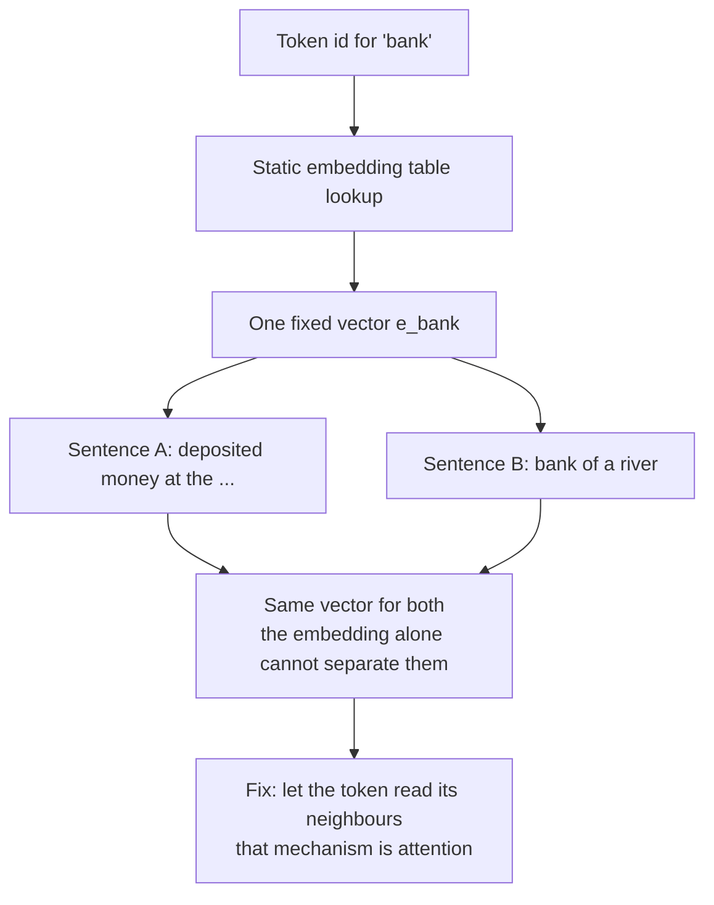
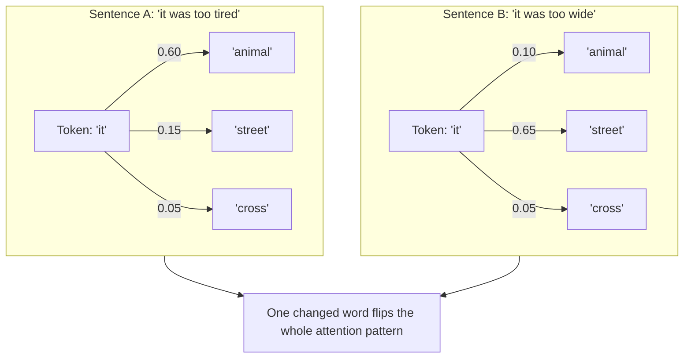
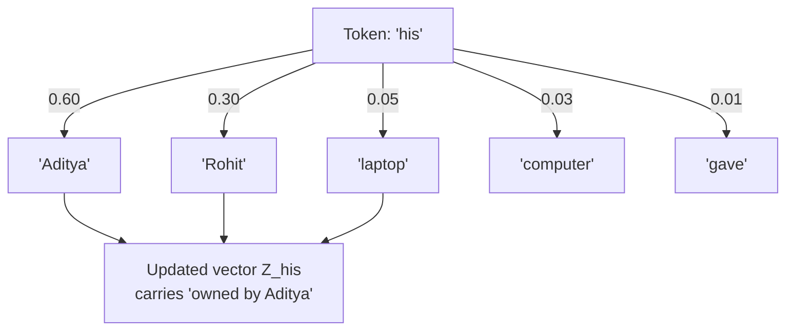
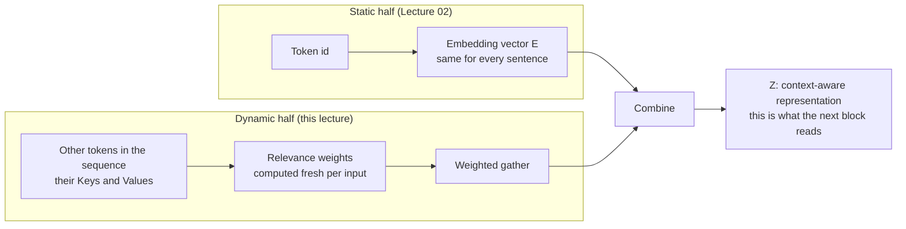
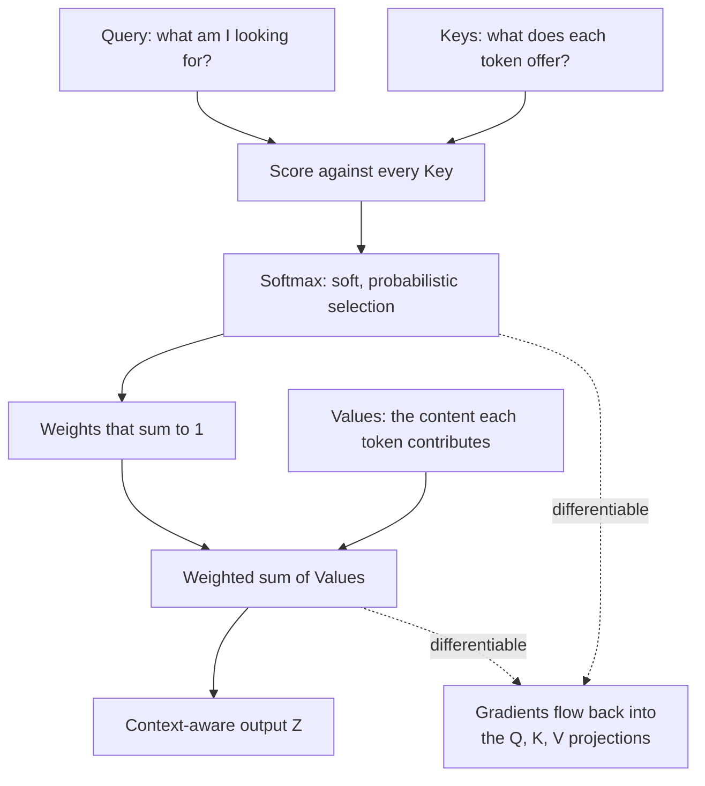
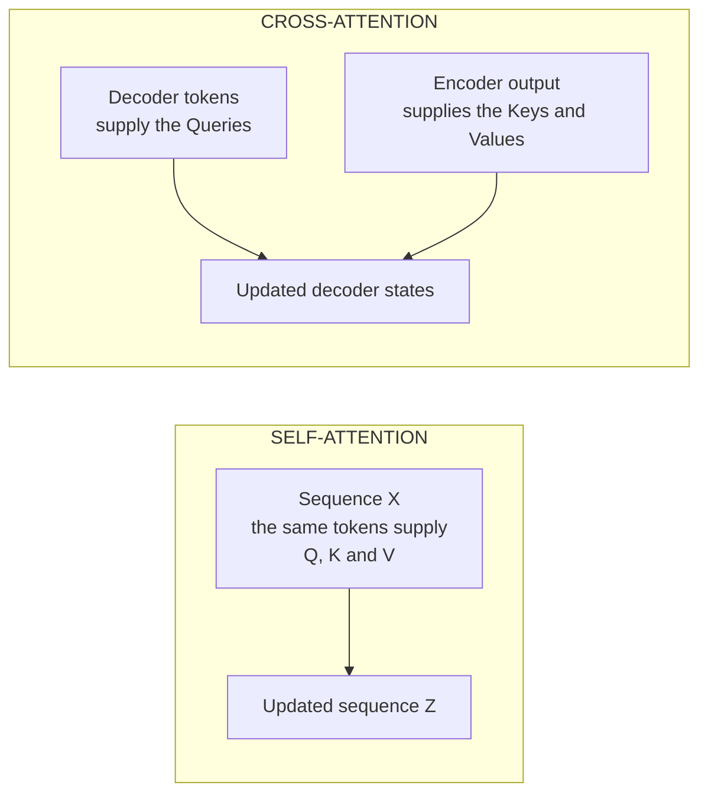
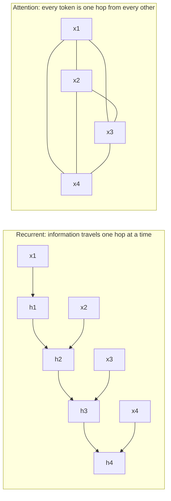
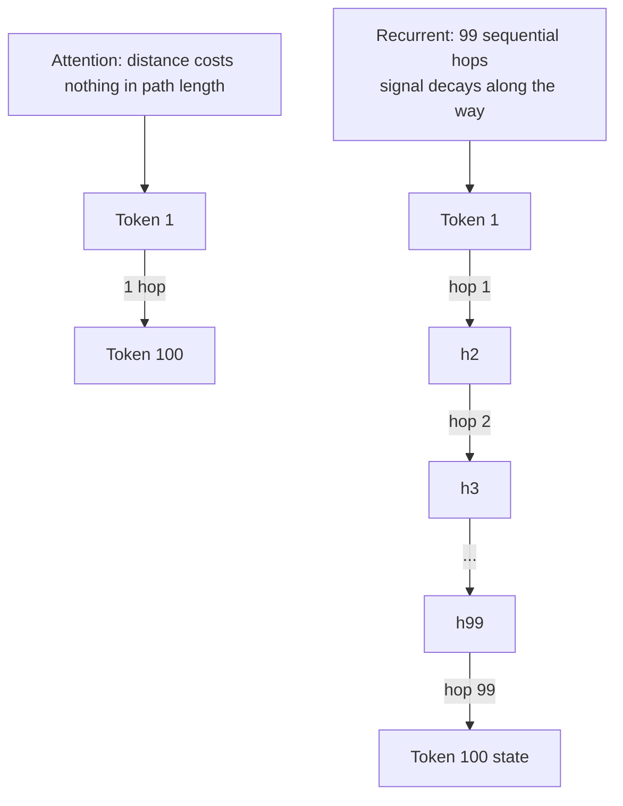
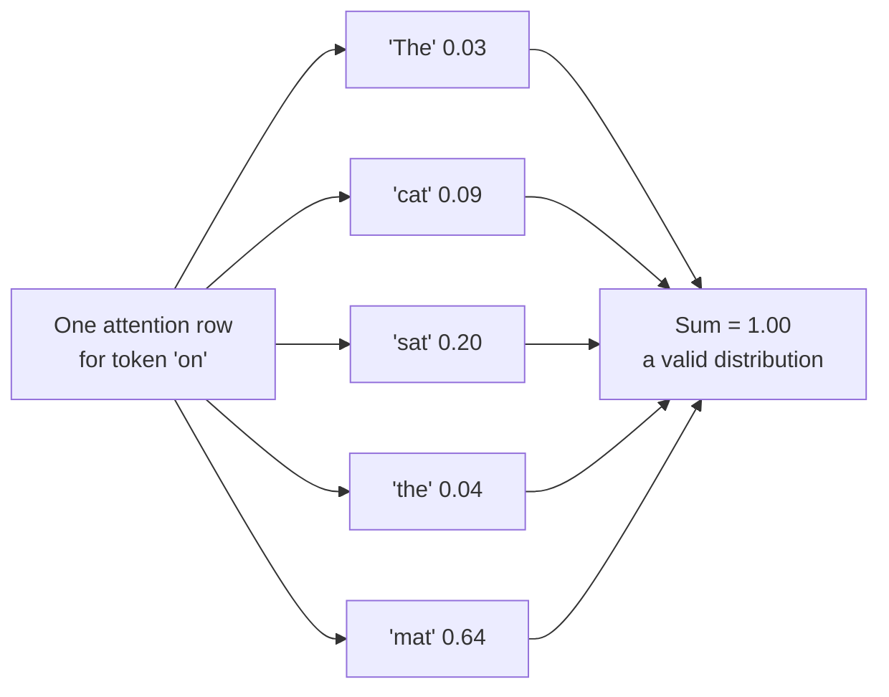

# Chapter 01 — Why Attention: From Static Vectors to Dynamic Context

> **Lecture 03 · Chapter 01 of 09** · Level: 🟢 Beginner · Phase 1 — Foundations: How LLMs Actually Work
> **Source:** `Forward-Deployed-Engineer/Lecture 02/notes/04_Self_Attention_Mechanism_and_QKV_Architecture.md`
> (§4.1–4.2, §4.7) · `gen-ai-cohort/week01/learning/day01/notes/notes.md` (Step 4 — Self-Attention ·
> single-head vs multi-head attention)
> **Roadmap topics:** **self-attention mechanism** (why it exists before *how* it works) ·
> $O(1)$ **path length vs RNN sequential decay** · dynamic (not static) representations ·
> self-attention vs cross-attention.

---

## 01.0 What this chapter is for

Lecture 02 ended with a fully built **input pipeline**: text → tokens → IDs → embedding vectors → position-aware
vectors. That pipeline is powerful, but it has a hole in it. Every token's vector is looked up from a table, so
the *same token always gets the same vector* — no matter what surrounds it.

This chapter explains the hole, and then names the machine that fills it: **self-attention**. It deliberately
stops *before* the mathematics (that is Chapter 03). The goal here is the *why*, because an engineer who knows
why attention exists can debug it; an engineer who only memorised the formula cannot.

By the end of this chapter you should be able to:

1. Explain why a **static embedding table** cannot represent context-dependent meaning, using the
   `bank`, `it was too tired / too wide` and `his` examples.
2. State the **three questions** every attention computation answers, and write the one-line summary
   $\mathbf{E}_{\text{token}} + \text{context} \rightarrow \mathbf{Z}$.
3. Explain attention as a **differentiable soft database lookup**, and why "differentiable" is the whole point.
4. Distinguish **self-attention** from **cross-attention**, and name the four attention "modes" you meet in
   real architectures (bidirectional, causal, cross, masked/padding).
5. Explain the $O(1)$ **path length** argument against RNNs — and the $O(N^2)$ price attention pays for it.
6. Explain why an attention row is a **probability distribution**, and why attention weights are *not* a
   complete explanation of the model's reasoning.
7. Say precisely what attention does **not** do (it is not a rule engine, not a fact store, and not the
   feed-forward network).

---

## 01.1 Where we are: the pipeline, and the box we are about to open

```mermaid
flowchart LR
    T["Raw text"] --> TOK["Tokenizer<br/>Lecture 02 ch 03-04"]
    TOK --> IDS["Token ids<br/>labels, not measurements"]
    IDS --> EMB["Embedding lookup<br/>W_emb: V rows by d_model columns"]
    EMB --> POS["Add positional encoding<br/>Lecture 02 ch 07"]
    POS --> X["Position-aware input X<br/>shape N by d_model"]
    X --> ATT["SELF-ATTENTION<br/>this lecture"]
    ATT --> REST["Transformer block<br/>chapters 04-06"]
    REST --> LOGITS["Logits and softmax<br/>chapter 07"]
    LOGITS --> DEC["Decoding<br/>chapter 08"]
    DEC --> NEXT["Next token"]
    NEXT -->|"append and repeat"| X
```



The box marked **self-attention** is what makes a language model a language model. Everything before it is
table lookup and arithmetic; everything after it is projection and choice.

> [!IMPORTANT]
> **The one-sentence reason attention exists.** An embedding lookup answers *"what does this token mean in
> general?"* — but language needs *"what does this token mean **here**?"* Attention converts the first answer
> into the second.

---

## 01.2 The problem: static vectors cannot be context-dependent

Recall from Lecture 02 that the embedding step is literally a table read:

$$\mathbf{E}_{t} = W_{\text{emb}}[\,\text{id}(t)\,]$$

There is no `if` statement, no neighbouring token, no sentence structure. The row for `bank` is the same row
whether the sentence is about money or about rivers. This is the **polysemy problem**, and it is the cleanest
way to see why attention is needed.

### Example A — the two banks

| Sentence | What `bank` should mean | What the static lookup gives |
| :--- | :--- | :--- |
| `"I deposited money at the bank."` | financial institution | one fixed vector |
| `"I sat on the bank of a river."` | riverside | **the same fixed vector** |



### Example B — the classic pair (from the lecture)

- `"The animal didn't cross the street because it was too tired."` → `it` = **the animal**
- `"The animal didn't cross the street because it was too wide."` → `it` = **the street**

One word changes (`tired` → `wide`) and the reference of `it` flips. Notice what this means: the *correct*
interpretation is not a property of `it` at all. It is a property of `it` **plus the rest of the sentence**.
A lookup table keyed on a single token can never express that.



### Example C — pronoun resolution with two candidates

`"Rohit gave Aditya his laptop because his computer was broken."`

To decide what each `his` refers to, the model has to weigh candidates:

| Candidate token | Weight for the first `his` | Why |
| :--- | :--- | :--- |
| `Rohit` | 30% | plausible owner |
| `gave` | 1% | a verb, not an owner |
| **`Aditya`** | **60%** | the recipient, and the second clause explains *his* broken computer |
| `laptop` | 5% | the object being owned |
| `because` | 1% | discourse marker |
| `computer` | 3% | related, but not the owner |



> [!NOTE]
> **Attention is dynamic, not rule-based.** The model does not store `"it" → animal`. It recomputes relevance
> from scratch for *every* sequence, so the same word can attend to completely different tokens in different
> sentences. That is why attention patterns are called **soft, input-dependent** weights.

### The three things attention must decide

For every token, three questions have to be answered:

1. **Which** other tokens are relevant to me?
2. **How much** weight should each of them get? (a number between 0 and 1; the weights must sum to 1)
3. **What information** should I take from each of them?

Answering (1)–(3) is exactly what the Query/Key/Value machinery of Chapter 02 does.

---

## 01.3 The shape of the fix

The fix is not to replace the embedding — it is to **add context to it**:

$$\underbrace{\mathbf{E}_{\text{bank}}}_{\text{static, from the table}} \;+\; \underbrace{\text{context gathered from other tokens}}_{\text{dynamic, computed per input}} \;\longrightarrow\; \underbrace{\mathbf{Z}_{\text{bank}}}_{\text{context-aware}}$$



Two properties matter for the rest of the lecture:

| Property | Why it matters |
| :--- | :--- |
| The output $\mathbf{Z}$ has the **same shape** as the input $\mathbf{X}$ ($N \times d_{\text{model}}$) | blocks can be stacked; nothing downstream has to change |
| The combination is a **weighted average of Value vectors** | it is linear in the values, smooth, and fully differentiable — so gradient descent can train it |

> [!TIP]
> **Why "weighted average" is a load-bearing phrase.** A weighted average can never leave the convex hull of the
> values it mixes. That is a real constraint: attention alone cannot *invent* a new direction in representation
> space. Inventing new directions is the job of the feed-forward network (Chapter 05).

---

## 01.4 Attention is a *differentiable soft database lookup*

The cleanest mental model: attention is a **search engine** running inside the model, once per token.

| Real search engine | Attention |
| :--- | :--- |
| You type a query | the current token emits a **Query** vector |
| The engine has indexed documents with titles/tags | every token emits a **Key** vector |
| Matching documents are ranked and returned | scores → weights → a weighted blend of **Value** vectors |

The two differences from a real search engine are the interesting ones:

1. **It is soft.** A real search returns whole documents (all-or-nothing). Attention returns *a little of
   everything*, in proportion to relevance. Nothing is discarded, so information is never abruptly lost.
2. **It is differentiable.** The ranking is a softmax, the retrieval is a weighted sum, and both have
   gradients. So the *"index"* (the Key and Value projections) can be **learned by backpropagation**. Nobody
   programs the rules of grammar into it.



> [!IMPORTANT]
> **Useful reframing for engineers.** Think of every token as *simultaneously* a client (it queries), an index
> entry (it is findable), and a payload (it supplies content). The three roles are three *different* learned
> projections of the same vector — which is why one token vector becomes three vectors, not one.

---

## 01.5 "Self"-attention, cross-attention, and the four attention modes

The word **self** is doing real work in the name. In **self-attention**, the Queries, Keys and Values all come
from **the same sequence**. The sequence attends to itself. There is no external memory, no separate index, no
database file.



| Mode | Where Q comes from | Where K and V come from | Used by |
| :--- | :--- | :--- | :--- |
| **Bidirectional self-attention** | the sequence | the same sequence, **all** positions | encoders (BERT), embeddings models |
| **Causal self-attention** | the sequence | the same sequence, **past and present only** | decoder-only LLMs (GPT, LLaMA, Claude, Gemini) |
| **Cross-attention** | the decoder | the encoder's output | encoder-decoder models (original Transformer, T5, Whisper) |
| **Masked / padded attention** | any of the above | same, with padding positions forced to zero weight | every batched implementation |

The last row is not a separate architecture — it is bookkeeping. When you batch sequences of different lengths,
shorter sequences are padded, and the attention must be told to **ignore the padding**. In production code the
two masks (causal and padding) are usually combined into a single additive mask.

> [!NOTE]
> **Two extra modes you will meet later in this repository.** *Multi-head* attention (Chapter 04) runs several
> of these computations in parallel and concatenates the results. *Sliding-window / local* attention (Chapter 09)
> restricts which positions a token may look at, which is how long-context models control cost.

---

## 01.6 Why not an RNN? The path-length argument

Before the Transformer (2017), sequences were processed by **recurrent** networks: a hidden state was carried
left to right, one token at a time.



Two costs of the recurrent design:

| Problem | Consequence |
| :--- | :--- |
| **Long path length** | For token 1 to influence token 100, the signal must survive ~99 sequential multiplications. Gradients shrink or explode, so long-range dependencies fade — the classic **vanishing/decaying signal** problem. |
| **No parallelism across time** | Step $t$ needs step $t-1$. Training cannot use the whole sequence at once, so GPUs sit idle on long sequences. |

Attention fixes both:

| Property | RNN | Self-attention |
| :--- | :--- | :--- |
| **Path length** between any two positions | $O(N)$ — grows with distance | $O(1)$ — one hop, regardless of distance |
| **Parallelism over the sequence** | none (sequential by construction) | full — the whole sequence is one matrix multiply |
| **Compute per layer** | $O(N \cdot d^2)$ | $O(N^2 \cdot d)$ — quadratic in sequence length |
| **Memory of the past** | compressed into one hidden state | every past token is still explicitly available |



> [!WARNING]
> **The trade is not free.** $O(1)$ path length is bought with $O(N^2)$ compute and memory in the attention
> matrix. That single fact explains most of the engineering in later lectures: the KV cache, paged attention,
> sliding-window attention, FlashAttention-style kernels, and why long context costs more money. See
> **Lecture 25 — vLLM and PagedAttention**.

### Path length is not the only thing you need

Attention gives *access*; it does not give *reasoning*. That is why a Transformer block is attention **plus**
a feed-forward network, residual connections and normalisation (Chapter 05), repeated many times. Attention
moves information between positions; the rest of the block processes it.

---

## 01.7 An attention row is a probability distribution

The weights in the diagrams above are not arbitrary numbers: each row is produced by a **softmax**, so it is a
valid probability distribution.

| Property | Value | Consequence |
| :--- | :--- | :--- |
| Range | each weight in $(0, 1)$ | soft selection, never all-or-nothing |
| Sum per row | exactly $1.0$ | the output $\mathbf{Z}_i$ is a **weighted average**, so it stays on the same scale as the values |
| Number of entries | $N$ (one per position, including the token itself) | cost grows with the square of sequence length |
| Gradient | smooth everywhere | trainable end to end |



> [!CAUTION]
> **Attention weights are not an explanation.** It is tempting to treat a strong weight as "the reason the model
> said this". In practice the same behaviour can be produced by many different attention patterns, and
> information also flows through residual connections and the feed-forward network without touching the
> attention matrix at all. Use attention maps as a **debugging clue**, never as proof of causality.

---

## 01.8 What attention does **not** do

Setting expectations early saves a lot of confusion later in the repository.

| Common belief | Reality |
| :--- | :--- |
| "Attention looks up facts." | Facts are not stored in attention. Attention only *moves* information between positions; knowledge lives in the weights of the projections and the FFN. |
| "Attention is the Transformer." | Attention is **one sub-layer** of a block. A block also has LayerNorm, a residual connection and an FFN (Chapter 05). |
| "Attention knows word order." | Attention is permutation-invariant by itself. Order is injected by positional encodings (Chapter 09). |
| "Attention is cheap because it is just a dot product." | It is a dot product for *every pair* of tokens: $O(N^2)$ per head, per layer. |
| "More attention heads = more intelligence." | Heads can be redundant; many are prunable. Head count is a capacity/cost trade, not a quality dial (Chapter 04). |
| "The attention pattern is the model's plan." | It is one of many internal signals, and it is not causal evidence (see the warning above). |

---

## 01.9 The shape of attention as pseudo-code

No implementation yet — just the *interface*, so the vocabulary of Chapters 02–03 has somewhere to land.

```ts
// PSEUDO-CODE — the contract of self-attention, not an implementation.
type Matrix = number[][];          // rows = positions, columns = features

function selfAttention(X: Matrix /* N x d_model */): Matrix /* N x d_model */ {
  // 1. Every token proposes three things: what it looks for, what it offers,
  //    and what it would contribute. (Chapter 02)
  const Q = project(X, "query");
  const K = project(X, "key");
  const V = project(X, "value");

  // 2. Relevance = how well each query matches each key. (Chapter 03)
  const scores = similarity(Q, K);          // shape N x N

  // 3. Turn relevance into a probability distribution, so the result is a
  //    weighted average and stays on the same scale as V.
  const weights = softmaxRows(scores);      // each row sums to 1

  // 4. Each token gathers a blend of everybody's value, weighted by relevance.
  return mix(weights, V);                   // shape N x d_model
}

// Key property: input shape equals output shape, so this can be repeated L times.
// Key cost:    the N x N score matrix is why long sequences are expensive.
```

Three details are deliberately missing here, because they are the whole subject of Chapter 03: the **scaling
factor**, the **mask** that hides future tokens, and **numerical stability**. In a real implementation all
three are mandatory.

---

## Common mistakes

- **Thinking attention is optional decoration.** Without attention, the model can only ever see isolated token
  vectors plus their positions. Attention is the *only* mechanism that mixes information across positions in a
  decoder-only LLM.
- **Saying "the embedding knows the context".** It does not. The embedding is static; the *output* of attention
  is the context-aware representation.
- **Assuming attention is hard retrieval.** It is soft: every token always contributes something, just with a
  small weight. This is why a bad token in the context *degrades* rather than *breaks* an answer — and why
  prompt injection is possible at all.
- **Confusing self-attention with cross-attention.** Self = one sequence supplying Q, K and V. Cross = the
  decoder queries an *encoder's* output.
- **Treating the $N \times N$ matrix as free.** Quadratic cost is the reason KV caches, sliding windows and
  paged attention exist. Every "just send the whole document" decision pays for it.
- **Reading attention weights as an explanation.** See the warning in §01.7.
- **Believing the $O(1)$ path-length story means attention has no long-range problems.** It has *access* to
  every position, but quality still degrades with distance and with where evidence sits in the context
  ("lost in the middle").
- **Assuming every model uses bidirectional attention.** GPT-style models are **causal**: a token cannot see the
  future. Training a causal model on a bidirectional objective (or vice versa) produces a model that behaves
  nothing like the one you evaluated.

## Key takeaways

1. **Static embeddings cannot be context-dependent.** `bank`, `it`, `his` all demonstrate that meaning is a
   property of the token *plus its neighbourhood*.
2. Attention answers three questions per token: **which** tokens matter, **how much**, and **what content** to
   take from them.
3. The output is $\mathbf{E}_{\text{token}} + \text{context} \rightarrow \mathbf{Z}$ — same shape as the input,
   so it can be stacked.
4. Attention is a **soft, differentiable database lookup**: Query = what I want, Key = what I am indexed as,
   Value = what I contribute. Soft and differentiable are exactly why it can be **learned**.
5. **Self**-attention means the sequence attends to itself; **cross**-attention queries another sequence
   (an encoder's output).
6. Four modes you meet in practice: bidirectional, causal, cross, and masked/padded.
7. The winning argument against RNNs is **path length**: $O(1)$ versus $O(N)$, plus full parallelism over the
   sequence. The price is $O(N^2)$ attention cost — the root cause of most inference engineering.
8. An attention row is a **probability distribution** (weights in $(0,1)$, sum $=1$), which makes the output a
   weighted average — and that means attention alone cannot create new directions in representation space.
9. Attention weights are a **debugging clue, not an explanation**.
10. Attention does not store facts, does not know word order, and is not the whole Transformer.

## Self-check questions

1. Why is the vector for `bank` identical in `"deposited money at the bank"` and `"sat on the bank of a river"`,
   and what exactly changes after attention runs?
2. Name the three questions attention answers for each token.
3. Give the one-line formula summarising what attention does to a token's representation.
4. Explain why "differentiable" matters for a soft database lookup. What would break if the selection were hard?
5. State the difference between self-attention and cross-attention, and name a model family that uses each.
6. Which four attention modes exist in practice, and which one does GPT use?
7. Explain the path-length argument with the numbers 1 and 100, then say what cost attention pays instead.
8. Why must the weights in an attention row sum to 1? Give two consequences.
9. A colleague shows you a heat map and says "the model looked at *mat*, so that is why it answered this way".
   What is wrong with that claim?
10. Which part of a Transformer block is responsible for *inventing* new feature directions, and why can
    attention not do it?

---

### Navigation

- **Previous:** [Lecture 02 — Chapter 08: Context Windows, Training vs Inference & the Complete Pipeline](../Lecture%2002%20-%20LLM%20Foundations/notes/08_Context_Windows_Training_vs_Inference_and_the_Complete_Pipeline.md)
- **Next:** [Chapter 02 — Queries, Keys & Values: The Attention Search Engine](./02_Queries_Keys_Values_The_Attention_Search_Engine.md)
- **Source:** `Forward-Deployed-Engineer/Lecture 02/notes/04_Self_Attention_Mechanism_and_QKV_Architecture.md`
  (§4.1–4.2, §4.7) · `gen-ai-cohort/week01/learning/day01/notes/notes.md` (Step 4 — Self-Attention)
- **Back to index:** [../index.md](../index.md)


