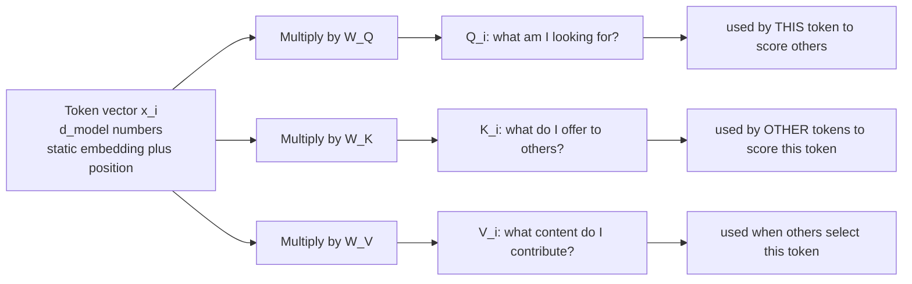
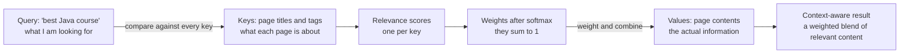
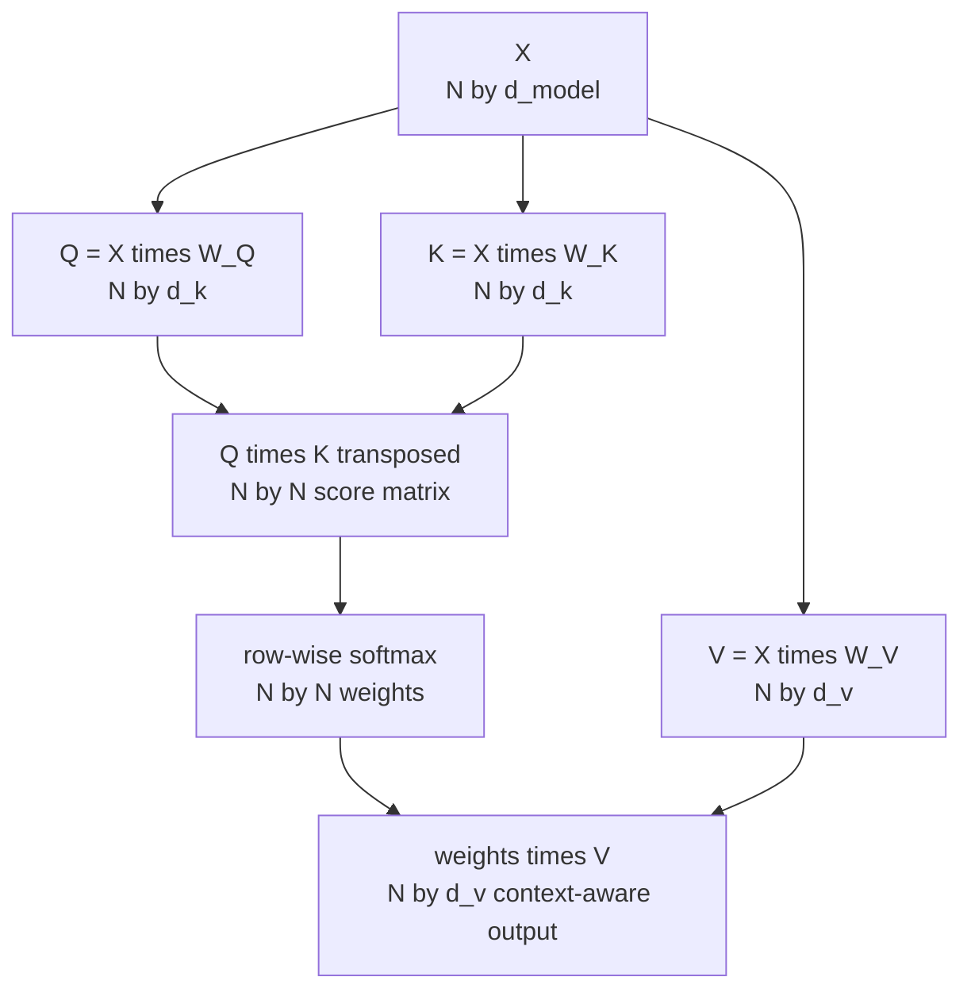
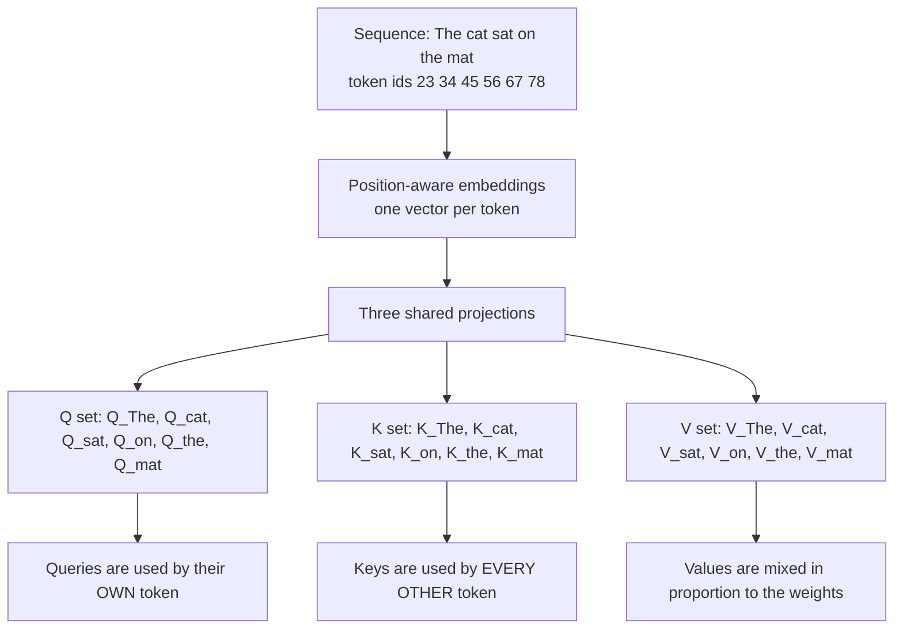
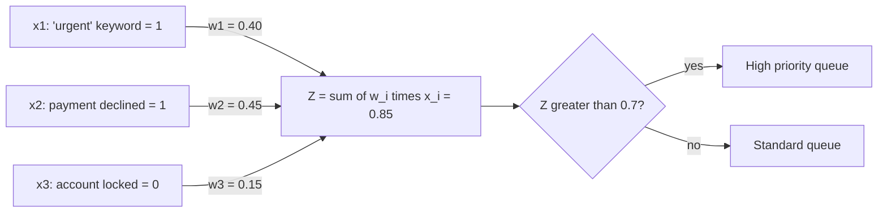
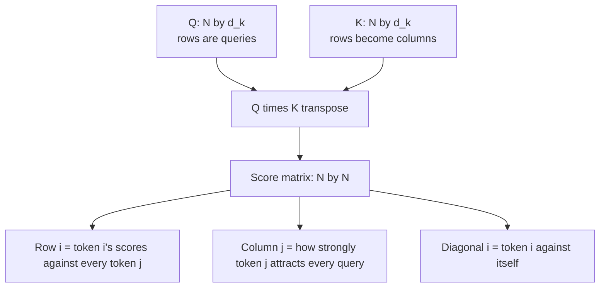
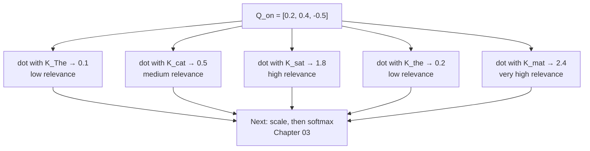
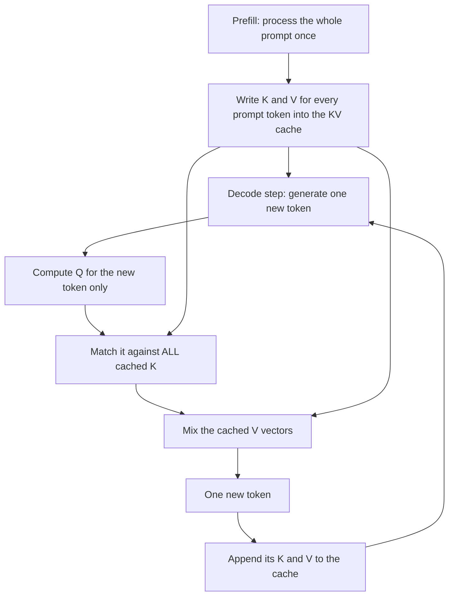

# Chapter 02 — Queries, Keys & Values: The Attention Search Engine

> **Lecture 03 · Chapter 02 of 09** · Level: 🟢 Beginner · Phase 1 — Foundations: How LLMs Actually Work
> **Source:** `Forward-Deployed-Engineer/Lecture 02/notes/04_Self_Attention_Mechanism_and_QKV_Architecture.md`
> (§4.3–4.5, §4.8) · `Excalidraw-Notes.svg` (QKV → Query, Key, Value · `Q(on)`, `K[0.3, 0.7, 0.9]`,
> `V[-0.9, 0.99, -0.6]` · `Z = x1w1 + x2w2 + x3w3`) ·
> `gen-ai-cohort/week01/learning/day01/notes/notes.md` (Step 4 — Self-Attention)
> **Roadmap topics:** **self-attention mechanism: the Q, K, V architecture** · learned linear projections ·
> every token is simultaneously a querier, an index entry and a payload.

---

## 02.0 What this chapter is for

Chapter 01 established *why* attention exists. This chapter builds the machinery that makes it work: the three
**learned linear projections** — Query, Key and Value — that turn one token vector into three vectors with three
different jobs.

By the end of this chapter you should be able to:

1. Explain why each token needs **three** vectors rather than one, using the search-engine and
   multi-faceted-person analogies.
2. Write the projection equations $Q = XW_Q$, $K = XW_K$, $V = XW_V$ and give the **shape** of every matrix.
3. Compute the **parameter cost** of the projections for a real model size.
4. Trace, for the sentence `"The cat sat on the mat"`, which Q/K/V vectors exist and how they are shared.
5. Explain the **weighted-sum** view $Z_i = \sum_j w_{ij} V_j$, and recognise the same arithmetic in a
   non-LLM example (the e-commerce urgency score).
6. Describe the $N \times N$ **score matrix** $QK^T$: what a row is, what a column is, and what the diagonal is.
7. Explain why $W_Q$ and $W_K$ must be **different** matrices.
8. Explain why production inference caches **K and V but not Q**.

---

## 02.1 One token vector, three projections

Each token arrives as one position-aware vector $\mathbf{x}_i \in \mathbb{R}^{d_{\text{model}}}$. Attention
turns it into three vectors by multiplying it with three **different learned weight matrices**:

$$Q_i = \mathbf{x}_i W_Q, \qquad K_i = \mathbf{x}_i W_K, \qquad V_i = \mathbf{x}_i W_V$$

where $W_Q, W_K, W_V \in \mathbb{R}^{d_{\text{model}} \times d_k}$ and $d_k$ (the per-head projection width)
is usually $d_{\text{model}} / h$.



> [!IMPORTANT]
> **Why not reuse the same vector for all three roles?** Because the three roles need different geometry.
> "What I am looking for" (a question), "what I am about" (a label) and "what I will hand over" (a payload)
> are genuinely different things. One vector forced to serve all three would have to compromise; three
> projections let the model learn three independent views of the same token.

The three roles are **not** stored in three separate places. The token's *identity* lives in $\mathbf{x}_i$; the
three projections are just three ways of reading it. That is why a single token can be an expert on one subject
(as a Key) while asking about a completely different subject (as a Query).

---

## 02.2 The search-engine analogy (from the lecture)

You type `"best Java programming course"` into a search engine. Compare the pieces:

| Component | Search engine | Self-attention |
| :--- | :--- | :--- |
| **Query (Q)** | your typed search string | "What information am I looking for?" |
| **Key (K)** | page titles, tags and metadata the engine indexed | "What kind of information do I contain?" |
| **Value (V)** | the actual page content returned on a match | "Here is the information I can contribute" |

The engine compares the Query against every Key, produces a relevance ranking, and returns the **Values** of the
best matches — blended, in attention's case.



### The multi-faceted person analogy (from the lecture)

Take a person — say **Aditya** — and ask three different questions about him:

| Question | The "Key" aspect that matches |
| :--- | :--- |
| "Who knows Java?" | technical skills: Java, FDE, CS fundamentals |
| "Who lives closest?" | location: Delhi, remote worker |
| "Who should teach this?" | communication skills + knowledge + availability |

Aditya is one person. Different questions extract different *facets* of him. Q, K and V are how a Transformer
gets the same flexibility: each token can be **asked about** differently (K), **ask** differently (Q), and
**contribute** differently (V).

---

## 02.3 The projections, their shapes and their cost

Because the projection is shared by every token, it is a **matrix multiply over the whole sequence**:

$$Q = XW_Q, \qquad K = XW_K, \qquad V = XW_V$$

| Symbol | Shape | Meaning |
| :--- | :--- | :--- |
| $X$ | $N \times d_{\text{model}}$ | all $N$ tokens of the sequence |
| $W_Q, W_K, W_V$ | $d_{\text{model}} \times d_k$ | the three learned projection matrices (shared across positions) |
| $Q, K$ | $N \times d_k$ | one query and one key per token |
| $V$ | $N \times d_v$ | one value per token (usually $d_v = d_k$) |



### Parameter cost — worked example

| Model scale | $d_{\text{model}}$ | $h$ heads | $d_k = d_{\text{model}}/h$ | Parameters in $W_Q + W_K + W_V$ |
| :--- | :--- | :--- | :--- | :--- |
| GPT-2 small | 768 | 12 | 64 | $3 \times 768 \times 768 = 1{,}769{,}472$ |
| LLaMA-3 8B | 4096 | 32 | 128 | $3 \times 4096 \times 4096 = 50{,}331{,}648$ |
| GPT-3 | 12,288 | 96 | 128 | $3 \times 12{,}288 \times 12{,}288 \approx 453\text{M}$ |

Notice the shape of the arithmetic: the projection cost depends on $d_{\text{model}}^2$, **not** on sequence
length. Sequence length only affects the $N \times N$ part. That separation is worth remembering: *the weights
are a fixed cost, the attention matrix is a per-request cost.*

> [!NOTE]
> **Two production details that appear in real implementations.** (1) The three projections are usually stored
> as **one fused matrix** of shape $d_{\text{model}} \times 3d_{\text{model}}$ and sliced after the multiply,
> because one big matrix multiply is faster than three small ones. (2) A **bias vector** is sometimes added to
> each projection; most modern LLMs drop it (bias-free) because LayerNorm makes it redundant.

---

## 02.4 Every token produces its own Q, K and V

For the sentence `"The cat sat on the mat"` with token ids `[23, 34, 45, 56, 67, 78]`, after position-aware
embedding every token has its own three vectors:

```text
Token "The":  Q_The,  K_The,  V_The
Token "cat":  Q_cat,  K_cat,  V_cat
Token "sat":  Q_sat,  K_sat,  V_sat
Token "on":   Q_on,   K_on,   V_on
Token "the":  Q_the,  K_the,  V_the
Token "mat":  Q_mat,  K_mat,  V_mat
```

The lecture's hand-drawn trace for the token `"on"` (a 3-dimensional toy example):

```text
"on" at position 56 produces:
  Q_on = [ 0.2,  0.4, -0.5]     what "on" is looking for: an object to attach to
  K_on = [ 0.3,  0.7,  0.9]     how "on" is findable by others
  V_on = [-0.9,  0.99, -0.6]    what "on" will contribute when selected
```



> [!TIP]
> **The asymmetry to internalise.** A token's **Query** is used once — by itself, against everybody. A token's
> **Key and Value** are used $N$ times — by every token in the sequence. This asymmetry is the reason inference
> engines cache **K and V** and recompute nothing else (see §02.8).

### The "why 3 vectors" question, answered concretely

For the token `"on"`, the Query needs to express *"I am a preposition looking for the thing I attach to"*. The
Key of `"mat"` needs to express *"I am a concrete object and a plausible attachment point"*. The Value of
`"mat"` needs to carry *"I am a physical surface in the scene"*. Those are three different questions about the
same token, so they need three different projections.

---

## 02.5 The weighted-sum view — and the same arithmetic outside LLMs

Once the weights are known, the output for token $i$ is a **weighted sum of every Value vector**:

$$Z_i = \sum_{j=1}^{N} w_{ij} V_j, \qquad \sum_{j=1}^{N} w_{ij} = 1$$

That is the entire second half of attention. Everything else (Chapters 02–03) exists only to *produce* the
weights $w_{ij}$.

### The grounded industry example (from the lecture)

The lecture makes the point that this weighted sum is not exotic mathematics — it is the same operation you
would write by hand for a business rule. Consider an e-commerce support system deciding whether a ticket is
urgent:

| Feature | Input value | Learned weight | Contribution |
| :--- | :--- | :--- | :--- |
| $x_1$: query contains "urgent" | 1 (true) | $w_1 = 0.40$ | 0.40 |
| $x_2$: payment was declined | 1 (true) | $w_2 = 0.45$ | 0.45 |
| $x_3$: account is locked | 0 (false) | $w_3 = 0.15$ | 0.00 |

$$Z = w_1 x_1 + w_2 x_2 + w_3 x_3 = 0.40 + 0.45 + 0.00 = 0.85 \quad (\text{high urgency})$$



Now read that side by side with attention:

| Business rule | Self-attention |
| :--- | :--- |
| 3 features | up to $N$ positions |
| hand-tuned weights $w_1, w_2, w_3$ | weights **computed from Q and K**, fresh per input |
| the "values" are the feature values | the values are the $V_j$ vectors |
| a scalar score | a $d_v$-dimensional vector |
| threshold + rule | softmax makes it a distribution, so the result is a blend |

> [!TIP]
> **This is the single most useful sentence in the chapter.** Attention is a *learned, input-dependent weighted
> sum*. If you can write a weighted average in code, you already understand the second half of attention.

---

## 02.6 The score matrix $QK^T$: an $N \times N$ table of relationships

Multiplying $Q$ ($N \times d_k$) by $K^T$ ($d_k \times N$) gives an $N \times N$ matrix of raw relevance scores.
One entry per **ordered pair** of positions.



| Part of the matrix | Meaning | Engineering relevance |
| :--- | :--- | :--- |
| Row $i$ | the $N$ raw scores for token $i$'s query | after softmax, this row *is* token $i$'s attention distribution |
| Column $j$ | how attractive token $j$'s key is, across all queries | a "hub" token has a high column — it is read by many tokens |
| Diagonal $(i,i)$ | token $i$ against itself | usually strong; this is how information is preserved |
| Upper triangle (causal models) | **forbidden** — future positions | masked to zero weight (Chapter 03) |

For the toy trace of `"on"` in `"The cat sat on the mat"`, one **row** of this matrix (before softmax) is:

```text
Q_on · K_The  → 0.1     (low)
Q_on · K_cat  → 0.5     (medium — the subject)
Q_on · K_sat  → 1.8     (high — "sat ... on" is a strong pattern)
Q_on · K_the  → 0.2     (low — a filler word)
Q_on · K_mat  → 2.4     (very high — the object of "on")
```



> [!NOTE]
> **Reading the score matrix is a real debugging skill.** Because each row is a distribution over positions,
> plotting a few rows shows you *what a token is paying attention to*. Row-level inspection is how people find
> "attention sinks" (a token that absorbs attention mass for no semantic reason) and how they confirm that a
> retrieval chunk is actually being read.

---

## 02.7 Why $W_Q$ and $W_K$ must be different matrices

It is tempting to think one matrix would do — after all, both $Q$ and $K$ come from the same token vector. But
the score is a **dot product**, and dot products are **symmetric**:

$$Q_i \cdot K_j = K_i \cdot Q_j$$

If you used the same projection for both ($W_Q = W_K$), then the score of "token $i$ looks at token $j$" would
always equal "token $j$ looks at token $i$", and the score matrix would be **symmetric**. That destroys
directionality: `"on"` looking for a surface and `"mat"` offering one would be forced to agree about relevance.

| Choice | Score matrix | Consequence |
| :--- | :--- | :--- |
| $W_Q = W_K$ | symmetric | cannot express one-way relationships; effectively a similarity matrix |
| $W_Q \neq W_K$ (what every real model does) | asymmetric | directed relationships: "A needs B" ≠ "B needs A" |
| $W_V$ different again | — | what a token *offers* is decoupled from how it is *found* |

> [!IMPORTANT]
> **The general principle.** Attention has three *independent* learned views of the same token because the
> questions asked of it are independent: how it searches, how it is found, and what it hands over. Any two of
> those being tied together is a loss of expressiveness, and the model pays for it with accuracy.

---

## 02.8 Q, K and V in production: the KV cache

Chapter 01 warned that attention costs $O(N^2)$. Chapter 09 and Lecture 25 deal with that in depth, but one
consequence follows *directly* from the Q/K/V asymmetry and belongs here.

During generation the model produces one token at a time. For the new token you only need **its** query, but you
need the keys and values of **every** previous token. So an inference engine stores them:



| Object | Cached? | Why |
| :--- | :--- | :--- |
| **Q** | ❌ no | a query is used once, by its own token, and never again |
| **K** | ✅ yes | every future token must be able to match against it |
| **V** | ✅ yes | every future token may need to read it |
| Position-aware input vectors $\mathbf{x}_i$ | usually no | their information is already baked into the cached K and V |

> [!WARNING]
> **The KV cache is why long context is expensive in a way prompt tokens are not.** Cache size grows linearly
> with context length **and** with the number of concurrent requests, and it is a large, fragmented allocation.
> That memory pressure — not the FLOPs — is what PagedAttention and vLLM were built to fix (Lecture 25). It is
> also why "cache-friendly" prompt layouts (stable prefix first) reduce cost in providers that support
> prompt caching.

---

## 02.9 Pseudo-code: producing Q, K and V

```ts
// PSEUDO-CODE — the projection stage only. Attention itself is Chapter 03.
type Matrix = number[][];                    // rows = positions, cols = features

interface AttentionWeights {
  wq: Matrix;   // d_model x d_k, learned
  wk: Matrix;   // d_model x d_k, learned
  wv: Matrix;   // d_model x d_v, learned
}

function projectTokens(X: Matrix, w: AttentionWeights): { Q: Matrix; K: Matrix; V: Matrix } {
  // One matrix multiply per role, applied to EVERY position at once.
  // The same W_Q / W_K / W_V is reused for all tokens — that is what makes it "self"-attention
  // rather than a per-token custom rule.
  return {
    Q: matmul(X, w.wq),   // N x d_k : "what am I looking for"
    K: matmul(X, w.wk),   // N x d_k : "what am I findable as"
    V: matmul(X, w.wv),   // N x d_v : "what do I contribute"
  };
}

// Production note: real kernels fuse these three multiplies into one GEMM of shape
// d_model x (3 * d_model), then slice — fewer kernel launches, better GPU utilisation.
```

> [!TIP]
> **How to remember the division of labour in the whole attention block.**
> *Projections* (this chapter) create the three views. *Scoring + softmax + mixing* (Chapter 03) turns the views
> into a context-aware output. *Multi-head splitting* (Chapter 04) runs several such view-sets in parallel.

---

## Common mistakes

- **Thinking Q, K and V are three different tokens.** They are three **projections of the same token vector**.
  A token is not "the query token" or "the value token" — it plays all three roles at once.
- **Assuming $W_Q$, $W_K$, $W_V$ differ per token.** They are shared across the whole sequence and across the
  whole batch. Only the input vectors differ.
- **Believing the projections are hand-designed.** They are randomly initialised and learned by gradient
  descent. Nobody writes "verbs look at objects".
- **Confusing "the Key" with "the content".** The Key decides *how findable* a token is; the Value decides
  *what it hands over*. They are decoupled on purpose.
- **Using $W_Q = W_K$ "for simplicity".** You get a symmetric score matrix and lose directed relationships
  (§02.7).
- **Forgetting the shapes.** Getting $N \times d_k$ and $d_k \times N$ the wrong way round is the most common
  shape bug in attention code; the result is a $d_k \times d_k$ matrix that looks plausible and is meaningless.
- **Caching the wrong things.** Production caches **K and V**, never Q, and the cache is per layer, not global.
- **Assuming more projections means more parameters than the FFN.** Attention projections are usually *smaller*
  than the FFN, which holds about two-thirds of the parameters (Chapter 05).

## Key takeaways

1. Each token produces **three vectors** from **three learned projections**:
   $Q = XW_Q$ (what I look for), $K = XW_K$ (what I am findable as), $V = XW_V$ (what I contribute).
2. The projections are **shared across all positions** — that is what makes the operation *self*-attention.
3. The Query is consumed by its **own** token; Keys and Values are consumed by **every** token. That asymmetry
   is the reason the **KV cache** exists.
4. Attention's output is a **weighted sum of Value vectors**, $Z_i = \sum_j w_{ij}V_j$, with $\sum_j w_{ij} = 1$.
5. The same arithmetic is a plain weighted average in ordinary code — the e-commerce urgency score is the same
   $Z = \sum w_i x_i$ you would write by hand. Only the *weights* are novel: they are computed from Q and K.
6. $QK^T$ is an $N \times N$ matrix of **ordered pair** scores: a row is one token's query distribution (before
   softmax), a column shows which keys attract everyone.
7. $W_Q \neq W_K$ is required, because dot products are symmetric and directionality must be preserved.
8. Projection parameters scale as $3 \cdot d_{\text{model}}^2$ — a **fixed** cost, independent of context
   length. The per-request cost is in the $N \times N$ matrix.
9. Real kernels **fuse** the three projections into one matrix multiply.
10. Everything in this chapter produces the *inputs* to attention. Chapter 03 turns them into the output.

## Self-check questions

1. Write the three projection equations and give the shape of $X$, $W_Q$ and $Q$.
2. Why does each token need three projections rather than one? Use the search-engine analogy in your answer.
3. Which of Q, K and V is used by the token itself, and which are used by all other tokens? What production
   consequence follows?
4. Compute the parameter count of $W_Q + W_K + W_V$ for $d_{\text{model}} = 4096$. Does it depend on sequence
   length?
5. Write the weighted-sum formula for attention output and state the constraint on the weights.
6. Redraw the e-commerce urgency calculation and map each element to its attention equivalent.
7. What are the dimensions of $QK^T$? What does row $i$ mean, and what does column $j$ mean?
8. For `"The cat sat on the mat"`, `Q_on · K_mat` is the largest score in that row. Explain in one sentence why
   that is intuitively sensible.
9. Why would setting $W_Q = W_K$ break directed relationships?
10. Why is Q not cached during inference? What exactly is stored in the KV cache?

---

### Navigation

- **Previous:** [Chapter 01 — Why Attention: From Static Vectors to Dynamic Context](./01_Why_Attention_From_Static_Vectors_to_Dynamic_Context.md)
- **Next:** [Chapter 03 — Scaled Dot-Product Attention, By Hand](./03_Scaled_Dot_Product_Attention_by_Hand.md)
- **Source:** `Forward-Deployed-Engineer/Lecture 02/notes/04_Self_Attention_Mechanism_and_QKV_Architecture.md`
  (§4.3–4.5, §4.8) · `Excalidraw-Notes.svg` · `gen-ai-cohort/week01/learning/day01/notes/notes.md`
- **Back to index:** [../index.md](../index.md)


