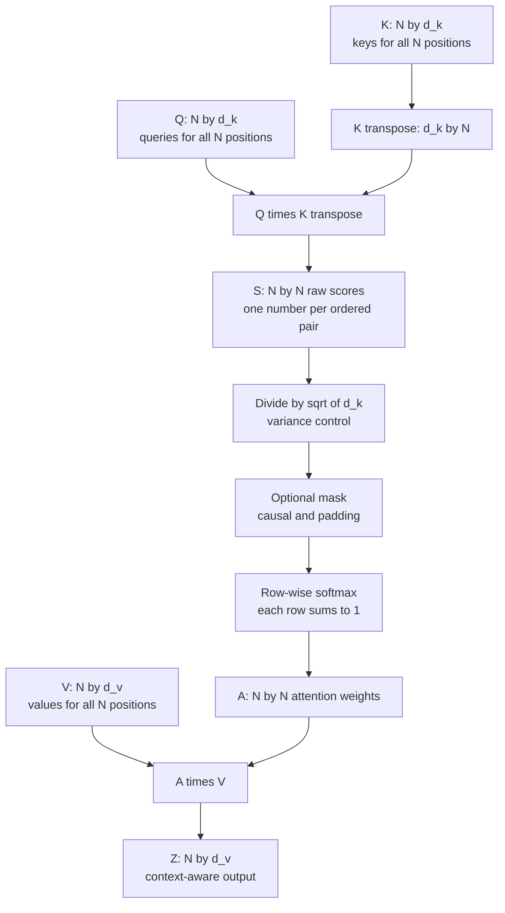
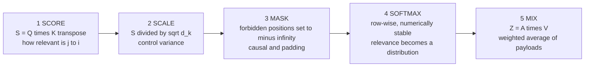
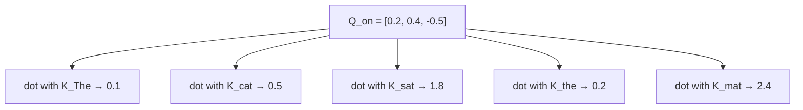
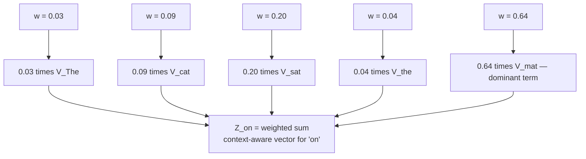
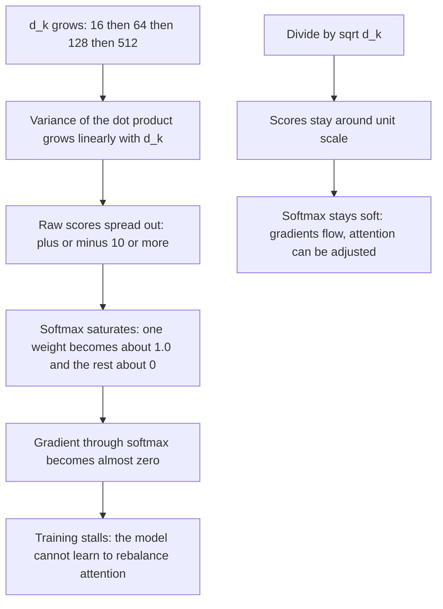
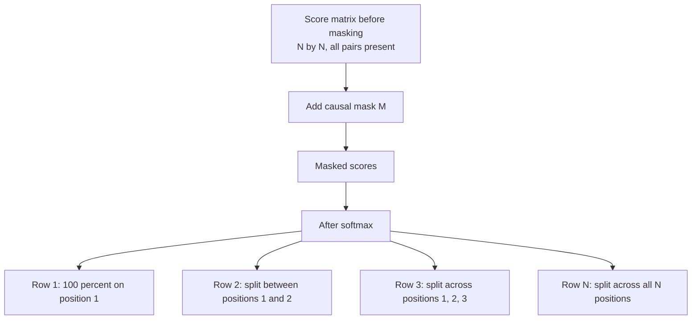
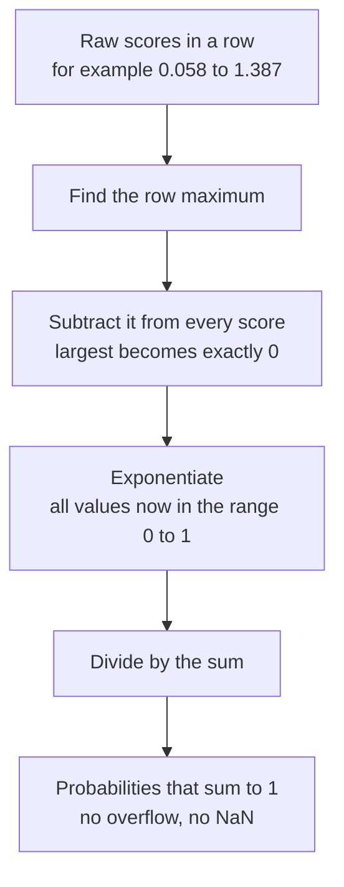
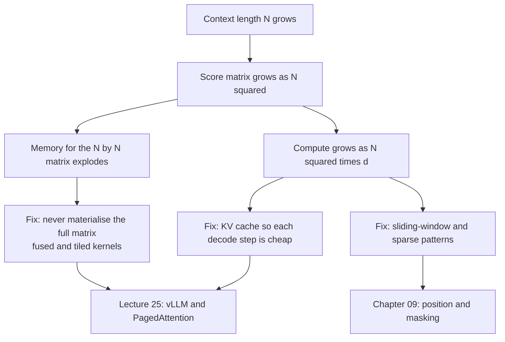

# Chapter 03 — Scaled Dot-Product Attention, By Hand

> **Lecture 03 · Chapter 03 of 09** · Level: 🟢 Beginner · Phase 1 — Foundations: How LLMs Actually Work
> **Source:** `Forward-Deployed-Engineer/Lecture 02/notes/04_Self_Attention_Mechanism_and_QKV_Architecture.md`
> (§4.5–4.6, §4.9) · `Excalidraw-Notes.svg` (the `"on"` trace · `Z = (w1 * value(The)) + (w2 * value(cat)) +
> (w3 * value(mat))` · `[23, 34, 56]` triangular masking) ·
> `gen-ai-cohort/week01/learning/day01/notes/notes.md` (Step 4 — Self-Attention)
> **Roadmap topics:** **scaled dot-product attention** $\text{softmax}\!\left(\frac{QK^T}{\sqrt{d_k}}\right)V$ —
> and *why* $\frac{1}{\sqrt{d_k}}$ · causal masking · quadratic cost.

---

## 03.0 What this chapter is for

Chapter 02 built Q, K and V. This chapter assembles them into the single formula that runs modern language
models, walks it through a **hand-computed example**, and explains the two pieces of arithmetic that beginners
skip and production engineers cannot: the **scaling factor** and the **mask**.

By the end of this chapter you should be able to:

1. Write the scaled dot-product attention formula and give the shape of every intermediate.
2. Execute the five steps — score, scale, mask, softmax, mix — by hand on a small example.
3. Reproduce the lecture's `"on"` trace, including the scaled scores and the resulting weights.
4. Derive **why** the dot products are divided by $\sqrt{d_k}$, and explain what breaks without it.
5. Explain the **causal mask**, how it is implemented, and what happens if you forget it.
6. Explain why the softmax is computed with the **row maximum subtracted**, and what breaks without it.
7. State the **time and memory cost** of attention and identify which term grows with context length.

---

## 03.1 The formula, symbol by symbol

$$\text{Attention}(Q, K, V) = \text{softmax}\!\left(\frac{QK^{T}}{\sqrt{d_k}}\right)V$$



| Symbol | Shape | What it is | Intuition |
| :--- | :--- | :--- | :--- |
| $Q$ | $N \times d_k$ | query matrix | $N$ questions |
| $K$ | $N \times d_k$ | key matrix | $N$ index cards |
| $QK^{T}$ | $N \times N$ | raw score matrix | every question against every index card |
| $\sqrt{d_k}$ | scalar | the scaling factor | keeps scores in a trainable range |
| $\text{softmax}(\cdot)$ | $N \times N$ | applied **row-wise** | each question's relevance becomes a distribution |
| $V$ | $N \times d_v$ | value matrix | $N$ payloads |
| $Z$ | $N \times d_v$ | output | each position's context-aware vector |

> [!IMPORTANT]
> **Two words carry the whole formula.** *Scaled* refers to dividing by $\sqrt{d_k}$ (§03.4). *Dot-product*
> refers to using a dot product as the relevance measure. Change either one and you have a different
> architecture — which is why the paper is called *"Attention Is All You Need"* and not *"Softmax Is All You
> Need"*.

---

## 03.2 The five steps, in order

Every attention implementation — hand-written, framework-level, or a fused GPU kernel — does these five things.
Learn the order and the rest is bookkeeping.



| Step | Operation | If you get it wrong |
| :--- | :--- | :--- |
| 1. Score | $S = QK^{T}$ | shapes transposed → a $d_k \times d_k$ matrix that silently trains to nonsense |
| 2. Scale | $S / \sqrt{d_k}$ | high-dimensional models saturate: one-hot softmax, vanishing gradients |
| 3. Mask | add $-\infty$ to forbidden entries | the model reads the future; training loss looks great, generation is broken |
| 4. Softmax | row-wise, subtract the row max first | `inf`/`NaN` on large logits, or rows that do not sum to 1 |
| 5. Mix | $Z = AV$ | wrong weighting order; output is no longer a convex combination of values |

---

## 03.3 The complete worked trace (from the lecture)

The lecture computes attention for the token `"on"` in `"The cat sat on the mat"`. Follow it exactly; every
number below is from the source.

### Step 1 — raw relevance scores (dot products)

`"on"` uses its own query $Q_{\text{on}}$ against the key of **every** token:

```text
Q_on · K_The  →  0.1     "The" is not relevant to "on"
Q_on · K_cat  →  0.5     "cat" (the subject) is somewhat relevant
Q_on · K_sat  →  1.8     "sat" is relevant  — sat ... on what?
Q_on · K_the  →  0.2     "the" is a filler
Q_on · K_mat  →  2.4     "mat" is the direct object of "on"
```



### Step 2 — scale by $1/\sqrt{d_k}$

With the toy dimension $d_k = 3$, the divisor is $\sqrt{3} \approx 1.73$:

```text
0.1 / 1.73 = 0.058
0.5 / 1.73 = 0.289
1.8 / 1.73 = 1.040
0.2 / 1.73 = 0.116
2.4 / 1.73 = 1.387
```

### Step 3 — softmax, applied row-wise

| Token | Scaled score | Attention weight $w_i$ |
| :--- | :--- | :--- |
| `The` | 0.058 | 3% |
| `cat` | 0.289 | 9% |
| `sat` | 1.040 | 20% |
| `the` | 0.116 | 4% |
| **`mat`** | **1.387** | **64%** |
| — | — | **sum = 100%** |

### Step 4 — weighted sum of values

$$Z_{\text{on}} = 0.03\,V_{\text{The}} + 0.09\,V_{\text{cat}} + 0.20\,V_{\text{sat}} + 0.04\,V_{\text{the}} + 0.64\,V_{\text{mat}}$$



> [!NOTE]
> **What just happened, in plain language.** The vector for `"on"` was rewritten so that 64% of it is now
> `"mat"`'s payload. Downstream layers no longer see "the word *on*" — they see "**on … a mat**". No grammar rule
> was written anywhere; the weights fell out of learned geometry.

### The compact form of the same computation

The lecture also writes the weighted sum in the shorthand used in its diagrams:

$$Z = w_1 \cdot \text{value}(The) + w_2 \cdot \text{value}(cat) + w_3 \cdot \text{value}(mat)$$

That is exactly $Z_i = \sum_j w_{ij}V_j$ from Chapter 02 — the same equation, three terms instead of five.

---

## 03.4 Why divide by $\sqrt{d_k}$? (the scaling factor)

This is the most-asked question in the lecture, and the answer has two halves: a **variance argument** and a
**gradient argument**.

### The variance argument

Take a query and a key whose entries are independent, zero-mean, unit-variance random numbers. The dot product
of two $d_k$-dimensional vectors is a sum of $d_k$ products, so:

$$\text{Var}\!\left(Q \cdot K\right) = \sum_{i=1}^{d_k} \text{Var}(q_i k_i) \approx d_k$$

So the **standard deviation of the raw scores grows like $\sqrt{d_k}$**. With $d_k = 128$ (a real per-head
width), raw scores routinely reach $\pm 11$ or more. Dividing by $\sqrt{d_k}$ brings the standard deviation back
to roughly 1 — the scale the softmax was designed to work with.



### The gradient argument

The softmax derivative is proportional to $p_i(1-p_i)$, where $p_i$ is the output probability. If the
distribution collapses to a one-hot vector ($p \to 1$ for one token, $0$ for the rest), then $p(1-p) \to 0$ and
the gradient **vanishes**. Without scaling, high-dimensional attention would sit in exactly that saturated
region — the model would be unable to learn *which* tokens to attend to, because it could not move the weights.

| Without scaling | With scaling |
| :--- | :--- |
| score variance $\propto d_k$ | score variance $\approx 1$ |
| softmax saturates to one-hot | softmax stays soft |
| gradients $\to 0$, training stalls | gradients healthy |
| attention effectively hard-argmax | attention stays differentiable |

> [!IMPORTANT]
> **The precise statement to memorise.** Dividing by $\sqrt{d_k}$ keeps the **variance of the dot products
> constant regardless of the head dimension**, which keeps the softmax out of its saturated region and keeps
> gradients flowing. It is a numerical-conditioning trick with real training consequences — not a cosmetic
> detail.

### What if you divide by something else?

| Divisor | Effect |
| :--- | :--- |
| $1$ (no scaling) | saturation at large $d_k$; unstable training |
| $\sqrt{d_k}$ (the standard) | variance normalised to ~1 — the default in every mainstream model |
| $d_k$ | over-flattens; attention becomes nearly uniform and loses selectivity |
| a **learned** scalar (query-key normalisation) | some newer models learn the temperature instead; a research-driven variation |

### A subtlety worth knowing

The scaling factor interacts with **positional encodings**. Because RoPE (Chapter 09) changes the *norm* of
queries and keys with distance, several long-context models adjust the effective temperature with a
position-dependent multiplier instead of a fixed $\sqrt{d_k}$. The principle is identical: **keep the scores in
the range where softmax is informative.**

---

## 03.5 The causal mask: attention must not read the future

A decoder-only model generates left to right, so when it predicts token $t+1$ it must not be allowed to look at
positions $> t$ — those tokens do not exist yet at inference time. During **training**, however, the whole
sequence is present at once (for parallelism), so the future is *physically available* and must be **blocked
explicitly**.

That is the causal mask: a triangular matrix added to the scores before the softmax.

$$\text{scores} = \frac{QK^{T}}{\sqrt{d_k}} + M, \qquad M_{ij} = \begin{cases} 0 & j \le i \\ -\infty & j > i \end{cases}$$



For a 3-token sequence the mask looks like this (the lecture's `[23, 34, 56]` triangular sketch):

```text
Allowed pattern (1 = allowed, 0 = blocked):

        to:   t1   t2   t3
from t1        1    0    0
from t2        1    1    0
from t3        1    1    1

The same thing written as the additive mask M:

        to:   t1     t2     t3
from t1        0   -inf   -inf
from t2        0      0   -inf
from t3        0      0      0
```

Why **$-\infty$** and not $0$? Because the mask is applied *before* the softmax, and $e^{-\infty} = 0$. Adding
$-\infty$ therefore gives the forbidden position exactly zero weight, no matter how large its score was. Adding
$0$ would merely leave the score unchanged — the model would still be able to read the future.

| Property | Consequence |
| :--- | :--- |
| Row $i$ has exactly $i$ allowed entries | row 1 has one option (itself), row $N$ has $N$ options |
| The diagonal is always allowed | a token always attends to itself |
| The mask is **fixed** for a given sequence length | it can be precomputed and reused across batches |
| Masking happens **before** softmax | it is an additive $-\infty$, not a multiplicative zero |
| With masking, row sums are still exactly 1 | the softmax renormalises over the allowed entries only |

> [!WARNING]
> **What happens if you forget the mask.** The model trains beautifully — it can see the answer it is supposed
> to predict, so the loss plummets. Then at inference time there is no future to look at, and quality collapses.
> The failure is *silent and invisible in the training curve*, which is why this is one of the most expensive
> bugs in the field. If training loss looks suspiciously low, check the mask first.

### Padding masks, and combining the two

A causal mask hides the **future**. A **padding mask** hides the fake tokens added to make a batch rectangular.
In real code they are combined into one additive mask:

```ts
// PSEUDO-CODE — one mask for both jobs. Additive, applied before softmax.
function buildMask(seqLen: number, lengths: number[]): number[][] {
  const mask: number[][] = [];
  for (let i = 0; i < seqLen; i++) {
    const row: number[] = [];
    for (let j = 0; j < seqLen; j++) {
      const isFuture  = j > i;                 // causal rule
      const isPadding = j >= lengths[i];       // batch rule: token j is padding for row i
      row.push(isFuture || isPadding ? -Infinity : 0);
    }
    mask.push(row);
  }
  return mask;
}
```

> [!TIP]
> **Masking is also the basis of two features you will meet later.** *Sliding-window attention* is a causal mask
> with an extra band (Chapter 09). *Constrained decoding* (Lecture 10) applies the same idea to the **vocabulary**
> instead of the positions — forbidden tokens get $-\infty$ logits before the softmax.

---

## 03.6 Numerical stability: subtract the row maximum

The mathematically clean definition of softmax is $e^{z_i} / \sum_j e^{z_j}$. In floating point, that version
**overflows**: for a raw logit of 1000, $e^{1000}$ is far beyond the largest representable float.

The standard fix is to subtract the maximum score in each row before exponentiating. This is not an
approximation — it is algebraically identical:

$$\text{softmax}(z)_i = \frac{e^{z_i - \max_j z_j}}{\sum_k e^{z_k - \max_j z_j}}$$



| Situation | Naive softmax | Max-subtracted softmax |
| :--- | :--- | :--- |
| scores in $[-5, 5]$ | fine | fine |
| scores around $\pm 50$ | large but survivable | safe |
| scores around $\pm 1000$ | `inf / inf` → `NaN` | safe and correct |
| all scores $-\infty$ (fully masked row) | `NaN` | still `NaN` — a *bug you must guard against* |

> [!CAUTION]
> **A fully masked row is the classic NaN in attention.** If every entry in a row is $-\infty$ — which happens
> when a padding mask is wrong, or when a sliding window is smaller than a step — the softmax has nothing to
> normalise over. Production code guards this case explicitly (usually by giving the token itself a zero score).

---

## 03.7 The cost model: why context length is the expensive variable

Attention is $O(N^2 \cdot d)$ in time and $O(N^2)$ in memory for the score matrix, per head, per layer.

| Sequence length $N$ | Score matrix entries $N^2$ | Memory at fp16, one head | Across 32 heads |
| :--- | :--- | :--- | :--- |
| 128 | 16,384 | 32 KB | 1 MB |
| 1,024 | 1,048,576 | 2 MB | 64 MB |
| 8,192 | 67,108,864 | 128 MB | 4 GB |
| 128,000 | 16,384,000,000 | 32 GB | **cannot be materialised** |



Three engineering consequences follow directly, and all three appear later in this repository:

1. **Prefill and decode have different cost shapes.** Prefill is compute-bound; decode is memory-bandwidth
   bound (it reads the whole KV cache to produce one token).
2. **The KV cache is the memory bottleneck in serving.** It grows linearly with context *and* concurrency.
3. **Long context is a per-request bill.** Doubling the context roughly quadruples the attention work, before
   the token cost of the context itself is even counted.

> [!NOTE]
> **Why "attention is all you need" did not end with quadratic cost.** Modern kernels (FlashAttention and
> friends) do not change the *asymptotics*; they avoid writing the $N \times N$ matrix to memory by computing it
> in tiles and recomputing during the backward pass. The FLOPs are similar; the memory traffic is dramatically
> lower. That is why "quadratic attention" is not automatically a disaster — but "quadratic *memory*" is.

---

## 03.8 Pseudo-code: attention, end to end

```ts
// PSEUDO-CODE — the complete five-step computation, written to be read, not run.
type Matrix = number[][];                    // rows = positions, cols = features

function scaledDotProductAttention(
  X: Matrix,                                 // N x d_model, position-aware inputs
  w: { wq: Matrix; wk: Matrix; wv: Matrix }, // learned projections (Chapter 02)
  opts: { causal: boolean; lengths?: number[] },
): Matrix {
  const N = X.length;

  // 1. Project to Q, K and V  (Chapter 02)
  const Q = matmul(X, w.wq);                 // N x d_k
  const K = matmul(X, w.wk);                 // N x d_k
  const V = matmul(X, w.wv);                 // N x d_v

  // 2. Score every query against every key
  const dk = Q[0].length;
  let scores = matmul(Q, transpose(K));      // N x N  <-- the quadratic object

  // 3. Scale: keep the softmax in its informative range
  scores = scale(scores, 1 / Math.sqrt(dk));

  // 4. Mask: forbidden positions become -infinity BEFORE the softmax
  if (opts.causal) {
    for (let i = 0; i < N; i++)
      for (let j = i + 1; j < N; j++)
        scores[i][j] = -Infinity;            // no reading the future
  }
  if (opts.lengths) { /* same idea: hide padded columns */ }

  // 5. Softmax row-wise, subtracting the row max for numerical safety
  const weights = softmaxRows(scores);       // each row sums to exactly 1

  // 6. Mix the values
  return matmul(weights, V);                 // N x d_v
}
```

**The three things that must never be skipped:** the $\sqrt{d_k}$ scaling, the mask, and the max-subtracted
softmax. Drop any one of them and the model either trains badly, cheats during training, or produces `NaN`.

---

## Common mistakes

- **Forgetting the $\sqrt{d_k}$ scaling.** The most common "my model trains but plateaus" cause at larger head
  widths.
- **Applying the mask after the softmax.** Multiplying by zero afterwards leaves the distribution
  un-normalised; the correct move is an additive $-\infty$ *before* softmax.
- **Using $0$ instead of $-\infty$ in the mask.** Scores are unaffected, so the model still reads the future.
- **Transposing Q and K the wrong way.** You get a $d_k \times d_k$ matrix that trains to something plausible
  and wrong.
- **Forgetting that softmax is row-wise.** Applying it column-wise (or globally) destroys the "each token gets
  its own distribution" property.
- **Assuming the attention output replaces the input.** It is *added* to the input by a residual connection
  (Chapter 05); the block output is $\mathbf{X} + \mathbf{Z}$, not $\mathbf{Z}$.
- **Believing attention weights must be sparse to be good.** Many heads are diffuse by design; interpretability
  intuitions do not transfer to training quality.
- **Thinking the $N \times N$ matrix is the whole memory cost.** The KV cache usually dominates in serving.
- **Ignoring fully masked rows.** They produce `NaN`, and the failure surfaces far from its cause.
- **Assuming attention is the same everywhere.** Bidirectional, causal, cross and windowed attention are all
  called "attention" but behave completely differently.

## Key takeaways

1. The formula is
   $\text{Attention}(Q,K,V) = \text{softmax}\!\left(\frac{QK^{T}}{\sqrt{d_k}}\right)V$ — score, scale, mask,
   softmax, mix.
2. **Score** produces an $N \times N$ matrix; **mix** produces an $N \times d_v$ output.
3. **Scale** keeps the variance of the dot products constant (about $d_k$ before, about 1 after), which keeps
   the softmax soft and the gradients alive.
4. **Mask** adds $-\infty$ to forbidden positions *before* the softmax. Causal masks hide the future; padding
   masks hide batch padding; both are usually one additive matrix.
5. The softmax is computed **row-wise** and with the **row maximum subtracted** for numerical stability.
6. The output is a **convex combination of Value vectors** — a weighted average, with weights that sum to 1.
7. Attention costs $O(N^2 \cdot d)$ time and $O(N^2)$ memory per head per layer; context length is the
   expensive variable, and the KV cache is where that cost lands in production.
8. A masked softmax must still normalise over the **allowed** entries only, and fully masked rows must be
   guarded against.
9. Forgetting the causal mask is invisible during training and fatal at inference — check it first when a
   training loss looks too good.
10. The same masking idea reappears at the vocabulary level as **constrained decoding** (Lecture 10).

## Self-check questions

1. Write the scaled dot-product attention formula and give the shape of $QK^T$, the weight matrix and $Z$.
2. List the five steps in order, and say what breaks if each is omitted.
3. Reproduce the lecture's `"on"` trace: raw scores, scaled scores, weights, and the weighted sum.
4. Why is the score for `mat` (2.4) not 2.4 after scaling, and what is it instead?
5. Derive the $\sqrt{d_k}$ scaling from the variance of a dot product.
6. What is the softmax derivative, and why does saturation kill it?
7. Write the causal mask for a 4-token sequence in both the 0/1 and the additive $-\infty$ forms.
8. Why is $-\infty$ used instead of $0$ in the mask, and where is the mask applied relative to the softmax?
9. Explain the max-subtraction trick in softmax and say what a fully masked row produces.
10. For $N = 8{,}192$ and 32 heads at fp16, roughly how much memory does the score matrix need? What does that
    imply for long-context serving?

---

### Navigation

- **Previous:** [Chapter 02 — Queries, Keys & Values: The Attention Search Engine](./02_Queries_Keys_Values_The_Attention_Search_Engine.md)
- **Next:** [Chapter 04 — Multi-Head Attention & Head Specialisation](./04_Multi_Head_Attention_and_Head_Specialisation.md)
- **Source:** `Forward-Deployed-Engineer/Lecture 02/notes/04_Self_Attention_Mechanism_and_QKV_Architecture.md`
  (§4.5–4.6, §4.9) · `Excalidraw-Notes.svg` · `gen-ai-cohort/week01/learning/day01/notes/notes.md`
- **Back to index:** [../index.md](../index.md)

