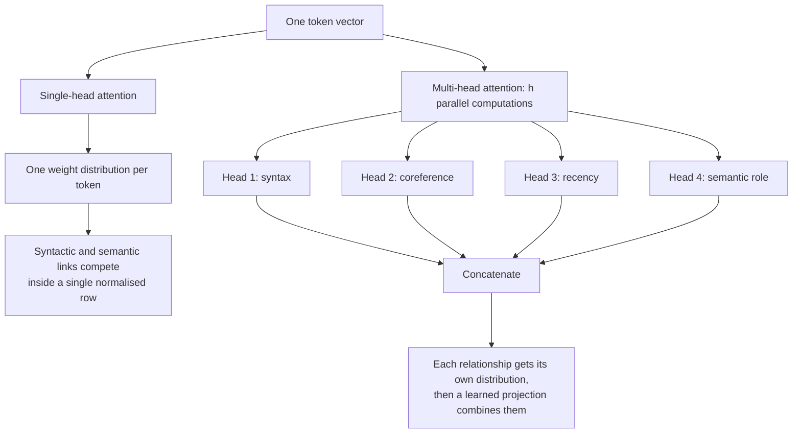
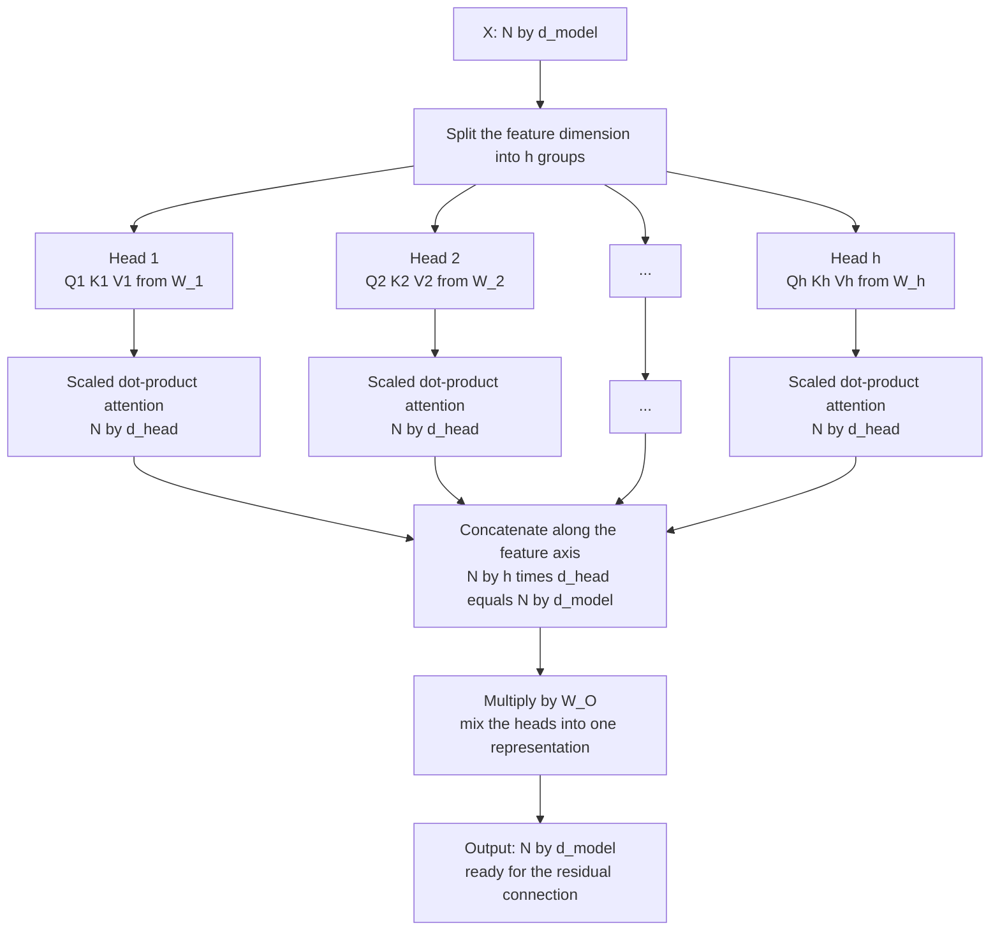
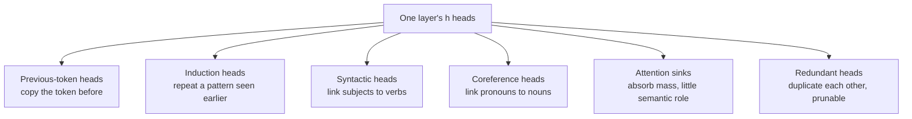
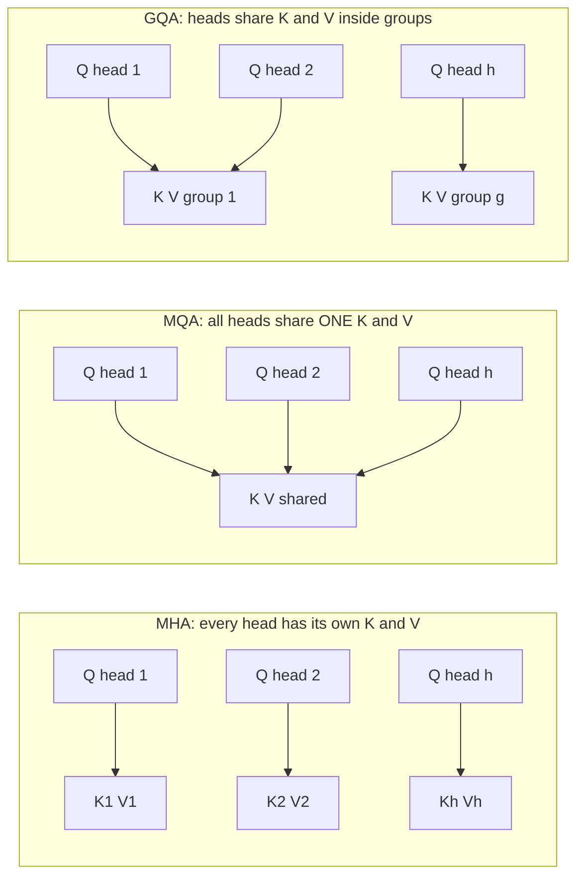

# Chapter 04 — Multi-Head Attention & Head Specialisation

> **Lecture 03 · Chapter 04 of 09** · Level: 🟢 Beginner · Phase 1 — Foundations: How LLMs Actually Work
> **Source:** `Forward-Deployed-Engineer/Lecture 02/notes/05_Transformer_Blocks_Deep_Layers_and_Logits.md`
> (§5.2 ② Multi-Head Self-Attention) ·
> `gen-ai-cohort/week01/learning/day01/notes/notes.md` (Step 4 — single-head and multi-head attention)
> **Roadmap topics:** **multi-head attention ($h$ heads)** · what each head can specialise in ·
> why multiple relationship types must be tracked simultaneously.

---

## 04.0 What this chapter is for

Chapter 03 ran **one** attention computation. Real models run **$h$ of them in parallel** and concatenate the
results. That single change is what gives a Transformer the ability to track several kinds of relationship at
the same time — syntax in one head, coreference in another, recency in a third.

By the end of this chapter you should be able to:

1. Explain why one attention pattern per layer is insufficient, and what "one type of relationship" means.
2. Write the multi-head formula and give the shape of every tensor.
3. Compute $d_{\text{head}} = d_{\text{model}} / h$ for real model sizes and explain why the total compute stays
   roughly constant.
4. Draw the split → attend → concatenate → project pipeline.
5. Name the kinds of relationships heads are observed to specialise in — and the caveats about
   interpretability.
6. Explain the modern variants **MQA** and **GQA**, and what problem they solve.
7. Reason about head count as a capacity/cost trade-off rather than a quality dial.

---

## 04.1 Why one attention pattern is not enough

A single attention computation produces **one** weight matrix per layer: one way of relating tokens. But
language encodes many relationships *simultaneously*, and they do not always agree:

| Relationship | What it needs to look at |
| :--- | :--- |
| **Syntactic** | subject–verb agreement, adjective–noun attachment |
| **Coreference** | pronouns to their antecedents |
| **Positional / recency** | the immediately preceding token |
| **Semantic role** | who did what to whom (agent / patient) |
| **Long-range topical** | a definition far earlier in the document |
| **Delimiter / structural** | matching brackets, quotes, code blocks |

If you average these into one distribution, the relationships **compete**: a strong syntactic link and a strong
topical link cannot both get weight 0.9 in the same row. Multi-head attention resolves the competition by giving
each relationship type its **own** distribution.



> [!IMPORTANT]
> **The key insight.** Heads do not add *more attention*; they add **more independent attention
> distributions**. Each head can put 90% of its weight on a different token for the same query position, and the
> output projection learns how much of each view to use.

---

## 04.2 The multi-head formula

$$\text{MultiHead}(Q, K, V) = \text{Concat}(\text{head}_1, \dots, \text{head}_h)\,W^{O}$$

$$\text{head}_i = \text{Attention}\!\left(QW_i^{Q},\; KW_i^{K},\; VW_i^{V}\right)$$

| Symbol | Shape | Meaning |
| :--- | :--- | :--- |
| $W_i^{Q}, W_i^{K}, W_i^{V}$ | $d_{\text{model}} \times d_{\text{head}}$ | per-head projections, learned separately for each head |
| $\text{head}_i$ | $N \times d_{\text{head}}$ | one head's context-aware output |
| $\text{Concat}(\cdot)$ | $N \times (h \cdot d_{\text{head}}) = N \times d_{\text{model}}$ | heads placed side by side |
| $W^{O}$ | $d_{\text{model}} \times d_{\text{model}}$ | output projection mixing the heads back together |



> [!NOTE]
> **Two ways to implement this, one result.** (1) *Split* the $d_{\text{model}}$ dimension into $h$ chunks of
> size $d_{\text{head}}$ and run each independently. (2) Keep the full width and give each head its own
> $d_{\text{model}} \times d_{\text{head}}$ projection, then concatenate. Implementations use the first form
> because it maps cleanly onto tensor reshape operations; the mathematics is the same.

---

## 04.3 The arithmetic: $d_{\text{head}} = d_{\text{model}} / h$

| Model | $d_{\text{model}}$ | heads $h$ | $d_{\text{head}}$ | Layers |
| :--- | :--- | :--- | :--- | :--- |
| GPT-2 small | 768 | 12 | 64 | 12 |
| LLaMA-3 8B | 4096 | 32 | 128 | 32 |
| LLaMA-3 70B | 8192 | 64 | 128 | 80 |
| GPT-3 | 12,288 | 96 | 128 | 96 |

Two facts to take from this table:

1. **$d_{\text{head}}$ is usually 64 or 128** across wildly different model sizes. It is one of the most stable
   hyperparameters in the field.
2. **The total width is preserved**: $h \times d_{\text{head}} = d_{\text{model}}$. Splitting into heads does
   **not** increase the size of the attention output — it redistributes it.

### Does multi-head cost more than single-head?

| Quantity | Single head at full width | $h$ heads at $d_{\text{model}}/h$ |
| :--- | :--- | :--- |
| Projection parameters | $3\,d_{\text{model}}^2$ | $3\,d_{\text{model}}^2$ — **identical** |
| Score matrix entries | $N^2$ | $h \cdot N^2$ (one per head) |
| Mixing FLOPs | $N^2 \cdot d_{\text{model}}$ | $h \cdot N^2 \cdot d_{\text{head}} = N^2 \cdot d_{\text{model}}$ — **identical** |
| Output projection | none | $+d_{\text{model}}^2$ |
| What differs | one relationship | $h$ independent relationships |

> [!TIP]
> **The elegant part.** Multi-head attention is *nearly free*: the total mixing FLOPs equal those of one
> full-width head, and the projections cost the same. The only genuinely new costs are the $h$ separate score
> matrices (memory) and the output projection $W^O$. You get $h$ different views for roughly the price of one.

---

## 04.4 What heads actually specialise in

The lecture lists the intuitive set of roles:

| Head | Observed focus |
| :--- | :--- |
| Head 1 | **syntactic relationships** — subject–verb agreement |
| Head 2 | **coreference** — pronoun resolution |
| Head 3 | **positional proximity** — the previous token, or the same token type nearby |
| Head 4 | **semantic role** — agent–patient relationships |

Real models also contain heads that are stranger than that list:

| Head type | Behaviour | Why it matters |
| :--- | :--- | :--- |
| **Previous-token head** | attends almost exclusively to position $i-1$ | cheap, extremely common; a kind of n-gram detector |
| **Induction head** | "if I saw A then B earlier, and I see A again, predict B" | the mechanism behind much in-context learning |
| **Attention sink** | a token (often the first) absorbs a large share of attention mass | a known artefact; it matters when you edit or truncate prompts |
| **Syntactic head** | tracks dependency structure | the classic interpretability result |
| **Duplicate / redundant head** | two heads computing nearly the same thing | heads are **prunable**: removing some barely changes loss |



> [!CAUTION]
> **Do not over-interpret head roles.** Head specialisation is *observed*, not *designed*. Many heads are
> polysemantic (they do several things depending on context), many are redundant, and the same role can move to
> a different head after fine-tuning. Treat "this head does coreference" as a hypothesis to test, not a fact to
> build on. This is the same warning as Chapter 01 §01.7, applied one level deeper.

---

## 04.5 Modern variants: MQA, GQA and the KV-cache problem

Chapter 02 showed that inference caches **K and V**. With $h$ heads, that cache has $h$ separate key/value
pairs — which is exactly what becomes expensive at long context and high concurrency. Three designs exist:

| Design | Queries | Keys / Values | KV cache size | Used by |
| :--- | :--- | :--- | :--- | :--- |
| **MHA** (multi-head attention) | $h$ | $h$ | $1\times$ (baseline) | GPT-2, GPT-3, LLaMA-2 |
| **MQA** (multi-query attention) | $h$ | $1$ (shared) | $1/h$ | PaLM, Falcon |
| **GQA** (grouped-query attention) | $h$ | $g$ groups, $1 < g < h$ | $g/h$ | LLaMA-3, Mistral, most current models |



> [!NOTE]
> **Why this matters to you as an application engineer.** The KV-cache size directly determines how many
> concurrent requests a provider can serve, and therefore the price and throughput of the API you call. GQA is
> the reason a modern 8B model can hold far more simultaneous conversations than an older 8B model of the same
> quality. The full treatment is in **Lecture 25 — vLLM and PagedAttention**.

---

## 04.6 Head count as a hyperparameter

Given $h \times d_{\text{head}} = d_{\text{model}}$, choosing $h$ is choosing how finely to slice the feature
space:

| Smaller $d_{\text{head}}$ (more heads) | Larger $d_{\text{head}}$ (fewer heads) |
| :--- | :--- |
| more independent relationship types | fewer, but each is richer |
| each head has a lower-dimensional view | each head can represent more complex relations |
| more score matrices → more memory | less memory for scores |
| higher KV-cache cost with plain MHA | cheaper cache |
| risk of many redundant heads | risk of under-parallelising |

The observed empirical pattern is that **$d_{\text{head}} \approx 64$–$128$ is the sweet spot**, and it has
survived a decade of scaling. Practical notes:

- **Head count is usually tied to $d_{\text{model}}$**, not tuned freely.
- **Many heads are prunable** after training; if you are optimising a self-hosted model, head pruning is a real
  lever.
- **Head count barely changes the parameter count** — the difference is *how* the width is used, not how much
  of it exists.
- **Do not compare two models by head count.** A 32-head model is not "better" than a 12-head model; they differ
  in $d_{\text{model}}$ and training data too.

---

## 04.7 Pseudo-code: multi-head attention

```ts
// PSEUDO-CODE — the head loop, written for clarity rather than speed.
type Matrix = number[][];                     // rows = positions, cols = features

interface MultiHeadWeights {
  heads: { wq: Matrix; wk: Matrix; wv: Matrix }[];   // h sets of per-head projections
  wo: Matrix;                                         // output projection, d_model x d_model
}

function multiHeadAttention(
  X: Matrix,
  w: MultiHeadWeights,
  opts: { causal: boolean },
): Matrix {
  const headOutputs: Matrix[] = [];

  // Each head runs the FULL attention computation of Chapter 03, in its own subspace.
  for (const h of w.heads) {
    headOutputs.push(scaledDotProductAttention(X, h, opts));   // N x d_head
  }

  // Concatenate along the FEATURE axis: h pieces of d_head become one d_model vector.
  const concatenated = concatAlongFeatures(headOutputs);       // N x d_model

  // Mix the heads. Without this step the heads would be independent channels that
  // nothing could recombine — the model could never use "syntax AND coreference together".
  return matmul(concatenated, w.wo);                           // N x d_model
}

// Two design questions this pseudo-code makes explicit:
//   1. Where do the h subspaces come from?  (slice d_model, or h separate projections)
//   2. Are K and V shared across heads?     (MHA: no, MQA: all share, GQA: share per group)
```

> [!TIP]
> **The most underrated detail: $W^O$.** Beginners remember the concatenation and forget the output
> projection. $W^O$ is what lets the model *combine* what the heads found — for example, "a coreference head
> says this pronoun points at the subject, and a semantic head says the subject is the agent, so the answer is
> the agent". Remove $W^O$ and the heads become a bag of unrelated features.

---

## Common mistakes

- **Thinking each head sees a different *token*.** Every head sees **all** tokens; it sees them through a
  different **projection** (a different subspace of features).
- **Believing multi-head multiplies the cost by $h$.** The mixing FLOPs equal one full-width head; only the
  score-matrix memory grows.
- **Forgetting the output projection $W^O$.** Heads cannot be recombined without it.
- **Assuming head count must equal $d_{\text{model}} / 64$.** That is the common choice, not a law; several
  models deviate deliberately.
- **Treating "head 3 does coreference" as architecture.** It is an observation about one checkpoint on one task.
- **Ignoring MQA/GQA when reasoning about serving cost.** The KV cache, not the parameter count, is usually the
  limiting factor for concurrent requests.
- **Assuming concatenation happens along the sequence axis.** It happens along the **feature** axis;
  concatenating positions would create a sequence of length $hN$ and destroy the correspondence with the input.
- **Forgetting that all heads share the same causal mask and the same $\sqrt{d_k}$.** Heads differ in
  projections, not in masking rules.
- **Using head-level attention maps as a product feature.** They are a debugging aid (Chapter 01 §01.7).

## Key takeaways

1. **Multi-head attention runs $h$ independent attention computations in parallel** and combines them.
2. The formula is
   $\text{MultiHead}(Q,K,V) = \text{Concat}(\text{head}_1,\dots,\text{head}_h)W^{O}$ with
   $\text{head}_i = \text{Attention}(QW_i^Q, KW_i^K, VW_i^V)$.
3. **$d_{\text{head}} = d_{\text{model}}/h$**, and the concatenation restores the width $d_{\text{model}}$.
4. Multi-head attention is **nearly free** in FLOPs compared with a single full-width head — the gain is $h$
   independent relationship distributions instead of one.
5. Heads are observed to specialise (syntax, coreference, previous-token, induction, sinks), but specialisation
   is **observed, not designed**, and many heads are redundant or polysemantic.
6. **$W^O$ is essential**: it recombines the heads into a single usable representation.
7. **MQA** and **GQA** shrink the KV cache by sharing keys and values across heads; GQA is the modern default
   because it keeps most of the quality at a fraction of the cache.
8. Head count is a **capacity/cost trade-off**, not a quality dial, and $d_{\text{head}} \approx 64$–$128$ has
   been stable across model generations.
9. Every head uses the same **causal mask** and the same scaling; only the projections differ.
10. Head-level analysis is a **debugging tool** — never a guaranteed explanation of model behaviour.

## Self-check questions

1. Why does a single attention distribution force different linguistic relationships to compete?
2. Write the multi-head attention formula and give the shape of $\text{head}_i$, the concatenation and $W^O$.
3. For $d_{\text{model}} = 4096$ and $h = 32$, what is $d_{\text{head}}$? What is the concatenated width?
4. Show that multi-head attention has the same mixing FLOPs as a single head of full width.
5. Name four relationship types heads are observed to specialise in, plus two "strange" head types from
   interpretability research.
6. What does the output projection $W^O$ do, and what breaks if you remove it?
7. Explain how MQA and GQA reduce KV-cache size, and which of them a current open-weights model is likely to
   use.
8. Why is head count a poor way to compare two models?
9. Explain why concatenation must happen along the feature axis and not the sequence axis.
10. Give one reason attention maps are unreliable as explanations, using an attention sink as your example.

---

### Navigation

- **Previous:** [Chapter 03 — Scaled Dot-Product Attention, By Hand](./03_Scaled_Dot_Product_Attention_by_Hand.md)
- **Next:** [Chapter 05 — The Transformer Block & the Residual Stream](./05_The_Transformer_Block_and_the_Residual_Stream.md)
- **Source:** `Forward-Deployed-Engineer/Lecture 02/notes/05_Transformer_Blocks_Deep_Layers_and_Logits.md`
  (§5.2 ②) · `gen-ai-cohort/week01/learning/day01/notes/notes.md` (Step 4 — Self-Attention)
- **Back to index:** [../index.md](../index.md)

