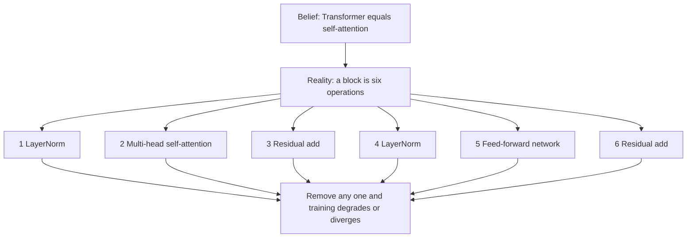
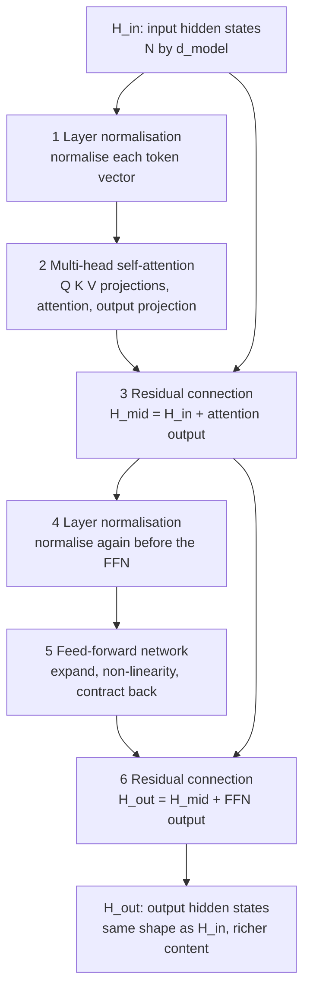
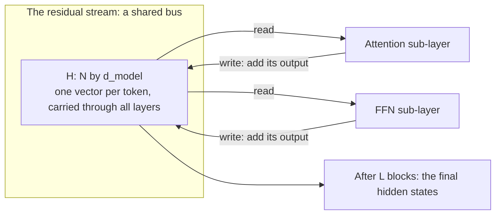
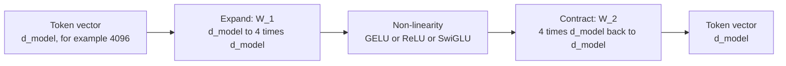
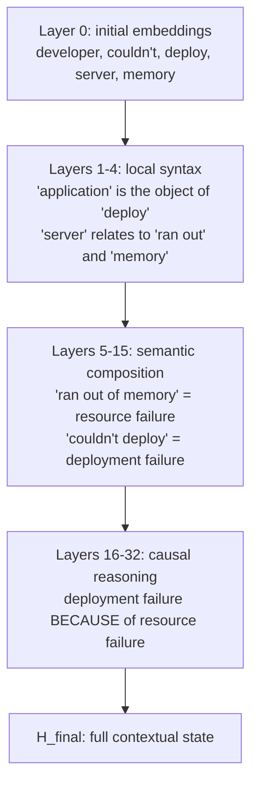
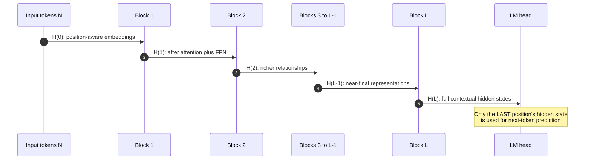
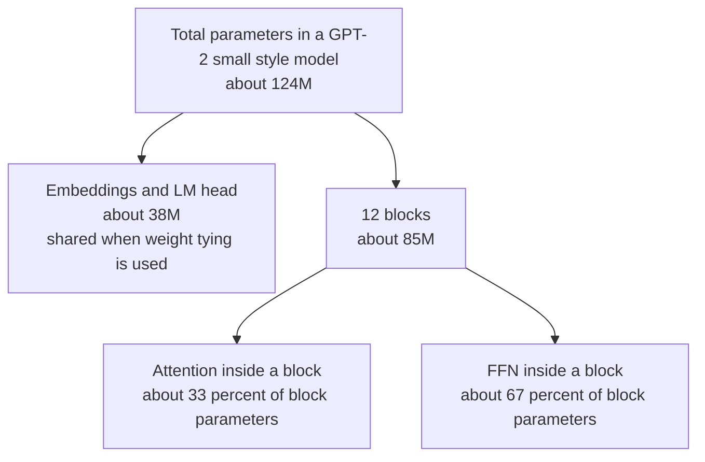
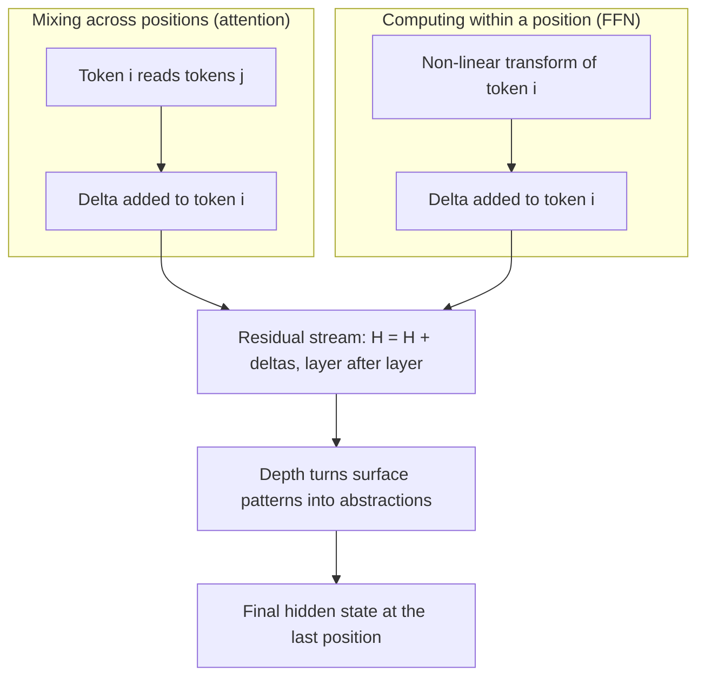

# Chapter 05 — The Transformer Block & the Residual Stream

> **Lecture 03 · Chapter 05 of 09** · Level: 🟢 Beginner · Phase 1 — Foundations: How LLMs Actually Work
> **Source:** `Forward-Deployed-Engineer/Lecture 02/notes/05_Transformer_Blocks_Deep_Layers_and_Logits.md`
> (§5.1–5.4) · `Lecture_02_Complete_Notes.md` (takeaways 16–17) ·
> `gen-ai-cohort/week01/learning/day01/notes/notes.md` (Step 5 — Feed Forward Network)
> **Roadmap topics:** **transformer blocks** — residual streams, layer norm, MLP, deep-layer behaviour ·
> correcting the common misconception about what a transformer block actually does ·
> depth as an abstraction hierarchy.

---

## 05.0 What this chapter is for

Chapters 02–04 built attention. This chapter puts it in its place — literally: attention is **one sub-layer of
one block**, and a block is much more than attention. Then it explains the component that makes 100-layer
networks trainable at all: the **residual stream**.

By the end of this chapter you should be able to:

1. Correct the claim "Transformer = self-attention" with a component-by-component counter-argument.
2. Draw the six operations of a transformer block from memory, in order.
3. Explain what LayerNorm does and why **pre-LN** replaced **post-LN** in modern models.
4. Explain the **residual stream** as a shared bus that every sub-layer reads from and writes to.
5. Write the FFN formula, explain the 4× expansion, and say why it holds about **two-thirds of the parameters**.
6. Explain why attention alone cannot do what the FFN does, and vice versa.
7. Describe how representations become more abstract with depth, using the deployment-failure example.
8. Estimate a real model's parameter budget across embeddings, attention and FFN.

---

## 05.1 Correcting the misconception: Transformer ≠ attention

The source calls this "one of the most persistent mistakes in AI discourse":

$$\text{Transformer} \equiv \text{Self-Attention} \qquad \text{— wrong}$$

Self-attention is one component **inside** a block. A block contains several more operations that are equally
essential, and leaving any of them out breaks training.

| Component | Common misconception | Reality |
| :--- | :--- | :--- |
| **Self-attention** | "this *is* the Transformer" | one sub-layer of one block |
| **FFN / MLP** | often completely forgotten | applies a non-linear transformation to each token independently; ~2/3 of parameters |
| **LayerNorm** | usually ignored | critical for training stability |
| **Residual connection** | rarely mentioned | essential for gradient flow in deep networks |



> [!IMPORTANT]
> **The clean division of labour inside a block.**
> *Attention* **moves** information **between positions** — it is a mixing operation.
> *The FFN* **transforms** information **within each position** — it is a per-token computation.
> *Residual connections* **carry** information **past** both.
> *LayerNorm* keeps the whole thing **numerically sane**.
> If you remember only this paragraph, you understand the block.

---

## 05.2 Anatomy of a single transformer block

Each block (also called a layer, or a "decoder block" in GPT-style models) applies six operations in sequence:



The lecture's own ordering (LayerNorm → MHA → residual → LayerNorm → FFN → residual) is what is now called
**pre-LN**, and it is what essentially every modern decoder uses.

### ① Layer normalisation

Normalises the values **within each token's vector** to zero mean and unit variance, then applies a learned
scale and shift:

$$\text{LayerNorm}(\mathbf{x}) = \gamma \cdot \frac{\mathbf{x} - \mu}{\sigma + \epsilon} + \beta$$

| Property | Meaning |
| :--- | :--- |
| Normalises **per token**, across features | it does *not* mix information between positions |
| $\gamma, \beta$ are learned | the network can undo the normalisation if it wants to |
| $\epsilon$ is a small constant | prevents division by zero |
| Purpose | keep activations in a sane range so gradients do not explode or vanish |

> [!NOTE]
> **Pre-LN vs post-LN, and RMSNorm.** The original 2017 Transformer applied LayerNorm *after* the sub-layer
> (post-LN). Modern models apply it *before* (pre-LN) because pre-LN trains far more stably at depth and does not
> need a learning-rate warm-up as long. Many current models replace LayerNorm with **RMSNorm**, which skips the
> mean subtraction and the bias — cheaper, and empirically just as good.

### ② Multi-head self-attention

The Chapter 03–04 machinery: $h$ heads, each with its own Q/K/V projections, concatenated and mixed by $W^O$.
In a decoder block this is **causal** (Chapter 03 §03.5).

### ③ The residual connection — and the "residual stream"

The input to a sub-layer is **added** to that sub-layer's output:

$$H_{\text{mid}} = H_{\text{in}} + Z_{\text{attention}}, \qquad H_{\text{out}} = H_{\text{mid}} + \text{FFN}(H_{\text{mid}})$$

This looks like a small implementation detail. It is the single most important design decision in deep networks.



| Benefit | Why it matters |
| :--- | :--- |
| **Gradient highway** | gradients flow through the addition operation straight to earlier layers; no repeated multiplication to attenuate them |
| **Information bypass** | a sub-layer can output *nothing* useful and the token still keeps its representation — so bad sub-layers cannot destroy good information |
| **Additive accumulation** | each sub-layer *adds* a correction; the stream is refined rather than overwritten |
| **Enables depth** | residual connections are why 96-layer (GPT-3) and 200+ layer networks train at all |

> [!TIP]
> **The mental model that pays off later.** Think of the residual stream as a **shared memory bus** running
> through the model. Attention and the FFN are *readers and writers*: each reads the current state, computes a
> delta, and adds the delta back. Nothing ever overwrites. This is why you can:
> * **edit a prompt's representation** in the middle of the stack (activation steering),
> * **delete or prune** a whole sub-layer with graceful degradation,
> * **read out intermediate states** at any layer (probing), and
> * understand that *attention outputs are deltas*, not replacements.

### ④–⑤ The feed-forward network (FFN / MLP)

After attention has let tokens exchange information, the FFN applies a **non-linear transformation to each token
independently**. It expands to a higher dimension and contracts back:

$$\text{FFN}(\mathbf{x}) = \text{GELU}(\mathbf{x}W_1 + b_1)W_2 + b_2$$



| Property | Value / meaning |
| :--- | :--- |
| Expansion ratio | typically **4×** ($d_{\text{ff}} = 4\,d_{\text{model}}$); LLaMA-family models use ~3.5× with gated variants |
| Mixes tokens? | **No.** Attention already did that; the FFN is strictly per-token |
| Parameter share | about **two-thirds** of a model's total parameters |
| Non-linearity | GELU (GPT-2/3), SwiGLU (LLaMA, Mistral), ReLU in older models |
| Interpretation | often described as a **key–value memory**: the first matrix detects patterns, the second writes back associated content |

> [!IMPORTANT]
> **Why attention alone is not enough — the mathematical reason.** Attention's output is a *convex combination*
> of value vectors (Chapter 01 §01.3): it can only move existing information around. The FFN is what can compute
> **new features** — a non-linear function of the token's current state. Remove the FFN and the model loses the
> ability to compute anything beyond weighted averaging.

---

## 05.3 Why many layers? The abstraction hierarchy

One block applies one round of attention and one FFN pass. Complex language understanding needs **hierarchical
abstraction**, built up over many steps.

### The lecture's example

`"The developer couldn't deploy the application because the server ran out of memory."`

| Processing stage | What the model understands |
| :--- | :--- |
| Early layers (1–4) | `"server"` and `"memory"` are co-occurring technical terms |
| Middle layers (5–15) | `"server ran out of memory"` is a resource-failure event |
| Deep layers (16–32) | the sentence describes a deployment failure **caused by** resource exhaustion |



### The photo-editing analogy (from the lecture)

Think of processing a photo in an editor — not one big operation, but a pipeline of refinements:

```text
Raw camera sensor data
    -> exposure correction
    -> shadow / highlight recovery
    -> contrast adjustment
    -> colour calibration
    -> noise reduction
    -> sharpening and detail
Final polished image
```

Each block in a Transformer is one refinement step:

```text
Raw token embeddings
    -> Block 1:   adjacent word relationships
    -> Block 2:   phrase-level structure
    -> Block 3:   clause boundaries
    -> Block N-1: semantic roles
    -> Block N:   full contextual meaning
Final hidden state H_final
```

### Tracking token states through the stack

At every layer $l$, every token $i$ has its own hidden state
$\mathbf{h}_i^{(l)} \in \mathbb{R}^{d_{\text{model}}}$.



| Layer band | Typical role | Failure if missing |
| :--- | :--- | :--- |
| 1–4 | local syntax, token identity, simple n-grams | the model cannot parse basic structure |
| middle | semantic composition, coreference, entity linking | the model loses *what the sentence is about* |
| deep | causal and relational reasoning, task-level abstraction | the model cannot answer multi-step questions |

> [!NOTE]
> **Depth is not just "more of the same".** Interpretability work consistently finds that different layer bands
> compute qualitatively different things, and that **middle layers are often the most transferable** (which is
> why LoRA adapters, probing classifiers and steering vectors are usually attached in the middle). The topmost
> layers also become highly specific to the output format — which is why pruning from the top hurts more than
> pruning from the middle.

---

## 05.4 Where the parameters actually live

This is the calculation that makes the block structure concrete. Take a GPT-2-small-shaped model:
$d_{\text{model}} = 768$, $L = 12$, $d_{\text{ff}} = 4 \cdot 768 = 3072$, $|V| \approx 50{,}257$,
and ignore biases and LayerNorm parameters.

| Component | Formula | Parameters |
| :--- | :--- | ---: |
| Attention projections (per layer) | $3 \cdot d_{\text{model}}^2$ | 1,769,472 |
| Attention output projection (per layer) | $d_{\text{model}}^2$ | 589,824 |
| FFN (per layer) | $2 \cdot d_{\text{model}} \cdot d_{\text{ff}} = 8\,d_{\text{model}}^2$ | 4,718,592 |
| **One block total** | | **≈ 7.08M** |
| All 12 blocks | | **≈ 85M** |
| Token embeddings | $|V| \cdot d_{\text{model}}$ | ≈ 38.6M (tied with the LM head) |



| Takeaway | Number |
| :--- | :--- |
| FFN share of a block | ~2/3 |
| Attention share of a block | ~1/3 |
| Embedding share of the whole model (small models) | ~30%, and it **shrinks** as depth grows |
| Effect of doubling depth | roughly doubles the block parameters and halves the relative embedding cost |

> [!IMPORTANT]
> **The practical implication.** When people talk about "a model's knowledge", most of it lives in the **FFN
> weights**, while "how it routes information between tokens" lives in **attention**. That is why
> knowledge-editing techniques (ROME-style), LoRA adapters on FFN layers, and quantisation trade-offs all tend
> to focus on the MLP — and why attention heads are more prunable than MLP neurons.

---

## 05.5 Pseudo-code: one transformer block

```ts
// PSEUDO-CODE — one decoder block, in the order the operations actually run.
type Matrix = number[][];

function transformerBlock(
  H: Matrix,                                   // N x d_model, from the residual stream
  w: BlockWeights,                             // attention + FFN + norm parameters
  opts: { causal: boolean },
): Matrix {
  // --- Sub-layer 1: attention (mixes information BETWEEN positions) ---
  const normed1 = layerNorm(H, w.norm1);        // pre-LN: normalise before the sub-layer
  const attended = multiHeadAttention(normed1, w.attention, opts);
  const Hmid = add(H, attended);                // residual: write the DELTA back to the stream

  // --- Sub-layer 2: FFN (transforms information WITHIN each position) ---
  const normed2 = layerNorm(Hmid, w.norm2);
  const expanded = gelu(matmul(normed2, w.ffn.w1));   // d_model -> d_ff (about 4x)
  const contracted = matmul(expanded, w.ffn.w2);      // d_ff -> d_model
  const Hout = add(Hmid, contracted);                 // residual again

  return Hout;                                  // same shape as the input: stackable L times
}

// Three invariants to check when reading any real implementation:
//   1. shape in == shape out (d_model preserved) so blocks can be stacked;
//   2. every sub-layer is wrapped in a residual add;
//   3. normalisation happens before each sub-layer, not after (pre-LN).
```

> [!TIP]
> **Why the block returns the same shape it receives.** Because the whole stack is a chain of these blocks, and
> the residual stream must keep one consistent width from the embedding table all the way to the LM head. Any
> block that changed the width would break every subsequent residual add.

---

## 05.6 What the block does — a one-screen summary

| Operation | Direction of information flow | Purpose | If removed |
| :--- | :--- | :--- | :--- |
| **LayerNorm** | within a token | keep activations in range | training instability at depth |
| **Multi-head attention** | **between** positions | gather context | the model can only see isolated tokens |
| **Residual add** | past the sub-layer | preserve and accumulate | deep networks stop training |
| **FFN / MLP** | within a token | compute new non-linear features | the model is limited to weighted averages |
| **Stack of $L$ blocks** | across depth | build an abstraction hierarchy | only surface patterns are captured |



---

## Common mistakes

- **Saying "the Transformer is attention".** A block has LayerNorm, attention, residuals and an FFN; depth stacks
  them. Attention is roughly one-third of a block's parameters.
- **Thinking LayerNorm mixes tokens.** It normalises **within** each token vector, across features. Mixing
  positions is attention's job.
- **Believing the residual connection is optional.** It is the reason depth works at all, and it is the reason
  sub-layer outputs behave like *deltas*.
- **Assuming the FFN is a minor add-on.** It is the majority of the parameters and the only place new non-linear
  features are computed.
- **Thinking the FFN mixes information across tokens.** It is strictly per-token; there is no cross-position
  interaction inside it.
- **Assuming post-LN is still standard.** Modern models are pre-LN (often RMSNorm) for stability.
- **Expecting layer $k$ to be "the layer that knows X".** Layer bands have tendencies, not discrete
  responsibilities, and they overlap.
- **Thinking all layers are needed for every task.** Many tasks survive layer pruning; many do not. Measure, do
  not assume.
- **Forgetting that only the last position's hidden state is used for the next token.** Earlier positions are
  needed to *build* that state, not to produce logits directly.
- **Assuming the block changes the representation's shape.** Width is preserved precisely so blocks can stack.

## Key takeaways

1. **Transformer ≠ attention.** A block is LayerNorm → multi-head attention → residual → LayerNorm → FFN →
   residual.
2. **Attention mixes across positions; the FFN computes within a position; residuals carry information past
   both; LayerNorm keeps it numerically stable.**
3. **LayerNorm** normalises each token vector to zero mean and unit variance with a learned scale and shift.
   Modern models use **pre-LN** (and often **RMSNorm**).
4. The **residual stream** is a shared bus: every sub-layer reads the current state and adds a delta. Nothing is
   overwritten.
5. Residual connections are the **gradient highway** that makes 100+ layer models trainable, and they are why
   sub-layer outputs behave like corrections rather than replacements.
6. The **FFN** expands (~4×), applies a non-linearity (GELU/SwiGLU) and contracts — and holds about **2/3 of the
   parameters**.
7. Attention can only produce **convex combinations**; the FFN is what creates **new features**. Both are
   necessary.
8. **Depth builds abstraction**: early layers do local syntax, middle layers do semantic composition, deep
   layers do causal and task-level reasoning.
9. Parameter budget: attention ≈ 1/3, FFN ≈ 2/3 of a block; the embedding table dominates only in small models.
10. The block preserves shape ($N \times d_{\text{model}}$ in, same out) so it can be stacked $L$ times — and
    only the last position's final state is projected to vocabulary logits (Chapter 07).

## Self-check questions

1. List the six operations of a transformer block in order.
2. Give two reasons why "Transformer = attention" is wrong, using parameter counts.
3. Write the LayerNorm formula and say what is normalised: across tokens, or across features?
4. Why did pre-LN replace post-LN, and what is RMSNorm?
5. Explain the residual stream as a bus, using the words *read*, *delta* and *write*.
6. Write the FFN formula and state its expansion ratio for a $d_{\text{model}} = 4096$ model.
7. Why can attention not replace the FFN? Use the convex-combination argument.
8. For $d_{\text{model}} = 768$ and $d_{\text{ff}} = 3072$, compute the FFN parameter count per layer and compare
   it with the attention projections.
9. Using the deployment-failure sentence, describe what layers 1–4, 5–15 and 16–32 each contribute.
10. Which hidden-state position is used for next-token prediction, and what happens to the others?

---

### Navigation

- **Previous:** [Chapter 04 — Multi-Head Attention & Head Specialisation](./04_Multi_Head_Attention_and_Head_Specialisation.md)
- **Next:** [Chapter 06 — Encoder-Decoder vs Decoder-Only & Why GPT Is Decoder-Only](./06_Encoder_Decoder_vs_Decoder_Only_and_Why_GPT.md)
- **Source:** `Forward-Deployed-Engineer/Lecture 02/notes/05_Transformer_Blocks_Deep_Layers_and_Logits.md`
  (§5.1–5.4) · `gen-ai-cohort/week01/learning/day01/notes/notes.md` (Step 5 — Feed Forward Network)
- **Back to index:** [../index.md](../index.md)

